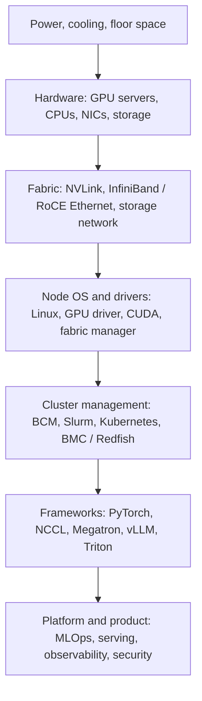

# 0.1 The AI factory landscape and the roles in it

An **AI factory** is a data center built to turn electricity and data into tokens: trained models and answered requests. Everything in this book hangs off that one idea. The unit of output is a token, the unit of cost is GPU-hours, and your job as an infrastructure engineer is to keep the expensive part (the GPUs) busy and healthy.

## Where the AI factory idea comes from

Most businesses today use machine learning (ML) as their key AI technology. An ML algorithm is a statistical engine. It finds patterns in past observations and uses them to predict new outcomes. When you combine ML with data sources, experiments and software, you get what the book calls an AI factory.

The factory runs as a loop. Good data, from inside or outside the organisation, trains ML algorithms to predict a specific task. In healthcare, those predictions can help an expert make a decision. In other fields, an algorithm can automate a task with little or no human involvement. Each change creates new data, and that data helps the algorithm improve again.

Iansiti and Lakhani describe this as a virtuous cycle between user engagement, data collection, algorithm design, prediction and improvement. The cycle itself is not new. The AI factory takes it further by adding technologies such as natural language processing and computer vision. Dickson argues that the result is more services for more people at less cost.

### Becoming an AI company

Building a successful AI company is as much a product management job as an engineering job. Many successful organisations built the right culture and processes on AI technology that had existed for a long time. They did not try to force the newest deep learning (DL) methods into an infrastructure that could not support them. This holds for startups and long-standing firms alike. To survive and thrive, an organisation has to keep changing its operating and business models.

Peloton is the book's example of a startup that built an AI factory from the ground up and disrupted its market. Walmart is the example of an established company. It used digitisation and AI to avoid the fate of Sears, which filed for bankruptcy in 2018.

AI also gives new meaning to network effects. When AI algorithms are built into a network, they can boost growth, learning and product improvement.

Managers do not need to become data scientists, statisticians, programmers or AI engineers. They do need to understand why to use AI, along with its challenges and its advantages. A manager who knows this can ask better questions of the engineers who build the factory.

## Data comes first

Many organisations have vast amounts of data. The problem is where that data lives. Maintenance and operations often keep their records in separate parts of the company, in incompatible formats and frameworks. If internal systems stay fragmented across units and functions, the data cannot be aggregated. Without aggregation, analytics and AI cannot deliver their power.

Raw data also needs work before an algorithm can learn from it. Suppose you want an AI chatbot that handles part of customer support. You would first gather the history of past customer messages. Then you would consolidate the text, split it into tokens, and strip out excess words and punctuation. Only after these transformations can the ML model train on it.

Structured data is not automatically ready either. Sales records can contain gaps, missing information and inaccuracies. When data comes from several sources, merging it carelessly can add new errors. If you train on low-quality data, the AI system will perform poorly.

Internal data is sometimes not enough. The book calls the full chain an AI pipeline. It is a set of components and processes that consolidate data from internal and external sources, clean it, integrate it, process it and store it for different AI systems. BlueDot is the book's example. It uses ML to predict the spread of infectious diseases, and it gathers information from hundreds of sources. These include health organisation statements, commercial flights, livestock health reports, satellite climate data and news reports. Much of the company's effort goes into gathering and unifying that data.

The pipeline should run in a systematic, sustainable and scalable way. It should need little manual effort, or it becomes the bottleneck for the whole AI system. Other challenges include choosing the right metrics and features for supervised ML, finding the right split between expert insight and AI predictions, and running and validating experiments.

Before you tune a model, check the pipeline that feeds it.

## The layers

A fault at any layer shows up at the top as "the job is slow" or "the job died". The book is ordered bottom-up so you can localise such faults.

| Layer | Where in this book |
|---|---|
| Linux, networking, Python, automation | Parts 1-4 |
| Kubernetes and containers | Part 5 |
| HPC and Slurm | Part 6 |
| BMC, Redfish, Base Command Manager | Parts 7-8 |
| NVIDIA systems (DGX, HGX, SuperPOD) | Part 9 |
| GPU and CUDA, GPUs on Kubernetes | Parts 10-11 |
| AI networking and storage | Parts 12-13 |
| Training, fine-tuning, inference | Parts 14-15 |

## Training versus inference

- **Training** runs for days or weeks across many nodes. It is bound by collective communication (all-reduce), checkpoint I/O and fault tolerance. One slow or failing GPU stalls everyone.
- **Inference** is latency-sensitive and bursty. It is bound by memory bandwidth (decode) and KV-cache capacity, and by routing and autoscaling.
- **HPC** (Slurm, MPI) predates both and still supplies the scheduling and cluster-management habits used in AI factories.

## Learning at the speed of the factory

A factory produces data every second, but a model trained on yesterday's data is late. The problem is latency. The book's answer for near real-time ML is a design called the lambda (λ) architecture. It gives quick answers from some of the data and accurate answers from all of the data.

### Why the lambda architecture exists

Moving data into a warehouse takes time. Extracting, transforming and loading data is slow, and the delay is called ETL lag. Even with clustered processors, it can take hours to pull structured and unstructured data from many formats and load it. A single IoT-enabled device can produce 5 GB of data per week. SAP, the ERP provider, requires a minimum of 60 GB of storage.

The batch layer holds an immutable, constantly growing master dataset. It computes functions over the full dataset, so its answers are the most accurate. The price is time. Even on Hadoop batch clusters, pushing new data through the batch layer can take hours. Near real-time control of a factory therefore needs a second path.

### The speed layer and the serving layer

The speed layer runs ML on the most recent data before that data reaches the batch layer. It does not recompute batch views from scratch. It updates them incrementally, which is why it is fast. Databases such as Cassandra or HBase support this. Training that once took weeks can drop to minutes when parallel processor clusters do the work.

Speed is paid for with complexity. Transfer learning and random database reads and writes make the speed layer the hardest part to build. The lambda design keeps that complexity in a layer where data exists only briefly. Once data moves to the batch layer, it is purged from the speed layer to make room for new data.

Streams flow in through a queuing system such as Kafka and a streaming system such as Storm, Spark or Flink. Batches move between layers once an hour or once a day. Model-predicted data goes up to a serving layer, where factory managers read it with NoSQL key-value queries.

### Cloud and edge

Smart manufacturing runs mostly on pay-for-use network clusters called clouds, because the storage and computing that ML needs are large. In 2019, cloud spending on IaaS and SaaS hit $20 billion. The book estimates that almost half of the world's data will be stored in clouds by 2025. Five companies account for nearly 80% of the public cloud.

The leading cloud providers offer their own automated ML packages. Microsoft offers Machine Learning Studio, Google offers Cloud AutoML, and AWS uses SageMaker. Cloud and coding tools mean more organisations can start AI work.

Cloud is still too far away for some jobs. 5G can offer 20× faster downlink speeds and support 10× more connected devices per unit of floor space. Even so, latency across networks is a concern. Near real-time ML on a speed layer needs storage and processing closer to where the output is used, which is the edge. Factory data is often useful only to the applications that generate it. Edge computing, using local devices and nearby data centres, is what makes near real-time cyber-physical systems practical.

## Cyber-physical systems and virtual factories

### Machines and data at scale

Machines have been talking to each other for decades. The book traces machine-to-machine (M2M) communication from a patent for sending information from one telephone to another in the early 1970s. By the late 1990s, M2M meant devices sharing data over networks. Today the Internet of Things (IoT) includes some 50 billion data-sharing devices. The book estimates 75 billion by 2025.

The volume of data is the bigger shock. Back in 2016, the planet produced 2,500,000,000 GB of data a day. Nearly 90% of all data that had ever existed before 2016 was created during 2016. Global storage capacity doubles every four years. It now stands at 6,200,000,000,000 GB, and roughly 60% of that space is in use.

Generating and storing data is not enough, though. Machines must collect, share, analyse and act on it. That needs fast, flexible processors. Multicore CPUs execute billions of calculations per second. Cyber-physical systems need clusters of multicore processors working in parallel. The IBM AC922 cluster has 4,608 servers, and it can perform 200 quadrillion calculations in one second. Fast processors and fast memory transfers sit at the heart of smart manufacturing.

### Virtual factories

Engineers can now build virtual factories. Discrete event modelling describes how products flow through production steps. Agent-based modelling places people, facilities, products and orders inside a simulation and watches how the system behaves. Volvo Group Global uses virtual factories to check proposed production changes before it makes them in real plants.

Simulation has limits. A factory is an open system. Absenteeism, training, product mix, on-time delivery, inventory levels, machine breakdowns and scrap all change what happens inside it. A factory never settles into a steady state, and that makes modelling hard. A cyber-physical system (CPS) fixes this by feeding real information back into the model all the time. Computations then monitor and control physical processes, and the feedback loops let the physical processes update the computations.

### Cyber-physical systems in manufacturing

For a manufacturer, a CPS is an Internet-connected physical item, such as a pump or a compressor. It has embedded computers and control parts, including sensors and actuators. It has its own IP address, and it can monitor itself, report on its own functioning and talk to other entities. It is self-regulating and works with a degree of autonomy.

The Fourth Industrial Revolution, called Industry 4.0, is the trend toward this kind of factory. The foundation was laid in the Third Industrial Revolution, when electronics and computers were used to automate production. Digital and communication technologies then began to converge. Industry 4.0 aims for higher efficiency and productivity, with machines, logistics systems, work-in-progress parts and people communicating directly.

A company that wants this must convert its physical assets into CPS. It should first decide which machines or systems can deliver the most value. Then it connects them to cyber systems and builds a network of CPS. Take a refinery with tank farms, pipelines, control valves and pumping stations. Its tank farm upkeep is manual inspection and periodic maintenance, which is expensive and inefficient. Turning those assets into CPS, with suitable analytics, allows remote monitoring and predictive maintenance.

## AI in manufacturing

### Robotics and processes

AI in manufacturing has two core areas: robotics and processes. Robotics makes machines better at tasks people do with ease, such as picking up objects of different strengths. For all but the biggest manufacturers, building bespoke robots may not be feasible. Buying new machinery is a big investment and cannot happen often.

Processes are the easier place to start. They can often use data already on the shop floor, or sensors added at a modest cost. Process work covers optimising the flow through production, finding quality issues and cutting machine downtime. Historians can consolidate sensor data so that a manufacturer can start building AI skills. A single data scientist or AI engineer costs less than most investments a manufacturer makes.

### The three levels of AI competency

AI competency has three levels: apprentice, journeyman and master. Each level brings more responsibility, trust and scope as time goes on.

**Apprentice.** This level is where the basics are learned and people find out how much they do not yet know. It is a formative stage where trust is built. Apprentices get simpler tasks, are closely monitored and are not expected to be proactive. A good first job is watching a few critical systems and flagging unusual changes to a supervisor. Anomaly detection fits this role. At its simplest, it raises an alert when a value exceeds a threshold. Later it can learn the patterns of work over recent weeks, so an issue is judged against what is expected at that time. Like human apprentices, these systems can be too nervous or too relaxed. The goal is the right level of attention. Many anomaly routines on the shop floor can each generate many alerts, so it is often better to keep a few and improve each one. This stage also builds comfort with computers prompting action.

**Journeyman.** A journeyman has earned some trust and takes on harder work. Workers at this level should understand, at a high level, which factors drive problems, so they can see when things might go wrong. The work moves from reactive to proactive, but a journeyman still lacks the authority for big decisions. In AI terms, this means ML methods with known variables that explain the drivers of an outcome. Regression and decision trees are common. Experts pick the machines and sensors that matter most for breakdowns, quality drops or processing speed, and match those sensor values to the outcome. The resulting model can drive manual controls or rules, or raise an alert when a breakdown becomes likely. These models need historic data from several sensors, so they are harder to build than anomaly detection. Building them shows the organisation can use historic data to find insights. Preventing issues can also bring a significant return on investment (ROI).

**Master.** A master understands the breadth of the field and has deep knowledge. Masters often sense a problem before it appears, and they make most decisions with little oversight. They keep learning, but they refine what they know instead of starting over. In AI terms, this means deep learning (DL) and reinforcement learning. The models can generate tasks and work orders, or even control machines. With DL, a model does not rely on a few rules that someone else chose. It takes in the whole suite of sensors and tunes its predictions using real-time (RT) signals about how well it predicts. These methods are harder to build, but they cover a situation more fully and can be more accurate. A human should still be in the loop, because models, like humans, can make mistakes. Reaching master status needs trusted data, trusted models and strong RT processing. Employees then trust the system to help them carry out daily tasks.

### Smart factories

The real manufacturing world is moving toward the digital one. This lets organisations plan and project the whole life cycle of products and facilities. A smart factory aims to run production with little human involvement. The book describes a pyramid of four levels: device, supervisory control and data acquisition (SCADA), manufacturing operations management (MOM), and enterprise.

A factory counts as smart to the extent that it can answer "yes" to ten statements:

- Models decide how much stock to hold and how much to produce.
- Machines answer questions from customers and staff as they arise.
- Machines spot, sort and fix parts that fall outside specification.
- Models foresee quality problems before they show up on the line.
- Models foresee when maintenance will be needed.
- Image recognition finds parts in storage and on the line.
- Material-moving equipment steers itself.
- Models generate and check designs.
- Production equipment runs without an operator.
- Production equipment writes its own programs.

Smart manufacturing is expected to grow fast, but adoption is slower than the forecasts. A 2018 US Census Bureau survey of 583,000 US businesses found that only 2.8% had adopted ML. Another study, by the Capgemini Research Institute, polled 1,000 manufacturers with smart factory projects underway. Only 14% of them called their rollouts successful. A key issue holding AI back is the connection between devices and analytics.

Scaling beyond a proof-of-concept (POC) is another challenge. It is not only a technology problem. Stakeholders and end-users must trust the data and the insights. Even when people know the inventory recommendation is accurate, they may still hold a little extra stock. Human heuristics therefore become part of the challenge.

### Why AI adoption is accelerating

Three advantages make AI a good launching pad for manufacturers. These are intelligent maintenance, intelligent demand planning and forecasting, and product quality control. Companies adopt AI quickly because it improves analytics, makes forecasts better and cuts inventory costs. Better analytics also make predictive maintenance possible. That reduces maintenance costs and downtime.

Predictive maintenance schedules repairs before equipment fails. Equipment runs more efficiently and more cheaply when this is in place. Predicting breakdowns and planning schedules ahead of failure keeps equipment reliable and production smooth.

The deployment is complex, and it is still moving forward. Sustaining an AI initiative so that it keeps adding value is likely to decide early success.

### Digital twins in industry

A digital twin (DT) is a profile of the past and current behaviour of a physical object or process. Analysts can study that profile to improve business performance. Digital twins are used for quality control, supply chain management, predictive maintenance and customer experiences. As IoT gives more access to Big Data, building and keeping a high-fidelity twin gets easier.

A digital twin helps engineering, production, sales and marketing work from the same data. It shows variances in equipment or processes that point to a need for maintenance before something major fails. Easy access to operational data supports collaboration and faster decisions.

## The data-driven approach

The main goal of a data-driven approach is to augment human capability. The book lists seven improvements. Decisions get better grounded in facts. Cost per unit of work drops. Planning gets faster. Logistics gets smoother. Analytics gets stronger. Prediction and prevention get better. Sustainability improves.

Augmenting intelligence needs more than data. It needs methods such as deep learning (DL) that can make sense of data, adjust to changing conditions and then act on what they find. That leads to two dilemmas. The first is data acquisition: if data are needed to solve a problem, how do you know which datasets are useful? The second is algorithm choice: selecting the best-fit algorithm is a major optimisation challenge. Measuring precision can indicate accuracy, but precision needs known answers to check against. What if the knowledge that describes a phenomenon is not yet known? Can explainability make algorithms more trustworthy?

Both dilemmas depend on domain knowledge. This is the in-depth understanding of an industrial sector. For example, domain knowledge can describe the physics of failure, which is how physical, thermal, chemical and electrical mechanisms interact over time. In short, domain knowledge helps you choose the relevant datasets and the best-fit algorithms. Efficient procedures for getting training data and domain knowledge are often missing, so the data-driven approach is hard to apply. Domain knowledge is key, but it is a complex issue.

Once the data and algorithms are found, data-driven approaches are very useful. Their key strength is turning high-dimensional, noisy data into lower-dimensional information. That information supports diagnostic and prognostic decisions, including estimating remaining useful life (RUL) and planning maintenance. ML has been applied to estimate RUL in industry, and it has shown better performance than conventional approaches.

### Pros and cons

The book lists these advantages of AI and a data-driven approach:

- **Fact-based decisions.** Digital tools with AI allow stronger reasoning. Organisations can see patterns and relations in growing datasets, including hidden ones.
- **Transparency.** Data and models that are easy to reach in one place make decisions more open. Organisations can share data and models.
- **Collaboration.** A data-driven culture encourages communication. This improves effectiveness inside an organisation and between partners.
- **Reduced bias.** Decisions based on intuition can be biased and cause errors. A data-driven approach reduces that bias.
- **Error-free processing.** People make mistakes on repeated tasks. A machine built for one task does not make those errors, so AI helps cut unnecessary errors.
- **Repetitive jobs.** Machines do not tire. AI-based machines keep a steady pace on repeated tasks, which suits manufacturers who must meet market demand.
- **Around-the-clock service.** A person's shift lasts seven or eight hours. An AI machine can keep serving customers all day, every day, such as an ecommerce support chat.
- **Consistent decisions.** AI decisions are not swayed by emotion or bias. Cognitive computing helps machines make practical decisions in real time.
- **Digital assistance.** Digital assistants save human effort on automated tasks. During the COVID-19 pandemic, doctors used them to follow patients from remote locations.
- **Faster decisions.** AI can review many relevant factors much faster than a person. Organisations that use it can gain time to make better decisions.
- **High-risk work.** Human involvement in risky situations can be reduced by using AI there.
- **New inventions.** AI can help solve complex problems. The book's example is the healthcare sector.

The same source lists these challenges:

- **Good-quality data.** Insights depend on data quality. Poor data leads to less reliable decisions.
- **Context knowledge.** Analytics rests on assumptions and simplifications. They must be measured and explained, or decisions may be inaccurate.
- **Knowledge transformation.** Keeping know-how in the organisation over the long term is hard. Maintenance decisions also need adapting to national and international conditions.
- **Cost.** Building AI is very costly, often in the millions for large projects. Hardware and software need regular updates, which adds more expense. The book expects costs to drop in future.
- **Employment.** AI creates jobs for people with technical skills, but it can replace low-skilled jobs. Because machines work non-stop, organisations may invest in AI instead of hiring.
- **Creativity and humanity.** AI can learn from data, but it cannot invent. It lacks ethics, morals and judgement. It may break down or give unpredictable results if it is not programmed for a decision.

### Learning failure

AI algorithms learn by exploring data. Problems in the data can cause learning to fail, and improvement can be inconsistent. The algorithms may need readjusting when new data arrives.

## Implementing a data-driven approach

Organisations that want a data-driven approach must first address its challenges. They need a regulatory framework and a governance model. They must weigh barriers and possible solutions, cover both business and technology, and study every stakeholder and what each party prefers. In other words, governance, business and technology must all be considered together.

### Enablers

The book's table of enablers shows what each one needs and what it returns:

| Enabler | What it needs | Expected benefit |
|---|---|---|
| eGovernance | Digital models for governance, backed by rules and policies | Better transparency and democratisation |
| Business | New business models and investment plans | New lines of business |
| Collaboration | A regulatory framework that makes collaboration easy | Investment and innovation in business and technology |
| Asset management of digital assets | A way of managing data and models as valued assets | Better innovation and a new line of analysis |
| Change management | A culture that promotes AI and digitalisation | Easier adaptation to new business models |
| Data-driven and model-driven | Both approaches combined | Better analytics, using the strengths of both |
| Data democratisation | Data and models that are available and accessible | More accurate decisions and less bias |
| Cybersecurity | Security mechanisms that keep an open digital space safe | Better democratisation |
| Data and model sharing | Clear goals for what sharing should achieve | Better KPIs for sharing, and rules for information logistics |
| System-of-system | Knowing which system is of interest and which systems enable it | Focus on the right challenge |
| Knowledge management | Ways to keep know-how as AI takes over tasks | Better knowledge management |

### Governance, business and technology

Governance for a CPS, such as a transport system made of physical and digital assets, needs a holistic view. The model must respect digital assets and encourage cooperation, while still giving consistent control. A governance roadmap starts with four questions. What are the pros and cons of the current structures and processes for a data-driven approach to maintenance? How can we encourage coordination? Is the incentive structure effective? How should we measure performance?

Business models for CPS must reflect how digital assets behave. Digital assets do not wear out with use like physical assets, and they are not tied to one space and time. So they can be used in more contexts. A business roadmap asks four questions. What future financing is possible? What incentives and barriers affect efficiency? How can we ensure adequate resources? What do different forms of ownership change?

Technology should follow the governance and business models. Technology changes faster than governance and business, so systems may need renewal within the same cycle. A technology roadmap asks four questions. How must policy change to use digitisation? How do we manage cybersecurity? How do we improve data quality for correct decisions? How do we deploy new technologies to improve analytics?

### Six implementation steps

Production runs on the same idea. Management decisions rest on objective data analysis. The larger the company, the harder its data is to collect, align, analyse and draw correct conclusions from. Some experiments fail for this reason. A data-driven approach, used well, still produces well-grounded production forecasts.

Using the data-driven approach in production has six steps:

1. **Data collection.** Machines collect the data that is available.
2. **Data storage.** A unified system stores large volumes of data.
3. **Data cleaning.** Data goes into a common format, unnecessary data is removed and comparable fragments are selected. This is the hardest point for production companies, along with joining everything into one whole.
4. **Data comparison and analysis.** Data is unified, and dependencies, patterns and potential bottlenecks are identified.
5. **Data visualisation.** Visuals make numbers easier to understand. Information is available at any time, for example through a chatbot.
6. **Data-based forecasting.** This is the planning step, based on the analysis.

The approach has clear benefits in production. Cost falls in many areas, from predicting equipment failure to modelling future demand. Time-series data from IoT sensors can predict failure and reveal its causes. Downtime drops, and adjustments remove the problem for good. Sensors also tell workers in different departments when they need components, which avoids downtime. Quality rises because Big Data analysis tracks failures and removes their causes. Production rates grow as inventory and supply chain management improve.

Some factors can cause failure if they are ignored:

- **Relevant data.** Not all data is equally useful. Choose the data early, so no time is lost on insignificant factors.
- **Clear goals.** Business goals must be clear and followed in every way.
- **Pilots first.** When an industrial AI system is starting, making pilots succeed matters more than chasing a fast return on investment (ROI). A good pilot teaches data handling and motivates the working group.
- **A strong internal leader.** The leader who decides the area of data handling is critical.

## Policy and sustainability

### Data-driven policymaking

Data-driven approaches succeed only if policymakers build a regulatory framework. The book lists these needs:

- A business model that encourages private investment in data acquisition and processing, with a trade, incentive and payment model for data use.
- Open public access to data and solutions, to encourage innovation.
- Clear guidelines for acquiring and storing data.
- Quality assurance for information and its logistics.
- A security mechanism, or cybersecurity, for accessing and using data.
- Guidance on investing in and running digital infrastructure.
- Equal availability and access for all stakeholders, which is data democratisation.
- Data transparency, with equal access on the same terms.
- A mechanism that stops people and companies from manipulating data, to keep the ecosystem ethical.

New data sources, such as real-time sensor data, change how policy is made. They can bring greater efficiency and new products and business models. Data also comes in more formats, so interoperability becomes an issue. The book's table of opportunities, challenges and innovations looks at three steps. Capturing data offers real-time sensor data, open data and social media data, but brings variety, quality, reliability and security problems. Crowdsourcing and nowcasting, which means capturing search engine data, are the innovations. Integrating data offers cross-organisational collaboration and linking new sources to traditional statistics. Its challenges are interoperability, a lack of standards, architectures and portals, and legacy systems. Sentiment analysis, location mapping and social network analysis help here. Applying data offers real-time policy monitoring, transparency and accountability. Its challenge is sense-making, and visualisation and simulation help.

### Co-creating policy

Co-creation means that governments, businesses and civil society exchange ideas and information to build policy together. It can mean consulting or taking part in decisions and implementation. The book follows three phases.

In the predictive and problem-definition phase, real-time sensor data from citizens, businesses and government defines problems and predicts them. Problems are defined from many actors' data, not only from experts. The challenge is capturing varied data while ensuring quality, reliability and security. Experts still matter, because they explain the trends that technology spots.

In the design and experimentation phase, stakeholders collaborate on decisions. Sentiment analysis, location mapping, social network analysis, visualisation, computer simulation and serious games help choose policy options. The main challenge is an infrastructure that lets data interoperate, built on shared standards and architectures.

In the evaluation and implementation phase, governments, citizens and businesses implement policy together and keep evaluating it. This gives agility and public value, along with transparency and accountability. It can also lead to more surveillance. Accuracy of data and models, privacy, security, and the skills and culture of the agency are the challenges.

The book uses the Policy Lab approach, developed through design science by Veenstra and Kotterink. It lets teams test new policies and develop new data-driven methods at the same time. The approach has two circles. The inner circle is the policymaking process: agenda setting, policy formulation, decision-making, implementation and evaluation. The outer circle is the development of data-driven methods and co-creation. The circles are separate, but each shapes the other. Policy experiments test new methods, and those methods help evaluate policy.

### Government and transport infrastructure

Governments play several roles in transport infrastructure. As infrastructure managers, they are responsible for strategic maintenance and provide maintenance budgets. They may privatise investment and maintenance decisions, but keep their influence through contracts, licences and concessions. As regulators, they govern how transport and data are shared, and they guarantee safe, secure and effective systems. These roles can conflict, and policymakers must find a balance.

Data-driven maintenance can give a more accurate view of an asset's real state than regular physical inspection. How fast it is adopted depends on the sector, place and context. New technology is adopted when its value is known. Experimentation suits cases where the value is still unclear.

Policymakers should follow data-governance practice. Data should be anonymised and encrypted. Non-disclosure agreements, trusted third parties, and exchanges of query results rather than raw data protect privacy. Current rules for condition-based maintenance may not fit new approaches, so regulations and guidelines will likely need updating.

### The triple bottom line

The triple bottom line (TBL) is an accounting framework with three dimensions: social, environmental and financial. These are also called the three Ps: people, planet and profits. Traditional reports leave out the environmental and social parts, which are hard to measure. TBL addresses sustainability.

The nested spheres model, also called the Venn diagram, places sustainability where the three dimensions overlap. It shows no hierarchy between them, so some call it a weak approach. A stronger view puts the economy and society inside a bounded ecological system. This is the overlapping spheres model, often called the Russian doll model.

- **Economic.** This goes beyond financial performance to the impact on society. It covers managing strategic capabilities and creating shareholder value. Economic sustainability has been a bigger concern since the 2008 Great Recession.
- **Social.** This covers the impact on human welfare for employees and the wider community. Corporate social responsibility (CSR) is now an expected part of business.
- **Environmental.** This covers the effort to reduce energy use, waste and ecological footprint. ISO 14001 certification addresses this dimension. Some consider it the most important, because everything depends on Earth's resources and systems.

Other dimensions have been proposed, such as human values, ethics and worldviews, along with institutional, cultural, ethical and technological dimensions.

Sustainability integration has five stages: pre-compliance, compliance, beyond compliance, integrated strategy, and purpose and passion. Most organisations understand TBL, but very few have reached the integrated strategy stage. Many sit at beyond compliance, cutting costs through better resource use and less waste. Sustainable behaviour can raise revenue and productivity, cut energy, water, waste and material costs, and reduce turnover and risk. Poor sustainability can damage reputation and customer trust.

Measuring it is still hard. Indexes such as the Dow Jones Sustainability Stoxx Index and the Global Reporting Initiative index exist, and the ISO 14000 series covers the environmental side of products and services. Reports still treat environmental, social and governance work as separate things. The Genuine Progress Indicator (GPI) tries to combine 25 variables covering economic, social and environmental factors. It converts them into monetary units and sums them into one dollar-denominated figure.

## The roles

| Role | Owns | Typical tools |
|---|---|---|
| Datacenter / hardware engineer | Racks, power, cabling, firmware, BMC | Redfish, IPMI, vendor tools |
| Cluster / HPC administrator | Provisioning, Slurm, users, health | BCM, Slurm, Ansible |
| Network engineer | InfiniBand / RoCE fabric, congestion, telemetry | UFM, switch OS, perftest |
| Platform / Kubernetes engineer | GPU operator, scheduling, multi-tenancy | Kubernetes, Helm, Kueue |
| MLOps / LLMOps engineer | Pipelines, registries, evaluation, release | Argo, MLflow, observability stack |
| Inference engineer | Engines, batching, quantisation, SLOs | vLLM, TensorRT-LLM, Triton |
| Site reliability / operations | Alerts, incidents, capacity, cost | Prometheus, DCGM, runbooks |

Small teams combine several roles in one person. Part 0.3 maps each role to a reading order.

## Common failure at this level

Treating the GPU as the only component that matters. In practice a stalled job is most often a NIC, a cable, a storage stall or a misconfigured driver, and GPU utilisation alone will not tell you which.

## Checkpoint questions

1. What is the unit of output of an AI factory, and what is the main unit of cost? *Tokens; GPU-hours.*
2. Why does one slow GPU hurt a whole training job? *Collectives such as all-reduce wait for the slowest rank.*
3. Which resource usually limits inference decode? *Memory bandwidth, plus KV-cache capacity.*
4. Name three layers beneath the framework that can make a job slow. *Fabric, driver / firmware, storage, thermal or power limits.*

## Sources and review notes

- **Sources read in full:**
  - `ai-factory`: *Chapter 11 AI Factory: A Roadmap for AI Transformation* (DOI `10.1201/9781003208686-11`). It covers the AI factory and ML pipelines, AI competency in manufacturing, cyber-physical systems and Industry 4.0, the data-driven approach and its pros and cons, implementation steps and failure factors, data-driven policymaking, and the triple bottom line.
- **Figures not reproduced:** The chapter's figures (AI competency, public cloud share, pros and cons graphics, the policy lab diagram and the sustainability models) are described in words here, not redrawn.
- **Not verified here:** The statistics and company examples come from the sources the chapter cites (Locke 2020, Iansiti and Lakhani 2020, Seidelson 2021, Subbotin 2020, Veenstra and Kotterink 2017, Intellipaat 2022, and others). They are reported as the chapter gives them and have not been checked against those sources.
