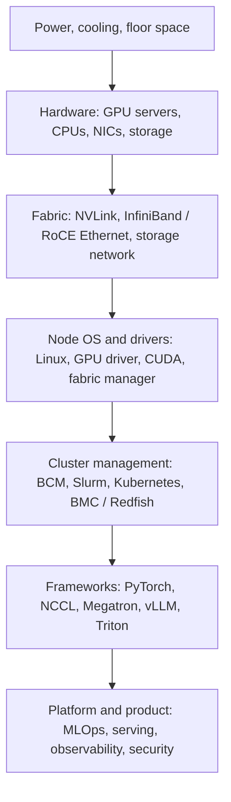

# 0.1 The AI factory landscape and the roles in it

An **AI factory** is a data center built to turn electricity and data into tokens: trained models and answered requests. Everything in this book hangs off that one idea. The unit of output is a token, the unit of cost is GPU-hours, and your job as an infrastructure engineer is to keep the expensive part (the GPUs) busy and healthy.

## The layers

A fault at any layer shows up at the top as "the job is slow" or "the job died". The book is ordered bottom-up so you can localise such faults.

| Layer | Where in this book |
|---|---|
| Linux, networking, Python, automation | Parts 1-4 |
| Kubernetes and containers | Part 5 |
| HPC and Slurm | Part 6 |
| BMC, Redfish, Base Command Manager | Parts 7-8 |
| NVIDIA systems (DGX, HGX, SuperPOD) | Part 9 |
| GPU and CUDA, GPUs on Kubernetes | Parts 10-11 |
| AI networking and storage | Parts 12-13 |
| Training, fine-tuning, inference | Parts 14-15 |

## Training versus inference

- **Training** runs for days or weeks across many nodes. It is bound by collective communication (all-reduce), checkpoint I/O and fault tolerance. One slow or failing GPU stalls everyone.
- **Inference** is latency-sensitive and bursty. It is bound by memory bandwidth (decode) and KV-cache capacity, and by routing and autoscaling.
- **HPC** (Slurm, MPI) predates both and still supplies the scheduling and cluster-management habits used in AI factories.

## The roles

| Role | Owns | Typical tools |
|---|---|---|
| Datacenter / hardware engineer | Racks, power, cabling, firmware, BMC | Redfish, IPMI, vendor tools |
| Cluster / HPC administrator | Provisioning, Slurm, users, health | BCM, Slurm, Ansible |
| Network engineer | InfiniBand / RoCE fabric, congestion, telemetry | UFM, switch OS, perftest |
| Platform / Kubernetes engineer | GPU operator, scheduling, multi-tenancy | Kubernetes, Helm, Kueue |
| MLOps / LLMOps engineer | Pipelines, registries, evaluation, release | Argo, MLflow, observability stack |
| Inference engineer | Engines, batching, quantisation, SLOs | vLLM, TensorRT-LLM, Triton |
| Site reliability / operations | Alerts, incidents, capacity, cost | Prometheus, DCGM, runbooks |

Small teams combine several roles in one person. Part 0.3 maps each role to a reading order.

## Common failure at this level

Treating the GPU as the only component that matters. In practice a stalled job is most often a NIC, a cable, a storage stall or a misconfigured driver, and GPU utilisation alone will not tell you which.

## Checkpoint questions

1. What is the unit of output of an AI factory, and what is the main unit of cost? *Tokens; GPU-hours.*
2. Why does one slow GPU hurt a whole training job? *Collectives such as all-reduce wait for the slowest rank.*
3. Which resource usually limits inference decode? *Memory bandwidth, plus KV-cache capacity.*
4. Name three layers beneath the framework that can make a job slow. *Fabric, driver / firmware, storage, thermal or power limits.*
