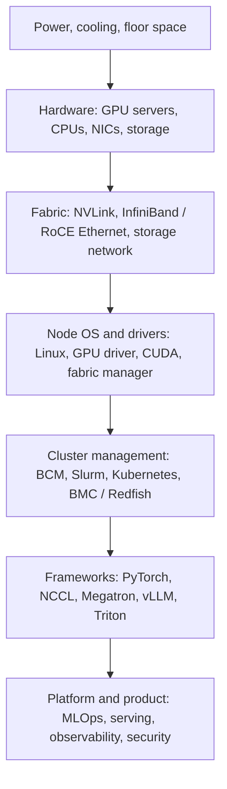

# 0.1 The AI factory landscape and the roles in it

An **AI factory** is a data center built to turn electricity and data into tokens: trained models and answered requests. Everything in this book hangs off that one idea. The unit of output is a token, the unit of cost is the GPU-hour, and your job as an infrastructure engineer is to keep the expensive part, the GPUs, busy and healthy.

A GPU server costs far more than the rest of its rack combined, and it earns nothing while it waits. It waits for data from storage, for a message from another node, for a failed neighbour to be replaced, or for a person to notice an alert. Almost every chapter that follows is about removing one of those waits.

## What a GPU server is

Picture one server in a rack. It holds eight GPUs, a pair of CPUs, a few network cards and some local disks. The GPUs are joined to each other by a fast internal link called NVLink, so that eight of them behave like one large accelerator. The network cards connect the server to other servers and to shared storage. A small separate computer on the motherboard, the baseboard management controller, lets you power the server on and off and read its sensors without logging in to the operating system.

One server is rarely enough. A large training job spreads over hundreds or thousands of GPUs, and a popular model is served from many servers at once. The factory is therefore a very large number of identical servers, joined by a network, managed by software that treats them as one pool.

## The layers

A fault at any layer shows up at the top as "the job is slow" or "the job died". The handbook is ordered bottom-up so you can learn to find which layer a fault lives in.

| Layer | Where in this handbook |
|---|---|
| Linux, networking, Python, automation | Parts 1-4 |
| Kubernetes and containers | Part 5 |
| HPC and Slurm | Part 6 |
| BMC, Redfish, Base Command Manager | Parts 7-8 |
| NVIDIA systems (DGX, HGX, SuperPOD) | Part 9 |
| GPU and CUDA, GPUs on Kubernetes | Parts 10-11 |
| AI networking and storage | Parts 12-13 |
| Training, fine-tuning, inference | Parts 14-15 |

## Training versus inference

Two kinds of work run on the factory floor, and they fail in different ways.

Training teaches a model by showing it data. It runs for days or weeks across many nodes, and it is limited by how fast the GPUs can exchange results, how fast they can save progress, and how well the job survives a failure. One slow or failing GPU stalls everyone.

Inference uses a trained model to answer requests. It is latency-sensitive and bursty. It is limited by memory bandwidth while the model writes its answer, by the memory that holds the conversation so far, and by how well requests are routed and scaled.

HPC jobs, scheduled with Slurm and MPI, came before both. They still supply many of the scheduling and cluster-management habits used in AI factories.

## A training job, end to end

Suppose a team wants to train a language model on 512 GPUs, which is 64 servers of eight. Follow the job from submission to a saved result.

A person submits the job to a scheduler, either Slurm or a Kubernetes batch system. The scheduler waits until 64 servers are free at once, because the job cannot start with fewer. It then places one process on every GPU. Each process is called a rank, and every rank has a number from 0 to 511.

Each rank loads the same model and reads a different slice of the training data from shared storage. Slow storage shows up here first: ranks sit idle, GPU utilisation drops, and nothing looks broken.

One training step then runs. Every rank computes how the model should change to do better on its own slice of data. Before anyone updates the model, all 512 ranks must agree on one combined answer. They average their results with an operation called all-reduce. Inside a server the data travels over NVLink. Between servers it travels over InfiniBand or RoCE Ethernet, through a library called NCCL that picks the routes.

All-reduce is a barrier. No rank continues until the last rank has delivered its part. If one GPU runs hot and slows down, or one cable drops packets, the other 511 wait for it at every step.

Every so often the job writes a checkpoint, a file holding the model and the optimiser state, so that a failure does not lose days of work. A checkpoint of a large model is hundreds of gigabytes, and every rank writes at the same moment. Storage that handled data reading well can still choke on this burst. While the write runs, the GPUs are idle, so checkpoint time is a direct tax on useful work.

When the job ends, or fails, the scheduler releases the servers. After a failure someone must find the cause, replace or repair the bad node, and restart from the last checkpoint. The work lost is whatever ran since that checkpoint.

## An inference request, end to end

Now follow one request to a deployed model, say a user typing a question into a chat window.

The request reaches a load balancer, which picks one of many replicas of the model server. Engines such as vLLM or TensorRT-LLM run on each replica. The replica first tokenises the text, which means splitting it into the numbered pieces the model understands.

The model then works in two phases. In the prefill phase it reads the whole prompt at once. This is heavy arithmetic and keeps the GPU busy. In the decode phase it writes the answer one token at a time. Each new token needs the model weights to be read from GPU memory again, so decode is limited by memory bandwidth, not by arithmetic.

To avoid recomputing the conversation for every new token, the engine keeps intermediate results for all earlier tokens in a store called the KV cache. The KV cache grows with the length of the conversation and with the number of requests in flight. It lives in the same GPU memory as the model weights, so it limits how many requests one GPU can serve at once.

Because decode wastes most of the GPU's arithmetic on a single request, the engine batches many requests together and moves a token forward for all of them in one pass. A bigger batch means more tokens per second and a lower cost per token, but each user waits a little longer. Tuning that trade-off is most of an inference engineer's work.

The tokens stream back through the load balancer to the user. The numbers that matter are the time to the first token, the time between tokens, and the share of requests that meet the target for both.

## What goes wrong at scale

At eight GPUs a hardware failure is an event. At thousands it is a schedule. Meta reported that during a 54-day stretch of training the Llama 3 405B model on 16,384 H100 GPUs, the job was interrupted 466 times. Of these, 419 were unexpected, and about 78 percent of the unexpected ones were traced to hardware, most often GPUs and their memory. That is roughly one unplanned interruption every three hours.

Two facts follow. First, a job that needs every GPU to keep stepping is only as reliable as its weakest part, so the failure rate of the whole job is the sum of the failure rates of every GPU, cable and switch port. Second, each interruption costs more than the failed part: all ranks stop, the job restarts, the data loader warms up again, and work since the last checkpoint is redone. The teams that keep this overhead low checkpoint often, detect bad nodes within minutes, and keep spare servers ready to swap in.

The same pressure applies to inference at a smaller scale. A single replica that is slow but not dead can pull down the tail latency of a service, and a load balancer that does not notice keeps sending it traffic.

This is why the factory needs site reliability engineering. Good utilisation is not a matter of fast hardware alone. It depends on finding the slow or failing component quickly, taking it out of service, and putting the work somewhere else. Fleets that are run well measure goodput, the share of GPU time that goes into progress that is kept, and not only utilisation, which also counts work that is later thrown away.

## The roles

| Role | Owns | Typical tools |
|---|---|---|
| Datacenter / hardware engineer | Racks, power, cabling, firmware, BMC | Redfish, IPMI, vendor tools |
| Cluster / HPC administrator | Provisioning, Slurm, users, health | BCM, Slurm, Ansible |
| Network engineer | InfiniBand / RoCE fabric, congestion, telemetry | UFM, switch OS, perftest |
| Platform / Kubernetes engineer | GPU operator, scheduling, multi-tenancy | Kubernetes, Helm, Kueue |
| MLOps / LLMOps engineer | Pipelines, registries, evaluation, release | Argo, MLflow, observability stack |
| Inference engineer | Engines, batching, quantisation, SLOs | vLLM, TensorRT-LLM, Triton |
| Site reliability / operations | Alerts, incidents, capacity, cost | Prometheus, DCGM, runbooks |

Small teams combine several roles in one person. Part 0.3 maps each role to a reading order.

## Common failure at this level

Treating the GPU as the only component that matters. In practice a stalled job is most often a NIC, a cable, a storage stall or a misconfigured driver, and GPU utilisation alone will not tell you which.

## Checkpoint questions

1. What is the unit of output of an AI factory, and what is the main unit of cost?

Tokens; GPU-hours.

2. Why does one slow GPU hurt a whole training job?

Collectives such as all-reduce wait for the slowest rank.

3. Which resource usually limits inference decode?

Memory bandwidth, plus KV-cache capacity.

4. Name three layers beneath the framework that can make a job slow.

Fabric, driver / firmware, storage, thermal or power limits.

## Sources and review notes

- **Llama 3 interruption figures:** Dubey et al., *The Llama 3 Herd of Models*, arXiv 2407.21783 (2024), section on reliability during pre-training. The figures are quoted from memory of the paper and were not re-fetched when this chapter was rewritten.
- **Training and inference mechanics:** general descriptions of data-parallel training with all-reduce, checkpointing, prefill and decode, KV cache and continuous batching. Later parts give each one in depth.
- **Earlier draft:** an earlier version summarised a business-book chapter on AI transformation in manufacturing and policy. That material was removed because it is not infrastructure content and used a different meaning of "AI factory". The source remains `ai-factory` chapter 11 (DOI 10.1201/9781003208686-11).
