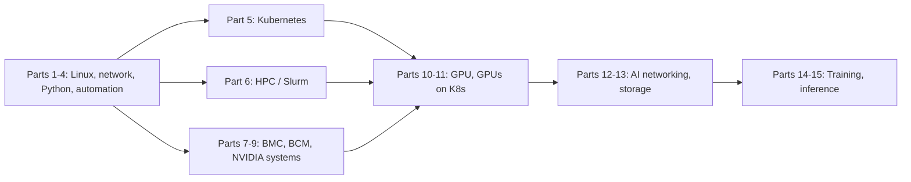

# 0.3 Learning paths by role

The book is ordered bottom-up, but you do not need all of it. Pick a path, read the **core** chapters in order, and use the rest as reference. If Linux and networking are strong, skim Parts 1-2 and start at the first chapter that surprises you.

| Role | Core path | Then |
|---|---|---|
| **Platform / Kubernetes** | 1 (selected), 2.22-2.25, 4, 5, 10, 11 | 12 (RDMA basics), 15 |
| **MLOps / LLMOps** | 3, 4, 5, 14, 15 | Parts 16-17 |
| **LLM inference** | 10, 11, 15, 14.1-14.3 | 12 (NCCL), 13 |
| **HPC / cluster admin** | 1, 2, 6, 7, 8, 9 | 11.20 (schedulers), 12 |
| **GPU cloud / AI factory operations** | 1, 2, 7-13 | 14-15, then 17 |
| **AI networking** | 2 (all), 12, 9.9 | 10.10, 14 (parallelism) |

## Rules of thumb

- Read the **how it fails** and **checkpoint** sections of any chapter you skip the body of; they show what you are expected to know.
- Do at least one lab per part. Reading alone does not build the debugging instinct interviews and on-call reward.
- When a chapter points to another by number (for example `10.7`), follow it; the book is cross-linked on purpose.

## How it fails

- **Starting at the top:** jumping to inference without Linux and networking leaves you unable to diagnose why a deployment is slow. Do the prerequisite parts for your path first.
- **Reading only:** you recognise terms but cannot debug. Run the labs.
- **Treating the path as a limit:** roles overlap heavily in AI factories; revisit other paths after the first pass.

## Checkpoint questions

1. Which two parts are the shared base for almost every path? *Linux (1) and networking (2).*
2. A candidate for an inference role skips Part 12. What is the risk? *Multi-node serving and NCCL issues become unexplainable.*
3. What should you read if you skip a chapter's body? *Failure modes and checkpoint questions.*
