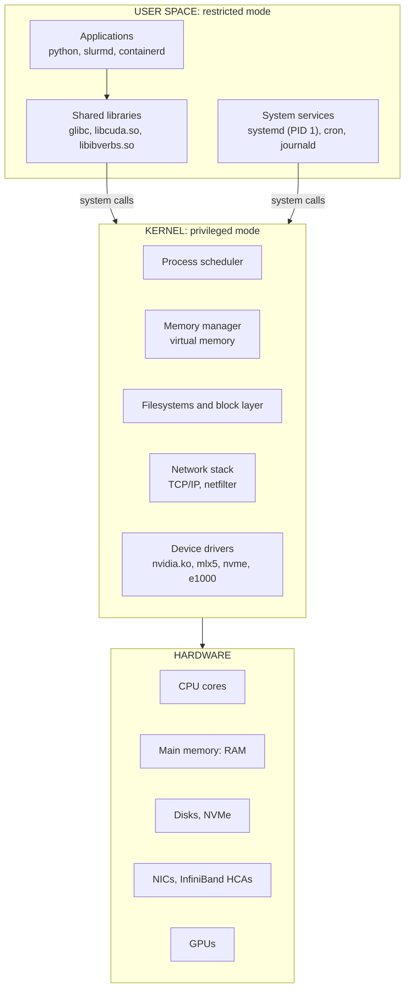
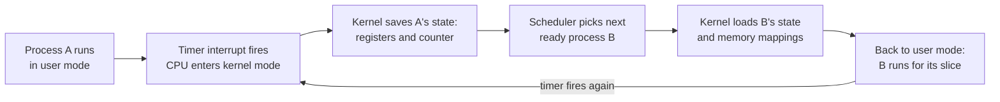
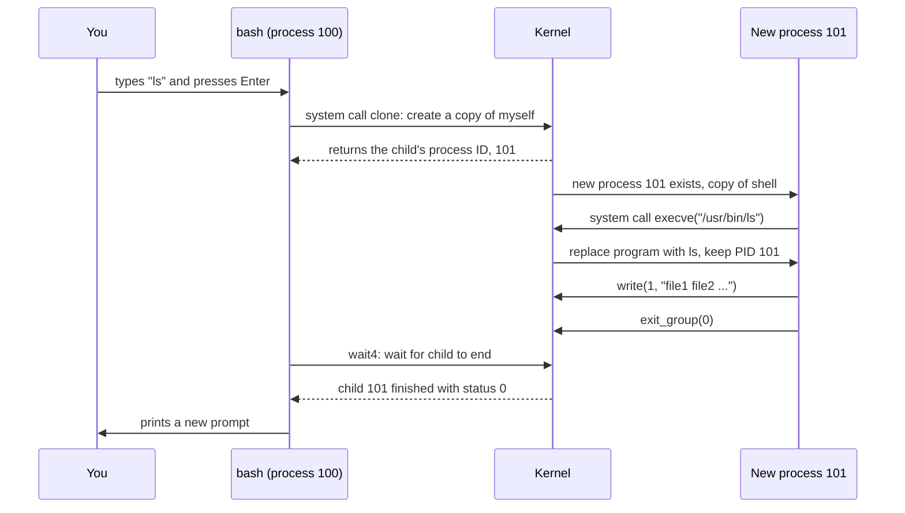
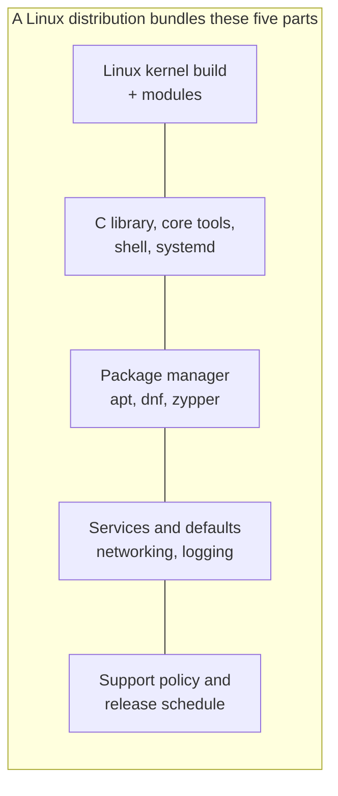
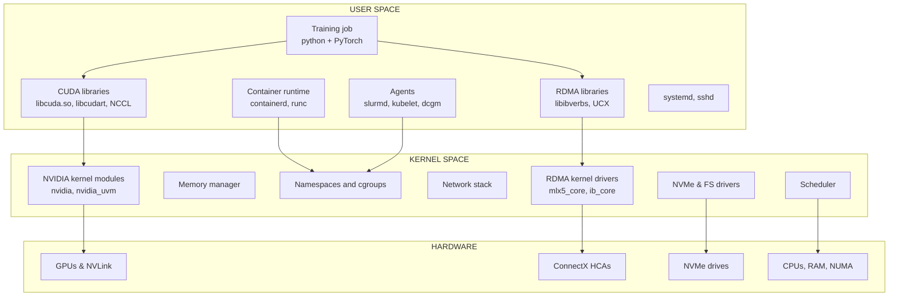

# 1.1 The Linux big picture: kernel, userspace, distributions

| Field | Value |
|---|---|
| Level | Basics |
| Priority tier | Tier 0 (foundations) |
| Lab venue | Small Ubuntu VM on GCP (`linux_layers_lab.py`: 26 checks pass; VM commands **untested** here) |
| Part | Part 1: Linux, from the command line to the kernel and performance |

## Why this matters for AI infrastructure

Every machine in an AI factory runs Linux: the GPU servers, the Slurm controller, the Kubernetes nodes, the storage servers, the BMCs' companion hosts, and even the data center switches. Look inside a modern spine or leaf switch on an AI fabric and you will find a full Linux distribution driving the switching silicon. The OpenCompute Project builds Open Network Linux (ONL), which underpins Big Switch's Switch Light and the DENT Project's dentOS. NVIDIA ships Debian-based Cumulus Linux on its Spectrum Ethernet switches, while Microsoft, Intel, NVIDIA, Broadcom, and Dell collaborate on SONiC, short for Software for Open Networking in the Cloud. Automation tools like Ansible and Python also run from Linux control hosts, and kernel technologies like eBPF and XDP are reshaping high-speed networking, security, and observability.

When a training job slows down, a container refuses to start, or a driver stops loading after an update, the cause lives in one specific layer of the system. You can only find it quickly if you can name the layers and know what each one is responsible for. Although each component has a tremendous number of technical details in its internal makeup, we will ignore the low-level trivia at first and concentrate on what the components do in relation to the whole system. This chapter provides a high-level overview of the components that make up a Linux system. Nothing later in the book makes sense without that map, including cgroups, namespaces, Kubernetes pods, GPU drivers, and RDMA, so we start at the very beginning and assume nothing.

If you have used Linux for years but never learned *how it is put together*, this chapter is for you. The goal is not to memorise commands. The goal is a clear picture in your head so you can say: "this is a kernel problem, that is a user-space problem, and this other thing is a hardware problem."

## Prerequisites and outcomes

You need a terminal on any Linux machine and the willingness to type commands. After this chapter you will be able to:

- Explain what an operating system does, in plain words, using the three-layer model of hardware, kernel, and user space.
- Explain the difference between kernel mode and user mode, and why that boundary exists.
- Describe the four jobs of the kernel: running processes, managing memory, managing devices, and serving system calls.
- Explain what a process is, trace what happens when you type a command with `fork` or `clone` and `exec`, and watch it happen with `strace`.
- Explain what Linux is as a kernel, what a distribution is as a kernel plus everything else, and how the Red Hat and Debian families evolved.
- Place the NVIDIA driver, CUDA, the container runtime, `slurmd` and RDMA correctly on a layered diagram of a GPU node.
- Use a short set of commands to inspect any Linux machine, and recognise six classic confusions that come from mixing up the layers.

## 1. What an operating system is for

Start with the problem. A computer has a handful of expensive, shared resources: processor cores, memory, storage, network cards, and GPUs in our world. Many programs want to use them at the same time. Without something in charge, every program would have to know how to talk to every kind of disk and network card. Programs could read and overwrite each other's memory, and one runaway program could freeze the whole machine.

An **operating system (OS)** is the software that sits between programs and hardware and solves these exact problems. It does three things:

1. **Shares** the resources fairly. It decides which program runs on which CPU core and for how long.
2. **Protects** programs from each other and itself from programs. One crashing program must not take down the others.
3. **Simplifies** access to hardware. A program asks to "write these bytes to this file" and does not care whether the disk is an SSD, a network drive, or something else.

A useful comparison is a large office building. The people working inside are the programs. The building has a property manager who allocates rooms for memory and schedules the shared meeting rooms for CPU time. That manager also controls who may enter which floor for permissions, and runs the plumbing and electricity so that tenants can simply turn on a tap for hardware access. Tenants do not rewire the building. They make requests at the front desk. In Linux, the property manager is the **kernel** and the front desk is the **system call interface**. Keep the building in mind; we will come back to it.

## 2. The three layers

Almost everything you will ever debug on Linux can be placed on this picture.



Read the picture from the bottom up.

**Hardware** is the physical machine. At the bottom are the CPU cores that execute instructions, and **main memory (RAM)**, which holds the programs and data that are currently running. Around them are devices: storage, network cards, and GPUs. For this chapter, the most important fact about hardware is that *the CPU only ever works on data that is in main memory*. A program, the kernel, a network packet that just arrived, a file you are reading: while the CPU is working on any of them, they are sequences of bytes in RAM. Everything else, whether disks, networks, or GPUs, is a place to move bytes to and from RAM.

You will hear the word **state** constantly, so fix its meaning now. Strictly, a state is one particular arrangement of bits: four bits holding 0110, 0001 and 1011 are three different states. A running process or the kernel can be millions of bits. Because of that scale, people describe state in abstract terms instead, such as "the process is waiting for input" or "the process is in stage 2 of startup." The physical arrangement of bits that makes up a particular running program or kernel is sometimes called its **image**. Nearly everything the kernel does revolves around main memory. It divides memory into pieces, keeps state information about every piece at all times, and makes sure each process stays inside its own share.

**The kernel** is a program like any other in one respect, a large piece of software loaded into memory. It is special in two ways. First, it is the first piece of the OS to start when the machine boots and it never goes away until shutdown. Second, the CPU runs it in a **privileged mode** that allows it to touch all memory and all hardware. It is the property manager from our analogy.

**User space** is everything else: every program you have ever run, from `ls` to a PyTorch training job to a database. Programs in user space run in an **unprivileged mode**. They cannot touch hardware directly, and they can only see their own memory. When a program needs something only the kernel can provide, such as opening a file, sending a packet, starting another program, or asking for more memory, it makes a **system call**. A system call is a controlled request through a defined doorway. The kernel checks the request, performs it, and returns the result.

User space is not one lump. The programs in it fall into a **rough layering**. At the bottom sit *basic services*, which are small components that do one uncomplicated job, such as a logging daemon. In the middle sit *utility services*, which are larger components such as mail, printing, a database, or a DNS cache that other programs use. At the top sit *applications*, which are the programs users touch directly, such as a browser or a training script. A component generally uses components at its own level or below. Treat the picture as an approximation, because **user space has no real rules**. Most programs write diagnostic messages through the standard `syslog` service, yet some do their own logging. A database server can be called a high-level application because its task is complicated, and also a middle-level service because applications depend on it. From the kernel's point of view all processes are equal; the layers are a human way to reason about dependencies. You will also hear the informal word **userland** for user space, and sometimes for the programs in it.

### Why two modes? Kernel mode and user mode

Modern CPUs implement the split in hardware. A CPU can run in at least two privilege levels. On x86 processors these are traditionally called **ring 0** for the most privileged level used by the kernel, and **ring 3** for the least privileged level used by normal programs. In the privileged mode the CPU allows instructions that control memory protection, talk to devices, and handle interrupts. In the unprivileged mode, trying to execute such an instruction causes the CPU to raise a fault, and the kernel decides what to do, usually killing the offending program.

This gives you the property you rely on every day. **If a user-space program crashes, the kernel cleans it up and the rest of the system continues.** A buggy Python script that crashes cannot corrupt the kernel's memory or another user's process. The reverse is also true, and is why kernel problems are more serious. A bug *inside* the kernel, including inside a kernel module such as a GPU driver that runs in kernel mode, can bring down the whole machine. A "kernel panic" is the kernel itself deciding it cannot safely continue.

Two details are worth knowing now because they appear later:

- **Kernel threads.** The kernel also runs its own background workers, called kernel threads. You will see names like `kthreadd`, `kworker`, and `ksoftirqd` in the process list, enclosed in square brackets. They look like processes but live entirely in the kernel.
- **Privilege is not the same as being `root`.** "Root" is a *user account* in user space that is allowed to ask the kernel to do almost anything. A root process still runs in unprivileged *CPU mode*; it is the kernel that chooses to say yes to its requests. Do not mix up "kernel mode," which is a CPU state, with "root," which is a kind of user.

Always identify whether a failure lives in hardware, kernel space, or user space before changing any setting.

## 3. What the kernel does: four jobs

Everything the kernel does fits under four headings. Processes Normally use system calls to communicate with the kernel, and we will now briefly explore each of these four areas before meeting them in depth in chapters 1.8, 1.10, 1.11, and 1.17. If you are interested in the detailed academic and source-level workings of a kernel, two classic textbooks are *Operating System Concepts*, 10th edition, by Abraham Silberschatz, Peter B. Galvin, and Greg Gagne, and *Linux Kernel Development*, 3rd edition, by Robert Love.

### Job 1: running processes

A **program** is a file on disk. A **process** is a program that is running. The kernel has loaded it into memory and keeps a record for it, including its process ID, its memory map, the files it has open, who owns it, and what it is currently doing.

A computer has far more processes than CPU cores, so the kernel has to share the cores. It does this by **time slicing**. A core runs one process for a very short slice of time, typically a few milliseconds or less. Then the kernel interrupts it, saves where it was, picks another process that is ready, and lets that one run. Switching from one process to another is called a **context switch**. Because the slices are so short, to a human everything appears to run at once; that illusion is **multitasking**. The part of the kernel that picks who runs next is the **scheduler**. Linux's default scheduler for ordinary processes was the Completely Fair Scheduler for many years, and was replaced by EEVDF starting with kernel 6.6. You do not need the details yet; the idea of fair sharing is what matters.

What triggers the switch? A hardware timer. At the end of a slice the CPU is *interrupted* by the timer, switches into privileged mode, and hands control to the kernel. Here is the sequence in everyday terms:



Two consequences to remember. First, *the kernel only runs between slices of user programs*, or when a program makes a system call or a device raises an interrupt. It is not a separate program running in parallel with yours; it is the thing that steps in on a regular basis. Second, with several cores the picture is the same per core, with the extra job of deciding which core a process should be on. Placement matters a great deal for performance with GPUs and fast networks, as chapter 1.17 covers under NUMA.

### Job 2: managing memory

Every process believes it owns a large, private, continuous block of memory. That is an illusion the kernel builds with the help of a piece of CPU hardware called the **memory management unit (MMU)**. This design is called **virtual memory**.

Here is the idea. The addresses a program uses, called virtual addresses, are not physical locations in the RAM chips. The kernel keeps a translation table for each process, the **page table**, that maps chunks of virtual addresses called **pages**, usually 4 KiB each, to chunks of physical RAM. Every time a program reads or writes memory, the MMU translates the address using the table, in hardware, at full speed. This one trick gives the kernel several powers at once:

- **Isolation.** Process A's pages simply are not mapped into process B's table, so B has no way to even name A's memory.
- **Sharing.** Two processes can have page-table entries pointing at the *same* physical page, which is how programs share a library or how a container image's files are shared in memory.
- **Protection.** Entries can be marked read-only or non-executable.
- **Overcommit and swap.** The kernel can promise more memory than exists and can move rarely used pages out to disk, bringing them back on demand.
- **Lazy loading.** Pages can be filled in only when first touched.

When a program touches a page that is not currently mapped, the CPU raises a **page fault** and the kernel handles it. It may load the page, allocate a fresh one, or kill the program if the access was illegal; the famous "segmentation fault" is the last case. You will meet page faults again in GPU work, because GPU unified memory uses the same idea.

Part of the kernel's own bookkeeping is also memory: it needs a private region that user processes can never map. That region is **kernel space**, while the part user processes may use is **user space**.

### Job 3: managing devices

Disks, network cards, keyboards and GPUs all speak different low-level languages. Programs should not have to learn them. The kernel includes **device drivers**, one for each kind of hardware, which understand the device and expose it through a common, simple interface. A driver is code that runs in kernel mode. That is the key fact for GPU nodes: **the NVIDIA driver is kernel code**, delivered as kernel modules named `nvidia`, `nvidia_uvm` and a few more, plus user-space libraries that talk to it.

Linux presents many devices as **special files** under `/dev`. A program can open `/dev/nvidia0` or `/dev/nvme0n1` and use ordinary file operations; the kernel routes them to the right driver. This is the first appearance of a Linux idea you will see everywhere: *many things are made to look like files*. Devices, processes under `/proc`, hardware information under `/sys`, and network sockets all look like files so that the same small set of tools and system calls works on all of them.

Some device files do not correspond to any hardware. **Pseudodevices** look like devices to programs but are implemented purely in software, usually inside the kernel for practical reasons. `/dev/null` discards what you write, `/dev/zero` provides an endless supply of zero bytes, and `/dev/random` and `/dev/urandom` supply random numbers from the kernel's generator, which would be hard to implement securely in an ordinary program. Strictly, a process still needs a system call to open one, so processes can never escape system calls entirely.

Drivers can be built into the kernel or loaded on demand as **kernel modules** in `.ko` files. Loading a module puts new code *into the running kernel*, which is why a module compiled for one kernel version often refuses to load on another. This is the origin of one of the most common GPU-node failures, covered at the end of this chapter.

### Job 4: system calls and the services around them

A **system call** (syscall) is a request from a user program to the kernel through the defined doorway. There are a few hundred of them, and they are the entire vocabulary a program has for dealing with the world outside its own memory. Examples, by category:

| Category | Typical system calls | What they let a program do |
|---|---|---|
| Files | `open`, `read`, `write`, `close`, `stat` | work with files and devices |
| Processes | `clone` (and `fork`), `execve`, `wait4`, `exit_group`, `kill` | create, run, wait for and end processes |
| Memory | `mmap`, `brk`, `munmap`, `mprotect` | ask for or change memory |
| Network | `socket`, `connect`, `bind`, `listen`, `accept`, `sendto`, `recvfrom` | talk over the network |
| Control and info | `ioctl`, `getpid`, `uname`, `clock_gettime` | talk to drivers, ask the kernel questions |

You almost never call them directly. Your program calls a function in a library such as `printf`, `open`, or `socket`, and the library function eventually performs the actual system call. The most important library is **glibc**, the GNU C library (`libc.so.6`), used by nearly every program on mainstream distributions.

Two notation points appear in every book and manual page. System calls are written with parentheses, such as `fork()`, `exec()`, and `execve()`, a habit from the C language in which they are called. You do not need to know C; just remember that *a system call is an interaction between a process and the kernel*. A name like `exec()` usually stands for a **family** of related C library functions, including `execl()`, `execv()`, and `execvp()`. Those functions differ only in how arguments are passed, and all of them invoke the underlying kernel system call `execve()`. There is also a lighter variant of a process called a **thread**. A thread shares most of its memory with the process that created it, which is how a single program uses several cores, as chapter 1.8 explains.

Everything in Linux eventually reduces to system calls, which is why **`strace`**, a tool that prints every system call a program makes, is the best learning and debugging tool you will meet. When a user program hangs or fails mysteriously, trace its system calls to see the exact kernel boundary where it stopped.

## 4. Processes, users, and who starts what

### What happens when you type a command

Here is the most important worked example in this chapter, because it answers "how does anything start?" You type `ls` into a terminal. The program you are typing into is a **shell** such as `bash`, itself just a user-space program that reads your text and runs other programs.



Two steps do all the work:

- **Create** a new process. The classic Unix call is `fork()`, which makes the child an almost exact copy of the parent. On modern Linux the C library implements `fork()` using the `clone` system call, so `strace` will show `clone` or `clone3`.
- **Replace** its program. When the child calls one of the C library's `exec()` family of functions, such as `exec(ls)` in simplified notation, the library calls the kernel's `execve()` system call. That call throws away the child's current program and loads the new program into the same process. The process ID (PID) stays the same; only the program inside it changes.

Every process except the first is created this way, so processes form a **tree**. The first user-space process the kernel starts is called **init**, has process ID 1, and is the ancestor of everything. On modern distributions it is **systemd**, covered in chapter 1.15. If a process's parent dies, the process is adopted by PID 1. This tree is why `pstree` is a useful command. It is also why container runtimes and Slurm care so much about who the parent of a process is: in chapter 6.7, `slurmstepd` must be the parent of job processes so it can track and clean them up.

### Users, owners, and `root`

Linux is a multi-user system. Each user has a numeric **user ID (UID)** and belongs to one or more groups with numeric **group IDs (GID)**. Every process runs *as* some UID and GID, and every file has an owner and a group. The kernel makes access decisions by comparing these numbers with permission bits stored on files. The special account **root** has UID 0 and bypasses most permission checks.

Why have users at all? **Users exist to provide permissions and boundaries.** Every user-space process has an owner and is said to run as that user. A user can end or alter their own processes within limits, but cannot interfere with other users' processes, and users own files and choose whether to share them. Besides the accounts for human beings, a system has several service accounts covered in chapter 1.6. The one to know now is `root`, the **superuser**, which is an exception to these rules. The `root` user can terminate or alter any process and read any file on the local system, which is why a person who can act as root is the system's administrator. Operating as root is dangerous because the system will let you do anything, even if it is destructive, and mistakes are hard to spot. System designers therefore keep working to make root access unnecessary, such as letting an ordinary user switch Wi-Fi networks without it. Groups are sets of users, used mostly to share file access among members.

You will learn permissions properly in chapter 1.6. For now, remember two things: *processes have an identity*, which comes from whoever started them, and *the kernel enforces access on numbers, not names*. Keep numeric UIDs identical across all nodes of a cluster so Slurm's munge authentication and shared filesystems agree on who owns every file and job.

## 5. Seeing it with your own eyes

Reading about layers is not enough. Run these on a Linux machine. All commands below are marked `(untested here)` because they target a live Linux VM; deterministic model checks run locally in `code/part01/linux_layers_lab.py`.

### 5.1 What machine and which kernel is this?

```bash
uname -a            # (untested here) kernel name, node name, kernel release, architecture
cat /etc/os-release # (untested here) which distribution and version this is (the user-space side)
lscpu | head -20    # (untested here) CPU model, sockets, cores, threads, NUMA nodes
free -h             # (untested here) RAM and swap, human-readable
lsblk               # (untested here) block devices: disks, partitions, mount points
ip -br addr         # (untested here) network interfaces and addresses
```

`uname -r` prints the **kernel release**, such as `6.8.0-1020-gcp`: a version that tells you which kernel is running. `/etc/os-release` tells you the **distribution**, such as Ubuntu 24.04 or Rocky Linux 9. Notice that these are separate facts. You can update one without the other, and mismatches between them cause real trouble.

### 5.2 What is running, and in what tree?

```bash
ps -ef --forest | head -40     # (untested here) every process, drawn as a tree (PID, parent PID)
pstree -p | head -30           # (untested here) the same tree, compact
ps -eo pid,ppid,user,stat,comm | head   # (untested here) chosen columns
ls /proc/1                     # (untested here) PID 1's "files": cmdline, status, maps, fd, ns ...
cat /proc/1/cmdline | tr '\0' ' '; echo # (untested here)
```

Look for PID 1, `systemd` or `init`, then several processes in square brackets such as `[kthreadd]` and `[kworker/0:0]`: those are kernel threads. Everything else descends from PID 1. In the `STAT` column, `S` means sleeping and `R` means running. The letter `D` marks uninterruptible sleep waiting on I/O, and `Z` marks a zombie process that finished but has not yet been collected by its parent.

### 5.3 Watch a command start: `strace`

```bash
sudo apt-get install -y strace     # (untested here) Debian/Ubuntu; use dnf on Rocky/RHEL
strace -f -e trace=execve,clone,clone3,wait4,exit_group bash -c 'ls /tmp > /dev/null' 2>&1 | head -30 # (untested here)
```

You should see the shell call `clone` or `clone3`, a child call `execve("/usr/bin/ls", ...)`, the child exit with `exit_group`, and the parent `wait4`. If you want to see every call, drop the `-e trace=` filter and redirect the output to a file. Look at the opening lines and you will see the dynamic loader mapping the C library, reading `/etc/ld.so.cache`, and calling `mmap` for memory before the real work starts. Reading even a few dozen lines of `strace` output for a simple program is the single best habit for understanding Linux.

### 5.4 Watch the kernel/user boundary yourself

Write the smallest program that makes a system call, compile it, and trace it.

```bash
cat > hello.c <<'EOF'
#include <unistd.h>
int main(void) { write(1, "hello from user space\n", 22); return 0; }
EOF
gcc -static -o hello hello.c && strace ./hello # (untested here)
```

The static build makes the trace tiny. You will see `execve`, a few memory calls, and the `write(1, "hello from user space\n", 22)` request to the kernel, followed by `exit_group`. Drop `-static` to see the dynamic loader added. This proves, with no trust required, that *a program is just a sequence of ordinary computation and system calls*.

### 5.5 Where do devices and kernel modules show up?

```bash
ls /dev | head -30            # (untested here) device files (null, zero, tty, sda or nvme0n1, ...)
lsmod | head                  # (untested here) kernel modules currently loaded into the running kernel
modinfo nvme 2>/dev/null | head -5   # (untested here) details of a module
dmesg | tail -20              # (untested here) kernel log ring buffer (may need sudo)
```

On a GPU machine you will additionally see `/dev/nvidia0`, `/dev/nvidiactl`, `/dev/nvidia-uvm` and `lsmod` lines for `nvidia`, `nvidia_uvm`, `nvidia_modeset`. Check `lsmod` and `/dev/nvidia*` first whenever a user-space tool reports that no GPUs are present.

## 6. Distributions: Linux is a kernel, not a system

**A little history, because it explains the standards and the two threads behind Linux.** The UNIX operating system was developed at AT&T. After AT&T's breakup, the trademark and the rights to the original source code changed hands several times. Since 1993 the trademark and the right to certify compliance have been held by the X/Open consortium, now **The Open Group**, which develops the **Single UNIX Specification**, of which POSIX is the core. Only systems certified against it, such as Solaris and AIX, may be *called* UNIX. Systems that did not seek certification, Linux among them, deliberately follow the same standards, so programs written to the standard interfaces and libraries port between them easily. That portability, together with UNIX's earlier popularity and its successors Solaris, OpenBSD, FreeBSD, AIX and Linux, gave the family leadership on servers, and **Linux is the de facto standard for clusters and supercomputers**.

The creation of Linux itself weaves together two historical threads from the 1980s and early 1990s. The first thread started in the early 1980s when Richard Stallman launched the **GNU Project** to build a completely free Unix-like operating system. The name GNU is a recursive acronym for *GNU's Not Unix*, and Stallman's **GNU General Public License (GPL)** grew out of this work. The GNU Project wrote free versions of almost all essential Unix user-space utilities, compilers, and libraries, but its own kernel, called **GNU Hurd**, never gained momentum.

The second thread began in 1991 when Linus Torvalds started writing a free **MINIX** clone because no free Unix kernel was readily available. His kernel, named **Linux**, rapidly attracted contributors around the world and was licensed under the GNU GPL in 1992 with the release of version 0.99. Combining Torvalds's Linux kernel with the GNU Project's user-space software collection produced a complete operating system, which is why organizations such as Debian sometimes call the full system **GNU/Linux**.

A **distribution** (distro) bundles the Linux kernel together with a selection of open-source utilities, a C library, an init system, a **package manager**, configuration defaults, and a support policy. Early distributions like Slackware pioneered this packaging. Today, almost every server and cluster you touch in AI infrastructure belongs to one of two major distribution lineages.



### 6.1 The Red Hat, Fedora, CentOS, and Amazon Linux branch

Red Hat became the first major commercial success in the Linux market with **Red Hat Enterprise Linux (RHEL)**, prized by enterprise and HPC data centers for multi-year stability, vendor certifications, and commercial support contracts. Because the fast pace of upstream Linux kernel development conflicts with the slow, methodical stability required by RHEL customers, Red Hat sponsors **Fedora** as an upstream distribution. New kernels, package tools, and system features land in Fedora first, get vetted by developers and the open-source community, and later flow downstream into RHEL.

Because the GNU GPL requires Red Hat to publish the source code of RHEL, community engineers originally rebuilt those exact sources into **CentOS** (*Community Enterprise OS*), a free binary-compatible clone of RHEL without paid support. In late 2020, Red Hat shifted CentOS into **CentOS Stream**, a "midstream" distribution sitting between upstream Fedora and downstream RHEL. Organizations wanting a strict downstream binary rebuild of RHEL created **AlmaLinux** and **Rocky Linux** as direct CentOS replacements. AWS also builds **Amazon Linux** in this family. It was first launched in September 2011 and succeeded by **Amazon Linux 2** in 2018. Next came **Amazon Linux 2022** and **Amazon Linux 2023**, which draw from Fedora, CentOS Stream, and RHEL sources. Other members include Oracle Linux and Scientific Linux.

Every distribution in this branch uses the **RPM** (`.rpm`) package format, named after the original Red Hat Package Manager utility `rpm`. While `rpm` installs individual package files, modern Red Hat derivatives use higher-level dependency resolvers that pull from online repositories: first `yum` (*Yellowdog Updater, Modified*), and now `dnf` (*Dandified YUM*).

### 6.2 The Debian and Ubuntu branch

**Debian GNU/Linux** was founded by Ian Murdock in 1993 and received early sponsorship from the Free Software Foundation's GNU Project from November 1994 through November 1995. Debian remains the only major Linux distribution governed entirely by a community project rather than a corporate parent. Every Debian release since version 1.1 in June 1996, code-named *Buzz*, is named after a *Toy Story* character, such as Debian 11.0 *Bullseye* released in August 2021 and Debian 12 *Bookworm*. Debian maintains three branches: `unstable` (always named *Sid*), `testing`, and `stable`. Packages mature through `unstable` and `testing` before freezing into a rock-solid `stable` release, which makes Debian a favorite base for other distributions, including NVIDIA's Cumulus Linux on network switches.

The most widely deployed Debian derivative in AI infrastructure is **Ubuntu**, started in April 2004 by Mark Shuttleworth's company **Canonical**. Ubuntu's first release in October 2004 was version 4.10 (4 for the year 2004, 10 for October), code-named *Warty Warthog*, followed by alliterative animal names such as *Hoary Hedgehog* and *Breezy Badger*. Ubuntu pulls packages from Debian's `unstable` branch and ships a regular release every six months plus a **Long-Term Support (LTS)** release every two years, supported for at least five years. NVIDIA's **DGX OS** is built directly on Ubuntu LTS.

All Debian and Ubuntu systems share the `.deb` package format, managed at the low level by `dpkg` and at the repository/dependency level by `apt`, `apt-get`, and `aptitude` (which replaced the older `dselect` tool).

| Family | Examples | Package format & tools | Where you meet it in AI infrastructure |
|---|---|---|---|
| Debian and Ubuntu | Debian, Ubuntu LTS, DGX OS, Cumulus Linux | `.deb` via `dpkg` and `apt` | NVIDIA DGX OS, Cumulus switches, cloud GPU images, and container base images |
| Red Hat family | RHEL, Fedora, CentOS Stream, Rocky Linux, AlmaLinux, Amazon Linux | `.rpm` via `rpm`, `yum`, and `dnf` | Enterprise HPC clusters, Slurm supercomputers, and NVIDIA Base Command Manager nodes |
| SUSE | SLES, openSUSE | `.rpm` via `rpm` and `zypper` | European HPC centers and enterprise appliances |

Three practical points about distributions save hours of cluster debugging:

1. **Same package format does not mean portable packages.** RHEL, Fedora, Rocky, and SUSE all use `.rpm` files, and Debian and Ubuntu both use `.deb` files. Even so, you cannot safely install a package built for one distribution on another. Slight differences in package naming, library versions, and file paths make cross-distro binary packages fail dependency resolution or crash at runtime.
2. **Kernel versions are not what they seem.** Enterprise distributions keep an older base kernel version number but *backport* security fixes and hardware drivers into it. For example, RHEL 9 reports a `5.14`-series kernel while containing many newer features. Ubuntu ships newer kernels and offers Hardware Enablement (`HWE`) kernels that advance during an LTS lifecycle. Always check `uname -r` and your vendor's support matrix before installing GPU or InfiniBand drivers.
3. **The kernel and user space move independently, with two strict asymmetries.** Because the Linux kernel strictly obeys the rule "never break user space," old user-space binaries almost always keep running on newer kernels. The reverse fails in two ways. First, *user-space programs compiled against a newer `glibc` will fail to start on an older distribution*. Second, *kernel modules (`.ko`) compiled for one kernel build will refuse to load on another*. Standardise a single tested OS release across every node in a cluster.

If you want to build a deeper personal sysadmin library alongside this handbook, Sergey Zhumatiy's *Supercomputers for Linux SysAdmins* highlights four timeless companions. The first is *UNIX and Linux System Administration Handbook* by Evi Nemeth, Garth Snyder, Trent Hein, and Ben Whaley. The second and third are *The Practice of System and Network Administration* by Thomas Limoncelli, Christina Hogan, and Strata Chalup, along with Limoncelli's *Time Management for System Administrators*. The fourth is Brian Kernighan and Rob Pike's classic *The UNIX Programming Environment*.

## 7. Putting a GPU node on the map

Now apply the layered picture to the machine you will actually work on: a server with GPUs, InfiniBand adapters, and a Kubernetes or Slurm agent.



| GPU Node Component | Layer | Exact Role and Failure Boundary |
|---|---|---|
| `nvidia.ko`, `nvidia_uvm.ko`, `nvidia_peermem.ko` | Kernel space | Own the GPU hardware, manage GPU virtual memory page faults, and expose `/dev/nvidia*` character devices |
| `libcuda.so`, `libnvidia-ml.so` (`nvidia-smi`) | User space | Ship with the driver; translate CUDA Driver API and NVML calls into `ioctl` system calls on `/dev/nvidia*` |
| `libcudart.so`, `cuBLAS`, `cuDNN`, `NCCL` | User space | CUDA Toolkit and math/collective libraries; run in user space inside the job or container |
| `mlx5_core.ko`, `ib_core.ko` | Kernel space | Own the ConnectX NIC/HCA, register pinned memory, and set up RDMA queue pairs |
| `libibverbs.so`, `UCX` | User space | Post RDMA work requests directly to adapter hardware from user space (kernel bypass for data) |
| `containerd`, `runc`, `slurmd`, `kubelet` | User space | User-space daemons that ask the kernel to isolate and limit jobs via namespaces and cgroups |

Use this map as a lookup table:

- **The NVIDIA driver has two halves.** The *kernel modules* (`nvidia.ko` and friends) run in kernel mode, own the GPU, and create `/dev/nvidia*`. The *user-space libraries* (`libcuda.so`, `libnvidia-ml.so` used by `nvidia-smi`) are what your programs link against and they talk to the kernel half using `ioctl` system calls on those device files. The two halves must be compatible versions, which is why "driver/library version mismatch" happens when the kernel module is not reloaded after an upgrade.
- **CUDA toolkit libraries and cuDNN are pure user space.** They do not need the kernel to change. You can have several toolkit versions side by side in different containers as long as the host *driver* is new enough for them.
- **Containers are not virtual machines.** A container is an ordinary set of user-space processes that the kernel isolates using **namespaces** for separate views of processes, network, and mounts, and limits using **cgroups**. All containers on a node *share the host's kernel*. Consequently, a container can see GPUs only if the host has the driver and the device files are passed in. The kernel version on the node, not in the container image, determines what kernel features exist. Chapters 1.18 to 1.20 build this from scratch.
- **RDMA bypasses the kernel for data, not for setup.** The kernel driver sets up resources such as queues and memory registrations, then the application, using `libibverbs`, talks to the adapter directly from user space. That "kernel bypass" is why InfiniBand achieves low latency, and also why standard Linux packet capture tools like `tcpdump` cannot see RDMA payload traffic.
- **`slurmd` and `kubelet` are just user-space programs.** They are not part of the kernel. They ask the kernel via system calls, cgroup files, and namespaces to start and limit jobs. When you wonder who is in charge of a job, the answer is a user-space daemon *using* kernel features.

**In one minute:** Every GPU node splits cleanly into hardware, kernel space (`nvidia.ko`, `mlx5_core.ko`, namespaces, cgroups), and user space (`libcuda.so`, `pytorch`, `containerd`, `slurmd`, `kubelet`). Containers bring their own user space but always share the host kernel.

## 8. How it fails: six classic confusions

Each of these is a real incident pattern. Always ask first which layer the failure lives in.

### 1. "I updated the kernel and the GPU disappeared"
**Symptom:** after an OS update and reboot, `nvidia-smi` fails with "couldn't communicate with the NVIDIA driver." **Cause:** the NVIDIA kernel modules were built for the old kernel and are not present or will not load for the new one because kernel modules are tied to a specific kernel build. **Diagnose:** `uname -r`, `lsmod | grep nvidia`, `dmesg | grep -i nvidia`, `modinfo nvidia | grep vermagic`. **Fix:** install modules matching the running kernel via prebuilt packages or DKMS, or boot the old kernel. In production, pin kernels and update in a tested image, never ad hoc.

### 2. "Works in the container, not on the host" (and the reverse): confusing library layers
**Symptom:** a binary fails with `GLIBC_2.xx not found` or `error while loading shared libraries`. **Cause:** programs depend on user-space libraries; a binary built against a newer `glibc` cannot run on a host with an older one. **Diagnose:** `ldd ./binary`, `ldd --version`, `cat /etc/os-release`. **Fix:** build on the oldest distribution you need to support, or ship the binary in a container that brings its own user space, or use a matching base image.

### 3. A process that "cannot be killed": state D
**Symptom:** `kill -9` has no effect; the process shows `D` in `ps`. **Cause:** it is inside a system call waiting for I/O on a dead NFS server, a failing disk, or a hung driver, and is uninterruptible by design. **Diagnose:** `ps -eo pid,stat,wchan:30,comm | awk '$2 ~ /D/'`, `dmesg`, check the storage or mount. **Fix:** fix the underlying device or mount; there is no signal that works while the kernel is waiting on hardware. This is a *kernel/hardware layer* problem, which no amount of user-space restarting solves.

### 4. "The kernel killed my job": the out-of-memory killer
**Symptom:** a training process vanishes with no error in its own log; `dmesg` shows "Out of memory: Killed process ...". **Cause:** physical memory plus swap was exhausted, so the kernel's OOM killer chose a victim to save the machine. **Diagnose:** `dmesg -T | grep -i -E "killed process|oom"`, `free -h`, per-cgroup limits in `memory.max`. **Fix:** reduce memory use, add memory, or set realistic limits; in containers and Slurm the same event happens at the cgroup limit rather than whole-machine exhaustion, as chapters 1.17 and 1.18 explain.

### 5. "Permission denied" versus "No such file": wrong layer of cause
**Symptom:** a command fails with an error that looks like a file problem. **Cause:** these two errors are different system call return codes: `ENOENT` means the path does not exist, whereas `EACCES` means it exists but your user ID may not use it. Treating one as the other wastes hours. **Diagnose:** `strace -f -e trace=openat,execve program 2>&1 | grep -E "ENOENT|EACCES"`, `ls -l`, `id`. **Fix:** correct the path or the permissions, ownership, or SELinux label accordingly.

### 6. "It behaves differently on the other cluster": distribution differences
**Symptom:** a script or a package name that works on Ubuntu fails on Rocky. **Cause:** different package managers, package names, default paths, init and firewall defaults, and kernel feature backports. **Diagnose:** `cat /etc/os-release`, `uname -r`, `command -v` for the tool, read the distribution's documentation. **Fix:** standardise the OS on the cluster, write scripts that detect the distribution or use Ansible from chapters 4.3 onward, and keep a compatibility matrix.

## Hands-on lab: layer verification and VM tour

First, run the self-checking Python lab (`code/part01/linux_layers_lab.py`) locally. It verifies layer placement, privilege rules, `fork` and `execve` PID transitions, `4 KiB` virtual page translation, process states, and distribution lineage rules.

```bash
python3 code/part01/linux_layers_lab.py
```

Next, on an `e2-small` Ubuntu 24.04 VM or any Linux machine (untested here on live cloud hardware), work through these steps:

**Part A: identify the layers.**
1. Run the commands from section 5.1. Record the distribution, the kernel release, the CPU count and the RAM. Explain which of those belong to user space, the kernel and hardware.
2. Run `ps -ef --forest` (untested here). Find PID 1. Find three kernel threads. Find your own shell and draw its ancestors up to PID 1.

**Part B: watch a program start.**
3. Run the `strace` command from section 5.3. Mark which line is the creation of the child, which line replaces the program, and which line is the exit.
4. Run `strace -c ls /usr/bin > /dev/null` (untested here). This summarises system calls by count and time. Which system call is called most? Why does `ls` need it?
5. Compile and trace the `hello.c` program from section 5.4, with and without `-static`. Compare the length of the traces and explain the difference caused by the dynamic loader.

**Part C: see the privilege boundary.**
6. As a normal user, try to read a protected kernel interface: `cat /proc/kcore | head -c 10` (untested here), then `sudo cat /proc/1/maps | head` (untested here). Explain the difference in outcome in terms of user ID and what the kernel allows.
7. Write a program that dereferences a null pointer, run it, and read the shell's message (`Segmentation fault`). Explain which hardware component noticed the problem (the MMU), which software component acted (the kernel), and why the machine was unaffected.

**Part D: processes and states.**
8. Start `sleep 300 &` (untested here), then run `ps -o pid,ppid,stat,comm -p $!` (untested here) and `ls -l /proc/$!/` (untested here). Kill it. Start `sleep 300`, press Ctrl-Z, run `ps` again and note the state letter change.
9. Create a zombie on purpose to see state `Z` using a short Python snippet that forks a child that exits while the parent sleeps without waiting. Explain what a zombie is and who removes it.

**Part E: distribution awareness.**
10. Run a Rocky Linux container on an Ubuntu host: `docker run --rm -it rockylinux:9 bash` (untested here). Compare `cat /etc/os-release` and the package command (`dnf` versus `apt`), then run `uname -r` inside the container and on the host and observe that they are the *same kernel*.

## Exercises

1. **Layer Classification on a GPU Node:** Classify each of the following 8 components into hardware, kernel, or user space: (a) `connectx_hca`, (b) `nvidia.ko`, (c) `nvidia_uvm.ko`, (d) `mlx5_core.ko`, (e) `libcuda.so`, (f) `libibverbs.so`, (g) `systemd`, and (h) `slurmd`. Check your answers with `classify_component_layer()` in `code/part01/linux_layers.py`.
2. **Root (UID 0) versus Kernel Mode (Ring 0):** A system administrator runs a Python script as `root` (UID 0). First, while the Python interpreter is executing a normal `for` loop in user space, state which x86 privilege ring (0 or 3) and mode (user mode or kernel mode) the CPU is in. State whether it can execute a privileged CPU instruction directly without a system call. Second, when an ordinary user (UID 1000) invokes the `read()` system call, state which CPU ring and mode the processor switches into while executing inside the kernel.
3. **Tracing `fork()`/`clone()` and `execve()` PIDs:** Suppose an interactive `bash` shell running at PID 100 (UID 1000) launches `/usr/bin/ls` and the kernel's `clone` call allocates PID 101 to the child process. What is the child process's PID and program image immediately *before* `execve("/usr/bin/ls")` and immediately *after* `execve("/usr/bin/ls")`?
4. **Virtual Memory Page Table Translation (4 KiB Pages):** Assume a 4,096-byte (4 KiB) page size and a per-process page table mapping virtual page 2 to physical frame 15 and virtual page 3 to physical frame 9. First, calculate the virtual page number, byte offset, and physical RAM address for virtual address 8,320 (which is 2 * 4096 + 128). Second, state what the MMU and kernel do when the process dereferences virtual address 28,736 (which is 7 * 4096 + 64).
5. **Process States (R, D, Z) and `kill -9`:** Two troubled processes appear in `ps`: Process A has `STAT = D` waiting on an unresponsive NFS mount, and Process B has `STAT = Z` (`<defunct>`). Explain why `kill -9` (`SIGKILL`) fails to remove either process immediately, and state the exact recovery action required for each.
6. **Distribution Lineages and Container Kernel Sharing:** An Ubuntu 24.04 host (`uname -r` = `6.8.0-1020-gcp`) runs a Rocky Linux 9 container (`cat /etc/os-release` shows Rocky Linux 9). (a) What does `uname -r` print inside the Rocky Linux 9 container, and what package manager (`apt` or `dnf`) runs inside the container? (b) If the Ubuntu host updates its kernel to `6.8.0-1021-gcp` and reboots without building `nvidia.ko` for the new kernel, can a container with `/usr/local/cuda` installed use the GPUs?

## Checkpoint questions (20)

<details>
<summary>1. What three things does an operating system do for programs?</summary>

It shares hardware resources fairly by scheduling CPU time and allocating RAM. It protects programs from each other and the kernel from programs. Finally, it simplifies access to diverse hardware through uniform abstractions like files and sockets.
</details>

<details>
<summary>2. Name the three layers of a Linux system and state what runs in each.</summary>

Hardware sits at the bottom, including CPU cores, main memory, NVMe disks, network cards, and GPUs. The kernel sits in the middle and runs the process scheduler, memory manager, filesystems, network stack, and device drivers. User space sits at the top and runs applications, shared libraries like `glibc` and `libcuda.so`, shells, and system services like `systemd`.
</details>

<details>
<summary>3. Why does the CPU have a privileged mode (ring 0) and an unprivileged mode (ring 3)? What happens if a user program tries a privileged instruction?</summary>

The hardware split lets the kernel enforce isolation: user programs run in unprivileged mode (ring 3) where direct hardware access and page-table modifications are forbidden. If a user program executes a privileged instruction, the CPU raises a hardware fault and traps into the kernel, which terminates the offending process without harming the rest of the system.
</details>

<details>
<summary>4. What is the difference between "kernel mode" and "root" (UID 0)?</summary>

Kernel mode (ring 0) is a hardware CPU execution state in which kernel code runs. By contrast, `root` (`UID 0`) is a user identity in user space. A root process still executes its own instructions in unprivileged user mode (ring 3) and must make system calls to ask the kernel to perform privileged operations, which the kernel grants because `UID == 0`.
</details>

<details>
<summary>5. List the four primary jobs of the Linux kernel.</summary>

The four jobs are process management and scheduling, memory management via virtual memory and page tables, device management through device drivers, and serving system calls and kernel support routines.
</details>

<details>
<summary>6. What triggers a context switch, and what does the kernel do during it?</summary>

A hardware timer interrupt at the end of a time slice, or a blocking system call, switches the CPU into kernel mode. The kernel saves the current process's CPU registers and instruction pointer, and invokes the scheduler to pick the next runnable process. It then loads that process's registers and page-table mappings, and returns the CPU to user mode.
</details>

<details>
<summary>7. Explain virtual memory, the MMU, and page tables in three sentences.</summary>

Every process uses virtual addresses rather than physical RAM addresses. On every memory access, the CPU's Memory Management Unit (MMU) translates the virtual page number (typically `4 KiB` pages) into a physical frame number using a per-process page table maintained by the kernel. If a virtual page is unmapped, the MMU raises a page fault so the kernel can allocate memory lazily, swap a page in, or send `SIGSEGV` on an illegal access.
</details>

<details>
<summary>8. What is a pseudodevice? Name four classic Linux pseudodevices and what each does.</summary>

A pseudodevice is a file under `/dev` implemented purely in kernel software with no physical hardware behind it. `/dev/null` discards all writes and returns EOF on read, while `/dev/zero` supplies an endless stream of `0x00` bytes. `/dev/random` and `/dev/urandom` provide cryptographic random numbers from the kernel's entropy pool.
</details>

<details>
<summary>9. What is a system call, and what role does `glibc` (`libc.so.6`) play when your program calls `open()` or `printf()`?</summary>

A system call is the controlled entry point from user space into the kernel (`openat`, `read`, `write`, `clone`, `execve`, `mmap`, `ioctl`). Programs normally call wrapper functions in the GNU C library (`glibc`), which format arguments and execute the architecture's syscall instruction on the program's behalf.
</details>

<details>
<summary>10. Describe step by step what happens from typing `ls` in `bash` to seeing its output. How do `fork()`/`clone()`, `exec()`, and `execve()` fit together?</summary>

First, the shell calls `fork()`, implemented via the `clone` or `clone3` system call, to create a child process with a new PID. Next, the child calls a function in the C library's `exec()` family (`execl()`, `execv()`, `execvp()`), which invokes the kernel's `execve()` system call to replace the child's memory image with `/usr/bin/ls` while keeping the same PID. Finally, `ls` opens and reads the directory (`openat`, `getdents64`), writes output via `write()`, and exits via `exit_group(0)` while the parent shell collects its exit status via `wait4()`.
</details>

<details>
<summary>11. Why are processes arranged in a tree, and what is special about PID 1?</summary>

Every process after boot is created by an existing parent process calling `clone()` or `fork()`. PID 1 (`init`, which is `systemd` on modern distributions) is the first user-space process started by the kernel. It serves as the ancestor of all other user-space processes and adopts orphaned child processes whose original parent exited.
</details>

<details>
<summary>12. How did the GNU Project (1980s) and Linus Torvalds's 1991 kernel come together to form GNU/Linux?</summary>

Richard Stallman started the GNU Project ("GNU's Not Unix") in the early 1980s and created the GPL and user-space Unix utilities, but its kernel (`GNU Hurd`) stalled. In 1991 Linus Torvalds wrote a free MINIX-inspired kernel (`Linux`) and licensed version `0.99` under the GNU GPL in 1992, combining with the GNU userland to form a complete operating system.
</details>

<details>
<summary>13. Why is Linux central to modern data center switches as well as servers?</summary>

Modern network operating systems (NOSs) run on Linux. The OpenCompute Project's Open Network Linux (`ONL`) powers Switch Light and `dentOS`. NVIDIA's Cumulus Linux is a full Debian-based distribution running on Spectrum switches, and `SONiC` (Software for Open Networking in the Cloud) runs Linux and containers on white-box switches across hyperscale fabrics.
</details>

<details>
<summary>14. How do Fedora, CentOS Stream, RHEL, and Rocky Linux / AlmaLinux relate to each other?</summary>

Fedora is Red Hat's fast-moving upstream distribution where new kernels and features are tested first. CentOS Stream sits midstream between Fedora and Red Hat Enterprise Linux (RHEL), which is the commercial enterprise release. Rocky Linux and AlmaLinux are downstream community distributions rebuilt from RHEL's GPL source code after CentOS shifted to CentOS Stream in late 2020.
</details>

<details>
<summary>15. How do Debian's three branches (`unstable`, `testing`, `stable`) relate to Ubuntu's release cadence and NVIDIA DGX OS?</summary>

Debian (founded by Ian Murdock in 1993, using *Toy Story* codenames like `1.1` *Buzz* and `11.0` *Bullseye*) matures packages from `unstable` through `testing` into `stable`. Ubuntu (started by Canonical in 2004 with `4.10` *Warty Warthog*) pulls from Debian `unstable` to ship six-month releases and two-year LTS releases (supported for five years), and NVIDIA's DGX OS is built on Ubuntu LTS.
</details>

<details>
<summary>16. Why can't you reliably install a Fedora `.rpm` on Rocky Linux or an Ubuntu `.deb` on Debian even though they share the same package format?</summary>

Sharing the `.rpm` (`rpm`, `yum`, `dnf`) or `.deb` (`dpkg`, `apt`) container format does not guarantee binary or dependency compatibility. Differences in shared library versions (`glibc`, `libssl`), package naming conventions, and filesystem paths across distributions cause dependency resolution failures or runtime crashes.
</details>

<details>
<summary>17. The NVIDIA GPU driver has a kernel half and a user-space half. Name the files in each half and explain how they communicate.</summary>

The kernel half consists of kernel modules (`nvidia.ko`, `nvidia_uvm.ko`, `nvidia_peermem.ko`) that run in ring 0 and expose `/dev/nvidia*`. The user-space half consists of libraries (`libcuda.so`, `libnvidia-ml.so`) and tools (`nvidia-smi`) that talk to the kernel modules via `ioctl` system calls on `/dev/nvidia*`.
</details>

<details>
<summary>18. Why does a kernel module (`.ko`) built on one kernel refuse to load on another, whereas old user-space binaries keep working on newer kernels?</summary>

The Linux kernel maintains a strict stable ABI for system calls ("don't break userspace"), so old user binaries keep working. Inside the kernel, internal data structures and function signatures change between builds, so `.ko` modules are version-checked (`vermagic`) against the exact kernel release (`uname -r`) they were compiled for.
</details>

<details>
<summary>19. Why does `tcpdump` fail to see InfiniBand or RoCEv2 RDMA payload traffic on a GPU node?</summary>

RDMA uses the kernel (`mlx5_core`, `ib_core`) only during setup to register pinned memory and create queue pairs. Once established, `libibverbs` in user space posts work requests directly to the ConnectX adapter hardware via kernel bypass. Because the payload never traverses the Linux kernel's TCP/IP and netfilter stack, `tcpdump` hooks never see it.
</details>

<details>
<summary>20. Why does `kill -9` fail on a process in state `D`, and how is state `D` different from state `Z`?</summary>

A process in state `D` (uninterruptible sleep) is executing inside the kernel waiting on hardware or network storage I/O (such as a dead NFS/Lustre mount); signals are not delivered until the kernel syscall returns. A process in state `Z` (zombie) has already terminated and released its memory, and only its process-table entry remains until its parent calls `wait4()`.
</details>

## Sources and review notes

- **Sources read in full:**
  - `how-linux-works-3rd-edition` — Brian Ward, *How Linux Works*, 3rd ed., **Chapter 1: The Big Picture**. Read sections 1.1–1.6 in full. Covers levels and layers of abstraction, hardware and main memory state/image, the kernel's four tasks, context switches, virtual memory and page tables, device drivers and pseudodevices, `fork()` and `exec()`/`execve()` system calls, Silberschatz *Operating System Concepts* 10th ed. and Love *Linux Kernel Development* 3rd ed. references, user-space layering, and users/groups/root.
  - `network-programmability-and-automation-2nd-edition` — Jason Edelman, Scott S. Lowe, and Matt Oswalt, *Network Programmability and Automation*, 2nd ed., **Chapter 3: Linux**. Read "Examining Linux in a Network Automation Context", "Exploring a Brief History of Linux", and "Understanding Linux Distributions" in full. Covers OCP Open Network Linux (ONL), Switch Light, dentOS, NVIDIA Debian-based Cumulus Linux, SONiC, eBPF/XDP, Richard Stallman's 1980s GNU Project and GPL vs Linus Torvalds's 1991 Linux kernel v0.99 in 1992, Red Hat/Fedora/CentOS Stream/RHEL/AlmaLinux/Rocky Linux/Amazon Linux 2 & 2022 with `rpm`/`yum`/`dnf`, and Debian 1993 Ian Murdock / 1.1 *Buzz* 1996 / 11.0 *Bullseye* 2021 / Ubuntu 4.10 *Warty Warthog* Oct 2004 with `dpkg`/`dselect`/`apt`.
  - `supercomputers-for-linux-sysadmins-managing-modern-hpc-clusters-and-supercomputers-from-software-to` — Sergey Zhumatiy, *Supercomputers for Linux SysAdmins*, **Chapter 7: UNIX and Linux – the Basics**. Read UNIX/POSIX standards history (1993 X/Open / The Open Group Single UNIX Specification), UID/GID privilege model, and classic sysadmin book recommendations (Nemeth et al., Limoncelli et al., and Kernighan & Pike).
  - `systems-performance-2nd-edition` — Brendan Gregg, *Systems Performance*, 2nd ed., **Chapter 3: Operating Systems**. Cross-checked kernel vs user mode, system calls, interrupts, context switches, and virtual memory.
- **Run here:** `python3 code/part01/linux_layers_lab.py` (26 passed, 0 failed).
- **Explicitly labelled inferences:** The EEVDF scheduler note (Linux kernel 6.6 onward) and x86 ring 0 / ring 3 terminology are standard architecture background alongside the cited books.
- **Not verified on live hardware:** All interactive VM shell commands (`uname -a`, `ps`, `pstree`, `strace`, `gcc -static`, `lsmod`, `modinfo`, `dmesg`, `docker run`) are marked (untested here) and should be executed on a Linux VM.
