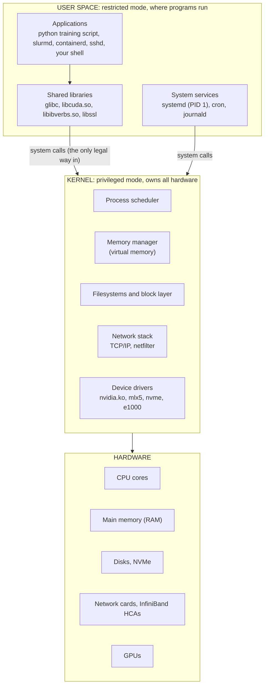
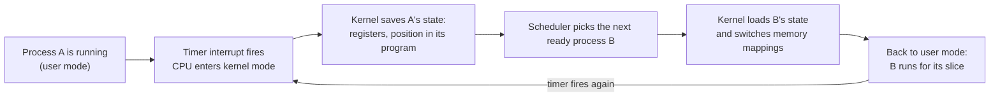
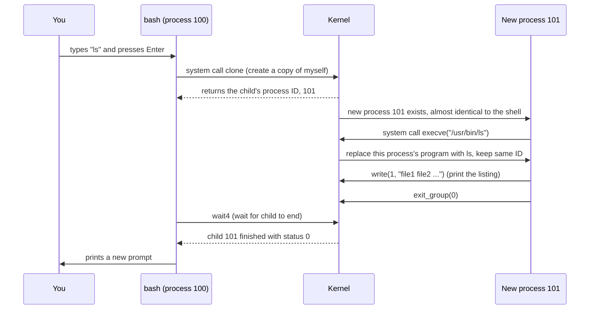
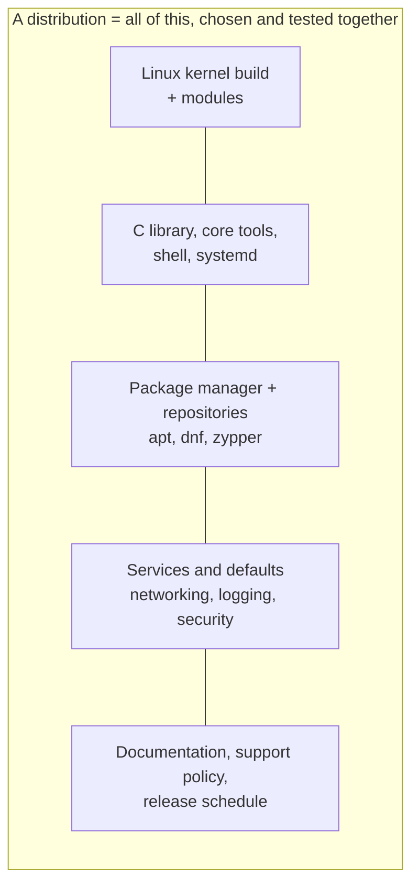
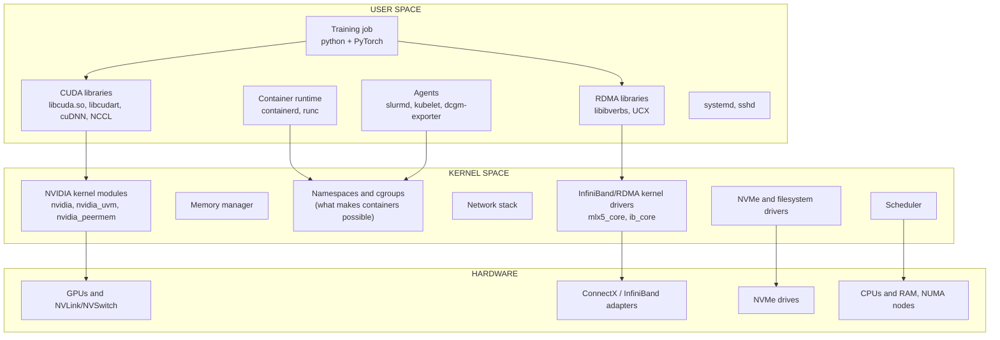

# 1.1 The Linux big picture: kernel, userspace, distributions

**Level:** basics · **Tier 0 (foundations)** · **Lab venue:** a small Ubuntu VM on GCP (everything here also works on any Linux machine) · **Status:** drafted, labs untested

## Why this matters for AI infrastructure

Every machine in an AI factory runs Linux: the GPU servers, the Slurm controller, the Kubernetes nodes, the storage servers, the BMCs' companion hosts. When a training job slows down, a container refuses to start, or a driver stops loading after an update, the cause lives in one specific layer of the system, and you can only find it quickly if you can name the layers and know what each one is responsible for. This chapter gives you that map. Nothing later in the book (cgroups, namespaces, Kubernetes pods, GPU drivers, RDMA) makes sense without it, so we start at the very beginning and assume nothing.

If you have used Linux for years but never learned *how it is put together*, this chapter is for you. The goal is not to memorise commands. The goal is a picture in your head that you can reason with: "this is a kernel problem, that is a user-space problem, this other thing is a hardware problem."

## Prerequisites and outcomes

You need a terminal on any Linux machine and the willingness to type commands. After this chapter you will be able to:

- explain what an operating system does, in plain words, using the three-layer model (hardware, kernel, user space);
- explain the difference between kernel mode and user mode, and why that boundary exists;
- describe the four jobs of the kernel: running processes, managing memory, managing devices, and serving system calls;
- explain what a process is and trace what happens when you type a command (`fork` or `clone`, then `exec`), and watch it happen with `strace`;
- explain what Linux is (a kernel), what a distribution is (a kernel plus everything else), and how to choose and identify one;
- place the NVIDIA driver, CUDA, the container runtime, `slurmd` and RDMA correctly on a layered diagram of a GPU node;
- use a short set of commands to inspect any Linux machine, and recognise six classic confusions that come from mixing up the layers.

## 1. What an operating system is for

Start with the problem. A computer has a handful of expensive, shared resources: processor cores, memory, storage, network cards, and (in our world) GPUs. Many programs want to use them at the same time. Without something in charge, every program would have to know how to talk to every kind of disk and network card, programs could read and overwrite each other's memory, and one runaway program could freeze the whole machine.

An **operating system (OS)** is the software that sits between programs and hardware and solves exactly these problems. It does three things:

1. **Shares** the resources fairly (it decides which program runs on which CPU core and for how long).
2. **Protects** programs from each other and itself from programs (one crashing program must not take down the others).
3. **Simplifies** access to hardware (a program asks to "write these bytes to this file" and does not care whether the disk is an SSD, a network drive or something else).

A useful comparison is a large office building. The people working inside are the programs. The building has a property manager who allocates rooms (memory), schedules the shared meeting rooms (CPU time), controls who may enter which floor (permissions), and runs the plumbing and electricity so that tenants can just turn on a tap (hardware access). Tenants do not rewire the building; they make requests at the front desk. In Linux, the property manager is the **kernel** and the front desk is the **system call interface**. Keep the building in mind; we will come back to it.

## 2. The three layers

Almost everything you will ever debug on Linux can be placed on this picture.



Read the picture from the bottom up.

**Hardware** is the physical machine. At the bottom are the CPU cores that execute instructions, and **main memory (RAM)**, which holds the programs and data that are currently running. Around them are devices: storage, network cards, and GPUs. For this chapter, the most important fact about hardware is that *the CPU only ever works on data that is in main memory*. A program, the kernel, a network packet that just arrived, a file you are reading: while the CPU is working on any of them, they are sequences of bytes in RAM. Everything else (disks, networks, GPUs) is a place to move bytes to and from RAM.

You will hear the word **state** constantly, so fix its meaning now. Strictly, a state is one particular arrangement of bits: four bits holding `0110`, `0001` and `1011` are three different states. A running process or the kernel can be millions of bits, so people describe state in abstract terms instead ("the process is waiting for input", "the process is in stage 2 of startup"). The physical arrangement of bits that makes up a particular running program or kernel is sometimes called its **image**. Nearly everything the kernel does revolves around main memory: it divides memory into pieces, keeps state information about every piece at all times, and makes sure each process stays inside its own share.

**The kernel** is a program like any other in one respect, a large piece of software loaded into memory. It is special in two ways. First, it is the first piece of the OS to start when the machine boots and it never goes away until shutdown. Second, the CPU runs it in a **privileged mode** that allows it to touch all memory and all hardware. It is the property manager from our analogy.

**User space** is everything else: every program you have ever run, from `ls` to a PyTorch training job to a database. Programs in user space run in an **unprivileged mode**. They cannot touch hardware directly, and they can only see their own memory. When a program needs something only the kernel can provide (open a file, send a packet, start another program, ask for more memory), it makes a **system call**: a controlled request through a defined doorway. The kernel checks the request, performs it, and returns the result.

User space is not one lump. The programs in it fall into a **rough layering**: *basic services* at the bottom (small components that do one uncomplicated job, such as a logging daemon), *utility services* in the middle (larger ones such as mail, printing, a database, or a DNS cache that other programs use), and *applications* at the top (what users touch: a browser, a training script). A component generally uses components at its own level or below. But treat the picture as an approximation: **user space has no real rules**. Most programs write diagnostic messages through the standard `syslog` service, yet some do their own logging; a database server can be called a high-level application because its task is complicated, and also a middle-level service because applications depend on it. From the kernel's point of view all processes are equal; the layers are a human way to reason about dependencies. (You will also hear the informal word **userland** for user space, and sometimes for the programs in it.)

### Why two modes? Kernel mode and user mode

Modern CPUs implement the split in hardware. A CPU can run in at least two privilege levels. On x86 processors these are traditionally called **ring 0** (most privileged, used by the kernel) and **ring 3** (least privileged, used by normal programs). In the privileged mode the CPU allows instructions that control memory protection, talk to devices, and handle interrupts. In the unprivileged mode, trying to execute such an instruction causes the CPU to raise a fault, and the kernel decides what to do (usually to kill the offending program).

This gives you the property you rely on every day: **if a user-space program crashes, the kernel cleans it up and the rest of the system continues.** A buggy Python script that crashes cannot corrupt the kernel's memory or another user's process. The reverse is also true, and is why kernel problems are more serious: a bug *inside* the kernel (including inside a kernel module such as a GPU driver, which runs in kernel mode) can bring down the whole machine. A "kernel panic" is the kernel itself deciding it cannot safely continue.

Two details are worth knowing now because they appear later:

- **Kernel threads.** The kernel also runs its own background workers, called kernel threads (you will see names like `kthreadd`, `kworker`, `ksoftirqd` in the process list, in square brackets). They look like processes but live entirely in the kernel.
- **Privilege is not the same as being `root`.** "Root" is a *user account* in user space that is allowed to ask the kernel to do almost anything. A root process still runs in unprivileged *CPU mode*; it is the kernel that chooses to say yes to its requests. Do not mix up "kernel mode" (a CPU state) with "root" (a kind of user).

## 3. What the kernel does: four jobs

Everything the kernel does fits under four headings. We will meet each in depth later (processes in 1.8, memory in 1.17, devices in 1.10, system calls in 1.11); here you build the overview.

### Job 1: running processes

A **program** is a file on disk. A **process** is a program that is running: the kernel has loaded it into memory and keeps a record for it (its process ID, its memory map, the files it has open, who owns it, and what it is currently doing).

A computer has far more processes than CPU cores, so the kernel has to share the cores. It does this by **time slicing**. A core runs one process for a very short slice of time (typically some milliseconds or less), then the kernel interrupts it, saves where it was, picks another process that is ready, and lets that one run. Switching from one process to another is called a **context switch**. Because the slices are so short, to a human everything appears to run at once; that illusion is **multitasking**. The part of the kernel that picks who runs next is the **scheduler**. (Linux's default scheduler for ordinary processes was the Completely Fair Scheduler for many years, and was replaced by EEVDF starting with kernel 6.6. You do not need the details yet; the idea of fair sharing is what matters.)

What triggers the switch? A hardware timer. At the end of a slice the CPU is *interrupted* by the timer, switches into privileged mode, and hands control to the kernel. Here is the sequence in everyday terms:



Two consequences to remember. First, *the kernel only runs between slices of user programs* (or when a program makes a system call or a device raises an interrupt); it is not a separate program running in parallel with yours, it is the thing that steps in on a regular basis. Second, with several cores the picture is the same per core, with the extra job of deciding which core a process should be on. Placement matters a great deal for performance with GPUs and fast networks (NUMA, chapter 1.17).

### Job 2: managing memory

Every process believes it owns a large, private, continuous block of memory. That is an illusion the kernel builds with the help of a piece of CPU hardware called the **memory management unit (MMU)**. This design is called **virtual memory**.

Here is the idea. The addresses a program uses (virtual addresses) are not physical locations in the RAM chips. The kernel keeps a translation table for each process, the **page table**, that maps chunks of virtual addresses (**pages**, usually 4 KiB each) to chunks of physical RAM. Every time a program reads or writes memory, the MMU translates the address using the table, in hardware, at full speed. This one trick gives the kernel several powers at once:

- **Isolation.** Process A's pages simply are not mapped into process B's table, so B has no way to even name A's memory.
- **Sharing.** Two processes can have page-table entries pointing at the *same* physical page, which is how programs share a library or how a container image's files are shared in memory.
- **Protection.** Entries can be marked read-only or non-executable.
- **Overcommit and swap.** The kernel can promise more memory than exists and can move rarely used pages out to disk, bringing them back on demand.
- **Lazy loading.** Pages can be filled in only when first touched.

When a program touches a page that is not currently mapped, the CPU raises a **page fault** and the kernel handles it (load the page, allocate a fresh one, or kill the program if the access was illegal; the famous "segmentation fault" is the last case). You will meet page faults again in GPU work, because GPU unified memory uses the same idea.

Part of the kernel's own bookkeeping is also memory: it needs a private region that user processes can never map. That region is **kernel space**; the part user processes may use is **user space** (the name is shared with the layer above, which is slightly confusing but conventional).

### Job 3: managing devices

Disks, network cards, keyboards and GPUs all speak different low-level languages. Programs should not have to learn them. The kernel includes **device drivers**, one for each kind of hardware, which understand the device and expose it through a common, simple interface. A driver is code that runs in kernel mode. That is the key fact for GPU nodes: **the NVIDIA driver is kernel code** (kernel modules named `nvidia`, `nvidia_uvm` and a few more) plus user-space libraries that talk to it.

Linux presents many devices as **special files** under `/dev`. A program can open `/dev/nvidia0` or `/dev/nvme0n1` and use ordinary file operations; the kernel routes them to the right driver. This is the first appearance of a Linux idea you will see everywhere: *many things are made to look like files* (devices, processes under `/proc`, hardware information under `/sys`, network sockets), so that the same small set of tools and system calls works on all of them.

Some device files do not correspond to any hardware. **Pseudodevices** look like devices to programs but are implemented purely in software, usually inside the kernel for practical reasons. `/dev/null` (discards what you write), `/dev/zero` (an endless supply of zero bytes) and `/dev/random` and `/dev/urandom` (random numbers from the kernel's generator, which would be hard to implement securely in an ordinary program) are the classics. Strictly, a process still needs a system call to open one, so processes can never escape system calls entirely.

Drivers can be built into the kernel or loaded on demand as **kernel modules** (`.ko` files). Loading a module puts new code *into the running kernel*, which is why a module compiled for one kernel version often refuses to load on another. This is the origin of one of the most common GPU-node failures, covered at the end of this chapter.

### Job 4: system calls and the services around them

A **system call** (syscall) is a request from a user program to the kernel through the defined doorway. There are a few hundred of them, and they are the entire vocabulary a program has for dealing with the world outside its own memory. Examples, by category:

| Category | Typical system calls | What they let a program do |
|---|---|---|
| Files | `open`, `read`, `write`, `close`, `stat` | work with files and devices |
| Processes | `clone` (and `fork`), `execve`, `wait4`, `exit_group`, `kill` | create, run, wait for and end processes |
| Memory | `mmap`, `brk`, `munmap`, `mprotect` | ask for or change memory |
| Network | `socket`, `connect`, `bind`, `listen`, `accept`, `sendto`, `recvfrom` | talk over the network |
| Control and info | `ioctl`, `getpid`, `uname`, `clock_gettime` | talk to drivers, ask the kernel questions |

You almost never call them directly. Your program calls a function in a library (`printf`, `open`, `socket`), and the library function eventually performs the actual system call. The most important library is **glibc** (the GNU C library, `libc.so.6`), used by nearly every program on mainstream distributions.

Two notation points you will meet in every book and manual page. System calls are written with parentheses, `fork()` and `execve()`, a habit from the C language in which they are called; you do not need to know C, just remember that *a system call is an interaction between a process and the kernel*. And a name like `exec` usually stands for a **family** of related calls that differ only in how arguments are passed (the underlying kernel call is `execve`). There is also a lighter variant of a process, the **thread**, which shares most of its memory with the process that created it and is how a single program uses several cores (chapter 1.8).

Everything in Linux eventually reduces to system calls, which is why **`strace`**, a tool that prints every system call a program makes, is the best learning and debugging tool you will meet. We use it throughout this chapter and the book. Section 5 shows it in action.

## 4. Processes, users, and who starts what

### What happens when you type a command

Here is the most important worked example in this chapter, because it answers "how does anything start?" You type `ls` into a terminal. The program you are typing into is a **shell** (for example `bash`), itself just a user-space program that reads your text and runs other programs.



Two steps do all the work:

- **Create** a new process. The classic Unix call is `fork()`, which makes the child an almost exact copy of the parent. On modern Linux the C library implements `fork()` using the `clone` system call, so `strace` will show `clone` (or `clone3`).
- **Replace** its program. `execve` throws away the child's current program and loads a new one into the same process. The process ID stays the same; only the program inside it changes.

Every process except the first is created this way, so processes form a **tree**. The first user-space process the kernel starts is called **init**, has process ID 1, and is the ancestor of everything. On modern distributions it is **systemd** (chapter 1.15). If a process's parent dies, the process is adopted by PID 1. This tree is why `pstree` is a useful command, and why container runtimes and Slurm care so much about "who is the parent of this process?" (chapter 6.7: `slurmstepd` must be the parent of job processes so it can clean them up).

### Users, owners, and `root`

Linux is a multi-user system. Each user has a numeric **user ID (UID)** and belongs to one or more groups with numeric **group IDs (GID)**. Every process runs *as* some UID and GID, and every file has an owner and a group. The kernel makes access decisions by comparing these numbers with permission bits stored on files. The special account **root** has UID 0 and bypasses most permission checks.

Why have users at all? **Users exist to provide permissions and boundaries.** Every user-space process has an owner and is said to run as that user. A user can end or alter their own processes (within limits) but cannot interfere with other users' processes, and users own files and choose whether to share them. Besides the accounts for human beings, a system has several others (chapter 1.6); the one to know now is `root`, the **superuser**, an exception to these rules: it can terminate or alter any process and read any file on the local system, which is why a person who can act as root is the system's administrator. Operating as root is dangerous, because the system will let you do anything even if it is destructive and mistakes are hard to spot, so system designers keep working to make root access unnecessary (for example, letting an ordinary user switch Wi-Fi networks without it). Groups are sets of users, used mostly to share file access among members.

You will learn permissions properly in chapter 1.6. For now, remember two things: *processes have an identity*, which comes from whoever started them, and *the kernel enforces access on numbers, not names*. The second fact is why identical UIDs across all nodes of a cluster matter so much for Slurm's munge (chapter 6.7) and for shared filesystems.

## 5. Seeing it with your own eyes

Reading about layers is not enough. Run these on a Linux machine. All commands are safe and read-only unless stated.

### 5.1 What machine and which kernel is this?

```bash
uname -a            # kernel name, node name, kernel release, architecture
cat /etc/os-release # which distribution and version this is (the user-space side)
lscpu | head -20    # CPU model, sockets, cores, threads, NUMA nodes
free -h             # RAM and swap, human-readable
lsblk               # block devices: disks, partitions, mount points
ip -br addr         # network interfaces and addresses
```

`uname -r` prints the **kernel release** (for example `6.8.0-1020-gcp`): a version that tells you which kernel is running. `/etc/os-release` tells you the **distribution** (Ubuntu 24.04, Rocky Linux 9, and so on). Notice that these are separate facts. You can update one without the other, and mismatches between them cause real trouble.

### 5.2 What is running, and in what tree?

```bash
ps -ef --forest | head -40     # every process, drawn as a tree (PID, parent PID)
pstree -p | head -30           # the same tree, compact
ps -eo pid,ppid,user,stat,comm | head   # chosen columns
ls /proc/1                     # PID 1's "files": cmdline, status, maps, fd, ns ...
cat /proc/1/cmdline | tr '\0' ' '; echo
```

Look for PID 1 (`systemd` or `init`), then several processes in square brackets such as `[kthreadd]`, `[kworker/0:0]`: those are kernel threads. Everything else descends from PID 1. In the `STAT` column, `S` is sleeping, `R` running, `D` uninterruptible sleep (waiting on I/O, cannot be killed; section 8 explains why this matters), `Z` zombie (finished but not yet collected by its parent).

### 5.3 Watch a command start: `strace`

```bash
sudo apt-get install -y strace     # Debian/Ubuntu; use dnf on Rocky/RHEL
strace -f -e trace=execve,clone,clone3,wait4,exit_group bash -c 'ls /tmp > /dev/null' 2>&1 | head -30
```

You should see the shell call `clone` (or `clone3`), a child call `execve("/usr/bin/ls", ...)`, the child exit with `exit_group`, and the parent `wait4`. If you want to see every call, drop the `-e trace=` filter, redirect the output to a file and look at the opening lines: you will see the dynamic loader mapping the C library, reading `/etc/ld.so.cache`, `mmap` calls for memory, then the real work. Reading even a few dozen lines of `strace` output for a simple program is the single best habit for understanding Linux.

### 5.4 Watch the kernel/user boundary yourself

Write the smallest program that makes a system call, compile it, and trace it:

```bash
cat > hello.c <<'EOF'
#include <unistd.h>
int main(void) { write(1, "hello from user space\n", 22); return 0; }
EOF
gcc -static -o hello hello.c && strace ./hello
```

The static build makes the trace tiny: you will see `execve`, a few memory calls, and the `write(1, "hello from user space\n", 22)` that is the actual request to the kernel, then `exit_group`. Drop `-static` to see the dynamic loader added. This proves, with no trust required, that *a program is just a sequence of ordinary computation and system calls*.

### 5.5 Where do devices and kernel modules show up?

```bash
ls /dev | head -30            # device files (null, zero, tty, sda or nvme0n1, ...)
lsmod | head                  # kernel modules currently loaded into the running kernel
modinfo nvme 2>/dev/null | head -5   # details of a module (try another if nvme is absent)
dmesg | tail -20              # kernel log ring buffer (may need sudo)
```

On a GPU machine you will additionally see `/dev/nvidia0`, `/dev/nvidiactl`, `/dev/nvidia-uvm` and `lsmod` lines for `nvidia`, `nvidia_uvm`, `nvidia_modeset`. Those are the kernel half of the GPU driver, explained in the next section.

## 6. Distributions: Linux is a kernel, not a system

**A little history, because it explains the standards.** The UNIX operating system was developed at AT&T; after AT&T's breakup the trademark and the rights to the original source code changed hands several times. Since 1993 the trademark and the right to certify compliance have been held by the X/Open consortium, now **The Open Group**, which develops the **Single UNIX Specification** (of which POSIX is the core). Only systems certified against it, such as Solaris and AIX, may be *called* UNIX. Systems that did not seek certification, Linux among them, deliberately follow the same standards, so programs written to the standard interfaces and libraries port between them easily. That portability, together with UNIX's earlier popularity and its successors (Solaris, OpenBSD, FreeBSD, AIX and Linux), gave the family leadership on servers, and **Linux is the de facto standard for clusters and supercomputers**. When this book says "UNIX-like" it means exactly this family.

The word "Linux" strictly names only the **kernel**, started in 1991 by Linus Torvalds and developed since by thousands of contributors. A usable system also needs a shell, a C library, core tools (`ls`, `cp`, `grep`), an init system, a package manager, networking tools, and thousands of other programs. Much of that foundation comes from the GNU project, which is why some people say "GNU/Linux." A **distribution** (distro) is a curated collection: a particular kernel build, a coherent set of user-space software, a **package manager** and repositories to install and update it, an installer, default configuration, and a support policy.



The families you will meet in AI infrastructure:

| Family | Examples | Package tool | Where you meet it |
|---|---|---|---|
| Debian and Ubuntu | Ubuntu LTS, Debian | `apt`, `.deb` packages | NVIDIA's DGX OS is Ubuntu-based; most cloud GPU images and most ML tooling documentation assume Ubuntu |
| Red Hat family | RHEL, Rocky Linux, AlmaLinux, CentOS Stream | `dnf`/`yum`, `.rpm` packages | HPC and enterprise sites; many large clusters standardise on RHEL-compatible systems |
| SUSE | SLES, openSUSE | `zypper`, `.rpm` | some HPC and SAP environments |

Three practical points about distributions.

1. **Release model and support.** "LTS" or "enterprise" releases are supported for years and receive security fixes without changing major versions. For a cluster you want exactly that: stable and predictable. Pick the distribution your hardware vendor and software stack (NVIDIA drivers, MOFED, BCM, DGX OS) officially support, and do not mix.
2. **Kernel versions are not what they seem.** Enterprise distributions keep an old kernel version number but *backport* fixes and features into it (RHEL 9 reports a 5.14-series kernel while including many later changes). So "kernel 5.14" says little on its own; the distribution's build number matters. Ubuntu ships newer kernels and offers "HWE" (hardware enablement) kernels that move forward during a release's life. Always check `uname -r` and the vendor's compatibility matrix before installing drivers.
3. **The kernel and user space move independently.** You can update the kernel without changing user space and vice versa, subject to compatibility. The kernel is very careful never to break user space ("don't break userspace" is a long-standing rule), which is why old programs usually keep working on new kernels. The reverse is much less safe: *programs built against a newer C library often will not run on an older one*, and *kernel modules built for one kernel will not load on another*. Remember these two asymmetries; they explain most "works on my machine" surprises.

## 7. Putting a GPU node on the map

Now apply the layered picture to the machine you will actually work on, a server with GPUs, InfiniBand adapters, and a Kubernetes or Slurm agent.



Use this map as a lookup table:

- **The NVIDIA driver has two halves.** The *kernel modules* (`nvidia.ko` and friends) run in kernel mode, own the GPU, and create `/dev/nvidia*`. The *user-space libraries* (`libcuda.so`, `libnvidia-ml.so` used by `nvidia-smi`) are what your programs link against and they talk to the kernel half using `ioctl` system calls on those device files. The two halves must be compatible versions, which is why "driver/library mismatch" is a thing.
- **CUDA toolkit libraries and cuDNN are pure user space.** They do not need the kernel to change. You can often have several toolkit versions side by side as long as the *driver* is new enough for them.
- **Containers are not virtual machines.** A container is an ordinary set of user-space processes that the kernel isolates using **namespaces** (separate views of processes, network, mounts) and limits using **cgroups**. All containers on a node *share the host's kernel*. That is why a container can see GPUs only if the host has the driver and the device files are passed in, and why the kernel version on the node, not in the container image, determines what kernel features exist. Chapters 1.18 to 1.20 build this from scratch.
- **RDMA bypasses the kernel for data, not for setup.** The kernel driver sets up resources (queues and memory registrations), then the application, using `libibverbs`, talks to the adapter directly from user space. That "kernel bypass" is why InfiniBand achieves low latency, and also why standard Linux tools like `tcpdump` cannot see RDMA traffic.
- **`slurmd` and `kubelet` are just user-space programs.** They are not part of the kernel. They ask the kernel (system calls, cgroup files, namespaces) to start and limit jobs. When you wonder "who is in charge of this job?", the answer is a user-space daemon *using* kernel features.

## 8. How it fails: six classic confusions

Each of these is a real incident pattern. Learn to ask first: *which layer is this in?*

### 1. "I updated the kernel and the GPU disappeared"
**Symptom:** after an OS update and reboot, `nvidia-smi` fails with "couldn't communicate with the NVIDIA driver." **Cause:** the NVIDIA kernel modules were built for the old kernel and are not present or will not load for the new one (kernel modules are tied to a kernel build). **Diagnose:** `uname -r`, `lsmod | grep nvidia`, `dmesg | grep -i nvidia`, `modinfo nvidia | grep vermagic`. **Fix:** install modules matching the running kernel (prebuilt packages or DKMS that rebuilds on kernel updates), or boot the old kernel. In production, pin kernels and update in a tested image, never ad hoc.

### 2. "Works in the container, not on the host" (and the reverse): confusing library layers
**Symptom:** a binary fails with `GLIBC_2.xx not found` or `error while loading shared libraries`. **Cause:** programs depend on user-space libraries; a binary built against a newer glibc cannot run on a host with an older one. **Diagnose:** `ldd ./binary`, `ldd --version`, `cat /etc/os-release`. **Fix:** build on the oldest distribution you need to support, or ship the binary in a container (which brings its own user space), or use a matching base image.

### 3. A process that "cannot be killed": state D
**Symptom:** `kill -9` has no effect; the process shows `D` in `ps`. **Cause:** it is inside a system call waiting for I/O (a dead NFS server, a failing disk, a hung driver), uninterruptible by design. **Diagnose:** `ps -eo pid,stat,wchan:30,comm | awk '$2 ~ /D/'`, `dmesg`, check the storage or mount. **Fix:** fix the underlying device or mount; there is no signal that works while the kernel is waiting on hardware. This is a *kernel/hardware layer* problem, which no amount of user-space restarting solves.

### 4. "The kernel killed my job": the out-of-memory killer
**Symptom:** a training process vanishes with no error in its own log; `dmesg` shows "Out of memory: Killed process ...". **Cause:** physical memory plus swap was exhausted, so the kernel's OOM killer chose a victim to save the machine. **Diagnose:** `dmesg -T | grep -i -E "killed process|oom"`, `free -h`, per-cgroup limits (`memory.max`). **Fix:** reduce memory use, add memory, or set realistic limits; in containers and Slurm the same event happens at the cgroup limit rather than whole-machine exhaustion (chapter 1.17 and 1.18).

### 5. "Permission denied" versus "No such file": wrong layer of cause
**Symptom:** a command fails with an error that looks like a file problem. **Cause:** these two errors are different system call return codes: `ENOENT` (the path does not exist) versus `EACCES` (it exists but your user ID may not use it). Treating one as the other wastes hours. **Diagnose:** `strace -f -e trace=openat,execve program 2>&1 | grep -E "ENOENT|EACCES"`, `ls -l`, `id`. **Fix:** correct the path or the permissions/ownership/SELinux label accordingly.

### 6. "It behaves differently on the other cluster": distribution differences
**Symptom:** a script or a package name that works on Ubuntu fails on Rocky. **Cause:** different package managers, package names, default paths, init and firewall defaults, and kernel feature backports. **Diagnose:** `cat /etc/os-release`, `uname -r`, `command -v` for the tool, read the distribution's documentation. **Fix:** standardise the OS on the cluster, write scripts that detect the distribution (or use configuration management such as Ansible, chapters 4.3 onward), and keep a compatibility matrix.

## Hands-on lab (GCP VM; untested)

Create an `e2-small` Ubuntu 24.04 VM (or use any Linux machine) and work through these steps. Write your answers in your notes; do not skip the "explain" parts, they are the learning.

**Part A: identify the layers.**
1. Run the commands from section 5.1. Record the distribution, the kernel release, the CPU count and the RAM. Explain which of those belong to user space, the kernel and hardware.
2. Run `ps -ef --forest`. Find PID 1. Find three kernel threads. Find your own shell and draw its ancestors up to PID 1.

**Part B: watch a program start.**
3. Run the `strace` command from section 5.3. Mark which line is the creation of the child, which line replaces the program, and which line is the exit.
4. Run `strace -c ls /usr/bin > /dev/null`. This summarises system calls by count and time. Which system call is called most? Why does `ls` need it?
5. Compile and trace the `hello.c` program from section 5.4, with and without `-static`. Compare the length of the traces and explain the difference (hint: the dynamic loader).

**Part C: see the privilege boundary.**
6. As a normal user, try to read a protected kernel interface: `cat /proc/kcore | head -c 10`, then `sudo cat /proc/1/maps | head`. Explain the difference in outcome in terms of user ID and what the kernel allows. (Do not try to write to `/proc` or `/sys` yet.)
7. Write a program that dereferences a null pointer, run it, and read the shell's message ("Segmentation fault"). In your own words, explain which component noticed the problem (hint: the MMU), which component acted (the kernel), and why the machine was unaffected.

**Part D: processes and states.**
8. Start `sleep 300 &`, then run `ps -o pid,ppid,stat,comm -p $!` and `ls -l /proc/$!/`. Kill it. Start `sleep 300`, press Ctrl-Z, run `ps` again and note the state letter change. What does `fg` do?
9. Create a zombie on purpose to see state `Z` (a short Python snippet that forks a child that exits while the parent sleeps without waiting works). Explain what a zombie is and who removes it.

**Part E: distribution awareness.**
10. If you have access to a second distribution (a Rocky Linux container is enough: `docker run --rm -it rockylinux:9 bash`), compare `cat /etc/os-release`, the package command (`dnf` versus `apt`), and the location of a few files. Then run `uname -r` inside the container and on the host and observe that they are the *same kernel*. State what this proves about containers.

## Checkpoint questions

1. What three things does an operating system do for programs?
2. Name the three layers of a Linux system and say what runs in each.
3. Why does the CPU have a privileged and an unprivileged mode? What happens if a user program tries a privileged instruction?
4. What is the difference between "kernel mode" and "root"?
5. List the four jobs of the kernel.
6. What triggers a context switch, and what does the kernel do during it?
7. Explain virtual memory in three sentences. What does the MMU do, and what is a page table?
8. What is a system call? Name five, with what they do.
9. Describe, step by step, what happens from typing `ls` to seeing its output. Which system calls are involved?
10. Why are processes arranged in a tree, and what is PID 1?
11. Is "Linux" an operating system? Explain, and define "distribution".
12. The NVIDIA driver has a kernel half and a user half. Name an example of each and explain why they must match.
13. Why does a kernel module built on one kernel not load on another, while old user programs usually still run on a newer kernel?
14. Containers on a node each have their own filesystem and process list. Do they have their own kernel? Explain.
15. A job vanished and the log has nothing. Which command checks whether the kernel killed it, and why can the kernel do this without the program's cooperation?

### Answers

1. It shares hardware resources fairly, protects programs from each other and itself from programs, and simplifies access to hardware through uniform interfaces.
2. Hardware (CPU, RAM, disks, network cards, GPUs); the kernel (scheduler, memory manager, filesystems, network stack, device drivers); user space (all ordinary programs, libraries, and services, including shells and daemons).
3. To let the kernel enforce protection in hardware. Normal programs run unprivileged, where memory access is restricted and hardware instructions are forbidden; if they try a privileged instruction the CPU raises a fault and the kernel handles it, normally by terminating the program. The kernel runs in privileged mode so it can manage everything.
4. Kernel mode is a CPU privilege state in which kernel code runs. Root is a user identity (UID 0) in user space that the kernel trusts to ask for almost anything; a root process still runs in the CPU's unprivileged mode and must use system calls.
5. Run and schedule processes, manage memory, manage devices through drivers, and provide system calls and related services.
6. Usually a hardware timer interrupt at the end of a time slice (also blocking I/O or voluntary yielding). The CPU enters kernel mode, the kernel saves the running process's state, the scheduler picks another ready process, the kernel restores that process's state and memory mappings, and returns to user mode.
7. Each process uses virtual addresses that are translated to physical memory; the MMU does the translation in hardware using a per-process table; that table, the page table, maps pages (typically 4 KiB) of virtual addresses to physical frames, giving isolation, sharing, protection and the ability to overcommit memory.
8. A controlled request from a user program to the kernel. Examples: `open` (open a file), `read` and `write` (move bytes), `clone` (create a process), `execve` (run a program), `mmap` (map memory), `socket` (create a network endpoint), `exit_group` (end the process), `wait4` (wait for a child).
9. The shell calls `clone` to create a child; the child calls `execve` to load `ls`; `ls` opens and reads the directory (`openat`, `getdents64`), writes the listing (`write`), and ends (`exit_group`); the shell waits with `wait4` and then prints a prompt.
10. Because every process is created by another process (via `clone`), giving parent-child relationships; PID 1 is the first user-space process the kernel starts (systemd on modern systems), the ancestor of all others, and the adopter of orphans.
11. Strictly, Linux is the kernel only. A distribution bundles a kernel build with a C library, core tools, init system, package manager, configuration and support policy into a complete usable system.
12. Kernel half: the `nvidia` and `nvidia_uvm` modules (they own the GPU and create `/dev/nvidia*`). User half: `libcuda.so` or `libnvidia-ml.so`. They talk through an internal interface (system calls such as `ioctl` on the device files) that changes between versions, so the halves must be compatible.
13. Modules run inside the kernel and depend on its internal, unstable interfaces, so they are tied to a kernel build; the kernel's external interface for user programs (system calls) is kept stable, so old programs keep working. The reverse, new programs on old libraries, is not guaranteed.
14. No. Containers share the host kernel; isolation comes from namespaces and cgroups. Proof: `uname -r` is identical inside and outside a container.
15. `dmesg -T | grep -i -E "killed process|out of memory"` (or the journal). The kernel can do it because the kernel owns memory and process control; it does not need the program's consent.

## Sources and further reading

- Brian Ward, *How Linux Works*, 3rd ed., ch. 1 (levels and layers, kernel and user space, main memory and state, the kernel's tasks, context switches, virtual memory, `fork` and `exec`, users). The three-layer model and the four kernel areas follow this chapter; the analogy, diagrams, tooling exercises and GPU-node mapping here are original.
- Sergey Zhumatiy, *Supercomputers for Linux SysAdmins*, ch. 7 (Unix and Linux basics for cluster administrators: processes, access rights, services, manuals), used to align the cluster-administration viewpoint.
- Brendan Gregg, *Systems Performance*, 2nd ed., ch. 3 (operating system concepts: kernel and user mode, system calls, interrupts, scheduling, virtual memory) for cross-checking the concepts above.
- Linux man pages: `man 2 syscalls`, `man 2 execve`, `man 2 clone`, `man 7 signal`, `man 5 proc`, `man 1 strace`.

*Notes for the reader and reviewers:* the EEVDF scheduler statement (kernel 6.6 onward), the x86 ring terminology, and the distribution examples (DGX OS being Ubuntu-based, RHEL kernel backporting) are stated from general knowledge and should be checked against current vendor documentation. All lab commands are **untested** and should be run on a Linux VM before this chapter moves to `reviewed`.
