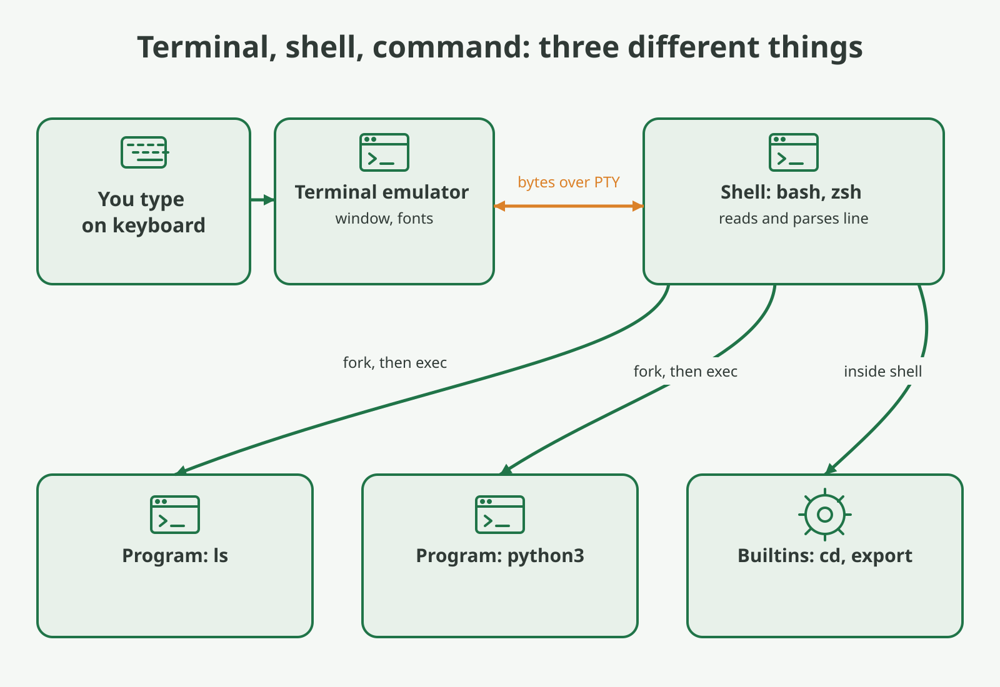
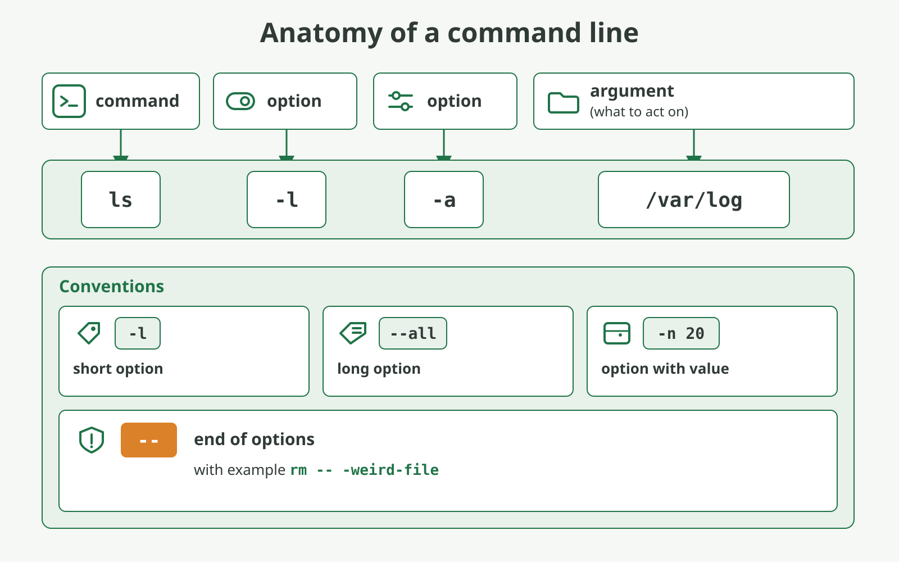
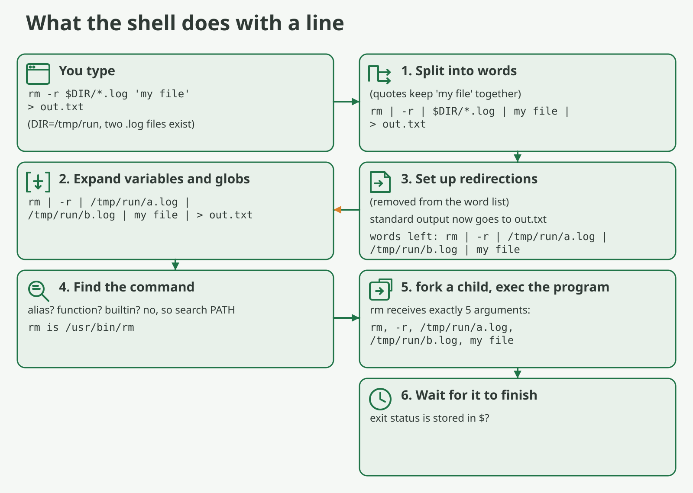
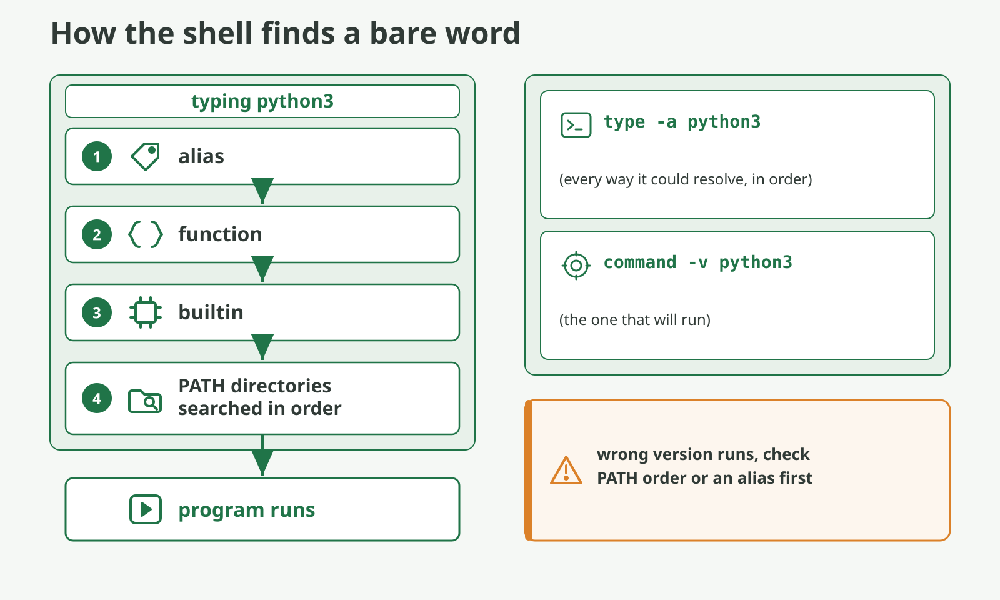
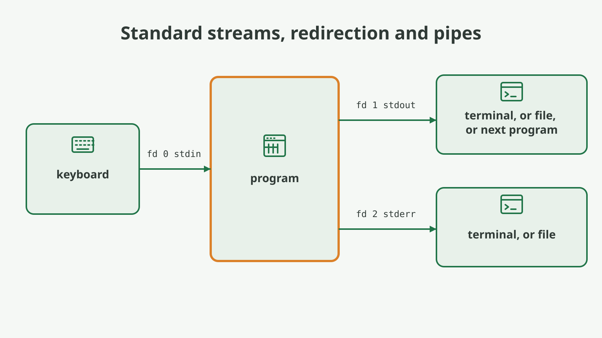
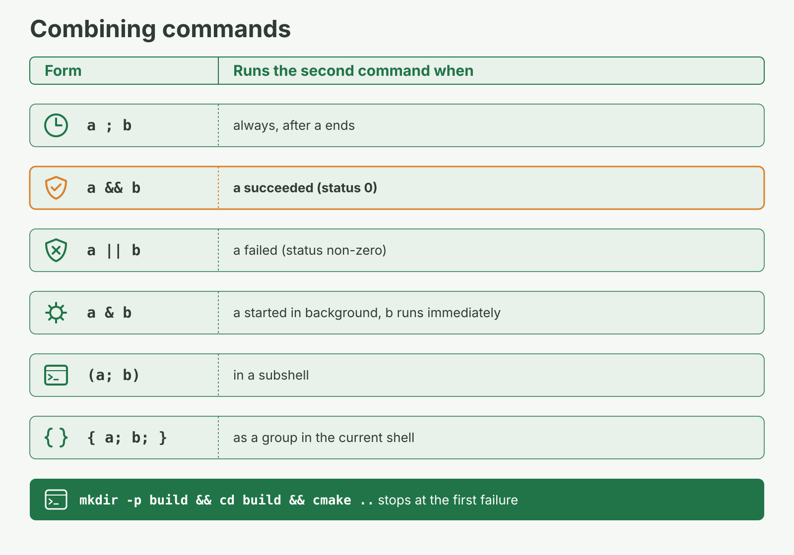
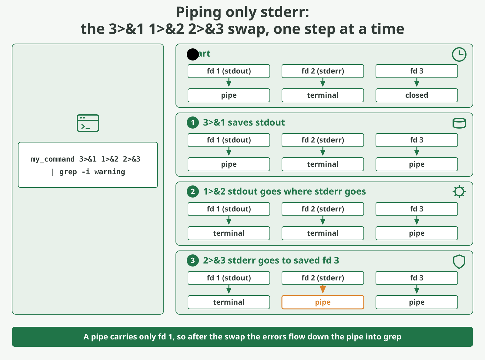
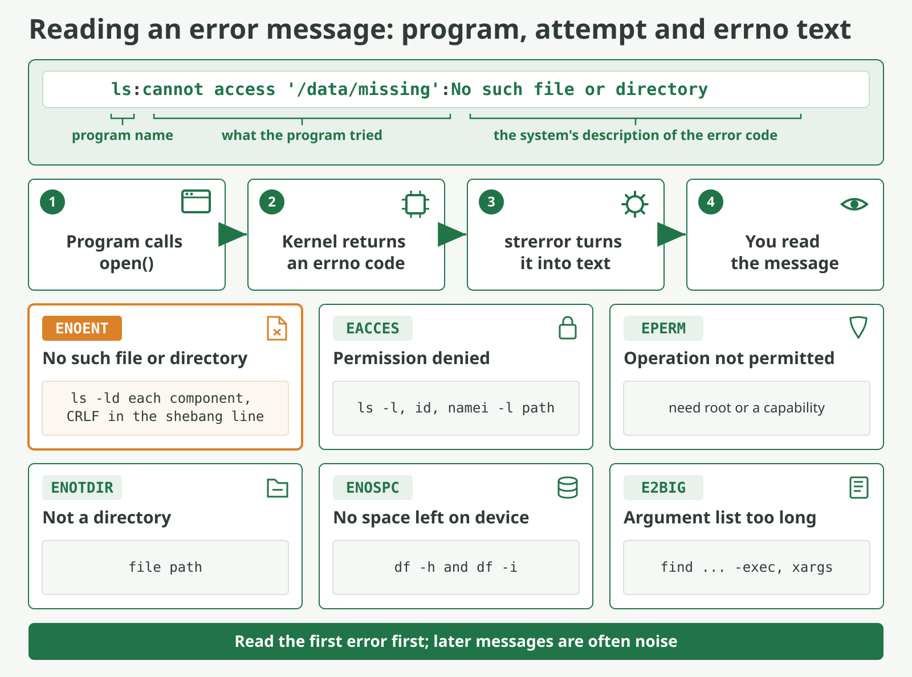

# 1.2 The command line: shells, commands, pipes and redirection

| Field | Value |
|---|---|
| Level | Basics |
| Priority tier | Tier 0 (foundations) |
| Lab venue | Small Ubuntu VM (`shell_pipeline_lab.py`: 26 checks pass; VM commands **untested** here) |
| Part | Part 1: Linux, from the command line to the kernel and performance |

## Why this matters for AI infrastructure

Picture a training job that fails overnight. The log is quiet, the script reports success, and nobody can say why. You look again in the morning, and the cause turns out to be a small shell mistake made weeks earlier by someone in a hurry. This happens more often than you would guess.

You will spend much of your career typing commands into terminals on machines you did not build. Those machines might be a GPU node you reach over SSH, a Slurm login node, the shell inside a container, or a BMC console next to a rack. The typing never really stops. Every cluster job script is a shell command line in disguise. So is every Dockerfile `RUN` line, every Ansible `command:` task, every systemd `ExecStart=`, and every step in a CI pipeline.

People who have used a shell for years, but never learned *how a line is actually processed*, keep getting bitten by the same handful of things. A space in a filename breaks a copy, and an unquoted variable splits into pieces. Errors vanish into the wrong stream. A pipeline reports success while its first stage failed. An environment variable exists in one shell and disappears in another.

This chapter teaches the rules once, from the beginning. After that, these problems stop catching you, and you can read other people's scripts with confidence.

## Prerequisites and outcomes

Chapter 1.1 gives you the model of processes, system calls and the kernel, so read it first if you have not. When you finish this chapter, you will be able to do the following.

- Explain the difference between a terminal, a shell, and a command, and trace what the shell does between you pressing Enter and a program starting.
- Use a core set of commands to look around, create, copy, move, and delete files safely.
- Read and write command lines with options, arguments, quoting, globbing, variables, and command substitution, and predict what the shell will do *before* it runs.
- Use standard input, output, and error, redirection, and pipes, and explain file descriptors 0, 1, and 2.
- Read exit codes, chain commands with `&&`, `||`, and `;`, and recognise the exit codes you will see from Slurm and Kubernetes (126, 127, 137, 143).
- Understand environment variables, `PATH`, startup files, and why "it works in my shell" fails elsewhere.
- Find help yourself with `--help`, `man`, `type`, and friends, and decode a Unix error message.
- Avoid eight classic command-line failures.

## 1. Terminal, shell, command: three different things

Here is a confusion you can watch on any team. Someone says "the terminal is broken" when the remote machine is fine, then spends an hour in the wrong place. Most people blur three things together when they type a line. Keep them apart, and half of the confusion goes away.

- A **terminal** (terminal emulator) is the window where text appears and where your keystrokes go. Today it is a program such as Terminal, iTerm, GNOME Terminal, or the SSH client in your window. Historically it was a physical keyboard-and-screen device. That is why the Linux kernel still has "TTY" devices, short for teletype.
- A **shell** is a program that runs *inside* the terminal. It prints a **prompt**, reads a line you type, interprets it, and runs the programs you ask for. The shell is just a user-space program like any other, and it is not part of the kernel. Common shells include `sh` (the original Bourne shell, and its small modern relatives such as dash), **bash** (the "Bourne-again shell", the default on most Linux distributions), zsh (the default on macOS), tcsh/csh, and fish. Scripts and cluster tooling are overwhelmingly written for bash or plain `sh`. If you want a whole book on bash beyond this chapter and chapter 1.9, Jason Edelman, Scott S. Lowe, and Matt Oswalt recommend *Learning the bash Shell*, 3rd edition, by Cameron Newham and Bill Rosenblatt.
- A **command** is whatever you ask the shell to run. It may be a *program on disk* (`ls`, `python3`), a *shell builtin* handled inside the shell itself (`cd`, `export`), an *alias* (a shorthand you or the system defined), or a *shell function*.



*Figure 1.2.1. Terminal, shell, command: three different things.*

Want to know which shell you are in? Run `echo $0` or `ps -p $$`. The file `/etc/shells` lists the shells installed on the system. Your **login shell**, the one started when you log in, is recorded in `/etc/passwd`, and the command `chsh` changes it. Do not change root's shell or the shell used by system scripts. The interpreter of a script is chosen by its first line (`#!/bin/bash`, chapter 1.9), not by your login shell.

Three more facts about shells are worth knowing early. First, **the shell is also a small programming environment**. Many important parts of a Linux system are themselves shell scripts, meaning text files containing a sequence of shell commands. Startup scripts, installers, package hooks, and the glue in Slurm and Kubernetes tooling all work this way. Chapter 1.9 is devoted to writing them well.

Second, **every Unix system needs a Bourne-compatible shell at `/bin/sh`**, because system scripts assume it is there. On some distributions `/bin/sh` is a link to bash. On **Debian and Ubuntu it is dash**, a smaller, faster POSIX shell that lacks bash extensions such as arrays and `[[ ]]`. That difference bites scripts. A script that starts with `#!/bin/sh` but uses bash features works on one distribution and fails on another. Check with `ls -l /bin/sh`.

Third, **the prompt tells you where you are**. On Ubuntu and Debian it looks like `alice@gpu01:~/lab$` or `admin@ip-172-31-26-181:~$`. It shows the username before `@`, the hostname after `@`, and the current working directory after `:`, where `~` is shorthand for your home directory. On Fedora, Red Hat, and Amazon Linux systems the prompt sits in brackets, such as `[alice@gpu01 lab]$` or `[ec2-user@ip-172-31-5-69 ~]$`. The prompt ends with `$` for a normal user and with `#`, called a hash sign or octothorpe, for `root`. Documentation, including this book, uses the same convention.

A leading `$` marks a command to type as a normal user. A leading `#` marks one that needs root, and you should run it with `sudo` so the action is logged. Not every line you type has the "program, options, arguments" shape. **Shell builtins** and **assignments before a command** (`NCCL_DEBUG=INFO python3 train.py`) are the exceptions you will meet most often.

## 2. Anatomy of a command line



*Figure 1.2.2. A command line is a command, its options and its arguments.*

Say you copy a command from a colleague's note and it does something slightly different from what the note described. The answer often sits in the shape of the line itself. When you type a line, the shell first splits it into **words** at the spaces. The first word is the **command**, and the rest are its **arguments**. An argument that starts with `-` is usually an **option**, also called a flag or switch. Options change what the program does.

```bash
ls -l -a /var/log
#  ^  ^  ^   ^
#  |  |  |   argument (what to act on)
#  |  |  option
#  |  option
#  command
```

Most Linux tools follow a few conventions, and you can rely on them once you have seen them once.

- Short options are one dash and one letter (`-l`), and several can be combined (`-la` equals `-l -a`).
- Long options are two dashes and a word (`--all`, `--human-readable`) and are easier to read in scripts.
- Some options take a value, written as `-n 20`, `--lines=20`, or `-n20`.
- `--` means "end of options; everything after is an argument". It saves you when a filename begins with a dash, as in `rm -- -weird-file`.
- Almost every command accepts `--help`, and many accept `--version`.

### What the shell does with a line

Between the moment you press Enter and the moment a program starts, the shell does a lot of work. It reads, splits, expands, rewires, and only then starts anything. This order is the most useful thing in this chapter, because once you know it you can predict what a line will do before you run it.



*Figure 1.2.3. What the shell does with a line.*

The sequence has a consequence that surprises many people. **The program never sees your wildcards, variables, or quotes. It only sees the final result.** When you type `ls *.txt`, the *shell* replaces `*.txt` with the list of matching names before `ls` starts. You can check this yourself. `echo *.txt` prints the names the shell produced, because `echo` receives them as ordinary arguments. Use `echo` or `printf '%s\n'` as a free preview tool whenever you are unsure what a line will expand to.

### How the shell finds a program: `PATH`



*Figure 1.2.4. The shell checks aliases, functions and builtins before searching PATH in order.*

Suppose two versions of `python3` live on the machine and the wrong one keeps starting. That is not a Python problem. When you type a bare word such as `python3`, the shell first checks for an alias, a function, or a builtin, in that order. If none of them matches, it searches the directories in the environment variable **`PATH`** from left to right and takes the first match. These commands let you inspect that lookup.

```bash
echo "$PATH" | tr ':' '\n'      # show the search directories one per line
type -a python3                  # every way "python3" could resolve, in order
command -v python3               # the one that will run
which -a python3                 # similar, searches PATH only
```

If you run the wrong version of a tool, look at `PATH` order or an alias first. Section 8 goes deeper.

## 3. A survival kit of commands

You do not need a hundred commands to survive your first week on a cluster. You need about a dozen, learned well enough that you no longer stop to think about them. Learn these first. Each one in the table comes with its reason, because a command memorised without a reason is a command you will misuse later. The detailed filesystem ideas, such as paths, inodes and links, are in chapter 1.3. The text-processing tools are in chapter 1.4.

| Command | What it does | The options you will really use |
|---|---|---|
| `pwd` | print the current (working) directory | `-P` resolve symlinks |
| `ls` | list directory contents | `-l` long format, `-a` include dotfiles, `-h` human sizes, `-t` by time, `-r` reverse, `-R` recursive, `-d` the directory itself |
| `cd` | change directory (a *builtin*, because it must change the shell's own state) | `cd` home, `cd -` previous directory, `cd ..` parent |
| `mkdir` | create a directory | `-p` create parents, no error if exists |
| `rmdir` | remove an *empty* directory | |
| `touch` | create an empty file or update its timestamp | |
| `cp` | copy | `-r` directories, `-a` preserve everything, `-i` ask before overwrite, `-v` verbose |
| `mv` | move or rename | `-i`, `-n` never overwrite, `-v` |
| `rm` | remove files (no trash, no undo) | `-r` directories, `-i` ask, `-f` force (no questions) |
| `cat` | print files, or join them | `-n` number lines |
| `less` | read a long file one screen at a time (`q` quits, `/` searches, `G` end, `F` follow) | `-S` no wrapping |
| `head`, `tail` | first or last lines | `-n 20`, `tail -f` follow a growing file |
| `echo`, `printf` | print text | `printf` is more predictable in scripts |
| `wc` | count lines, words, bytes | `-l` lines |
| `clear` | clear the screen (or press Ctrl-L) | |

### The forms of the basic commands

The one-line descriptions in the table hide the forms you will use every day. Read the next few paragraphs slowly, because they are where a copy goes right or quietly goes wrong.

- **`cp`**: `cp file1 file2` copies a file to a new name, and `cp file dir` copies it into a directory and keeps its name. With several sources, as in `cp file1 file2 file3 dir`, the **last argument is the destination**, and it must be a directory. Get that order wrong and the copy lands somewhere you did not expect. Use `cp -r dir1 dir2` to copy an entire directory tree. `cp -p` keeps the original file's attributes, such as permissions and timestamps. Without it, the copy gets the current user's defaults and the current time. Use `cp -i` to ask before overwriting an existing destination. The same thinking shapes `mkdir`. `mkdir -p a/b/c` creates parent directories as needed and stays quiet if they already exist, while `mkdir -m 750 dir` sets the permission mode at creation. Typing `cat > notes.txt` is a quick way to create a file from the keyboard, and you end the text with Ctrl-D. `cat a b c > all` merges three files into one. The originals are kept and the target is overwritten, so use `>>` if you want to append instead. Text-mode file managers such as **Midnight Commander** (`mc`, with its editor `mcedit`) perform many of these operations without a graphical desktop, which makes them a gentle start for newcomers.
- **`mv`**: what it does depends on the arguments, and this is the command that quietly surprises people. `mv file1 file2` renames `file1` to `file2`, and it silently replaces an existing `file2`. Pass `-i` to be asked first, or `-n` to refuse. `mv dir1 dir2` renames the directory if `dir2` does not exist. If `dir2` already exists, the command moves `dir1` *into* `dir2` instead. `mv file dir` moves the file into the directory under the same name. `mv file1 dir/file2` moves and renames in one step, and `mv file* ../dir2` moves a whole list into a directory. In every case the source disappears from its old name or location. Inside one filesystem, a move is only a rename of a directory entry, so it happens instantly, as chapter 1.3 explains. Useful options include `-i` for prompts and `-f` to force the move.
- **`touch`**: creates an empty file if none exists. If the file already exists, `touch` leaves the contents alone and **updates the modification time**. That is how you test build tools that recompile when files change.
- **`rm`**: deletes files, and it refuses to delete directories unless you pass `-r`. **`rmdir`** removes only *empty* directories and refuses otherwise. By contrast, `rm -r dir` removes a directory and everything inside it. Few commands can do more serious damage, especially as root. Never combine `-r` with a bare `*`, and check the line twice before you press Enter.
- **`ls`**: `ls -F` appends a character that marks the file type. A slash means a directory, a star means an executable, and an at sign means a symlink. `ls -l` prints a long listing. Its columns show the file type and permissions, the number of hard links, the owner, the group, the byte size, the modification timestamp, and the filename. Learn to read those columns once, and every later chapter becomes easier.
- **`cd`** is a **builtin**, not a separate program, and the reason is instructive. Every process has its own current working directory, and a child process cannot change its parent's working directory. If `cd` were an external program, it would change *its own* directory and then exit. Your shell would stay right where it started. The same reasoning applies to any command that must change the state of the shell itself, such as `export`, `alias`, `source`, `ulimit`, and `umask`. Those commands cannot simply go in a script and run as a child process. A normal script runs in a child shell, so its directory or variable changes vanish when the child exits. Run `cd` with no argument to return to your home directory. Run `cd -` to toggle between your current directory and your previous one. Say you jump from `/usr/local/bin` to `/media/cdrom`. Typing `cd -` then takes you straight back to `/usr/local/bin`.
- **Paths:** A path component of two dots (`..`) means the parent of a directory. If you are working in `/usr/lib`, the relative path `..` refers to `/usr`, and `../bin` refers to `/usr/bin`. If you are in `/usr/local` and want to move to `/usr/share`, run `cd ../share`. Run `cd ../..` to climb two levels up to `/`. One dot (`.`) refers to the current directory. For example, `./prog` runs an executable file named `prog` in the current working directory. A path that starts with a forward slash (`/`) is absolute, anchored at the single root directory. Any path without a leading slash is relative to your current working directory. Typing `bin` inside `/home/admin` refers to `/home/admin/bin`, whereas `/bin` refers to the system directory at the root. The leading slash is the whole difference, and it decides whether you are working inside your home directory or at the root of the system.

**`cat` as a window onto standard input.** `cat file1 file2` concatenates files to the screen, which is where its name comes from. Run `cat` with **no arguments** and it seems to hang. It is waiting on standard input, which the kernel connects to your terminal. Type some lines and it echoes each one back. Press **Ctrl-D** on an empty line to send end-of-file (`EOF`), and `cat` exits cleanly. Ctrl-C instead kills the program with an interrupt signal. This small experiment shows the whole idea of standard streams, which section 6 covers. A filter command given no file arguments reads from standard input.

Type this first session line by line on a Linux VM. Every line stays inside the scratch directory you create, so nothing outside it changes, and the point is to watch each result appear. These lines were not run on live hardware, so check the output yourself.

```bash
pwd                                  # where am I?
mkdir -p ~/lab/day1/{src,notes}      # make a small tree (brace expansion creates both subdirs)
cd ~/lab/day1
touch notes/todo.txt src/main.py
ls -lR                               # long, recursive listing
echo "install the driver" > notes/todo.txt
cat notes/todo.txt
cp notes/todo.txt notes/todo.bak
mv notes/todo.bak notes/old.txt
ls notes
rm notes/old.txt                     # gone; there is no undo
```

### The one habit that prevents most disasters

`rm` does not move anything to a trash folder, so a deleted file is gone. `rm -r` descends into directories, and `rm -f` suppresses all warnings. The combination `rm -rf` has destroyed production data many times. It usually happened when the command was pointed at the wrong path, or at a path built from an empty variable. The person who typed it was not careless; they were moving fast and trusted the line. Build three habits instead.

1. Run `ls` with the exact same pattern first. If it lists what you expect, replace `ls` with `rm`.
2. Never put an unquoted variable in a destructive command. Use `rm -rf -- "${DIR:?DIR is empty}/build"` so the `:?` operator makes the shell abort with an error if `DIR` is empty or unset.
3. Prefer `rm -i` in interactive sessions, and keep `-f` out of your muscle memory.

Make the `ls` check a reflex before any `rm`, the way you look before crossing a road.

## 4. Getting help without leaving the terminal

You cannot memorise every option of every command, and nobody expects you to. Linux ships with a lot of built-in documentation, so what matters is finding the answer fast. For most basic commands, the manual pages, called *man pages*, tell you what you need. To read the manual page for `ls`, run `man` like this.

```bash
man ls                         # read the manual page for ls
ls --help | less               # a short usage summary; works for most GNU tools
man -k "copy files"            # search manual names and descriptions (same as apropos)
type cd ; help cd              # for shell builtins use 'help', not 'man'
info coreutils                 # the GNU 'info' manuals, sometimes more detailed
ls /usr/share/doc | head       # package-supplied documentation
```

Manual pages are grouped into numbered **sections**. You will see names like `ls(1)` or `socket(2)`, and the number tells you which section the page belongs to.

| Section | Contains | Example |
|---|---|---|
| 1 | user commands | `man 1 ls` |
| 2 | system calls | `man 2 execve` |
| 3 | C library functions | `man 3 printf` |
| 4 | device interface and driver information | `man 4 null` (of marginal use) |
| 5 | file formats and configuration files | `man 5 passwd`, `man 5 slurm.conf` |
| 6 | games | `man 6 intro` (rarely useful) |
| 7 | overviews, conventions and encodings | `man 7 signal`, `man 7 cgroups` |
| 8 | system administration commands | `man 8 mount` |

When one name exists in several sections, pass the section number yourself. `man 5 passwd` opens the format of the `/etc/passwd` file. `man 1 passwd` opens the password-changing command. Two pages, one name, and completely different subjects.

Manual pages are **reference material, not tutorials**. They list options systematically, often in alphabetical order, so they do not tell you which options matter first. Expect to scan, and do not read one like a chapter of a book. As an administrator you will use sections 1, 5, 7 and 8 most. Section 3 is for C programmers. Section 2 becomes readable once you understand system calls from chapter 1.1. When you know what a tool should do but not its name, run `man -k sort` or `apropos sort`. These search manual page names and one-line descriptions. The output shows the page name, the section number and a summary, such as `sort (1) - sort lines of text files` next to `qsort (3)` for the C library function.

The GNU project publishes many manuals in **info** format. Run `info coreutils`, navigate it with its own keys, or pipe it through `less`. Info pages often hold more detail than the man page. Some packages also install README files and examples under `/usr/share/doc`, with no man or info page at all. For a fast option check, `command --help` or `command -h` prints a short usage summary. Inside `man`, press `/word` to search forward, `n` to jump to the next match, and `q` to quit. On a cluster, **the manual of the exact version installed on the machine is authoritative**. Trust `man slurm.conf` on your login node over any blog post.

### Reading a man page without getting lost

A common first reaction is to type `man ls`, see a wall of text, and give up. The problem is expectation, not difficulty. A manual page is a reference, not a lesson. It lists every option, often in alphabetical order, and it does not say which options matter most. Scan for the option you need instead of reading from the top.

Help output can be noisy too. Try `command --help` or `command -h` first, because the flag varies from command to command. Some tools print a deluge of text, and `ls --help` is a good example, so pipe long output through `less` and search inside it with `/`.

The GNU Project decided that it did not like manual pages very much, and moved much of its documentation to **info**, also called texinfo. Info pages often go further than a man page, but they are more complex to use. Run `info command` to open one, or send its output to `less` if you dislike the info reader. Some packages install documentation in `/usr/share/doc` with no man or info page at all, so look there when a search comes up empty.

Patience is the real skill. If you have time, read the man page until you find the option. If you are impatient, ask a colleague instead. When you know what a tool should do but not its name, search by keyword. Here is what `man -k sort` prints, with lines removed for space:

```
$ man -k sort
--snip--
comm (1) - compare two sorted files line by line
qsort (3) - sorts an array
sort (1) - sort lines of text files
sortm (1) - sort messages
tsort (1) - perform topological sort
--snip--
```

Each line gives the page name, its section number and a short description. Read the section number before you open a page, because the same name can appear in several sections.

## 5. Expansion and quoting: the rules that explain "weird" behaviour

Here is a line that looks harmless and does something strange: `cp $src /backup`. It works on your laptop and fails on the cluster, because the file name has a space in it. Before it runs a command, the shell expands several kinds of text, and this section is about those expansions. These are the ones you will use every day.

| Kind | Example | Becomes |
|---|---|---|
| Tilde | `~`, `~alice` | home directory of you, or of alice |
| Variable | `$HOME`, `${USER}` | the variable's value |
| Command substitution | `$(date +%F)` | the command's output, for example `2026-10-23` |
| Arithmetic | `$((3 * 7))` | `21` |
| Brace expansion (bash and zsh) | `file{1..3}.txt`, `{a,b}` | `file1.txt file2.txt file3.txt`, `a b` |
| Globbing (wildcards) | `*.log`, `data?`, `[abc]*` | the matching file names |

**Globbing.** A glob is a wildcard pattern, and it is the expansion that surprises beginners most. `*` matches any run of characters, including none. `?` matches exactly one character. `[abc]` matches one of the listed characters, and `[0-9]` matches one character in a range.

Globs match names in the filesystem, and the shell does the matching before the program runs. Two details follow from that. They never cross a `/`, so a single `*` stays inside one directory level. And a `*` does not match hidden files, which start with a dot.

When nothing matches, bash passes the pattern through unchanged. So `ls *.xyz` tries to list a file literally named `*.xyz`. zsh stops instead with "no matches found". That difference trips up people who move scripts between a Mac and a Linux server.

Practise with a few patterns. `at*` matches names that start with `at`. `*at` matches names that end with `at`. `*at*` matches names that contain `at`. `b?at` matches `boat` and `brat`. **A trap for anyone coming from Windows:** `*.*` does *not* mean "all files". On Linux it matches only names that contain a dot. Use `*` for everything, because Unix names need not have an extension. To pass a literal `*` to a program, as you must with `grep` and `find` patterns, single-quote it: `echo '*'` prints a star. Remember the rule behind all of this. **The shell expands globs before running the command, and only then.** If a `*` reaches a program unexpanded, the program, not the shell, decides what it means.

The last point is hidden files. `*` skips names that begin with a dot, and the obvious fix, `.*`, is a trap. It also matches `.` and `..`, the current and parent directories, and `rm -r .*` has damaged real systems this way. To match hidden files safely, use `.[!.]*` or `.??*`. For anything destructive, prefer `find` (chapter 1.3).

The full set of shell patterns includes `*` for any string, `?` for any one character, `[c1-c2]` for any character in a range, and `[!c1-c2]` for any character *not* in the range. It also includes `{a,b,c}` for an exact comma-separated list and `{10..20}` for a numeric sequence. Braces are the exception, because they generate words without looking at real file names. So `ls *.{cxx,h,la}` becomes `ls *.cxx *.h *.la`, and `cp config{,.bak}` becomes `cp config config.bak`, even though the second file does not exist yet.

**Hostile or accidental file names.** Once a glob expands, a name that begins with a dash can be read as an option. A file called `-rf` can turn `rm *` into trouble. The universal remedy is the argument `--`, which means "no more options, only file names". `rm -- -f` removes a file named `-f`, while `rm -f` would read `-f` as an option. Likewise, `rm -- '-rf *.?'` removes a file whose name is full of special characters, once you quote or backslash-escape each one.

**Quoting** decides which expansions happen, and it is the single most useful skill in this section. Three tools control it.

| Form | Effect | Example |
|---|---|---|
| `'single quotes'` | everything is literal, nothing expands | `echo '$HOME and *'` prints `$HOME and *` |
| `"double quotes"` | variables, `$(...)` and backslash escapes still work; wildcards and word splitting are suppressed | `echo "home is $HOME"` |
| `\` backslash | escapes the next single character | `echo \$HOME`, `touch my\ file` |

The most important rule in shell scripting is this: **double-quote your variable expansions**, such as `"$var"`, `"$@"` and `"$(cmd)"`. An unquoted `$var` is first split on whitespace and then expanded by globs. Say `file="my report.txt"`. Then `cp $file /backup` runs `cp my report.txt /backup`. That is three arguments, so the command fails or copies the wrong thing. `cp "$file" /backup` is correct.


*Figure 1.2.5. Quoting decides what the program receives. An unquoted variable is split on whitespace, while a double-quoted variable reaches the program as one argument.*

### Special characters: the names to know

When you talk about Linux with others, the spoken names of special characters help. Say "pipe" out loud on a call and everyone knows which key you mean. Many of these characters mean something to the shell. You must quote or escape them when you want them taken literally. If you enjoy the folklore behind Unix terminology, read the *Jargon File* (`http://www.catb.org/jargon/html/`), or its printed companion, *The New Hacker's Dictionary*, edited by Eric S. Raymond.

| Character | Names | Common uses |
|---|---|---|
| `*` | star, asterisk | glob; "zero or more" in regular expressions |
| `.` | dot | current directory; hidden-file prefix; separator in names |
| `!` | bang | negation; history expansion (`!!`) |
| `\|` | pipe | connect commands |
| `/` | slash | directory separator (never a backslash); `/pattern` searches in `less`, `man`, `vim` |
| `\` | backslash | escape the next character; line continuation (never a directory separator) |
| `$` | dollar | variables, command substitution; end of line in regular expressions |
| `'` | single quote, tick | literal string |
| `` ` `` | backtick | old form of command substitution (use `$(...)`) |
| `"` | double quote | string that still expands variables |
| `^` | caret, hat | start of line in regular expressions; negation in `[^...]`; written before a letter for control keys (`^C` means Ctrl-C) |
| `~` | tilde | home directory |
| `#` | hash, pound, sharp | start of a comment; the root prompt |
| `[ ]` | square brackets | character sets and ranges in globs and regular expressions; `[ ]` as a test command |
| `{ }` | braces, curly brackets | brace expansion, grouping, variable syntax `${var}` |
| `_` | underscore | a space substitute where spaces are not allowed |

Some utilities, such as the Perl programming language, use almost all of these special characters. Keep in mind that the names above are the American names for them. Learn the characters by what they do in a command, and the names will follow.

Try this predict-then-check habit. Guess each output before you press Enter, then compare. The gap between the two is where the learning happens.

```bash
file="my report.txt"
printf '<%s>\n' $file          # unquoted: two words
printf '<%s>\n' "$file"        # quoted: one word
echo *.conf                    # see what the glob becomes
echo "$(date +%F)-run"         # command substitution inside quotes
```

Before you run a line that uses `$` or `*`, predict exactly what the program will receive.

## 6. Standard streams, redirection and pipes

Picture a command whose output you are logging to a file. The file fills with results, the errors still flash past on your screen, and you wonder why the log is incomplete. The reason is that the shell gives every program three separate channels, and most people only watch one of them.

Every process starts with three open **file descriptors**. A file descriptor is a small integer the kernel uses to refer to an open file, pipe, terminal or socket. By convention, the first three are these.

| FD | Name | Default is | Used for |
|---|---|---|---|
| 0 | standard input (stdin) | the keyboard | data the program reads |
| 1 | standard output (stdout) | the terminal | normal results |
| 2 | standard error (stderr) | the terminal | error and diagnostic messages |

Keeping errors in a *separate* stream was a deliberate design choice, and it matters a lot. You can capture results without mixing in warnings. You can still see errors when the output is redirected. The shell rewires these descriptors before it starts a program, and the program does not know or care where they lead. This is the "everything is a file" idea from chapter 1.1, applied to standard streams.



*Figure 1.2.6. Standard streams, redirection and pipes.*

These are the redirection operators. Each one tells the shell where a descriptor should point before the program starts.

| Operator | Meaning | Example |
|---|---|---|
| `> file` | send stdout to file, overwriting it | `ls > list.txt` |
| `>> file` | append stdout to file | `echo run >> log.txt` |
| `< file` | read stdin from file | `wc -l < list.txt` |
| `2> file` | send stderr to file | `ls /nope 2> err.txt` |
| `2>&1` | make stderr go where stdout currently goes | `cmd > all.txt 2>&1` |
| `&> file` | (bash) both stdout and stderr to file | `cmd &> all.txt` |
| `> /dev/null` | discard output (`/dev/null` swallows everything) | `cmd > /dev/null 2>&1` |
| `<<EOF` ... `EOF` | here-document: feed text lines as stdin | see below |

The table leaves out two points. First, **`>` destroys the previous contents of the target file the moment the command starts**, even if the command then fails. A typo such as `sort data.txt > data.txt` empties the file before `sort` reads it. In bash, `set -o noclobber` or `set -C` makes `>` refuse to overwrite an existing file. You can force an overwrite with `>|`, and that is a worthwhile safety net in interactive shells. Second, pipes can chain as many commands as you like, one after another. For example, `head /proc/cpuinfo | tr a-z A-Z` upper-cases the first lines of the CPU description. The `<` operator is rarely needed, because most commands accept file names directly. `head < /proc/cpuinfo` and `head /proc/cpuinfo` do the same thing. A few programs only read standard input, though.

**Order matters.** The shell processes redirections from left to right, and this one rule explains a family of confusing bugs. In `cmd > out.txt 2>&1`, stdout goes to the file first. Then stderr is pointed at the same place, so both end up in the file. In `cmd 2>&1 > out.txt`, stderr is pointed at the terminal first, because that is where stdout goes at that moment. Only then does stdout move to the file, so errors still appear on the screen. Memorise the first form. It is the one you want almost every time.

**Pipes.** The `|` character connects the stdout of one command directly to the stdin of the next. No temporary file is needed. `ps -ef | grep slurmd | wc -l` is a complete example. The kernel keeps a small in-memory buffer between the two processes, and both run *at the same time*. This is the heart of the Unix philosophy. Many small tools each do one job, and you join them into pipelines. A pipe carries only stdout. Stderr still goes to the terminal unless you redirect it, as in `cmd1 2>&1 | cmd2`.


*Figure 1.2.7. Every process has three streams, the shell rewires them before the program starts, and the order of redirections decides where errors end up.*

Four tools pair naturally with redirection and pipes.

- `tee file` copies stdin to both stdout and a file. For example, `make 2>&1 | tee build.log` lets you see the output *and* keep a log. `tee -a` appends.
- `/dev/null` is the black hole for output you do not want.
- `xargs` builds a command line from stdin (chapter 1.4).
- **Here-documents** write multi-line input inline. They are very handy for creating config files from scripts.

```bash
cat > /tmp/job.sbatch <<'EOF'
#!/bin/bash
#SBATCH --nodes=2
echo "hello from $(hostname)"
EOF
```

Quoting the delimiter (`'EOF'`) stops the shell from expanding `$` and backticks inside the text, so the file is written exactly as typed. Without quotes, `$(hostname)` would be replaced *when the file is created*. That single pair of quotes decides whether the job script records a name for later or bakes in a value forever.

Before you pipe a command, decide which stream you need, and redirect the other one.

## 7. Exit status and combining commands



*Figure 1.2.8. Operators decide whether the second command runs based on the first command's exit status.*

Suppose a job script runs three steps, the middle one fails, and the script still reports success. The culprit is not the script's logic but the way it reads exit statuses. When a process ends, it hands a small integer back to its parent. That number is the **exit status**, also called the exit code. By convention, **0 means success**, and any other value means failure. The shell stores the status of the last command in `$?`.

```bash
ls /tmp ; echo "status=$?"       # 0
ls /nope ; echo "status=$?"      # non-zero (2 for GNU ls)
```

You can chain commands based on that status, which is how a well-written script stops at the first problem instead of pushing on through it.

| Form | Runs the second command when |
|---|---|
| `a ; b` | always, after `a` ends |
| `a && b` | `a` succeeded (status 0) |
| `a \|\| b` | `a` failed (status non-zero) |
| `a & b` | `a` is started in the background, and `b` runs immediately |
| `(a; b)` | in a subshell (a child shell; variable changes do not leak out) |
| `{ a; b; }` | as a group in the current shell |

A typical use is `mkdir -p build && cd build && cmake ..`. It stops at the first failure. `command || echo "failed" >&2` reports the failure on stderr instead.

### Exit codes you will meet in AI infrastructure

These are not abstract numbers. Each one will greet you in a cluster log at some point, so it pays to know them before they appear.

| Code | Meaning | Where you see it |
|---|---|---|
| 0 | success | everywhere |
| 1 | generic error | many tools |
| 2 | misuse of a command or syntax error | shells, many CLIs |
| 126 | found but not executable (permissions, wrong format) | scripts without `chmod +x` |
| 127 | command not found | wrong `PATH`, missing package |
| 128 + N | killed by signal N | `130` = Ctrl-C (SIGINT 2); `137` = SIGKILL (9); `143` = SIGTERM (15) |

The `128 + N` rule explains many common incidents. **A Kubernetes container that exits with 137 was killed with SIGKILL, most often by the kernel's out-of-memory killer, which shows up as "OOMKilled".** A Slurm job that ends with exit code `0:9` or reports signal 9 was killed in the same way. The killer might be a cgroup memory limit, or an administrator running `scancel`. Exit 143 is a polite SIGTERM, such as Kubernetes asking a pod to stop. When you see 137 in a pod, check its memory limit before anything else. You can reproduce 137 yourself with `bash -c 'kill -9 $$'; echo $?`.

A related trap is this. **In a pipeline, the exit status comes from the *last* command only.** `false | cat; echo $?` prints `0`, which hides the failure of `false`. In scripts, use `set -o pipefail` (chapter 1.9). Then the pipeline fails if any stage fails.

Check the status of every critical stage, not only the final one.


*Figure 1.2.9. The exit status is the number a finished process hands back to its parent, and 128 plus N means it was killed by signal N.*

## 8. Environment variables, `PATH` and startup files

Here is a mystery you will meet in your first month: a command works when you type it, then fails inside the job. The program is the same, the arguments are the same, and the environment is not. A shell keeps named values called **variables**. The ones marked with `export` go into the **environment**, which is a block of `NAME=value` strings. Every child process inherits it, because the kernel copies it on `execve` (chapter 1.1). That is how `PATH`, `HOME`, `LANG` and application settings travel from the shell into programs.

```bash
name="alice"                    # shell variable: visible only to this shell
export CUDA_VISIBLE_DEVICES=0,1 # environment variable: inherited by children
env | sort | head               # list the environment (printenv is similar)
echo "$name $CUDA_VISIBLE_DEVICES"
bash -c 'echo "[$name] [$CUDA_VISIBLE_DEVICES]"'   # child sees only the exported one
NCCL_DEBUG=INFO python3 train.py     # set a variable for ONE command only
```

Notice what the child sees in that block. It prints `[$name] [$CUDA_VISIBLE_DEVICES]` with the first pair empty, because a plain assignment never leaves the shell that made it.


*Figure 1.2.10. A plain assignment never leaves the shell that made it, while an exported variable is copied into the environment that every child process inherits.*

Some variables matter throughout this book. `PATH` drives command lookup. `HOME`, `USER` and `PWD` describe you and your location. `LANG` and `LC_ALL` set the locale and sorting order, and `EDITOR` picks your editor. You will also set AI-specific variables again and again: `CUDA_VISIBLE_DEVICES`, `NCCL_DEBUG`, `NCCL_SOCKET_IFNAME`, `OMP_NUM_THREADS`, and `LD_LIBRARY_PATH`. Remember this rule. An environment variable set in your terminal does not exist inside a Slurm job, a systemd service, or a container, unless it is passed along explicitly. Many "works interactively, fails in the job" mysteries come down to this rule.

### Modifying `PATH` safely

```bash
export PATH="$HOME/bin:$PATH"      # prepend: your tools win
export PATH="$PATH:/opt/tool/bin"  # append: system tools win
```

Order is priority. The first directory that holds a matching name wins, so a prepend lets your tools speak first. Never add an empty element or `.` (the current directory) to `PATH`. Doing so lets any file in any directory you visit shadow a real command.

Two practical points about editing `PATH`. First, the assignment has **no spaces around `=`**. Write `PATH=dir:$PATH`. With spaces, the shell tries to run a command called `PATH`. Second, a typo such as `PATH=dir:$PAHT` replaces the whole path with a nearly empty one. Then even `ls` reports "not found". Do not panic. The damage stays inside that shell, so close the window or run `exec bash` or `bash -l` for a fresh one. Permanent damage needs the same typo in a startup file. Even then, you can fix it by running commands with full paths, such as `/usr/bin/vim ~/.bashrc`.

The same distinction applies to any variable. A plain assignment such as `STUFF=blah` creates a **shell variable**, visible only to the shell. `export STUFF` turns it into an **environment variable** that every child inherits. Programs read their configuration from the environment. `LESS`, for example, holds your preferred `less` options. Many manual pages end with an ENVIRONMENT section that lists the variables the program honours.

### Startup files: where the settings live

Startup files set defaults for the shell and other interactive programs. They decide how things behave when a user logs in. Most users never look at them, and they touch them only to add something handy, such as an alias. Over time, those files fill up with unnecessary environment variables and tests. That clutter can cause annoying problems, and sometimes serious ones. Files whose names start with a dot are called **dot files**. The leading dot hides them from the default display of `ls` and most file managers. Use `ls -a` to see `.bashrc`, `.ssh/`, `.gitconfig`, and `.vimrc`.

Keep two goals in mind when you design startup files, whether for yourself or as defaults for new cluster users in chapter 1.6. The first goal is **simplicity**. Keep the number of startup files small and short. A mistake shipped to 10 users may need fixing 10 times. The second goal is **readability**. Write descriptive comments so anyone can see what each line does.

When bash starts, the configuration files it reads depend on *how* the shell was started.

| Kind of bash shell | Reads (in order) | Examples |
|---|---|---|
| **login shell** (SSH login, `bash -l`) | `/etc/profile`, then **only the first** file it finds among `~/.bash_profile`, `~/.bash_login`, and `~/.profile` | what you get over SSH or on a text console |
| **interactive non-login** (a new terminal window on a desktop, or `bash` typed inside a session) | `~/.bashrc` | aliases, prompt, interactive functions |
| **non-interactive** (scripts, `ssh host command`, cron, Slurm batch steps) | nothing by default (only what `BASH_ENV` names) | automation and batch jobs |

Pay close attention to how bash handles login shells. It first executes `/etc/profile`. Then it looks in your home directory for `.bash_profile`, `.bash_login` and `.profile`. It **runs only the first one it finds**. If `.bash_profile` exists, bash ignores `.bash_login` and `.profile` completely. This one sentence explains a great many "my alias is missing over SSH" reports. It may sound strange, but you can run a non-interactive shell as a login shell, with `bash -l -c 'cmd'`. Most graphical desktop display managers do exactly this. They start your session with one non-interactive login shell, which keeps the login versus non-login environment model intact.


*Figure 1.2.11. Which startup file bash reads depends on how the shell was started.*

In bash, you can choose among `.bash_profile`, `.profile`, `.bash_login` and `.bashrc`. Which one should hold your command path? The path starts with `/usr/local/bin:/usr/bin:/bin`, adds `$HOME/bin` or `$HOME/.local/bin`, and then includes `/usr/local/sbin:/usr/sbin:/sbin` for utilities such as `sysctl`, `fdisk` and `lsmod`. Where should the manual page path (`MANPATH`), the prompt (`PS1`), aliases, `EDITOR` (`vi`, `emacs`, or `nano`), `PAGER` (`less`) and the permissions mask (`umask 022`) go? Put your main configuration in `~/.bashrc`. Then have `~/.bash_profile` source `~/.bashrc`, so login and non-login interactive shells share one setup. One file to edit, one place to look when something is missing.

```bash
# Inside ~/.bash_profile
if [ -f "$HOME/.bashrc" ]; then
    . "$HOME/.bashrc"
fi
```

Inside `~/.bashrc`, check whether the shell is interactive before you run interactive-only commands. Look for `i` in the special `$-` option-flags variable.

```bash
# Inside ~/.bashrc: return early if non-interactive
case $- in
    *i*) ;;
      *) return ;;
esac
```

Other shells follow different rules. In tcsh, the enhanced C shell that popularized command-line editing and completion, you do not need to worry about login versus non-login shells. At startup, tcsh looks for `.tcshrc`. If that file is missing, it looks for the csh startup file, `.cshrc`. The order lets you keep tcsh extensions in `.tcshrc`, where they will not break csh. In practice, sticking to traditional `.cshrc` lines works everywhere. Examples are `setenv PATH ...`, `setenv EDITOR vi`, `setenv PAGER less`, `setenv LESS meiX` and `umask 022`. Even so, bash should be the default shell for new users. csh is a notoriously bad scripting tool. bash uses GNU `readline` and gives clean control over I/O redirection and file handles.

Follow six strict rules to avoid startup file pitfalls on any server or cluster. Each one comes from an incident, not a theory.

1. **Keep graphical commands, and the `DISPLAY` and terminal type (`TERM`) variables, out of shell startup files.** Not every shell runs in a graphical environment. Display managers have their own startup files, such as `.xsession` and `.xinitrc` for GNOME or KDE.
2. **Do not run commands that print to standard output in a startup file.** Output from `.bashrc` corrupts the wire protocol of file-transfer tools such as `scp`, `sftp` and `rsync`, which are non-interactive.
3. **Never set `LD_LIBRARY_PATH` in a shell startup file.** See chapter 1.11 for details. Overriding the dynamic linker search path globally breaks system binaries. Set it only inside an environment module or a job wrapper.
4. **Do not skimp on comments in default startup files.** Test new defaults from scratch with two fresh test user accounts before you distribute them.
5. **Keep default editor startup files small.** A little `set showmatch` in the `.exrc` file, which makes `vi` show matching parentheses, never hurt anyone. Steer clear of anything that changes editor behavior or appearance a lot, such as `showmode`, auto-indentation and wrap margins.
6. **Remember the non-interactive row of the table.** `ssh host 'command'`, `cron` and Slurm batch scripts do not read `~/.bashrc` by default. So any `PATH` change that a batch job relies on must be set inside the job script.

Before you blame a job failure on the code, check the environment the job actually received.

## 9. Working faster: history, completion and editing

You will retype the same long command many times today, and a typo in the middle of it costs you the whole line. The shell has shipped with an editor for decades, and most people never learn to use it. These are the built-in *readline* keystrokes. Once they are in your fingers, you will work much faster.

| Keystroke | Action |
|---|---|
| `Ctrl-B` / `Ctrl-F` | Move the cursor left / right one character |
| `Alt-B` / `Alt-F` | Move the cursor backward / forward one word |
| `Ctrl-P` / `Ctrl-N` | View the previous / next command in history (same as Up / Down arrows) |
| `Ctrl-A` / `Ctrl-E` | Move the cursor to the beginning / end of the line |
| `Ctrl-W` | Erase the preceding word |
| `Ctrl-U` | Erase from the cursor to the beginning of the line |
| `Ctrl-K` | Erase from the cursor to the end of the line |
| `Ctrl-Y` | Yank (paste) the text most recently erased with `Ctrl-W`, `Ctrl-U`, or `Ctrl-K` |
| `Ctrl-R` | Search backward incrementally through command history |
| `Ctrl-L` | Clear the terminal screen while keeping the current line |

Three of these pay for themselves in a single day. `Ctrl-R` finds a command you ran an hour ago. `Ctrl-A` and `Ctrl-E` jump to either end of a long line so you can fix one word instead of retyping it.

- **Tab completion** finishes command names, file names and options when `bash-completion` is installed. Press Tab twice to list every candidate.
- **History shortcuts:** `history | tail` lists recent commands. `!!` repeats the previous command, so `sudo !!` re-runs it as root. `!$` expands to the last argument of the previous command.
- **Terminal control keys:** `Ctrl-C` sends `SIGINT` to interrupt the foreground program. `Ctrl-D` sends end-of-input (`EOF`). `Ctrl-Z` suspends the foreground program with `SIGTSTP`, so you can resume it with `fg` or `bg` (chapter 1.8). `Ctrl-S` and `Ctrl-Q` pause and resume terminal output.
- **Aliases:** `alias ll='ls -lah'` creates a shorthand. To bypass an alias once, prefix the command with a backslash, as in `\ls`.

### Shell tricks that save hours on clusters



*Figure 1.2.12. Each redirection is applied left to right: fd 3 saves the pipe, fd 1 moves to the terminal, and fd 2 ends up on the pipe.*

Administering hundreds of nodes means repeating the same operation many times, so small habits add up. The tricks below work in bash and mostly in zsh. A few of them do not work in plain `sh`, so check before you put one in a script.

- **Brace expansion generates lists and variants.** `cp config{,.bak}` expands to `cp config config.bak`. The empty first alternative gives the plain name. `for n in gpu-{1,2}-{a,b}; do echo $n; done` visits four combinations. Ranges work too, as in `echo {1..15}`. Brace ranges do not keep leading zeros, though. For names such as `node-001` to `node-100`, use `seq` instead: `for i in $(seq -w 1 100); do ssh node-$i true; done`. The `-w` option pads each number to equal width. The remote command `true` prints nothing, so only the nodes that fail to answer show an error. That is a fast way to find the dead node in a rack.
- **Reuse earlier commands.** `!!` is the previous command. After a "Permission denied", `sudo !!` repeats it as root. `!$` is the last argument of the previous command. So after `chown alice data.txt`, you can run `chmod 600 !$`. `history | grep sudo` finds older commands. Every history entry has a number, so `!123` re-runs entry 123. Always inspect a line before you run it, because history expansion repeats the exact line that was typed. Ctrl-R searches backwards as you type a substring. Press it again to reach the next older match.
- **Quick arithmetic.** `echo $((123*55+18))` computes with integers. Inside `$(())`, variables need no `$`, as in `$((123*55+offset))`. For fractions, use `bc`.
- **More command separators.** `&` runs a command in the background, and it also separates that command from the next one. In `job_a & job_b & wait`, both jobs start, and `wait` pauses until they finish. `&&` and `||` are conditional. A common test is `[ -f testfile ] && cat testfile`. Here `[` is **a command**, an old synonym for `test`. That is why it needs spaces around its arguments and around the closing `]`.
- **Process only the error stream.** A pipe carries stdout only. To pipe stderr instead, swap the two streams using a spare descriptor: `my_command 3>&1 1>&2 2>&3 | grep -i warning`. First, the command saves stdout as descriptor 3. Then it points stdout where stderr goes. Finally, it points stderr at saved descriptor 3.
- **Keep the raw output and still analyse it.** `my_command | tee out.log | grep warning` writes everything to `out.log`. Only the matching lines continue down the pipe, so you keep both the full log and the filtered view.
- **Copy a tree to another host with no temporary file.** `tar cf - mydata/ | ssh remotehost 'cd /place/to/go && tar xf -'`. See chapter 1.5 and chapter 1.3.
- **Useful built-in variables in scripts.** `$?` holds the status of the last command. `$$` holds the PID of the current shell. `$!` holds the PID of the last background job (chapter 1.9).
- **bash versus `sh`.** Many of these tricks rely on bash features. Do not assume they work in a script that starts with `#!/bin/sh`.

Pick two of these habits and make them automatic, because you will use them every day on a cluster.

## 10. Understanding error messages



*Figure 1.2.13. The text after the last colon is the standard description of an errno code, so learning a few codes lets you diagnose any program.*

An error message looks cryptic until you see its fixed shape. Once you do, every program on the machine speaks the same small language.

```
ls: cannot access '/data/missing': No such file or directory
|   |                              |
|   what the program tried          the system's description of the error code
program name
```

The final text after the colon is not written by the program. It is the standard description of an **errno** code. The kernel returns that code when a system call fails, and `strerror` turns it into the text you read. The set of codes is small. Learn the common ones, and you can diagnose failures in any program, including ones you have never seen. The table lists the ones that matter, with what to check first.

| Message | Code | Meaning in practice | First checks |
|---|---|---|---|
| No such file or directory | `ENOENT` | the path does not exist (or a directory in the path does not); also what you get running a script whose `#!` interpreter is missing | typo, relative versus absolute path, `ls -ld` each component, CRLF in the shebang line |
| Permission denied | `EACCES` | the file exists but your user, group or the path's directories do not allow this access (or an SELinux/AppArmor rule blocks) | `ls -l`, `id`, `namei -l path` |
| Operation not permitted | `EPERM` | you are not allowed to do this *operation* regardless of the file's mode (changing ownership, setting time, loading a module) | need root or a capability |
| File exists | `EEXIST` | creating something that is already there | `ls`, use `-p` or remove it |
| Not a directory / Is a directory | `ENOTDIR` / `EISDIR` | wrong kind of object for this operation | `file path` |
| No space left on device | `ENOSPC` | the filesystem is full of data **or** out of inodes (file slots) | `df -h` **and** `df -i` |
| Too many open files | `EMFILE` / `ENFILE` | the per-process or system limit on open file descriptors | `ulimit -n`, `lsof -p` |
| Argument list too long | `E2BIG` | a glob expanded into too many names for one command | use `find ... -exec`, `xargs` |
| Command not found | (exit 127) | the shell found nothing in `PATH` | `type`, `echo $PATH`, install the package |
| Segmentation fault | signal `SIGSEGV` | the program touched memory it may not (the MMU faulted, the kernel killed it) | bug in the program or a bad library; `dmesg`, core dump |
| Bus error | signal `SIGBUS` | invalid memory access, e.g. a truncated memory-mapped file | file or hardware problem |

A few details sit behind the table. **ENOENT** ("No such file or directory") is the commonest of all. It covers files *and* directories, because the Unix file interface does not distinguish them much. You see it when you read a file that is not there, `cd` into a missing directory, or write into a directory that does not exist. The name comes from "error, no entity". "File exists" (`EEXIST`) usually means you tried to create a directory with the same name as an existing file.

"Not a directory" applies to one component of the path. After `touch a`, the command `touch a/b` fails with `a/b: Not a directory`. The message is about `a`, not `b`, so when a long path fails, inspect each component. That habit turns a five-minute puzzle into a ten-second answer. "Permission denied" also appears when you try to *run* a file that lacks the execute bit, even if you can read it. "Operation not permitted" most often means you tried to signal or change something you do not own. Killing another user's process is one example.

A **segmentation fault** means the program touched memory it was not allowed to touch, and the kernel killed it. That almost always points to a bug in the program or to unexpected input. A **bus error** is a related invalid-access fault. In rare cases it points at faulty memory hardware. Error codes come straight from system calls. For example, `open()` returns `ENOENT`. The system-call manual pages, such as `man 2 open` in its ERRORS section, list what each failure can mean.

**Errors versus warnings.** A message that says *warning* means something is wrong, but the program keeps going. An error means the program gave up on the operation. Do not ignore warnings. A warning about an unreadable file or a stale lock may explain the error that follows.

**Read the first error first.** Some programs report one root problem, then dozens of consequences. Suppose a hypothetical daemon prints `scumd: cannot access /etc/scumd/config: No such file or directory`, followed by pages of other complaints. The later messages are noise caused by the first. Fix the missing file, then read the output again. If a message is still unclear, run the command under `strace -f -e trace=file` (chapter 1.1). That shows *which path or call* returned the error code. Find the first error in any log before you touch the rest.

## 11. Mac or Linux? The differences that bite

Many readers work on a Mac laptop and also on Linux servers. The two feel identical for an hour, and then a script that worked at home fails on the login node. If you move between a Mac and Linux, you will meet these differences often. Both are Unix-like, yet small differences can silently break a script.

| Area | Linux (GNU userland) | macOS |
|---|---|---|
| Default shell | bash on most distributions | zsh |
| Core tools | GNU coreutils, GNU sed, GNU grep, GNU find | BSD versions; options differ |
| In-place edit | `sed -i 's/a/b/' file` | `sed -i '' 's/a/b/' file` (needs an empty suffix argument) |
| Dates | `date -d "yesterday"` | BSD `date` does not have `-d`; use `-v-1d` |
| Unmatched glob | passes the pattern through (bash) | zsh: "no matches found" error |
| Word splitting of unquoted variables | splits on whitespace (bash) | zsh does not split by default |
| Process tools | procfs (`/proc`), `ss`, `ip` | no `/proc`; `lsof`, `netstat`, `ifconfig` |
| Containers | native namespaces and cgroups | run inside a hidden Linux VM |

Practical advice comes first. **Do your labs for this book on a Linux machine**, such as a cloud VM, a local VM or a container. Then the output matches the text, and you are not debugging your laptop at the same time. Keep scripts POSIX-clean, or name `#!/bin/bash` explicitly, and test them on the target OS. Homebrew can install GNU tools on a Mac (`gsed`, `ggrep`, `gdate`), which helps local development. Never assume those tools exist on the machine that will run your script.

Test every script on the system where it will actually run.

## 12. Daily patterns for AI and HPC work

A few idioms that appear constantly; recognise them now, and chapter 1.9 turns them into robust scripts. Read each one as a small story: what you want, and the line that gets it.

```bash
# keep a log and still see the output; capture errors too
python3 train.py --config cfg.yaml 2>&1 | tee run-$(date +%F-%H%M).log

# watch a GPU or a directory change every second
watch -n 1 nvidia-smi
watch -n 5 'ls -lh /data/ckpt | tail -5'

# run a long job that survives your SSH session closing
nohup python3 train.py > train.log 2>&1 &

# set per-job environment on the command line
NCCL_DEBUG=INFO CUDA_VISIBLE_DEVICES=0,1 torchrun --nproc_per_node=2 train.py

# time a command, and check its status afterward
time ./preprocess.sh && echo ok || echo "failed with $?"

# run a command on a remote machine, with a terminal (for interactive tools like top)
ssh -t gpu01 'nvidia-smi; uptime'
```

Read those lines as a set of habits rather than tricks. You keep a log and still watch it. You set per-job variables on the command line, so the job never depends on what your terminal happened to export. You use `time`, so you learn what a step really costs, and you read the status in the same line, so a failure cannot pass silently. None of it is advanced, and all of it saves an evening.

## How it fails

Each of the eight entries below starts from a symptom you can see, so match your own screen against them. Find the one that matches, then run the diagnose step before you change anything. Changing the first thing that looks wrong is how a small failure becomes a long afternoon.

### 1. A space in a filename, an unquoted variable
**Symptom:** `cp: cannot stat 'my': No such file or directory`, or a loop acts on half-names. **Cause:** the shell splits an unquoted expansion on spaces. **Diagnose:** `printf '<%s>\n' $var` shows the pieces. **Fix:** quote every expansion, as in `"$var"` or `"$@"`. For file lists, consider NUL separators, such as `find -print0 | xargs -0` (chapter 1.4).

### 2. `rm -rf "$DIR"/*` with an empty `DIR`
**Symptom:** `/` or the home directory starts disappearing. **Cause:** if `DIR` is unset or empty, `"$DIR"/*` becomes `/*`. **Fix:** use `${DIR:?}`, which aborts when the variable is empty. Validate the value with `[ -n "$DIR" ]` and an absolute-path check. Use `set -u` in scripts (chapter 1.9). Confirm the value with `echo` before you run `rm -rf -- "$DIR"`. Do not rely on `--preserve-root`, because it protects `/` only.

### 3. Errors vanish or appear in the wrong place: redirection order
**Symptom:** a log file is empty while the errors flash on the terminal. **Cause:** the redirections come in the wrong order, as in `cmd 2>&1 > file`. Another cause is forgetting that pipes carry only stdout. **Diagnose:** run `cmd > out 2> err`, then inspect both files. **Fix:** write `cmd > file 2>&1`, or use `cmd 2>&1 | tee file`.

### 4. The wrong program runs: `PATH` or alias shadowing
**Symptom:** `python3 --version` shows an unexpected version, or a script uses the system Python instead of the conda one. **Diagnose:** check `type -a python3`, `echo $PATH | tr ':' '\n'` and `alias`. **Fix:** order `PATH` on purpose. Avoid aliasing standard command names in scripts. In automation, call tools by their absolute path, so you always know which one runs.

### 5. "Argument list too long"
**Symptom:** `rm *.tmp` or `cp *` fails in a directory with a huge number of files. **Cause:** the kernel limits the total size of the arguments for one command. Check the limit with `getconf ARG_MAX`. The glob expanded past that limit. **Fix:** let a tool do the looping. Use `find . -name '*.tmp' -delete`, or `find ... -print0 | xargs -0 rm`.

### 6. `bad interpreter: No such file or directory` on a script that exists
**Symptom:** `./run.sh: /bin/bash^M: bad interpreter`. **Cause:** the script was saved with Windows (CRLF) line endings. The shebang line then names `/bin/bash\r`. This is common when scripts are edited on a laptop and copied to a node. If you see that message, check the line endings before anything else. **Diagnose:** `file run.sh` mentions CRLF. `cat -A run.sh | head -2` shows `^M$`. **Fix:** run `sed -i 's/\r$//' run.sh` (GNU sed) or `dos2unix`. Then configure the editor and Git to use LF endings.

### 7. A failing pipeline stage hidden by a later one
**Symptom:** a job reports success even though its data step failed. **Cause:** the pipeline's exit status belongs to its last command. **Diagnose:** in bash, run `echo ${PIPESTATUS[@]}` right after the pipeline. It shows each stage's status. **Fix:** add `set -o pipefail` in scripts, and check the status of critical stages.

### 8. A "bash script" that fails on another distribution: `/bin/sh` is not bash
**Symptom:** a script with `#!/bin/sh` works on one machine and reports `[[: not found` or `Syntax error: "(" unexpected` on another. **Cause:** `/bin/sh` is dash on Debian and Ubuntu, but it is bash on other systems. Bash-only features, such as `[[ ]]`, arrays, `<<<` and `${var//x/y}`, are not POSIX. **Diagnose:** run `ls -l /bin/sh`, `readlink -f /bin/sh`, `bash -n script` or `shellcheck script`. **Fix:** use `#!/usr/bin/env bash` or `#!/bin/bash` when you need bash features. Otherwise write strictly POSIX `sh`. Never run a bash script with `sh script`.

## Hands-on lab: shell parsing, redirection, and VM drills

Time to get your hands dirty, and to make the rules yours rather than mine. First, run the self-checking Python lab (`code/part01/shell_pipeline_lab.py`) locally. It verifies redirection order (`> file 2>&1` vs `2>&1 > file` and `3>&1 1>&2 2>&3`), exit status decoding, `pipefail`, `bash` startup file selection, `PATH` resolution precedence, and Unix `errno` codes.

```bash
python3 code/part01/shell_pipeline_lab.py
```

Next, on a GCP Ubuntu VM (the interactive VM commands below were not run on live hardware), work through these exercises. Keep a scratch directory for each part, and do not worry about breaking it.

**Part A: predict, then check.** For each line, write down the output you expect *before* running it, then compare. Explain every difference.
1. `touch "a b.txt" c.txt; ls`.
2. `printf '<%s>\n' a b.txt` versus `printf '<%s>\n' "a b.txt"`.
3. `echo *.txt` and then `echo "*.txt"` and `echo '*.txt'`.
4. `X=5; echo $X; bash -c 'echo [$X]'; export X; bash -c 'echo [$X]'`.
5. `echo $(echo $(echo hi))`, `echo "a   b"`, `echo a   b`.
6. `echo file{1..3}.{c,h}`.

**Part B: streams and pipes.**
7. Run `ls /tmp /nope > both.txt`, then examine `both.txt`. Where did the error go? Fix it three different ways: to a separate file, into the same file, and discarded.
8. Compare `ls /nope > out.txt 2>&1` and `ls /nope 2>&1 > out.txt`. Look at what each leaves in `out.txt` and on the screen, and explain using the left-to-right rule.
9. Build a pipeline that counts the logged-in processes of each user: `ps -eo user= | sort | uniq -c | sort -rn | head`. Explain each stage and what flows between stages.
10. Use `tee` to save the output of `ls -l /etc | head` to a file and still see it.

**Part C: exit codes.**
11. Run `true; echo $?`, `false; echo $?`, `ls /nope; echo $?`, `nosuchcmd; echo $?` (127), `touch noexec.sh; ./noexec.sh; echo $?` (126), `bash -c 'kill -9 $$'; echo $?` (137), and `sleep 100` interrupted with Ctrl-C then `echo $?` (130). Fill in the table of section 7 from your own results.
12. Show the pipeline trap: `false | cat; echo $?` then `set -o pipefail; false | cat; echo $?`, then `echo ${PIPESTATUS[@]}` after a pipeline.

**Part D: environment.**
13. Print `PATH` one entry per line. Create `~/bin/hello` (a script that prints "hello", `chmod +x`), run `hello` before and after adding `~/bin` to `PATH`, and explain the difference. Check `type hello`.
14. Open a new login shell (`bash -l`), then a non-interactive one (`bash -c 'echo $FOO'`). Put `export FOO=bar` in `~/.bashrc` and see which of these start seeing it. Explain with the table in section 8.

**Part E: error messages.**
15. Reproduce each error in the table of section 10 that you can: ENOENT (`cat /x`), EACCES (`cat /etc/shadow` as a normal user), EEXIST (`mkdir /tmp`), ENOTDIR (`cd /etc/passwd`), and EISDIR (`cat /etc`). Also inspect E2BIG via `getconf ARG_MAX`, and trigger a segmentation fault from a tiny C program with a null-pointer write. For two of them, use `strace` to see the failing system call and its errno.

**Part E2: the details from the source chapters.**
15a. Run `cat` with no arguments, type three lines, end with Ctrl-D, then repeat and end with Ctrl-C. Explain the difference. Run `echo *.*` in a directory with and without dotted names. Create `.hidden1 .hidden2` and compare `ls`, `ls -a`, `echo *`, `echo .*`, `echo .[!.]*`.
15b. Run `sort data.txt > data.txt` on a throwaway file and see it emptied; then `set -o noclobber` and repeat. Compare `ls -l /bin/sh` with the shell you are in; run a script with `[[ ]]` under `sh` and under `bash`.
15c. Use `man -k sort`, then read the same name in two sections (`man 1 passwd`, `man 5 passwd`), open `info coreutils`, and look in `/usr/share/doc` for one package. Practise the readline keys of section 9 until they are automatic.

**Part F: safety drill.**
16. Make a scratch directory with a few files. Practise the safe-delete routine: `ls` the pattern, then `rm`; try `rm -rf -- "${NOPE:?not set}"/x` and see the abort; try `rm -i`.

## Exercises

Work through these on paper first, and answer before you look; that is where the learning happens.

1. **Redirection Order (`> file 2>&1` vs `2>&1 > file` vs `3>&1 1>&2 2>&3`):** Using the left-to-right file-descriptor binding rule, state where file descriptor 1 (`stdout`) and file descriptor 2 (`stderr`) end up for: (a) `cmd > out.txt 2>&1`, (b) `cmd 2>&1 > out.txt`, and (c) `cmd 3>&1 1>&2 2>&3 | grep -i warning`. Verify with `simulate_redirection_order()` in `code/part01/shell_pipeline.py`.
2. **Decoding Exit Statuses (0, 126, 127, 130, 137, 143):** Decode each exit status and state the exact signal number and name where applicable. Evaluate `126`, `127`, `130`, `137` on a Kubernetes training container, and `143`.
3. **Pipeline Exit Status and `set -o pipefail`:** A data-preprocessing pipeline runs `python3 shard_data.py | tee shard.log` where `python3 shard_data.py` fails with exit code `2` and `tee` exits with `0`. What does `$?` report (a) under default `bash` rules, (b) when `set -o pipefail` is enabled, and (c) what array variable holds `[2, 0]`?
4. **Bash Startup File Precedence (*How Linux Works* Chapter 13):** A user's home directory contains `~/.bash_profile`, `~/.bash_login`, `~/.profile`, and `~/.bashrc`. Which exact files does `bash` read automatically when started as: (a) an interactive SSH login shell, (b) an interactive non-login terminal, and (c) a non-interactive `ssh gpu01 'nvidia-smi'` command? What happens if `~/.bash_profile` and `~/.bash_login` are deleted?
5. **Command Resolution Precedence and `PATH` Ordering:** Suppose `PATH="/home/alice/bin:/usr/bin"`, `/home/alice/bin/python3` and `/usr/bin/python3` both exist, `ll` is defined as an alias, and `cd` is a shell builtin. In what order does `bash` resolve `ll`, `cd`, `python3`, and a nonexistent `nosuchcmd`?
6. **Diagnosing Kernel `errno` Messages:** Map each error message to its kernel `errno` symbol and state the first diagnostic check to run. Evaluate: (a) `No such file or directory` on `./run.sh` even though `ls -l run.sh` shows the file exists, and (b) `Not a directory` on `touch a/b`. Next, evaluate: (c) `No space left on device` when `df -h` shows 40% free gigabytes, and (d) `Argument list too long` on `rm *.tmp`.

## Checkpoint questions (20)

<details>
<summary>1. What is the difference between a terminal, a shell, and a command?</summary>

A terminal is the window, or TTY device, that shows text and captures your keystrokes. A shell (bash, zsh, dash) is the program inside the terminal that interprets your commands. A command is what you ask the shell to run. It can be an alias, a function, a shell builtin, or an external program.
</details>

<details>
<summary>2. List the six steps the shell performs between pressing Enter and a program finishing.</summary>

First, it splits the line into words, respecting quotes. Second, it expands braces, tilde, variables, command substitution, arithmetic and filename globs. Third, it sets up redirections and pipes on file descriptors. Fourth, it finds the command by checking aliases, functions and builtins, and then searching `PATH`. Fifth, it calls `fork`/`clone` and `execve` with the expanded argument array. Sixth, it waits using `wait4` and stores the exit status in `$?`.
</details>

<details>
<summary>3. Why does `ls *.txt` work even though `ls` knows nothing about wildcards?</summary>

When you type `ls *.txt`, the shell expands `*.txt` into the matching filenames in the current directory before it launches `ls`. The `ls` binary only receives the final list of names, as ordinary `argv` strings.
</details>

<details>
<summary>4. Why must `cd`, `export`, `alias`, and `umask` be shell builtins rather than external binaries in `/usr/bin`?</summary>

Every process has its own working directory, environment block and file-creation mask, and a child process cannot change its parent's state. If `cd` were an external program, it would change only its own directory and then exit. The parent shell would stay where it was.
</details>

<details>
<summary>5. How does `cd -` work, and how do `.` and `..` behave in relative paths?</summary>

`cd -` switches back to the previous working directory, so you toggle between the two. A single dot (`.`) names the current directory, so `./prog` runs `prog` from here. Two dots (`..`) name the parent directory, one level up.
</details>

<details>
<summary>6. Why is `*.*` a trap for matching all files on Linux, and why is `rm -r .*` dangerous?</summary>

Linux filenames do not need a dot extension. So `*.*` matches only names that contain a literal dot. `.*` also matches `.` and `..`, the current and parent directories. To match dotfiles safely, use `.[!.]*` or `find`.
</details>

<details>
<summary>7. How do you remove or inspect a file whose name starts with a dash, such as `-rf` or `-weird-file`?</summary>

If you have a file like that, pass `--` before the filename, as in `rm -- -weird-file`. You can also prefix the path with `./`, as in `rm ./-weird-file`. Either way, the command does not read the leading dash as an option.
</details>

<details>
<summary>8. What is the difference between single quotes (`'...'`), double quotes (`"..."`), and a backslash (`\`)?</summary>

Single quotes keep every character literal, with no expansion. Double quotes stop word splitting and globbing, but they still expand `$VAR`, `$(cmd)` and `\` escapes. A backslash escapes only the single character right after it.
</details>

<details>
<summary>9. What are file descriptors 0, 1, and 2, and why is standard error separate from standard output?</summary>

File descriptor 0 is standard input (`stdin`), 1 is standard output (`stdout`), and 2 is standard error (`stderr`). Keeping `stderr` separate lets you redirect normal output to a file or pipe it onward. Error messages stay on the terminal and do not corrupt the data.
</details>

<details>
<summary>10. Explain why `cmd > out.txt 2>&1` captures both streams into `out.txt` whereas `cmd 2>&1 > out.txt` leaves errors on the screen.</summary>

Read the redirections from left to right, because that is how the shell evaluates them. In `cmd > out.txt 2>&1`, fd 1 points at `out.txt` first. Then `2>&1` points fd 2 at wherever fd 1 currently points, which is `out.txt`. In `cmd 2>&1 > out.txt`, fd 2 is pointed at the terminal first, because that is where fd 1 starts. Only after that is fd 1 sent to `out.txt`.
</details>

<details>
<summary>11. How does `my_command 3>&1 1>&2 2>&3 | grep -i warning` pipe only standard error?</summary>

A pipe carries only fd 1. The `3>&1` opens descriptor 3 as a copy of stdout. `1>&2` then points stdout at stderr's destination. `2>&3` points stderr at saved descriptor 3, which is the original stdout. The two streams swap, so errors flow down the pipe into `grep`.
</details>

<details>
<summary>12. Why does `sort data.txt > data.txt` destroy `data.txt`, and what shell option prevents accidental overwrites?</summary>

The shell truncates `data.txt` for the `>` redirection before `sort` starts, so `sort` reads an empty file. `set -o noclobber`, or `set -C`, stops `>` from overwriting existing files in bash. You can still force an overwrite with `>|`.
</details>

<details>
<summary>13. What do exit codes `0`, `126`, `127`, `130`, `137`, and `143` mean?</summary>

Exit `0` means success. Exit `126` means the file was found but is not executable. Exit `127` means the command was not found in `PATH`. With the `128 + N` rule, `130` is `128 + 2`, which is `SIGINT` from Ctrl-C. `137` is `128 + 9`, which is `SIGKILL`, usually from the kernel OOM killer and shown as `OOMKilled`. `143` is `128 + 15`, which is `SIGTERM`.
</details>

<details>
<summary>14. Why does `false | cat` exit with status `0` by default, and how do you fix it in production scripts?</summary>

By default, a pipeline reports the status of its last command, here `cat`, which succeeded with `0`. If you want failures to show, set `set -o pipefail`, which makes the pipeline return the status of the rightmost command that failed. You can also inspect `${PIPESTATUS[@]}`.
</details>

<details>
<summary>15. In what order does a bash login shell read startup files, and how does it differ from an interactive non-login shell and a non-interactive shell?</summary>

A login shell reads `/etc/profile`, then only the first file it finds among `~/.bash_profile`, `~/.bash_login`, and `~/.profile`. An interactive non-login shell reads `~/.bashrc`. A non-interactive shell, such as `ssh host cmd` or a batch script, reads none of these by default, unless `BASH_ENV` is set.
</details>

<details>
<summary>16. Why should `~/.bash_profile` source `~/.bashrc`, and why should `~/.bashrc` never print to stdout or set `LD_LIBRARY_PATH`?</summary>

Sourcing `~/.bashrc` from `~/.bash_profile` keeps `PATH`, `PS1`, `umask` and aliases the same in login and non-login interactive shells. If you print to stdout in `.bashrc`, you break the protocol handshakes of non-interactive `scp` and `rsync`. Setting `LD_LIBRARY_PATH` globally breaks system binaries that rely on the standard libraries.
</details>

<details>
<summary>17. What do the readline keystrokes `Ctrl-A`, `Ctrl-E`, `Ctrl-W`, `Ctrl-U`, `Ctrl-K`, `Ctrl-Y`, and `Ctrl-R` do?</summary>

`Ctrl-A` jumps to the start of the line, and `Ctrl-E` jumps to the end. `Ctrl-W` erases the word before the cursor. `Ctrl-U` erases back to the start of the line, and `Ctrl-K` erases to the end. `Ctrl-Y` pastes the erased text back. `Ctrl-R` searches backward through history as you type.
</details>

<details>
<summary>18. What is the difference between `man 1 passwd` and `man 5 passwd`, and how do you search across manual descriptions?</summary>

Section 1 covers user commands, so `man 1 passwd` documents the `/usr/bin/passwd` tool. Section 5 covers file formats, so `man 5 passwd` documents `/etc/passwd`. To search manual names and descriptions, use `man -k <keyword>` or `apropos <keyword>`.
</details>

<details>
<summary>19. Distinguish the kernel errors `ENOENT`, `EACCES`, `EPERM`, `ENOTDIR`, and `ENOSPC`.</summary>

`ENOENT` means a path component, or a script's `#!` interpreter, is missing. `EACCES` means permission bits or ACLs block access. `EPERM` means the operation itself needs root or a capability. `ENOTDIR` means a regular file was used as a directory component. `ENOSPC` means the filesystem is out of data blocks, which `df -h` shows, or out of inodes, which `df -i` shows.
</details>

<details>
<summary>20. Why can a script starting with `#!/bin/sh` work on Rocky Linux and fail with `[[: not found` on Ubuntu?</summary>

If your script works on Rocky Linux but fails on Ubuntu, check this. On Rocky Linux and RHEL, `/bin/sh` is a symlink to bash, so bash extensions still work, even in POSIX mode. On Debian and Ubuntu, `/bin/sh` is dash. It is a strict POSIX shell and does not support bashisms such as `[[ ]]`, arrays or `{a,b}` brace expansion.
</details>

## Sources and review notes

- **Sources read in full:**
  - `how-linux-works-3rd-edition` — Brian Ward, *How Linux Works*, 3rd ed., **Chapter 2: Basic Commands and Directory Hierarchy** and **Chapter 13: User Environments**. Read Chapter 2 sections 2.1–2.15 in full. Covers the Bourne shell and `bash`, `cat` standard input and Ctrl-D/Ctrl-C, basic commands (`ls`, `cp`, `mv`, `touch`, `rm`, `echo`, `cd`, `.` and `..`), globbing, environment and `PATH`, special characters and the Jargon File / *The New Hacker's Dictionary*, Table 2-2 command-line editing keystrokes, section 2.13 online help (`man ls`, manual sections 1–8, `info`, `/usr/share/doc`), shell I/O redirection and pipes, and section 2.15 error messages. Read Chapter 13 sections 13.1–13.7 in full. Covers startup file guidelines, `/etc/profile` and first-of `.bash_profile`/`.bash_login`/`.profile`, sourcing `. $HOME/.bashrc`, `case $- in *i*)`, `tcsh` `.tcshrc`/`.cshrc`, `.exrc` `set showmatch`, and startup file pitfalls.
  - `supercomputers-for-linux-sysadmins-managing-modern-hpc-clusters-and-supercomputers-from-software-to` — Sergey Zhumatiy, *Supercomputers for Linux SysAdmins*, **Chapter 7: UNIX and Linux – the Basics** and **Chapter 8: UNIX and Linux – Working Techniques**. Read shell tricks in full, including brace expansion (`config{,.bak}`), `seq -w 1 100`, history (`!!` and `!$`), `$((...))` arithmetic, `&`/`wait`, `3>&1 1>&2 2>&3` stderr pipe swap, `tee`, and `tar cf - | ssh`.
  - `network-programmability-and-automation-2nd-edition` — Jason Edelman, Scott S. Lowe, and Matt Oswalt, *Network Programmability and Automation*, 2nd ed., **Chapter 3: Linux**. Read "Interacting with Linux" and "Navigating the Filesystem" in full. Covers Newham & Rosenblatt *Learning the bash Shell* 3rd ed., prompt anatomy on Debian/Ubuntu vs Amazon Linux/RHEL, `#` octothorpe vs `$`, relative vs absolute paths, and `cd -` directory toggling.
- **Run here:** `python3 code/part01/shell_pipeline_lab.py` (26 passed, 0 failed).
- **Explicitly labelled inferences:** Kubernetes `137` (`OOMKilled`) and Slurm `0:9` signal reporting are standard cluster runtime behaviors applying the POSIX `128 + N` exit status rule.
- **Not verified on live hardware:** All interactive VM shell commands in the chapter and lab are marked and should be executed on a Linux VM.
