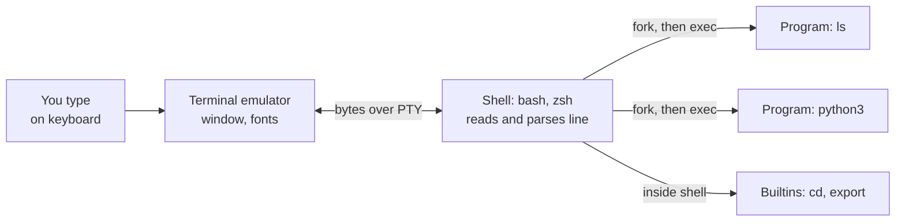
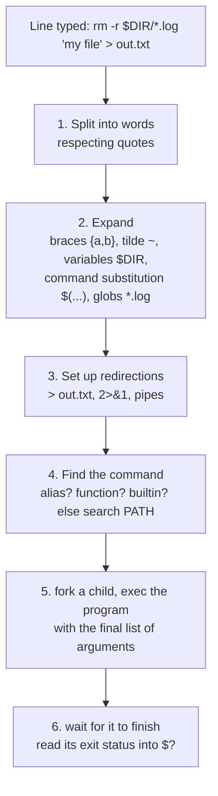
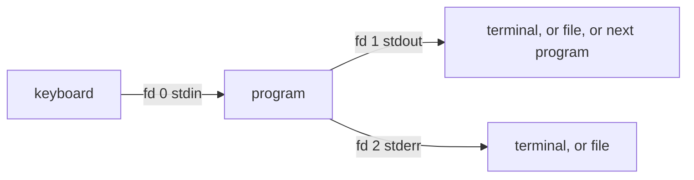

# 1.2 The command line: shells, commands, pipes and redirection

| Field | Value |
|---|---|
| Level | Basics |
| Priority tier | Tier 0 (foundations) |
| Lab venue | Small Ubuntu VM (`shell_pipeline_lab.py`: 26 checks pass; VM commands **untested** here) |
| Part | Part 1: Linux, from the command line to the kernel and performance |

## Why this matters for AI infrastructure

You will spend much of your career typing commands into terminals on machines you did not build: a GPU node over SSH, a Slurm login node, the shell inside a container, or a BMC console. Every cluster job script, every Dockerfile `RUN` line, every Ansible `command:` task, every systemd `ExecStart=` and every CI step is a shell command line in disguise. People who have used a shell for years but never learned *how a line is actually processed* keep getting bitten by the same things. When a training job or deployment script fails, the cause is often a small shell mistake. A space in a filename breaks a copy, or an unquoted variable splits into pieces. Errors disappear into the wrong stream, a pipeline reports success while its first stage failed, or an environment variable exists in one shell and vanishes in another. This chapter teaches the rules once, from the beginning, so that those problems stop happening and you can read other people's scripts with confidence.

## Prerequisites and outcomes

You need chapter 1.1 for the model of processes, system calls, and the kernel. After this chapter you will be able to:

- Explain the difference between a terminal, a shell, and a command, and trace what the shell does between you pressing Enter and a program starting.
- Use a core set of commands to look around, create, copy, move, and delete files safely.
- Read and write command lines with options, arguments, quoting, globbing, variables, and command substitution, and predict what the shell will do *before* it runs.
- Use standard input, output, and error, redirection, and pipes, and explain file descriptors 0, 1, and 2.
- Read exit codes, chain commands with `&&`, `||`, and `;`, and recognise the exit codes you will see from Slurm and Kubernetes (126, 127, 137, 143).
- Understand environment variables, `PATH`, startup files, and why "it works in my shell" fails elsewhere.
- Find help yourself with `--help`, `man`, `type`, and friends, and decode a Unix error message.
- Avoid eight classic command-line failures.

## 1. Terminal, shell, command: three different things

New users blur these together; separating them clears up half of the confusion.

- A **terminal** (terminal emulator) is the window where text appears and where your keystrokes go. Today it is a program such as Terminal, iTerm, GNOME Terminal, or the SSH client in your window. Historically it was a physical keyboard-and-screen device, which is why the Linux kernel still has "TTY" devices, short for teletype.
- A **shell** is a program that runs *inside* the terminal. It prints a **prompt**, reads a line you type, interprets it, and runs the programs you ask for. The shell is just a user-space program like any other; it is not part of the kernel. Common shells include `sh` (the original Bourne shell, and its small modern relatives such as `dash`), **`bash`** (the "Bourne-again shell", the default on most Linux distributions), `zsh` (the default on macOS), `tcsh`/`csh`, and `fish`. Scripts and cluster tooling are overwhelmingly written for `bash` or plain `sh`. If you want an entire book devoted to `bash` beyond what we cover here and in chapter 1.9, Jason Edelman, Scott S. Lowe, and Matt Oswalt recommend *Learning the bash Shell*, 3rd edition, by Cameron Newham and Bill Rosenblatt.
- A **command** is whatever you ask the shell to run. It may be a *program on disk* (`ls`, `python3`), a *shell builtin* handled inside the shell itself (`cd`, `export`), an *alias* (a shorthand you or the system defined), or a *shell function*.



You can ask which shell you are in with `echo $0` or `ps -p $$`, and see which shells exist on the system in the file `/etc/shells`. Your **login shell**, the one started when you log in, is recorded in `/etc/passwd`; the command `chsh` changes it. Do not change root's shell or system scripts' shell. The interpreter of a script is chosen by its first line (`#!/bin/bash`, chapter 1.9), not by your login shell.

Three further facts about shells are worth having early. First, **the shell is also a small programming environment**. Many important parts of a Linux system are themselves shell scripts, meaning text files containing a sequence of shell commands: startup scripts, installers, package hooks, and the glue in Slurm and Kubernetes tooling. Chapter 1.9 is devoted to writing them well.

Second, **every Unix system needs a Bourne-compatible shell at `/bin/sh`**, because system scripts assume it. On some distributions `/bin/sh` is a link to `bash`. On **Debian and Ubuntu it is `dash`**, a smaller, faster POSIX shell that lacks bash extensions such as arrays and `[[ ]]`. Consequently, a script that starts with `#!/bin/sh` but uses bash features works on one distribution and fails on another; check with `ls -l /bin/sh`.

Third, **the prompt tells you where you are**. On Ubuntu and Debian it looks like `alice@gpu01:~/lab$` or `admin@ip-172-31-26-181:~$`, showing the username before `@`, the hostname after `@`, and the current working directory after `:`, where `~` is shorthand for your home directory. On Fedora, Red Hat, and Amazon Linux systems it is enclosed in brackets, such as `[alice@gpu01 lab]$` or `[ec2-user@ip-172-31-5-69 ~]$`. The prompt ends with `$` for a normal user and `#`, called a hash sign or octothorpe, for `root`. Documentation, including this book, uses the same convention. A leading `$` marks a command to type as a normal user, and a leading `#` marks one that needs root, which you should run with `sudo` so the action is logged. Not every line you type has the "program, options, arguments" shape. **Shell builtins** and **assignments before a command** (`NCCL_DEBUG=INFO python3 train.py`) are the exceptions you will meet most.

## 2. Anatomy of a command line

A line is split into **words** separated by spaces. The first word is the **command**; the rest are its **arguments**. Arguments that start with `-` are conventionally **options**, also called flags or switches, that change what the program does.

```bash
ls -l -a /var/log
#  ^  ^  ^   ^
#  |  |  |   argument (what to act on)
#  |  |  option
#  |  option
#  command
```

Conventions you can rely on across almost every Linux tool include:

- Short options are one dash and one letter (`-l`), and several can be combined (`-la` equals `-l -a`).
- Long options are two dashes and a word (`--all`, `--human-readable`) and are easier to read in scripts.
- Some options take a value, written as `-n 20`, `--lines=20`, or `-n20`.
- `--` means "end of options; everything after is an argument", which saves you when a filename begins with `-` (`rm -- -weird-file`).
- Almost every command accepts `--help` and many accept `--version`.

### What the shell does with a line

Between you pressing Enter and the program starting, the shell does a lot. Learning this order is the single most useful thing in this chapter because it lets you predict behaviour.



That sequence has a consequence that surprises people. **The program never sees your wildcards, variables, or quotes; it only sees the final result.** When you type `ls *.txt`, the *shell* replaces `*.txt` with the list of matching names before `ls` starts. You can prove it: `echo *.txt` prints the names the shell produced, because `echo` is given them as ordinary arguments. Use `echo` or `printf '%s\n'` as a free preview tool whenever you are unsure what a line will expand to.

### How the shell finds a program: `PATH`

When you type a bare word like `python3`, the shell checks in order whether it is an alias, a function, or a builtin. Otherwise, it searches the directories listed in the environment variable **`PATH`** from left to right and takes the first match. These commands inspect that lookup:

```bash
echo "$PATH" | tr ':' '\n'      # show the search directories one per line
type -a python3                  # every way "python3" could resolve, in order
command -v python3               # the one that will run
which -a python3                 # similar, searches PATH only
```

If you ever run the wrong version of a tool, the problem is almost always `PATH` order or an alias. Section 8 goes deeper.

## 3. A survival kit of commands

Learn these first, and learn them well. We explain the *why* of each; the detailed filesystem concepts (paths, inodes, links) are in chapter 1.3 and text-processing tools in 1.4.

| Command | What it does | The options you will really use |
|---|---|---|
| `pwd` | print the current (working) directory | `-P` resolve symlinks |
| `ls` | list directory contents | `-l` long format, `-a` include dotfiles, `-h` human sizes, `-t` by time, `-r` reverse, `-R` recursive, `-d` the directory itself |
| `cd` | change directory (a *builtin*, because it must change the shell's own state) | `cd` home, `cd -` previous directory, `cd ..` parent |
| `mkdir` | create a directory | `-p` create parents, no error if exists |
| `rmdir` | remove an *empty* directory | |
| `touch` | create an empty file or update its timestamp | |
| `cp` | copy | `-r` directories, `-a` preserve everything, `-i` ask before overwrite, `-v` verbose |
| `mv` | move or rename | `-i`, `-n` never overwrite, `-v` |
| `rm` | remove files (no trash, no undo) | `-r` directories, `-i` ask, `-f` force (no questions) |
| `cat` | print files, or join them | `-n` number lines |
| `less` | read a long file one screen at a time (`q` quits, `/` searches, `G` end, `F` follow) | `-S` no wrapping |
| `head`, `tail` | first or last lines | `-n 20`, `tail -f` follow a growing file |
| `echo`, `printf` | print text | `printf` is more predictable in scripts |
| `wc` | count lines, words, bytes | `-l` lines |
| `clear` | clear the screen (or press Ctrl-L) | |

### The forms of the basic commands

The one-line descriptions in the table hide the forms you will use every day.

- **`cp`**: `cp file1 file2` copies a file to a new name, and `cp file dir` copies it into a directory keeping its name. When you run `cp file1 file2 file3 dir`, it copies several files into `dir`; the **last argument is the destination**, and it must be a directory when there are several sources. Running `cp -r dir1 dir2` copies an entire directory tree. Use `cp -p` to preserve the original file's attributes, such as permissions and timestamps, instead of using the current user's defaults and the current time, and `cp -i` to ask before overwriting an existing destination. Similarly, `mkdir -p a/b/c` creates parent directories as needed and stays quiet if they already exist, while `mkdir -m 750 dir` sets the permission mode at creation. Typing `cat > notes.txt` is a quick way to create a file from the keyboard (end with Ctrl-D), and `cat a b c > all` merges three files into one. The originals are kept and the target is overwritten, so use `>>` if you want to append instead. Text-mode file managers such as **Midnight Commander** (`mc`, with its editor `mcedit`) perform many of these operations without a graphical desktop and offer a gentle start for newcomers.
- **`mv`**: its behaviour depends on what the arguments are. `mv file1 file2` renames `file1` to `file2` and silently replaces an existing `file2` unless you pass `-i` to be asked or `-n` to refuse. Running `mv dir1 dir2` renames the directory if `dir2` does not exist, but moves `dir1` *into* `dir2` if `dir2` already exists. Passing `mv file dir` moves the file into the directory under the same name, `mv file1 dir/file2` moves and renames in one step, and `mv file* ../dir2` moves a whole list into a directory. In every case the source disappears under its old name or location. Moving within a single filesystem is just a directory-entry rename and happens instantly, as chapter 1.3 explains. Useful options include `-i` for interactive prompts and `-f` to force the move.
- **`touch`**: creates an empty file if it does not exist. If the file already exists, `touch` leaves the contents alone and **updates the modification time**, which is how you test build tools that recompile when files change.
- **`rm`**: deletes files, and refuses to delete directories without `-r`. **`rmdir`** removes only *empty* directories and refuses otherwise. By contrast, `rm -r dir` removes a directory and everything inside it, and is one of the few commands that can do serious damage, especially as root. Never combine `-r` with a bare `*`, and double-check the line before pressing Enter.
- **`ls`**: `ls -F` appends a character that marks the file type (`/` for directories, `*` for executables, `@` for symlinks). `ls -l` prints a long listing whose columns show the file type and permissions, the number of hard links, the owner, the group, the byte size, the modification timestamp, and the filename.
- **`cd`** is a **builtin**, not a separate program, and the reason is instructive. Every process has its own current working directory, and a child process cannot change its parent's working directory. If `cd` were an external program started by the shell, it would change *its own* directory and immediately exit, leaving your shell right where it started. The same reasoning applies to any command that must change the state of the shell itself, such as `export`, `alias`, `source`, `ulimit`, and `umask`. Such commands cannot simply be put in a script and executed as a child process. A normal script runs in a child shell, and its directory or variable changes vanish when the child exits. Run `cd` with no argument to return to your home directory. Run `cd -` to toggle back and forth between your current directory and your previous directory. For example, if you jump from `/usr/local/bin` to `/media/cdrom`, typing `cd -` returns you immediately to `/usr/local/bin`.
- **Paths:** A path component identified by two dots (`..`) specifies the parent of a directory. For example, if you are working in `/usr/lib`, the relative path `..` refers to `/usr`, and `../bin` refers to `/usr/bin`. Similarly, if you are in `/usr/local` and want to move laterally to `/usr/share`, you can run `cd ../share`, or `cd ../..` to climb two levels up to `/`. One dot (`.`) refers to the current directory; for example, `./prog` runs an executable file named `prog` in the current working directory. Any path that starts with a forward slash (`/`) is an absolute path anchored at the single root directory. Any path without a leading slash is relative to your current working directory. Typing `bin` inside `/home/admin` refers to `/home/admin/bin`, whereas `/bin` refers to the system directory at the root.

**`cat` as a window onto standard input.** `cat file1 file2` concatenates files to the screen, which is where its name comes from. Run `cat` with **no arguments** and it appears to hang because it is waiting on standard input, which the kernel connects to your terminal. Type some lines and it echoes each back. Press **Ctrl-D** on an empty line to send end-of-file (`EOF`) and it exits cleanly, whereas Ctrl-C kills the program with an interrupt signal. This tiny experiment demonstrates the whole idea of standard streams in section 6: a filter command given no file arguments reads from standard input.

A first session, typed line by line (all VM commands below are marked `untested here`):

```bash
pwd                                  # (untested here) where am I?
mkdir -p ~/lab/day1/{src,notes}      # (untested here) make a small tree (brace expansion creates both subdirs)
cd ~/lab/day1                        # (untested here)
touch notes/todo.txt src/main.py     # (untested here)
ls -lR                               # (untested here) long, recursive listing
echo "install the driver" > notes/todo.txt # (untested here)
cat notes/todo.txt                   # (untested here)
cp notes/todo.txt notes/todo.bak     # (untested here)
mv notes/todo.bak notes/old.txt      # (untested here)
ls notes                             # (untested here)
rm notes/old.txt                     # (untested here) gone; there is no undo
```

### The one habit that prevents most disasters

`rm` does not move anything to a trash folder. `rm -r` descends into directories, and `rm -f` suppresses all warnings. The combination `rm -rf` applied to the wrong path, or to a path built from an empty variable, has destroyed production data many times. Build these three habits:

1. Run `ls` with the exact same pattern first. If it lists what you expect, replace `ls` with `rm`.
2. Never put an unquoted variable in a destructive command. Use `rm -rf -- "${DIR:?DIR is empty}/build"` so the `:?` operator makes the shell abort with an error if `DIR` is empty or unset.
3. Prefer `rm -i` in interactive sessions, and keep `-f` out of your muscle memory.

## 4. Getting help without leaving the terminal

Linux systems come with a wealth of built-in documentation. You will not memorise every option; what matters is finding answers fast. For basic commands, the manual pages (or *man pages*) tell you what you need to know. For example, to see the manual page for the `ls` command, run `man` as follows:

```bash
man ls                         # (untested here) read the manual page for ls
ls --help | less               # (untested here) a short usage summary; works for most GNU tools
man -k "copy files"            # (untested here) search manual names and descriptions (same as apropos)
type cd ; help cd              # (untested here) for shell builtins use 'help', not 'man'
info coreutils                 # (untested here) the GNU 'info' manuals, sometimes more detailed
ls /usr/share/doc | head       # (untested here) package-supplied documentation
```

Manual pages are organised in numbered **sections**. You will see names like `ls(1)` or `socket(2)`; the number is the section:

| Section | Contains | Example |
|---|---|---|
| 1 | user commands | `man 1 ls` |
| 2 | system calls | `man 2 execve` |
| 3 | C library functions | `man 3 printf` |
| 4 | device interface and driver information | `man 4 null` (of marginal use) |
| 5 | file formats and configuration files | `man 5 passwd`, `man 5 slurm.conf` |
| 6 | games | `man 6 intro` (rarely useful) |
| 7 | overviews, conventions and encodings | `man 7 signal`, `man 7 cgroups` |
| 8 | system administration commands | `man 8 mount` |

When the same name exists in several sections, pass the section number explicitly: `man 5 passwd` opens the `/etc/passwd` file format specification, whereas `man 1 passwd` opens the password-changing command.

Manual pages are **reference material, not tutorials**. They list options systematically, often in alphabetical order, rather than telling you which ones matter first, so expect to scan through them. Sections 1, 5, 7, and 8 are the ones you will use most as an administrator; section 3 is for C programmers, and section 2 becomes readable once you understand system calls from chapter 1.1. Running `man -k sort` or `apropos sort` searches manual page names and one-line descriptions when you only know what a tool should do. The output lists the page name, section number, and summary, such as `sort (1) - sort lines of text files` next to `qsort (3)` for the C library function.

The GNU project also publishes many manuals in **info** format (`info coreutils`, navigated with its own keys or piped through `less`), which often contains more detail than the man page. Some packages also install README files and examples directly under `/usr/share/doc` without registering a man or info page. For a fast option check, `command --help` or `command -h` prints a concise usage summary. Inside `man`, press `/word` to search forward, `n` to jump to the next match, and `q` to quit. For cluster work, remember that **the manual of the exact version installed on the machine is authoritative**: `man slurm.conf` on your login node beats any blog post.

## 5. Expansion and quoting: the rules that explain "weird" behaviour

The shell expands several kinds of text before running a command. The ones you will use daily:

| Kind | Example | Becomes |
|---|---|---|
| Tilde | `~`, `~alice` | home directory of you, or of alice |
| Variable | `$HOME`, `${USER}` | the variable's value |
| Command substitution | `$(date +%F)` | the command's output, for example `2026-10-23` |
| Arithmetic | `$((3 * 7))` | `21` |
| Brace expansion (bash and zsh) | `file{1..3}.txt`, `{a,b}` | `file1.txt file2.txt file3.txt`, `a b` |
| Globbing (wildcards) | `*.log`, `data?`, `[abc]*` | the matching file names |

**Globbing.** `*` matches any run of characters including none, `?` matches one character, `[abc]` matches one of the listed characters, and `[0-9]` matches one in a range. Globs match *file names in the filesystem*, are expanded by the shell, and do not cross `/`. Hidden files starting with `.` are not matched by `*`. If nothing matches, bash passes the pattern through unchanged so `ls *.xyz` tries to list a file literally named `*.xyz`, whereas zsh stops with "no matches found". That difference trips up people moving scripts between a Mac and a Linux server.

Some patterns to practise: `at*` matches names that start with `at`, `*at` names that end with `at`, `*at*` names that contain `at`, and `b?at` matches `boat` and `brat`. **A trap for anyone coming from Windows:** `*.*` does *not* mean "all files". On Linux it matches only names that contain a dot. Use `*` for everything, because Unix names need not have an extension. To pass a literal `*` to a program, as you must with `grep` and `find` patterns, single-quote it: `echo '*'` prints a star. Remember the rule behind all of this: **the shell expands globs before running the command, and only then**. If a `*` reaches a program unexpanded, the program, not the shell, decides what it means.

Finally, `*` does not match names that begin with a dot. The obvious fix, `.*`, is a trap because it also matches `.` and `..`, the current and parent directories, and `rm -r .*` has damaged real systems. To match hidden files use `.[!.]*` or `.??*`, and prefer `find` for anything destructive (chapter 1.3).

The full list of shell patterns includes `*` for any string, `?` for any one character, `[c1-c2]` for any character in a range, and `[!c1-c2]` for any character *not* in the range. It also includes `{a,b,c}` for an exact comma-separated list and `{10..20}` for a numeric sequence. All of them except the braces are matched against real file names. Braces just generate words, so `ls *.{cxx,h,la}` becomes `ls *.cxx *.h *.la`, and `cp config{,.bak}` becomes `cp config config.bak` even though the second file does not yet exist.

**Hostile or accidental file names:** a name that begins with a dash is read by the command as an option once the glob expands. A file called `-rf` can turn `rm *` into trouble. The universal remedy is the argument `--`, which means "no more options, only file names". Running `rm -- -f` removes a file named `-f`, whereas `rm -f` would read `-f` as an option. Similarly, `rm -- '-rf *.?'` removes a file with a name full of special characters when you quote or backslash-escape each one.

**Quoting** controls which expansions happen. There are three tools:

| Form | Effect | Example |
|---|---|---|
| `'single quotes'` | everything is literal, nothing expands | `echo '$HOME and *'` prints `$HOME and *` |
| `"double quotes"` | variables, `$(...)` and backslash escapes still work; wildcards and word splitting are suppressed | `echo "home is $HOME"` |
| `\` backslash | escapes the next single character | `echo \$HOME`, `touch my\ file` |

The most important rule in all of shell scripting: **double-quote your variable expansions** (`"$var"`, `"$@"`, `"$(cmd)"`). An unquoted `$var` is split on whitespace and then expanded by globs. If `file="my report.txt"`, then `cp $file /backup` runs `cp my report.txt /backup`, three arguments, and fails (or copies the wrong thing). `cp "$file" /backup` is correct.

### Special characters: the names to know

When discussing Linux with others, you should know the spoken names for the special characters that you encounter on the command line. Many of these characters have special meaning to the shell and must be quoted or escaped when you want them literally. If you enjoy the folklore behind Unix terminology, see the *Jargon File* (`http://www.catb.org/jargon/html/`) or its printed companion, *The New Hacker's Dictionary* edited by Eric S. Raymond.

| Character | Names | Common uses |
|---|---|---|
| `*` | star, asterisk | glob; "zero or more" in regular expressions |
| `.` | dot | current directory; hidden-file prefix; separator in names |
| `!` | bang | negation; history expansion (`!!`) |
| `\|` | pipe | connect commands |
| `/` | slash | directory separator (never a backslash); `/pattern` searches in `less`, `man`, `vim` |
| `\` | backslash | escape the next character; line continuation (never a directory separator) |
| `$` | dollar | variables, command substitution; end of line in regular expressions |
| `'` | single quote, tick | literal string |
| `` ` `` | backtick | old form of command substitution (use `$(...)`) |
| `"` | double quote | string that still expands variables |
| `^` | caret, hat | start of line in regular expressions; negation in `[^...]`; written before a letter for control keys (`^C` means Ctrl-C) |
| `~` | tilde | home directory |
| `#` | hash, pound, sharp | start of a comment; the root prompt |
| `[ ]` | square brackets | character sets and ranges in globs and regular expressions; `[ ]` as a test command |
| `{ }` | braces, curly brackets | brace expansion, grouping, variable syntax `${var}` |
| `_` | underscore | a space substitute where spaces are not allowed |

Predict-then-check habit:

```bash
file="my report.txt"
printf '<%s>\n' $file          # unquoted: two words
printf '<%s>\n' "$file"        # quoted: one word
echo *.conf                    # see what the glob becomes
echo "$(date +%F)-run"         # command substitution inside quotes
```

## 6. Standard streams, redirection and pipes

Every process starts with three open **file descriptors**: small integers the kernel uses to refer to open files, pipes, terminals or sockets. By convention:

| FD | Name | Default is | Used for |
|---|---|---|---|
| 0 | standard input (stdin) | the keyboard | data the program reads |
| 1 | standard output (stdout) | the terminal | normal results |
| 2 | standard error (stderr) | the terminal | error and diagnostic messages |

Having a *separate* error stream is a design decision with big consequences: you can capture results without mixing in warnings, and you can see errors even when output is redirected. The shell lets you rewire these descriptors before starting a program; the program neither knows nor cares where they lead (a pure application of the "everything is a file" idea from chapter 1.1).



The redirection operators:

| Operator | Meaning | Example |
|---|---|---|
| `> file` | send stdout to file, overwriting it | `ls > list.txt` |
| `>> file` | append stdout to file | `echo run >> log.txt` |
| `< file` | read stdin from file | `wc -l < list.txt` |
| `2> file` | send stderr to file | `ls /nope 2> err.txt` |
| `2>&1` | make stderr go where stdout currently goes | `cmd > all.txt 2>&1` |
| `&> file` | (bash) both stdout and stderr to file | `cmd &> all.txt` |
| `> /dev/null` | discard output (`/dev/null` swallows everything) | `cmd > /dev/null 2>&1` |
| `<<EOF` ... `EOF` | here-document: feed text lines as stdin | see below |

Two points the table does not show. First, **`>` destroys the previous contents** of the target file the moment the command starts, even if the command then fails. A typo such as `sort data.txt > data.txt` empties the file before `sort` reads it. In bash, `set -o noclobber` or `set -C` makes `>` refuse to overwrite an existing file unless forced with `>|`, providing a worthwhile safety net in interactive shells. Second, pipes chain as many commands as you like, one after another: `head /proc/cpuinfo | tr a-z A-Z` upper-cases the first lines of the CPU description. The `<` operator is rarely needed because most commands accept file names directly (`head < /proc/cpuinfo` and `head /proc/cpuinfo` do the same thing), though a few programs only read standard input.

**Order matters.** Redirections are processed left to right. `cmd > out.txt 2>&1` sends stdout to the file, *then* points stderr at the same place: both end up in the file. `cmd 2>&1 > out.txt` first points stderr at the terminal (where stdout currently goes), *then* moves stdout to the file: errors still appear on screen. Burn the first form into memory; it is the one you want almost always.

**Pipes.** The character `|` connects the stdout of one command directly to the stdin of the next, without a temporary file: `ps -ef | grep slurmd | wc -l`. The kernel provides a small in-memory buffer between the two processes, and they run *at the same time*. This is the heart of the Unix philosophy: many small tools, each doing one thing, joined into pipelines. Note that a pipe carries only stdout; stderr still goes to the terminal unless you redirect it (`cmd1 2>&1 | cmd2`).

Four tools pair naturally with redirection and pipes:

- `tee file` copies stdin to both stdout and a file: `make 2>&1 | tee build.log` lets you see the output *and* keep a log. `tee -a` appends.
- `/dev/null` is the black hole for output you do not want.
- `xargs` builds a command line from stdin (chapter 1.4).
- **Here-documents** write multi-line input inline, which is very useful for creating config files from scripts.

```bash
cat > /tmp/job.sbatch <<'EOF'
#!/bin/bash
#SBATCH --nodes=2
echo "hello from $(hostname)"
EOF
```

Quoting the delimiter (`'EOF'`) stops the shell from expanding `$` and backticks inside the text, so the file is written exactly as typed. Without quotes, `$(hostname)` would be replaced *when the file is created*.

## 7. Exit status and combining commands

Every process, when it ends, returns a small integer to its parent: the **exit status** or exit code. By convention **0 means success** and anything else means failure. The shell stores the status of the last command in `$?`.

```bash
ls /tmp ; echo "status=$?"       # 0
ls /nope ; echo "status=$?"      # non-zero (2 for GNU ls)
```

You can combine commands using the status:

| Form | Runs the second command when |
|---|---|
| `a ; b` | always, after `a` ends |
| `a && b` | `a` succeeded (status 0) |
| `a \|\| b` | `a` failed (status non-zero) |
| `a & b` | `a` is started in the background, and `b` runs immediately |
| `(a; b)` | in a subshell (a child shell; variable changes do not leak out) |
| `{ a; b; }` | as a group in the current shell |

Typical use: `mkdir -p build && cd build && cmake ..` stops at the first failure, while `command || echo "failed" >&2` reports failure on stderr.

### Exit codes you will meet in AI infrastructure

| Code | Meaning | Where you see it |
|---|---|---|
| 0 | success | everywhere |
| 1 | generic error | many tools |
| 2 | misuse of a command or syntax error | shells, many CLIs |
| 126 | found but not executable (permissions, wrong format) | scripts without `chmod +x` |
| 127 | command not found | wrong `PATH`, missing package |
| 128 + N | killed by signal N | `130` = Ctrl-C (SIGINT 2); `137` = SIGKILL (9); `143` = SIGTERM (15) |

The `128 + N` rule explains frequent incidents. **A Kubernetes container that exits with 137 was killed with SIGKILL, most often by the kernel's out-of-memory killer ("OOMKilled").** Similarly, a Slurm job that ends with exit code `0:9` or reports signal 9 was killed the same way, either by a cgroup memory limit or an administrator's `scancel`. Exit 143 is a polite SIGTERM, such as Kubernetes asking a pod to stop. You can reproduce 137 yourself: `bash -c 'kill -9 $$'; echo $?`.

A related trap: **in a pipeline, the exit status is that of the *last* command only.** `false | cat; echo $?` prints `0`, hiding the failure of `false`. In scripts, use `set -o pipefail` (chapter 1.9) so a pipeline fails if any stage fails.

## 8. Environment variables, `PATH` and startup files

A shell keeps named values called **variables**. A subset, marked with `export`, is placed into the **environment**, a block of `NAME=value` strings that every child process inherits because the kernel copies it on `execve` (chapter 1.1). That is how `PATH`, `HOME`, `LANG`, and application settings travel from the shell into programs.

```bash
name="alice"                    # shell variable: visible only to this shell
export CUDA_VISIBLE_DEVICES=0,1 # environment variable: inherited by children
env | sort | head               # list the environment (printenv is similar)
echo "$name $CUDA_VISIBLE_DEVICES"
bash -c 'echo "[$name] [$CUDA_VISIBLE_DEVICES]"'   # child sees only the exported one
NCCL_DEBUG=INFO python3 train.py     # set a variable for ONE command only
```

Variables worth knowing for this book include `PATH` for command lookup, `HOME`, `USER`, `PWD`, `LANG` and `LC_ALL` for locale and sorting order, and `EDITOR`. You will also constantly set AI-specific variables: `CUDA_VISIBLE_DEVICES`, `NCCL_DEBUG`, `NCCL_SOCKET_IFNAME`, `OMP_NUM_THREADS`, and `LD_LIBRARY_PATH`. Remember that *an environment variable set in your terminal does not exist inside a Slurm job, a systemd service, or a container unless it is explicitly passed along*. Many "works interactively, fails in the job" mysteries come down to this rule.

### Modifying `PATH` safely

```bash
export PATH="$HOME/bin:$PATH"      # prepend: your tools win
export PATH="$PATH:/opt/tool/bin"  # append: system tools win
```

Order is priority. Never add an empty element or `.` (the current directory) to `PATH`: it lets any file in any directory you visit shadow a real command.

Two practical points about editing `PATH`. First, the assignment form has **no spaces around `=`** (`PATH=dir:$PATH`); with spaces the shell would try to run a command called `PATH`. Second, a typo such as `PATH=dir:$PAHT` replaces the whole path with a nearly empty one, after which even `ls` is "not found". Do not panic if that happens. The damage is confined to that shell, so close the window or run `exec bash` or `bash -l` for a fresh one. Permanent damage requires making the same typo in a startup file, and even then you fix it by running commands with full paths (`/usr/bin/vim ~/.bashrc`). The same distinction applies to any variable. An assignment such as `STUFF=blah` creates a **shell variable** visible only to the shell, whereas `export STUFF` turns it into an **environment variable** that every child inherits. Programs read their configuration from the environment; for example, `LESS` holds your preferred `less` options, and many manual pages end with an ENVIRONMENT section listing the variables the program honours.

### Startup files: where the settings live

Startup files set defaults for the shell and other interactive programs, determining how the system behaves when a user logs in. Most users do not pay close attention to their startup files, touching them only when they want to add something for convenience, such as an alias. Over time, those files become cluttered with unnecessary environment variables and tests that can lead to annoying or quite serious problems. Files that start with a dot are called **dot files** because the leading dot excludes them from the default display of `ls` and most file managers; use `ls -a` to see `.bashrc`, `.ssh/`, `.gitconfig`, and `.vimrc`.

When designing startup files for yourself or as defaults for new cluster users in chapter 1.6, keep two goals in mind. The first goal is **simplicity**: keep the number of startup files small and short, because if you distribute an error to 10 users you may have to fix it 10 times. The second goal is **readability**: use extensive descriptive comments so anyone can see what each line does.

When `bash` starts, the configuration files it reads depend on *how* the shell was started.

| Kind of bash shell | Reads (in order) | Examples |
|---|---|---|
| **login shell** (SSH login, `bash -l`) | `/etc/profile`, then **only the first** file it finds among `~/.bash_profile`, `~/.bash_login`, and `~/.profile` | what you get over SSH or on a text console |
| **interactive non-login** (a new terminal window on a desktop, or `bash` typed inside a session) | `~/.bashrc` | aliases, prompt, interactive functions |
| **non-interactive** (scripts, `ssh host command`, cron, Slurm batch steps) | nothing by default (only what `BASH_ENV` names) | automation and batch jobs |

Notice how `bash` handles login shells. When `bash` runs as a login shell, it first executes `/etc/profile`. Then it looks in your home directory for `.bash_profile`, `.bash_login`, and `.profile`, and **runs only the first one that it sees**. If `.bash_profile` exists, `bash` ignores `.bash_login` and `.profile` completely. As strange as it sounds, it is also possible to run a non-interactive shell as a login shell (`bash -l -c 'cmd'`). In fact, most graphical desktop display managers start your session with one non-interactive login shell in order to preserve the login versus non-login environment model.

In `bash`, you can choose from `.bash_profile`, `.profile`, `.bash_login`, and `.bashrc`. Which one should hold your command path (`PATH` starting with `/usr/local/bin:/usr/bin:/bin`, plus `$HOME/bin` or `$HOME/.local/bin` and `/usr/local/sbin:/usr/sbin:/sbin` for utilities like `sysctl`, `fdisk`, and `lsmod`)? And where should you set your manual page path (`MANPATH`), prompt (`PS1`), aliases, `EDITOR` (`vi`, `emacs`, or `nano`), `PAGER` (`less`), and permissions mask (`umask 022`)? Put your main configuration in `~/.bashrc`, and have `~/.bash_profile` source `~/.bashrc` so login and non-login interactive shells share the same setup.

```bash
# Inside ~/.bash_profile (untested here)
if [ -f "$HOME/.bashrc" ]; then
    . "$HOME/.bashrc"
fi
```

Inside `~/.bashrc`, you can check whether the current shell is interactive before running interactive-only commands by inspecting the special `$-` option-flags variable for `i`.

```bash
# Inside ~/.bashrc: return early if non-interactive (untested here)
case $- in
    *i*) ;;
      *) return ;;
esac
```

Other shells have different rules. You do not have to worry about the difference between login shells and non-login shells in `tcsh`, the enhanced C shell that popularized command-line editing and completion. Upon startup, `tcsh` looks for a `.tcshrc` file, and failing this, it looks for the `csh` shell's `.cshrc` startup file. The reason for that order is so you can use `.tcshrc` for `tcsh` extensions that do not work in `csh`. In practice, sticking to traditional `.cshrc` (`setenv PATH ...`, `setenv EDITOR vi`, `setenv PAGER less`, `setenv LESS meiX`, `umask 022`) works everywhere. Even so, `bash` should always be the default shell for new users because `csh` is a notoriously bad scripting tool and `bash` uses GNU `readline` and gives clean control over I/O redirection and file handles.

Follow six strict rules to avoid startup file pitfalls on any server or cluster:

1. **Do not put any graphical command or set the `DISPLAY` or terminal type (`TERM`) environment variable in a shell startup file.** Not all shells run in graphical environments, and display managers have their own startup files such as `.xsession` and `.xinitrc` for GNOME or KDE.
2. **Do not run commands in a startup file that print to the standard output.** Output from `.bashrc` corrupts the wire protocol of non-interactive file-transfer tools like `scp`, `sftp`, and `rsync`.
3. **Never set `LD_LIBRARY_PATH` in a shell startup file** (see chapter 1.11). Overriding the dynamic linker search path globally breaks system binaries; set it only inside an environment module or job wrapper.
4. **Do not skimp on descriptive comments in default startup files.** Test new default startup files from scratch using two fresh test user accounts before distributing them.
5. **Avoid large default editor startup files.** A little `set showmatch` in the `.exrc` startup file to have `vi` show matching parentheses never hurt anyone. However, steer clear of anything that significantly changes editor behavior or appearance, such as `showmode`, auto-indentation, and wrap margins.
6. **Remember the non-interactive row of the table.** Because `ssh host 'command'`, `cron`, and Slurm batch scripts do not read `~/.bashrc` by default, any `PATH` change you rely on for batch jobs must be set explicitly inside the job script.

## 9. Working faster: history, completion and editing

You will work much faster once you stop retyping commands and use the built-in *readline* keystrokes.

| Keystroke (`HLW` Table 2-2) | Action |
|---|---|
| `Ctrl-B` / `Ctrl-F` | Move the cursor left / right one character |
| `Alt-B` / `Alt-F` | Move the cursor backward / forward one word |
| `Ctrl-P` / `Ctrl-N` | View the previous / next command in history (same as Up / Down arrows) |
| `Ctrl-A` / `Ctrl-E` | Move the cursor to the beginning / end of the line |
| `Ctrl-W` | Erase the preceding word |
| `Ctrl-U` | Erase from the cursor to the beginning of the line |
| `Ctrl-K` | Erase from the cursor to the end of the line |
| `Ctrl-Y` | Yank (paste) the text most recently erased with `Ctrl-W`, `Ctrl-U`, or `Ctrl-K` |
| `Ctrl-R` | Search backward incrementally through command history |
| `Ctrl-L` | Clear the terminal screen while keeping the current line |

- **Tab completion** finishes command names, file names, and options when `bash-completion` is installed; press Tab twice to list all candidates.
- **History shortcuts:** `history | tail` lists recent commands, `!!` repeats the previous command (`sudo !!` re-runs it as root), and `!$` expands to the last argument of the previous command.
- **Terminal control keys:** `Ctrl-C` sends `SIGINT` to interrupt the foreground program, `Ctrl-D` sends end-of-input (`EOF`), `Ctrl-Z` suspends the foreground program with `SIGTSTP` so you can resume it with `fg` or `bg` (chapter 1.8), and `Ctrl-S` / `Ctrl-Q` pause and resume terminal output.
- **Aliases:** `alias ll='ls -lah'` creates a shorthand; bypass an alias once by prefixing a backslash (`\ls`).

### Shell tricks that save hours on clusters

Administering hundreds of nodes means running the same operation many times, so small habits compound. These all work in bash and mostly in zsh; a few do not work in plain `sh`.

- **Brace expansion generates lists and variants.** `cp config{,.bak}` expands to `cp config config.bak` because the empty first alternative gives the plain name, and `for n in gpu-{1,2}-{a,b}; do echo $n; done` visits four combinations. Ranges work too: `echo {1..15}`. Brace ranges do not keep leading zeros, so for names like `node-001` to `node-100` use `seq`: `for i in $(seq -w 1 100); do ssh node-$i true; done` where `-w` pads to equal width. Because the remote command `true` prints nothing, only the nodes that fail to answer show an error.
- **Reuse earlier commands.** `!!` is the previous command, so `sudo !!` repeats it as root after a "Permission denied". `!$` is its last argument, so you can run `chown alice data.txt` and then `chmod 600 !$`. Running `history | grep sudo` finds older commands, and every history entry has a number so `!123` re-runs entry 123. Always inspect before you run, because history expansion repeats the exact line that was typed. Ctrl-R searches backwards as you type a substring; press it again for the next older match.
- **Quick arithmetic.** `echo $((123*55+18))` computes with integer arithmetic, and variables need no `$` inside `$((123*55+offset))`. For fractions, use `bc`.
- **More command separators.** `&` runs a command in the background *and* separates it from the next one: `job_a & job_b & wait` starts both and `wait` pauses until they finish. `&&` and `||` are conditional. A common test is `[ -f testfile ] && cat testfile`. Note that `[` here is **a command**, an old synonym for `test`, which is why it needs spaces around its arguments and the closing `]`.
- **Process only the error stream.** A pipe carries stdout only. To pipe stderr instead and let stdout go elsewhere, swap the two streams with a spare descriptor: `my_command 3>&1 1>&2 2>&3 | grep -i warning`. It saves stdout as 3, points stdout at where stderr goes, and points stderr at saved 3.
- **Keep the raw output and also analyse it.** `my_command | tee out.log | grep warning` writes everything to `out.log` while only matching lines continue down the pipe.
- **Copy a tree to another host with no temporary file.** `tar cf - mydata/ | ssh remotehost 'cd /place/to/go && tar xf -'` (chapter 1.5 and chapter 1.3).
- **Useful built-in variables in scripts:** `$?` is the status of the last command, `$$` is the PID of the current shell, and `$!` is the PID of the last background job (chapter 1.9).
- **`bash` versus `sh`.** Many of these rely on bash features; do not assume them in a script that starts with `#!/bin/sh`.

## 10. Understanding error messages

An error message looks cryptic until you notice it has a fixed shape:

```
ls: cannot access '/data/missing': No such file or directory
|   |                              |
|   what the program tried          the system's description of the error code
program name
```

The final text after the colon is not written by the program; it is the standard description of an **errno** code that the kernel returned to a failed system call (`strerror`). Because the set of codes is small, learning the common ones lets you diagnose failures in any program, including ones you have never seen. Here are the ones that matter, with what to check:

| Message | Code | Meaning in practice | First checks |
|---|---|---|---|
| No such file or directory | `ENOENT` | the path does not exist (or a directory in the path does not); also what you get running a script whose `#!` interpreter is missing | typo, relative versus absolute path, `ls -ld` each component, CRLF in the shebang line |
| Permission denied | `EACCES` | the file exists but your user, group or the path's directories do not allow this access (or an SELinux/AppArmor rule blocks) | `ls -l`, `id`, `namei -l path` |
| Operation not permitted | `EPERM` | you are not allowed to do this *operation* regardless of the file's mode (changing ownership, setting time, loading a module) | need root or a capability |
| File exists | `EEXIST` | creating something that is already there | `ls`, use `-p` or remove it |
| Not a directory / Is a directory | `ENOTDIR` / `EISDIR` | wrong kind of object for this operation | `file path` |
| No space left on device | `ENOSPC` | the filesystem is full of data **or** out of inodes (file slots) | `df -h` **and** `df -i` |
| Too many open files | `EMFILE` / `ENFILE` | the per-process or system limit on open file descriptors | `ulimit -n`, `lsof -p` |
| Argument list too long | `E2BIG` | a glob expanded into too many names for one command | use `find ... -exec`, `xargs` |
| Command not found | (exit 127) | the shell found nothing in `PATH` | `type`, `echo $PATH`, install the package |
| Segmentation fault | signal `SIGSEGV` | the program touched memory it may not (the MMU faulted, the kernel killed it) | bug in the program or a bad library; `dmesg`, core dump |
| Bus error | signal `SIGBUS` | invalid memory access, e.g. a truncated memory-mapped file | file or hardware problem |

A few details sit behind the table. **ENOENT** ("No such file or directory") is the commonest of all and covers files *and* directories, because the Unix file interface does not distinguish them much. It appears when you read a file that is not there, `cd` to a missing directory, or write into a directory that does not exist; the name comes from "error, no entity". "File exists" (`EEXIST`) usually means you tried to create a directory with the same name as an existing file. "Not a directory" applies to *one component* of the path. After `touch a`, the command `touch a/b` fails with `a/b: Not a directory`, and the message is about `a`, so when a long path fails you must inspect each component. "Permission denied" also appears when you try to *run* a file that lacks the execute bit, even if you can read it. "Operation not permitted" most often means you tried to signal or change something you do not own, such as killing another user's process. A **segmentation fault** means the program touched memory it was not allowed to touch and the kernel killed it, which almost always means a bug in the program or unexpected input. A **bus error** is a related invalid-access fault that, in rare cases, points at faulty memory hardware. Error codes come straight from system calls (`open()` returns `ENOENT`), so the system-call manual pages (`man 2 open`, section ERRORS) list what each failure can mean.

**Errors versus warnings.** A message containing *warning* means something is wrong but the program is trying to continue, whereas an error means it gave up on the operation. Do not ignore warnings. A warning about an unreadable file or a stale lock may be the clue that explains the error that follows.

**Read the first error first.** Some programs report one fundamental problem and then dozens of consequences. If a hypothetical daemon prints `scumd: cannot access /etc/scumd/config: No such file or directory` followed by pages of other complaints, the remaining messages are noise created by the first. Fix the missing file first and read again. When a message is still unclear, run the command under `strace -f -e trace=file` (chapter 1.1) to see *which path or call* returned the error code.

## 11. Mac or Linux? The differences that bite

Many readers work on a Mac laptop and on Linux servers. Both are Unix-like, but they differ in small ways that silently break scripts.

| Area | Linux (GNU userland) | macOS |
|---|---|---|
| Default shell | bash on most distributions | zsh |
| Core tools | GNU coreutils, GNU sed, GNU grep, GNU find | BSD versions; options differ |
| In-place edit | `sed -i 's/a/b/' file` | `sed -i '' 's/a/b/' file` (needs an empty suffix argument) |
| Dates | `date -d "yesterday"` | BSD `date` does not have `-d`; use `-v-1d` |
| Unmatched glob | passes the pattern through (bash) | zsh: "no matches found" error |
| Word splitting of unquoted variables | splits on whitespace (bash) | zsh does not split by default |
| Process tools | procfs (`/proc`), `ss`, `ip` | no `/proc`; `lsof`, `netstat`, `ifconfig` |
| Containers | native namespaces and cgroups | run inside a hidden Linux VM |

Practical advice: **do your labs for this book on a Linux machine** (a cloud VM, a local VM or a container) so the output matches the text. Keep your scripts POSIX-clean or explicitly `#!/bin/bash` and test them on the target OS. Installing GNU tools on a Mac via Homebrew (`gsed`, `ggrep`, `gdate`) is useful for local development, but never assume they are present on the machine that will run your script.

## 12. Daily patterns for AI and HPC work

A few idioms that appear constantly; recognise them now, and chapter 1.9 turns them into robust scripts.

```bash
# keep a log and still see the output; capture errors too
python3 train.py --config cfg.yaml 2>&1 | tee run-$(date +%F-%H%M).log

# watch a GPU or a directory change every second
watch -n 1 nvidia-smi
watch -n 5 'ls -lh /data/ckpt | tail -5'

# run a long job that survives your SSH session closing
nohup python3 train.py > train.log 2>&1 &

# set per-job environment on the command line
NCCL_DEBUG=INFO CUDA_VISIBLE_DEVICES=0,1 torchrun --nproc_per_node=2 train.py

# time a command, and check its status afterward
time ./preprocess.sh && echo ok || echo "failed with $?"

# run a command on a remote machine, with a terminal (for interactive tools like top)
ssh -t gpu01 'nvidia-smi; uptime'
```

## How it fails

### 1. A space in a filename, an unquoted variable
**Symptom:** `cp: cannot stat 'my': No such file or directory`, or a loop acts on half-names. **Cause:** unquoted expansion is split on spaces. **Diagnose:** `printf '<%s>\n' $var` shows the pieces. **Fix:** quote every expansion (`"$var"`, `"$@"`), and consider tools that use NUL separators (`find -print0 | xargs -0`, chapter 1.4).

### 2. `rm -rf "$DIR"/*` with an empty `DIR`
**Symptom:** `/` or the home directory starts disappearing. **Cause:** if `DIR` is unset or empty, `"$DIR"/*` becomes `/*`. **Fix:** `${DIR:?}` aborts if empty, validate with `[ -n "$DIR" ]` and an absolute-path check, `set -u` in scripts (chapter 1.9), and prefer `rm -rf -- "$DIR"` after confirming the value with `echo`. Do not rely on `--preserve-root`; it protects `/` only.

### 3. Errors vanish or appear in the wrong place: redirection order
**Symptom:** a log file is empty while the errors flash on the terminal. **Cause:** `cmd 2>&1 > file` (wrong order) or forgetting that pipes carry only stdout. **Diagnose:** `cmd > out 2> err`, inspect both. **Fix:** `cmd > file 2>&1`, or `cmd 2>&1 | tee file`.

### 4. The wrong program runs: `PATH` or alias shadowing
**Symptom:** `python3 --version` shows an unexpected version; a script uses the system Python instead of the conda one. **Diagnose:** `type -a python3`, `echo $PATH | tr ':' '\n'`, `alias`. **Fix:** order `PATH` deliberately, avoid aliasing standard command names in scripts, call tools by absolute path in automation.

### 5. "Argument list too long"
**Symptom:** `rm *.tmp` or `cp *` fails in a directory with a huge number of files. **Cause:** the kernel limits the total size of arguments to one command (`getconf ARG_MAX`), and the glob expanded past it. **Fix:** let a tool iterate: `find . -name '*.tmp' -delete`, or `find ... -print0 | xargs -0 rm`.

### 6. `bad interpreter: No such file or directory` on a script that exists
**Symptom:** `./run.sh: /bin/bash^M: bad interpreter`. **Cause:** the script was saved with Windows (CRLF) line endings, so the shebang line names `/bin/bash\r`. Common when scripts are edited on a laptop and copied to a node. **Diagnose:** `file run.sh` mentions CRLF, `cat -A run.sh | head -2` shows `^M$`. **Fix:** `sed -i 's/\r$//' run.sh` (GNU sed) or `dos2unix`, and configure the editor and Git to use LF endings.

### 7. A failing pipeline stage hidden by a later one
**Symptom:** a job reports success though its data step failed. **Cause:** the pipeline's exit status is the last command's. **Diagnose:** `echo ${PIPESTATUS[@]}` (bash) right after the pipeline shows each stage's status. **Fix:** `set -o pipefail` in scripts, and check statuses of critical stages.

### 8. A "bash script" that fails on another distribution: `/bin/sh` is not bash
**Symptom:** a script with `#!/bin/sh` works on one machine and reports `[[: not found` or `Syntax error: "(" unexpected` on another. **Cause:** `/bin/sh` is `dash` on Debian and Ubuntu and `bash` on others, and bash-only features (`[[ ]]`, arrays, `<<<`, `${var//x/y}`) are not POSIX. **Diagnose:** `ls -l /bin/sh`, `readlink -f /bin/sh`, `bash -n script`, `shellcheck script`. **Fix:** use `#!/usr/bin/env bash` (or `#!/bin/bash`) for bash features, or write strictly POSIX `sh`; never run a bash script with `sh script`.

## Hands-on lab: shell parsing, redirection, and VM drills

First, run the self-checking Python lab (`code/part01/shell_pipeline_lab.py`) locally. It verifies redirection order (`> file 2>&1` vs `2>&1 > file` and `3>&1 1>&2 2>&3`), exit status decoding, `pipefail`, `bash` startup file selection, `PATH` resolution precedence, and Unix `errno` codes.

```bash
python3 code/part01/shell_pipeline_lab.py
```

Next, on a GCP Ubuntu VM (all interactive VM commands below are `untested here`), work through these exercises.

**Part A: predict, then check.** For each line, write down the output you expect *before* running it, then compare. Explain every difference.
1. `touch "a b.txt" c.txt; ls` (untested here).
2. `printf '<%s>\n' a b.txt` versus `printf '<%s>\n' "a b.txt"` (untested here).
3. `echo *.txt` and then `echo "*.txt"` and `echo '*.txt'` (untested here).
4. `X=5; echo $X; bash -c 'echo [$X]'; export X; bash -c 'echo [$X]'` (untested here).
5. `echo $(echo $(echo hi))`, `echo "a   b"`, `echo a   b` (untested here).
6. `echo file{1..3}.{c,h}` (untested here).

**Part B: streams and pipes.**
7. Run `ls /tmp /nope > both.txt` (untested here), then examine `both.txt`. Where did the error go? Fix it three different ways: to a separate file, into the same file, and discarded.
8. Compare `ls /nope > out.txt 2>&1` and `ls /nope 2>&1 > out.txt` (untested here). Look at what each leaves in `out.txt` and on the screen, and explain using the left-to-right rule.
9. Build a pipeline that counts the logged-in processes of each user: `ps -eo user= | sort | uniq -c | sort -rn | head` (untested here). Explain each stage and what flows between stages.
10. Use `tee` to save the output of `ls -l /etc | head` (untested here) to a file and still see it.

**Part C: exit codes.**
11. Run `true; echo $?`, `false; echo $?`, `ls /nope; echo $?`, `nosuchcmd; echo $?` (127), `touch noexec.sh; ./noexec.sh; echo $?` (126), `bash -c 'kill -9 $$'; echo $?` (137), and `sleep 100` interrupted with Ctrl-C then `echo $?` (130) (untested here). Fill in the table of section 7 from your own results.
12. Show the pipeline trap: `false | cat; echo $?` then `set -o pipefail; false | cat; echo $?`, then `echo ${PIPESTATUS[@]}` after a pipeline (untested here).

**Part D: environment.**
13. Print `PATH` one entry per line. Create `~/bin/hello` (a script that prints "hello", `chmod +x`), run `hello` before and after adding `~/bin` to `PATH`, and explain the difference. Check `type hello` (untested here).
14. Open a new login shell (`bash -l`), then a non-interactive one (`bash -c 'echo $FOO'`) (untested here). Put `export FOO=bar` in `~/.bashrc` and see which of these start seeing it. Explain with the table in section 8.

**Part E: error messages.**
15. Reproduce each error in the table of section 10 that you can: ENOENT (`cat /x`), EACCES (`cat /etc/shadow` as a normal user), EEXIST (`mkdir /tmp`), ENOTDIR (`cd /etc/passwd`), and EISDIR (`cat /etc`) (untested here). Also inspect E2BIG via `getconf ARG_MAX`, and trigger a segmentation fault from a tiny C program with a null-pointer write. For two of them, use `strace` to see the failing system call and its errno.

**Part E2: the details from the source chapters.**
15a. Run `cat` with no arguments, type three lines, end with Ctrl-D, then repeat and end with Ctrl-C (untested here). Explain the difference. Run `echo *.*` in a directory with and without dotted names. Create `.hidden1 .hidden2` and compare `ls`, `ls -a`, `echo *`, `echo .*`, `echo .[!.]*`.
15b. Run `sort data.txt > data.txt` on a throwaway file and see it emptied; then `set -o noclobber` and repeat (untested here). Compare `ls -l /bin/sh` with the shell you are in; run a script with `[[ ]]` under `sh` and under `bash`.
15c. Use `man -k sort`, then read the same name in two sections (`man 1 passwd`, `man 5 passwd`), open `info coreutils`, and look in `/usr/share/doc` for one package (untested here). Practise the readline keys of section 9 until they are automatic.

**Part F: safety drill.**
16. Make a scratch directory with a few files. Practise the safe-delete routine: `ls` the pattern, then `rm`; try `rm -rf -- "${NOPE:?not set}"/x` and see the abort; try `rm -i` (untested here).

## Exercises

1. **Redirection Order (`> file 2>&1` vs `2>&1 > file` vs `3>&1 1>&2 2>&3`):** Using the left-to-right file-descriptor binding rule, state where file descriptor 1 (`stdout`) and file descriptor 2 (`stderr`) end up for: (a) `cmd > out.txt 2>&1`, (b) `cmd 2>&1 > out.txt`, and (c) `cmd 3>&1 1>&2 2>&3 | grep -i warning`. Verify with `simulate_redirection_order()` in `code/part01/shell_pipeline.py`.
2. **Decoding Exit Statuses (0, 126, 127, 130, 137, 143):** Decode each exit status and state the exact signal number and name where applicable. Evaluate `126`, `127`, `130`, `137` on a Kubernetes training container, and `143`.
3. **Pipeline Exit Status and `set -o pipefail`:** A data-preprocessing pipeline runs `python3 shard_data.py | tee shard.log` where `python3 shard_data.py` fails with exit code `2` and `tee` exits with `0`. What does `$?` report (a) under default `bash` rules, (b) when `set -o pipefail` is enabled, and (c) what array variable holds `[2, 0]`?
4. **Bash Startup File Precedence (`HLW` Chapter 13):** A user's home directory contains `~/.bash_profile`, `~/.bash_login`, `~/.profile`, and `~/.bashrc`. Which exact files does `bash` read automatically when started as: (a) an interactive SSH login shell, (b) an interactive non-login terminal, and (c) a non-interactive `ssh gpu01 'nvidia-smi'` command? What happens if `~/.bash_profile` and `~/.bash_login` are deleted?
5. **Command Resolution Precedence and `PATH` Ordering:** Suppose `PATH="/home/alice/bin:/usr/bin"`, `/home/alice/bin/python3` and `/usr/bin/python3` both exist, `ll` is defined as an alias, and `cd` is a shell builtin. In what order does `bash` resolve `ll`, `cd`, `python3`, and a nonexistent `nosuchcmd`?
6. **Diagnosing Kernel `errno` Messages:** Map each error message to its kernel `errno` symbol and state the first diagnostic check to run. Evaluate: (a) `No such file or directory` on `./run.sh` even though `ls -l run.sh` shows the file exists, and (b) `Not a directory` on `touch a/b`. Next, evaluate: (c) `No space left on device` when `df -h` shows 40% free gigabytes, and (d) `Argument list too long` on `rm *.tmp`.

## Checkpoint questions (20)

<details>
<summary>1. What is the difference between a terminal, a shell, and a command?</summary>

A terminal is the window or TTY device that displays text and captures keystrokes. A shell (`bash`, `zsh`, `dash`) is the user-space command interpreter running inside the terminal. A command is the action you ask the shell to run, which can be an alias, function, shell builtin, or external executable program.
</details>

<details>
<summary>2. List the six steps the shell performs between pressing Enter and a program finishing.</summary>

First, it splits the line into words respecting quotes. Second, it performs expansions for braces, tilde, variables, command substitution, arithmetic, and filename globs. Third, it wires up redirections and pipes on file descriptors. Fourth, it resolves the command via alias, function, builtin, and `PATH` search. Fifth, it calls `fork`/`clone` and `execve` with the expanded argument array. Sixth, it waits via `wait4` and stores the exit status in `$?`.
</details>

<details>
<summary>3. Why does `ls *.txt` work even though `ls` knows nothing about wildcards?</summary>

The shell expands `*.txt` against matching filenames in the current directory *before* launching `ls`. The `ls` binary simply receives the final list of filenames as ordinary `argv` strings.
</details>

<details>
<summary>4. Why must `cd`, `export`, `alias`, and `umask` be shell builtins rather than external binaries in `/usr/bin`?</summary>

Every process has its own private working directory, environment block, and file-creation mask, and a child process cannot modify its parent's state. If `cd` were an external program, it would change its own child directory and immediately exit, leaving the parent shell unchanged.
</details>

<details>
<summary>5. How does `cd -` work, and how do `.` and `..` behave in relative paths?</summary>

`cd -` switches back to the previous working directory (toggling between the current and prior locations). A single dot (`.`) names the current directory (so `./prog` executes `prog` in the current directory), while two dots (`..`) name the parent directory one level up.
</details>

<details>
<summary>6. Why is `*.*` a trap for matching all files on Linux, and why is `rm -r .*` dangerous?</summary>

Unlike DOS/Windows, Linux filenames do not require a dot extension, so `*.*` only matches names containing a literal dot (`.`). Conversely, `.*` matches `.` and `..` (current and parent directories); use `.[!.]*` or `find` to match dotfiles safely.
</details>

<details>
<summary>7. How do you remove or inspect a file whose name starts with a dash, such as `-rf` or `-weird-file`?</summary>

Pass `--` (end of options) before the filename (`rm -- -weird-file`) or prefix the current directory path (`rm ./-weird-file`) so the command does not parse the leading dash as an option flag.
</details>

<details>
<summary>8. What is the difference between single quotes (`'...'`), double quotes (`"..."`), and a backslash (`\`)?</summary>

Single quotes preserve every character literally with zero expansion. Double quotes suppress word splitting and filename globbing while still expanding `$VAR`, `$(cmd)`, and `\` escapes. A backslash escapes only the single character immediately following it.
</details>

<details>
<summary>9. What are file descriptors 0, 1, and 2, and why is standard error separate from standard output?</summary>

File descriptor 0 is standard input (`stdin`), 1 is standard output (`stdout`), and 2 is standard error (`stderr`). Separating `stderr` from `stdout` allows normal program output to be redirected to a file or piped into another program while error messages remain visible on the terminal instead of corrupting the data stream.
</details>

<details>
<summary>10. Explain why `cmd > out.txt 2>&1` captures both streams into `out.txt` whereas `cmd 2>&1 > out.txt` leaves errors on the screen.</summary>

Redirections are evaluated left to right. In `cmd > out.txt 2>&1`, fd 1 is pointed at `out.txt` first, and then `2>&1` points fd 2 at whatever fd 1 currently targets (`out.txt`). In `cmd 2>&1 > out.txt`, fd 2 is pointed at fd 1's initial target (the terminal) first, and only afterward is fd 1 redirected to `out.txt`.
</details>

<details>
<summary>11. How does `my_command 3>&1 1>&2 2>&3 | grep -i warning` pipe only standard error?</summary>

A pipe (`|`) carries only fd 1 (`stdout`). The redirection opens descriptor 3 as a copy of fd 1 (`3>&1`), redirects fd 1 to fd 2's destination (`1>&2`), and redirects fd 2 to saved descriptor 3 (`2>&3`). That swaps `stdout` and `stderr` so error messages flow down the pipe into `grep`.
</details>

<details>
<summary>12. Why does `sort data.txt > data.txt` destroy `data.txt`, and what shell option prevents accidental overwrites?</summary>

The shell truncates `data.txt` for the `>` redirection *before* starting `sort`, so `sort` reads an already-empty file. Enabling `set -o noclobber` (`set -C`) in `bash` prevents `>` from overwriting existing files unless forced with `>|`.
</details>

<details>
<summary>13. What do exit codes `0`, `126`, `127`, `130`, `137`, and `143` mean?</summary>

Exit `0` is success. Exit `126` means the file was found but is not executable, and `127` means the command was not found in `PATH`. By the `128 + N` rule, `130` is `128 + 2` (`SIGINT` from Ctrl-C), `137` is `128 + 9` (`SIGKILL`, typically kernel OOM killer / `OOMKilled`), and `143` is `128 + 15` (`SIGTERM`).
</details>

<details>
<summary>14. Why does `false | cat` exit with status `0` by default, and how do you fix it in production scripts?</summary>

By default, a pipeline's exit status is the exit status of its *last* command (`cat`, which succeeded with `0`). Setting `set -o pipefail` makes the pipeline return the exit status of the rightmost command that failed (or you can inspect `${PIPESTATUS[@]}`).
</details>

<details>
<summary>15. In what order does a `bash` login shell read startup files, and how does it differ from an interactive non-login shell and a non-interactive shell?</summary>

A login shell reads `/etc/profile` and then **only the first** file found among `~/.bash_profile`, `~/.bash_login`, and `~/.profile`. An interactive non-login shell reads `~/.bashrc`. A non-interactive shell (such as `ssh host cmd` or a batch script) reads none of these by default unless `BASH_ENV` is set.
</details>

<details>
<summary>16. Why should `~/.bash_profile` source `~/.bashrc`, and why should `~/.bashrc` never print to stdout or set `LD_LIBRARY_PATH`?</summary>

Sourcing `~/.bashrc` from `~/.bash_profile` keeps `PATH`, `PS1`, `umask`, and aliases identical across login and non-login interactive shells. Printing to stdout in `.bashrc` breaks non-interactive `scp`/`rsync` protocol handshakes, and setting `LD_LIBRARY_PATH` globally breaks system binaries linked against standard system libraries.
</details>

<details>
<summary>17. What do the readline keystrokes `Ctrl-A`, `Ctrl-E`, `Ctrl-W`, `Ctrl-U`, `Ctrl-K`, `Ctrl-Y`, and `Ctrl-R` do?</summary>

`Ctrl-A` jumps to the start of the line and `Ctrl-E` jumps to the end. `Ctrl-W` erases the preceding word, `Ctrl-U` erases to the start of the line, and `Ctrl-K` erases to the end of the line. `Ctrl-Y` yanks (pastes) the erased text, and `Ctrl-R` searches backward incrementally through command history.
</details>

<details>
<summary>18. What is the difference between `man 1 passwd` and `man 5 passwd`, and how do you search across manual descriptions?</summary>

Section 1 covers user commands (`man 1 passwd` documents the `/usr/bin/passwd` tool), whereas Section 5 covers file formats (`man 5 passwd` documents `/etc/passwd`). Use `man -k <keyword>` (or `apropos <keyword>`) to search manual names and one-line descriptions.
</details>

<details>
<summary>19. Distinguish the kernel errors `ENOENT`, `EACCES`, `EPERM`, `ENOTDIR`, and `ENOSPC`.</summary>

`ENOENT` ("No such file or directory") means a path component or script `#!` interpreter is missing. `EACCES` ("Permission denied") means permission bits or ACLs block access, while `EPERM` ("Operation not permitted") means the operation itself requires root or capabilities. `ENOTDIR` means a regular file was used as a directory component, and `ENOSPC` means the filesystem is out of data blocks (`df -h`) or inodes (`df -i`).
</details>

<details>
<summary>20. Why can a script starting with `#!/bin/sh` work on Rocky Linux and fail with `[[: not found` on Ubuntu?</summary>

On Rocky Linux and RHEL, `/bin/sh` is a symlink to `bash`, which allows bash extensions even in POSIX mode. On Debian and Ubuntu, `/bin/sh` is `dash`, a strict POSIX shell that does not support bashisms like `[[ ]]`, arrays, or `{a,b}` brace expansion.
</details>

## Sources and review notes

- **Sources read in full:**
  - `how-linux-works-3rd-edition` — Brian Ward, *How Linux Works*, 3rd ed., **Chapter 2: Basic Commands and Directory Hierarchy** and **Chapter 13: User Environments**. Read Chapter 2 sections 2.1–2.15 in full. Covers the Bourne shell and `bash`, `cat` standard input and Ctrl-D/Ctrl-C, basic commands (`ls`, `cp`, `mv`, `touch`, `rm`, `echo`, `cd`, `.` and `..`), globbing, environment and `PATH`, special characters and the Jargon File / *The New Hacker's Dictionary*, Table 2-2 command-line editing keystrokes, section 2.13 online help (`man ls`, manual sections 1–8, `info`, `/usr/share/doc`), shell I/O redirection and pipes, and section 2.15 error messages. Read Chapter 13 sections 13.1–13.7 in full. Covers startup file guidelines, `/etc/profile` and first-of `.bash_profile`/`.bash_login`/`.profile`, sourcing `. $HOME/.bashrc`, `case $- in *i*)`, `tcsh` `.tcshrc`/`.cshrc`, `.exrc` `set showmatch`, and startup file pitfalls.
  - `supercomputers-for-linux-sysadmins-managing-modern-hpc-clusters-and-supercomputers-from-software-to` — Sergey Zhumatiy, *Supercomputers for Linux SysAdmins*, **Chapter 7: UNIX and Linux – the Basics** and **Chapter 8: UNIX and Linux – Working Techniques**. Read shell tricks in full, including brace expansion (`config{,.bak}`), `seq -w 1 100`, history (`!!` and `!$`), `$((...))` arithmetic, `&`/`wait`, `3>&1 1>&2 2>&3` stderr pipe swap, `tee`, and `tar cf - | ssh`.
  - `network-programmability-and-automation-2nd-edition` — Jason Edelman, Scott S. Lowe, and Matt Oswalt, *Network Programmability and Automation*, 2nd ed., **Chapter 3: Linux**. Read "Interacting with Linux" and "Navigating the Filesystem" in full. Covers Newham & Rosenblatt *Learning the bash Shell* 3rd ed., prompt anatomy on Debian/Ubuntu vs Amazon Linux/RHEL, `#` octothorpe vs `$`, relative vs absolute paths, and `cd -` directory toggling.
- **Run here:** `python3 code/part01/shell_pipeline_lab.py` (26 passed, 0 failed).
- **Explicitly labelled inferences:** Kubernetes `137` (`OOMKilled`) and Slurm `0:9` signal reporting are standard cluster runtime behaviors applying the POSIX `128 + N` exit status rule.
- **Not verified on live hardware:** All interactive VM shell commands in the chapter and lab are marked (untested here) and should be executed on a Linux VM.
