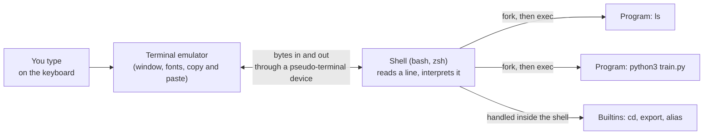
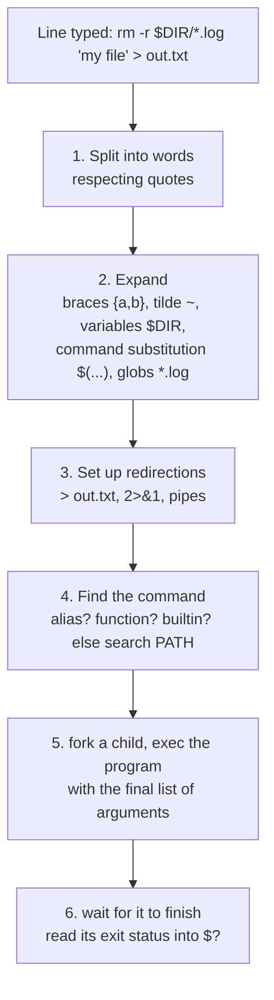
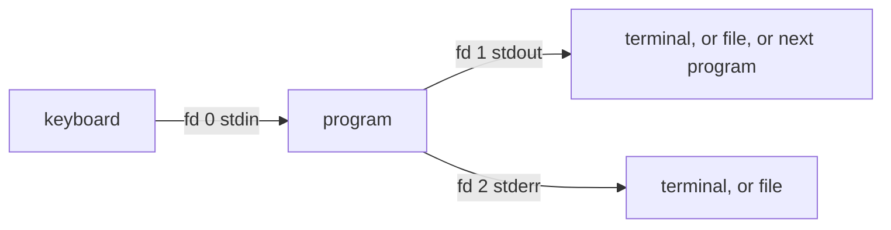

# 1.2 The command line: shells, commands, pipes and redirection

**Level:** basics · **Tier 0 (foundations)** · **Lab venue:** a small Ubuntu VM (also works on a Mac terminal, with the differences listed in section 11) · **Status:** drafted, labs untested

## Why this matters for AI infrastructure

You will spend much of your career typing commands into terminals on machines you did not build: a GPU node over SSH, a Slurm login node, the shell inside a container, a BMC console. Every cluster job script, every Dockerfile `RUN` line, every Ansible `command:` task, every systemd `ExecStart=` and every CI step is a shell command line in disguise. People who have used a shell for years but never learned *how a line is actually processed* keep getting bitten by the same things: a space in a filename, an unquoted variable, errors that disappear into the wrong stream, a pipeline that "succeeds" while its first stage failed, an environment variable that exists in one shell and not another. This chapter teaches the rules once, from the beginning, so that those problems stop happening and you can read other people's scripts with confidence.

## Prerequisites and outcomes

You need chapter 1.1 (the idea of processes, system calls and the kernel). After this chapter you will be able to:

- explain the difference between a terminal, a shell and a command, and what the shell does between you pressing Enter and a program starting;
- use a core set of commands to look around, create, copy, move and delete files safely;
- read and write command lines with options, arguments, quoting, globbing, variables and command substitution, and predict what the shell will do *before* it runs;
- use standard input, output and error, redirection and pipes, and explain file descriptors 0, 1 and 2;
- read exit codes, chain commands with `&&`, `||` and `;`, and recognise the exit codes you will see from Slurm and Kubernetes (126, 127, 137, 143);
- understand environment variables, `PATH`, startup files and why "it works in my shell" fails elsewhere;
- find help yourself with `--help`, `man`, `type` and friends, and decode a Unix error message;
- avoid seven classic command-line failures.

## 1. Terminal, shell, command: three different things

New users blur these together; separating them clears up half of the confusion.

- A **terminal** (terminal emulator) is the window where text appears and where your keystrokes go. Today it is a program (Terminal, iTerm, GNOME Terminal, the SSH client in your window). Historically it was a physical keyboard-and-screen device, which is why the Linux kernel still has "TTY" devices (teletype).
- A **shell** is a program that runs *inside* the terminal. It prints a **prompt**, reads a line you type, interprets it, and runs the programs you ask for. The shell is just a user-space program (chapter 1.1) like any other; it is not part of the kernel. Common shells: `sh` (the original Bourne shell, and its small modern relatives such as `dash`), **`bash`** (the "Bourne-again shell", the default on most Linux distributions), `zsh` (the default on macOS), and `fish`. Scripts and cluster tooling are overwhelmingly written for `bash` or plain `sh`.
- A **command** is whatever you ask the shell to run. It may be a *program on disk* (`ls`, `python3`), a *shell builtin* handled inside the shell itself (`cd`, `export`), an *alias* (a shorthand you or the system defined), or a *shell function*.



You can ask which shell you are in with `echo $0` (or `ps -p $$`), and which shells exist on the system in the file `/etc/shells`. Your **login shell** (the one started when you log in) is recorded in `/etc/passwd`; the command `chsh` changes it. Do not change root's shell or system scripts' shell; the interpreter of a script is chosen by its first line (`#!/bin/bash`, chapter 1.9), not by your login shell.

Three further facts about shells are worth having early. **The shell is also a small programming environment**, and many important parts of a Linux system are themselves shell scripts (text files containing a sequence of shell commands: startup scripts, installers, package hooks, the glue in Slurm and Kubernetes tooling); chapter 1.9 is devoted to writing them well. **Every Unix system needs a Bourne-compatible shell at `/bin/sh`**, because system scripts assume it. On some distributions `/bin/sh` is a link to `bash`; on **Debian and Ubuntu it is `dash`**, a smaller, faster POSIX shell that lacks bash extensions such as arrays and `[[ ]]`, so a script that starts with `#!/bin/sh` but uses bash features works on one distribution and fails on another (check with `ls -l /bin/sh`; failure mode 8 below). And **the prompt tells you where you are**: on Ubuntu it looks like `alice@gpu01:~/lab$` (user, host, working directory), on Fedora and Red Hat family systems `[alice@gpu01 lab]$`; it ends with `$` for a normal user and `#` for root. Documentation, including this book, uses the same convention: a leading `$` marks a command to type as a normal user and a leading `#` marks one that needs root, which you should run with `sudo` so the action is logged (chapter 1.6). Not every line you type has the "program, options, arguments" shape: **shell builtins** (handled inside the shell) and **assignments before a command** (`NCCL_DEBUG=INFO python3 train.py`) are the exceptions you will meet most.

## 2. Anatomy of a command line

A line is split into **words** separated by spaces. The first word is the **command**; the rest are its **arguments**. Arguments that start with `-` are conventionally **options** (also called flags or switches) that change what the program does.

```bash
ls -l -a /var/log
#  ^  ^  ^   ^
#  |  |  |   argument (what to act on)
#  |  |  option
#  |  option
#  command
```

Conventions you can rely on across almost every Linux tool:

- Short options are one dash and one letter (`-l`); several can be combined (`-la` equals `-l -a`).
- Long options are two dashes and a word (`--all`, `--human-readable`) and are easier to read in scripts.
- Some options take a value: `-n 20` or `--lines=20` or `-n20`.
- `--` means "end of options; everything after is an argument", which saves you when a filename begins with `-` (`rm -- -weird-file`).
- Almost every command accepts `--help` and many accept `--version`.

### What the shell does with a line

Between you pressing Enter and the program starting, the shell does a lot. Learning this order is the single most useful thing in this chapter because it lets you predict behaviour.



The consequence that surprises people: **the program never sees your wildcards, variables or quotes; it only sees the final result.** When you type `ls *.txt`, the *shell* replaces `*.txt` with the list of matching names before `ls` starts. You can prove it: `echo *.txt` prints the names the shell produced, because `echo` is given them as ordinary arguments. Use `echo` (or `printf '%s\n'`) as a free preview tool whenever you are unsure what a line will expand to.

### How the shell finds a program: `PATH`

When you type a bare word like `python3`, the shell checks, in order, whether it is an alias, a function, or a builtin, and otherwise searches the directories listed in the environment variable **`PATH`**, from left to right, taking the first match. These are useful:

```bash
echo "$PATH" | tr ':' '\n'      # show the search directories one per line
type -a python3                  # every way "python3" could resolve, in order
command -v python3               # the one that will run
which -a python3                 # similar, searches PATH only
```

If you ever run the wrong version of a tool, the problem is almost always `PATH` order or an alias. Section 8 goes deeper.

## 3. A survival kit of commands

Learn these first, and learn them well. We explain the *why* of each; the detailed filesystem concepts (paths, inodes, links) are in chapter 1.3 and text-processing tools in 1.4.

| Command | What it does | The options you will really use |
|---|---|---|
| `pwd` | print the current (working) directory | `-P` resolve symlinks |
| `ls` | list directory contents | `-l` long format, `-a` include dotfiles, `-h` human sizes, `-t` by time, `-r` reverse, `-R` recursive, `-d` the directory itself |
| `cd` | change directory (a *builtin*, because it must change the shell's own state) | `cd` home, `cd -` previous directory, `cd ..` parent |
| `mkdir` | create a directory | `-p` create parents, no error if exists |
| `rmdir` | remove an *empty* directory | |
| `touch` | create an empty file or update its timestamp | |
| `cp` | copy | `-r` directories, `-a` preserve everything, `-i` ask before overwrite, `-v` verbose |
| `mv` | move or rename | `-i`, `-n` never overwrite, `-v` |
| `rm` | remove files (no trash, no undo) | `-r` directories, `-i` ask, `-f` force (no questions) |
| `cat` | print files, or join them | `-n` number lines |
| `less` | read a long file one screen at a time (`q` quits, `/` searches, `G` end, `F` follow) | `-S` no wrapping |
| `head`, `tail` | first or last lines | `-n 20`, `tail -f` follow a growing file |
| `echo`, `printf` | print text | `printf` is more predictable in scripts |
| `wc` | count lines, words, bytes | `-l` lines |
| `clear` | clear the screen (or press Ctrl-L) | |

### The forms of the basic commands

The one-line descriptions in the table hide the forms you will use every day.

- **`cp`**: `cp file1 file2` copies a file to a new name; `cp file dir` copies it into a directory keeping its name; `cp file1 file2 file3 dir` copies several files into `dir` (the **last argument is the destination**, and it must be a directory when there are several sources); `cp -r dir1 dir2` copies a directory tree. `cp -p` preserves the original's attributes (permissions, times) instead of using the current user's defaults and the current time, and `cp -i` asks before overwriting an existing destination. `mkdir -p a/b/c` creates the parents as needed (and is quiet if they exist), `mkdir -m 750 dir` sets the mode at creation. `cat > notes.txt` is a quick way to create a file from the keyboard (end with Ctrl-D), and `cat a b c > all` merges three files into one (the originals are kept; the target is overwritten, so use `>>` to append). Text-mode file managers such as **Midnight Commander** (`mc`, with its editor `mcedit`) do many of these operations without a graphical desktop and are a gentle start for newcomers.
- **`mv`**: its behaviour depends on what the arguments are. `mv file1 file2` renames `file1` to `file2` (and silently replaces an existing `file2`; use `-i` to be asked, `-n` to refuse); `mv dir1 dir2` renames the directory if `dir2` does not exist, but moves `dir1` *into* `dir2` if it does; `mv file dir` moves it into the directory under the same name, and `mv file1 dir/file2` moves and renames in one step; `mv file* ../dir2` moves a whole list into a directory. In every case the source disappears, as a new name or a new place. Moving within a filesystem is just a rename and is instant (chapter 1.3). Useful options: `-i` and `-f` (interactive, force).
- **`touch`**: creates an empty file if it does not exist; if it does exist, it leaves the contents alone and **updates the modification time**, which is how you test tools that rebuild things when files change.
- **`rm`**: deletes files (not directories without `-r`). **`rmdir`** removes only *empty* directories and refuses otherwise; `rm -r dir` removes a directory and everything inside it, and is one of the few commands that can do serious damage, especially as root: never combine `-r` with a bare `*`, and double-check the line before pressing Enter.
- **`ls`**: `ls -F` appends a character that marks the type (`/` for directories, `*` for executables, `@` for symlinks); `ls -l` is the long listing, whose columns are the type and permissions, the number of hard links, the owner, the group, the size, the modification time and the name (chapter 1.3 explains each).
- **`cd`** is a **builtin**, not a separate program, and the reason is instructive: every process has its own current working directory, and a child process cannot change its parent's. If `cd` were an external program started by the shell, it would change *its own* directory and exit, leaving the shell where it was. The same reasoning applies to any command that must change the state of the shell itself (`export`, `alias`, `source`, `ulimit`, `umask`), and it is why such commands cannot be put in a script and run normally: a script runs in a child shell and its changes vanish when it exits. Run `cd` with no argument to return home.
- **Paths:** `..` is the parent directory, `.` the current one (so `./prog` runs a program in the current directory), and a path that does not start with `/` is relative. If you are in `/usr/lib`, then `..` is `/usr` and `../bin` is `/usr/bin`.

**`cat` as a window onto standard input.** `cat file1 file2` concatenates files to the screen (that is where the name comes from). Run `cat` with **no arguments** and it appears to hang: it is waiting on standard input, which the kernel connects to your terminal. Type some lines and it echoes each back. Press **Ctrl-D** on an empty line to send end-of-file and it exits (Ctrl-C by contrast kills the program regardless). This tiny experiment shows the whole idea of standard streams (section 6): a command with no file arguments reads stdin.

A first session, typed line by line; read what each line does before running it:

```bash
pwd                                  # where am I?
mkdir -p ~/lab/day1/{src,notes}      # make a small tree (brace expansion creates both subdirs)
cd ~/lab/day1
touch notes/todo.txt src/main.py
ls -lR                               # long, recursive listing
echo "install the driver" > notes/todo.txt
cat notes/todo.txt
cp notes/todo.txt notes/todo.bak
mv notes/todo.bak notes/old.txt
ls notes
rm notes/old.txt                     # gone; there is no undo
```

### The one habit that prevents most disasters

`rm` does not move anything to a trash. `rm -r` descends into directories; `rm -f` suppresses all warnings. The combination `rm -rf` applied to the wrong path, or to a path built from an empty variable, has destroyed production data many times (failure mode 2). Build these habits:

1. Run `ls` with exactly the same pattern first. If it lists what you expect, replace `ls` with `rm`.
2. Never put an unquoted variable in a destructive command. Use `rm -rf -- "${DIR:?DIR is empty}/build"`: the `:?` makes the shell abort with an error if `DIR` is empty or unset.
3. Prefer `rm -i` in interactive sessions, and keep `-f` out of your muscle memory.

## 4. Getting help without leaving the terminal

You will not memorise every option. What matters is to find answers fast.

```bash
ls --help | less               # a short usage summary; works for most GNU tools
man ls                         # the manual page
man -k "copy files"            # search manual names and descriptions (same as apropos)
type cd ; help cd              # for shell builtins use 'help', not 'man'
info coreutils                 # the GNU 'info' manuals, sometimes more detailed
ls /usr/share/doc | head       # package-supplied documentation
```

Manual pages are organised in numbered **sections**. You will see names like `ls(1)` or `socket(2)`; the number is the section:

| Section | Contains | Example |
|---|---|---|
| 1 | user commands | `man 1 ls` |
| 2 | system calls | `man 2 execve` |
| 3 | C library functions | `man 3 printf` |
| 4 | device interface and driver information | `man 4 null` (of marginal use) |
| 5 | file formats and configuration files | `man 5 passwd`, `man 5 slurm.conf` |
| 6 | games | `man 6 intro` (rarely useful) |
| 7 | overviews, conventions and encodings | `man 7 signal`, `man 7 cgroups` |
| 8 | system administration commands | `man 8 mount` |

When the same name exists in several sections, say which one you want: `man 5 passwd` (the file) versus `man 1 passwd` (the command).

Manual pages are **reference material, not tutorials**: they list options systematically (often alphabetically) rather than telling you which ones matter, so expect to read around. Sections 1, 5, 7 and 8 are the ones you will use most as an administrator; section 3 is for programmers, and section 2 becomes readable once you know what system calls are (chapter 1.1). `man -k sort` (or `apropos sort`) searches names and one-line descriptions, which is how you find a command when you only know what it should do: the result lists the page name, the section and a summary, for example `sort (1) - sort lines of text files` next to `qsort (3)`, which is a C function and not what you wanted. The GNU project also publishes many manuals in **info** format (`info coreutils`, navigated with its own keys; pipe it through `less` if you prefer), which can be more detailed than the man page; and some packages simply install their documentation under `/usr/share/doc` without registering it with either system, so look there too. For a quick reminder of options, `command --help` or `command -h` usually prints a short summary. Inside `man`, use `/word` to search, `n` for the next match, `q` to quit. For cluster work, remember that **the manual of the exact version installed on the machine is authoritative**; `man slurm.conf` on your login node beats any blog post.

## 5. Expansion and quoting: the rules that explain "weird" behaviour

The shell expands several kinds of text before running a command. The ones you will use daily:

| Kind | Example | Becomes |
|---|---|---|
| Tilde | `~`, `~alice` | home directory of you, or of alice |
| Variable | `$HOME`, `${USER}` | the variable's value |
| Command substitution | `$(date +%F)` | the command's output, for example `2026-10-23` |
| Arithmetic | `$((3 * 7))` | `21` |
| Brace expansion (bash and zsh) | `file{1..3}.txt`, `{a,b}` | `file1.txt file2.txt file3.txt`, `a b` |
| Globbing (wildcards) | `*.log`, `data?`, `[abc]*` | the matching file names |

**Globbing.** `*` matches any run of characters (including none), `?` exactly one character, `[abc]` one of the listed characters, `[0-9]` one in a range. Globs match *file names in the filesystem*, are expanded by the shell, and do not cross `/`. Hidden files (starting with `.`) are not matched by `*`. If nothing matches, bash passes the pattern through unchanged (so `ls *.xyz` tries to list a file literally named `*.xyz`), while zsh stops with "no matches found". That difference trips up people moving scripts between a Mac and a Linux server.

Some patterns to practise: `at*` matches names that start with `at`, `*at` names that end with `at`, `*at*` names that contain `at`, and `b?at` matches `boat` and `brat` (exactly one character in place of `?`). **A trap for anyone coming from Windows:** `*.*` does *not* mean "all files". On Linux it matches only names that contain a dot; use `*` for everything, because Unix names need not have an extension. To pass a literal `*` to a program (as you must with `grep` and `find` patterns), single-quote it: `echo '*'` prints a star. And remember the rule behind all of this: **the shell expands globs before running the command, and only then**; if a `*` reaches a program unexpanded, the program, not the shell, decides what it means. Finally, `*` does not match names that begin with a dot, and the obvious fix, `.*`, is a trap, because it also matches `.` and `..` (the current and parent directories) and `rm -r .*` has damaged real systems. To match hidden files use `.[!.]*` or `.??*`, and prefer `find` for anything destructive (chapter 1.3). The full list of shell patterns: `*` any string, `?` any one character, `[c1-c2]` any character in a range, `[!c1-c2]` any character *not* in the range (bash and zsh), `{a,b,c}` an exact comma-separated list (bash and zsh), and `{10..20}` a numeric sequence. All of them except the braces are matched against real file names; braces just generate words, so `ls *.{cxx,h,la}` becomes `ls *.cxx *.h *.la`, and `cp config{,.bak}` becomes `cp config config.bak` even though the second file does not yet exist. **Hostile or accidental file names:** a name that begins with a dash is read by the command as an option once the glob expands (a file called `-rf` can turn `rm *` into trouble). The universal remedy is the argument `--`, which means "no more options, only file names": `rm -- -f` removes a file named `-f` (where `rm -f` would be read as an option), and `rm -- '-rf *.?'` removes a file with a name full of special characters when you quote or backslash-escape each one.

**Quoting** controls which expansions happen. There are three tools:

| Form | Effect | Example |
|---|---|---|
| `'single quotes'` | everything is literal, nothing expands | `echo '$HOME and *'` prints `$HOME and *` |
| `"double quotes"` | variables, `$(...)` and backslash escapes still work; wildcards and word splitting are suppressed | `echo "home is $HOME"` |
| `\` backslash | escapes the next single character | `echo \$HOME`, `touch my\ file` |

The most important rule in all of shell scripting: **double-quote your variable expansions** (`"$var"`, `"$@"`, `"$(cmd)"`). An unquoted `$var` is split on whitespace and then expanded by globs. If `file="my report.txt"`, then `cp $file /backup` runs `cp my report.txt /backup`, three arguments, and fails (or copies the wrong thing). `cp "$file" /backup` is correct.

### Special characters: the names to know

You will hear these characters named aloud when working with others, and many have a meaning to the shell, which is why they must be quoted when you want them literally.

| Character | Names | Common uses |
|---|---|---|
| `*` | star, asterisk | glob; "zero or more" in regular expressions |
| `.` | dot | current directory; hidden-file prefix; separator in names |
| `!` | bang | negation; history expansion (`!!`) |
| `\|` | pipe | connect commands |
| `/` | slash | directory separator (never a backslash); `/pattern` searches in `less`, `man`, `vim` |
| `\` | backslash | escape the next character; line continuation (never a directory separator) |
| `$` | dollar | variables, command substitution; end of line in regular expressions |
| `'` | single quote, tick | literal string |
| `` ` `` | backtick | old form of command substitution (use `$(...)`) |
| `"` | double quote | string that still expands variables |
| `^` | caret, hat | start of line in regular expressions; negation in `[^...]`; written before a letter for control keys (`^C` means Ctrl-C) |
| `~` | tilde | home directory |
| `#` | hash, pound, sharp | start of a comment; the root prompt |
| `[ ]` | square brackets | character sets and ranges in globs and regular expressions; `[ ]` as a test command |
| `{ }` | braces, curly brackets | brace expansion, grouping, variable syntax `${var}` |
| `_` | underscore | a space substitute where spaces are not allowed |

Predict-then-check habit:

```bash
file="my report.txt"
printf '<%s>\n' $file          # unquoted: two words
printf '<%s>\n' "$file"        # quoted: one word
echo *.conf                    # see what the glob becomes
echo "$(date +%F)-run"         # command substitution inside quotes
```

## 6. Standard streams, redirection and pipes

Every process starts with three open **file descriptors**: small integers the kernel uses to refer to open files, pipes, terminals or sockets. By convention:

| FD | Name | Default is | Used for |
|---|---|---|---|
| 0 | standard input (stdin) | the keyboard | data the program reads |
| 1 | standard output (stdout) | the terminal | normal results |
| 2 | standard error (stderr) | the terminal | error and diagnostic messages |

Having a *separate* error stream is a design decision with big consequences: you can capture results without mixing in warnings, and you can see errors even when output is redirected. The shell lets you rewire these descriptors before starting a program; the program neither knows nor cares where they lead (a pure application of the "everything is a file" idea from chapter 1.1).



The redirection operators:

| Operator | Meaning | Example |
|---|---|---|
| `> file` | send stdout to file, overwriting it | `ls > list.txt` |
| `>> file` | append stdout to file | `echo run >> log.txt` |
| `< file` | read stdin from file | `wc -l < list.txt` |
| `2> file` | send stderr to file | `ls /nope 2> err.txt` |
| `2>&1` | make stderr go where stdout currently goes | `cmd > all.txt 2>&1` |
| `&> file` | (bash) both stdout and stderr to file | `cmd &> all.txt` |
| `> /dev/null` | discard output (`/dev/null` swallows everything) | `cmd > /dev/null 2>&1` |
| `<<EOF` ... `EOF` | here-document: feed text lines as stdin | see below |

Two points the table does not show. First, **`>` destroys the previous contents** of the target file the moment the command starts (even if the command then fails), so a typo such as `sort data.txt > data.txt` empties the file before `sort` reads it. In bash, `set -o noclobber` (or `set -C`) makes `>` refuse to overwrite an existing file (use `>|` to force it), a worthwhile safety net in interactive shells. Second, pipes chain as many commands as you like, one after another: `head /proc/cpuinfo | tr a-z A-Z` upper-cases the first lines of the CPU description; and `<` is rarely needed because most commands accept file names directly (`head < /proc/cpuinfo` and `head /proc/cpuinfo` do the same thing), but a few programs only read standard input.

**Order matters.** Redirections are processed left to right. `cmd > out.txt 2>&1` sends stdout to the file, *then* points stderr at the same place: both end up in the file. `cmd 2>&1 > out.txt` first points stderr at the terminal (where stdout currently goes), *then* moves stdout to the file: errors still appear on screen. Burn the first form into memory; it is the one you want almost always.

**Pipes.** The character `|` connects the stdout of one command directly to the stdin of the next, without a temporary file: `ps -ef | grep slurmd | wc -l`. The kernel provides a small in-memory buffer between the two processes, and they run *at the same time*. This is the heart of the Unix philosophy: many small tools, each doing one thing, joined into pipelines. Note that a pipe carries only stdout; stderr still goes to the terminal unless you redirect it (`cmd1 2>&1 | cmd2`).

Four tools that pair naturally with redirection and pipes:

- `tee file` copies stdin to both stdout and a file: `make 2>&1 | tee build.log` (you see the output *and* keep a log). `tee -a` appends.
- `/dev/null`: the black hole for output you do not want.
- `xargs` builds a command line from stdin (chapter 1.4).
- **Here-documents** write multi-line input inline, very useful to create config files from scripts:

```bash
cat > /tmp/job.sbatch <<'EOF'
#!/bin/bash
#SBATCH --nodes=2
echo "hello from $(hostname)"
EOF
```

Quoting the delimiter (`'EOF'`) stops the shell from expanding `$` and backticks inside the text, so the file is written exactly as typed. Without quotes, `$(hostname)` would be replaced *when the file is created*.

## 7. Exit status and combining commands

Every process, when it ends, returns a small integer to its parent: the **exit status** (exit code). By convention **0 means success** and anything else means failure. The shell stores the status of the last command in `$?`:

```bash
ls /tmp ; echo "status=$?"       # 0
ls /nope ; echo "status=$?"      # non-zero (2 for GNU ls)
```

You can combine commands using the status:

| Form | Runs the second command when |
|---|---|
| `a ; b` | always, after `a` ends |
| `a && b` | `a` succeeded (status 0) |
| `a \|\| b` | `a` failed (status non-zero) |
| `a & b` | `a` is started in the background, and `b` runs immediately |
| `(a; b)` | in a subshell (a child shell; variable changes do not leak out) |
| `{ a; b; }` | as a group in the current shell |

Typical use: `mkdir -p build && cd build && cmake ..` stops at the first failure; `command || echo "failed" >&2` reports failure on stderr.

### Exit codes you will meet in AI infrastructure

| Code | Meaning | Where you see it |
|---|---|---|
| 0 | success | everywhere |
| 1 | generic error | many tools |
| 2 | misuse of a command or syntax error | shells, many CLIs |
| 126 | found but not executable (permissions, wrong format) | scripts without `chmod +x` |
| 127 | command not found | wrong `PATH`, missing package |
| 128 + N | killed by signal N | `130` = Ctrl-C (SIGINT 2); `137` = SIGKILL (9); `143` = SIGTERM (15) |

The `128 + N` rule explains frequent incidents: **a Kubernetes container that exits with 137 was killed with SIGKILL, most often by the kernel's out-of-memory killer ("OOMKilled")**, and a Slurm job that ends with exit code `0:9` or reports signal 9 was killed the same way (a cgroup memory limit or an administrator's `scancel`). Exit 143 is a polite SIGTERM, such as Kubernetes asking a pod to stop. You can reproduce 137 yourself: `bash -c 'kill -9 $$'; echo $?`.

A related trap: **in a pipeline, the exit status is that of the *last* command only.** `false | cat; echo $?` prints `0`, hiding the failure of `false`. In scripts, use `set -o pipefail` (chapter 1.9) so a pipeline fails if any stage fails.

## 8. Environment variables, `PATH` and startup files

A shell keeps named values called **variables**. A subset, marked with `export`, is placed into the **environment**, a block of `NAME=value` strings that every child process inherits (the kernel copies it on `execve`; chapter 1.1). That is how `PATH`, `HOME`, `LANG`, and application settings travel from the shell into programs:

```bash
name="alice"                    # shell variable: visible only to this shell
export CUDA_VISIBLE_DEVICES=0,1 # environment variable: inherited by children
env | sort | head               # list the environment (printenv is similar)
echo "$name $CUDA_VISIBLE_DEVICES"
bash -c 'echo "[$name] [$CUDA_VISIBLE_DEVICES]"'   # child sees only the exported one
NCCL_DEBUG=INFO python3 train.py     # set a variable for ONE command only
```

Variables worth knowing for this book: `PATH` (where commands are found), `HOME`, `USER`, `PWD`, `LANG`/`LC_ALL` (language and character set, which affect sorting), `EDITOR`, and the AI-specific ones you will set constantly: `CUDA_VISIBLE_DEVICES`, `NCCL_DEBUG`, `NCCL_SOCKET_IFNAME`, `OMP_NUM_THREADS`, `LD_LIBRARY_PATH`. Remember that *an environment variable set in your terminal does not exist inside a Slurm job, a systemd service or a container unless it is explicitly passed along*; many "works interactively, fails in the job" mysteries are this.

### Modifying `PATH` safely

```bash
export PATH="$HOME/bin:$PATH"      # prepend: your tools win
export PATH="$PATH:/opt/tool/bin"  # append: system tools win
```

Order is priority. Never add an empty element or `.` (the current directory) to `PATH`: it lets any file in any directory you visit shadow a real command.

Two practical points about editing `PATH`. The assignment form has **no spaces around `=`** (`PATH=dir:$PATH`); with spaces the shell would try to run a command called `PATH`. And a typo such as `PATH=dir:$PAHT` replaces the whole path with a nearly empty one, after which even `ls` is "not found". Do not panic: the damage is confined to that shell, so close the window or run `exec bash` (or `bash -l`) for a fresh one; permanent damage requires making the same typo in a startup file, and even then you fix it by running commands with full paths (`/usr/bin/vim ~/.bashrc`). The same distinction applies to any variable: an assignment such as `STUFF=blah` creates a **shell variable** visible only to the shell; `export STUFF` turns it into an **environment variable** that every child inherits, which is why programs read their configuration from the environment (for example `LESS` holds your preferred `less` options, and many manual pages end with an ENVIRONMENT section listing the variables the program honours).

### Startup files: where the settings live

When a shell starts it reads configuration files, which differ depending on how it was started:

| Kind of bash shell | Reads (in general) | Examples |
|---|---|---|
| **login shell** (SSH login, `bash -l`) | `/etc/profile`, then the first of `~/.bash_profile`, `~/.bash_login`, `~/.profile` | what you get over SSH |
| **interactive non-login** (a new terminal window on a desktop, or `bash` typed inside a session) | `~/.bashrc` | aliases, prompt |
| **non-interactive** (scripts, `ssh host command`, cron) | nothing by default (only what `BASH_ENV` names) | automation |

Conventional setups source `~/.bashrc` from `~/.profile` so both cases behave similarly (Ubuntu does this). Zsh uses `~/.zshrc` and `~/.zprofile`. Files that start with a dot are **dot files** (hidden from plain `ls`; use `ls -a`): `.bashrc`, `.ssh/`, `.gitconfig`, `.vimrc`. Changes to a startup file take effect in *new* shells; to apply to the current one, run `source ~/.bashrc` (or `. ~/.bashrc`).

Why you must care about the last row of the table: a non-interactive shell does not read `~/.bashrc`, so tools that your interactive session finds (via a `PATH` edit in `.bashrc`) can be *missing in cron jobs, Slurm batch scripts and `ssh host 'command'` invocations*. The fix is to set what a job needs inside the script, or to use absolute paths.

## 9. Working faster: history, completion and editing

You will be faster if you stop retyping.

- **Tab completion** finishes command names, file names and (with `bash-completion` installed) options; press Tab twice to list candidates.
- **History:** `history | tail`, **Ctrl-R** to search backwards through past commands (type a few letters, press Ctrl-R again for the next match), `!!` repeats the last command (`sudo !!` re-runs it as root), `!$` is the last argument of the previous command.
- **Line editing** (the *readline* library, which bash and many other programs use, so the keys carry over): Ctrl-B and Ctrl-F move the cursor left and right, Ctrl-P and Ctrl-N show the previous and next command, Ctrl-A start of line, Ctrl-E end, Alt-B and Alt-F back and forward a word, Ctrl-W delete the word before the cursor, Ctrl-U delete to the start, Ctrl-K delete to the end, Ctrl-Y paste what you deleted, Ctrl-L clear the screen. The arrow keys work too, but these combinations keep your hands on the home row and work in many other Unix programs, so they are worth learning properly.
- **Terminal control keys:** Ctrl-C sends SIGINT (interrupt) to the foreground program, Ctrl-D sends end-of-input (exits a shell when the line is empty), Ctrl-Z suspends the foreground program (resume with `fg` or `bg`; job control is chapter 1.8), Ctrl-S/Ctrl-Q pause and resume output on some terminals.
- **Aliases:** `alias ll='ls -lah'` creates a shorthand; put it in `~/.bashrc` to keep it. Bypass an alias once with a backslash: `\ls`.

### Shell tricks that save hours on clusters

Administering hundreds of nodes means running the same operation many times, so small habits compound. These all work in bash (and mostly in zsh); a few do not work in plain `sh`.

- **Brace expansion generates lists and variants.** `cp config{,.bak}` expands to `cp config config.bak` (the empty first alternative gives the plain name), and `for n in gpu-{1,2}-{a,b}; do echo $n; done` visits four combinations. Ranges work too: `echo {1..15}`. Brace ranges do not keep leading zeros, so for names like `node-001` to `node-100` use `seq`: `for i in $(seq -w 1 100); do ssh node-$i true; done` (`-w` pads to equal width). Because the remote command `true` prints nothing, only the nodes that fail to answer show an error.
- **Reuse earlier commands.** `!!` is the previous command (`sudo !!` repeats it as root after a "Permission denied"), `!$` is its last argument (`chown alice data.txt` then `chmod 600 !$`), and `history | grep sudo` finds older ones; every history entry has a number, so `!123` re-runs entry 123 (look before you run, because history expansion repeats exactly what was typed). Ctrl-R searches backwards as you type a substring; press it again for the next older match.
- **Quick arithmetic.** `echo $((123*55+18))` computes with integer arithmetic (variables need no `$` inside: `$((123*55+offset))`). For fractions, use `bc`.
- **More command separators.** `&` runs a command in the background *and* separates it from the next one: `job_a & job_b & wait` starts both and `wait` pauses until they finish. `&&` and `||` are conditional (previous section). A common test is `[ -f testfile ] && cat testfile`; note that `[` here is **a command** (an old synonym for `test`), which is why it needs spaces around its arguments and the closing `]`.
- **Process only the error stream.** A pipe carries stdout only. To pipe stderr instead (and let stdout go elsewhere), swap the two streams with a spare descriptor: `my_command 3>&1 1>&2 2>&3 | grep -i warning`. It reads: save stdout as 3, point stdout at where stderr goes, point stderr at saved 3.
- **Keep the raw output and also analyse it.** `my_command | tee out.log | grep warning` writes everything to `out.log` while only matching lines continue down the pipe.
- **Copy a tree to another host with no temporary file.** `tar cf - mydata/ | ssh remotehost 'cd /place/to/go && tar xf -'` (chapter 1.5 and chapter 1.3).
- **Useful built-in variables in scripts:** `$?` is the status of the last command, `$$` the PID of the current shell and `$!` the PID of the last background job (chapter 1.9).
- **`bash` versus `sh`.** Many of these rely on bash features; do not assume them in a script that starts with `#!/bin/sh` (failure mode 8).

## 10. Understanding error messages

An error message looks cryptic until you notice it has a fixed shape:

```
ls: cannot access '/data/missing': No such file or directory
|   |                              |
|   what the program tried          the system's description of the error code
program name
```

The final text after the colon is not written by the program; it is the standard description of an **errno** code that the kernel returned to a failed system call (`strerror`). Because the set of codes is small, learning the common ones lets you diagnose failures in any program, including ones you have never seen. Here are the ones that matter, with what to check:

| Message | Code | Meaning in practice | First checks |
|---|---|---|---|
| No such file or directory | `ENOENT` | the path does not exist (or a directory in the path does not); also what you get running a script whose `#!` interpreter is missing | typo, relative versus absolute path, `ls -ld` each component, CRLF in the shebang line |
| Permission denied | `EACCES` | the file exists but your user, group or the path's directories do not allow this access (or an SELinux/AppArmor rule blocks) | `ls -l`, `id`, `namei -l path` |
| Operation not permitted | `EPERM` | you are not allowed to do this *operation* regardless of the file's mode (changing ownership, setting time, loading a module) | need root or a capability |
| File exists | `EEXIST` | creating something that is already there | `ls`, use `-p` or remove it |
| Not a directory / Is a directory | `ENOTDIR` / `EISDIR` | wrong kind of object for this operation | `file path` |
| No space left on device | `ENOSPC` | the filesystem is full of data **or** out of inodes (file slots) | `df -h` **and** `df -i` |
| Too many open files | `EMFILE` / `ENFILE` | the per-process or system limit on open file descriptors | `ulimit -n`, `lsof -p` |
| Argument list too long | `E2BIG` | a glob expanded into too many names for one command | use `find ... -exec`, `xargs` |
| Command not found | (exit 127) | the shell found nothing in `PATH` | `type`, `echo $PATH`, install the package |
| Segmentation fault | signal `SIGSEGV` | the program touched memory it may not (the MMU faulted, the kernel killed it) | bug in the program or a bad library; `dmesg`, core dump |
| Bus error | signal `SIGBUS` | invalid memory access, e.g. a truncated memory-mapped file | file or hardware problem |

A few details behind the table. **ENOENT** ("No such file or directory") is the commonest of all and covers files *and* directories, because the Unix file interface does not distinguish them much: it appears when you read a file that is not there, `cd` to a missing directory, or write into a directory that does not exist; the name comes from "error, no entity". "File exists" (EEXIST) usually means you tried to create a directory with the same name as an existing file. "Not a directory" applies to *one component* of the path: after `touch a`, the command `touch a/b` fails with `a/b: Not a directory`, and the message is about `a`, so when a long path fails you may need to inspect each component. "Permission denied" also appears when you try to *run* a file that lacks the execute bit, even if you can read it. "Operation not permitted" most often means you tried to signal or change something you do not own, such as killing another user's process. A **segmentation fault** means the program touched memory it was not allowed to touch and the kernel killed it, which almost always means a bug in the program or unexpected input; a **bus error** is a related invalid-access fault that, in rare cases, points at faulty memory hardware. Error codes come straight from system calls (`open()` returns ENOENT and so on), so the system-call manual pages (`man 2 open`, section ERRORS) list exactly what each failure can mean.

**Errors versus warnings.** A message containing *warning* means something is wrong but the program is trying to continue; an error means it gave up on the operation. Do not ignore warnings: a warning about an unreadable file or a stale lock may be the clue that explains the error that follows.

**Read the first error first.** Some programs report one fundamental problem and then dozens of consequences. If a hypothetical daemon prints `scumd: cannot access /etc/scumd/config: No such file or directory` followed by pages of other complaints, the remaining messages are noise created by the first; fix the missing file first and read again. This is the single most useful debugging habit in the chapter.

Two further habits: read the **first** error in a long output (later ones are often consequences), and when a message is unclear, run the command under `strace -f -e trace=file` (chapter 1.1) to see *which path or call* returned the error code.

## 11. Mac or Linux? The differences that bite

Many readers work on a Mac laptop and on Linux servers. Both are Unix-like, but they differ in small ways that silently break scripts.

| Area | Linux (GNU userland) | macOS |
|---|---|---|
| Default shell | bash on most distributions | zsh |
| Core tools | GNU coreutils, GNU sed, GNU grep, GNU find | BSD versions; options differ |
| In-place edit | `sed -i 's/a/b/' file` | `sed -i '' 's/a/b/' file` (needs an empty suffix argument) |
| Dates | `date -d "yesterday"` | BSD `date` does not have `-d`; use `-v-1d` |
| Unmatched glob | passes the pattern through (bash) | zsh: "no matches found" error |
| Word splitting of unquoted variables | splits on whitespace (bash) | zsh does not split by default |
| Process tools | procfs (`/proc`), `ss`, `ip` | no `/proc`; `lsof`, `netstat`, `ifconfig` |
| Containers | native namespaces and cgroups | run inside a hidden Linux VM |

Practical advice: **do your labs for this book on a Linux machine** (a cloud VM, a local VM or a container) so the output matches the text. Keep your scripts POSIX-clean or explicitly `#!/bin/bash` and test them on the target OS. Installing GNU tools on a Mac via Homebrew (`gsed`, `ggrep`, `gdate`) is useful for local development, but never assume they are present on the machine that will run your script.

## 12. Daily patterns for AI and HPC work

A few idioms that appear constantly; recognise them now, and chapter 1.9 turns them into robust scripts.

```bash
# keep a log and still see the output; capture errors too
python3 train.py --config cfg.yaml 2>&1 | tee run-$(date +%F-%H%M).log

# watch a GPU or a directory change every second
watch -n 1 nvidia-smi
watch -n 5 'ls -lh /data/ckpt | tail -5'

# run a long job that survives your SSH session closing
nohup python3 train.py > train.log 2>&1 &

# set per-job environment on the command line
NCCL_DEBUG=INFO CUDA_VISIBLE_DEVICES=0,1 torchrun --nproc_per_node=2 train.py

# time a command, and check its status afterward
time ./preprocess.sh && echo ok || echo "failed with $?"

# run a command on a remote machine, with a terminal (for interactive tools like top)
ssh -t gpu01 'nvidia-smi; uptime'
```

## How it fails

### 1. A space in a filename, an unquoted variable
**Symptom:** `cp: cannot stat 'my': No such file or directory`, or a loop acts on half-names. **Cause:** unquoted expansion is split on spaces. **Diagnose:** `printf '<%s>\n' $var` shows the pieces. **Fix:** quote every expansion (`"$var"`, `"$@"`), and consider tools that use NUL separators (`find -print0 | xargs -0`, chapter 1.4).

### 2. `rm -rf "$DIR"/*` with an empty `DIR`
**Symptom:** `/` or the home directory starts disappearing. **Cause:** if `DIR` is unset or empty, `"$DIR"/*` becomes `/*`. **Fix:** `${DIR:?}` aborts if empty, validate with `[ -n "$DIR" ]` and an absolute-path check, `set -u` in scripts (chapter 1.9), and prefer `rm -rf -- "$DIR"` after confirming the value with `echo`. Do not rely on `--preserve-root`; it protects `/` only.

### 3. Errors vanish or appear in the wrong place: redirection order
**Symptom:** a log file is empty while the errors flash on the terminal. **Cause:** `cmd 2>&1 > file` (wrong order) or forgetting that pipes carry only stdout. **Diagnose:** `cmd > out 2> err`, inspect both. **Fix:** `cmd > file 2>&1`, or `cmd 2>&1 | tee file`.

### 4. The wrong program runs: `PATH` or alias shadowing
**Symptom:** `python3 --version` shows an unexpected version; a script uses the system Python instead of the conda one. **Diagnose:** `type -a python3`, `echo $PATH | tr ':' '\n'`, `alias`. **Fix:** order `PATH` deliberately, avoid aliasing standard command names in scripts, call tools by absolute path in automation.

### 5. "Argument list too long"
**Symptom:** `rm *.tmp` or `cp *` fails in a directory with a huge number of files. **Cause:** the kernel limits the total size of arguments to one command (`getconf ARG_MAX`), and the glob expanded past it. **Fix:** let a tool iterate: `find . -name '*.tmp' -delete`, or `find ... -print0 | xargs -0 rm`.

### 6. `bad interpreter: No such file or directory` on a script that exists
**Symptom:** `./run.sh: /bin/bash^M: bad interpreter`. **Cause:** the script was saved with Windows (CRLF) line endings, so the shebang line names `/bin/bash\r`. Common when scripts are edited on a laptop and copied to a node. **Diagnose:** `file run.sh` mentions CRLF, `cat -A run.sh | head -2` shows `^M$`. **Fix:** `sed -i 's/\r$//' run.sh` (GNU sed) or `dos2unix`, and configure the editor and Git to use LF endings.

### 7. A failing pipeline stage hidden by a later one
**Symptom:** a job reports success though its data step failed. **Cause:** the pipeline's exit status is the last command's. **Diagnose:** `echo ${PIPESTATUS[@]}` (bash) right after the pipeline shows each stage's status. **Fix:** `set -o pipefail` in scripts, and check statuses of critical stages.

### 8. A "bash script" that fails on another distribution: `/bin/sh` is not bash
**Symptom:** a script with `#!/bin/sh` works on one machine and reports `[[: not found` or `Syntax error: "(" unexpected` on another. **Cause:** `/bin/sh` is `dash` on Debian and Ubuntu and `bash` on others, and bash-only features (`[[ ]]`, arrays, `<<<`, `${var//x/y}`) are not POSIX. **Diagnose:** `ls -l /bin/sh`, `readlink -f /bin/sh`, `bash -n script`, `shellcheck script`. **Fix:** use `#!/usr/bin/env bash` (or `#!/bin/bash`) for bash features, or write strictly POSIX `sh`; never run a bash script with `sh script`.

## Hands-on lab (a GCP Ubuntu VM; untested)

**Part A: predict, then check.** For each line, write down the output you expect *before* running it, then compare. Explain every difference.
1. `touch "a b.txt" c.txt; ls`
2. `printf '<%s>\n' a b.txt` versus `printf '<%s>\n' "a b.txt"`
3. `echo *.txt` and then `echo "*.txt"` and `echo '*.txt'`
4. `X=5; echo $X; bash -c 'echo [$X]'; export X; bash -c 'echo [$X]'`
5. `echo $(echo $(echo hi))`, `echo "a   b"`, `echo a   b`
6. `echo file{1..3}.{c,h}`

**Part B: streams and pipes.**
7. Run `ls /tmp /nope > both.txt`, then examine `both.txt`. Where did the error go? Fix it three different ways (to a separate file, into the same file, discarded).
8. Compare `ls /nope > out.txt 2>&1` and `ls /nope 2>&1 > out.txt`; look at what each leaves in `out.txt` and on the screen. Explain using the left-to-right rule.
9. Build a pipeline that counts the logged-in processes of each user: `ps -eo user= | sort | uniq -c | sort -rn | head`. Explain each stage and what flows between stages.
10. Use `tee` to save the output of `ls -l /etc | head` to a file and still see it.

**Part C: exit codes.**
11. Run `true; echo $?`, `false; echo $?`, `ls /nope; echo $?`, `nosuchcmd; echo $?` (127), `touch noexec.sh; ./noexec.sh; echo $?` (126), `bash -c 'kill -9 $$'; echo $?` (137), and `sleep 100` interrupted with Ctrl-C then `echo $?` (130). Fill in the table of section 7 from your own results.
12. Show the pipeline trap: `false | cat; echo $?` then `set -o pipefail; false | cat; echo $?`, then `echo ${PIPESTATUS[@]}` after a pipeline.

**Part D: environment.**
13. Print `PATH` one entry per line. Create `~/bin/hello` (a script that prints "hello", `chmod +x`), run `hello` before and after adding `~/bin` to `PATH`, and explain the difference. Check `type hello`.
14. Open a new login shell (`bash -l`), then a non-interactive one (`bash -c 'echo $FOO'`). Put `export FOO=bar` in `~/.bashrc` and see which of these start seeing it. Explain with the table in section 8.

**Part E: error messages.**
15. Reproduce each error in the table of section 10 that you can: ENOENT (`cat /x`), EACCES (`cat /etc/shadow` as a normal user), EEXIST (`mkdir /tmp`), ENOTDIR (`cd /etc/passwd`), EISDIR (`cat /etc`), E2BIG (try `getconf ARG_MAX`, then reason about it; do not create millions of files), and a segmentation fault from a tiny C program with a null-pointer write. For two of them, use `strace` to see the failing system call and its errno.

**Part E2: the details from the source chapters.**
15a. Run `cat` with no arguments, type three lines, end with Ctrl-D, then repeat and end with Ctrl-C; explain the difference. Run `echo *.*` in a directory with and without dotted names. Create `.hidden1 .hidden2` and compare `ls`, `ls -a`, `echo *`, `echo .*`, `echo .[!.]*`.
15b. Run `sort data.txt > data.txt` on a throwaway file and see it emptied; then `set -o noclobber` and repeat. Compare `ls -l /bin/sh` with the shell you are in; run a script with `[[ ]]` under `sh` and under `bash`.
15c. Use `man -k sort`, then read the same name in two sections (`man 1 passwd`, `man 5 passwd`), open `info coreutils`, and look in `/usr/share/doc` for one package. Practise the readline keys of section 9 until they are automatic.

**Part F: safety drill.**
16. Make a scratch directory with a few files. Practise the safe-delete routine: `ls` the pattern, then `rm`; try `rm -rf -- "${NOPE:?not set}"/x` and see the abort; try `rm -i`.

## Checkpoint questions

1. What is the difference between a terminal, a shell and a command?
2. List the steps the shell performs between you pressing Enter and the program starting.
3. Why does `ls *.txt` work even though `ls` knows nothing about wildcards?
4. How does the shell find `python3`? Which commands show the resolution order?
5. What is the difference between single quotes and double quotes? When must you quote a variable?
6. What are file descriptors 0, 1 and 2? Why is stderr separate from stdout?
7. Explain `cmd > f 2>&1` versus `cmd 2>&1 > f`.
8. What does a pipe do, and what does it **not** carry? How can the kernel run both sides at once?
9. What does an exit status of 0 mean? What do 127, 130, 137 and 143 mean?
10. A container exits with 137. What happened, most likely?
11. What is the difference between a shell variable and an environment variable? Why might a variable be missing inside a Slurm job?
12. Which startup file does an SSH login read, and which one does `ssh host command` read?
13. A script fails with `bad interpreter: ^M`. What is wrong and how do you fix it?
14. What does "No space left on device" mean, and why is `df -h` not always enough to diagnose it?
15. List four differences between macOS and a typical Linux server shell environment that could break a script.

### Answers

1. A terminal is the window or device where text is displayed and keys are typed; a shell is a program inside it that reads and interprets lines; a command is what you ask the shell to run (program, builtin, alias or function).
2. Split into words with quoting, perform expansions (brace, tilde, variable, command substitution, arithmetic, globbing), set up redirections and pipes, find the command (alias, function, builtin, then `PATH`), fork a child and exec the program with the final argument list, wait for it and record its exit status.
3. The shell expands `*.txt` into the matching file names before starting `ls`; `ls` just receives a list of names.
4. It checks aliases, functions and builtins, then searches the directories in `PATH` from left to right and runs the first match. `type -a python3`, `command -v python3`, and `which -a python3` show this.
5. Single quotes keep everything literal; double quotes allow variable, command and arithmetic expansion but suppress wildcard expansion and word splitting. Quote a variable expansion whenever its value could contain spaces or glob characters, which is almost always.
6. Standard input, output and error. Errors are separate so results can be captured or piped without mixing in diagnostics, and so errors stay visible when output is redirected.
7. The first sends stdout to the file, then stderr to where stdout now points (the file): both in the file. The second sends stderr to the terminal (where stdout pointed at that moment), then stdout to the file: errors stay on screen.
8. It connects stdout of one process to stdin of the next through an in-kernel buffer. It carries only stdout. Both processes exist at the same time and run concurrently, with the kernel blocking the writer if the buffer is full and the reader if it is empty.
9. Success. 127 command not found, 130 killed by SIGINT (Ctrl-C), 137 killed by SIGKILL (9), 143 terminated by SIGTERM (15), following the rule 128 plus the signal number.
10. It was killed by SIGKILL, most commonly by the kernel's OOM killer because it exceeded its memory limit (reported as OOMKilled), though anything sending SIGKILL produces the same code.
11. A shell variable exists only inside the current shell; an exported variable is placed into the environment, which children inherit. A Slurm job, systemd service or container starts from its own environment, so interactive settings do not automatically carry over unless exported and propagated or set in the job.
12. A login shell reads `/etc/profile` and the first of `~/.bash_profile`, `~/.bash_login`, `~/.profile`. `ssh host command` runs a non-interactive shell, which reads none of these by default.
13. The script has Windows (CRLF) line endings, so the interpreter on the first line ends with a carriage return. Convert to LF (`dos2unix` or `sed -i 's/\r$//'`) and set editors and Git to LF.
14. The filesystem has no free blocks or no free inodes. `df -h` shows only block usage; `df -i` shows inode usage, and an inode-exhausted filesystem can show plenty of free space.
15. Default shell (zsh versus bash), BSD versus GNU option differences (`sed -i`, `date -d`), unmatched-glob and word-splitting behaviour in zsh, no `/proc`, and different networking and process tools.

## Sources and further reading

- Brian Ward, *How Linux Works*, 3rd ed., ch. 2 (the shell, basic commands, navigation and globbing, dot files, environment and `PATH`, special characters, command-line editing, online help, standard streams and redirection, understanding error messages, processes and job control basics, permissions, archives, the directory hierarchy, sudo). The material is reorganised across chapters 1.2 to 1.6 and 1.8 of this book; the explanations, exit-code section, Mac and Linux comparison, AI-infrastructure patterns, failure modes and lab are original.
- Sergey Zhumatiy, *Supercomputers for Linux SysAdmins*, ch. 7 and 8 (basics and working techniques for cluster administrators: manuals, file naming, common commands, shell tricks), used to align the cluster-operations viewpoint.
- Manual pages: `bash(1)` (sections EXPANSION, REDIRECTION, QUOTING, INVOCATION), `man 7 signal`, `man 3 errno`, `man 7 glob`, `man 1 tee`.

*Notes for review:* exit-code conventions (126, 127, 128+N) follow the POSIX and bash documentation; the statement that Kubernetes reports 137 as OOMKilled when the kernel kills a container for exceeding its memory limit is standard behaviour but should be confirmed on your cluster's runtime. macOS differences are stated for the stock tools and may vary by OS version. All lab commands are **untested** and must be run on a Linux VM before this chapter moves to `reviewed`.
