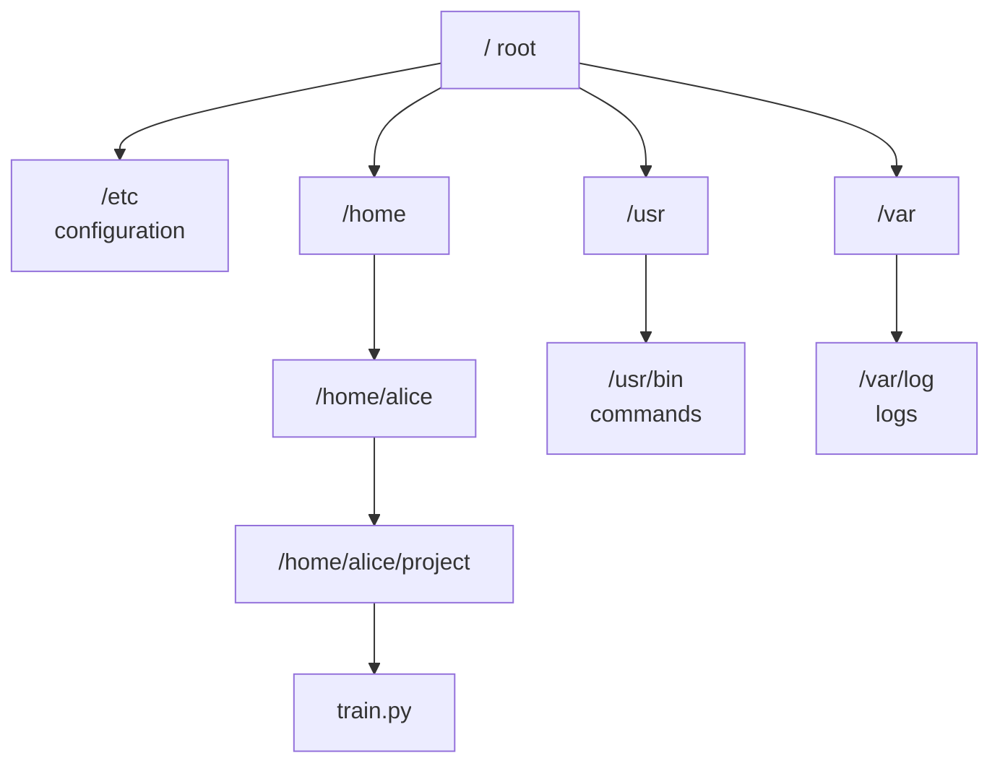
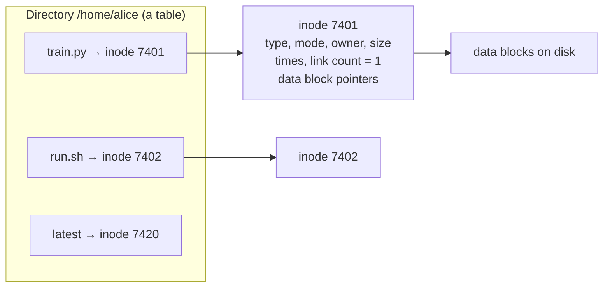

# 1.3 Files and the directory hierarchy: paths, links, inodes

| Field | Value |
|---|---|
| Level | Basics to Intermediate |
| Priority tier | Tier 0 (foundations) |
| Lab venue | Small Ubuntu VM on GCP (`fs_inodes_links_lab.py`: 20 checks pass; VM commands **untested** here) |
| Part | Part 1: Linux, from the command line to the kernel and performance |

## Why this matters for AI infrastructure

Everything in an AI cluster ends up as files on a filesystem: datasets with millions of small files, multi-gigabyte checkpoints, container image layers, Slurm and Kubernetes configuration, logs, driver modules, and the pseudo-files under `/proc` and `/sys` that expose the kernel and the hardware. Many of the failures that stop training runs are filesystem facts that look mysterious until you know the model. A disk reports that it is "full" while `df` shows plenty of free gigabytes. A checkpoint directory has a `latest` link that points at nothing. A dataset directory takes ten minutes just to list, or a tarball overwrites system files. This chapter gives you the mental model of how Linux names, stores, and links files, so that these problems become easy to diagnose and never surprise you in production.

## Prerequisites and outcomes

You need chapters 1.1 and 1.2 for the model of processes, system calls, and the shell. After this chapter you will be able to:

- Read and write absolute and relative paths correctly, and explain `.`, `..`, `~`, and `/`.
- Describe what lives in each top-level directory of a Linux system and where to look for configuration, logs, binaries, devices, and kernel information.
- Identify the type of any file from `ls -l` and `stat`, and explain what an inode is and what a directory really contains.
- Create and reason about hard links and symbolic links, and know when each breaks.
- Read the three timestamps of a file and understand what changes each.
- Find files by name, type, size, and age with `find`, and identify mystery files with `file`.
- Package, compress, inspect, and unpack archives with `tar` and common compressors safely.
- Diagnose six common filesystem failures: full disk with free space, dangling links, cross-device link errors, deleted-but-open files, unsafe extraction, and slow huge directories.

## 1. Paths: how you name a file

Every file or directory on Linux is reached through a **path**: a string of names separated by `/`. There is **one tree** with a single top, the **root directory**, written `/`. Unlike some other operating systems, there are no drive letters. Additional disks and network filesystems are *attached into the same tree* at chosen directories called mount points, which chapter 1.12 covers in detail.



- An **absolute path** starts with `/` and means the same thing everywhere: `/home/alice/project/train.py`.
- A **relative path** does not start with `/` and is interpreted starting from the **current working directory** (`pwd`) of the process: `project/train.py`. Relative paths are convenient interactively and a classic source of bugs in scripts, because the working directory is whatever the caller happened to be in. Cron jobs, systemd services, Slurm jobs, and containers each start in a different directory, so automation should use absolute paths or `cd` explicitly first.
- `.` means "this directory" and `..` means "the parent directory". The root's parent is itself.
- `~` is shell shorthand for your home directory; the shell expands it and the kernel never sees a tilde (chapter 1.2).
- Names are **case-sensitive** (`Data` and `data` are different), may contain almost any character except `/` and the NUL byte, and are **just bytes**. Linux imposes no encoding or file-extension meaning. A file called `train.py` is not special because of `.py`; the extension is a human and tool convention.

Two helpful commands manipulate paths: `realpath path` prints the absolute, symlink-resolved path, and `basename` and `dirname` split a path into its last component and the directory prefix.

## 2. The standard layout: where things live

Now that you know how to examine files, change directories, and read manual pages, you are ready to explore your system files and directories. The details of the Linux directory structure are outlined in the **Filesystem Hierarchy Standard (FHS)**, maintained by the Linux Foundation (`https://refspecs.linuxfoundation.org/fhs.shtml`). Knowing the FHS tells you where to look before you search.

| Directory | Purpose | What you will find on an AI node |
|---|---|---|
| `/` | root of the whole tree | |
| `/bin`, `/sbin`, `/lib`, `/lib64` | essential commands and libraries; on modern distributions these are **symbolic links** into `/usr` | |
| `/usr` | the bulk of installed software, read-mostly | `/usr/bin` commands, `/usr/lib` libraries, `/usr/share` data and docs, `/usr/local` software you installed yourself, `/usr/src` kernel and driver sources |
| `/etc` | **system-wide configuration** (plain text) | `slurm/slurm.conf`, `ssh/sshd_config`, `fstab`, `hosts`, `docker/`, `kubernetes/`, `systemd/system/` |
| `/var` | **variable** data that changes while the system runs | `/var/log` logs, `/var/lib` application state (`docker`, `kubelet`, `containerd`), `/var/spool` queues (`slurmd`), `/var/cache` caches |
| `/home` | users' personal files | code, notebooks, SSH keys; often on a shared filesystem in a cluster |
| `/root` | the superuser's home | |
| `/tmp` | temporary files, may be cleared at boot or periodically | scratch space; usually small and shared |
| `/run` | runtime data since boot (an in-memory filesystem) | PID files, sockets (`/run/munge`, `/run/containerd`) |
| `/dev` | device files | `nvidia0`, `nvme0n1`, `null`, `zero`, `tty`, `shm/` |
| `/proc` | a **virtual** filesystem: the kernel's view of processes and system state | `/proc/cpuinfo`, `/proc/meminfo`, `/proc/<pid>/`, `/proc/driver/nvidia/` |
| `/sys` | a **virtual** filesystem exposing devices, drivers and kernel settings | `/sys/class/infiniband/`, `/sys/class/net/`, `/sys/fs/cgroup/`, `/sys/bus/pci/` |
| `/boot` | what is needed to start the machine | the kernel image (`vmlinuz-*`), initramfs, bootloader files |
| `/opt` | self-contained third-party software | vendor tools, sometimes CUDA or NVIDIA utilities |
| `/mnt`, `/media` | places to mount filesystems temporarily or removable media | |
| `/srv` | data served by this system (rarely used) | |
| `/lost+found` | recovered file fragments after a filesystem check (on ext filesystems) | |

Three practical notes:

1. **"Merged usr".** On current Debian, Ubuntu, Rocky and RHEL, `/bin` is a symlink to `/usr/bin` (and likewise for `/sbin` and `/lib`). So `/bin/ls` and `/usr/bin/ls` are the same file. Older documentation that distinguishes them is out of date.
2. **`/proc` and `/sys` are not on disk.** They are generated by the kernel on demand, which is the "everything is a file" idea in its purest form. Reading `/proc/meminfo` runs kernel code and returns text, and writing to many files under `/sys` or `/proc/sys` changes live kernel settings (`sysctl`, chapter 1.22). They take no disk space. Be careful in them: a stray write can change system behaviour.
3. **`/usr/local` and `/opt` are for local software**, so package updates do not overwrite your work. A good example: NVIDIA's CUDA toolkit installs into a versioned directory such as `/usr/local/cuda-12.4` and creates a symlink `/usr/local/cuda` pointing at the default version. Switching CUDA versions is just repointing that link (section 5).

More detail on the directories that cause the most confusion.

- **`/bin` and `/sbin`.** `/bin` holds ready-to-run programs, including most basic commands such as `ls` and `cp`. Most are compiled binaries, though some are shell scripts. `/sbin` holds **system-administration** programs (`fdisk`, `iptables`, `reboot`). Regular users often do not have the `sbin` directories in their command path, and many of these tools only work as root.
- **`/lib` and libraries.** Libraries are code that executables share. They come in two kinds, **static** (linked into a program at build time) and **shared** (loaded at run time, `.so` files). `/lib` should contain only shared libraries, while other `lib` directories such as `/usr/lib` hold both kinds plus auxiliary files. Chapter 1.11 explains shared libraries.
- **`/tmp` and `/var/tmp`.** `/tmp` is for small temporary files you do not care about: any user may create files there but cannot touch each other's. Most distributions clear it at boot and some delete old files periodically, so **never keep anything important in `/tmp`**. Do not let it fill up either, because its space is often shared with something critical such as the root filesystem. `/var/tmp` is similar but is not wiped at boot.
- **`/run`.** Runtime data since boot: PID files, sockets, status records, and logging state. On older systems this lived in `/var/run`, which is now normally a symlink to `/run`.
- **`/usr`.** Pronounced "user", `/usr` is not for individual users' personal files; instead, it holds the bulk of the installed user-space software and has subdirectories that mirror the root (`/usr/bin`, `/usr/sbin`, `/usr/lib`). Beyond those mirrored directories, `/usr` contains three important subdirectories in `HLW` Section 2.19. First, **`/usr/include`** holds header files (`.h`) used by the C compiler. Second, **`/usr/local`** is where administrators install their own local software, and its internal structure should look like that of `/` and `/usr` (`/usr/local/bin`, `/usr/local/lib`). Third, **`/usr/share`** contains files that should work on other kinds of Unix machines with no loss of functionality, meaning architecture-independent data such as `man`, `info`, `dict`, and `doc` directories.
- **`/var`.** The "variable" directory where programs record information that changes over time: logs, caches, queues, user-tracking data, and spool files.
- **`/boot`, `/media`, `/opt`.** `/boot` contains only the files for the very first stage of startup (the kernel and boot loader files), not information about how services start. `/media` is the usual attachment point for removable media, and `/opt` may hold additional third-party software.
- **Where the kernel and its modules are.** On Linux the kernel is a binary file, normally `/boot/vmlinuz-<version>` (historically `/vmlinuz`), which the boot loader loads into memory and starts. After that the file is no longer used by the running system. **Loadable kernel modules**, which the kernel loads and unloads on demand in chapter 1.1 (the GPU driver is one), live under `/lib/modules/<kernel version>/`. Because of that path, a module built for one kernel version is not found under another.

When you hit a path you do not recognise, `man hier` or `man 7 hier` describes the layout on your system.

## 3. File types and what `ls -l` really shows

The kernel knows several kinds of file. The first character of the `ls -l` line tells you which.

```
$ ls -l /etc/hostname /usr/bin/ls /dev/null /dev/nvme0n1 /run/munge/munge.socket.2 /bin
-rw-r--r-- 1 root root   12 Oct 23 10:02 /etc/hostname
-rwxr-xr-x 1 root root 142K Mar 14  2025 /usr/bin/ls
crw-rw-rw- 1 root root 1, 3 Oct 23 09:58 /dev/null
brw-rw---- 1 root disk 259, 0 Oct 23 09:58 /dev/nvme0n1
srwxrwxrwx 1 munge munge 0 Oct 23 09:58 /run/munge/munge.socket.2
lrwxrwxrwx 1 root root    7 Mar 14  2025 /bin -> usr/bin
```

| Char | Type | Meaning |
|---|---|---|
| `-` | regular file | bytes: text, a program, an image, a checkpoint |
| `d` | directory | a file that lists other names |
| `l` | symbolic link | a small file that contains another path |
| `c` | character device | stream-oriented device (terminals, `/dev/null`, `/dev/nvidia0`) |
| `b` | block device | storage-style device with addressable blocks (disks, partitions) |
| `s` | socket | an endpoint for local inter-process communication |
| `p` | named pipe (FIFO) | a pipe that has a name in the filesystem |

The remaining columns of a long listing show the nine **permission** characters (`rwxr-xr-x`, explained in chapter 1.6), the **link count**, and the **owner** and **group**. Next come the **size** in bytes (or major and minor driver numbers for devices), the **modification time**, and the **name** (with `-> target` for symlinks).

The command `file` identifies a file from its *contents*, not its name, by looking for characteristic starting bytes called magic numbers. It is the right first step with an unknown file: `file model.bin`, `file /usr/bin/python3`, and `file run.sh`, which also reports CRLF line endings.

## 4. Inodes: what a file really is

A file in Linux is not its name. Underneath, a filesystem keeps for every file an object called an **inode** (index node), which holds everything about the file *except its name and its data*.

- The file type and permission bits.
- The owner and group IDs.
- The size, and the timestamps (section 6).
- The **link count**: how many names point at this inode.
- Where the data blocks live on the device.

A **directory** is a special file that holds a simple table of **(name → inode number)** entries. That is all a directory is. When you open `/home/alice/train.py`, the kernel walks the path component by component. It looks up `home` in the root directory's table to get an inode, then `alice` in that directory's table, and then `train.py`, arriving at the file's own inode and data blocks.



See it directly:

```bash
ls -li ~/project            # first column is the inode number
stat train.py               # all of the inode's metadata, in readable form
df -i /home                 # inode usage per filesystem (not just bytes!)
```

This model explains several behaviours that otherwise seem arbitrary:

- **Renaming a file within a filesystem is instant**, regardless of size: only the directory table entry changes. Moving across filesystems must copy the data and then delete the original.
- **Deleting a file removes a name, not data.** The command `rm` calls `unlink`, which removes the entry and decrements the inode's link count. The data is freed only when the link count reaches zero **and no process still has the file open**. A running program can keep using a deleted file (section 8, failure mode 4).
- **A filesystem has two independent capacities:** bytes of data blocks, and the number of inodes. Creating millions of tiny files can exhaust inodes while plenty of bytes are free, producing "No space left on device" with a seemingly half-empty disk. Datasets of small images or text shards make this a real AI-infrastructure concern (failure mode 1).
- **A file can have several names.** That is what hard links are. Notice what `ls -ld` shows for a **directory's link count**. A freshly created empty directory always starts with a link count of `2`: one for its name in its parent directory, and one for the `.` entry inside itself. Every subdirectory you create inside it increments the parent directory's link count by `1` because the child subdirectory contains a `..` entry pointing back to the parent's inode.

## 5. Links: hard and symbolic

### Hard links

A **hard link** is simply another directory entry pointing at the same inode. After `ln a.txt b.txt`, both names are completely equal citizens of the same file. The link count is 2, editing through either name changes the single underlying set of data blocks, and deleting one name leaves the file intact under the other. There is no "original".

```bash
echo hello > a.txt          # (untested here)
ln a.txt b.txt              # (untested here) hard link: same inode
ls -li a.txt b.txt          # (untested here) identical inode numbers, link count 2
rm a.txt; cat b.txt         # (untested here) still prints hello
```

Hard links have three limits that follow directly from the inode model:
1. They **cannot cross filesystems**. Inode numbers are only unique within a single filesystem, so linking across mount points fails with `Invalid cross-device link` (`EXDEV`).
2. By default they **cannot point to directories** (apart from the `.` and `..` entries managed by the filesystem itself, to prevent directory-tree loops).
3. They **require a Unix-style filesystem that separates directory entries from inodes**. You cannot use `ln` to create a hard link on a mounted VFAT (`vfat` / `msdos`) filesystem. VFAT's directory entry structure was designed for Windows rather than Unix, and stores file metadata directly inside the directory entry instead of a separate inode table.

Hard links are widely used for space-efficient deduplication (`rsnapshot`, `rsync --link-dest`) and inside container/package stores.

### Symbolic (soft) links

A **symbolic link** (symlink) is a tiny file of type `l` whose content is a *path*, resolved each time the link is used. It can point anywhere: another directory, another filesystem, even a path that does not exist.

```bash
ln -s /usr/local/cuda-12.4 /usr/local/cuda     # needs root; "latest version" pointer
ls -l /usr/local/cuda                          # cuda -> /usr/local/cuda-12.4
readlink -f /usr/local/cuda                    # the final target, fully resolved
```

Properties: a symlink to a missing target is a **dangling link**; `ls -l` shows it but opening it fails with "No such file or directory". Relative targets are interpreted relative to the *link's* directory, not your current one, which is why moving a relative symlink often breaks it. Symlinks are cheap and used everywhere: `/usr/bin/python3 -> python3.12`, the `/lib` merge, `latest` pointers for checkpoints and releases, CUDA version switching.

Symlinks have pitfalls worth learning once. **Argument order:** `ln -s TARGET LINKNAME` puts the target first, as in `ln -s /usr/local/cuda-12.4 /usr/local/cuda`. If you reverse the arguments and `LINKNAME` is an existing directory, `ln` quietly creates a link *inside* that directory, named after the target. Unless you used a full path, that new link points at itself; if a symlink to a directory misbehaves, look inside the directory for stray links. **Forgetting `-s`** creates a *hard link* instead of a symbolic one; hard links are subtler and best avoided until you are comfortable with inodes. **Chained links** (a link pointing at a link) are legal and a nuisance to trace: `readlink -f` follows the whole chain. **You cannot tell whether a link points to a file or a directory from its name**, only by following it. As a result, you can easily edit what you believe is a private copy when it is really a link to the original. Finally, a dangling link is confusing because `ls` shows it, yet any other program reports that the name does not exist. The reasons to use symlinks anyway are practical. A program often expects a file or directory at a fixed path, you cannot change the program, and you do not want a second copy; symlinks also let you reorganise or switch versions with one command.

| | Hard link | Symbolic link |
|---|---|---|
| Is | another name for the same inode | a separate small file containing a path |
| Across filesystems | no | yes |
| To directories | no (normally) | yes |
| If the original is deleted | still works | becomes dangling |
| Shows in `ls -l` as | an ordinary file with link count above 1 | `l`, with `->` target |
| Typical use | backups, deduplication | version pointers, convenience paths |

### The atomic "latest" pattern

A very common AI-infrastructure idiom is a `latest` symlink to the newest checkpoint that readers can switch to without ever seeing a half-written state. Renaming a symlink *over* another is atomic on a filesystem.

```bash
ln -sfn checkpoints/step_001000 latest.tmp   # create the new link under a temporary name
mv -T latest.tmp latest                       # atomic replace (rename over the old link)
```

Here `-f` replaces an existing link, `-n` treats an existing directory-symlink as a file instead of descending into it, and `mv -T` treats the destination as a normal name. Readers following `latest` always see either the old or the new target, never nothing.

## 6. Timestamps

Every inode records three times, shown by `stat`:

| Name | Abbrev. | Changes when | Shown by |
|---|---|---|---|
| Modification time | mtime | the **contents** are written | `ls -l`, `ls -lt` |
| Change time | ctime | the **inode** changes: permissions, owner, link count, or content | `ls -lc`, `stat` |
| Access time | atime | the file is **read** (subject to a mount option, below) | `ls -lu`, `stat` |

Notes: ctime is not "creation time" (a common mistake); modern filesystems may also record a creation (birth) time, which `stat` shows when available. To limit write overhead, Linux mounts filesystems with `relatime` by default, which updates atime only occasionally, so do not rely on atime to find unread data. `touch -d "2026-01-01 12:00" file` sets mtime (and atime) for testing, but you cannot set ctime. These times drive `find -mtime`, `make`'s rebuild decisions, `rsync`'s change detection and backup tools.

## 7. Names, extensions and finding things

**Naming conventions.** Linux does not care about extensions, but tools and humans do. Stick to lowercase letters, digits, `-`, `_` and `.`; avoid spaces and leading dashes; never put a newline in a name. A file whose name starts with `.` is **hidden** from plain `ls` (use `ls -a`) and from the `*` glob. Typical conventions: `.sh` scripts, `.py` Python, `.conf`/`.cfg`/`.ini`/`.yaml` configuration, `.log` logs, `.tar.gz` archives, `.so` shared libraries, `.service` systemd units, `.pt`/`.safetensors` model weights. Executability comes from the permission bit and a `#!` first line, not the extension (chapter 1.9). On macOS the default filesystem (APFS) is case-**insensitive**, while Linux is case-sensitive, so `Model.pt` and `model.pt` collide on a Mac and are two files on a server, a frequent source of "works on my laptop" bugs.

### `find`: search by properties

`find` walks a directory tree and tests each file against conditions you give it. It is the most important file-search tool.

```bash
find /var/log -type f -name '*.log'                 # regular files named *.log (quote the pattern!)
find /data -type f -size +1G                        # files larger than 1 GiB
find /tmp -type f -mtime +7                         # modified more than 7 days ago
find . -type f -newer reference.txt                 # newer than another file
find . -type d -empty                               # empty directories
find /home -user alice -perm -o+w                   # owned by alice and world-writable
find . -name '*.pyc' -delete                        # act on every match (careful)
find . -type f -name '*.log' -exec gzip {} \;       # run a command per file
find . -type f -name '*.log' -exec gzip {} +        # batch many files per command (faster)
find . -type f -print0 | xargs -0 ls -l             # safe with spaces; xargs in chapter 1.4
```

Remember to quote patterns (`'*.log'`) so the shell does not expand them first (chapter 1.2). Combine tests with implicit AND, `-o` for OR, and `\( ... \)` for grouping. Always run a `find` without `-delete` first and read the list.

**The basic form first.** Learn this until it is automatic: `find DIR -name 'PATTERN' -print`, where `DIR` is where to start, `-name` matches the file name against a pattern, and `-print` prints each match. GNU `find` prints by default if no action is given, though older versions require `-print`. The pattern is single-quoted because `find`, not the shell, must interpret the `*` and `?`; unquoted, the shell would expand it against the current directory first. Only once that form is second nature should you reach for `-exec`, `-delete` and the other actions, because an action applied to the wrong set of files is how data is lost.

### `locate`: search by name in an index

`locate name` searches a prebuilt database of all file names (built by `updatedb`, usually nightly), so it is instant but may be **stale**: new files are missing and deleted ones still appear. Use it for "where is that config file?", and `find` when you need current truth or property tests. Some systems install `plocate` or `mlocate` as the implementation.

### Where is that command?

`type -a cmd`, `command -v cmd`, `which cmd`, and `whereis cmd` (binary, source and man page locations) answer "which file runs when I type this?" (chapter 1.2).

## 8. Archiving and compression

Moving a whole directory tree as one object, or saving a snapshot of it, needs an **archive**: a single file that contains many files plus their metadata (names, permissions, owners, times). The classic tool is **`tar`** (tape archive). Archiving and compressing are separate steps: `tar` collects; a compressor shrinks. Combining them gives names like `.tar.gz`.

Four modes, each with an option letter, and a few modifiers are listed below.

| Option | Meaning |
|---|---|
| `-c` | create an archive |
| `-x` | extract |
| `-t` | list the contents (table of contents) without extracting |
| `-f FILE` | the archive file (`-f -` means standard input or output) |
| `-v` | verbose: list files as they are processed |
| `-z` | filter through gzip (`.tar.gz`, `.tgz`) |
| `-j` | bzip2 (`.tar.bz2`) |
| `-J` | xz (`.tar.xz`) |
| `--zstd` | zstd (`.tar.zst`) |
| `-C DIR` | change to DIR before working (extract elsewhere, archive relative paths) |
| `--strip-components=N` | drop N leading path levels when extracting |

```bash
tar -czf project.tar.gz project/              # create, gzip
tar -tzf project.tar.gz | head                # ALWAYS list before you extract an unknown archive
tar -xzf project.tar.gz -C /tmp/restore       # extract into a chosen directory
tar -cf - project | ssh gpu01 'tar -xf - -C /data'   # stream a tree over SSH without a temp file
zcat file.gz | head                           # read a gzip file without unpacking (also zless, zgrep)
```

Details of the classic usage appear in every README:

- **`gzip` compresses one file** (`gzip file` replaces `file` with `file.gz`) and does not make archives; `gunzip file.gz` (or `gzip -d`) restores it and removes the `.gz` suffix. `gzip -k` keeps the original. A `.gz` file is a GNU zip file, and `.tar.gz` is a tar archive that was then gzipped.
- The traditional `tar` command is written without a dash: `tar cvf archive.tar file1 dir2` creates (`c`), verbosely (`v`; a second `v` adds sizes and permissions), into the file named by `f`. The **`f` flag must be followed by the archive's name** (use `-` for standard input or output), which is why `f` is conventionally the last letter in a bundle like `cvf` or `xzf`. `tar xvf archive.tar` extracts; you can name individual members at the end to extract just those (you must give their exact names, which `t` shows you). `tar` never deletes the archive after extracting.
- **`t` is also an integrity check.** Listing reads the whole archive, so it verifies the archive is readable as well as showing its contents. Check that **all paths start with one common top-level directory**; if not, extract into a new empty directory (you can always move things up afterwards).
- **Permissions on extraction.** The `p` option restores the exact permissions stored in the archive, overriding your `umask`; it is the default when you extract as root. `tar` has to read the *whole* archive even to extract one member. It applies permissions and ownership **at the end**, so do not interrupt it, and wait for the shell prompt before judging the result.
- **Decompress from the right.** A `.tar.gz` is two layers; peel the outer one first: `gunzip file.tar.gz` then `tar xvf file.tar`. To create, reverse the order (`tar` first, `gzip` second). That works but writes an intermediate file, wasting disk space and I/O, so combine them in a pipe, `zcat file.tar.gz | tar xvf -` (`zcat` is `gunzip -dc`: decompress to standard output), or use the GNU `tar` shortcut `z`: `tar xzvf file.tar.gz`, `tar tzvf file.tar.gz`. Remember that the shortcut still performs two steps. A **`.tgz`** file is just a `.tar.gz` (the short suffix was chosen to fit old DOS-style filesystems).
- **Other compressors.** `xz` (`.xz`, undone with `unxz`) and `bzip2` (`.bz2`, undone with `bunzip2`) are slightly slower than `gzip` and often compress text a little better. Their options are close enough to `gzip`'s that you do not need to relearn anything. `zip` and `unzip` handle the Windows ZIP format, including self-extracting `.exe` archives. A file ending in `.Z` is a relic of the old `compress` program: `gunzip` can read it, `gzip` will not create it.

**Compressors compared:** `gzip` is fast and universal, `bzip2` compresses better and slower, and `xz` compresses best and is slow. **`zstd`** gives gzip-like speed with much better ratios and is a good modern default, while `pigz` and `pbzip2` are parallel versions of gzip and bzip2 that use many cores for big files. **Do not compress what is already compressed**: model checkpoints in `.safetensors`, images, video and most archives gain nothing and waste CPU. `zip`/`unzip` produce portable archives for sharing with other operating systems.

Safe-use rules that prevent real accidents:

1. **List before extracting** (`tar -tf`). Some archives contain absolute paths (`/etc/...`) or `..` components. GNU tar strips a leading `/` by default and warns, but do not rely on it for untrusted archives.
2. **Extract into an empty, dedicated directory** (`-C`). A "tarbomb" dumps hundreds of files into the current directory instead of one subdirectory.
3. **Mind ownership when running as root.** Extracting as root restores the archived owners and permissions, which may create files owned by UIDs that do not exist on this machine, or clobber system files. Extract as a normal user unless you need ownership preserved.
4. **Verify integrity of large transfers** with a checksum: `sha256sum file.tar.gz` on both ends.
5. Create archives with **relative paths** from a clean location: `tar -czf x.tar.gz -C /data dataset/`, so that extraction does not depend on where it was created.

## 9. AI-infrastructure patterns, in one place

- **Datasets of millions of small files** stress inode counts, directory lookup time and metadata servers on network filesystems. Pack small files into shards (tar-based formats such as WebDataset, Parquet, TFRecord) and read them sequentially. This is a major topic in chapter 13.6.
- **Checkpoints** are huge sequential files; write them to a temporary name and rename when complete (a rename within a filesystem is atomic) so a crash mid-write never leaves a corrupt "latest". Use the symlink pattern from section 5.
- **`/dev/shm`** is an in-memory filesystem used by PyTorch data loaders and NCCL for shared memory between processes. Its default size is small inside containers (Docker defaults to 64 MB), which causes mysterious dataloader crashes; the fix is to enlarge it (`--shm-size`, or an `emptyDir` with `medium: Memory` in Kubernetes).
- **`/tmp` is not scratch for big data.** It may be small, cleaned automatically, or on the root disk; use node-local NVMe mounts for scratch (chapter 13.2).
- **`/proc` and `/sys` are your hardware dashboard:** `/proc/driver/nvidia/gpus/*/information`, `/sys/class/infiniband/*/ports/1/rate`, `/sys/bus/pci/devices/*/numa_node`. Read these to confirm what the kernel sees.

## How it fails

### 1. "No space left on device" but `df -h` shows free space
**Symptom:** writes fail with ENOSPC. **Cause:** the filesystem ran out of **inodes**, not bytes (typically millions of tiny files), or a per-user or project quota is reached, or a container's writable layer is full. **Diagnose:** `df -h` **and** `df -i` on the path, `find /dir -xdev -type f | wc -l`, `quota -s` where used. **Fix:** delete or pack the small files, recreate the filesystem with more inodes (`mkfs.ext4 -N` or a different filesystem such as XFS, which allocates inodes dynamically), or move the data. Prevention: shard datasets.

### 2. A dangling symlink: `latest -> checkpoints/step_900` but the directory was cleaned
**Symptom:** `cat latest/model.pt`: No such file or directory, though `ls -l latest` shows the link. **Diagnose:** `readlink latest`, `ls -l $(readlink -f latest)`, `find . -xtype l` (lists broken symlinks). **Fix:** repoint the link, and make retention scripts update the link before deleting its target. Relative link targets move with their link's location, so test after moving directories.

### 3. "Invalid cross-device link" when hard-linking or renaming
**Symptom:** `ln` or `mv` fails with EXDEV, or a tool that "renames to publish" suddenly copies and is slow. **Cause:** source and destination are on different filesystems (a mount boundary, a different volume, an overlay), so inode links and atomic rename are impossible. **Diagnose:** `df path1 path2`, `stat -c %d path` (device number). **Fix:** write the temporary file on the same filesystem as the final path, use symlinks instead of hard links, or accept a copy.

### 4. The disk is full, but `du` cannot find the files: deleted but still open
**Symptom:** `df` shows 95% used, `du -sh /*` totals much less. **Cause:** a large log or temporary file was deleted while a process still has it open (the data is retained until the process closes it or exits); the name is gone, the space is not. **Diagnose:** `sudo lsof +L1` (open files with link count below 1), or `ls -l /proc/<pid>/fd | grep deleted`. **Fix:** restart or signal the process to reopen its log (`logrotate` with `copytruncate` or `postrotate` handles this properly), or truncate through the descriptor: `: > /proc/<pid>/fd/<n>`.

### 5. An archive overwrote system files or exploded the working directory
**Symptom:** after `sudo tar -xf x.tar` strange files appear in the current directory or `/etc` changed. **Cause:** a tarbomb, absolute paths, or root restoring archived ownership. **Diagnose:** `tar -tf x.tar | head -50`, `tar -tf x.tar | awk -F/ '{print $1}' | sort -u`. **Fix:** always list first, extract with `-C` into an empty directory as a normal user, and use `--no-same-owner` and `--no-same-permissions` when you do not want the archive to dictate them.

### 6. `ls` or a job takes forever in a directory with millions of entries
**Symptom:** listing or globbing a dataset directory hangs, `rm *` says "Argument list too long". **Cause:** large directories are slow to read and sort, especially on network filesystems where every entry may cost a metadata round trip, and globs expand into one huge command. **Diagnose:** `ls -f dir | wc -l` (unsorted, much faster), `strace -c ls dir`. **Fix:** avoid listing; use `find -print0 | xargs -0`; split data across subdirectories (`aa/bb/file` sharding by hash prefix); use shards instead of loose files.

## Hands-on lab: inodes, links, and VM drills

First, run the self-checking Python lab (`code/part01/fs_inodes_links_lab.py`) locally. It verifies the FHS directory map, `ls -l` file type characters, the `2 + N` directory link-count rule, hard-link `EXDEV` and VFAT limits, `unlink` and `lsof +L1` deleted-but-open space retention, timestamps, and `ENOSPC` inode exhaustion.

```bash
python3 code/part01/fs_inodes_links_lab.py
```

Next, on a GCP Ubuntu VM (all interactive VM commands below are `untested here`), work in a scratch directory (`mkdir -p ~/lab/files && cd ~/lab/files`):

**Part A: paths and the tree.**
1. Run `tree -L 2 /` if `tree` is installed (`sudo apt install tree`), or `ls /` (untested here). For each top-level directory, state its FHS purpose without looking at section 2, then check.
2. Confirm "merged usr": `ls -ld /bin /sbin /lib` and `readlink -f /bin/ls` (untested here). Where does `/usr/bin/python3` really point? (`readlink -f $(command -v python3)`)
3. Explore `/proc` and `/sys` read-only: `cat /proc/meminfo | head -3`, `cat /proc/sys/kernel/hostname`, `ls /sys/class/net`, `cat /sys/class/net/*/mtu` (untested here). Explain why `ls -l /proc/cpuinfo` shows size 0 yet `cat` prints text.

**Part B: types and inodes.**
4. Create one of each type you can (a file, a directory, a symlink, a FIFO with `mkfifo p`) and list them with `ls -l` (untested here); read the type characters. Find a `c`, a `b` and an `s` file on the system (`ls -l /dev | head -30`, `find /run -type s 2>/dev/null`).
5. Run `echo data > f1; ls -li f1; stat f1` (untested here). Identify inode, size, link count and the three times. Run `cat f1` and check that atime does or does not change (`relatime`), then `echo more >> f1` and see mtime and ctime change; then `chmod 600 f1` and see only ctime change. Explain each.

**Part C: links.**
6. Make a hard link and a symlink to `f1` (untested here). Compare inode numbers and link counts. Delete `f1`; which still works and why? Make the symlink target relative and move the link to another directory; observe it break.
7. Try a hard link across filesystems: `ln /etc/hostname /dev/shm/x` (untested here). Record the error and explain it in terms of inodes.
8. Implement the atomic `latest` pattern from section 5 with three fake checkpoint directories (untested here). In a second terminal run `while true; do readlink latest; done` while repointing `latest` in a loop; confirm the reader never sees an empty result.

**Part D: inode exhaustion and deleted-but-open files (needs sudo).**
9. Inode exhaustion safely: `sudo mkdir /mnt/t && sudo mount -t tmpfs -o size=10m,nr_inodes=200 tmpfs /mnt/t`, then `for i in $(seq 1 300); do sudo touch /mnt/t/f$i || break; done` (untested here). Observe the error, run `df -h /mnt/t` and `df -i /mnt/t`, and explain why one shows free space and the other full. Clean up with `sudo umount /mnt/t`.
10. Deleted-but-open: `sudo dd if=/dev/zero of=/tmp/big bs=1M count=200`, then `sleep 600 < /tmp/big &`, then `rm /tmp/big` (untested here). Compare `df -h /tmp` before and after the delete, find the culprit with `sudo lsof +L1 | grep big`, release it with `kill %1`, and watch the space return.

**Part E: find, file and archives.**
11. Use `find` to list files in `/var/log` larger than 1 MiB, regular files modified in the last day, and broken symlinks under `/etc` (`find /etc -xtype l`) (untested here). Use `file` on a script, a binary, an image and a gzip file.
12. Create a directory with a few files, then `tar -czf a.tar.gz dir`, `tar -tzf a.tar.gz`, extract into `/tmp/out` with `-C`, and verify with `diff -r dir /tmp/out/dir` (untested here). Create an archive with absolute paths (`tar -cf abs.tar /etc/hostname 2>&1 | head`) and read GNU tar's warning. Compare sizes and times of gzip, xz and zstd on a copy of `/usr/share` (`time tar -cf - /usr/share/doc | gzip | wc -c`, with `xz -T0` and `zstd -T0`).
13. Safety drill: build a tarbomb on purpose (a tar whose members have no common top directory), extract it in the wrong place, and clean up (untested here). Then extract it correctly with `-C`.

## Exercises

1. **FHS Directory Placement:** State the exact FHS directory path where each of the following lives on a GPU node. Identify: (a) `/etc/slurm/slurm.conf` system configuration, (b) C compiler header files (`.h`), and (c) administrator-installed local binaries (`bin`) and CUDA toolkits. Then identify: (d) architecture-independent documentation (`man`, `info`, `dict`, `doc`), (e) loadable kernel modules (`.ko`) for the running kernel, and (f) volatile runtime sockets (`/run/munge/munge.socket.2`).
2. **Directory Link Count Math (`2 + N` Rule):** An administrator runs `mkdir -p /data/Checkpoints` and then creates 5 subdirectories (`step_100` through `step_500`) and 20 regular `.pt` files inside `/data/Checkpoints`. What link count does `ls -ld /data/Checkpoints` display, and why do the 20 regular files not increase the directory's link count? Verify with `compute_directory_link_count(5)` in `code/part01/fs_inodes_links.py`.
3. **Hard Links, Cross-Device `EXDEV`, and VFAT:** Suppose file `a.txt` has inode `7401` on device `2049` (`ext4`, size `200 MiB`, `link_count = 1`). (a) What happens to `inode 7401`'s `link_count`, `mtime`, and `ctime` when you run `ln a.txt b.txt` on the same filesystem, and what happens to the `200 MiB` of data when you subsequently run `rm a.txt`? (b) Why does `ln a.txt /dev/shm/c.txt` (device `2050`) fail with `EXDEV`, and why does `ln` fail on a mounted `vfat` USB drive?
4. **Deleted-but-Open Files (`lsof +L1`):** A training job holds open a `200 MiB` log file (inode `8800`, `link_count = 1`, `open_fd_count = 1`) on `/tmp`. An operator runs `rm /tmp/big` while the job is still running. What are `link_count` and `open_fd_count` immediately after `rm`, are the `200 MiB` data blocks freed, and which `lsof` command locates the unlinked open file?
5. **Timestamp Updates (`mtime`, `ctime`, `atime`):** A file starts with `mtime = 100`, `ctime = 100`, and `atime = 100`. Which timestamps change when (a) a process appends bytes to the file, and (b) an administrator runs `chmod 600` on the file without modifying its contents?
6. **Atomic Symlink Swap and `ENOSPC` Diagnosis:** First, write the two-command sequence (`ln -sfn` and `mv -T`) that atomically switches a `latest` symlink from `checkpoints/step_000900` to `checkpoints/step_001000` without ever leaving `latest` missing. Second, on a `10 MiB` `tmpfs` mounted with `nr_inodes=200`, explain why `touch /mnt/t/f201` fails with `No space left on device` (`ENOSPC`) while `df -h /mnt/t` shows `10 MiB` free.

## Checkpoint questions (20)

<details>
<summary>1. What is the difference between an absolute path and a relative path, and why do automation scripts prefer absolute paths?</summary>
An absolute path starts at `/` and resolves to the exact same file regardless of the caller's working directory. A relative path does not start with `/` and resolves relative to the process's current working directory (`pwd`). Because cron, systemd, Slurm, and containers start in different working directories, scripts use absolute paths or an explicit `cd`.
</details>

<details>
<summary>2. Where in the Filesystem Hierarchy Standard (FHS) do you look for service configs, logs, runtime sockets, device nodes, the kernel image, and loadable kernel modules?</summary>
System configuration lives in `/etc`, logs in `/var/log`, runtime sockets and PID files in `/run`, device nodes in `/dev`, the kernel image (`/boot/vmlinuz-*`) in `/boot`, and loadable kernel modules (`.ko`) in `/lib/modules/<kernel-version>/`.
</details>

<details>
<summary>3. What is the difference between `/usr/include`, `/usr/local`, and `/usr/share`?</summary>
`/usr/include` holds C compiler header files (`.h`). `/usr/local` holds software installed locally by the system administrator, mirroring `/` and `/usr` with `/usr/local/bin` and `/usr/local/lib`, plus versioned toolkits like `/usr/local/cuda`. `/usr/share` holds architecture-independent shared files such as `man`, `info`, `dict`, and `doc`.
</details>

<details>
<summary>4. What does "merged usr" mean on modern Debian, Ubuntu, Rocky, and RHEL systems?</summary>
On modern distributions, `/bin`, `/sbin`, `/lib`, and `/lib64` are symbolic links pointing to `/usr/bin`, `/usr/sbin`, `/usr/lib`, and `/usr/lib64`, so `/bin/ls` and `/usr/bin/ls` resolve to the exact same binary.
</details>

<details>
<summary>5. What are `/proc` and `/sys`, do they consume disk space, and why does `/proc/cpuinfo` show size 0 in `ls -l`?</summary>
`/proc` and `/sys` are virtual filesystems generated in RAM on demand by the kernel (`/proc` exposes processes and kernel state; `/sys` exposes devices, drivers, and kernel objects). They consume zero disk blocks, and virtual files like `/proc/cpuinfo` report size 0 in `stat` because the kernel generates their text dynamically only when read.
</details>

<details>
<summary>6. What do the seven file-type characters (`-`, `d`, `l`, `c`, `b`, `s`, `p`) at the start of an `ls -l` line mean?</summary>
`-` is a regular file, `d` is a directory, `l` is a symbolic link, and `c` is a character device (`/dev/null`, `/dev/nvidia0`). In addition, `b` is a block device (`/dev/nvme0n1`), `s` is a local domain socket, and `p` is a named pipe (FIFO).
</details>

<details>
<summary>7. How does the `file` command identify a file's type if Linux ignores file extensions?</summary>
`file` inspects the file's actual content—specifically magic numbers (characteristic header bytes at the beginning of the file, such as ELF headers or `#!` shebangs) and text encoding/line endings—rather than trusting the filename suffix.
</details>

<details>
<summary>8. What is an inode, and what two crucial pieces of information are NOT stored inside the inode itself?</summary>
An inode (index node) is the filesystem metadata record storing the file type, permissions, owner UID, group GID, byte size, timestamps (`atime`, `mtime`, `ctime`), link count, and pointers to data blocks. It does not store the file's **name** (which lives in a directory table) or the file's **payload bytes** (which live in data blocks).
</details>

<details>
<summary>9. What does a directory actually contain on disk, and how does the kernel resolve `/home/alice/a.txt` or `/home/alice/train.py`?</summary>
A directory is a special file containing a table of `(filename -> inode_number)` mappings. To open `/home/alice/a.txt` or `/home/alice/train.py`, the kernel reads the root directory `/` inode to look up `home`. It then reads `/home`'s table to look up `alice`, and reads `/home/alice`'s table to find the inode number for `a.txt` or `train.py`.
</details>

<details>
<summary>10. Why does an empty directory have a link count of `2`, and why does adding 5 subdirectories raise its link count to `7`?</summary>
An empty directory has two hard links to its inode: its entry in its parent directory and its own `.` self-entry (`1 + 1 = 2`). Each subdirectory created inside it contains a `..` entry pointing back to the parent directory's inode, adding `1` per subdirectory (`2 + 5 = 7`).
</details>

<details>
<summary>11. Why is renaming a 100 GB checkpoint file within the same filesystem instant, whereas moving it across mount points takes minutes?</summary>
Within a single filesystem, `mv` simply updates the directory table entry to point the new name at the existing inode without touching the 100 GB of data blocks. Across different filesystems, inode numbers cannot be shared, so `mv` must copy all 100 GB of data blocks to the destination device and then unlink the source.
</details>

<details>
<summary>12. What happens when you `rm` a file that a running process still has open, and how do you find and reclaim that space?</summary>
`rm` calls `unlink()`, removing the directory entry and decrementing `link_count` to `0`, but the kernel does not free the data blocks until `open_fd_count` also reaches `0`. You locate such deleted-but-open files with `sudo lsof +L1` (or `ls -l /proc/<pid>/fd | grep deleted`) and free the space by restarting/signaling the process or truncating `/proc/<pid>/fd/<n>`.
</details>

<details>
<summary>13. Compare hard links and symbolic links across four operational properties.</summary>
A hard link is a second directory entry pointing to the same inode, cannot cross filesystems (`EXDEV`), cannot point to directories, and keeps the data alive if the original name is deleted. A symbolic link is a separate small file of type `l` storing a path string, can cross filesystems and point to directories, and becomes a dangling link if its target is deleted.
</details>

<details>
<summary>14. Why can't you create a hard link (`ln`) on a mounted VFAT (`vfat` / `msdos`) USB drive?</summary>
Traditional Unix filesystems (`ext4`, `XFS`) separate directory entries from an inode table so multiple directory entries can reference one inode. VFAT's directory structure was designed for MS-DOS/Windows and embeds file metadata directly inside the directory entry without an independent inode table.
</details>

<details>
<summary>15. How do you update a `latest` checkpoint symlink atomically so reader processes never see a missing or half-updated link?</summary>
Create a temporary symlink pointing to the new target and atomically rename it over the existing symlink on the same filesystem: `ln -sfn checkpoints/step_001000 latest.tmp && mv -T latest.tmp latest`.
</details>

<details>
<summary>16. What do `mtime`, `ctime`, and `atime` record, and which one changes when you run `chmod 600 f1`?</summary>
`mtime` records when the file's content bytes were last modified. `ctime` records when the inode metadata (permissions, ownership, link count, or content size) last changed, and `atime` records when the file was last read (throttled by `relatime`). Running `chmod 600 f1` changes only `ctime`.
</details>

<details>
<summary>17. Why can a disk fail with `No space left on device` (`ENOSPC`) when `df -h` shows 40% free space, and how do you verify it?</summary>
Every `ext4` filesystem has a fixed number of inodes alongside its data blocks; millions of small dataset files can exhaust 100% of the inodes while data blocks remain half empty. Verify with `df -i` (and check `quota -s` for user/project quotas).
</details>

<details>
<summary>18. Why must you quote the pattern in `find /var/log -type f -name '*.log'`, and what is the difference between `-exec gzip {} \;` and `-exec gzip {} +`?</summary>
Quoting `'*.log'` prevents the shell from expanding the wildcard against the current working directory before `find` starts. `-exec ... \;` forks a separate `gzip` process for every single file found, whereas `-exec ... +` batches many filenames into each `gzip` invocation like `xargs`.
</details>

<details>
<summary>19. Why should you always run `tar -tf` before `tar -xf`, and what is a "tarbomb"?</summary>
`tar -tf` lists the archive's table of contents and verifies readability without writing to disk. That check reveals whether the archive contains dangerous leading `/` or `..` paths or lacks a single top-level directory (a "tarbomb" that scatters hundreds of files directly into your current working directory). Always extract untrusted archives into a fresh directory with `-C`.
</details>

<details>
<summary>20. Why does Docker's default `/dev/shm` size (`64 MB`) break multi-worker PyTorch `DataLoader` jobs, and how is it fixed?</summary>
`/dev/shm` is an in-memory `tmpfs` used for POSIX shared-memory IPC between PyTorch `DataLoader` worker processes and NCCL. When batch tensors exceed Docker's `64 MB` default, workers crash with `Bus error` (`SIGBUS`) or `ENOSPC`; fix it by passing `--shm-size=16g` (or mounting a memory-backed `emptyDir` at `/dev/shm` in Kubernetes).
</details>

## Sources and review notes

- **Sources read in full:**
  - `how-linux-works-3rd-edition` — Brian Ward, *How Linux Works*, 3rd ed., **Chapter 2: Basic Commands and Directory Hierarchy** and **Chapter 4: Disks and Filesystems**. Read Chapter 2 sections 2.4, 2.5.5, 2.5.6, 2.17.2, 2.18, and 2.19 in full. Covers relative paths, `file`, `find` and `locate`, symbolic links (`ln -s`), archiving and compressing (`gzip`, `gunzip`, `tar`, `zcat`), and the Filesystem Hierarchy Standard (`https://refspecs.linuxfoundation.org/fhs.shtml`, `/bin`, `/sbin`, `/lib`, `/usr/include`, `/usr/local`, `/usr/share`, `/etc`, `/var`, `/run`, `/tmp`, `/dev`, `/proc`, `/sys`, `/boot/vmlinuz`, `/lib/modules`). Read Chapter 4 section 4.5 in full. Covers inode tables, directory entry tables, directory link counts (`2 + N`), and why VFAT does not support `ln` hard links.
  - `supercomputers-for-linux-sysadmins-managing-modern-hpc-clusters-and-supercomputers-from-software-to` — Sergey Zhumatiy, *Supercomputers for Linux SysAdmins*, **Chapter 7: UNIX and Linux – the Basics** and **Chapter 8: UNIX and Linux – Working Techniques**. Read file naming conventions, extension agreements, templates, commands for working with the directory tree and catalogs, and `tar`/`gzip` streaming.
- **Run here:** `python3 code/part01/fs_inodes_links_lab.py` (20 passed, 0 failed).
- **Explicitly labelled inferences:** The Docker `64 MB` `/dev/shm` default and the WebDataset/Parquet/TFRecord sharding recommendations connect the Linux inode model to Part 11 and Part 13 AI storage practices (chapters 13.6 and 13.7).
- **Not verified on live hardware:** All interactive VM shell commands (`tree`, `mount -t tmpfs`, `dd`, `lsof +L1`, `find`, `tar`) are marked (untested here) and should be executed on a Linux VM.
