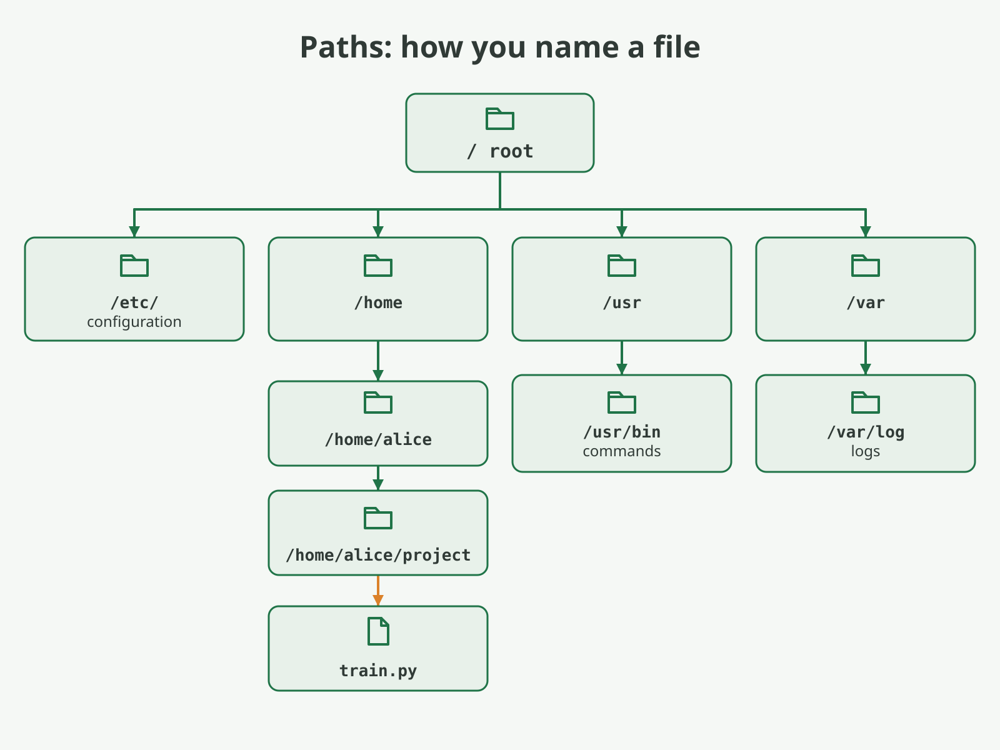
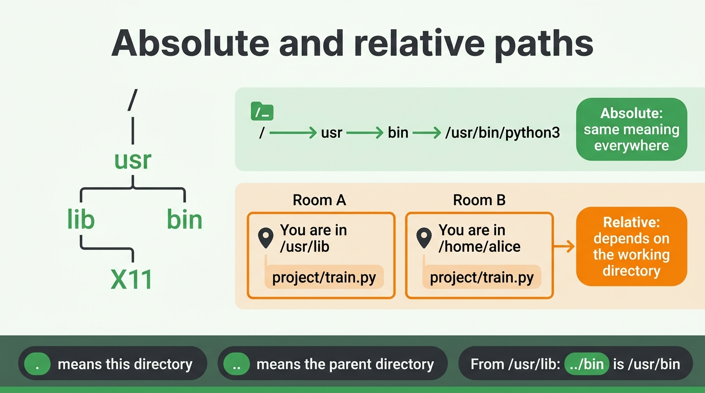
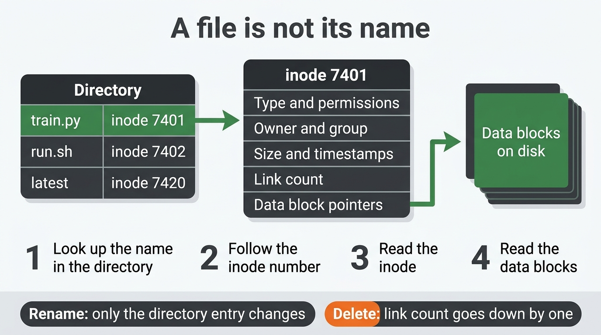
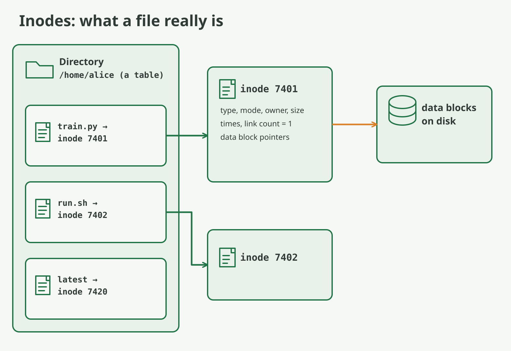
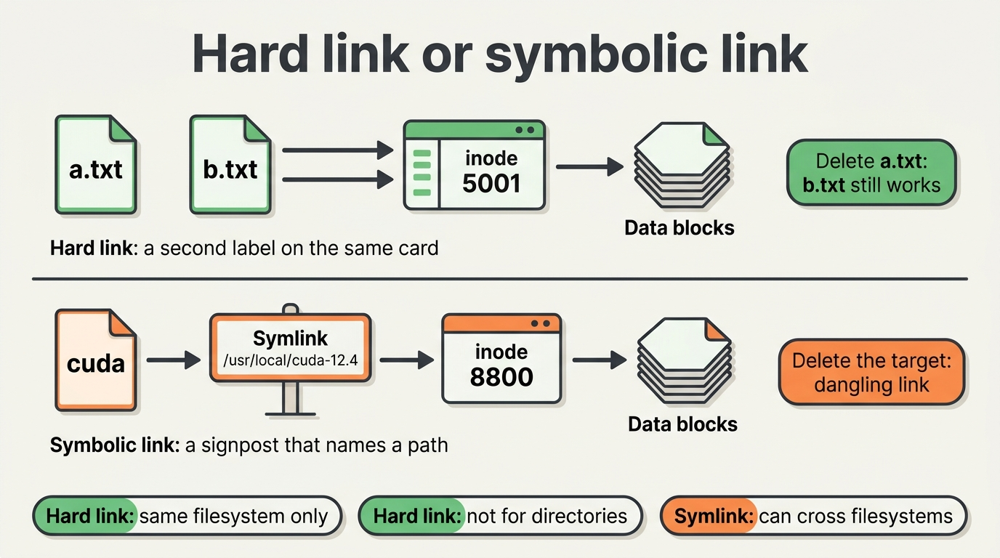
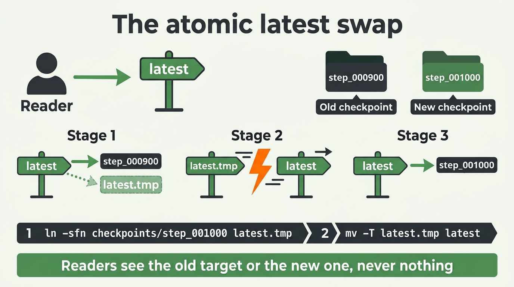

# 1.3 Files and the directory hierarchy: paths, links, inodes

| Field | Value |
|---|---|
| Level | Basics to Intermediate |
| Priority tier | Tier 0 (foundations) |
| Lab venue | Small Ubuntu VM on GCP (`fs_inodes_links_lab.py`: 20 checks pass; VM commands **untested** here) |
| Part | Part 1: Linux, from the command line to the kernel and performance |

## Why this matters for AI infrastructure

Picture three small puzzles, all of them ordinary on an AI cluster. A disk that `df` reports as full while plenty of free gigabytes show. A checkpoint directory whose `latest` link points at nothing. A dataset directory that takes ten minutes just to list. Each one looks mysterious at first. Each one becomes obvious once you know how Linux names, stores and links files.

Everything in an AI cluster ends up as files on a filesystem. That includes datasets with millions of small files, multi-gigabyte checkpoints, container image layers, Slurm and Kubernetes configuration, logs, driver modules, and the pseudo-files under `/proc` and `/sys`. Those pseudo-files are how the kernel and the hardware show themselves to you.

So many failures that stop training runs are filesystem facts. They only look mysterious until you know the model, and that is what this chapter gives you: the mental model of how Linux names, stores and links files. With it, these problems become easy to diagnose, and they stop surprising you in production.

When a disk looks full, check the inodes before you start deleting anything.

## Prerequisites and outcomes

Before you start, spend a few minutes on chapters 1.1 and 1.2. They give you the model of processes, system calls and the shell that this chapter builds on, and this chapter assumes all of it. When you finish, you should be able to do the following:

- Read and write absolute and relative paths correctly, and explain what `.`, `..`, `~` and `/` each mean.
- Describe what lives in each top-level directory, and where to look for configuration, logs, binaries, devices and kernel information.
- Identify the type of any file from `ls -l` and `stat`, and explain what an inode is and what a directory really contains.
- Create and reason about hard links and symbolic links, and know when each one breaks.
- Read the three timestamps of a file and understand what changes each one.
- Find files by name, type, size and age with `find`, and identify mystery files with `file`.
- Package, compress, inspect and unpack archives with `tar` and common compressors safely.
- Diagnose six common filesystem failures: a full disk with free space, dangling links, cross-device link errors, deleted-but-open files, unsafe extraction, and slow huge directories.

Treat this list as a checklist, not a contract. If an item is still unclear after the chapter, the hands-on lab near the end gives you a place to practise it.

## 1. Paths: how you name a file

Your script works in your terminal, then fails when cron runs it from somewhere else. The reason is almost always the path.

Every file or directory on Linux is reached through a **path**: a string of names separated by `/`. There is one tree with a single top, the **root directory**, written `/`. Unlike some other operating systems, there are no drive letters. Additional disks and network filesystems are *attached into the same tree* at chosen directories called mount points. Chapter 1.12 covers mount points in detail.



*Figure 1.3.1. Paths: how you name a file.*

An **absolute path** starts with `/` and means the same thing everywhere, such as `/home/alice/project/train.py`. A **relative path** does not start with `/`. The system reads it from the **current working directory** (`pwd`) of the process, so `project/train.py` depends on where the process started. Picture two people in different rooms both saying "the file on my desk": each means a different file, and both are correct.



*Figure 1.3.2. An absolute path starts at the root; a relative path is read from the current working directory.*

Relative paths are convenient at a prompt. They are also a classic source of script bugs, because the working directory is whatever the caller happened to be in. Cron jobs, systemd services, Slurm jobs and containers each start in a different directory. Automation should therefore use absolute paths, or `cd` explicitly first.

The name `.` means "this directory", and `..` means "the parent directory". The root's parent is itself. The `~` is shell shorthand for your home directory. The shell expands it, and the kernel never sees a tilde. Chapter 1.2 explains that step.

An example makes the dots clear. Suppose you are working in `/usr/lib`. Then `..` refers to `/usr`, and `../bin` refers to `/usr/bin`. The path `.` is still `/usr/lib`, so `./X11` means `/usr/lib/X11`. Most commands use the current directory when a path does not begin with `/`, so `X11` alone works just as well as `./X11`.

Names are **case-sensitive**, so `Data` and `data` are two different names. A name may contain almost any character except `/` and the NUL byte. Names are just bytes, and Linux imposes no encoding and no file-extension meaning. A file called `train.py` is not special because of `.py`, because the extension is only a convention for humans and tools.

Two helpful commands work with paths. `realpath path` prints the absolute path with every symlink resolved. `basename` and `dirname` split a path into its last component and its directory prefix. When a script reports a strange name, run `realpath` on it before you doubt your eyes.

Before you put a script into cron or Slurm, switch every path in it to an absolute one.

## 2. The standard layout: where things live

You log into an unfamiliar GPU node and someone asks where the Slurm configuration lives. You could search the whole disk and hope. You could also learn the layout once and know the answer on every machine you ever touch. That is what the standard behind this section gives you.

The Filesystem Hierarchy Standard, or FHS, describes where each directory of a Linux system belongs. The Linux Foundation maintains it at `https://refspecs.linuxfoundation.org/fhs.shtml`. You now know how to examine files, change directories and read manual pages, so you are ready to explore the system. The FHS tells you where to look before you search.

The table below gives the purpose of each directory. The last column shows what you will find on an AI node.

| Directory | Purpose | What you will find on an AI node |
|---|---|---|
| `/` | root of the whole tree | |
| `/bin`, `/sbin`, `/lib`, `/lib64` | essential commands and libraries; on modern distributions these are **symbolic links** into `/usr` | |
| `/usr` | the bulk of installed software, read-mostly | `/usr/bin` commands, `/usr/lib` libraries, `/usr/share` data and docs, `/usr/local` software you installed yourself, `/usr/src` kernel and driver sources |
| `/etc` | **system-wide configuration** (plain text) | `slurm/slurm.conf`, `ssh/sshd_config`, `fstab`, `hosts`, `docker/`, `kubernetes/`, `systemd/system/` |
| `/var` | **variable** data that changes while the system runs | `/var/log` logs, `/var/lib` application state (`docker`, `kubelet`, `containerd`), `/var/spool` queues (`slurmd`), `/var/cache` caches |
| `/home` | users' personal files | code, notebooks, SSH keys; often on a shared filesystem in a cluster |
| `/root` | the superuser's home | |
| `/tmp` | temporary files, may be cleared at boot or periodically | scratch space; usually small and shared |
| `/run` | runtime data since boot (an in-memory filesystem) | PID files, sockets (`/run/munge`, `/run/containerd`) |
| `/dev` | device files | `nvidia0`, `nvme0n1`, `null`, `zero`, `tty`, `shm/` |
| `/proc` | a **virtual** filesystem: the kernel's view of processes and system state | `/proc/cpuinfo`, `/proc/meminfo`, `/proc/<pid>/`, `/proc/driver/nvidia/` |
| `/sys` | a **virtual** filesystem exposing devices, drivers and kernel settings | `/sys/class/infiniband/`, `/sys/class/net/`, `/sys/fs/cgroup/`, `/sys/bus/pci/` |
| `/boot` | what is needed to start the machine | the kernel image (`vmlinuz-*`), initramfs, bootloader files |
| `/opt` | self-contained third-party software | vendor tools, sometimes CUDA or NVIDIA utilities |
| `/mnt`, `/media` | places to mount filesystems temporarily or removable media | |
| `/srv` | data served by this system (rarely used) | |
| `/lost+found` | recovered file fragments after a filesystem check (on ext filesystems) | |

Read the last column as the link between the map and the machine you run. `/etc` holds plain-text configuration, while `/var` holds data that changes as the system runs. One entry in the middle of the table deserves a plain-words gloss now. A **symbolic link** is a small file whose content is a path to something else, and section 5 takes that idea apart properly. A **virtual** filesystem is the other one to hold on to: the kernel builds it in memory as you read it, instead of storing it on a disk.

Three practical notes help you read the table.

**Merged usr.** On current Debian, Ubuntu, Rocky and RHEL, `/bin` is a symlink to `/usr/bin`, and the same holds for `/sbin` and `/lib`. So `/bin/ls` and `/usr/bin/ls` are the same file. Older documentation that tells them apart is out of date, and this is one of the first things to unlearn.

**`/proc` and `/sys` are not on disk.** The kernel generates them on demand, which is the "everything is a file" idea in its purest form. Reading `/proc/meminfo` runs kernel code and returns text. Writing to many files under `/sys` or `/proc/sys` changes live kernel settings, as `sysctl` does in chapter 1.22. Because they take no disk space, a stray write is the real risk. Be careful in them, since a write can change how the system behaves, and it does so at once.

**`/usr/local` and `/opt` are for local software.** Package updates therefore do not overwrite your work. NVIDIA's CUDA toolkit, for example, installs into a versioned directory such as `/usr/local/cuda-12.4`. It also creates a symlink, `/usr/local/cuda`, that points at the default version. Switching CUDA versions is just repointing that link, as section 5 shows.

Some directories cause more confusion than others, so the paragraphs below look at them in more detail.

`/bin` holds ready-to-run programs, including most basic commands such as `ls` and `cp`. Most are compiled binaries, though some are shell scripts. `/sbin` holds system-administration programs, such as `fdisk`, `iptables` and `reboot`. Regular users often do not have the `sbin` directories in their command path, and many of these tools only work as root. So when a tool exists on the machine but your shell cannot find it, check the path before you reinstall anything.

Libraries are code that executables share, and they come in two kinds. Static libraries are linked into a program at build time. Shared libraries, the `.so` files, are loaded at run time. `/lib` should contain only shared libraries. Other `lib` directories, such as `/usr/lib`, hold both kinds plus auxiliary files. Chapter 1.11 explains shared libraries.

`/tmp` is for small temporary files you do not care about. Any user may create files there, but cannot touch each other's files. Most distributions clear it at boot, and some delete old files periodically. So never keep anything important in `/tmp`. Do not let it fill up either, because its space is often shared with something critical, such as the root filesystem. `/var/tmp` is similar, but it is not wiped at boot.

`/run` holds runtime data since boot: PID files, sockets, status records and logging state. A socket here is not a network port; it is a mailbox two local programs use to talk. On older systems this lived in `/var/run`, which is now normally a symlink to `/run`.

`/usr` is pronounced "user", but it is not for individual users' personal files. It holds the bulk of the installed user-space software, and its subdirectories mirror the root, such as `/usr/bin`, `/usr/sbin` and `/usr/lib`. Three more subdirectories matter, as laid out in *How Linux Works* Section 2.19. First, `/usr/include` holds header files (`.h`) used by the C compiler. Second, `/usr/local` is where administrators install their own software, and it mirrors `/` and `/usr`, with `/usr/local/bin` and `/usr/local/lib`. Third, `/usr/share` holds architecture-independent data, such as `man`, `info`, `dict` and `doc` directories, that works on other kinds of Unix machines with no loss of functionality.

The `/usr/share` directory has a history worth knowing. Long ago, networks of machines shared this directory from one file server. Today that is rare, because disk space is no longer a tight limit on contemporary systems. You will still find `man`, `info` and `doc` subdirectories here, because this layout is an easily understood convention. The root directory also stays small for a historic reason: early systems kept its space requirements low, so most of the system lives under `/usr`.

`/var` is the "variable" directory, where programs record information that changes over time. That includes logs, caches, queues, user-tracking data and spool files. The rule of thumb is simple: if the content changes while the machine runs, it probably lives here.

`/boot` holds only the files for the very first stage of startup: the kernel and the boot loader files. It does not hold information about how services start. `/media` is the usual attachment point for removable media. `/opt` may hold additional third-party software.

The kernel is a binary file, normally `/boot/vmlinuz-<version>`. Historically it was `/vmlinuz`. The boot loader loads it into memory and starts it, and the running system no longer uses that file afterwards. Loadable kernel modules, which the kernel loads and unloads on demand as chapter 1.1 describes, live under `/lib/modules/<kernel version>/`. The GPU driver is one of them. Because of that path, a module built for one kernel version is not found under another.

When you meet a path you do not recognise, check the layout before you search. `man hier` or `man 7 hier` describes it on your system.

## 3. File types and what `ls -l` really shows

Picture the first time you run `ls -l` on a directory you have never seen. Each line starts with a character that looks like noise: a dash, a `d`, an `l`, a `c`. The kernel knows several kinds of file, and that first character tells you which kind you are looking at. Learn the set once, and every listing on every machine becomes readable.

```
$ ls -l /etc/hostname /usr/bin/ls /dev/null /dev/nvme0n1 /run/munge/munge.socket.2 /bin
-rw-r--r-- 1 root root   12 Oct 23 10:02 /etc/hostname
-rwxr-xr-x 1 root root 142K Mar 14  2025 /usr/bin/ls
crw-rw-rw- 1 root root 1, 3 Oct 23 09:58 /dev/null
brw-rw---- 1 root disk 259, 0 Oct 23 09:58 /dev/nvme0n1
srwxrwxrwx 1 munge munge 0 Oct 23 09:58 /run/munge/munge.socket.2
lrwxrwxrwx 1 root root    7 Mar 14  2025 /bin -> usr/bin
```

Use this table to decode that first character.

| Char | Type | Meaning |
|---|---|---|
| `-` | regular file | bytes: text, a program, an image, a checkpoint |
| `d` | directory | a file that lists other names |
| `l` | symbolic link | a small file that contains another path |
| `c` | character device | stream-oriented device (terminals, `/dev/null`, `/dev/nvidia0`) |
| `b` | block device | storage-style device with addressable blocks (disks, partitions) |
| `s` | socket | an endpoint for local inter-process communication |
| `p` | named pipe (FIFO) | a pipe that has a name in the filesystem |

The rest of a long listing has more columns. The nine **permission** characters, such as `rwxr-xr-x`, come next, and chapter 1.6 explains them. Then come the **link count**, the **owner** and the **group**. The **size** follows in bytes, or as major and minor driver numbers for devices. Last come the **modification time** and the **name**, which shows `-> target` for symlinks.

When a name does not tell you enough, use `file`. It identifies a file from its *contents*, not its name. It looks for characteristic starting bytes called magic numbers. That makes it the right first step with an unknown file: `file model.bin`, `file /usr/bin/python3`, and `file run.sh`, which also reports CRLF line endings. A name is a label someone chose. The contents are what the machine must actually deal with.

Make `file` your first step with any unknown file.

### Reading a long listing column by column

A long listing packs a lot into each line, so it helps to know what each column answers. Think of each line as a short sentence about one file. Here is a home directory from a typical Linux system, with the `total` line at the top.

```
$ ls -l
total 3616
-rw-r--r-- 1 juser users 3804 May 28 10:40 abusive.c
-rw-r--r-- 1 juser users 4165 Aug 13 10:01 battery.zip
-rw-r--r-- 1 juser users 131219 Aug 13 10:33 beav_1.40-13.tar.gz
-rw-r--r-- 1 juser users 6255 May 20 14:34 country.c
drwxr-xr-x 2 juser users 4096 Jul 17 20:00 cs335
-rwxr-xr-x 1 juser users 7108 Jun 16 13:05 dhry
-rw-r--r-- 1 juser users 11309 Aug 13 10:26 dhry.c
-rw-r--r-- 1 juser users 56 Jul 9 15:30 doit
drwxr-xr-x 6 juser users 4096 Feb 20 13:51 dw
drwxr-xr-x 3 juser users 4096 Jul 1 16:05 hough-stuff
```

Column 3 is the owner of the file, here `juser`. Column 4 is the group, here `users`. Column 5 is the file size in bytes, and the modification date and time sit between that size and the file name. Column 2 counts hard links, which section 4 explains. Column 1 holds the file type and the permissions, which chapter 1.6 covers.

Use `ls -F` when you want a quick hint about each name's type. It appends a mark to each name, so directories and executables stand out at a glance. Once you can read these columns, a directory listing tells you most of what you need before you open anything.

## 4. Inodes: what a file really is

Here are two puzzles you will meet in your first month. You rename a file that is huge, and the command returns at once. You delete a file that a program still has open, and the disk can stay full. Both behaviours come from the inode.

A file in Linux is not its name. For every file, the filesystem keeps an object called an **inode**, short for index node. Think of the inode as the file's record card, kept by the filesystem rather than by the name. The inode holds everything about the file except its name and its data:

- The file type and permission bits.
- The owner and group IDs.
- The size, and the timestamps covered in section 6.
- The **link count**: how many names point at this inode.
- Where the data blocks live on the device.

A **directory** is a special file that holds a simple table. Each entry maps a name to an inode number, and that is all a directory is: a list of names with the inode numbers they lead to. When you open `/home/alice/train.py`, the kernel walks the path one component at a time. It looks up `home` in the root directory's table to get an inode. It then looks up `alice` in that table, and then `train.py`. The last lookup leads to the file's own inode and data blocks.



*Figure 1.3.3. The name lives in the directory; everything else about the file lives in the inode.*



*Figure 1.3.4. Inodes: what a file really is.*

You can look at the inode yourself with these commands. The `ls -li` output shows the inode number in its first column.

```bash
ls -li ~/project            # first column is the inode number
stat train.py               # all of the inode's metadata, in readable form
df -i /home                 # inode usage per filesystem (not just bytes!)
```

Once you have the picture, several behaviours that look arbitrary start to make sense.

Renaming a file within one filesystem is instant, whatever its size. Only the directory table entry changes, and the data blocks never move. Moving a file across filesystems is slower, because the data must be copied and the original then deleted.

Deleting a file removes a name, not data. The `rm` command calls `unlink`, which removes the entry and decrements the inode's link count. The data is freed only when the link count reaches zero and no process still has the file open. A running program can keep using a deleted file, which section 8 covers as failure mode 4.

A filesystem has two independent capacities: bytes of data blocks, and a number of inodes. Creating millions of tiny files can use up the inodes while plenty of bytes stay free. The result is "No space left on device" on a disk that looks half empty. Datasets of small images or text shards make this a real AI-infrastructure concern, and section 8 covers it as failure mode 1.

A file can have several names, and that is what hard links are. A freshly created empty directory starts with a link count of `2`. One count is for its name in its parent directory, and the other is for the `.` entry inside itself. Each subdirectory you create inside it adds `1` to the parent's link count, because the child contains a `..` entry pointing back to the parent's inode. Worked example: a directory with five subdirectories has a link count of 2 + 5 = 7. Notice what `ls -ld` shows for a directory's link count on your own system, and check the arithmetic against this rule.

When a write fails even though the free space looks fine, check the inode usage with `df -i` before you look anywhere else.

## 5. Links: hard and symbolic

Two names can point at the same file, or one name can point at another name. Picture the record card from section 4, because the two kinds of link are easy to tell apart in that picture. A hard link is a second label on the same card. A symbolic link is a note in a drawer that says where to find the card. Which one you choose decides what happens when you delete or move things later.

### Hard links

A **hard link** is simply another directory entry pointing at the same inode. After `ln a.txt b.txt`, both names are equal. The link count is 2. Editing through either name changes the one set of underlying data blocks. Deleting one name leaves the file intact under the other, and there is no "original".

The lines below were not run on live hardware, so run them on a Linux machine and check the output yourself.

```bash
echo hello > a.txt
ln a.txt b.txt              # hard link: same inode
ls -li a.txt b.txt          # identical inode numbers, link count 2
rm a.txt; cat b.txt         # still prints hello
```

Hard links have three limits, and each one follows from the inode model. First, they cannot cross filesystems. Inode numbers are unique only within one filesystem, so linking across mount points fails with Invalid cross-device link (`EXDEV`). Second, by default they cannot point to directories. The exception is the `.` and `..` entries, which the filesystem manages itself to prevent directory-tree loops. Third, they need a Unix-style filesystem that keeps directory entries separate from inodes.

The third limit deserves a picture. You cannot use `ln` to make a hard link on a mounted VFAT (vfat or msdos) filesystem. VFAT was designed for Windows, and it stores file metadata inside the directory entry instead of in a separate inode table. With no inode table, there is no separate record card to give a second label.

Hard links are widely used for space-efficient deduplication, with tools such as `rsnapshot` and `rsync --link-dest`, and inside container and package stores. One copy of the data, many names, and no extra bytes spent.

### Symbolic (soft) links

A **symbolic link**, or symlink, is a tiny file of type `l`. Its content is a path, and the system resolves that path each time you use the link. Think of it as a signpost rather than a copy: the sign is cheap, and it is only useful while the place it names still exists. It can point anywhere: to another directory, to another filesystem, or even to a path that does not exist.

```bash
ln -s /usr/local/cuda-12.4 /usr/local/cuda     # needs root; "latest version" pointer
ls -l /usr/local/cuda                          # cuda -> /usr/local/cuda-12.4
readlink -f /usr/local/cuda                    # the final target, fully resolved
```

A symlink to a missing target is a **dangling link**. `ls -l` still shows it, but opening it fails with "No such file or directory". A signpost to a demolished building, in other words, and it still stands there looking helpful. Relative targets are read relative to the link's own directory, not your current directory. That is why moving a relative symlink often breaks it. Symlinks are cheap, and Linux uses them everywhere: `/usr/bin/python3 -> python3.12`, the `/lib` merge, `latest` pointers for checkpoints and releases, and CUDA version switching.

A few pitfalls catch everyone once, so learn them here rather than in production. Argument order matters. `ln -s TARGET LINKNAME` puts the target first, as in `ln -s /usr/local/cuda-12.4 /usr/local/cuda`. If you reverse the arguments and `LINKNAME` is an existing directory, `ln` quietly creates a link inside that directory, named after the target. Unless you used a full path, that new link points at itself. So if a symlink to a directory misbehaves, look inside the directory for stray links.

Forgetting `-s` creates a hard link instead. Hard links are subtler, so avoid them until you are comfortable with inodes. Chained links, where one link points at another, are legal but a nuisance to trace. `readlink -f` follows the whole chain and tells you where you actually land.

You cannot tell from its name whether a link points to a file or to a directory. You only find out by following it. So you can easily edit what you believe is a private copy when it is really a link to the original. A dangling link is confusing for a similar reason: `ls` shows it, yet other programs report that the name does not exist.

The reasons to use symlinks anyway are practical. A program often expects a file or directory at a fixed path, and you cannot change the program. You also do not want a second copy. Symlinks let you reorganise or switch versions with one command, and the program never notices.

The table compares the two kinds side by side.

| | Hard link | Symbolic link |
|---|---|---|
| Is | another name for the same inode | a separate small file containing a path |
| Across filesystems | no | yes |
| To directories | no (normally) | yes |
| If the original is deleted | still works | becomes dangling |
| Shows in `ls -l` as | an ordinary file with link count above 1 | `l`, with `->` target |
| Typical use | backups, deduplication | version pointers, convenience paths |

Notice the row for a deleted original, because it decides most real incidents. A hard link still works, while a symlink becomes dangling.



*Figure 1.3.5. Deleting one hard-linked name leaves the data; deleting a symlink's target leaves a dangling link.*

### The atomic "latest" pattern

A common AI-infrastructure pattern keeps a `latest` symlink that points at the newest checkpoint. Readers can switch to a new checkpoint without ever seeing a half-written state. The trick is that renaming a symlink over another one is atomic on a filesystem. Atomic here means all or nothing: a reader sees the old link or the new one, never a moment in between.

```bash
ln -sfn checkpoints/step_001000 latest.tmp   # create the new link under a temporary name
mv -T latest.tmp latest                       # atomic replace (rename over the old link)
```

The `-f` flag replaces an existing link. `-n` treats an existing directory symlink as a file instead of descending into it. `mv -T` treats the destination as a normal name. Readers following `latest` always see either the old target or the new one, never nothing. Two steps, one atomic rename, and no window in which the path is missing.



*Figure 1.3.6. Create latest.tmp first, then rename it over latest; readers see the old target or the new one.*

Before you point a `latest` link at a new checkpoint, use this two-step swap so readers never find it missing.

## 6. Timestamps

You ask what changed recently, and Linux gives you three different answers depending on which time you read. That is not a trick. Every inode records three times, and `stat` shows all of them.

| Name | Abbrev. | Changes when | Shown by |
|---|---|---|---|
| Modification time | mtime | the **contents** are written | `ls -l`, `ls -lt` |
| Change time | ctime | the **inode** changes: permissions, owner, link count, or content | `ls -lc`, `stat` |
| Access time | atime | the file is **read** (subject to a mount option, below) | `ls -lu`, `stat` |

The modification time moves when the contents are written. The change time moves when the inode changes, through permissions, owner, link count or content. The access time moves when the file is read, subject to a mount option described below.

Two details trip people up. The change time is not the creation time, which is a common mistake. Modern filesystems may record a creation (birth) time, which `stat` shows when available. Linux mounts filesystems with `relatime` by default to limit write overhead, so atime updates only occasionally. Do not rely on it to find unread data.

For testing, `touch -d "2026-01-01 12:00" file` sets the mtime and the atime. You cannot set the ctime that way. These times drive `find -mtime`, the rebuild decisions of `make`, the change detection of `rsync`, and backup tools. So they are not trivia: a wrong idea of `mtime` produces a wrong rebuild.

Decide which of the three times you actually mean before you search for recent changes.

## 7. Names, extensions and finding things

A job fails because it cannot find a config file. You know the file exists somewhere on this node, and you have no idea where. You will search for files far more often than you create them, so it pays to know the tools and to keep names you can trust.

Linux does not care about extensions, but tools and humans do. Stick to lowercase letters, digits, `-`, `_` and `.`. Avoid spaces and leading dashes, and never put a newline in a name. A name that starts with `.` is hidden from plain `ls`, which needs `ls -a` to show it, and from the `*` glob. Common conventions include `.sh` for scripts, `.py` for Python, `.conf`, `.cfg`, `.ini` and `.yaml` for configuration, `.log` for logs, `.tar.gz` for archives, `.so` for shared libraries, `.service` for systemd units, and `.pt` or `.safetensors` for model weights. Executability comes from the permission bit and a `#!` first line, not from the extension. Chapter 1.9 covers that.

On macOS the default filesystem, APFS, is case-insensitive, while Linux is case-sensitive. So `Model.pt` and `model.pt` collide on a Mac, but they are two files on a server. That difference is a frequent source of "works on my laptop" bugs.

### `find`: search by properties

`find` walks a directory tree and tests each file against the conditions you give it. Think of it as a filter you describe in words: start here, keep regular files, match this name, act on what is left. It is the most important file-search tool you have.

```bash
find /var/log -type f -name '*.log'                 # regular files named *.log (quote the pattern!)
find /data -type f -size +1G                        # files larger than 1 GiB
find /tmp -type f -mtime +7                         # modified more than 7 days ago
find . -type f -newer reference.txt                 # newer than another file
find . -type d -empty                               # empty directories
find /home -user alice -perm -o+w                   # owned by alice and world-writable
find . -name '*.pyc' -delete                        # act on every match (careful)
find . -type f -name '*.log' -exec gzip {} \;       # run a command per file
find . -type f -name '*.log' -exec gzip {} +        # batch many files per command (faster)
find . -type f -print0 | xargs -0 ls -l             # safe with spaces; xargs in chapter 1.4
```

Quote your patterns, such as `'*.log'`, so the shell does not expand them first. Chapter 1.2 explains why. Tests combine with an implicit AND, so each added condition narrows the list. Use `-o` for OR, and `\(... \)` for grouping. Always run a `find` without `-delete` first, and read the list it prints.

Learn the basic form until it is automatic: `find DIR -name 'PATTERN' -print`. `DIR` is where to start. `-name` matches the file name against a pattern, and `-print` prints each match. GNU `find` prints by default when no action is given, though older versions require `-print`. The pattern is single-quoted because `find`, not the shell, must interpret the `*` and `?`. Unquoted, the shell would expand the pattern against the current directory first. Reach for `-exec`, `-delete` and the other actions only once the basic form is second nature, because an action applied to the wrong set of files is how data gets lost.

### `locate`: search by name in an index

`locate name` searches a prebuilt database of all file names. The `updatedb` command builds that database, usually nightly, so the search is instant. The cost is that the index may be **stale**: new files are missing, and deleted files still appear. Use `locate` to answer "where is that config file?". Use `find` when you need the current truth or property tests. Some systems install `plocate` or `mlocate` as the implementation.

Think of the difference as a library catalogue versus walking the shelves. The catalogue answers in a second, but someone has to update it. Walking the shelves always tells the truth, and it takes as long as the shelves are long.

### Where is that command?

`type -a cmd`, `command -v cmd`, `which cmd` and `whereis cmd` answer the question "which file runs when I type this?" The `whereis` command also shows the source and man page locations. Chapter 1.2 covers the shell side of this.

Before you search the whole disk, check whether a `find` with a simple `-name` test answers your question.

## 8. Archiving and compression

You need to move a whole directory tree as one object, with its permissions and timestamps intact. A directory full of loose files is painful to copy, count and verify. What you need is an **archive**.

An archive is a single file that holds many files plus their metadata: names, permissions, owners and times. The classic tool is **`tar`**, short for tape archive. Archiving and compressing are separate steps. `tar` collects the files, and a compressor shrinks the result. Combining the two gives names like `.tar.gz`.

The table lists the four modes and the modifiers that go with them.

| Option | Meaning |
|---|---|
| `-c` | create an archive |
| `-x` | extract |
| `-t` | list the contents (table of contents) without extracting |
| `-f FILE` | the archive file (`-f -` means standard input or output) |
| `-v` | verbose: list files as they are processed |
| `-z` | filter through gzip (`.tar.gz`, `.tgz`) |
| `-j` | bzip2 (`.tar.bz2`) |
| `-J` | xz (`.tar.xz`) |
| `--zstd` | zstd (`.tar.zst`) |
| `-C DIR` | change to DIR before working (extract elsewhere, archive relative paths) |
| `--strip-components=N` | drop N leading path levels when extracting |

Notice that `-z`, `-j`, `-J` and `--zstd` each choose a compressor, so one flag covers the whole job.

```bash
tar -czf project.tar.gz project/              # create, gzip
tar -tzf project.tar.gz | head                # ALWAYS list before you extract an unknown archive
tar -xzf project.tar.gz -C /tmp/restore       # extract into a chosen directory
tar -cf - project | ssh gpu01 'tar -xf - -C /data'   # stream a tree over SSH without a temp file
zcat file.gz | head                           # read a gzip file without unpacking (also zless, zgrep)
```

A few classic usage details appear in every README, and each one has caught someone. `gzip` compresses one file. `gzip file` replaces `file` with `file.gz`, and it does not make archives. `gunzip file.gz`, or `gzip -d`, restores the file and removes the `.gz` suffix. `gzip -k` keeps the original. A `.gz` file is a GNU zip file, and a `.tar.gz` file is a tar archive that was then gzipped.

The traditional `tar` command is written without a dash, which looks odd at first. `tar cvf archive.tar file1 dir2` creates an archive, verbosely, into the file named by `f`. The `f` flag must be followed by the archive's name, which is why `f` comes last in a bundle such as `cvf` or `xzf`. Use `-` for standard input or output. `tar xvf archive.tar` extracts the archive. You can name individual members at the end to extract only those, but you must give their exact names, which `t` shows you. `tar` never deletes the archive after extracting.

`t` is also an integrity check. Listing reads the whole archive, so it verifies that the archive is readable as well as showing its contents. Check that all paths start with one common top-level directory. If they do not, extract into a new empty directory. You can always move things up afterwards.

The `p` option restores the exact permissions stored in the archive, overriding your `umask`. It is the default when you extract as root. `tar` must read the whole archive even to extract one member. It applies permissions and ownership at the end, so do not interrupt it. Wait for the shell prompt before you judge the result.

A `.tar.gz` is two layers, so peel the outer one first: `gunzip file.tar.gz`, then `tar xvf file.tar`. To create one, reverse the order and run `tar` first, then `gzip`. That works, but it writes an intermediate file, which wastes disk space and I/O. Combine the steps in a pipe instead: `zcat file.tar.gz | tar xvf -`. Here `zcat` is `gunzip -dc`, which decompresses to standard output. You can also use the GNU `tar` shortcut `z`: `tar xzvf file.tar.gz` or `tar tzvf file.tar.gz`. The shortcut still performs two steps. A `.tgz` file is just a `.tar.gz`. The short suffix was chosen to fit old DOS-style filesystems.

`xz` produces `.xz` files, which `unxz` undoes. `bzip2` produces `.bz2` files, which `bunzip2` undoes. Both are slightly slower than `gzip`, and they often compress text a little better. Their options are close enough to `gzip`'s that you do not need to relearn anything. `zip` and `unzip` handle the Windows ZIP format, including self-extracting `.exe` archives. A file ending in `.Z` is a relic of the old `compress` program. `gunzip` can read it, but `gzip` will not create it.

Here is how the compressors compare. `gzip` is fast and works everywhere. `bzip2` compresses better, but more slowly. `xz` compresses best, and it is slow. `zstd` gives gzip-like speed with much better ratios, which makes it a good modern default. `pigz` and `pbzip2` are parallel versions of gzip and bzip2, so they use many cores for big files. Do not compress what is already compressed. Model checkpoints in `.safetensors`, images, video and most archives gain nothing and waste CPU. `zip` and `unzip` produce portable archives for sharing with other operating systems.

Safe-use rules that prevent real accidents:

1. List before extracting with `tar -tf`. Some archives contain absolute paths such as `/etc/...`, or `..` components. GNU tar strips a leading `/` by default and warns, but do not rely on that for untrusted archives.
2. Extract into an empty, dedicated directory with `-C`. A "tarbomb" dumps hundreds of files into the current directory instead of one subdirectory.
3. Mind ownership when you run as root. Extracting as root restores the archived owners and permissions. That may create files owned by UIDs that do not exist on this machine, or clobber system files. Extract as a normal user unless you need ownership preserved.
4. Verify large transfers with a checksum: `sha256sum file.tar.gz` on both ends.
5. Create archives with relative paths from a clean location, such as `tar -czf x.tar.gz -C /data dataset/`, so that extraction does not depend on where the archive was created.

Before you extract any archive you did not create, list its contents first.

## 9. AI-infrastructure patterns, in one place

A PyTorch data loader crashes inside a container, and the error gives no obvious cause. Most of the time, the clues sit in places this chapter has already covered. Gather them here, and the next crash is faster to read.

Datasets of millions of small files stress inode counts, directory lookup time and metadata servers on network filesystems. Pack small files into shards instead, using tar-based formats such as WebDataset, Parquet or TFRecord, and read them sequentially. Chapter 13.6 covers this topic in depth.

Checkpoints are huge sequential files. Write them to a temporary name, then rename when the write completes. A rename within one filesystem is atomic, so a crash mid-write never leaves a corrupt "latest". Use the symlink pattern from section 5 to point readers at the result.

`/dev/shm` is an in-memory filesystem. PyTorch data loaders and NCCL use it for shared memory between processes. Inside containers its default size is small, and Docker defaults to 64 MB. Suppose batch tensors grow past that size. The workers then crash in ways that look mysterious. The fix is to enlarge `/dev/shm`, with `--shm-size`, or with an `emptyDir` that has `medium: Memory` in Kubernetes. Passing `--shm-size=16g` raises the limit.

`/tmp` is not scratch space for big data. It may be small, it may be cleaned automatically, or it may sit on the root disk. For scratch, use node-local NVMe mounts, which chapter 13.2 covers.

`/proc` and `/sys` are your hardware dashboard. Read `/proc/driver/nvidia/gpus/*/information`, `/sys/class/infiniband/*/ports/1/rate` and `/sys/bus/pci/devices/*/numa_node` to confirm what the kernel sees. If a device is missing there, no amount of framework debugging will bring it back.

When a data-loading job fails, check the shard layout and the `/dev/shm` size before you blame the framework.

## How it fails

Most filesystem failures look like something other than a filesystem problem. That is what makes them expensive, because an hour goes by while you look in the wrong place. Each failure below gives you the symptom you see, the cause behind it, how to confirm the cause, and the fix.

### 1. "No space left on device" but `df -h` shows free space

**Symptom:** writes fail with ENOSPC, yet `df -h` shows free space. You may be sure the disk has room, and that is the trap. **Cause:** the filesystem ran out of **inodes**, not bytes. That is typically millions of tiny files. Or a per-user or project quota has been reached, or a container's writable layer is full. **Diagnose:** run `df -h` **and** `df -i` on the path. Then run `find /dir -xdev -type f | wc -l`, and `quota -s` where quotas are used. **Fix:** delete or pack the small files. Or recreate the filesystem with more inodes, using `mkfs.ext4 -N`, or choose a different filesystem such as XFS, which allocates inodes dynamically. You can also move the data. **Prevention:** shard your datasets.

### 2. A dangling symlink: `latest -> checkpoints/step_900` but the directory was cleaned

**Symptom:** `cat latest/model.pt` prints "No such file or directory", even though `ls -l latest` shows the link. **Diagnose:** start by asking where the link points. Run `readlink latest`, then `ls -l $(readlink -f latest)`. To list every broken symlink in a tree, run `find . -xtype l`. **Fix:** repoint the link. Make your retention scripts update the link before they delete its target. Relative link targets move with their link's location, so test after you move directories.

### 3. "Invalid cross-device link" when hard-linking or renaming

**Symptom:** `ln` or `mv` fails with EXDEV. Or a tool that renames files to publish them suddenly copies everything and runs slowly. **Cause:** the source and destination sit on different filesystems. That can happen at a mount boundary, on a different volume, or in an overlay. Inode links and atomic rename are impossible across filesystems. **Diagnose:** run `df path1 path2`, or `stat -c %d path` to see the device number. **Fix:** write the temporary file on the same filesystem as the final path. You can also use symlinks instead of hard links, or accept a copy.

### 4. The disk is full, but `du` cannot find the files: deleted but still open

**Symptom:** `df` shows 95% used, but `du -sh /*` totals much less. **Cause:** a large log or temporary file was deleted while a process still had it open. The data is kept until that process closes the file or exits. The name is gone, but the space is not. **Diagnose:** run `sudo lsof +L1`, which lists open files with a link count below 1. Or run `ls -l /proc/<pid>/fd | grep deleted`. **Fix:** restart the process, or signal it to reopen its log. `logrotate` with `copytruncate` or `postrotate` handles this properly. You can also truncate the file through its descriptor with `: > /proc/<pid>/fd/<n>`.

### 5. An archive overwrote system files or exploded the working directory

**Symptom:** after `sudo tar -xf x.tar`, strange files appear in the current directory, or `/etc` has changed. **Cause:** the archive was a tarbomb, it held absolute paths, or root restored its archived ownership. **Diagnose:** run `tar -tf x.tar | head -50`, or `tar -tf x.tar | awk -F/ '{print $1}' | sort -u`. **Fix:** always list first. Extract with `-C` into an empty directory as a normal user. Use `--no-same-owner` and `--no-same-permissions` when you do not want the archive to set them.

### 6. `ls` or a job takes forever in a directory with millions of entries

**Symptom:** listing or globbing a dataset directory hangs, and `rm *` says "Argument list too long". **Cause:** large directories are slow to read and sort. On network filesystems, every entry may cost a metadata round trip. A glob also expands into one huge command. **Diagnose:** `ls -f dir | wc -l` is much faster, because it skips sorting. `strace -c ls dir` shows the system call counts. **Fix:** avoid listing the directory. Use `find -print0 | xargs -0`. Split the data across subdirectories, for example by sharding on a hash prefix such as `aa/bb/file`. Or use shards instead of loose files.

When a disk looks full, check inodes and deleted-but-open files before you delete anything.

## Hands-on lab: inodes, links, and VM drills

You can check every idea in this chapter yourself, and as you go, compare each output with what the chapter says. Reading about an inode is not the same as watching one change under your hands. Start with the self-checking Python lab, which you run locally. It verifies the FHS directory map, the `ls -l` file type characters, the `2 + N` directory link-count rule, hard-link `EXDEV` and VFAT limits, `unlink` and `lsof +L1` deleted-but-open space retention, timestamps, and `ENOSPC` inode exhaustion.

```bash
python3 code/part01/fs_inodes_links_lab.py
```

Next, take a GCP Ubuntu VM, or any Linux machine you can break safely. The interactive VM commands below were not run on live hardware. Work in a scratch directory, created with `mkdir -p ~/lab/files && cd ~/lab/files`.

**Part A: paths and the tree.**

1. Run `tree -L 2 /` if `tree` is installed (`sudo apt install tree`), or run `ls /` instead. For each top-level directory, state its FHS purpose without looking at section 2, then check your answer.
2. Confirm "merged usr" with `ls -ld /bin /sbin /lib` and `readlink -f /bin/ls`. Where does `/usr/bin/python3` really point? Find out with `readlink -f $(command -v python3)`.
3. Explore `/proc` and `/sys` read-only: `cat /proc/meminfo | head -3`, `cat /proc/sys/kernel/hostname`, `ls /sys/class/net`, and `cat /sys/class/net/*/mtu`. Explain to yourself why `ls -l /proc/cpuinfo` shows size 0 yet `cat` prints text.

**Part B: types and inodes.**

4. Create one of each type you can, a file, a directory, a symlink, and a FIFO with `mkfifo p`, then list them with `ls -l`. Read the type characters. Find a `c`, a `b` and an `s` file on the system with `ls -l /dev | head -30` and `find /run -type s 2>/dev/null`.
5. Run `echo data > f1; ls -li f1; stat f1`. Identify the inode, size, link count and the three times. Run `cat f1` and check whether atime changes, given `relatime`. Then run `echo more >> f1` and see mtime and ctime change. Finally run `chmod 600 f1` and see that only ctime changes. Explain each result.

**Part C: links.**

6. Make a hard link and a symlink to `f1`. Compare their inode numbers and link counts. Delete `f1`. Which link still works, and why? Make the symlink target relative, move the link to another directory, and observe it break.
7. Try a hard link across filesystems with `ln /etc/hostname /dev/shm/x`. Record the error and explain it in terms of inodes.
8. Implement the atomic `latest` pattern from section 5 with three fake checkpoint directories. In a second terminal, run `while true; do readlink latest; done` while you repoint `latest` in a loop. Confirm that the reader never sees an empty result.

**Part D: inode exhaustion and deleted-but-open files (needs sudo).**

9. Exhaust inodes safely with `sudo mkdir /mnt/t && sudo mount -t tmpfs -o size=10m,nr_inodes=200 tmpfs /mnt/t`, then `for i in $(seq 1 300); do sudo touch /mnt/t/f$i || break; done`. Observe the error, then run `df -h /mnt/t` and `df -i /mnt/t`. Explain why one shows free space and the other shows full. Clean up with `sudo umount /mnt/t`.
10. Try a deleted-but-open file with `sudo dd if=/dev/zero of=/tmp/big bs=1M count=200`, then `sleep 600 < /tmp/big &`, then `rm /tmp/big`. Compare `df -h /tmp` before and after the delete. Find the culprit with `sudo lsof +L1 | grep big`, release it with `kill %1`, and watch the space return.

**Part E: find, file and archives.**

11. Use `find` to list files in `/var/log` larger than 1 MiB, regular files modified in the last day, and broken symlinks under `/etc` with `find /etc -xtype l`. Run `file` on a script, a binary, an image and a gzip file.
12. Create a directory with a few files, then run `tar -czf a.tar.gz dir`, `tar -tzf a.tar.gz`, and extract into `/tmp/out` with `-C`. Verify with `diff -r dir /tmp/out/dir`. Create an archive with absolute paths using `tar -cf abs.tar /etc/hostname 2>&1 | head`, and read GNU tar's warning. Compare the sizes and times of gzip, xz and zstd on a copy of `/usr/share` with `time tar -cf - /usr/share/doc | gzip | wc -c`, using `xz -T0` and `zstd -T0` as well.
13. Run a safety drill. Build a tarbomb on purpose, a tar whose members have no common top directory, extract it in the wrong place, and clean up. Then extract it correctly with `-C`.

## Exercises

Work these on paper or in a scratch directory. Each one checks a single idea from the chapter, so write down your answer before you look back at the text. The effort of recalling is where the learning happens, and a wrong answer you catch yourself is worth more than a paragraph you re-read.

1. **FHS Directory Placement:** State the exact FHS directory path where each of the following lives on a GPU node. Identify: (a) `/etc/slurm/slurm.conf` system configuration, (b) C compiler header files (`.h`), and (c) administrator-installed local binaries (`bin`) and CUDA toolkits. Then identify: (d) architecture-independent documentation (`man`, `info`, `dict`, `doc`), (e) loadable kernel modules (`.ko`) for the running kernel, and (f) volatile runtime sockets (`/run/munge/munge.socket.2`).
2. **Directory Link Count Math (`2 + N` Rule):** An administrator runs `mkdir -p /data/Checkpoints` and then creates 5 subdirectories (`step_100` through `step_500`) and 20 regular `.pt` files inside `/data/Checkpoints`. What link count does `ls -ld /data/Checkpoints` display, and why do the 20 regular files not increase the directory's link count? Verify with `compute_directory_link_count(5)` in `code/part01/fs_inodes_links.py`.
3. **Hard Links, Cross-Device `EXDEV`, and VFAT:** Suppose file `a.txt` has inode `7401` on device `2049` (ext4, size `200 MiB`, `link_count = 1`). (a) What happens to `inode 7401`'s `link_count`, `mtime`, and `ctime` when you run `ln a.txt b.txt` on the same filesystem, and what happens to the `200 MiB` of data when you subsequently run `rm a.txt`? (b) Why does `ln a.txt /dev/shm/c.txt` (device `2050`) fail with `EXDEV`, and why does `ln` fail on a mounted vfat USB drive?
4. **Deleted-but-Open Files (`lsof +L1`):** A training job holds open a `200 MiB` log file (inode `8800`, `link_count = 1`, `open_fd_count = 1`) on `/tmp`. An operator runs `rm /tmp/big` while the job is still running. What are `link_count` and `open_fd_count` immediately after `rm`, are the `200 MiB` data blocks freed, and which `lsof` command locates the unlinked open file?
5. **Timestamp Updates (`mtime`, `ctime`, `atime`):** A file starts with `mtime = 100`, `ctime = 100`, and `atime = 100`. Which timestamps change when (a) a process appends bytes to the file, and (b) an administrator runs `chmod 600` on the file without modifying its contents?
6. **Atomic Symlink Swap and `ENOSPC` Diagnosis:** First, write the two-command sequence (`ln -sfn` and `mv -T`) that atomically switches a `latest` symlink from `checkpoints/step_000900` to `checkpoints/step_001000` without ever leaving `latest` missing. Second, on a `10 MiB` tmpfs mounted with `nr_inodes=200`, explain why `touch /mnt/t/f201` fails with No space left on device (`ENOSPC`) while `df -h /mnt/t` shows `10 MiB` free.

## Checkpoint questions (20)

<details>
<summary>1. What is the difference between an absolute path and a relative path, and why do automation scripts prefer absolute paths?</summary>

An absolute path starts at `/` and reaches the same file wherever the caller is. A relative path starts from the process's current working directory (`pwd`). Cron, systemd, Slurm and containers start in different directories, so scripts use absolute paths or an explicit `cd`.
</details>

<details>
<summary>2. Where in the Filesystem Hierarchy Standard (FHS) do you look for service configs, logs, runtime sockets, device nodes, the kernel image, and loadable kernel modules?</summary>

System configuration lives in `/etc`, and logs live in `/var/log`. Runtime sockets and PID files live in `/run`, and device nodes live in `/dev`. The kernel image, `/boot/vmlinuz-*`, sits in `/boot`. Loadable kernel modules (`.ko`) live in `/lib/modules/<kernel-version>/`.
</details>

<details>
<summary>3. What is the difference between `/usr/include`, `/usr/local`, and `/usr/share`?</summary>

`/usr/include` holds the C compiler's header files (`.h`). `/usr/local` holds software that the system administrator installs locally. It mirrors `/` and `/usr` with `/usr/local/bin` and `/usr/local/lib`, and it also holds versioned toolkits such as `/usr/local/cuda`. `/usr/share` holds architecture-independent shared files, such as `man`, `info`, `dict` and `doc`.
</details>

<details>
<summary>4. What does "merged usr" mean on modern Debian, Ubuntu, Rocky, and RHEL systems?</summary>

On modern distributions, `/bin`, `/sbin`, `/lib` and `/lib64` are symbolic links. They point to `/usr/bin`, `/usr/sbin`, `/usr/lib` and `/usr/lib64`. So `/bin/ls` and `/usr/bin/ls` resolve to the same binary.
</details>

<details>
<summary>5. What are `/proc` and `/sys`, do they consume disk space, and why does `/proc/cpuinfo` show size 0 in `ls -l`?</summary>

`/proc` and `/sys` are virtual filesystems, which the kernel generates in RAM on demand. `/proc` exposes processes and kernel state, and `/sys` exposes devices, drivers and kernel objects. They use no disk blocks. `/proc/cpuinfo` shows size 0 in `stat` because the kernel generates its text only when you read it.
</details>

<details>
<summary>6. What do the seven file-type characters (`-`, `d`, `l`, `c`, `b`, `s`, `p`) at the start of an `ls -l` line mean?</summary>

`-` is a regular file, and `d` is a directory. `l` is a symbolic link, and `c` is a character device, such as `/dev/null` or `/dev/nvidia0`. `b` is a block device, such as `/dev/nvme0n1`. `s` is a local domain socket, and `p` is a named pipe (FIFO).
</details>

<details>
<summary>7. How does the `file` command identify a file's type if Linux ignores file extensions?</summary>

`file` reads the file's actual content. It checks magic numbers, which are characteristic bytes at the start of a file, such as ELF headers or `#!` shebangs. It also checks the text encoding and line endings. It does not trust the filename suffix.
</details>

<details>
<summary>8. What is an inode, and what two crucial pieces of information are NOT stored inside the inode itself?</summary>

An inode, short for index node, is the metadata record for a file. It stores the file type, permissions, owner UID, group GID, byte size, timestamps (`atime`, `mtime`, `ctime`), link count, and pointers to data blocks. It does not store the file's **name**, which lives in a directory table. It also does not store the file's **payload bytes**, which live in data blocks.
</details>

<details>
<summary>9. What does a directory actually contain on disk, and how does the kernel resolve `/home/alice/a.txt` or `/home/alice/train.py`?</summary>

A directory is a special file containing a table of `(filename -> inode_number)` mappings. To open `/home/alice/a.txt` or `/home/alice/train.py`, the kernel reads the inode of the root directory `/` and looks up `home`. It then reads the table in `/home` to look up `alice`. Finally, it reads the table in `/home/alice` to find the inode number of `a.txt` or `train.py`.
</details>

<details>
<summary>10. Why does an empty directory have a link count of `2`, and why does adding 5 subdirectories raise its link count to `7`?</summary>

An empty directory has two hard links to its inode. One is its entry in the parent directory, and the other is its own `.` entry, so `1 + 1 = 2`. Each subdirectory contains a `..` entry that points back to the parent's inode. That adds `1` per subdirectory, so five subdirectories give `2 + 5 = 7`.
</details>

<details>
<summary>11. Why is renaming a 100 GB checkpoint file within the same filesystem instant, whereas moving it across mount points takes minutes?</summary>

Within one filesystem, `mv` only updates the directory table entry, so the new name points at the same inode. The 100 GB of data blocks never move, which is why the rename is instant. Across filesystems, inode numbers cannot be shared. So `mv` must copy all 100 GB of data blocks to the destination device, and then unlink the source.
</details>

<details>
<summary>12. What happens when you `rm` a file that a running process still has open, and how do you find and reclaim that space?</summary>

`rm` calls `unlink()`. That removes the directory entry and drops `link_count` to `0`. The kernel does not free the data blocks until `open_fd_count` also reaches `0`. When you need to find these files, use `sudo lsof +L1` or `ls -l /proc/<pid>/fd | grep deleted`. To free the space, restart or signal the process, or truncate `/proc/<pid>/fd/<n>`.
</details>

<details>
<summary>13. Compare hard links and symbolic links across four operational properties.</summary>

A hard link is a second directory entry for the same inode. It cannot cross filesystems (`EXDEV`), it cannot point to directories, and it keeps the data alive if the original name is deleted. A symbolic link is a separate small file of type `l` that stores a path. It can cross filesystems and point to directories. It becomes dangling if its target is deleted.
</details>

<details>
<summary>14. Why can't you create a hard link (`ln`) on a mounted VFAT (vfat / msdos) USB drive?</summary>

Traditional Unix filesystems such as ext4 and XFS keep directory entries separate from an inode table, so several entries can refer to one inode. VFAT was designed for MS-DOS and Windows. It stores the file's metadata inside the directory entry, with no separate inode table, so `ln` cannot make a hard link there.
</details>

<details>
<summary>15. How do you update a `latest` checkpoint symlink atomically so reader processes never see a missing or half-updated link?</summary>

Create a temporary symlink that points to the new target, then rename it over the existing symlink on the same filesystem. Rename is atomic, so you never give your readers a missing link: `ln -sfn checkpoints/step_001000 latest.tmp && mv -T latest.tmp latest`.
</details>

<details>
<summary>16. What do `mtime`, `ctime`, and `atime` record, and which one changes when you run `chmod 600 f1`?</summary>

`mtime` records when the file's content bytes were last written. `ctime` records when the inode metadata last changed, such as permissions, ownership, link count, or content size. `atime` records when the file was last read, and `relatime` throttles how often it updates. Running `chmod 600 f1` changes only `ctime`.
</details>

<details>
<summary>17. Why can a disk fail with No space left on device (`ENOSPC`) when `df -h` shows 40% free space, and how do you verify it?</summary>

Every ext4 filesystem has a fixed number of inodes alongside its data blocks. Millions of small dataset files can use up every inode while the data blocks remain half empty. When you verify it, run `df -i`, and check `quota -s` for user or project quotas.
</details>

<details>
<summary>18. Why must you quote the pattern in `find /var/log -type f -name '*.log'`, and what is the difference between `-exec gzip {} \;` and `-exec gzip {} +`?</summary>

Quoting `'*.log'` stops the shell from expanding the wildcard against the current working directory before `find` starts. `-exec ... \;` starts a separate `gzip` process for every file it finds. `-exec ... +` packs many filenames into each `gzip` call, the way `xargs` does.
</details>

<details>
<summary>19. Why should you always run `tar -tf` before `tar -xf`, and what is a "tarbomb"?</summary>

`tar -tf` lists the archive's table of contents, and it verifies readability, without writing anything to disk. The listing reveals dangerous leading `/` or `..` paths, and it shows whether the archive lacks a single top-level directory. The second case is a "tarbomb", which scatters hundreds of files directly into your current working directory. When you extract an untrusted archive, use a fresh directory and `-C`.
</details>

<details>
<summary>20. Why does Docker's default `/dev/shm` size (`64 MB`) break multi-worker PyTorch `DataLoader` jobs, and how is it fixed?</summary>

`/dev/shm` is an in-memory tmpfs used for POSIX shared-memory IPC between PyTorch `DataLoader` worker processes and NCCL. When batch tensors exceed Docker's `64 MB` default, workers crash with Bus error (`SIGBUS`) or `ENOSPC`. Fix it by passing `--shm-size=16g`, or by mounting a memory-backed `emptyDir` at `/dev/shm` in Kubernetes.
</details>

## Sources and review notes

- **Sources read in full:**
  - `how-linux-works-3rd-edition` — Brian Ward, *How Linux Works*, 3rd ed., **Chapter 2: Basic Commands and Directory Hierarchy** and **Chapter 4: Disks and Filesystems**. Read Chapter 2 sections 2.4, 2.5.5, 2.5.6, 2.17.2, 2.18, and 2.19 in full. Covers relative paths, `file`, `find` and `locate`, symbolic links (`ln -s`), archiving and compressing (`gzip`, `gunzip`, `tar`, `zcat`), and the Filesystem Hierarchy Standard (`https://refspecs.linuxfoundation.org/fhs.shtml`, `/bin`, `/sbin`, `/lib`, `/usr/include`, `/usr/local`, `/usr/share`, `/etc`, `/var`, `/run`, `/tmp`, `/dev`, `/proc`, `/sys`, `/boot/vmlinuz`, `/lib/modules`). Read Chapter 4 section 4.5 in full. Covers inode tables, directory entry tables, directory link counts (`2 + N`), and why VFAT does not support `ln` hard links.
  - `supercomputers-for-linux-sysadmins-managing-modern-hpc-clusters-and-supercomputers-from-software-to` — Sergey Zhumatiy, *Supercomputers for Linux SysAdmins*, **Chapter 7: UNIX and Linux – the Basics** and **Chapter 8: UNIX and Linux – Working Techniques**. Read file naming conventions, extension agreements, templates, commands for working with the directory tree and catalogs, and `tar`/`gzip` streaming.
- **Run here:** `python3 code/part01/fs_inodes_links_lab.py` (20 passed, 0 failed).
- **Explicitly labelled inferences:** The Docker `64 MB` `/dev/shm` default and the WebDataset/Parquet/TFRecord sharding recommendations connect the Linux inode model to Part 11 and Part 13 AI storage practices (chapters 13.6 and 13.7).
- **Not verified on live hardware:** All interactive VM shell commands (`tree`, `mount -t tmpfs`, `dd`, `lsof +L1`, `find`, `tar`) are marked and should be executed on a Linux VM.
