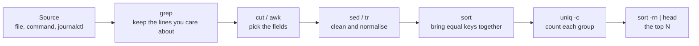

# 1.4 Text-processing essentials: grep, sed, awk, find, xargs, sort

| Field | Value |
|---|---|
| Level | Basics to Intermediate |
| Priority tier | Tier 0 (foundations) |
| Lab venue | Small Ubuntu VM (`text_pipeline_lab.py`: 25 checks pass; VM commands **untested** here) |
| Part | Part 1: Linux, from the command line to the kernel and performance |

## Why this matters for AI infrastructure

Infrastructure produces text: logs, `nvidia-smi` tables, `squeue` and `sinfo` listings, `dmesg`, `journalctl`, `kubectl` output, configuration files, CSV exports of metrics, and JSON from every API. When a 256-GPU job misbehaves at 3 a.m. you will not open a dashboard first. You will pull out the right ten lines from ten gigabytes of logs and count, group, and compare them. The tools in this chapter are old, small, and ubiquitous, and they are installed on every node you will ever log into, including the ones where you cannot install anything. Fluency here turns a half-hour investigation into a one-line pipeline, and it is the foundation for the shell scripts of chapter 1.9.

## Prerequisites and outcomes

You need chapter 1.2 for pipes, redirection, and quoting. After this chapter you will be able to:

- Explain the "text stream of lines" model and choose the right tool for a task.
- Read and write regular expressions in both basic and extended dialects, and know when to avoid them.
- Search with `grep`, extract with `cut`, `tr`, and `awk`, transform with `sed`, order and group with `sort` and `uniq`, and build the standard "top N" and "count by key" pipelines.
- Run commands over many files safely with `find` and `xargs`, including in parallel.
- Compare files with `diff` and `comm`.
- Query JSON with `jq` and use `kubectl -o jsonpath` / `custom-columns` and `nvidia-smi --query-gpu` for machine-readable output.
- Apply ten ready recipes to GPU, Slurm, Kubernetes, and training-log data.
- Avoid seven classic pitfalls: locale differences, Mac versus GNU options, `uniq` on unsorted data, spaces and newlines in names, unescaped dots, `cut` on aligned tables, and parsing JSON with regex.

## 1. The model: lines of text flowing through small tools

Most Unix text tools share one design: read **lines** from files or standard input, do one small thing to each, and write lines to standard output. Because every tool consumes and produces the same thing (plain text lines), you can connect them with pipes (chapter 1.2) into a pipeline that does something none of them can do alone. This is the "Unix philosophy": small sharp tools, composed.

A useful map for choosing:

| Task | Tool | Mnemonic |
|---|---|---|
| Keep only lines that match (or do not match) a pattern | `grep` | **filter** lines |
| Select columns / fields | `cut`, `awk` | **slice** columns |
| Replace or delete text, edit streams | `sed`, `tr` | **rewrite** text |
| Compute: sums, averages, counts, reformat, conditions on fields | `awk` | **calculate** |
| Order lines | `sort` | **order** |
| Collapse and count duplicate adjacent lines | `uniq` | **group** |
| First or last lines, count lines | `head`, `tail`, `wc` | **sample** |
| Glue files or columns | `paste`, `join`, `column` | **combine** |
| Compare two files or lists | `diff`, `comm`, `cmp` | **compare** |
| Run a command once per item or batch | `xargs`, `find -exec` | **fan out** |
| Query structured JSON | `jq` | **JSON-aware** |

A habit worth building immediately: **build pipelines incrementally.** Run the first command and look at the output; add the next stage; look again. Do not write a six-stage pipeline blind.



## 2. Regular expressions from scratch

A **regular expression** (regex) is a compact pattern that describes a set of strings. `grep`, `sed`, `awk`, `less`, `vim`, Prometheus, Python and nearly every tool you use understand some dialect of it. Learn the core once.

Characters that match themselves: letters, digits, spaces. Characters with special meaning (**metacharacters**):

| Pattern | Matches |
|---|---|
| `.` | any single character |
| `*` | zero or more of the preceding item |
| `+` | one or more of the preceding item (extended regex) |
| `?` | zero or one of the preceding item (extended regex) |
| `^` | the start of the line |
| `$` | the end of the line |
| `[abc]`, `[a-z]`, `[0-9]` | any one character from the set or range |
| `[^abc]` | any one character **not** in the set |
| the pipe character (`\|` in table cells), written with a leading backslash in basic regex and plain in extended | alternation: this or that (for example `error` or `fail`) |
| `( )` | grouping and capture |
| `{n,m}` | between n and m repetitions |
| `\.` | a literal dot (a backslash removes a special meaning) |
| `[[:digit:]]`, `[[:space:]]`, `[[:alpha:]]` | named character classes (locale-aware) |

Two dialects matter. **Basic regular expressions (BRE)** are the default in `grep` and `sed`, where `+ ? | ( ) { }` are *literal* unless preceded by a backslash. **Extended regular expressions (ERE)** treat them as operators directly; turn them on with `grep -E` (or `egrep`) and `sed -E` (`awk` already uses ERE). **Use `-E`** unless you have a reason not to; it is easier to read. GNU `grep -P` enables Perl-compatible expressions (lookaheads, `\d`), but it is a GNU extension that macOS `grep` does not provide.

Examples, in words and then as patterns:

- A line that starts with a timestamp like `2026-10-23`: `^[0-9]{4}-[0-9]{2}-[0-9]{2}`.
- The word `ERROR` or `FATAL`: `ERROR|FATAL`.
- An IPv4-looking address: `([0-9]{1,3}\.){3}[0-9]{1,3}`, which is a rough match that also accepts 999.
- A line that is empty or only spaces: `^[[:space:]]*$`.
- `step=` followed by digits: `step=[0-9]+`.

Important habits: **quote regexes with single quotes** so the shell does not interpret `*`, `$`, `|` or `(`. Remember that `.` matches *exactly one arbitrary character*, so use `\.` or `grep -F` (fixed string) when you mean a literal dot. Also remember that regex quantifiers are greedy (`.*` takes as much as it can). A tiny interactive practice: `echo "step=120 loss=0.43" | grep -oE 'loss=[0-9.]+'` prints just the match. The `grep(1)` manual page (`man 1 grep`) and `man 7 regex` contain detailed specifications of regular expressions, though they can be dense to read. To go deeper, Brian Ward's *How Linux Works* recommends *Mastering Regular Expressions*, 3rd edition, by Jeffrey E. F. Friedl (O'Reilly, 2006), and Chapter 20 of *Unix Power Tools*, 3rd edition, by Shelley Powers, Jerry Peek, Tim O'Reilly, and Mike Loukides (O'Reilly, 2002).

## 3. `grep`: filter lines

`grep PATTERN [file...]` prints lines that match. Without files it reads standard input, which is why it sits naturally in pipelines. Options you will use constantly:

| Option | Meaning |
|---|---|
| `-i` | ignore case |
| `-v` | invert: lines that do **not** match |
| `-n` | show line numbers |
| `-c` | count matching lines |
| `-l` / `-L` | list names of files that do / do not match |
| `-o` | print only the matched part |
| `-w` | match whole words |
| `-x` | match whole lines |
| `-A n`, `-B n`, `-C n` | n lines of context After, Before, or around each match |
| `-r`, `-R` | recurse into directories (`--include='*.py'`, `--exclude-dir=.git`) |
| `-E` | extended regex |
| `-F` | fixed string (no regex; fast, safe for literals) |
| `-q` | quiet: only set the exit status (0 match, 1 none, 2 error), great in `if` tests |
| `-s` | suppress errors about unreadable files |

```bash
grep -n "ERROR" train.log                        # errors with line numbers
grep -c "ERROR" train.log                        # how many
grep -iE "nccl|timeout" train.log | head         # case-insensitive, either word
grep -C 3 "Xid" <(dmesg -T)                      # three lines around each GPU fault
grep -rn --include='*.yaml' "nvidia.com/gpu" .   # which manifests request GPUs
grep -v '^#' /etc/slurm/slurm.conf | grep -v '^$'   # a config without comments and blank lines
if grep -q "OOM" job.out; then echo "ran out of memory"; fi
```

The comment-stripping idiom in the fifth example is worth memorising: reading a config file without its noise.

## 4. Slicing, ordering and counting: `cut`, `tr`, `sort`, `uniq`, `wc`, `head`, `tail`

**`cut`** extracts fields by position or by a one-character delimiter:

```bash
cut -d: -f1,3 /etc/passwd          # username and UID (fields 1 and 3, colon-separated)
cut -c1-10 file                    # first ten characters of each line
```

`cut` uses a *single* delimiter character, so it fails on text aligned with runs of spaces; use `awk` for that (section 6).

**`tr`** translates or deletes single characters from stdin:

```bash
tr 'a-z' 'A-Z' < file              # upper-case
tr -d '\r' < crlf.txt > lf.txt     # delete carriage returns (Windows line endings)
tr -s ' ' < table.txt              # squeeze runs of spaces to one
tr ':' '\n' <<< "$PATH"            # one PATH entry per line
```

**`sort`** orders lines. By default it compares as text in the current locale; use numeric and key options for real data:

| Option | Meaning |
|---|---|
| `-n` | numeric order (so 9 sorts before 10) |
| `-h` | human-readable numbers (`2K 1M 3G`) |
| `-r` | reverse |
| `-k N` | sort by field N (`-k2,2` limits the key to exactly field 2) |
| `-t C` | field separator character |
| `-u` | unique: drop duplicates |
| `-V` | version order (`1.9` before `1.10`) |
| `-s` | stable sort |

**`uniq`** collapses *adjacent* identical lines. Because "adjacent" is the key word, it almost always follows a `sort`. `uniq -c` prefixes each line with its count, `uniq -d` shows only duplicated lines, `uniq -u` only lines that occur once.

**`wc -l`** counts lines (`-w` words, `-c` bytes). **`head -n N`** and **`tail -n N`** show the first or last N lines; `tail -f` follows a file as it grows, and **`tail -F`** also follows it across log rotation (which replaces the file), the right choice for logs.

### The two pipelines you will write a thousand times

```bash
# 1. Count by key, most frequent first
cat file | cut -d' ' -f1 | sort | uniq -c | sort -rn | head -10

# 2. The biggest things first (sizes in human form)
du -sh * | sort -rh | head -10
```

The first reads: extract the key, **sort so equal keys are adjacent**, count adjacent duplicates, sort by the count, show the top ten. Understanding why each stage is there (and why `uniq` needs the first `sort`) is the whole skill.

### Reading long output: `less`, and a few one-line improvements

`less` is the pager you will use all day: it shows a file or a stream one screen at a time and lets you move both ways without loading everything first. Key bindings include space or `f` to move forward one screen, `b` to move back one screen, `/word` to search forward, and `?word` to search backward. Press `n` for the next match or `N` for the previous match, and `g` or `G` for the first or last line. Press `F` to follow the end of a growing file like `tail -f`, Ctrl-C to stop following, and `q` to quit.

Useful options include `-S` to prevent wrapping long lines (essential for wide tables such as `ps` and `nvidia-smi`), and `-R` to pass ANSI colour codes through so coloured `grep` and `ls` output stays readable. Pass `-F` to quit immediately if the whole input fits on one screen, `-N` to show line numbers (and `-n` to hide them), and `-f` to force-open a file that looks binary. A good habit is putting your favourites in the `LESS` environment variable, such as `export LESS='-FRSX'`. `less` is the improved descendant of `more`; on a stripped-down system that lacks it, `more` works. The classic use is a pipeline ending in a pager: `grep ie /usr/share/dict/words | less`.

Three small improvements are worth adopting immediately. First, **`sort -u file`** does what `sort file | uniq` does (unique sorted lines) in one step. Second, **`grep -E`** lets you write `a+bc|xy?z(qwe){1,4}` instead of the backslash-ridden basic form `a\+bc\|xy\?z\(qwe\)\{1,4\}`. Third, **`tail -n +N file`** prints from line N to the end (for example `tail -n +2 data.csv` skips a header line), while `head -5 file` is a shorthand for the first five lines. Finally, `diff` has a default human-readable format, but programmers send `diff -u` (unified format) to each other because tools such as `patch` and code-review systems understand it.

### Combining: `paste`, `join`, `column`, `tee`

`paste a b` puts files side by side line by line, and `join` merges two sorted files on a common field like a tiny database join. `column -t` aligns whitespace-separated text into a readable table (`mount | column -t`), and `tee` (chapter 1.2) copies a stream to a file and onward.

## 5. `sed`: edit a stream

`sed` (stream editor) applies editing commands to each input line. Its most used command is **substitute**:

```bash
sed 's/old/new/' file        # replace the first match on each line
sed 's/old/new/g' file       # replace all matches on each line
sed -E 's/step=([0-9]+)/STEP:\1/' file     # \1 refers to the first capture group
sed 's|/usr/local|/opt|g' file             # use another delimiter when the text contains /
```

Other commands: `d` deletes lines, `p` prints, `i`/`a` insert and append text, `y` transliterates. **Addresses** limit where a command applies:

```bash
sed -n '10,20p' file          # print only lines 10 to 20 (-n turns off automatic printing)
sed '1d' file                 # delete the first line (header)
sed '/^#/d' file              # delete comment lines
sed '/\[main\]/,/^\[/ s/debug=1/debug=0/' file    # change inside a section only
```

By default `sed` writes to standard output and **does not modify the file**. `sed -i` edits in place: **`sed -i 's/a/b/' file` on GNU/Linux but `sed -i '' 's/a/b/' file` on macOS**, a classic portability trap (section 9). Use `sed -i.bak` to keep a backup. Test the substitution without `-i` first and `diff` the result.

Use `sed` for quick stream edits and simple one-line substitutions. For anything with multiple steps or logic, use `awk`, a script, or a proper parser, and for structured formats (JSON, YAML) never use regex; use `jq` or `yq` (section 8).

## 6. `awk`: the Swiss army knife for columns

`awk` is a tiny programming language built for line-and-field data. Its basic form is **`awk 'PATTERN { ACTION }' file`**. For every input line, awk splits it into **fields** on runs of whitespace by default, making them available as `$1`, `$2`, and so on. The variable `$0` holds the whole line, `NF` holds the number of fields, and `NR` holds the current line number. If the PATTERN is true, the ACTION runs.

```bash
awk '{ print $1, $3 }' file                  # fields 1 and 3
awk -F: '{ print $1 }' /etc/passwd           # use ':' as the field separator
awk '$3 > 90' file                           # lines whose third field is greater than 90
awk '/ERROR/ { n++ } END { print n+0 }' f    # count ERROR lines (END runs after the last line)
awk 'NR==1 || /ERROR/' file                  # header plus error lines
awk 'BEGIN { OFS="," } { print $1, $2 }' f   # BEGIN runs first; OFS is the output separator
```

The real power is **variables and associative arrays**, which let you aggregate without `sort | uniq`:

```bash
# sum and average of column 3
awk '{ s += $3 } END { print s, s/NR }' file

# count occurrences of each value in column 1 (a "group by")
awk '{ c[$1]++ } END { for (k in c) print c[k], k }' file | sort -rn

# max of column 3 and the line where it occurred
awk 'NR==1 || $3 > m { m=$3; line=$0 } END { print m, line }' file

# average per key
awk '{ s[$1]+=$2; n[$1]++ } END { for (k in s) printf "%s %.2f\n", k, s[k]/n[k] }' file
```

Two points save time. First, because awk separates fields on *runs* of whitespace, it parses the aligned output of `ps`, `df`, `nvidia-smi` tables and `squeue` correctly where `cut -d' '` fails. Second, remember that **awk treats a field as a number when it looks like one**. If a field contains units like `120MiB`, strip them first (`sub(/MiB/,"",$3)`), or request machine-readable output from the tool as in section 8.

## 7. Fan-out: `find`, `xargs`, and parallelism

Many tasks mean "do X to each of these N things": compress every old log, change owner on all files, check every node. `find` (chapter 1.3) produces the list; **`xargs`** turns lines on its standard input into arguments of another command.

```bash
find /data -name '*.tmp' -print0 | xargs -0 rm -f        # safe with spaces and newlines in names
find . -name '*.log' -print0 | xargs -0 -n 50 gzip        # at most 50 files per gzip call
printf '%s\n' gpu01 gpu02 gpu03 | xargs -I{} ssh {} nvidia-smi -L   # one call per host, {} is the item
find . -name '*.png' -print0 | xargs -0 -P 8 -n 20 ./resize.sh      # 8 parallel workers
```

Key options for `xargs`:
- **`-0`** pairs with `find -print0` and separates items with the NUL byte, the only byte that cannot appear in a file name, so names with spaces or newlines are handled correctly.
- **`-n N`** batches N items per command invocation.
- **`-I{}`** runs the command once per item, substituting `{}` with the item.
- **`-P N`** runs up to N invocations in parallel (use it for I/O or network fan-out, never blindly for CPU-heavy work on a shared login node).
- **`-r`** (GNU) skips running the command when the input is empty; otherwise `xargs rm` with no input would run `rm` with no arguments.

Note that `find ... -exec cmd {} +` is an alternative that batches arguments without a pipe (chapter 1.3). For larger fan-out jobs, GNU `parallel` is a more featureful relative of `xargs -P`.

## 8. Comparing files and handling structured text

### `diff`, `comm`, `cmp`

```bash
diff -u old.conf new.conf          # unified diff: the format used by patches and code review
diff -r dirA dirB                  # recurse through two directory trees
diff <(sort a.txt) <(sort b.txt)   # compare the sorted output of two commands (process substitution)
comm -12 <(sort a) <(sort b)       # lines present in BOTH sorted files (-1/-2/-3 hide columns)
cmp -l file1 file2 | head          # first differing bytes (for binary files)
sha256sum model.bin                # compare by checksum when files are huge
```

`diff -u` marks removed lines with `-` and added lines with `+`; `patch -p1 < change.diff` applies such a diff to a source tree. Before editing any production config, copy it and `diff -u` the result: it is the cheapest change review there is.

### JSON and friends: use a parser, not regex

Modern tools emit JSON. Parsing it with `grep` and `sed` works until it does not. **`jq`** is `sed` for JSON:

```bash
echo '{"gpu":[{"id":0,"mem":1200},{"id":1,"mem":81000}]}' | jq '.gpu[] | select(.mem>80000) | .id'
kubectl get pods -A -o json | jq -r '.items[] | select(.status.phase!="Running") | [.metadata.namespace,.metadata.name,.status.phase] | @tsv'
curl -s http://prometheus:9090/api/v1/query?query=up | jq -r '.data.result[] | [.metric.instance,.value[1]] | @tsv'
```

Useful pieces include `.field`, `.[]` to iterate an array, `select(condition)`, `map(...)`, `length`, `-r` for raw strings without quotes, `@tsv` or `@csv` to produce tables, and `-e` to set the exit status from the result. For YAML, `yq` plays the same role. For Kubernetes specifically, `kubectl` has built-in extractors that avoid `jq` in simple cases.

```bash
kubectl get nodes -o custom-columns=NAME:.metadata.name,GPUS:.status.allocatable.nvidia\\.com/gpu
kubectl get pod mypod -o jsonpath='{.status.containerStatuses[0].lastState.terminated.exitCode}'
```

### Ask tools for machine-readable output first

Before parsing a pretty table, check whether the tool has a parseable mode.

```bash
nvidia-smi --query-gpu=index,name,utilization.gpu,memory.used,memory.total,temperature.gpu \
           --format=csv,noheader,nounits                      # one clean CSV line per GPU
nvidia-smi --query-compute-apps=pid,used_memory --format=csv  # processes using the GPUs
squeue -h -o "%u %T"                                           # Slurm: user and state, no header
sinfo -N -h -o "%N %T"                                         # Slurm: node and state
lsblk -J                                                       # block devices as JSON
ip -j addr                                                     # network addresses as JSON
df -P                                                          # POSIX layout, one line per filesystem
```

Option names such as `-h` and `-o` vary slightly between tools and versions; confirm in the man page of the tool you are using.

## 9. Portability, locale and other traps

**GNU versus BSD.** Linux servers carry the GNU versions of these tools; macOS carries the BSD versions, which differ in details that break scripts: `sed -i` needs an empty suffix argument on macOS; `grep -P` and some `-o` behaviours are absent; `sort`, `date`, `xargs -r`, `readlink -f`, and some `awk` features differ. For this book use a Linux machine for labs. When a script must run on both, stick to POSIX options, test on both, or install GNU tools on the Mac (`brew install gnu-sed grep coreutils findutils gawk`, which provide `gsed`, `ggrep` and so on).

**Locale.** The language and encoding settings (`LANG`, `LC_ALL`, chapter 1.2) affect sorting order, character classes (`[a-z]`), and speed. In a UTF-8 locale `sort` compares using language rules, so `a` and `B` may interleave. Many scripts set **`LC_ALL=C`** in front of `sort`, `grep`, and `awk` for plain byte order and a large speed-up: `LC_ALL=C sort file`. When two machines give different sort orders for the same file, locale is the first suspect.

**Line endings and encodings.** Files from Windows have `\r\n` line endings (strip with `tr -d '\r'`); files can be in encodings other than UTF-8 (`file -i name`, `iconv`). `grep` may report `Binary file matches` for files containing NUL bytes; use `-a` to treat them as text.

**Large files.** These tools stream, so a 50 GB log does not need 50 GB of memory. However, `sort` of a huge file spills to temporary disk (`TMPDIR`, `-T`), and `awk` arrays grow with the number of keys. Filter early (`grep` first) and use `head` only after the expensive part, remembering that a pipeline stops early when a downstream `head` closes (the upstream process receives SIGPIPE).

## 10. Recipes for AI and HPC work

Each recipe is a pattern you will adapt. Run the first stage alone to see the data before trusting the pipeline.

```bash
# 1. GPUs above 90 percent utilisation right now
nvidia-smi --query-gpu=index,utilization.gpu --format=csv,noheader,nounits | awk -F', ' '$2>90 {print "GPU", $1, $2"%"}'

# 2. Total GPU memory in use across the node (MiB)
nvidia-smi --query-gpu=memory.used --format=csv,noheader,nounits | awk '{s+=$1} END {print s " MiB"}'

# 3. Who has the most jobs queued in Slurm
squeue -h -t PD -o %u | sort | uniq -c | sort -rn | head

# 4. How many nodes in each Slurm state
sinfo -N -h -o "%T" | sort | uniq -c

# 5. Kernel messages about GPU faults, with timestamps, last 20
dmesg -T | grep -iE "xid|nvrm" | tail -20

# 6. The ten largest files under a directory (human readable)
find /data -xdev -type f -printf '%s %p\n' | sort -rn | head -10 | awk '{printf "%.1f GiB %s\n", $1/2^30, $2}'

# 7. Distinct error messages in a log, ranked, with ids and numbers masked
grep -i error train.log | sed -E 's/[0-9]+/N/g' | sort | uniq -c | sort -rn | head

# 8. Mean tokens per second from a training log with lines like "... tokens_per_sec=94211 ..."
grep -oE 'tokens_per_sec=[0-9]+' train.log | cut -d= -f2 | awk '{s+=$1} END {print s/NR}'

# 9. Pods that are not Running, across the cluster
kubectl get pods -A --no-headers | awk '$4!="Running" && $4!="Completed" {print $1, $2, $4}'

# 10. Which hosts differ in kernel version (compare outputs collected into files)
for h in gpu01 gpu02 gpu03; do ssh $h uname -r | sed "s/^/$h /"; done | sort -k2 | uniq -f1 -c
```

## How it fails

### 1. Different sort order or "wrong" results on two machines: locale
**Symptom:** the same pipeline gives a different order or different matches on two hosts; ranges like `[a-z]` behave oddly. **Cause:** different `LANG` or `LC_ALL`. **Diagnose:** `locale`, `echo $LC_ALL`. **Fix:** set `LC_ALL=C` for byte order in scripts, or the same explicit UTF-8 locale everywhere.

### 2. `uniq -c` shows duplicates: input was not sorted
**Symptom:** the same key appears several times with small counts. **Cause:** `uniq` only collapses adjacent lines. **Fix:** `sort | uniq -c`, or count with `awk '{c[$1]++}'`.

### 3. The `sed -i` that works on the laptop and fails on the server (or the reverse)
**Symptom:** `sed: 1: "file": extra characters at the end of d command` on macOS, or a stray backup file named `file''` on Linux. **Cause:** GNU versus BSD syntax for `-i`. **Fix:** use `sed -i.bak` (valid on both) and delete the backup, install GNU sed, or avoid in-place editing in portable scripts (write to a temp file and `mv`).

### 4. Files with spaces or newlines in names break an `xargs` pipeline
**Symptom:** `xargs rm` complains about non-existent half-names. **Cause:** plain `xargs` splits on whitespace. **Fix:** `find ... -print0 | xargs -0 ...`.

### 5. A regex that matches too much: unescaped dots, greedy stars
**Symptom:** `grep 10.0.0.1` also matches `10.0.0.100` and `10x0y0z1`. **Cause:** `.` matches any character, and there is no word boundary. **Fix:** `grep -F`, escape dots (`10\.0\.0\.1`), anchor or use `-w`: `grep -wF 10.0.0.1`.

### 6. Parsing a pretty table with `cut -d' '`
**Symptom:** columns come out empty or shifted. **Cause:** aligned tables use runs of spaces; `cut` takes a single space as the delimiter. **Fix:** `awk '{print $2}'`, or better, ask the tool for CSV or JSON.

### 7. Parsing JSON or YAML with regex
**Symptom:** it works for a month, then a field order change or a value containing a quote breaks it silently. **Cause:** regex does not understand nesting or escaping. **Fix:** `jq` or `yq`.

## Hands-on lab: text pipelines and VM drills

First, run the self-checking Python lab (`code/part01/text_pipeline_lab.py`) locally. It verifies `uniq -c` versus `sort | uniq -c`, `cut -d' '` versus `awk` whitespace splitting, error log masking and ranking (`sed -E 's/[0-9]+/N/g'`), `xargs -0` NUL-delimited batching, `tail -n +2` header skipping, and `nvidia-smi` CSV aggregation.

```bash
python3 code/part01/text_pipeline_lab.py
```

Next, on a GCP Ubuntu VM (all interactive VM commands below are `untested here`), build a synthetic training log and GPU metrics CSV.

```bash
mkdir -p ~/lab/text && cd ~/lab/text # (untested here)
awk 'BEGIN{srand(42); for(i=1;i<=2000;i++){loss=2.5/(1+i/200)+rand()*0.05;
 printf "2026-10-23T10:%02d:%02d step=%d loss=%.4f tokens_per_sec=%d gpu=%d\n", int(i/60)%60, i%60, i, loss, 90000+int(rand()*10000), i%8}}' > train.log
printf '%s\n' "2026-10-23T10:20:01 ERROR NCCL timeout on rank 3" "2026-10-23T10:21:44 WARN loss spike at step 1300" \
  "2026-10-23T10:31:09 ERROR NCCL timeout on rank 5" "2026-10-23T10:40:00 ERROR CUDA out of memory on gpu=2" >> train.log
awk 'BEGIN{srand(7); print "index,name,util,mem_used,mem_total,temp"; for(g=0;g<8;g++) printf "%d,NVIDIA H100,%d,%d,81559,%d\n", g, int(rand()*100), 1000+int(rand()*79000), 40+int(rand()*40)}' > gpus.csv
wc -l train.log gpus.csv; head -3 train.log; head -3 gpus.csv
```

**Part B: grep.** (1) Count error lines, warning lines, and all non-training lines without `step=` (untested here). (2) Show each ERROR with two lines of context. (3) List only the distinct error messages after masking numbers with `sed` (recipe 7). (4) Use `grep -q` in an `if` statement to print "found OOM" or "no OOM".

**Part C: slicing and counting.** (5) Extract the `gpu=` value of every training line and count how many lines each GPU produced (`sort | uniq -c`) (untested here). Are they equal? (6) Using `cut` and `tr`, extract the `loss` values to a file. (7) Find the line with the smallest loss with `sort -t= -k3 -n` and then again with `awk`.

**Part D: awk.** (8) Compute the mean and the maximum of `tokens_per_sec` (untested here). (9) Print the mean loss per block of 500 steps using `int(step/500)`. (10) From `gpus.csv` print the GPUs whose utilisation is above 80 and temperature above 60, formatted with `column -t`. (11) Compute total memory used as a percentage of total.

**Part E: sed.** (12) Replace `loss=` with `L=` in a copy and show the diff with `diff -u` (untested here). (13) Print lines 100 to 105 only. (14) Remove the header of `gpus.csv` with `sed '1d'`. (15) Create a copy of `/etc/ssh/sshd_config` (do not edit the original), disable a setting with `sed -i.bak`, and show the change with `diff -u`.

**Part F: find and xargs.** (16) Create 1000 empty files, some with spaces in the names, in a directory. Remove them first with a naive `ls | xargs rm` and watch it fail, then do it correctly with `-print0` and `xargs -0` (untested here). (17) Compress them with `xargs -P 4`.

**Part G: JSON.** (18) Install `jq` (`sudo apt-get install -y jq`) and process `ip -j addr` to print each interface name with its first IPv4 address (untested here). (19) Use `jq` to pick two fields out of a JSON file you write by hand.

**Part H: traps.** (20) Make a file with mixed-case words and show how `sort` and `LC_ALL=C sort` order them differently (untested here). (21) Demonstrate the `uniq` without `sort` pitfall. (22) Create a CRLF file and show that `grep '^ERROR$'` fails on it, then fix with `tr -d '\r'`.

## Exercises

1. **`uniq -c` Without `sort` versus `sort | uniq -c`:** Given the input lines `["alice", "bob", "alice", "alice", "bob"]`, state the exact `(count, name)` output tuples produced by (a) `uniq -c` alone and (b) `sort | uniq -c`. Verify with `simulate_uniq_count()` in `code/part01/text_pipeline.py`.
2. **`cut -d' '` versus `awk` on Space-Aligned Tables:** Given the `ps` output line `"root      1024  0.0  0.1 slurmd"` (where `root` and `1024` are separated by 6 spaces), what does `cut -d' ' -f2` return, and what does `awk '{print $2, $5}'` return?
3. **Masking and Ranking Error Logs (`grep` + `sed -E` + `sort` + `uniq -c`):** Examine the 4 log lines in Part A of the lab (`rank 3` timeout, `step 1300` warn, `rank 5` timeout, and `gpu=2` OOM). What happens when you filter for `ERROR`, mask all numbers to `N` with `sed -E 's/[0-9]+/N/g'`, and rank the lines by frequency?
4. **NUL-Delimited `find -print0 | xargs -0 -n 2` Batching:** Suppose `find . -name '*.log' -print0` emits `"run 01.log\0run 02.log\0run 03.log\0"`. What batches does `xargs -0 -n 2 gzip` form, and why would plain `find . -name '*.log' | xargs -n 2 gzip` fail?
5. **Skipping Headers with `tail -n +2` and Aggregating `nvidia-smi` CSV:** Given the CSV lines `["index, util, mem", "0, 95, 40000", "1, 85, 20000", "2, 92, 60000"]`: (a) which rows remain after `tail -n +2`, (b) which GPU indices have utilization `> 90%`, and (c) what is the total GPU memory used (`MiB`) across all 3 GPUs?
6. **Portable In-Place `sed` and Byte-Order `sort`:** (a) Why does `sed -i 's/debug=1/debug=0/' app.conf` work on Ubuntu Linux (`GNU sed`) but fail on macOS (`BSD sed`), and how does `sed -i.bak` solve it portably? (b) Which environment variable forces `sort`, `grep`, and `awk` to use deterministic ASCII byte order across all hosts?

## Checkpoint questions (20)

<details>
<summary>1. What shared property of Unix text tools allows them to be chained into pipelines?</summary>

Every tool reads lines of plain text from standard input (`fd 0`) and writes lines of plain text to standard output (`fd 1`), while sending diagnostics to standard error (`fd 2`).
</details>

<details>
<summary>2. Why must you run `sort` before `uniq -c`, and what happens if you omit `sort`?</summary>

`uniq` only compares and collapses *adjacent* identical lines. Without `sort` first, identical keys separated by other lines are counted separately in multiple partial groups.
</details>

<details>
<summary>3. Write a one-line pipeline that prints the five most frequent values in the third whitespace-separated column of `file`.</summary>

`awk '{print $3}' file | sort | uniq -c | sort -rn | head -5`.
</details>

<details>
<summary>4. What is the difference between Basic Regular Expressions (BRE) and Extended Regular Expressions (ERE), and how do you enable ERE in `grep` and `sed`?</summary>

In BRE, the operators `+`, `?`, `|`, `(`, `)`, `{`, and `}` match literally unless preceded by a backslash (`\+`, `\|`). In ERE (enabled via `grep -E` and `sed -E`, and native in `awk`), they act as regex operators directly without backslashes.
</details>

<details>
<summary>5. Why does `grep 10.0.0.1 hosts.txt` match `10x0y0z1` and `10.0.0.100`, and how do you fix both problems?</summary>

In regular expressions, `.` matches any single arbitrary character, and unanchored patterns match substrings. Use `grep -wF '10.0.0.1' hosts.txt` (`-F` for fixed literal string, `-w` for whole-word match) or escape the dots (`10\.0\.0\.1`).
</details>

<details>
<summary>6. What does `grep -v '^#' slurm.conf | grep -v '^$'` do?</summary>

The first `grep -v '^#'` removes comment lines starting with `#`, and the second `grep -v '^$'` removes empty lines, leaving only active configuration directives.
</details>

<details>
<summary>7. What is the difference between `grep -c`, `grep -l`, `grep -o`, and `grep -q`?</summary>

`-c` prints only the count of matching lines, and `-l` prints only the filenames that contain at least one match. `-o` prints only the matching substring rather than the whole line. `-q` suppresses all output and exits with status `0` as soon as a match is found, which is ideal for `if grep -q ...` conditionals.
</details>

<details>
<summary>8. In `less`, what do the options `-S`, `-R`, `-F`, and `-N` do, and what key follows a growing log file?</summary>

`-S` disables line wrapping so wide tables stay aligned horizontally, and `-R` renders ANSI color escape sequences. `-F` exits automatically if the output fits on one screen, and `-N` displays line numbers. Pressing `F` inside `less` follows a growing file like `tail -f`.
</details>

<details>
<summary>9. What is the difference between `tail -n 20` and `tail -n +2`, and between `tail -f` and `tail -F`?</summary>

`tail -n 20` prints the last 20 lines of a file, whereas `tail -n +2` prints from line 2 to the end (skipping the 1-line header). `tail -f` follows an open file descriptor, whereas `tail -F` follows by filename and automatically reopens the file when `logrotate` rotates and replaces it.
</details>

<details>
<summary>10. Why does `awk '{print $2}'` parse `ps` and `squeue` tables accurately when `cut -d' ' -f2` fails?</summary>

`awk` splits fields on *runs* of one or more whitespace characters (spaces or tabs) and strips leading whitespace by default. `cut -d' '` treats every single space character as a separate delimiter, producing empty fields whenever columns are padded with multiple spaces.
</details>

<details>
<summary>11. In `awk '{ s += $3 } END { print s, s/NR }'`, what do `$3`, `NR`, and `END` represent?</summary>

`$3` is the third whitespace-separated field of the current line, `NR` is the number of records (lines) read so far, and `END` is the block executed once after all input lines have been processed.
</details>

<details>
<summary>12. How do you group and count occurrences of column 1 in `awk` without running `sort | uniq -c`?</summary>

Use an associative array in `awk`: `awk '{ c[$1]++ } END { for (k in c) print c[k], k }' file | sort -rn`.
</details>

<details>
<summary>13. What is the difference between `sed 's/old/new/'` and `sed 's/old/new/g'`, and how do you print only lines 10 through 20 with `sed`?</summary>

Without `g`, `sed 's/old/new/'` replaces only the *first* match on each line; adding `g` replaces *all* matches on each line. To print only lines 10 to 20, suppress default output with `-n` and use an address range: `sed -n '10,20p' file`.
</details>

<details>
<summary>14. Why does `sed -i 's/a/b/' file` fail on macOS when copied from a Linux runbook, and what is the portable alternative?</summary>

GNU `sed` on Linux treats `-i`'s backup-extension argument as optional, whereas BSD `sed` on macOS requires an explicit argument (`sed -i '' 's/a/b/' file`). Passing a non-empty backup suffix (`sed -i.bak 's/a/b/' file`) works on both Linux and macOS.
</details>

<details>
<summary>15. Why should you pair `find ... -print0` with `xargs -0`, and what do `xargs -n 50` and `xargs -P 8` control?</summary>

`-print0` and `-0` delimit filenames with the NUL byte (`\0`), preventing filenames containing spaces, quotes, or newlines from splitting into bogus arguments. `-n 50` passes at most 50 items per command invocation, and `-P 8` runs up to 8 command processes in parallel.
</details>

<details>
<summary>16. Why does `diff -u old.conf new.conf` use `-u`, and how does `comm -12 <(sort a) <(sort b)` work?</summary>

`-u` produces a unified diff showing context lines alongside `-` (removed) and `+` (added) lines, which `patch` and Git understand. `comm` compares two sorted inputs and outputs three columns (only in `a`, only in `b`, and in both); `-12` suppresses columns 1 and 2, printing only the intersection present in both files.
</details>

<details>
<summary>17. Why should you parse JSON with `jq` instead of `grep`/`sed`, and what does `jq -r` do?</summary>

JSON permits arbitrary whitespace, line breaks, and nested objects/arrays that break line-oriented regexes. `jq` parses the JSON syntax tree directly, and `-r` (`--raw-output`) prints extracted string values without surrounding double quotes so shell pipelines can consume them cleanly.
</details>

<details>
<summary>18. How do you ask `nvidia-smi` for machine-readable GPU utilization and memory usage without headers or units?</summary>

Run `nvidia-smi --query-gpu=index,utilization.gpu,memory.used --format=csv,noheader,nounits`, which emits one clean comma-separated line per GPU.
</details>

<details>
<summary>19. How can `sort` produce different orderings for the exact same file on two Linux machines, and how do you force identical byte order?</summary>

Different `LANG` or `LC_ALL` locale settings apply language-specific collation rules (for example, case-folding `a` and `B` together in `en_US.UTF-8`). Prefixing the command with `LC_ALL=C` forces deterministic ASCII byte-value sorting and speeds up comparisons.
</details>

<details>
<summary>20. Why does `grep '^ERROR$' file.log` fail on a log file copied from a Windows machine, and how do you fix it?</summary>

Windows text files end lines with `CRLF` (`\r\n`), so from Linux's perspective the character before `\n` is `\r` (`ERROR\r`), preventing `$` from matching immediately after `R`. Strip carriage returns with `tr -d '\r' < file.log > clean.log` (or `dos2unix`).
</details>

## Sources and review notes

- **Sources read in full:**
  - `how-linux-works-3rd-edition` — Brian Ward, *How Linux Works*, 3rd ed., **Chapter 2: Basic Commands and Directory Hierarchy**. Read sections 2.5.1 (`grep` and regular expressions), 2.5.2 (`less`), 2.5.4 (`diff`), 2.5.7 (`head` and `tail`), and 2.5.8 (`sort`) in full. Includes the references to Jeffrey E. F. Friedl's *Mastering Regular Expressions*, 3rd ed., and Chapter 20 of *Unix Power Tools*, 3rd ed., by Shelley Powers, Jerry Peek, Tim O'Reilly, and Mike Loukides.
  - `supercomputers-for-linux-sysadmins-managing-modern-hpc-clusters-and-supercomputers-from-software-to` — Sergey Zhumatiy, *Supercomputers for Linux SysAdmins*, **Chapter 7: UNIX and Linux – the Basics** and **Chapter 8: UNIX and Linux – Working Techniques**. Read "Tips for Some Often-Used Commands" in full (`less` flags `-F`, `-R`, `-S`, `-N`, `-n`, `-f`, `grep -E`, `sort -u`, `tail -n +N`, and `diff -u`).
- **Run here:** `python3 code/part01/text_pipeline_lab.py` (25 passed, 0 failed).
- **Explicitly labelled inferences:** The `nvidia-smi --query-gpu`, `squeue -h -o`, `sinfo -N -h -o`, and `kubectl -o jsonpath` / `jq` recipes apply standard CLI flags from Parts 5, 6, 10, 15, and 17 (chapters 15.14, 17.3, and 17.4) to the Unix text pipeline model.
- **Not verified on live hardware:** All interactive VM shell commands (`nvidia-smi`, `squeue`, `sinfo`, `kubectl`, `dmesg`, `jq`) are marked (untested here) and should be executed on a Linux VM or cluster login node.
