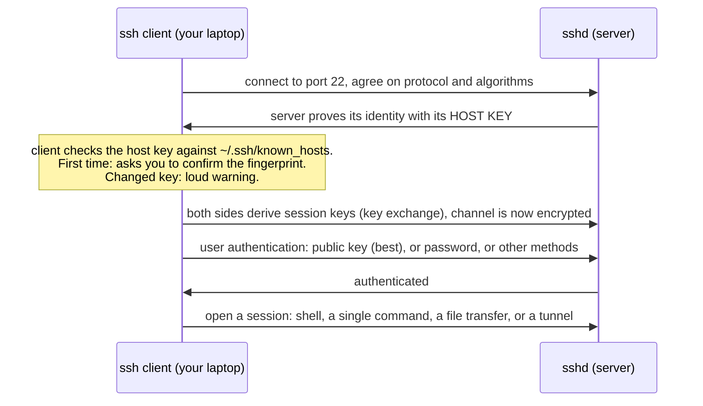

# 1.5 Working remotely: SSH keys, file transfer, tmux and editors

**Level:** basics → intermediate · **Tier 0 (foundations)** · **Lab venue:** two small Ubuntu VMs on GCP (or one VM and your laptop) · **Status:** drafted, labs untested

## Why this matters for AI infrastructure

You will almost never sit at the machines you manage. GPU servers live in data centres and clouds; you reach them through a bastion host, then a login node, then a compute node, and you move checkpoints and datasets between them. Everything runs over **SSH**: interactive shells, file copies, port tunnels to Jupyter and TensorBoard, Ansible, Slurm launch scripts, Git over SSH, and the cluster managers behind them. Mistakes here are expensive in two directions: a broken or clumsy workflow wastes hours (sessions that drop and kill a three-day training run, a file sync that deletes the wrong directory), and weak SSH hygiene (shared keys, forwarded agents, password logins) is how clusters get compromised. This chapter teaches SSH properly from the beginning, plus the tools that make remote work reliable: `rsync`, `tmux`, parallel shells, an editor you can survive in, and out-of-band access when the operating system is down.

## Prerequisites and outcomes

You need chapters 1.1 to 1.3 (processes, shell, files and permissions basics). After this chapter you will be able to:

- explain how SSH works (host keys, authentication, an encrypted channel) and what the "host key changed" warning really means;
- create and manage keys, copy a public key to a server, and configure `~/.ssh/config` with shortcuts, jump hosts and connection sharing;
- use SSH for remote commands, port forwarding (local, remote, dynamic) and file transfer, and choose between `scp`, `sftp`, `rsync` and cloud-storage tools;
- use `rsync` correctly, including the trailing-slash rule and dry runs;
- keep sessions alive with `tmux`, and run commands on many nodes at once with `pdsh` or `clush`;
- edit files on a server with `nano` or `vim`, and know the safe habits for editing production configuration;
- explain what a BMC, IPMI and serial-over-LAN are and when you need them;
- diagnose the common SSH failures (publickey denied, host key changed, timeouts, dropped sessions) in a systematic order.

> **Where the depth lives.** This chapter is the working core. The full SSH option references (client, server, `Match`, host-based authentication), `pdsh` and ClusterShell, screen and tmux key tables, and IPMI are in **chapter 1.29**; rsync's full option set, Samba, NFS, SSHFS, cloud storage and remote graphics (X11, VNC, x2go) are in **chapter 1.30**.

## 1. How SSH works

**SSH (Secure Shell)** is a protocol and a pair of programs: the **client** (`ssh`) on your machine and the **server** (`sshd`, the daemon) on the remote machine, listening by default on TCP port 22. It replaced older tools (telnet, rsh) that sent everything, including passwords, in plain text. SSH gives you three guarantees: the traffic is **encrypted**, the server is **authenticated** to you (so you know you reached the right machine), and you are **authenticated** to the server (so it knows who you are).

A connection goes through these stages:



Two separate key pairs are involved, and it is worth keeping them apart in your mind:

- **The server's host key.** Each server has its own long-lived key pair (stored under `/etc/ssh/`, for example `ssh_host_ed25519_key`). The first time you connect, your client shows the server's **fingerprint** (a short hash of its public key) and asks whether to trust it; if you say yes, it records the key in `~/.ssh/known_hosts`. On later connections it checks the server presents the same key. This protects you from connecting to an impostor (a man-in-the-middle attack).
- **Your user key.** You generate a key pair; the **private key** stays secret on your machine, and the **public key** is placed on the server in `~/.ssh/authorized_keys` of the account you will log in to. To log in, the client proves it holds the private key by signing a challenge; the server verifies the signature with the stored public key. No secret ever crosses the network, and there is nothing to guess or brute-force the way a password can be.

The "host key changed" warning (`WARNING: REMOTE HOST IDENTIFICATION HAS CHANGED!`) therefore means "the server presenting itself under this name is not the one I remembered." The usual harmless cause is that the machine was **rebuilt or reimaged** (new host keys), or a cloud VM's IP address was reassigned to a different VM. The dangerous cause is an attack. Verify out of band (cloud console serial output, a fingerprint published by your platform team) before you remove the old entry with `ssh-keygen -R hostname`.

## 2. Keys: create, install, protect

```bash
ssh-keygen -t ed25519 -C "alice@laptop-2026"       # create a key pair; choose a passphrase when asked
ls -l ~/.ssh                                        # id_ed25519 (private), id_ed25519.pub (public)
ssh-copy-id -i ~/.ssh/id_ed25519.pub alice@gpu01     # append the public key to the server's authorized_keys
ssh alice@gpu01                                      # now logs in with the key
ssh-keygen -lf ~/.ssh/id_ed25519.pub                # show the key's fingerprint
```

Notes that matter:

- **Algorithm.** **Ed25519** is the modern default: small, fast, strong. RSA with at least 3072 bits is still acceptable where Ed25519 is unsupported. Avoid DSA and short RSA keys.
- **Passphrase.** Protect the private key with a passphrase, so that a stolen laptop or copied file is not an instant breach. To avoid retyping it, use an **agent** (next paragraph).
- **Permissions are enforced.** `sshd` and `ssh` refuse keys with sloppy permissions: your `~/.ssh` directory should be `700`, private keys and `authorized_keys` `600`, and your home directory must not be writable by group or others (the server option `StrictModes`, on by default, checks this). A large share of "Permission denied (publickey)" tickets are simply wrong modes.
- **One key per purpose.** Prefer a separate key per device or role (laptop, CI), so one can be revoked without breaking the others. Never copy a private key between machines casually, and never commit one to Git.
- **The agent.** `ssh-agent` is a small background process that holds your *decrypted* keys in memory so you type the passphrase once: `eval "$(ssh-agent -s)"`, then `ssh-add ~/.ssh/id_ed25519` (use `ssh-add -t 3600` to expire after an hour; macOS can store it in the keychain). **Agent forwarding** (`ssh -A`, or `ForwardAgent yes`) lets a remote host use your local agent, which is convenient for hopping onward or pulling from a Git server, but it also lets anyone with root on that remote host *use your identity* while you are connected. Forward the agent only to hosts you trust, or avoid it by using a jump host (section 3).
- **Server-side policy** (covered fully in chapter 1.21): in production disable password authentication (`PasswordAuthentication no`), forbid direct root login (`PermitRootLogin no`), and restrict who may log in. Large fleets increasingly use **SSH certificates** signed by a central certificate authority instead of distributing public keys everywhere, so access can be time-limited and centrally revoked.

## 3. Using SSH day to day

### Running commands, with or without a terminal

```bash
ssh gpu01                               # interactive shell
ssh gpu01 uptime                        # run one command and return
ssh gpu01 'nvidia-smi -L | wc -l'       # quote it so YOUR shell does not pipe locally
ssh -t gpu01 htop                       # -t forces a terminal, needed for interactive full-screen tools
ssh gpu01 'bash -s' < local_script.sh   # run a local script on the remote host
```

Two details trip people up. **Quoting:** the line you give `ssh` is expanded by your *local* shell first, then sent as text to the remote shell, which parses it *again*. Use single quotes around the remote command so local expansion does not happen unintentionally. **Environment:** `ssh host command` runs a *non-interactive* shell, which does not read `~/.bashrc` (chapter 1.2), so a command found in your interactive session may be "not found" this way. Use full paths or put the necessary `PATH` setting where non-interactive shells read it.

### The config file: `~/.ssh/config`

The configuration file turns long command lines into short names and encodes your access topology once:

```
# ~/.ssh/config
Host *
    ServerAliveInterval 30          # keepalive probe every 30 s so idle connections do not die
    ServerAliveCountMax 4
    IdentitiesOnly yes              # offer only the keys named here (avoids "too many authentication failures")

Host bastion
    HostName bastion.example.com
    User alice
    IdentityFile ~/.ssh/id_ed25519

Host gpu* login*
    User alice
    ProxyJump bastion               # reach these hosts through the bastion, transparently
    IdentityFile ~/.ssh/id_ed25519

Host gpu01
    HostName 10.20.0.11

Host *
    ControlMaster auto              # reuse one connection for many sessions (fast, fewer logins)
    ControlPath ~/.ssh/cm-%r@%h:%p
    ControlPersist 10m
```

With this, `ssh gpu01` means: connect to the bastion, jump to `10.20.0.11`, log in as `alice`, with the right key. **`ProxyJump`** (the `-J` command-line option: `ssh -J bastion gpu01`) is the clean way to traverse a bastion: the connection to the final host is end-to-end encrypted *through* the bastion, and your agent does not need to be exposed on it. `ControlMaster` and `ControlPersist` share one TCP connection across many `ssh`, `scp` and `rsync` invocations, which makes repeated commands (and tools like Ansible) dramatically faster. The first matching value wins in the file, so put specific hosts before the catch-all `Host *`. `ssh -G hostname` prints the effective configuration, which is the first thing to check when a setting seems ignored.

### Port forwarding (tunnels)

An SSH connection can carry other TCP connections. This is how you reach a service that is not exposed to the network, without opening a firewall.

| Form | Meaning | Example |
|---|---|---|
| **Local forward** `-L` | listen on a port on **your** machine; traffic is delivered via the server to a destination | `ssh -L 6006:localhost:6006 gpu01` then open `http://localhost:6006` to reach TensorBoard on gpu01 |
| **Remote forward** `-R` | listen on a port on the **server**; traffic comes back to your side | `ssh -R 9000:localhost:8000 server` |
| **Dynamic forward** `-D` | your side runs a SOCKS proxy through the server | `ssh -D 1080 bastion`, then point a browser at the proxy |
| Flags `-N -f` | do not run a remote command; go to background | `ssh -N -f -L 8888:localhost:8888 gpu01` |

A typical use is a Jupyter or TensorBoard server started on a compute node, reached from the laptop with `ssh -L 8888:localhost:8888 gpu01` (through the bastion automatically if you used `ProxyJump`). Remember that `-L` binds only to localhost on your machine by default, which is the safe setting; exposing the forwarded port to the whole network (`-L 0.0.0.0:...`) is rarely what you want. (Kubernetes has its own equivalent, `kubectl port-forward`, chapter 5.25.)

### Debugging a connection

`ssh -v host` (up to `-vvv`) prints the negotiation step by step: which keys were offered, which authentication methods the server allows, and where it stopped. It is the single best tool for any login problem. On the server, the authentication log (`/var/log/auth.log` on Debian and Ubuntu, `/var/log/secure` on Red Hat family, or `journalctl -u ssh` / `-u sshd`) says *why* the server refused.

## 4. Copying files: `scp`, `sftp`, `rsync` and cloud tools

| Tool | Best for | Notes |
|---|---|---|
| `scp src host:dest` | quick one-off copy of a file or two | simple; recent OpenSSH versions run it over the SFTP protocol; not resumable |
| `sftp host` | interactive file browsing and transfer | `get`, `put`, `ls`, `cd` |
| **`rsync`** | **almost everything else**: synchronising directory trees, resumable large transfers, backups | only transfers differences; preserves permissions; needs `rsync` on both ends |
| `tar \| ssh` | streaming a tree with no temp file (chapter 1.3) | `tar -cf - dir \| ssh host 'tar -xf - -C /dest'` |
| `rclone`, `gcloud storage`, `aws s3` | moving data to and from object storage | the normal path for large datasets and checkpoints in the cloud |
| `sshfs host:/path mnt` | mount a remote directory over SSH (FUSE) for convenience | slow for heavy I/O; fine for editing a few files |

### `rsync` properly

`rsync` compares source and destination and transfers only what changed, using SSH as the default transport. Learn this small core:

```bash
rsync -avh --progress data/ gpu01:/scratch/data/      # archive mode, verbose, human sizes, progress
rsync -avhn --delete data/ gpu01:/scratch/data/       # DRY RUN (-n): show what would happen, change nothing
rsync -avhP --partial big.tar gpu01:/scratch/         # resume interrupted large transfers (-P = --partial --progress)
rsync -av --exclude '*.pyc' --exclude '.git/' src/ gpu01:/opt/src/
rsync -az --bwlimit=50m ckpt/ gpu01:/ckpt/            # compress on the wire, cap bandwidth (MiB/s with the m suffix in recent versions)
rsync -aHAX / /mnt/newroot --exclude=/proc --exclude=/sys --exclude=/dev   # system-style copy: hard links, ACLs, xattrs
```

Key options: **`-a`** (archive: recursive, copies links, permissions, times, owner and group where allowed, devices; the usual base), `-v` verbose, `-h` human-readable sizes, **`-n`/`--dry-run`**, **`--delete`** (remove files in the destination that are not in the source, which makes the destination an *exact mirror* and is therefore dangerous), `-z` (compress in transit; pointless for already-compressed data), `-P`, `--exclude`/`--include`, `-c` (compare by checksum instead of size and time; slow but thorough), `-e "ssh -p 2222"` to use a custom SSH command.

**The trailing slash rule.** This is the single most important `rsync` detail:

- `rsync -a src/ dest/` copies the **contents** of `src` into `dest`.
- `rsync -a src dest/` copies the directory **itself**, producing `dest/src/`.

Getting it wrong either nests a duplicate level or, with `--delete`, can delete things you meant to keep. The habit that prevents disasters is to run the command with **`-n` first**, read the list, and only then run it for real. After a transfer, verify when it matters: `rsync -avhn` again should show nothing to do, and large files can be checked with `sha256sum`.

### Network filesystems: an introduction

Instead of copying files, clusters usually *share* them, so that a user's home and project directories look the same on every node. The common technologies, in short:

- **NFS** (Network File System) is the standard Unix way to mount a remote directory as if local. A server lists exports (`/etc/exports`), clients mount them (`mount -t nfs4 server:/export /mnt`). Simple and ubiquitous, but a single server limits scale and metadata-heavy workloads (millions of small files) perform poorly. Its failure behaviour matters: if the server stops answering, processes accessing it can hang in uninterruptible sleep (state `D`, chapter 1.1).
- **Parallel filesystems** (Lustre, BeeGFS, GPFS and others) spread data over many servers for the bandwidth AI and HPC need; chapters 6.18 to 6.21 cover them.
- **SMB/CIFS (Samba)** is the Windows file-sharing protocol; relevant mostly for desktop integration, not for GPU clusters.
- **Object storage** (Google Cloud Storage, S3) is accessed through APIs and tools rather than mounted; the default home of datasets and checkpoints in the cloud.

Security on shared filesystems depends on identities matching across machines: files record numeric UIDs and GIDs, so the *same user must have the same UID on every node* (chapter 1.6, and the identity services in 6.24).

## 5. Sessions that survive: `tmux`

If your SSH connection drops (laptop sleep, Wi-Fi, a firewall idle timeout), every program started in that terminal receives a hangup signal and ends. For anything interactive and long (a build, a debugging session, a data conversion), run it inside a **terminal multiplexer**. **`tmux`** (older: `screen`) keeps sessions alive on the server independent of your connection; you reconnect and reattach.

```bash
tmux new -s train           # start a named session
#   ... run your commands ...
#   press Ctrl-b, then d    # DETACH: the session keeps running; you can close the terminal
tmux ls                     # list sessions
tmux attach -t train        # reattach later, possibly from a different laptop
tmux kill-session -t train  # end it
```

All tmux commands are keystrokes after the **prefix** `Ctrl-b`: `c` new window, `n`/`p` next and previous window, `%` split into left and right panes, `"` split top and bottom, arrow keys to move between panes, `[` scroll mode (use `q` to leave), `d` detach, `?` list all keys. A common layout for debugging is one pane running a job, one running `watch -n1 nvidia-smi`, and one for a shell.

Two cautions. First, tmux protects against *your connection* dropping, not against the *machine* rebooting or the job being preempted. For production batch work on a cluster, submit a batch job to the scheduler (`sbatch`, chapter 6.11) instead of leaving something running inside tmux on a login node; login nodes are shared and long CPU-heavy processes there are usually forbidden. Second, `nohup cmd &` and `disown` (chapter 1.8) are lighter alternatives for fire-and-forget background commands, but give you no way to reattach.

## 6. Running commands on many nodes

Clusters have hundreds of nodes, and "log in to each one and check" is not a plan. Options, from simplest to most capable:

```bash
for h in gpu01 gpu02 gpu03; do echo "== $h"; ssh "$h" 'uname -r; nvidia-smi -L | wc -l'; done   # a plain loop
pdsh -w gpu[01-16] 'nvidia-smi -L | wc -l' | dshbak -c        # pdsh: parallel ssh, dshbak groups identical output
clush -w gpu[01-16] -b 'uptime'                               # ClusterShell: -b gathers identical output together
srun -N16 --ntasks-per-node=1 hostname                        # inside a Slurm allocation, srun runs one task per node
ansible gpu -m shell -a 'uname -r'                            # Ansible ad hoc commands (chapter 4.3)
```

`pdsh` and `clush` accept the **node-range notation** `gpu[01-16]`, run commands in parallel (limited by a fan-out setting), and can collect identical outputs so a healthy fleet prints one line and an outlier stands out. Cautions: output order is not deterministic; each command is a separate SSH connection (set up keys and `known_hosts` first, or use host-based authentication in controlled clusters); watch quoting; and a destructive command run on 500 nodes at once fails 500 times at once. Rehearse on one node, then a few, then all. Ansible (Part 4) is the better tool when the operation must be repeatable and idempotent.

## 7. Editors: enough to survive anywhere

You will need to edit files on remote machines where you cannot install your favourite editor. Know one simple editor and the minimum of a powerful one.

**Which editor to learn.** To work seriously on Unix you must be able to edit text without damaging it: nearly everything is configured through plain-text files, you will edit them constantly, and you need a capable tool. The two long-standing de facto standards are **`vi`** (today usually `vim`) and **Emacs**; people are religious about the choice, so ignore them and pick the one that matches how you work. Emacs can do almost anything and has extensive built-in help (open it and press `Ctrl-h t` for the tutorial), at the price of more typing; `vi`/`vim` is built for speed and "plays a bit like a video game", it is installed on virtually every system, and it is the one you will find on a minimal server or recovery shell. A friendlier editor such as `nano` is fine for occasional edits, but habits form around the first tool you use, so for daily administration invest in `vim` (or Emacs). One more distinction: editors like `vim` run **inside the terminal** using the standard terminal interface, whereas GUI editors open their own window and are independent of the terminal (Emacs runs in either).

**`nano`**: shows its key commands at the bottom (`^O` write out, `^X` exit, `^W` search; `^` means Ctrl). It needs no explanation and is fine for quick edits.

**`vim`** (or `vi`, on every server): a **modal** editor, which confuses newcomers because keys mean different things in different modes. The survival kit:

| Key | Does |
|---|---|
| (start) | you are in **normal mode**; keys are commands, not text |
| `i` | enter **insert mode** (type text); press `Esc` to return to normal mode |
| `:w` Enter | save; `:q` quit; `:wq` save and quit; `:q!` quit **without** saving |
| `/word` Enter, then `n` | search forward, jump to the next match |
| `dd`, `yy`, `p` | delete (cut) a line, copy a line, paste |
| `u`, `Ctrl-r` | undo, redo |
| `gg`, `G` | go to the first, last line |
| `:set number` | show line numbers |
| `:%s/old/new/g` | replace in the whole file |

Set your default with `export EDITOR=vim` (or `nano`) in your shell startup file; tools like `git commit`, `crontab -e`, `visudo` and `kubectl edit` open `$EDITOR`.

**Safe editing of important files.** On a server: (1) copy the file first (`cp -a file file.bak.$(date +%F)`), (2) edit, (3) review the change with `diff -u file.bak.* file`, (4) validate with the program's checker when it has one (`sshd -t`, `nginx -t`, `visudo -c`, `systemd-analyze verify`, `kubectl apply --dry-run=client`), and only then (5) reload the service. Use **`sudoedit`** (or `sudo -e file`) instead of `sudo vim file`, which runs your whole editor as root. For editing the sudoers file always use `visudo`, which validates before saving (chapter 1.6).

**Working locally and running remotely.** Modern editors (VS Code with Remote-SSH, JetBrains Gateway) run a small server component on the remote host over SSH and give you a local-quality interface, including a terminal and port forwarding. They depend on the same SSH configuration (`~/.ssh/config`) as the command line, which is another reason to invest in it. For notebooks, run Jupyter on the node and tunnel the port rather than exposing it.

## 8. Out-of-band access: when SSH is not available

If the operating system has crashed, the network configuration is broken, or a node will not boot, SSH cannot help. Servers have a separate management computer, the **BMC (baseboard management controller)**, with its own network port and IP address, that works even when the main system is powered off. Through it you can power-cycle the server, read hardware sensors and logs, update firmware, open a virtual keyboard-video-mouse (**iKVM**), and connect to the machine's **serial console** over the network (**serial-over-LAN, SOL**). The classic interface is **IPMI**; the modern one is **Redfish** (Part 7).

```bash
ipmitool -I lanplus -H bmc-gpu01 -U admin -E chassis power status        # -E reads the password from IPMI_PASSWORD
ipmitool -I lanplus -H bmc-gpu01 -U admin -E sol activate                # attach to the serial console (~. to leave)
ipmitool -I lanplus -H bmc-gpu01 -U admin -E chassis power cycle         # hard power cycle (be sure!)
```

Large clusters use console servers (for example `conman`) and cluster managers (BCM, chapter 8) to centralise this. Two rules: the BMC network must be isolated and heavily protected (a compromised BMC is a compromised machine, below the operating system), and credentials must not appear on command lines where other users can see them in `ps`.

## 9. AI-infrastructure patterns

- **Cloud VMs.** On GCP, `gcloud compute ssh VM --zone ZONE` manages keys and, with IAP, tunnels through Google's proxy without a public IP (`--tunnel-through-iap`). Know what it writes to `~/.ssh` and use the same host entries in your config.
- **The standard HPC path:** laptop, then bastion, then Slurm login node, then (via `srun --pty bash` or `salloc`) a compute node. Do not ssh into compute nodes uninvited to run work: processes started outside Slurm are not tracked or limited by it (chapter 6.7). Many sites configure `pam_slurm_adopt` so SSH sessions to a node you hold are adopted into your job's cgroup.
- **Data movement:** `rsync` for code and small data over SSH; `rclone` or the cloud CLI for object storage; for tens of terabytes, parallel tools and the storage chapters (Part 13).
- **Interactive debugging:** `ssh -t node 'tmux new -A -s debug'` creates the session if absent or attaches if it exists (`-A`).
- **Never** put passwords, API keys or private keys on command lines, in shell history or in shared scripts. Use agents, environment from files with strict permissions, or secret managers (chapters 4.12 and 5.16).

## How it fails

### 1. `Permission denied (publickey)`
**Symptom:** the server refuses your key. **Causes, in the order to check:** wrong username; the public key is not in the target account's `authorized_keys`; wrong permissions on `~/.ssh`, `authorized_keys` or the home directory; the client did not offer the right key (many keys loaded, or `IdentitiesOnly` missing); the server disables the method; a cloud-metadata or OS Login system overwrote `authorized_keys`; SELinux context wrong on `~/.ssh` (Red Hat family: `restorecon -R ~/.ssh`). **Diagnose:** `ssh -vvv user@host` (which keys were tried, which methods remain), the server's auth log, `ls -ld ~ ~/.ssh ~/.ssh/authorized_keys`, `sshd -T | grep -i -E "authorizedkeys|pubkey|password|permitroot"`. **Fix:** correct the cause; do not "fix" it by turning on passwords.

### 2. `WARNING: REMOTE HOST IDENTIFICATION HAS CHANGED!`
**Symptom:** the client refuses to connect. **Cause:** the host key differs from `known_hosts`, because the node was reinstalled, the VM was recreated, an IP address was reused by another machine, or someone is intercepting traffic. **Fix:** confirm the change is legitimate through a trusted channel, then `ssh-keygen -R host` and reconnect, verifying the new fingerprint. For fleets, manage host keys deliberately (provision the same host key in the image, or publish them via SSH certificates or DNS) so this warning stays meaningful instead of being clicked through.

### 3. Hangs, timeouts and "Connection refused"
**Symptom:** the connection stalls or fails immediately. **Meaning:** *timeout* usually means packets are dropped (a firewall, security group, wrong IP, route, or the host is down); *connection refused* means the host answered but nothing listens on that port (sshd stopped or a different port). **Diagnose:** `ping`, `nc -vz host 22`, `traceroute`, check security groups and the host firewall, and the BMC console if the OS is unreachable. **Fix:** address the network or service layer found.

### 4. Sessions drop and kill your work
**Symptom:** "Broken pipe"; a long job started in the foreground dies with the connection. **Cause:** NAT or firewall idle timeouts, laptop sleep, Wi-Fi changes. **Fix:** `ServerAliveInterval` in the config to keep the connection alive; run long things in `tmux` (or `nohup`) and, for real work, in a scheduler job.

### 5. `rsync` mirrors the wrong thing: the trailing slash and `--delete`
**Symptom:** a nested duplicate directory, or files disappear from the destination. **Cause:** `src` versus `src/`, and `--delete` removing "extra" files. **Fix:** always dry-run first (`-n`), read the output, keep `--delete` out of habit, and use `--backup --backup-dir` or snapshots for anything valuable. Remember `--delete` makes the destination match the source; if the *source* is accidentally empty (an unmounted filesystem), it deletes the destination's contents.

### 6. Agent forwarding exposes you; keys leak
**Symptom:** unexplained logins using your identity; a key found in a Git history. **Cause:** `ForwardAgent` to a compromised or shared host; private keys copied around or committed. **Fix:** prefer `ProxyJump` over agent forwarding; short agent lifetimes (`ssh-add -t`); one key per device; rotate and revoke immediately on suspicion (remove from `authorized_keys`, or revoke the certificate); scan repositories for secrets.

### 7. Works in the terminal, fails over `ssh host command` or in automation
**Symptom:** `command not found`, or different behaviour in scripts. **Cause:** non-interactive shells skip `~/.bashrc`, so `PATH` and environment differ; no TTY for tools that need one (`-t`); host key prompts blocking an unattended run. **Fix:** full paths, set the environment explicitly, use `-t` when required, and pre-populate `known_hosts` (`ssh-keyscan -H host >> ~/.ssh/known_hosts`, verified out of band) instead of disabling checking.

## Hands-on lab (two GCP Ubuntu VMs, `vm1` and `vm2`; untested)

**Part A: keys and config.**
1. On your laptop (or `vm1`) create an Ed25519 key with a passphrase. Install the public key on `vm2` with `ssh-copy-id` (or by pasting into `authorized_keys`). Log in with the key.
2. Add a `Host vm2` block to `~/.ssh/config` with `HostName`, `User`, `IdentityFile`, `ServerAliveInterval`. Verify with `ssh -G vm2 | head -20`, then `ssh vm2 hostname`.
3. Start an agent, `ssh-add -t 600` the key, and confirm you are no longer asked for the passphrase.

**Part B: break it and fix it.**
4. On `vm2`, run `chmod 777 ~/.ssh; chmod 666 ~/.ssh/authorized_keys`. Try to log in; record the `ssh -vvv` and server log messages; fix the modes (`700`, `600`) and succeed.
5. Edit `~/.ssh/known_hosts` on the client to a wrong key for `vm2`, observe the warning, then fix it with `ssh-keygen -R`. Explain in your own words what each of the two failures protects against.

**Part C: jump hosts and tunnels.**
6. Treat `vm1` as the bastion and `vm2` as the internal host. Configure `ProxyJump` in `~/.ssh/config` and reach `vm2` from your laptop through `vm1`. (With cloud firewalls, allow SSH only from the bastion to `vm2` to make it real.)
7. On `vm2` run `python3 -m http.server 8000 --bind 127.0.0.1`. From your laptop run `ssh -N -L 8000:localhost:8000 vm2` and open `http://localhost:8000`. Explain exactly which connection travels where. Confirm with `ss -ltnp` on both ends.
8. Run `ssh -v vm2 true` twice with `ControlMaster auto` and `ControlPersist` set; compare the time (`time ssh vm2 true`), and use `ssh -O check vm2` and `ssh -O exit vm2`.

**Part D: file transfer.**
9. Create a directory with 50 small files and one 200 MB file (`dd if=/dev/urandom of=big bs=1M count=200`). Copy it with `scp -r`, then with `rsync -avhP`. Re-run `rsync` and note it transfers nothing. Modify one small file and re-run; observe only that file moves.
10. Demonstrate the trailing slash rule: run `rsync -avhn src dest/` and `rsync -avhn src/ dest/` and compare the listed paths. Then add `--delete` with `-n` and see what it *would* remove. Interrupt a large copy with Ctrl-C and resume with `--partial`.

**Part E: tmux and parallel commands.**
11. Start `tmux new -s lab`, run `top`, detach with `Ctrl-b d`, disconnect your SSH session entirely, reconnect and reattach. Split panes and run `watch -n1 date` in one.
12. Install `pdsh` or `clustershell` (`sudo apt-get install -y clustershell`) and run a command on both VMs in parallel with gathered output; run a command that prints a different value on each (`hostname`) and see how the output is grouped.

**Part F: editors and safe edits.**
13. Open a file in `vim` without using a mouse: insert text, search, delete a line, undo, save, quit. Practise `:q!`. Then do the safe-edit routine on a copy of `/etc/ssh/sshd_config`: backup, change `PasswordAuthentication no`, `diff -u`, and validate with `sudo sshd -t -f yourcopy`. Do not restart sshd on a machine you cannot afford to lose access to.

**Part G: BMC concepts (read-only).**
14. In the GCP console, find the serial console for a VM and enable it; connect and see the boot messages. Compare with what IPMI SOL gives on bare metal, and note which problems only a serial console or BMC can help with (no network, kernel panic, bootloader).

## Checkpoint questions

1. What three properties does SSH provide? Which keys are involved in each?
2. What is the difference between the server's host key and your user key?
3. What does the "REMOTE HOST IDENTIFICATION HAS CHANGED" warning mean? When is it harmless and when dangerous?
4. Why must the private key have restrictive permissions, and what else does `sshd` check?
5. What is `ProxyJump` and why is it preferred over agent forwarding for reaching internal hosts?
6. Explain `ssh -L 6006:localhost:6006 gpu01`. Which port listens where?
7. Why does `ssh host 'cmd'` sometimes say "command not found" although the command works after you log in?
8. What is the difference between `rsync -a src dest/` and `rsync -a src/ dest/`?
9. What does `rsync --delete` do, and what safety habit should you adopt?
10. Why is `tmux` useful, and why is it not a substitute for a scheduler job?
11. What are `pdsh` and `clush` for, and what precaution should you take before running a destructive command with them?
12. Why use `sudoedit` instead of `sudo vim`? Why `visudo` for the sudoers file?
13. What is a BMC, and name three things you can do through it that you cannot do through SSH.
14. List, in order, the first five things to check for `Permission denied (publickey)`.
15. Why is NFS acceptable for home directories but a poor choice for training data with millions of small files?

### Answers

1. Encryption of the traffic, authentication of the server to the client, and authentication of the client to the server. The host key authenticates the server; the user key pair (or password or certificate) authenticates you; session keys derived at connection time encrypt the traffic.
2. The host key identifies the server and lives on the server (`/etc/ssh/ssh_host_*`); clients remember its public half in `known_hosts`. The user key identifies you; the private half stays on your machine and the public half is stored in the server account's `authorized_keys`.
3. The server presenting itself under this name has a different host key from the one recorded. Harmless if the machine was rebuilt, reimaged or the IP was reassigned to another machine; dangerous if an attacker is impersonating it. Verify out of band before removing the old entry.
4. If other users could read the private key they could impersonate you. `sshd` with `StrictModes` also rejects `authorized_keys` or `~/.ssh` that are writable by others, or a home directory writable by group or world.
5. `ProxyJump` (`-J`) reaches a host through an intermediate bastion by tunnelling an end-to-end SSH connection through it, so the bastion cannot see the session and your agent need not be forwarded. Agent forwarding lets root on the intermediate host use your identity while connected.
6. Your local machine listens on port 6006; connections to it are carried through the SSH connection to gpu01 and delivered to `localhost:6006` as seen from gpu01 (for example TensorBoard).
7. `ssh host cmd` starts a non-interactive shell that does not read `~/.bashrc`, so `PATH` modifications made there are absent. Use full paths or set the environment where non-interactive shells read it.
8. The first copies the directory itself into `dest/`, producing `dest/src/...`; the second copies the contents of `src` into `dest/`.
9. It deletes files in the destination that are not in the source, making an exact mirror. Always dry-run (`-n`) first and be sure the source is complete (not an empty, unmounted path).
10. It keeps sessions running on the server when your connection drops, and lets you reattach. It does not survive reboots or preemption, and long jobs on shared login nodes should be scheduler jobs, which are tracked, limited and restartable.
11. They run commands over SSH on many nodes in parallel with node-range notation. Rehearse on one node, then a few, then the fleet, because mistakes are multiplied; and prefer Ansible for repeatable, idempotent changes.
12. `sudoedit` runs only a copy-and-edit step as root while your editor runs as you; `sudo vim` runs the whole editor, including plugins and shell escapes, as root. `visudo` validates syntax before saving so a typo cannot lock you out of sudo.
13. The BMC is an independent management controller with its own network port, working even when the OS is down or the machine is off. Examples: power cycle, serial-over-LAN console and virtual KVM, read hardware sensors and event logs, update firmware, set boot device.
14. Check the username, `ssh -vvv` output (which keys were offered), whether the public key is in the target account's `authorized_keys`, permissions of the home, `.ssh` and `authorized_keys`, and the server's auth log and `sshd -T` settings (plus SELinux context on Red Hat family systems).
15. NFS is simple and fine for modest, shared files, but a single server and per-file metadata round trips make small-file workloads slow, and an unresponsive server can hang processes. Parallel filesystems or sharded datasets on local or object storage are better for training data.

## Sources and further reading

- Brian Ward, *How Linux Works*, 3rd ed., ch. 12 (quick copies, `rsync` and the trailing-slash rule, excluding files, dry runs, bandwidth limits, file sharing and its security, Samba, SSHFS, NFS, cloud storage, the state of network file sharing) and ch. 2 section on text editors. This chapter's explanation of SSH, keys, configuration, tunnels, `tmux`, parallel shells, out-of-band access, failure modes and lab are original.
- Sergey Zhumatiy, *Supercomputers for Linux SysAdmins*, ch. 10 (ssh and parallel ssh, environment forwarding, port and X forwarding, the SSH agent, server and client configuration, host-based authentication, `pdsh`, ClusterShell, screen and tmux, IPMI, Conman, iKVM) and ch. 18 (remote user access: SSH, FTP/WWW, X Window and alternatives).
- Manual pages: `ssh(1)`, `ssh_config(5)`, `sshd_config(5)`, `ssh-keygen(1)`, `ssh-agent(1)`, `rsync(1)`, `tmux(1)`, `ipmitool(1)`; OpenSSH release notes for protocol and default changes.
- Related chapters: 1.6 (identities and permissions), 1.21 (SSH hardening), 4.3 (Ansible), Part 7 (BMC and Redfish), 6.25 (remote access to clusters), 13 (data movement).

*Notes for review:* SSH defaults (Ed25519 as the preferred key type, `scp` using the SFTP protocol in recent OpenSSH, `StrictModes`) follow current OpenSSH behaviour and should be confirmed against the version you run; `rsync`'s `--bwlimit` unit suffix handling varies by version. X11 forwarding, `conman` configuration and Samba server setup are mentioned only briefly and are not exercised in the lab. All lab commands are **untested** and must be run on VMs before this chapter moves to `reviewed`.
