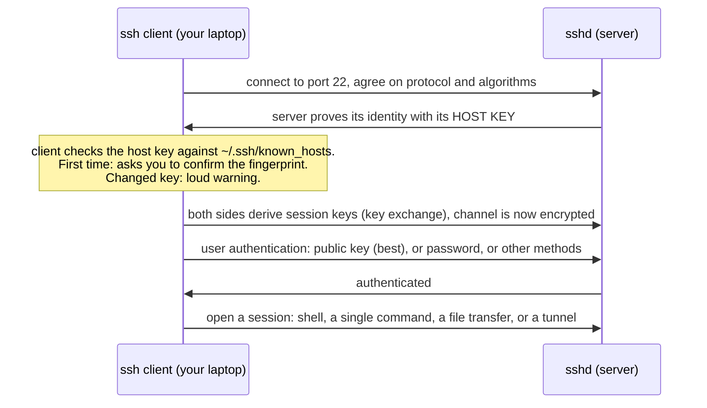

# 1.5 Working remotely: SSH keys, file transfer, tmux and editors

| Field | Value |
|---|---|
| Level | Basics to Intermediate |
| Priority tier | Tier 0 (foundations) |
| Lab venue | Two small Ubuntu VMs on GCP (`remote_ssh_rsync_lab.py`: 25 checks pass; VM commands **untested** here) |
| Part | Part 1: Linux, from the command line to the kernel and performance |

## Why this matters for AI infrastructure

You will almost never sit at the machines you manage. GPU servers live in data centres and clouds, so you reach them remotely. A typical route runs through a bastion host, then a login node, then a compute node, and along the way you move checkpoints and datasets. Everything rides on **SSH**, the protocol for secure remote logins. It carries interactive shells, file copies, port tunnels to Jupyter and TensorBoard, Ansible, Slurm launch scripts, Git over SSH, and the cluster managers behind them.

Mistakes here cost you in two directions. A clumsy workflow wastes hours. Dropped sessions can kill a three-day training run, and a careless file sync can delete the wrong directory. The second cost is worse. Weak SSH habits, such as shared keys, forwarded agents and password logins, are how clusters get compromised. Sergey Zhumatiy puts the balance well in *Supercomputers for Linux SysAdmins*: *the less access, the better, yet users should not be clamped in a hedgehog's grip*.

SSH combined with `scp`, `sftp` and `rsync` covers nearly all normal operation. This chapter teaches SSH from the beginning. It also covers the tools that make remote work reliable: `rsync`, `tmux`, parallel shells, an editor you can survive in, and out-of-band access for when the operating system is down. Learn the SSH core first, because the rest of the chapter builds on it.

## Prerequisites and outcomes

Before you start, you should be comfortable with chapters 1.1 to 1.3, which cover processes, the shell, and files and permissions. When you finish this chapter, you will be able to do the following.

- Explain how SSH works: host keys, authentication, and an encrypted channel. You will also know what the "host key changed" warning really means.
- Create and manage keys, copy a public key to a server, and set up `~/.ssh/config` with shortcuts, jump hosts, and connection sharing.
- Use SSH for remote commands, port forwarding (local, remote, dynamic), and file transfer. You will choose between scp, sftp, rsync, and cloud-storage tools.
- Use `rsync` correctly, including the trailing-slash rule, dry runs, and `--bwlimit`.
- Keep sessions alive with tmux, and run commands on many nodes at once with pdsh or clush.
- Edit files on a server with nano or vim, and follow safe habits when you edit production configuration.
- Explain what a BMC, IPMI, and serial-over-LAN are, and when you need them.
- Diagnose common SSH failures (publickey denied, host key changed, timeouts, dropped sessions) in a systematic order.

> **Where the depth lives.** This chapter is the working core. The full SSH option references (client, server, `Match`, host-based authentication), `pdsh` and ClusterShell, screen and tmux key tables, and IPMI are in **chapter 1.29**. rsync's full option set, Samba, NFS, SSHFS, cloud storage and remote graphics (X11, VNC, x2go) are in **chapter 1.30**.

## 1. How SSH works

Suppose you connect to a GPU server for the first time, and your client stops to ask you something. That question is there to protect you. **SSH (Secure Shell)** is a protocol and a pair of programs. The **client**, `ssh`, runs on your machine. The **server**, `sshd`, the daemon, runs on the remote machine and listens on TCP port 22 by default. SSH replaced older tools such as `telnet` and `rsh`. Those tools sent everything, passwords included, as plain text.

SSH gives you three guarantees. The traffic is **encrypted**. The server is **authenticated** to you, so you know you reached the right machine. And you are **authenticated** to the server, so it knows who you are.

A connection goes through four stages, shown in the diagram below.



Two separate key pairs take part, and it helps to keep them apart in your mind.

- **The server's host key.** Each server has its own long-lived key pair, stored under `/etc/ssh/` as files such as `ssh_host_ed25519_key`. The first time you connect, your client shows the server's fingerprint, a short hash of its public key, and asks whether to trust it. If you say yes, the client saves the key in `~/.ssh/known_hosts`. On later connections it checks that the server presents the same key. That check protects you from an impostor in a man-in-the-middle attack.
- **Your user key.** You generate a key pair. The private key stays secret on your machine. The public key goes onto the server, into `~/.ssh/authorized_keys` for the account you log in to. To log in, your client proves it holds the private key by signing a challenge. The server checks that signature against the stored public key. No secret crosses the network, and there is nothing to guess or brute-force the way you can with a password.

Now take the warning you will eventually meet: `WARNING: REMOTE HOST IDENTIFICATION HAS CHANGED`. It means the server answering to this name is not the one your client remembered. Often the cause is harmless. The machine was rebuilt or reimaged with new host keys, or a cloud VM's IP address was reassigned to a different VM. The dangerous cause is an attack. So verify the new key out of band, through the cloud console serial output or a fingerprint from your platform team, before you remove the old entry with `ssh-keygen -R hostname`. Treat a changed host key as a question to answer, not an error to click past.

## 2. Keys: create, install, protect

Typing a password on every login gets tedious, and a password can be guessed. A key pair fixes both problems. You generate the pair once, copy the public half to the server, and then log in with the private half.

```bash
ssh-keygen -t ed25519 -C "alice@laptop-2026"       # create a key pair; choose a passphrase when asked
ls -l ~/.ssh                                        # id_ed25519 (private), id_ed25519.pub (public)
ssh-copy-id -i ~/.ssh/id_ed25519.pub alice@gpu01     # append the public key to the server's authorized_keys
ssh alice@gpu01                                      # now logs in with the key
ssh-keygen -lf ~/.ssh/id_ed25519.pub                # show the key's fingerprint
```

Keep these notes in mind as you set up keys.

Choose the algorithm with care. Ed25519 is the modern default: it is small, fast and strong. RSA with at least 3072 bits is still acceptable where Ed25519 is unsupported. Avoid DSA and short RSA keys.

Protect the private key with a passphrase. A stolen laptop or a copied file then does not become an instant breach. To avoid retyping the passphrase, use an agent.

Permissions are enforced, so `sshd` and `ssh` refuse keys with sloppy modes. Your `~/.ssh` directory should be `700`, and private keys and `authorized_keys` should be `600`. Your home directory must not be writable by group or others, and `StrictModes`, which is enabled by default, checks this. A large share of `Permission denied (publickey)` tickets are simply wrong file modes.

Give each device or role its own key, such as one for your laptop and one for CI. Then you can revoke one without breaking the others. Never copy a private key between machines casually, and never commit one to Git.

The agent, ssh-agent, is a small background process. It holds your decrypted keys in memory, so you type the passphrase once. Start it with `eval "$(ssh-agent -s)"`, then load your key with `ssh-add ~/.ssh/id_ed25519`. Use `ssh-add -t 3600` to make the key expire after an hour. Agent forwarding, set with `ssh -A` or `ForwardAgent yes`, lets a remote host use your local agent. That is handy for hopping onward or pulling from a Git server. It also lets anyone with root on that remote host use your identity while you are connected. Forward the agent only to hosts you trust, or avoid forwarding altogether by using a jump host.

Server-side policy is covered fully in chapter 1.21. In production, disable password logins with `PasswordAuthentication no`, forbid direct root login with PermitRootLogin no, and restrict who may log in. Large fleets increasingly use SSH certificates, signed by a central certificate authority, instead of distributing public keys everywhere. That way access can be time-limited and revoked centrally.

Before you copy a key anywhere, check its permissions and decide who should hold it.

## 3. Using SSH day to day

### Running commands, with or without a terminal

Often you want one answer from a server, not a full session. The commands below show the common forms.

```bash
ssh gpu01                               # interactive shell
ssh gpu01 uptime                        # run one command and return
ssh gpu01 'nvidia-smi -L | wc -l'       # quote it so YOUR shell does not pipe locally
ssh -t gpu01 htop                       # -t forces a terminal, needed for interactive full-screen tools
ssh gpu01 'bash -s' < local_script.sh   # run a local script on the remote host
```

Two details trip people up. The first is quoting. The line you give `ssh` is expanded by your local shell first. It is then sent as text to the remote shell, which parses it again. Put single quotes around the remote command so your local shell does not expand it by accident. The second is the environment. `ssh host command` starts a non-interactive shell, which does not read `~/.bashrc` in chapter 1.2. A command that works in your interactive session may therefore say "not found" over SSH. Use full paths, or set `PATH` where non-interactive shells read it.

### The config file: `~/.ssh/config`

A configuration file turns long command lines into short names. It also records your access path once, so you do not have to type it again.

```
# ~/.ssh/config
Host *
    ServerAliveInterval 30          # keepalive probe every 30 s so idle connections do not die
    ServerAliveCountMax 4
    IdentitiesOnly yes              # offer only the keys named here (avoids "too many authentication failures")

Host bastion
    HostName bastion.example.com
    User alice
    IdentityFile ~/.ssh/id_ed25519

Host gpu* login*
    User alice
    ProxyJump bastion               # reach these hosts through the bastion, transparently
    IdentityFile ~/.ssh/id_ed25519

Host gpu01
    HostName 10.20.0.11

Host *
    ControlMaster auto              # reuse one connection for many sessions (fast, fewer logins)
    ControlPath ~/.ssh/cm-%r@%h:%p
    ControlPersist 10m
```

With this file, `ssh gpu01` means something specific. It connects to the bastion, jumps to `10.20.0.11`, and logs in as `alice` with the right key. `ProxyJump` is the clean way to traverse a bastion, and you can also pass it on the command line as `ssh -J bastion gpu01`. The connection to the final host stays end-to-end encrypted through the bastion, and your agent does not need to be exposed there. `ControlMaster` and ControlPersist share one TCP connection across many ssh, scp and rsync runs. That makes repeated commands, and tools such as Ansible, dramatically faster. The first matching value wins in the file, so put specific hosts before the catch-all `Host *`. When a setting seems ignored, run `ssh -G hostname` to print the effective configuration.

### Port forwarding (tunnels)

An SSH connection can carry other TCP connections. That lets you reach a service that is not exposed to the network, without opening a firewall.

| Form | Meaning | Example |
|---|---|---|
| **Local forward** `-L` | listen on a port on **your** machine; traffic is delivered via the server to a destination | `ssh -L 6006:localhost:6006 gpu01` then open `http://localhost:6006` to reach TensorBoard on gpu01 |
| **Remote forward** `-R` | listen on a port on the **server**; traffic comes back to your side | `ssh -R 9000:localhost:8000 server` |
| **Dynamic forward** `-D` | your side runs a SOCKS proxy through the server | `ssh -D 1080 bastion`, then point a browser at the proxy |
| Flags `-N -f` | do not run a remote command; go to background | `ssh -N -f -L 8888:localhost:8888 gpu01` |

Read each row by asking two questions. Which side listens, and where does the traffic go? The `-L` form listens on your machine, while `-R` listens on the server.

A typical use is a Jupyter or TensorBoard server running on a compute node. From your laptop, `ssh -L 8888:localhost:8888 gpu01` forwards the port, and with `ProxyJump` configured, the bastion is used automatically. By default `-L` binds only to localhost on your machine, which is the safe setting. Exposing the forwarded port to the whole network, with `-L 0.0.0.0:...`, is rarely what you want. Kubernetes has its own equivalent, `kubectl port-forward`, which chapter 5.25 covers.

X11 forwarding is a separate case. When you forward graphical applications with `ssh -X` or `ssh -Y`, which chapters 1.29 and 1.30 cover, you must have the `xauth` program installed on both computers. Be careful with remote `sudo` inside such a session. You need to pass your `XAUTHORITY` environment variable through `sudo`. That is the variable `ssh` set for you after you logged in, and it lets the privileged process read your X11 authentication cookie.

### Debugging a connection

When a login fails, start with verbose output. `ssh -v host`, with up to `-vvv`, prints the negotiation step by step. It shows which keys were offered, which authentication methods the server allows, and where the attempt stopped. It is the single best tool for any login problem. On the server, the authentication log says why the server refused you. On Debian and Ubuntu, that log is `/var/log/auth.log`. On the Red Hat family, it is `/var/log/secure`. You can also use `journalctl -u ssh` or `journalctl -u sshd`. Read the client-side negotiation first, then the server log, before you change any setting.

## 4. Copying files: `scp`, `sftp`, `rsync` and cloud tools

When you need to move a directory, which tool should you reach for? The answer depends on whether you copy once or keep two trees in step. SSH includes two built-in file transfer protocols, `scp` and `sftp`. They pair with `rsync`, and with ad-hoc HTTP or FUSE tools. Brian Ward's *How Linux Works* summarizes when to pick each tool.

| Goal / Scenario | Tool | Notes |
|---|---|---|
| Make a file or directory temporarily available to other machines on a trusted LAN | `python3 -m http.server` (formerly Python 2 `SimpleHTTPServer`) | Serves current directory over HTTP on port `8000`; zero setup |
| Quick one-off copy of a file or two over SSH | `scp src user@remote_host:dest` | Simple; recent OpenSSH runs `scp` over SFTP; not resumable |
| Interactive file browsing and transfer over SSH | `sftp host` | Supports `get`, `put`, `ls`, `cd` |
| **Distribute or synchronise directory trees regularly across machines** | **`rsync`** | Transfers only differences; preserves permissions; resumable |
| Stream a directory tree with no temporary archive file | `tar \| ssh` | `tar -cf - dir \| ssh host 'tar -xf - -C /dest'` (chapter 1.3) |
| Mount a remote directory over SSH with near-zero setup | `sshfs host:/path mnt` | FUSE user-space mount; convenient for editing, slow for heavy I/O |
| Regularly share files among Linux/Unix machines on a local network | **NFS** | Kernel network filesystem (`/etc/exports`, `mount -t nfs4`) |
| Share files with Windows machines on a local subnet | **Samba** (`smbd` / `nmbd`) | SMB/CIFS protocol (chapter 1.30) |
| Move large datasets and checkpoints to/from cloud object stores | `rclone`, `gcloud storage`, `aws s3` | Parallel multipart transfers to S3/GCS |

Read the table by matching your goal to a row. A one-off copy suits `scp`, while a directory you keep in step suits `rsync`. Notice why `scp -r` falls short for directories, too.

```bash
scp -r directory user@remote_host:dest_dir   # (untested here)
```

`scp -r` does get a first-time copy done. After a second transfer, though, the remote host may not have an exact copy of `directory`. If `directory` already exists on the remote host, `scp -r` places a *second* nested copy inside the existing directory, at `dest_dir/directory/directory`. It does not update the copy in place. It also copies every byte unconditionally, even when nothing changed.

### `rsync` properly

`rsync` solves both problems. It compares source and destination, transfers only what changed, and uses SSH as its default transport. Learn this small core first.

```bash
rsync -avh --progress data/ gpu01:/scratch/data/      # (untested here) archive mode, verbose, human sizes, progress
rsync -avhn --delete data/ gpu01:/scratch/data/       # (untested here) DRY RUN (-n): show what would happen, change nothing
rsync -avhP --partial big.tar gpu01:/scratch/         # (untested here) resume interrupted large transfers (-P = --partial --progress)
rsync -av --exclude '*.pyc' --exclude '.git/' src/ gpu01:/opt/src/ # (untested here)
rsync -az --bwlimit=10000 ckpt/ gpu01:/ckpt/          # (untested here) limit bandwidth to 10,000 KB/s (~10 MB/s), or --bwlimit=50m
rsync -aHAX / /mnt/newroot --exclude=/proc --exclude=/sys --exclude=/dev # (untested here) system-style copy: hard links, ACLs, xattrs
```

The `-a` flag stands for archive mode. It copies recursively, keeps symlinks as symlinks, and preserves permissions, modification times, owner and group where allowed, and device nodes. The `-v` flag makes the output verbose, and `-h` prints sizes in human-readable form. Two options deserve the most caution. The first is `-n`, or `--dry-run`, which shows what would happen and changes nothing. The second is `--delete`, which removes files in the destination that are not in the source, so the destination becomes an exact mirror. Other useful flags include `-z` to compress in transit, `-P` for partial resume and progress, and `--exclude` and `--include` for filtering. Use `-c` to compare by checksum instead of by size and time. Use `-e "ssh -p 2222"` to run a custom SSH command.

Limiting bandwidth matters on shared links. As *How Linux Works* explains in Section 12.2.7, it is easy to clog the uplink of an internet or WAN connection when you upload a large dataset or checkpoint to a remote host. You may not be using your downlink at all during an upload. Even so, a saturated uplink delays outgoing TCP `ACK` packets, and the whole connection then feels stalled. Passing `--bwlimit=10000` limits `rsync` to `10,000 KB/s`, about `10 MB/s`. Recent `rsync` versions also accept unit suffixes, such as `--bwlimit=50m`. The cap leaves headroom for interactive traffic.

The trailing slash is the single most important `rsync` detail.

- `rsync -a src/ dest/` copies the contents of `src` into `dest`.
- `rsync -a src dest/` copies the directory itself, producing `dest/src/`.

Get it wrong and you either nest a duplicate level or, with `--delete`, remove things you meant to keep. So always run the command with `-n` first, read the list, and only then run it for real. After a transfer, verify when it matters. Running `rsync -avhn` again should show nothing to do, and large files can be checked with `sha256sum`.

### Network filesystems: an introduction

Instead of copying files, clusters usually share them. A user's home and project directories then look the same on every node. The common technologies work like this.

NFS, short for Network File System, is the standard Unix way to mount a remote directory as if it were local. A server lists its exports in `/etc/exports`, and clients mount them with `mount -t nfs4 server:/export /mnt`. NFS is simple and nearly everywhere. A single server limits scale, though, and metadata-heavy work, such as millions of small files, performs poorly. Its failure behaviour matters too. If the server stops answering, processes that use it can hang in uninterruptible sleep, which shows as state `D`. Chapter 1.1 explains that state.

Parallel filesystems, such as Lustre, BeeGFS and GPFS, spread data over many servers. That gives the bandwidth that AI and HPC need. Chapters 6.18 to 6.21 cover them.

SMB/CIFS, implemented by Samba, is the Windows file-sharing protocol. It matters mostly for desktop integration, not for GPU clusters.

Object storage, such as Google Cloud Storage or S3, is accessed through APIs and tools rather than mounted. It is the usual home of datasets and checkpoints in the cloud.

Security on shared filesystems depends on identities matching across machines. Files record numeric UIDs and GIDs, so the same user must have the same UID on every node. Chapter 1.6 covers this, and so do the identity services in 6.24. Before you share a filesystem, check that every node maps each user to the same UID.

## 5. Sessions that survive: `tmux`

A laptop that goes to sleep can end a long job you started over SSH. The connection drops, and every program started in that terminal receives a hangup signal and ends. Laptop sleep, Wi-Fi trouble and a firewall idle timeout can all cause this. For anything interactive and long, such as a build, a debugging session or a data conversion, run it inside a terminal multiplexer. tmux, or `screen` in older setups, keeps the session alive on the server, independent of your connection. You reconnect and reattach.

```bash
tmux new -s train           # start a named session
#   ... run your commands ...
#   press Ctrl-b, then d    # DETACH: the session keeps running; you can close the terminal
tmux ls                     # list sessions
tmux attach -t train        # reattach later, possibly from a different laptop
tmux kill-session -t train  # end it
```

Once you are inside tmux, every command is a keystroke that follows the prefix `Ctrl-b`. Press `c` for a new window, and `n` or `p` to move to the next or previous one. Press `%` to split into left and right panes, and `"` to split into top and bottom. Arrow keys move between panes. `[` starts scroll mode, and `q` leaves it. `d` detaches, and `?` lists all the keys. A common debugging layout puts a job in one pane, `watch -n1 nvidia-smi` in a second, and a shell in a third.

Two cautions apply. First, tmux protects you from a dropped connection. It does not protect you from the machine rebooting or the job being preempted. For production batch work on a cluster, submit a batch job to the scheduler with `sbatch`, covered in chapter 6.11, instead of leaving something running in tmux on a login node. Login nodes are shared, and long CPU-heavy processes there are usually forbidden. Second, `nohup cmd &` and `disown` are lighter options for fire-and-forget background commands, and chapter 1.8 covers them. They give you no way to reattach, though.

## 6. Running commands on many nodes

Clusters have hundreds of nodes, so logging in to each one to check is not a plan. Suppose you want the GPU count on every node. You can ask all of them at once. Here are the main options, from simplest to most capable.

```bash
for h in gpu01 gpu02 gpu03; do echo "== $h"; ssh "$h" 'uname -r; nvidia-smi -L | wc -l'; done   # a plain loop
pdsh -w gpu[01-16] 'nvidia-smi -L | wc -l' | dshbak -c        # pdsh: parallel ssh, dshbak groups identical output
clush -w gpu[01-16] -b 'uptime'                               # ClusterShell: -b gathers identical output together
srun -N16 --ntasks-per-node=1 hostname                        # inside a Slurm allocation, srun runs one task per node
ansible gpu -m shell -a 'uname -r'                            # Ansible ad hoc commands (chapter 4.3)
```

The pdsh and ClusterShell tools accept node-range notation, such as `gpu[01-16]`. They run commands in parallel and collect identical outputs. A healthy fleet then prints one line, and an outlier stands out. Four cautions apply. First, output order is not deterministic. Second, each command is a separate SSH connection, so set up keys and `known_hosts` first. Third, watch your quoting carefully. Fourth, a destructive command run on 500 nodes at once fails 500 times at once. So rehearse on one node, then a few, then all. Ansible, covered in Part 4, is the better tool when the operation must be repeatable and idempotent.

## 7. Editors: enough to survive anywhere

You will often need to edit files on remote machines where you cannot install your favourite editor. Learn one simple editor, and the basics of a powerful one.

Which editor should you learn? To work seriously on Unix, you must edit text without damaging it. Nearly everything is configured through plain-text files, and you will edit them constantly. The two long-standing standards are vi, today usually vim, and Emacs. People are fiercely loyal to one or the other. Ignore the arguments and pick the one that matches how you work. Emacs can do almost anything, and it has extensive online help. Its built-in tutorial opens with `Ctrl-h t`. It suits you if you do not mind extra typing. If speed is what you value, try vi or vim. It plays a bit like a video game, and it is installed on virtually every Unix system. It is also the editor you will find on a minimal server or in an emergency recovery shell.

Two classic books cover them in depth. The first is *Learning the vi and Vim Editors*, 7th edition, by Arnold Robbins, Elbert Hannah and Linda Lamb, published by O'Reilly in 2008. The second is *Learning GNU Emacs*, 3rd edition, by Debra Cameron, James Elliott, Marc Loy, Eric Raymond and Bill Rosenblatt, published by O'Reilly in 2004. A friendlier editor such as `nano` is fine for occasional edits. Habits form around the first tool you use, though, so for daily administration invest in vim or Emacs. One more distinction matters. Editors like vim run inside the terminal, using the standard terminal interface. GUI editors open their own window, independent of the terminal. Emacs can run in either mode.

`nano` shows its key commands at the bottom of the screen. The `^O` command writes the file out, `^X` exits, and `^W` searches, where `^` means Ctrl. It needs no explanation and is fine for quick edits.

`vim`, or `vi` on every server, is a modal editor. Keys mean different things in different modes: normal mode, insert mode, visual mode for selecting text, and command-line mode, entered with `:`. That confuses newcomers. The survival kit below comes from HLW, chapter 2, and from SCL, Table 7-9.

| Key | Does |
|---|---|
| (start) | you are in **normal mode**; keys are commands, not text |
| `i` | enter **insert mode** (type text); press `Esc` to return to normal mode |
| `v` | enter **visual mode** to select text and apply an action to the selection |
| `x` | delete the single character under the cursor (and copy it to the register) |
| `dd`, `yy`, `p` | delete (cut) a line, copy (yank) a line, paste after cursor |
| `u`, `Ctrl-r` | undo, redo |
| `/word` Enter, `?word` Enter, `n` | search forward (`/`) or backward (`?`), jump to next match (`n`) |
| `gg`, `G` | go to the first, last line |
| `:w` Enter | save; `:q` quit; `:wq` save and quit; `:q!` quit **without** saving |
| `:set number` | show line numbers |
| `:%s/old/new/g` | replace `old` with `new` across the whole file |

Set your default editor in your shell startup file with `export EDITOR=vim`, or `export EDITOR=nano` if you prefer. Tools such as `git commit`, `crontab -e`, `visudo` and `kubectl edit` open `$EDITOR`.

Safe editing matters most for important files. On a server, copy the file first, with `cp -a file file.bak.$(date +%F)`. Edit it, then review the change with `diff -u file.bak.* file`. Next, validate with the program's own checker when it has one, such as `sshd -t`, `nginx -t`, `visudo -c`, `systemd-analyze verify` or `kubectl apply --dry-run=client`. Only then reload the service. Use `sudoedit`, or `sudo -e file`, instead of `sudo vim file`. The second form runs your whole editor as root. For the sudoers file, always use `visudo`, which validates before it saves, as chapter 1.6 explains.

Modern editors such as VS Code with Remote-SSH and JetBrains Gateway run a small server component on the remote host, over SSH. They give you a local-quality interface, including a terminal and port forwarding. They depend on the same `~/.ssh/config` as the command line, which is another reason to invest in it. For notebooks, run Jupyter on the node and tunnel the port rather than exposing it.

Before you edit a production file, copy it, review the change with `diff -u`, and validate it.

## 8. Out-of-band access: when SSH is not available

Sometimes SSH cannot help. The operating system may have crashed, the network configuration may be broken, or a node may refuse to boot. Servers have a separate management computer, the **BMC (baseboard management controller)**. It has its own network port and IP address, and it works even when the main system is powered off. Through it you can power-cycle the server, read hardware sensors and logs, update firmware, and open a virtual keyboard-video-mouse, called iKVM. You can also connect to the machine's serial console over the network, which is called serial-over-LAN, or SOL. The classic interface is IPMI. The modern one is Redfish, covered in Part 7.

```bash
ipmitool -I lanplus -H bmc-gpu01 -U admin -E chassis power status        # -E reads the password from IPMI_PASSWORD
ipmitool -I lanplus -H bmc-gpu01 -U admin -E sol activate                # attach to the serial console (~. to leave)
ipmitool -I lanplus -H bmc-gpu01 -U admin -E chassis power cycle         # hard power cycle (be sure!)
```

Large clusters centralise this work. They use console servers, such as `conman`, and cluster managers, such as BCM, which chapter 8 covers. Two rules govern BMC security. First, the BMC network must be isolated and heavily protected, because a compromised BMC compromises the machine below the operating system. Second, credentials must never appear on command lines where other users can see them in `ps`. Keep the BMC network isolated, and keep its passwords off the command line.

## 9. AI-infrastructure patterns

Most remote work on an AI cluster follows a handful of patterns. Each one comes with a rule you should know before you start.

- **Cloud VMs.** On GCP, `gcloud compute ssh VM --zone ZONE` manages keys for you. With IAP, it tunnels through Google's proxy when the VM has no public IP, using `--tunnel-through-iap`. Learn what it writes to `~/.ssh`, and use the same host entries in your config.
- **The standard HPC path.** You go from your laptop to a bastion, then to a Slurm login node, and then to a compute node. You reach the compute node with `srun --pty bash` or `salloc`. Do not ssh into compute nodes uninvited to run work. Processes started outside Slurm are not tracked or limited by it, as chapter 6.7 explains. Many sites configure `pam_slurm_adopt`, so that SSH sessions to a node you hold are adopted into your job's cgroup.
- **Data movement.** Use `rsync` for code and small data over SSH. Use `rclone` or the cloud CLI for object storage. For tens of terabytes, use parallel tools and the storage chapters in Part 13.
- **Interactive debugging.** `ssh -t node 'tmux new -A -s debug'` creates the session if it is absent, or attaches to it if it exists, because of the `-A` flag.
- **Secrets.** Never put passwords, API keys or private keys on a command line, in shell history or in shared scripts. Use agents, environment values loaded from files with strict permissions, or secret managers, covered in chapters 4.12 and 5.16.

Before you log in to a compute node, check whether Slurm should have placed your work there.

## How it fails

### 1. `Permission denied (publickey)`
The server refuses your key. Check the likely causes in this order. First, the username may be wrong, or the public key is not in the target account's authorized_keys. Next, the permissions on `~/.ssh`, authorized_keys or the home directory may be wrong. The client may also offer the wrong key when many keys are loaded and `IdentitiesOnly` is missing. Finally, the server may disable public-key authentication. A cloud-metadata or OS Login service may overwrite authorized_keys. On Red Hat family systems, the SELinux context on `~/.ssh` may be wrong, and `restorecon -R ~/.ssh` fixes that. To diagnose, run `ssh -vvv user@host`, read the server's auth log, and inspect the modes with `ls -ld ~ ~/.ssh ~/.ssh/authorized_keys`. Then check the server settings with `sshd -T | grep -i -E "authorizedkeys|pubkey|password|permitroot"`. Fix the actual cause. Do not hide it by turning passwords on.

### 2. `WARNING: REMOTE HOST IDENTIFICATION HAS CHANGED`
The client refuses to connect, because the host key differs from the entry in known_hosts. The usual reasons are that the node was reinstalled, the VM was recreated, or an IP address was reused by another machine. Someone intercepting the traffic is the dangerous reason. Confirm the change is legitimate through a trusted channel first. Then run `ssh-keygen -R host`, reconnect, and verify the new fingerprint. For fleets, manage host keys deliberately. Provision the same host key in the image, or publish keys through SSH certificates or DNS. That keeps this warning meaningful, instead of something people click through.

### 3. Hangs, timeouts and "Connection refused"
A stalled or immediately failing connection tells you which layer broke. A timeout usually means packets are dropped, by a firewall, a security group, a wrong IP address, a bad route, or a host that is down. Connection refused means the host answered, but nothing listens on that port, because sshd is stopped or runs on a different port. To diagnose, use `ping`, `nc -vz host 22` and `traceroute`, and check the security groups and the host firewall. If the OS is unreachable, check the BMC console. Then fix the network or service layer you found.

### 4. Sessions drop and kill your work
You see "Broken pipe", or a long job started in the foreground dies with the connection. The cause is usually a NAT or firewall idle timeout, laptop sleep, or a Wi-Fi change. Set `ServerAliveInterval` in your config to keep the connection alive. Run long jobs in tmux or under `nohup`, and for real work, use a scheduler job.

### 5. rsync mirrors the wrong thing: the trailing slash and --delete
You find a nested duplicate directory, or files disappear from the destination. The cause is the difference between `src` and `src/`, combined with --delete removing files you wanted. Always dry-run first with -n, read the output, and keep --delete out of habit. For anything valuable, use `--backup --backup-dir` or snapshots. Remember that --delete makes the destination match the source. If the source is accidentally empty, such as an unmounted filesystem, it deletes the destination's contents.

### 6. Agent forwarding exposes you, and keys leak
You see unexplained logins using your identity, or you find a key in a Git history. The cause is `ForwardAgent` set to a compromised or shared host, or private keys copied around or committed. Prefer ProxyJump over agent forwarding. Keep agent lifetimes short with `ssh-add -t`, and use one key per device. If you suspect a leak, rotate and revoke at once. Remove the key from authorized_keys, or revoke the certificate. Then scan your repositories for secrets.

### 7. Works in the terminal, fails over `ssh host command` or in automation
You see `command not found`, or a script behaves differently. Non-interactive shells skip `~/.bashrc`, so `PATH` and the environment differ. Some tools need a terminal and fail without `-t`. And host key prompts can block an unattended run. Use full paths, set the environment explicitly, and add `-t` when a tool requires it. Pre-populate known_hosts with `ssh-keyscan -H host >> ~/.ssh/known_hosts`, after you verify the key out of band. Do not disable host key checking to get past the prompt.

## Hands-on lab: SSH, rsync, tmux, and VM drills

Start on your own machine. Run the self-checking Python lab, `code/part01/remote_ssh_rsync_lab.py`. It verifies the OpenSSH `StrictModes` permission checks, the rsync trailing-slash rule (`src/` versus `src`), the `scp -r` nesting pitfall for an existing directory, -L, -R and -D port forwarding, and first-match-wins precedence in `~/.ssh/config`.

```bash
python3 code/part01/remote_ssh_rsync_lab.py
```

Next, you work on two GCP Ubuntu VMs, vm1 and vm2. Every interactive VM command below is marked untested here, so treat each step as a plan to verify on real Linux VMs. The steps build on one another.

**Part A: keys and config.**
1. On your laptop or vm1, create an Ed25519 key with a passphrase (untested here). Install the public key on vm2 with `ssh-copy-id`, or paste it into authorized_keys by hand. Then log in with the key.
2. Add a `Host vm2` block to `~/.ssh/config`, with `HostName`, User, `IdentityFile` and `ServerAliveInterval` (untested here). Check the result with `ssh -G vm2 | head -20`, then run `ssh vm2 hostname`.
3. Start an agent, run `ssh-add -t 600` on the key, and confirm that you are no longer asked for the passphrase (untested here).

**Part B: break it and fix it.**
4. On vm2, run `chmod 777 ~/.ssh; chmod 666 ~/.ssh/authorized_keys` (untested here). Try to log in, and record the `ssh -vvv` output and the server log messages. Then fix the modes to `700` and `600`, and log in successfully.
5. On the client, edit `~/.ssh/known_hosts` so that vm2 has a wrong key, and observe the warning (untested here). Fix it with `ssh-keygen -R`. Then explain in your own words what each of the two failures protects against.

**Part C: jump hosts and tunnels.**
6. Treat vm1 as the bastion and vm2 as the internal host (untested here). Configure ProxyJump in `~/.ssh/config`, and reach vm2 from your laptop through vm1.
7. On vm2, run `python3 -m http.server 8000 --bind 127.0.0.1` (untested here). From your laptop, run `ssh -N -L 8000:localhost:8000 vm2` and open `http://localhost:8000`. Explain which connection travels where, and confirm it with `ss -ltnp` on both ends.
8. Run `ssh -v vm2 true` twice, with `ControlMaster` auto and `ControlPersist` set (untested here). Compare the timings with `time ssh vm2 true`. Then check and close the shared connection with `ssh -O check vm2` and `ssh -O exit vm2`.

**Part D: file transfer.**
9. Create a directory with 50 small files and one 200 MB file, using `dd if=/dev/urandom of=big bs=1M count=200` (untested here). Copy it with `scp -r`, then with `rsync -avhP`. Run rsync again and note that it transfers nothing. Change one small file and run rsync again. You should see only that file move.
10. Compare the trailing-slash rule by running `rsync -avhn src dest/` and `rsync -avhn src/ dest/`, then comparing the listed paths (untested here). Add --delete with -n to see what it would remove. Interrupt a large copy with Ctrl-C, then resume it with `--partial`.

**Part E: tmux and parallel commands.**
11. Start `tmux new -s lab`, run `top`, and detach with `Ctrl-b d`. Disconnect your SSH session completely, reconnect, and reattach (untested here). Split the panes, and run `watch -n1 date` in one of them.
12. Install `pdsh` or `clustershell` with `sudo apt-get install -y clustershell`, and run a command on both VMs in parallel with gathered output (untested here). Run a command that prints a different value on each VM, such as `hostname`, and see how the output is grouped.

**Part F: editors and safe edits.**
13. Open a file in `vim` without a mouse. Insert text, search, delete a line, undo, save and quit (untested here). Practise `:q!` as well. Then run the safe-edit routine on a copy of `/etc/ssh/sshd_config`. Make a backup, change `PasswordAuthentication no`, review the change with `diff -u`, and validate it with `sudo sshd -t -f yourcopy`.

**Part G: BMC concepts (read-only).**
14. In the GCP console, find the serial console for a VM and enable it. Connect and read the boot messages (untested here). Compare them with what IPMI SOL gives on bare metal. Note which problems only a serial console or a BMC can help with.

## Exercises

1. **OpenSSH `StrictModes` Permission Validation:** Decide whether sshd and ssh accept or reject public-key authentication under each permission set. Start with (a) `~` = 0750, `~/.ssh` = 0700, authorized_keys = 0600, and `id_ed25519` = 0600. Then try (b) `~/.ssh` = 0777 with authorized_keys = 0666, (c) `~` = 0777, a world-writable home directory, and (d) `id_ed25519` = 0644, a world-readable private key. Verify your answers with `validate_ssh_strict_modes()` in `code/part01/remote_ssh_rsync.py`.
2. **rsync Trailing-Slash Rule versus `scp -r` Nesting:** Suppose the directory `data` contains `["a.pt", "b.pt"]`, and `/scratch/data` already exists on gpu01. Which exact destination file paths are written by (a) `rsync -a data/ gpu01:/scratch/data`, (b) `rsync -a data gpu01:/scratch/data`, and (c) `scp -r data gpu01:/scratch/data`?
3. **SSH Port Forwarding (-L, -R, -D):** For each tunnel command, identify which host opens the listening TCP socket, which port it listens on, and where the traffic is forwarded. Take (a) `ssh -L 6006:localhost:6006 gpu01`, (b) `ssh -R 9000:localhost:8000 bastion`, and (c) `ssh -D 1080 bastion`.
4. **`~/.ssh/config` First-Match-Wins Precedence:** Given an `~/.ssh/config` file with three stanzas in this order: `Host gpu01` (`HostName 10.20.0.11`, `User alice`), `Host gpu* login*` (`User clusterdefault`, `ProxyJump bastion`), and `Host *` (`ServerAliveInterval 30`, `User fallback`). Which effective User, `HostName`, ProxyJump and `ServerAliveInterval` values apply to `ssh gpu01`, and which apply to `ssh gpu02`?
5. **Bandwidth Limiting (`--bwlimit`) and Safe Mirroring (`-avhn --delete`):** (a) Why does an unthrottled upload on an asymmetric network uplink slow concurrent downloads on the same link? And what rate, in MB/s, does `rsync -az --bwlimit=10000` enforce? (b) Why must you always run `rsync -avhn --delete` before `rsync -avh --delete`?
6. **Out-of-Band IPMI Serial-over-LAN (SOL) and Safe Config Editing:** First, write the `ipmitool` command that uses `IPMI_PASSWORD` (`-E`) and `lanplus` to attach to `bmc-gpu01`'s serial console, and state the two-character escape sequence that disconnects you. Second, write the 5-step safe-edit workflow (`cp -a`, `sudoedit`, `diff -u`, `sshd -t`, reload) for modifying `/etc/ssh/sshd_config`.

## Checkpoint questions (20)

<details>
<summary>1. What three security guarantees does SSH provide, and which keys participate in each?</summary>

SSH first checks the server with its host key, which lives in `/etc/ssh/ssh_host_*_key` and is compared against `~/.ssh/known_hosts`. It then encrypts the channel with ephemeral session keys that both sides negotiate during key exchange. Finally, it checks you with your user key pair, `~/.ssh/id_ed25519` and `~/.ssh/authorized_keys`, or with a certificate.
</details>

<details>
<summary>2. What is the difference between the server's host key and your personal user key pair?</summary>

The server's host key identifies the machine. It stays in `/etc/ssh/` on the server, and clients record its public key in `~/.ssh/known_hosts`. Your user key pair identifies you. The private key stays encrypted on your laptop, and the public key goes into `~/.ssh/authorized_keys` on each server you log in to.
</details>

<details>
<summary>3. What does `WARNING: REMOTE HOST IDENTIFICATION HAS CHANGED!` mean, when is it benign, and how do you handle it safely?</summary>

The server at that hostname or IP presented a host public key that differs from the entry in `~/.ssh/known_hosts`. The change is benign when a node was reimaged or a cloud IP was reassigned. It is dangerous when an attacker intercepts the connection, a man-in-the-middle attack. Verify the new fingerprint out of band, through the BMC or the cloud console, before you run `ssh-keygen -R hostname`.
</details>

<details>
<summary>4. What permission modes do sshd (`StrictModes`) and ssh require on `~`, `~/.ssh`, `~/.ssh/authorized_keys`, and `~/.ssh/id_ed25519`?</summary>

Your home directory `~` must not be writable by group or others, so 0750 or 0755 works. `~/.ssh` must be 0700. `~/.ssh/authorized_keys` must be 0600, with no group or world write. Your private key, `~/.ssh/id_ed25519`, must be 0600 or 0400.
</details>

<details>
<summary>5. Why is ProxyJump (`ssh -J bastion gpu01`) safer than ForwardAgent yes (`ssh -A bastion`) for reaching internal cluster nodes?</summary>

With ForwardAgent yes, the bastion gets a Unix domain socket connected to your local ssh-agent. Anyone with root on the bastion can then sign challenges as you. With ProxyJump, your client builds an end-to-end encrypted SSH connection through the bastion straight to gpu01. Your agent is never exposed on the bastion.
</details>

<details>
<summary>6. How does `~/.ssh/config` resolve conflicting settings across multiple matching `Host` blocks, and how do you inspect the result?</summary>

OpenSSH applies a first-match-wins rule to each setting. The first matching `Host` block that sets an option locks in that value. Specific stanzas, such as `Host gpu01`, must therefore sit above wildcards such as `Host gpu*` and `Host *`. To see the result, run `ssh -G gpu01`, which prints the effective configuration.
</details>

<details>
<summary>7. What do `ControlMaster` auto, `ControlPath`, and ControlPersist 10m do in `~/.ssh/config`?</summary>

These settings let several SSH, scp and rsync sessions to one host share a single connection that is already authenticated. `ControlMaster` auto sets the sharing up, and `ControlPath` says where the shared connection lives. ControlPersist 10m keeps the connection alive in the background for 10 minutes. That removes the repeated TCP and SSH handshakes.
</details>

<details>
<summary>8. Explain `ssh -L 6006:localhost:6006 gpu01` versus `ssh -R 9000:localhost:8000 server` and `ssh -D 1080 bastion`.</summary>

`-L 6006:localhost:6006 gpu01` listens on port `6006` on your local client, and forwards traffic through gpu01 to `localhost:6006` there. `-R 9000:localhost:8000 server` listens on port `9000` on the remote server, and sends traffic back to `localhost:8000` on your client. `-D 1080 bastion` runs a local SOCKS proxy on port `1080`, and routes traffic dynamically through bastion.
</details>

<details>
<summary>9. When using X11 forwarding (`ssh -X`), what utility must be installed, and what happens if you run sudo on the remote host?</summary>

Both hosts need xauth to manage the MIT-MAGIC-COOKIE-1 display token. If you run sudo on the remote host to start a graphical tool, you must pass the `XAUTHORITY` variable that ssh set at login. Then the root process can read your X11 cookie.
</details>

<details>
<summary>10. Why does `scp -r dir host:/dest` behave differently on the first run versus the second run when `/dest` already exists?</summary>

If `/dest` does not exist, `scp -r dir host:/dest` creates `/dest` with the contents of `dir`. If `/dest` already exists, `scp -r` nests a copy inside it, at `/dest/dir`. Unlike rsync, it copies every file again, whether or not it changed.
</details>

<details>
<summary>11. Explain the rsync trailing-slash rule (`rsync -a src/ dest/` vs `rsync -a src dest/`) and why -n (`--dry-run`) is mandatory with --delete.</summary>

`rsync -a src/ dest/` copies the contents of `src` straight into `dest/`. `rsync -a src dest/` copies the directory itself, creating `dest/src/...`. --delete removes anything in `dest/` that is not in the source. A wrong slash, or an empty source such as an unmounted filesystem, could wipe out `dest/`. A preview with -n lets you catch that first.
</details>

<details>
<summary>12. Why can an unthrottled rsync upload stall your downloads on the same link, and how does `--bwlimit=10000` help?</summary>

An unthrottled upload saturates the outbound uplink. That queues the outgoing TCP ACK packets your downloads need, so the senders on the other end stall. `--bwlimit=10000` caps the upload at `10,000 KB/s`, about `10 MB/s`, which keeps the uplink queue latency low.
</details>

<details>
<summary>13. What happens to a foreground training script when your SSH session drops, and how does tmux prevent it?</summary>

When the SSH session disconnects, the kernel sends `SIGHUP`, the hangup signal, to the session's foreground process group. That ends the job. tmux runs a persistent server on the remote machine that owns the pseudo-terminals. If you detach with `Ctrl-b d`, or lose the SSH connection, the session keeps running, and `tmux attach` brings you back.
</details>

<details>
<summary>14. Why should long multi-hour jobs on a Slurm cluster be submitted with `sbatch` rather than left inside tmux on a login node?</summary>

Login nodes are shared entry points with limited CPU and RAM, and they have no dedicated GPUs. tmux does not survive a login-node reboot, and it does not enforce cgroup isolation. `sbatch` runs the job on dedicated compute nodes under Slurm accounting and resource limits.
</details>

<details>
<summary>15. How do `pdsh` (`dshbak -c`) and ClusterShell (`clush -b`) simplify checking 100 GPU nodes at once?</summary>

Both tools run one SSH command across a host range, such as `gpu[01-100]`, in parallel. They coalesce identical outputs into one grouped block, such as `gpu[01-99]: 8`. The single outlier, `gpu100: 7`, then stands out at once.
</details>

<details>
<summary>16. In `vim`, what are the four primary modes, and what do `i`, `Esc`, `x`, `dd`, `yy`, `p`, `u`, `:wq`, and `:q!` do?</summary>

The modes are normal, insert (`i`), visual (`v`) and command-line (`:`). `Esc` returns you to normal mode. `x` deletes the character under the cursor, `dd` cuts the current line, and `yy` copies it. `p` pastes. `u` undoes the last change, `:wq` saves and quits, and `:q!` quits without saving.
</details>

<details>
<summary>17. Why should you use `sudoedit` (`sudo -e`) instead of `sudo vim`, and why `visudo` for `/etc/sudoers`?</summary>

`sudoedit` copies the protected file into a temporary file that you own. It runs your editor as your unprivileged user, so editor plugins or shell escapes cannot run as root. Then it copies the result back. `visudo` locks `/etc/sudoers` and validates the syntax before saving, so a typo cannot lock everyone out of sudo.
</details>

<details>
<summary>18. What is the difference between a TCP connection timeout and Connection refused when running `ssh host`?</summary>

A timeout means SYN packets were silently dropped along the path. A firewall, a cloud security group, a routing black hole, or a powered-off host can do that. Connection refused means a TCP RST came back. The packets reached the host, but no process listens on TCP port 22. Usually sshd is stopped, or it listens on a different port.
</details>

<details>
<summary>19. What is a BMC, and how does `ipmitool -I lanplus -H bmc-gpu01 -U admin -E sol activate` rescue an unbootable GPU server?</summary>

A Baseboard Management Controller, or BMC, is an independent microcontroller on the server board. It has its own network interface and standby power. `sol activate` connects over encrypted RMCP+, using `lanplus`, and reads the password from `IPMI_PASSWORD` through `-E`. It attaches to the host's serial console, ttyS0 or ttyS1. From there you can see BIOS, GRUB and kernel panic output, even when the OS network stack is dead.
</details>

<details>
<summary>20. List the five checks to run in order when troubleshooting `Permission denied (publickey)`.</summary>

Check these five things in order. First, verify the target username in `user@host`. Second, run `ssh -vvv user@host` to see which key files were offered, and whether `IdentitiesOnly` blocked the key. Third, confirm the public key line is in `~/.ssh/authorized_keys` on the server. Fourth, check the `StrictModes` permissions: `~/.ssh` should be `700`, and authorized_keys should be `600`. Fifth, read `/var/log/auth.log` or `/var/log/secure`, and check the SELinux labels with `restorecon -R ~/.ssh`.
</details>

## Sources and review notes

- **Sources read in full:**
  - `how-linux-works-3rd-edition` — Brian Ward, *How Linux Works*, 3rd ed., **Chapter 2: Basic Commands and Directory Hierarchy** and **Chapter 12: Network File Transfer and Sharing**. Read Chapter 2 section 2.12 ("Text Editors": `vi`/`vim` vs Emacs, Robbins et al. *Learning the vi and Vim Editors* 7th ed., and Cameron et al. *Learning GNU Emacs* 3rd ed.) in full. Read Chapter 12 sections 12.1–12.8 in full (`python3 -m http.server`, `scp -r` nested directory caveat, `rsync -a` and the trailing-slash rule, `--exclude`, `-n`, `-c`, `-z`, `--bwlimit=10000` uplink ACK starvation, `sshfs`, `NFS`, and Samba overview).
  - `supercomputers-for-linux-sysadmins-managing-modern-hpc-clusters-and-supercomputers-from-software-to` — Sergey Zhumatiy, *Supercomputers for Linux SysAdmins*, **Chapter 7: UNIX and Linux – the Basics**, **Chapter 10: Remote Management**, and **Chapter 18: Remote User Access**. Read Table 7-9 (`vi` normal/visual mode commands) and Chapter 10 in full (OpenSSH protocol, keys, `ssh-agent`, environment/port/X11 forwarding with `xauth` and `XAUTHORITY` under `sudo`, `pdsh`, ClusterShell `clush`, `screen` and `tmux`, IPMI `ipmitool lanplus`, `conman`, `iKVM`). Read Chapter 18 in full ("hedgehog's grip" access principle, SSH/SCP/SFTP vs FTP, and remote X11/VNC/RDP/X2Go).
- **Run here:** `python3 code/part01/remote_ssh_rsync_lab.py` (25 passed, 0 failed).
- **Explicitly labelled inferences:** GCP IAP tunneling (`gcloud compute ssh --tunnel-through-iap`) and Slurm `pam_slurm_adopt` cgroup adoption connect the SSH workflow to cloud and Part 6 Slurm operations (chapters 6.7 and 6.25).
- **Not verified on live hardware:** All interactive two-VM and BMC commands (`ssh-keygen`, `ssh-copy-id`, `rsync`, `tmux`, `pdsh`, `clush`, `ipmitool`) are marked (untested here) and should be executed on Linux VMs.
