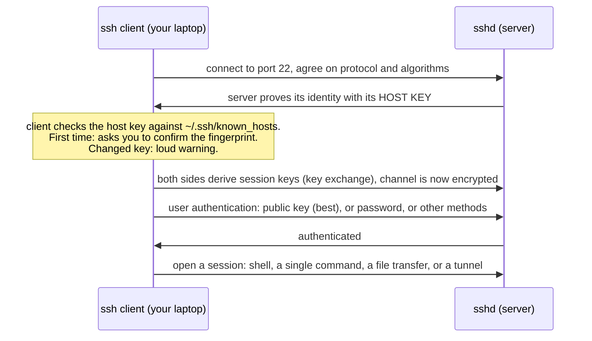

# 1.5 Working remotely: SSH keys, file transfer, tmux and editors

| Field | Value |
|---|---|
| Level | Basics to Intermediate |
| Priority tier | Tier 0 (foundations) |
| Lab venue | Two small Ubuntu VMs on GCP (`remote_ssh_rsync_lab.py`: 25 checks pass; VM commands **untested** here) |
| Part | Part 1: Linux, from the command line to the kernel and performance |

## Why this matters for AI infrastructure

You will almost never sit at the machines you manage. GPU servers live in data centres and clouds. You reach them through a bastion host, then a login node, and then a compute node, and you move checkpoints and datasets between them. Everything runs over **SSH**: interactive shells, file copies, port tunnels to Jupyter and TensorBoard, Ansible, Slurm launch scripts, Git over SSH, and the cluster managers behind them. Mistakes here are expensive in two directions. First, a broken or clumsy workflow wastes hours when dropped sessions kill a three-day training run or a file sync deletes the wrong directory. Second, weak SSH hygiene—such as shared keys, forwarded agents, or password logins—is how clusters get compromised. As Sergey Zhumatiy puts it in *Supercomputers for Linux SysAdmins*, the principle holds: *the less access, the better, yet users should not be clamped in a hedgehog's grip*. SSH combined with `scp`, `sftp`, and `rsync` is sufficient for nearly all normal operation. This chapter teaches SSH properly from the beginning, plus the tools that make remote work reliable: `rsync`, `tmux`, parallel shells, an editor you can survive in, and out-of-band access when the operating system is down.

## Prerequisites and outcomes

You need chapters 1.1 to 1.3 for processes, the shell, and files and permissions basics. After this chapter you will be able to:

- Explain how SSH works (host keys, authentication, an encrypted channel) and what the "host key changed" warning really means.
- Create and manage keys, copy a public key to a server, and configure `~/.ssh/config` with shortcuts, jump hosts, and connection sharing.
- Use SSH for remote commands, port forwarding (local, remote, dynamic), and file transfer, and choose between `scp`, `sftp`, `rsync`, and cloud-storage tools.
- Use `rsync` correctly, including the trailing-slash rule, dry runs, and `--bwlimit`.
- Keep sessions alive with `tmux`, and run commands on many nodes at once with `pdsh` or `clush`.
- Edit files on a server with `nano` or `vim`, and apply safe habits for editing production configuration.
- Explain what a BMC, IPMI, and serial-over-LAN are and when you need them.
- Diagnose common SSH failures (publickey denied, host key changed, timeouts, dropped sessions) in a systematic order.

> **Where the depth lives.** This chapter is the working core. The full SSH option references (client, server, `Match`, host-based authentication), `pdsh` and ClusterShell, screen and tmux key tables, and IPMI are in **chapter 1.29**; rsync's full option set, Samba, NFS, SSHFS, cloud storage and remote graphics (X11, VNC, x2go) are in **chapter 1.30**.

## 1. How SSH works

**SSH (Secure Shell)** is a protocol and a pair of programs: the **client** (`ssh`) on your machine and the **server** (`sshd`, the daemon) on the remote machine, listening by default on TCP port 22. It replaced older tools (`telnet`, `rsh`) that sent everything, including passwords, in plain text. SSH gives you three guarantees. The traffic is **encrypted**, the server is **authenticated** to you so you know you reached the right machine, and you are **authenticated** to the server so it knows who you are.

A connection goes through four stages.



Two separate key pairs are involved, and it is worth keeping them apart in your mind.

- **The server's host key.** Each server has its own long-lived key pair stored under `/etc/ssh/`, such as `ssh_host_ed25519_key`. The first time you connect, your client shows the server's **fingerprint** (a short hash of its public key) and asks whether to trust it. If you say yes, it records the key in `~/.ssh/known_hosts`, and on later connections it checks that the server presents the same key. This protects you from connecting to an impostor in a man-in-the-middle attack.
- **Your user key.** You generate a key pair. The **private key** stays secret on your machine, and the **public key** is placed on the server in `~/.ssh/authorized_keys` of the account you will log in to. To log in, the client proves it holds the private key by signing a challenge, and the server verifies the signature with the stored public key. No secret ever crosses the network, and there is nothing to guess or brute-force the way a password can be.

The "host key changed" warning (`WARNING: REMOTE HOST IDENTIFICATION HAS CHANGED`) therefore means that the server presenting itself under this name is not the one your client remembered. The usual harmless cause is that the machine was **rebuilt or reimaged** with new host keys, or a cloud VM's IP address was reassigned to a different VM. The dangerous cause is an attack. Verify out of band via the cloud console serial output or a fingerprint published by your platform team before you remove the old entry with `ssh-keygen -R hostname`.

## 2. Keys: create, install, protect

```bash
ssh-keygen -t ed25519 -C "alice@laptop-2026"       # create a key pair; choose a passphrase when asked
ls -l ~/.ssh                                        # id_ed25519 (private), id_ed25519.pub (public)
ssh-copy-id -i ~/.ssh/id_ed25519.pub alice@gpu01     # append the public key to the server's authorized_keys
ssh alice@gpu01                                      # now logs in with the key
ssh-keygen -lf ~/.ssh/id_ed25519.pub                # show the key's fingerprint
```

Notes that matter:

- **Algorithm.** **Ed25519** is the modern default: small, fast, strong. RSA with at least 3072 bits is still acceptable where Ed25519 is unsupported. Avoid DSA and short RSA keys.
- **Passphrase.** Protect the private key with a passphrase, so that a stolen laptop or copied file is not an instant breach. To avoid retyping it, use an **agent**.
- **Permissions are enforced.** `sshd` and `ssh` refuse keys with sloppy permissions. Your `~/.ssh` directory should be `700`, private keys and `authorized_keys` should be `600`, and your home directory must not be writable by group or others (`StrictModes`, enabled by default, checks this). A large share of "Permission denied (publickey)" tickets are simply wrong file modes.
- **One key per purpose.** Prefer a separate key per device or role (laptop, CI), so one can be revoked without breaking the others. Never copy a private key between machines casually, and never commit one to Git.
- **The agent.** `ssh-agent` is a small background process that holds your *decrypted* keys in memory so you type the passphrase once. Start it with `eval "$(ssh-agent -s)"`, and load your key with `ssh-add ~/.ssh/id_ed25519` or `ssh-add -t 3600` to expire after an hour. **Agent forwarding** (`ssh -A`, or `ForwardAgent yes`) lets a remote host use your local agent, which is convenient for hopping onward or pulling from a Git server. However, it also lets anyone with root on that remote host *use your identity* while you are connected. Forward the agent only to hosts you trust, or avoid it by using a jump host.
- **Server-side policy** (covered fully in chapter 1.21): in production disable password authentication (`PasswordAuthentication no`), forbid direct root login (`PermitRootLogin no`), and restrict who may log in. Large fleets increasingly use **SSH certificates** signed by a central certificate authority instead of distributing public keys everywhere, so access can be time-limited and centrally revoked.

## 3. Using SSH day to day

### Running commands, with or without a terminal

```bash
ssh gpu01                               # interactive shell
ssh gpu01 uptime                        # run one command and return
ssh gpu01 'nvidia-smi -L | wc -l'       # quote it so YOUR shell does not pipe locally
ssh -t gpu01 htop                       # -t forces a terminal, needed for interactive full-screen tools
ssh gpu01 'bash -s' < local_script.sh   # run a local script on the remote host
```

Two details trip people up. **Quoting:** the line you give `ssh` is expanded by your *local* shell first, then sent as text to the remote shell, which parses it *again*. Use single quotes around the remote command so local expansion does not happen unintentionally. **Environment:** `ssh host command` runs a *non-interactive* shell, which does not read `~/.bashrc` (chapter 1.2), so a command found in your interactive session may be "not found" this way. Use full paths or put the necessary `PATH` setting where non-interactive shells read it.

### The config file: `~/.ssh/config`

The configuration file turns long command lines into short names and encodes your access topology once:

```
# ~/.ssh/config
Host *
    ServerAliveInterval 30          # keepalive probe every 30 s so idle connections do not die
    ServerAliveCountMax 4
    IdentitiesOnly yes              # offer only the keys named here (avoids "too many authentication failures")

Host bastion
    HostName bastion.example.com
    User alice
    IdentityFile ~/.ssh/id_ed25519

Host gpu* login*
    User alice
    ProxyJump bastion               # reach these hosts through the bastion, transparently
    IdentityFile ~/.ssh/id_ed25519

Host gpu01
    HostName 10.20.0.11

Host *
    ControlMaster auto              # reuse one connection for many sessions (fast, fewer logins)
    ControlPath ~/.ssh/cm-%r@%h:%p
    ControlPersist 10m
```

With this, `ssh gpu01` means: connect to the bastion, jump to `10.20.0.11`, and log in as `alice` with the right key. **`ProxyJump`** (the `-J` command-line option: `ssh -J bastion gpu01`) is the clean way to traverse a bastion. The connection to the final host is end-to-end encrypted *through* the bastion, and your agent does not need to be exposed on it. `ControlMaster` and `ControlPersist` share one TCP connection across many `ssh`, `scp`, and `rsync` invocations, which makes repeated commands and tools like Ansible dramatically faster. The first matching value wins in the file, so put specific hosts before the catch-all `Host *`. `ssh -G hostname` prints the effective configuration, which is the first thing to check when a setting seems ignored.

### Port forwarding (tunnels)

An SSH connection can carry other TCP connections. This is how you reach a service that is not exposed to the network, without opening a firewall.

| Form | Meaning | Example |
|---|---|---|
| **Local forward** `-L` | listen on a port on **your** machine; traffic is delivered via the server to a destination | `ssh -L 6006:localhost:6006 gpu01` then open `http://localhost:6006` to reach TensorBoard on gpu01 |
| **Remote forward** `-R` | listen on a port on the **server**; traffic comes back to your side | `ssh -R 9000:localhost:8000 server` |
| **Dynamic forward** `-D` | your side runs a SOCKS proxy through the server | `ssh -D 1080 bastion`, then point a browser at the proxy |
| Flags `-N -f` | do not run a remote command; go to background | `ssh -N -f -L 8888:localhost:8888 gpu01` |

A typical use is a Jupyter or TensorBoard server started on a compute node, reached from the laptop with `ssh -L 8888:localhost:8888 gpu01` through the bastion automatically if you used `ProxyJump`. Remember that `-L` binds only to localhost on your machine by default, which is the safe setting; exposing the forwarded port to the whole network (`-L 0.0.0.0:...`) is rarely what you want. Kubernetes has its own equivalent, `kubectl port-forward`, covered in chapter 5.25. When forwarding graphical X11 applications over SSH (`ssh -X` or `ssh -Y`, covered in chapters 1.29 and 1.30), you must have the `xauth` program installed on both computers. Be careful when running remote `sudo` inside an X11-forwarded session. You need to pass your `XAUTHORITY` environment variable through `sudo`, which is the remote variable that `ssh` set after you logged in, so the privileged process can read your X11 authentication cookie.

### Debugging a connection

`ssh -v host` (up to `-vvv`) prints the negotiation step by step: which keys were offered, which authentication methods the server allows, and where it stopped. It is the single best tool for any login problem. On the server, the authentication log (`/var/log/auth.log` on Debian and Ubuntu, `/var/log/secure` on Red Hat family, or `journalctl -u ssh` / `-u sshd`) says *why* the server refused.

## 4. Copying files: `scp`, `sftp`, `rsync` and cloud tools

SSH includes two built-in file transfer protocols (`scp` and `sftp`), and pairs with `rsync` and ad-hoc HTTP or FUSE tools. Brian Ward's *How Linux Works* summarizes when to pick each tool.

| Goal / Scenario | Tool | Notes |
|---|---|---|
| Make a file or directory temporarily available to other machines on a trusted LAN | `python3 -m http.server` (formerly Python 2 `SimpleHTTPServer`) | Serves current directory over HTTP on port `8000`; zero setup |
| Quick one-off copy of a file or two over SSH | `scp src user@remote_host:dest` | Simple; recent OpenSSH runs `scp` over SFTP; not resumable |
| Interactive file browsing and transfer over SSH | `sftp host` | Supports `get`, `put`, `ls`, `cd` |
| **Distribute or synchronise directory trees regularly across machines** | **`rsync`** | Transfers only differences; preserves permissions; resumable |
| Stream a directory tree with no temporary archive file | `tar \| ssh` | `tar -cf - dir \| ssh host 'tar -xf - -C /dest'` (chapter 1.3) |
| Mount a remote directory over SSH with near-zero setup | `sshfs host:/path mnt` | FUSE user-space mount; convenient for editing, slow for heavy I/O |
| Regularly share files among Linux/Unix machines on a local network | **NFS** | Kernel network filesystem (`/etc/exports`, `mount -t nfs4`) |
| Share files with Windows machines on a local subnet | **Samba** (`smbd` / `nmbd`) | SMB/CIFS protocol (chapter 1.30) |
| Move large datasets and checkpoints to/from cloud object stores | `rclone`, `gcloud storage`, `aws s3` | Parallel multipart transfers to S3/GCS |

Notice why `scp -r` is less flexible than `rsync` when copying directories.

```bash
scp -r directory user@remote_host:dest_dir   # (untested here)
```

While `scp -r` gets a first-time copy done, after a second transfer the remote host may not have an exact copy of `directory`. If `directory` already exists on the remote host, `scp -r` places a *second* nested copy inside the existing directory (`dest_dir/directory/directory`) instead of updating it in place. It also copies every byte unconditionally even if nothing changed.

### `rsync` properly

`rsync` solves both problems: it compares source and destination and transfers only what changed, using SSH as the default transport. Learn this small core.

```bash
rsync -avh --progress data/ gpu01:/scratch/data/      # (untested here) archive mode, verbose, human sizes, progress
rsync -avhn --delete data/ gpu01:/scratch/data/       # (untested here) DRY RUN (-n): show what would happen, change nothing
rsync -avhP --partial big.tar gpu01:/scratch/         # (untested here) resume interrupted large transfers (-P = --partial --progress)
rsync -av --exclude '*.pyc' --exclude '.git/' src/ gpu01:/opt/src/ # (untested here)
rsync -az --bwlimit=10000 ckpt/ gpu01:/ckpt/          # (untested here) limit bandwidth to 10,000 KB/s (~10 MB/s), or --bwlimit=50m
rsync -aHAX / /mnt/newroot --exclude=/proc --exclude=/sys --exclude=/dev # (untested here) system-style copy: hard links, ACLs, xattrs
```

Key options include **`-a`** (archive: recursive, copies symlinks as symlinks, permissions, modification times, owner and group where allowed, and device nodes), `-v` verbose, and `-h` human-readable sizes. Always remember **`-n` / `--dry-run`** and **`--delete`**, which removes files in the destination that are not in the source to make the destination an exact mirror. Other key flags include `-z` to compress in transit, `-P` for partial resume and progress, `--exclude` and `--include`, `-c` to compare by checksum instead of size and time, and `-e "ssh -p 2222"` to use a custom SSH command.

**Limiting bandwidth (`--bwlimit`).** As *How Linux Works* (Section 12.2.7) warns, it is easy to clog the uplink of an internet or WAN connection when uploading a large dataset or checkpoint to a remote host. Even though you are not using your downlink capacity during an upload, saturating the uplink delays outgoing TCP `ACK` packets and makes your entire connection feel stalled. Passing `--bwlimit=10000` restricts `rsync` to `10,000 KB/s` (about `10 MB/s`; recent `rsync` versions also accept unit suffixes like `--bwlimit=50m`), leaving headroom for interactive traffic.

**The trailing slash rule.** This is the single most important `rsync` detail:

- `rsync -a src/ dest/` copies the **contents** of `src` into `dest`.
- `rsync -a src dest/` copies the directory **itself**, producing `dest/src/`.

Getting it wrong either nests a duplicate level or, with `--delete`, can delete things you meant to keep. Always run the command with **`-n` first**, read the list, and only then run it for real. After a transfer, verify when it matters: `rsync -avhn` again should show nothing to do, and large files can be checked with `sha256sum`.

### Network filesystems: an introduction

Instead of copying files, clusters usually *share* them, so that a user's home and project directories look the same on every node. The common technologies, in short:

- **NFS** (Network File System) is the standard Unix way to mount a remote directory as if local. A server lists exports (`/etc/exports`), clients mount them (`mount -t nfs4 server:/export /mnt`). Simple and ubiquitous, but a single server limits scale and metadata-heavy workloads (millions of small files) perform poorly. Its failure behaviour matters: if the server stops answering, processes accessing it can hang in uninterruptible sleep (state `D`, chapter 1.1).
- **Parallel filesystems** (Lustre, BeeGFS, GPFS and others) spread data over many servers for the bandwidth AI and HPC need; chapters 6.18 to 6.21 cover them.
- **SMB/CIFS (Samba)** is the Windows file-sharing protocol; relevant mostly for desktop integration, not for GPU clusters.
- **Object storage** (Google Cloud Storage, S3) is accessed through APIs and tools rather than mounted; the default home of datasets and checkpoints in the cloud.

Security on shared filesystems depends on identities matching across machines: files record numeric UIDs and GIDs, so the *same user must have the same UID on every node* (chapter 1.6, and the identity services in 6.24).

## 5. Sessions that survive: `tmux`

If your SSH connection drops (laptop sleep, Wi-Fi, a firewall idle timeout), every program started in that terminal receives a hangup signal and ends. For anything interactive and long (a build, a debugging session, a data conversion), run it inside a **terminal multiplexer**. **`tmux`** (older: `screen`) keeps sessions alive on the server independent of your connection; you reconnect and reattach.

```bash
tmux new -s train           # start a named session
#   ... run your commands ...
#   press Ctrl-b, then d    # DETACH: the session keeps running; you can close the terminal
tmux ls                     # list sessions
tmux attach -t train        # reattach later, possibly from a different laptop
tmux kill-session -t train  # end it
```

All tmux commands are keystrokes after the **prefix** `Ctrl-b`. Press `c` for a new window, `n` or `p` for the next or previous window, `%` to split into left and right panes, and `"` to split top and bottom. Use arrow keys to move between panes, `[` for scroll mode (`q` to leave), `d` to detach, and `?` to list all keys. A common layout for debugging is one pane running a job, one running `watch -n1 nvidia-smi`, and one for a shell.

Two cautions apply. First, tmux protects against *your connection* dropping, not against the *machine* rebooting or the job being preempted. For production batch work on a cluster, submit a batch job to the scheduler (`sbatch`, chapter 6.11) instead of leaving something running inside tmux on a login node. Login nodes are shared, and long CPU-heavy processes there are usually forbidden. Second, `nohup cmd &` and `disown` (chapter 1.8) are lighter alternatives for fire-and-forget background commands, but give you no way to reattach.

## 6. Running commands on many nodes

Clusters have hundreds of nodes, and "log in to each one and check" is not a plan. Here are the main options, from simplest to most capable.

```bash
for h in gpu01 gpu02 gpu03; do echo "== $h"; ssh "$h" 'uname -r; nvidia-smi -L | wc -l'; done   # a plain loop
pdsh -w gpu[01-16] 'nvidia-smi -L | wc -l' | dshbak -c        # pdsh: parallel ssh, dshbak groups identical output
clush -w gpu[01-16] -b 'uptime'                               # ClusterShell: -b gathers identical output together
srun -N16 --ntasks-per-node=1 hostname                        # inside a Slurm allocation, srun runs one task per node
ansible gpu -m shell -a 'uname -r'                            # Ansible ad hoc commands (chapter 4.3)
```

`pdsh` and `clush` accept the **node-range notation** `gpu[01-16]`, run commands in parallel, and collect identical outputs so a healthy fleet prints one line and an outlier stands out. Keep four cautions in mind. Output order is not deterministic, and each command is a separate SSH connection, so set up keys and `known_hosts` first. Watch quoting carefully, and remember that a destructive command run on 500 nodes at once fails 500 times at once. Rehearse on one node, then a few, then all. Ansible (Part 4) is the better tool when the operation must be repeatable and idempotent.

## 7. Editors: enough to survive anywhere

You will need to edit files on remote machines where you cannot install your favourite editor. Know one simple editor and the minimum of a powerful one.

**Which editor to learn.** To work seriously on Unix you must be able to edit text without damaging it. Nearly everything is configured through plain-text files, you will edit them constantly, and you need a capable tool. The two long-standing de facto standards are **`vi`** (today usually `vim`) and **Emacs**; people are religious about the choice, so ignore them and pick the one that matches how you work. If you want an editor that can do almost anything and has extensive online help (`Ctrl-h t` opens the built-in tutorial), and you do not mind extra typing, try Emacs. If speed is everything, give `vi` / `vim` a shot. It "plays" a bit like a video game, is installed on virtually every Unix system, and is the one you will find on a minimal server or emergency recovery shell. Two classic books cover them in depth. The first is *Learning the vi and Vim Editors*, 7th edition, by Arnold Robbins, Elbert Hannah, and Linda Lamb (O'Reilly, 2008). The second is *Learning GNU Emacs*, 3rd edition, by Debra Cameron, James Elliott, Marc Loy, Eric Raymond, and Bill Rosenblatt (O'Reilly, 2004). A friendlier editor such as `nano` is fine for occasional edits, but habits form around the first tool you use, so for daily administration invest in `vim` or Emacs. One more distinction: editors like `vim` run **inside the terminal** using the standard terminal interface, whereas GUI editors open their own window and are independent of the terminal (Emacs runs in either).

**`nano`**: shows its key commands at the bottom (`^O` write out, `^X` exit, `^W` search; `^` means Ctrl). It needs no explanation and is fine for quick edits.

**`vim`** (or `vi`, on every server): a **modal** editor, which confuses newcomers because keys mean different things in different modes (normal mode, insert mode, visual mode for selecting text, and command-line `:` mode). The survival kit (`HLW` Ch. 2 & `SCL` Table 7-9):

| Key | Does |
|---|---|
| (start) | you are in **normal mode**; keys are commands, not text |
| `i` | enter **insert mode** (type text); press `Esc` to return to normal mode |
| `v` | enter **visual mode** to select text and apply an action to the selection |
| `x` | delete the single character under the cursor (and copy it to the register) |
| `dd`, `yy`, `p` | delete (cut) a line, copy (yank) a line, paste after cursor |
| `u`, `Ctrl-r` | undo, redo |
| `/word` Enter, `?word` Enter, `n` | search forward (`/`) or backward (`?`), jump to next match (`n`) |
| `gg`, `G` | go to the first, last line |
| `:w` Enter | save; `:q` quit; `:wq` save and quit; `:q!` quit **without** saving |
| `:set number` | show line numbers |
| `:%s/old/new/g` | replace `old` with `new` across the whole file |

Set your default with `export EDITOR=vim` (or `nano`) in your shell startup file; tools like `git commit`, `crontab -e`, `visudo` and `kubectl edit` open `$EDITOR`.

**Safe editing of important files.** On a server, copy the file first (`cp -a file file.bak.$(date +%F)`), edit it, and review the change with `diff -u file.bak.* file`. Next, validate with the program's checker when it has one (`sshd -t`, `nginx -t`, `visudo -c`, `systemd-analyze verify`, `kubectl apply --dry-run=client`), and only then reload the service. Use **`sudoedit`** (or `sudo -e file`) instead of `sudo vim file`, which runs your whole editor as root. For editing the sudoers file always use `visudo`, which validates before saving (chapter 1.6).

**Working locally and running remotely.** Modern editors like VS Code with Remote-SSH and JetBrains Gateway run a small server component on the remote host over SSH and give you a local-quality interface, including a terminal and port forwarding. They depend on the same SSH configuration (`~/.ssh/config`) as the command line, which is another reason to invest in it. For notebooks, run Jupyter on the node and tunnel the port rather than exposing it.

## 8. Out-of-band access: when SSH is not available

If the operating system has crashed, the network configuration is broken, or a node will not boot, SSH cannot help. Servers have a separate management computer, the **BMC (baseboard management controller)**, with its own network port and IP address, that works even when the main system is powered off. Through it you can power-cycle the server, read hardware sensors and logs, update firmware, open a virtual keyboard-video-mouse (**iKVM**), and connect to the machine's **serial console** over the network (**serial-over-LAN, SOL**). The classic interface is **IPMI**; the modern one is **Redfish** (Part 7).

```bash
ipmitool -I lanplus -H bmc-gpu01 -U admin -E chassis power status        # -E reads the password from IPMI_PASSWORD
ipmitool -I lanplus -H bmc-gpu01 -U admin -E sol activate                # attach to the serial console (~. to leave)
ipmitool -I lanplus -H bmc-gpu01 -U admin -E chassis power cycle         # hard power cycle (be sure!)
```

Large clusters use console servers (for example `conman`) and cluster managers (BCM, chapter 8) to centralise this. Follow two rules for BMC security. First, the BMC network must be isolated and heavily protected because a compromised BMC compromises the machine below the operating system. Second, credentials must never appear on command lines where other users can see them in `ps`.

## 9. AI-infrastructure patterns

- **Cloud VMs.** On GCP, `gcloud compute ssh VM --zone ZONE` manages keys and, with IAP, tunnels through Google's proxy without a public IP (`--tunnel-through-iap`). Know what it writes to `~/.ssh` and use the same host entries in your config.
- **The standard HPC path:** laptop, then bastion, then Slurm login node, then (via `srun --pty bash` or `salloc`) a compute node. Do not ssh into compute nodes uninvited to run work: processes started outside Slurm are not tracked or limited by it (chapter 6.7). Many sites configure `pam_slurm_adopt` so SSH sessions to a node you hold are adopted into your job's cgroup.
- **Data movement:** `rsync` for code and small data over SSH; `rclone` or the cloud CLI for object storage; for tens of terabytes, parallel tools and the storage chapters (Part 13).
- **Interactive debugging:** `ssh -t node 'tmux new -A -s debug'` creates the session if absent or attaches if it exists (`-A`).
- **Never** put passwords, API keys or private keys on command lines, in shell history or in shared scripts. Use agents, environment from files with strict permissions, or secret managers (chapters 4.12 and 5.16).

## How it fails

### 1. `Permission denied (publickey)`
**Symptom:** the server refuses your key. **Causes, in the order to check:** wrong username, or the public key is not in the target account's `authorized_keys`. Other common causes are wrong permissions on `~/.ssh`, `authorized_keys`, or the home directory, or the client not offering the right key when many keys are loaded and `IdentitiesOnly` is missing. Finally, the server may disable public-key authentication, a cloud-metadata or OS Login service may overwrite `authorized_keys`, or the SELinux context on `~/.ssh` may be wrong (`restorecon -R ~/.ssh` on Red Hat family systems). **Diagnose:** `ssh -vvv user@host`, the server's auth log, `ls -ld ~ ~/.ssh ~/.ssh/authorized_keys`, and `sshd -T | grep -i -E "authorizedkeys|pubkey|password|permitroot"`. **Fix:** correct the cause; do not "fix" it by turning on passwords.

### 2. `WARNING: REMOTE HOST IDENTIFICATION HAS CHANGED`
**Symptom:** the client refuses to connect. **Cause:** the host key differs from `known_hosts`, because the node was reinstalled, the VM was recreated, an IP address was reused by another machine, or someone is intercepting traffic. **Fix:** confirm the change is legitimate through a trusted channel, then `ssh-keygen -R host` and reconnect, verifying the new fingerprint. For fleets, manage host keys deliberately (provision the same host key in the image, or publish them via SSH certificates or DNS) so this warning stays meaningful instead of being clicked through.

### 3. Hangs, timeouts and "Connection refused"
**Symptom:** the connection stalls or fails immediately. **Meaning:** *timeout* usually means packets are dropped by a firewall, security group, wrong IP, route, or downed host. By contrast, *connection refused* means the host answered, but nothing listens on that port because `sshd` is stopped or running on a different port. **Diagnose:** `ping`, `nc -vz host 22`, `traceroute`, check security groups and the host firewall, and the BMC console if the OS is unreachable. **Fix:** address the network or service layer found.

### 4. Sessions drop and kill your work
**Symptom:** "Broken pipe"; a long job started in the foreground dies with the connection. **Cause:** NAT or firewall idle timeouts, laptop sleep, Wi-Fi changes. **Fix:** `ServerAliveInterval` in the config to keep the connection alive; run long things in `tmux` (or `nohup`) and, for real work, in a scheduler job.

### 5. `rsync` mirrors the wrong thing: the trailing slash and `--delete`
**Symptom:** a nested duplicate directory, or files disappear from the destination. **Cause:** `src` versus `src/`, and `--delete` removing "extra" files. **Fix:** always dry-run first (`-n`), read the output, keep `--delete` out of habit, and use `--backup --backup-dir` or snapshots for anything valuable. Remember `--delete` makes the destination match the source; if the *source* is accidentally empty (an unmounted filesystem), it deletes the destination's contents.

### 6. Agent forwarding exposes you; keys leak
**Symptom:** unexplained logins using your identity; a key found in a Git history. **Cause:** `ForwardAgent` to a compromised or shared host; private keys copied around or committed. **Fix:** prefer `ProxyJump` over agent forwarding; short agent lifetimes (`ssh-add -t`); one key per device; rotate and revoke immediately on suspicion (remove from `authorized_keys`, or revoke the certificate); scan repositories for secrets.

### 7. Works in the terminal, fails over `ssh host command` or in automation
**Symptom:** `command not found`, or different behaviour in scripts. **Cause:** non-interactive shells skip `~/.bashrc`, so `PATH` and environment differ; no TTY for tools that need one (`-t`); host key prompts blocking an unattended run. **Fix:** full paths, set the environment explicitly, use `-t` when required, and pre-populate `known_hosts` (`ssh-keyscan -H host >> ~/.ssh/known_hosts`, verified out of band) instead of disabling checking.

## Hands-on lab: SSH, rsync, tmux, and VM drills

First, run the self-checking Python lab (`code/part01/remote_ssh_rsync_lab.py`) locally. It verifies OpenSSH `StrictModes` permission checks, the `rsync` trailing-slash rule (`src/` vs `src`), the `scp -r` existing-directory nesting pitfall, `-L`/`-R`/`-D` port forwarding, and `~/.ssh/config` first-match-wins precedence.

```bash
python3 code/part01/remote_ssh_rsync_lab.py
```

Next, on two GCP Ubuntu VMs (`vm1` and `vm2`; all interactive VM commands below are `untested here`), work through these steps:

**Part A: keys and config.**
1. On your laptop or `vm1`, create an Ed25519 key with a passphrase (untested here). Install the public key on `vm2` with `ssh-copy-id` or by pasting into `authorized_keys`. Log in with the key.
2. Add a `Host vm2` block to `~/.ssh/config` with `HostName`, `User`, `IdentityFile`, and `ServerAliveInterval` (untested here). Verify with `ssh -G vm2 | head -20`, then `ssh vm2 hostname`.
3. Start an agent, run `ssh-add -t 600` on the key, and confirm you are no longer asked for the passphrase (untested here).

**Part B: break it and fix it.**
4. On `vm2`, run `chmod 777 ~/.ssh; chmod 666 ~/.ssh/authorized_keys` (untested here). Try to log in, record the `ssh -vvv` and server log messages, and then fix the modes (`700`, `600`) and succeed.
5. Edit `~/.ssh/known_hosts` on the client to a wrong key for `vm2`, observe the warning, and fix it with `ssh-keygen -R` (untested here). Explain in your own words what each of the two failures protects against.

**Part C: jump hosts and tunnels.**
6. Treat `vm1` as the bastion and `vm2` as the internal host (untested here). Configure `ProxyJump` in `~/.ssh/config` and reach `vm2` from your laptop through `vm1`.
7. On `vm2` run `python3 -m http.server 8000 --bind 127.0.0.1` (untested here). From your laptop run `ssh -N -L 8000:localhost:8000 vm2` and open `http://localhost:8000`. Explain which connection travels where, and confirm with `ss -ltnp` on both ends.
8. Run `ssh -v vm2 true` twice with `ControlMaster auto` and `ControlPersist` set (untested here). Compare the time (`time ssh vm2 true`), and use `ssh -O check vm2` and `ssh -O exit vm2`.

**Part D: file transfer.**
9. Create a directory with 50 small files and one 200 MB file (`dd if=/dev/urandom of=big bs=1M count=200`) (untested here). Copy it with `scp -r`, then with `rsync -avhP`. Re-run `rsync` and note it transfers nothing. Modify one small file and re-run; observe only that file moves.
10. Demonstrate the trailing slash rule: run `rsync -avhn src dest/` and `rsync -avhn src/ dest/` and compare the listed paths (untested here). Then add `--delete` with `-n` and see what it *would* remove. Interrupt a large copy with Ctrl-C and resume with `--partial`.

**Part E: tmux and parallel commands.**
11. Start `tmux new -s lab`, run `top`, detach with `Ctrl-b d`, disconnect your SSH session entirely, reconnect, and reattach (untested here). Split panes and run `watch -n1 date` in one.
12. Install `pdsh` or `clustershell` (`sudo apt-get install -y clustershell`) and run a command on both VMs in parallel with gathered output (untested here). Run a command that prints a different value on each (`hostname`) and see how the output is grouped.

**Part F: editors and safe edits.**
13. Open a file in `vim` without using a mouse: insert text, search, delete a line, undo, save, and quit (untested here). Practise `:q!`. Then do the safe-edit routine on a copy of `/etc/ssh/sshd_config`: backup, change `PasswordAuthentication no`, `diff -u`, and validate with `sudo sshd -t -f yourcopy`.

**Part G: BMC concepts (read-only).**
14. In the GCP console, find the serial console for a VM and enable it; connect and see the boot messages (untested here). Compare with what IPMI SOL gives on bare metal, and note which problems only a serial console or BMC can help with.

## Exercises

1. **OpenSSH `StrictModes` Permission Validation:** State whether `sshd` and `ssh` accept or reject public-key authentication under each permission set. Check: (a) `~` = `0750`, `~/.ssh` = `0700`, `authorized_keys` = `0600`, and `id_ed25519` = `0600`. Then check: (b) `~/.ssh` = `0777` and `authorized_keys` = `0666`, (c) `~` = `0777` (world-writable home directory), and (d) `id_ed25519` = `0644` (world-readable private key). Verify with `validate_ssh_strict_modes()` in `code/part01/remote_ssh_rsync.py`.
2. **`rsync` Trailing-Slash Rule versus `scp -r` Nesting:** Suppose directory `data` contains `["a.pt", "b.pt"]` and `/scratch/data` already exists on `gpu01`. What exact destination file paths are written by: (a) `rsync -a data/ gpu01:/scratch/data`, (b) `rsync -a data gpu01:/scratch/data`, and (c) `scp -r data gpu01:/scratch/data`?
3. **SSH Port Forwarding (`-L`, `-R`, `-D`):** For each tunnel command, identify which host opens the listening TCP socket, which port it listens on, and where traffic is forwarded: (a) `ssh -L 6006:localhost:6006 gpu01`, (b) `ssh -R 9000:localhost:8000 bastion`, and (c) `ssh -D 1080 bastion`.
4. **`~/.ssh/config` First-Match-Wins Precedence:** Given an `~/.ssh/config` file with three stanzas in order—`Host gpu01` (`HostName 10.20.0.11`, `User alice`), `Host gpu* login*` (`User clusterdefault`, `ProxyJump bastion`), and `Host *` (`ServerAliveInterval 30`, `User fallback`)—what effective `User`, `HostName`, `ProxyJump`, and `ServerAliveInterval` values apply to `ssh gpu01` versus `ssh gpu02`?
5. **Bandwidth Limiting (`--bwlimit`) and Safe Mirroring (`-avhn --delete`):** (a) Why does saturating an asymmetric network uplink with an unthrottled upload slow down concurrent downloads on the same link, and what rate (in `MB/s`) does `rsync -az --bwlimit=10000` enforce? (b) Why must you always run `rsync -avhn --delete` before `rsync -avh --delete`?
6. **Out-of-Band IPMI Serial-over-LAN (`SOL`) and Safe Config Editing:** First, write the `ipmitool` command using `IPMI_PASSWORD` (`-E`) and `lanplus` to attach to `bmc-gpu01`'s serial console, and state the two-character escape sequence to disconnect. Second, write the 5-step safe-edit workflow (`cp -a`, `sudoedit`, `diff -u`, `sshd -t`, reload) for modifying `/etc/ssh/sshd_config`.

## Checkpoint questions (20)

<details>
<summary>1. What three security guarantees does SSH provide, and which keys participate in each?</summary>

First, SSH authenticates the server to the client using the server's **host key** (`/etc/ssh/ssh_host_*_key`, verified against `~/.ssh/known_hosts`). Second, it encrypts and protects the channel using ephemeral **session keys** negotiated during key exchange. Third, it authenticates the user to the server using your **user key pair** (`~/.ssh/id_ed25519` and `~/.ssh/authorized_keys`) or certificate.
</details>

<details>
<summary>2. What is the difference between the server's host key and your personal user key pair?</summary>

The server's host key identifies the machine (`sshd`) and stays in `/etc/ssh/` on the server while clients record its public key in `~/.ssh/known_hosts`. Your user key pair identifies you: the private key stays encrypted on your client laptop and the public key is appended to `~/.ssh/authorized_keys` on the servers you log into.
</details>

<details>
<summary>3. What does `WARNING: REMOTE HOST IDENTIFICATION HAS CHANGED!` mean, when is it benign, and how do you handle it safely?</summary>

The server at that hostname or IP presented a host public key that differs from the entry in `~/.ssh/known_hosts`. It is benign when a node was reimaged or a cloud IP was reassigned, and dangerous when an attacker is intercepting the connection (MITM). Verify the new fingerprint out of band (via BMC/cloud console) before running `ssh-keygen -R hostname`.
</details>

<details>
<summary>4. What permission modes do `sshd` (`StrictModes`) and `ssh` require on `~`, `~/.ssh`, `~/.ssh/authorized_keys`, and `~/.ssh/id_ed25519`?</summary>

Your home directory `~` must not be writable by group or others (`0750` or `0755`), and `~/.ssh` must be `0700`. In addition, `~/.ssh/authorized_keys` must be `0600` (with no group or world write), and your private key `~/.ssh/id_ed25519` must be `0600` or `0400`.
</details>

<details>
<summary>5. Why is `ProxyJump` (`ssh -J bastion gpu01`) safer than `ForwardAgent yes` (`ssh -A bastion`) for reaching internal cluster nodes?</summary>

With `ForwardAgent yes`, the bastion host receives a Unix domain socket connected to your local `ssh-agent`, allowing anyone with `root` on the bastion to sign authentication challenges as you. `ProxyJump` tunnels an end-to-end encrypted SSH connection *through* the bastion from your client directly to `gpu01` without ever exposing your agent on the bastion.
</details>

<details>
<summary>6. How does `~/.ssh/config` resolve conflicting settings across multiple matching `Host` blocks, and how do you inspect the result?</summary>

OpenSSH uses a **first-match-wins** rule for each parameter: the first matching `Host` block that sets an option locks in that value, so specific host stanzas (`Host gpu01`) must appear *above* wildcard stanzas (`Host gpu*`, `Host *`). Run `ssh -G gpu01` to print the effective configuration.
</details>

<details>
<summary>7. What do `ControlMaster auto`, `ControlPath`, and `ControlPersist 10m` do in `~/.ssh/config`?</summary>

They multiplex multiple SSH, `scp`, and `rsync` sessions to the same host over a single already-authenticated TCP connection kept alive in the background for 10 minutes, eliminating repeated TCP/SSH handshakes.
</details>

<details>
<summary>8. Explain `ssh -L 6006:localhost:6006 gpu01` versus `ssh -R 9000:localhost:8000 server` and `ssh -D 1080 bastion`.</summary>

`-L 6006:localhost:6006 gpu01` listens on TCP port `6006` on your **local client** and forwards traffic through `gpu01` to `localhost:6006` on `gpu01`. `-R 9000:localhost:8000 server` listens on port `9000` on the **remote server** and forwards traffic back to `localhost:8000` on your client. `-D 1080 bastion` runs a local SOCKS proxy on port `1080` that routes traffic dynamically through `bastion`.
</details>

<details>
<summary>9. When using X11 forwarding (`ssh -X`), what utility must be installed, and what happens if you run `sudo` on the remote host?</summary>

Both hosts need `xauth` to manage the `MIT-MAGIC-COOKIE-1` display token. If you invoke `sudo` on the remote host to run a graphical tool, you must preserve or pass the `XAUTHORITY` environment variable that `ssh` set at login so the root process can read your X11 cookie.
</details>

<details>
<summary>10. Why does `scp -r dir host:/dest` behave differently on the first run versus the second run when `/dest` already exists?</summary>

If `/dest` does not exist on the remote host, `scp -r dir host:/dest` creates `/dest` with `dir`'s contents. If `/dest` already exists, `scp -r` places a nested subdirectory inside it (`/dest/dir`), and unlike `rsync` it re-copies every file unconditionally.
</details>

<details>
<summary>11. Explain the `rsync` trailing-slash rule (`rsync -a src/ dest/` vs `rsync -a src dest/`) and why `-n` (`--dry-run`) is mandatory with `--delete`.</summary>

`rsync -a src/ dest/` copies the *contents* of `src` directly into `dest/`, whereas `rsync -a src dest/` copies the directory itself to create `dest/src/...`. Because `--delete` removes any file in `dest/` not present in the source, a wrong slash or an unmounted empty source directory can wipe out `dest/` unless you preview with `-n` first.
</details>

<details>
<summary>12. Why can an unthrottled `rsync` upload stall your downloads on the same link, and how does `--bwlimit=10000` help?</summary>

Saturating the outbound uplink queues outgoing TCP `ACK` packets needed by your incoming downloads, causing TCP senders on the other end to stall. Passing `--bwlimit=10000` caps the upload at `10,000 KB/s` (`~10 MB/s`), keeping uplink queue latency low.
</details>

<details>
<summary>13. What happens to a foreground training script when your SSH session drops, and how does `tmux` prevent it?</summary>

When an SSH session disconnects, the kernel sends `SIGHUP` (hangup) to the session's foreground process group, terminating the job. `tmux` runs a persistent server daemon on the remote machine that owns the pseudo-terminals; detaching (`Ctrl-b d`) or losing SSH leaves the `tmux` session running so you can `tmux attach` later.
</details>

<details>
<summary>14. Why should long multi-hour jobs on a Slurm cluster be submitted with `sbatch` rather than left inside `tmux` on a login node?</summary>

Login nodes are shared entry points with limited CPU/RAM and no dedicated GPUs, and `tmux` does not survive a login-node reboot or enforce cgroup isolation. `sbatch` schedules the job onto dedicated compute nodes under Slurm accounting and resource limits.
</details>

<details>
<summary>15. How do `pdsh` (`dshbak -c`) and ClusterShell (`clush -b`) simplify checking 100 GPU nodes at once?</summary>

Both tools execute an SSH command across a hostlist range (`gpu[01-100]`) in parallel and **coalesce identical outputs** into a single grouped block (`gpu[01-99]: 8`), making the one outlier node (`gpu100: 7`) immediately visible.
</details>

<details>
<summary>16. In `vim`, what are the four primary modes, and what do `i`, `Esc`, `x`, `dd`, `yy`, `p`, `u`, `:wq`, and `:q!` do?</summary>

The modes are normal, insert (`i`), visual (`v`), and command-line (`:`). `Esc` returns to normal mode, `x` deletes the character under the cursor, `dd` cuts the current line, `yy` yanks (copies) the line, and `p` pastes. Finally, `u` undoes the last change, `:wq` saves and quits, and `:q!` quits immediately without saving changes.
</details>

<details>
<summary>17. Why should you use `sudoedit` (`sudo -e`) instead of `sudo vim`, and why `visudo` for `/etc/sudoers`?</summary>

`sudoedit` copies the protected file to a temporary file owned by you and runs your editor as your unprivileged user (preventing editor plugins or shell escapes from running as root), then copies the result back. `visudo` locks `/etc/sudoers` and validates its syntax before saving so a typo cannot lock everyone out of `sudo`.
</details>

<details>
<summary>18. What is the difference between a TCP connection timeout and `Connection refused` when running `ssh host`?</summary>

A timeout means SYN packets were silently dropped along the path (by a firewall, cloud security group, routing black hole, or powered-off host). `Connection refused` (TCP `RST`) means the packets reached the host IP, but no process is listening on TCP port 22 (`sshd` is stopped or listening on a different port).
</details>

<details>
<summary>19. What is a BMC, and how does `ipmitool -I lanplus -H bmc-gpu01 -U admin -E sol activate` rescue an unbootable GPU server?</summary>

A Baseboard Management Controller (BMC) is an independent microcontroller on the server motherboard with its own network interface and standby power. `sol activate` connects over encrypted RMCP+ (`lanplus`, reading `IPMI_PASSWORD` via `-E`) to the host's serial console (`ttyS0`/`ttyS1`), letting you see BIOS, GRUB, and kernel panic output even when the OS network stack is dead.
</details>

<details>
<summary>20. List the five checks to run in order when troubleshooting `Permission denied (publickey)`.</summary>

First, verify the target username (`user@host`). Second, run `ssh -vvv user@host` to see which key files were offered and whether `IdentitiesOnly` blocked the key. Third, verify the public key line exists in `~/.ssh/authorized_keys` on the server. Fourth, check `StrictModes` permissions on `~`, `~/.ssh` (`700`), and `authorized_keys` (`600`). Fifth, inspect `/var/log/auth.log` or `/var/log/secure` and SELinux labels (`restorecon -R ~/.ssh`).
</details>

## Sources and review notes

- **Sources read in full:**
  - `how-linux-works-3rd-edition` — Brian Ward, *How Linux Works*, 3rd ed., **Chapter 2: Basic Commands and Directory Hierarchy** and **Chapter 12: Network File Transfer and Sharing**. Read Chapter 2 section 2.12 ("Text Editors": `vi`/`vim` vs Emacs, Robbins et al. *Learning the vi and Vim Editors* 7th ed., and Cameron et al. *Learning GNU Emacs* 3rd ed.) in full. Read Chapter 12 sections 12.1–12.8 in full (`python3 -m http.server`, `scp -r` nested directory caveat, `rsync -a` and the trailing-slash rule, `--exclude`, `-n`, `-c`, `-z`, `--bwlimit=10000` uplink ACK starvation, `sshfs`, `NFS`, and Samba overview).
  - `supercomputers-for-linux-sysadmins-managing-modern-hpc-clusters-and-supercomputers-from-software-to` — Sergey Zhumatiy, *Supercomputers for Linux SysAdmins*, **Chapter 7: UNIX and Linux – the Basics**, **Chapter 10: Remote Management**, and **Chapter 18: Remote User Access**. Read Table 7-9 (`vi` normal/visual mode commands) and Chapter 10 in full (OpenSSH protocol, keys, `ssh-agent`, environment/port/X11 forwarding with `xauth` and `XAUTHORITY` under `sudo`, `pdsh`, ClusterShell `clush`, `screen` and `tmux`, IPMI `ipmitool lanplus`, `conman`, `iKVM`). Read Chapter 18 in full ("hedgehog's grip" access principle, SSH/SCP/SFTP vs FTP, and remote X11/VNC/RDP/X2Go).
- **Run here:** `python3 code/part01/remote_ssh_rsync_lab.py` (25 passed, 0 failed).
- **Explicitly labelled inferences:** GCP IAP tunneling (`gcloud compute ssh --tunnel-through-iap`) and Slurm `pam_slurm_adopt` cgroup adoption connect the SSH workflow to cloud and Part 6 Slurm operations (chapters 6.7 and 6.25).
- **Not verified on live hardware:** All interactive two-VM and BMC commands (`ssh-keygen`, `ssh-copy-id`, `rsync`, `tmux`, `pdsh`, `clush`, `ipmitool`) are marked (untested here) and should be executed on Linux VMs.
