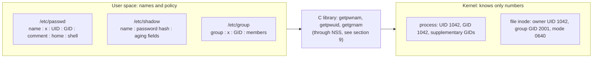
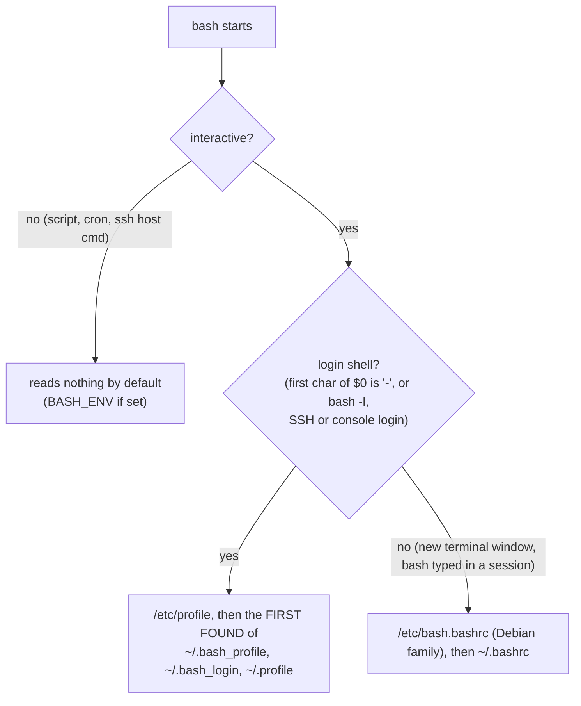

# 1.6 Users, groups, permissions, ACLs, sudo and user environments

| Field | Value |
|---|---|
| Level | Basics to Intermediate |
| Priority tier | Tier 0 (foundations) |
| Lab venue | Small Ubuntu VM on GCP (`users_permissions_lab.py`: 25 checks pass; VM commands **untested** here) |
| Part | Part 1: Linux, from the command line to the kernel and performance |

## Why this matters for AI infrastructure

Almost every "it works for me but not for the job" problem on a shared cluster is an identity or permission problem. A training job cannot read a dataset, or a checkpoint directory rejects writes from a teammate. Files owned by `root` appear in your project after a container run, a Slurm job fails because a user has a different UID on two nodes, a `sudo` rule locks an administrator out, or a login node freezes under one user's fork bomb. This chapter explains how Linux decides *who you are* and *what you may do*, from the numeric IDs the kernel uses up to the policy files an administrator edits, and how those ideas stretch across hundreds of cluster nodes. It also covers the user environment and shell startup files, which decide what every new shell and job starts with.

## Prerequisites and outcomes

You need chapters 1.1 to 1.3 for processes and system calls, the shell, and files and inodes. After this chapter you will be able to:

- Explain that the kernel knows only numeric user and group IDs, and describe where names, passwords, and group membership live (`/etc/passwd`, `/etc/shadow`, `/etc/group`) and how programs look them up.
- Read any `ls -l` mode, set permissions symbolically and in octal, and explain precisely what read, write, and execute mean for files and for directories.
- Use `umask`, the setuid, setgid, and sticky bits, and build a safe shared project directory.
- Use ACLs when classic permissions are too coarse.
- Explain real, effective, and saved user IDs, and why setuid programs are both necessary and dangerous.
- Create, modify, lock, and delete users and groups safely, and avoid the classic `usermod` mistake.
- Use `sudo` correctly, read and write `sudoers` safely, and know why not to work in a root shell.
- Design shell startup files that are simple and portable, and know which file is read when.
- Keep identities consistent across a cluster using pull-based `rsync` synchronization (`/usr/sbin/master-sync`), NIS/NIS+, or LDAP/SSSD, and restrict access when needed.
- Diagnose seven common identity and permission failures.

## 1. Users and groups: names for numbers

To the **kernel**, a user is a number: the **user ID (UID)**. Files record the UID of their owner; processes carry a UID that says on whose behalf they run. Names such as `alice` do not exist in the kernel; they are conveniences in user space. Likewise a **group** is a number, the **group ID (GID)**, and groups exist mainly to share file access among several users. The only UID with special meaning to the kernel is **0**, the superuser, conventionally called `root`; everything else, including the pseudo-users described below, is policy in user space.

This is the most important fact in the chapter, because it explains many cluster failures later: **when two machines disagree about which number belongs to `alice`, they disagree about who owns every file she created.** Names are labels; numbers are identity.

Where do the names come from? They live in a small set of plain-text configuration files inside `/etc`, normally consulted through the C library. As Brian Ward notes in *How Linux Works* (Section 7.2, on the structure of `/etc`), the basic guideline for `/etc` is that customizable configurations for a single machine—such as user account tables (`/etc/passwd`) and network details (`/etc/network`)—belong in `/etc`, whereas general application assets do not. For many years the trend has been to organize service configurations into subdirectories under `/etc`, such as `/etc/systemd` or `/etc/ssh`; if you run `ls -F /etc`, you will see a mix of classic top-level files and `/`-suffixed subdirectories.



### `/etc/passwd`: the user table

Each line describes one user as seven colon-separated fields:

```
alice:x:1042:1042:Alice Example,Room 12:/home/alice:/bin/bash
```

| Field | Meaning |
|---|---|
| `alice` | the login name |
| `x` | historically the password hash; now a marker meaning "the hash is in `/etc/shadow`". An asterisk `*` means this account cannot log in with a password. An **empty** field means *no password is required*, which you should never see. |
| `1042` | the UID |
| `1042` | the GID of the user's **primary group** |
| `Alice Example,...` | the "GECOS" comment: real name, sometimes room and phone, separated by commas |
| `/home/alice` | the home directory |
| `/bin/bash` | the login shell (must be listed in `/etc/shells` for `chsh` to accept it) |

The file is plain text with strict syntax: no comments, no blank lines. An **account**, in common usage, is a passwd entry plus a home directory, but that is only a convention: programs recognise a user from the passwd entry alone, and users may also come from a network directory service without any local line at all (section 9). UIDs should be unique; two entries with the same UID make both names the same person as far as the kernel is concerned, which is confusing at best.

**Special users.** `root` is UID 0 and GID 0. A number of **pseudo-users** exist so that services can run without root's power: `daemon`, `www-data`, `postgres`, `munge`, `slurm` and so on. They normally cannot log in (their shell is `/usr/sbin/nologin` or `/bin/false`, or their password field is `*`), but the system starts processes under their UIDs, which limits what a compromised service can do. The traditional `nobody` user (UID 65534 on Debian and Ubuntu, with group `nogroup`; the number differs on some distributions) owns nothing and is used for deliberately unprivileged processes. Remember: none of these have special meaning to the kernel. If you made `nobody` the owner of everything, it would not be unprivileged any more. By convention, UIDs below 1000 (the exact minimum is set in `/etc/login.defs`, as `UID_MIN`) are for system accounts and 1000 and above for people, though some older distributions used 500.

### `/etc/shadow`: passwords and aging

The shadow file holds authentication data and is readable only by root (and the `shadow` group), so that ordinary users cannot grab hashes and try to crack them offline. It has nine fields: the name, the **password hash**, and several aging fields (date of last change, minimum and maximum age, warning period, inactivity period, account expiry).

```
alice:$y$j9T$salt$hash...:20380:0:99999:7:::
```

The hash is a one-way transformation of the password, with a random salt, stored with a prefix that names the algorithm (`$6$` is SHA-512 crypt; `$y$` is yescrypt, the default on current Debian and Ubuntu; `$5$` SHA-256). A leading `!` or `*` in the field means the password is locked or unset, so password login is impossible (key-based SSH may still work). Use the tools, not an editor, to change these files: `passwd`, `chage`, `usermod`, `useradd`. If you must edit the files by hand (corruption, recovery), use **`vipw`** for `/etc/passwd` and **`vipw -s`** for `/etc/shadow`, which lock the file and keep a backup so that a concurrent change cannot corrupt it.

### `/etc/group`: the group table

```
projx:x:2001:alice,bob
```

Fields include the group name, a password marker (where `x` means the entry is in `/etc/gshadow`, nearly always a locked `!` or `*`), the GID, and a **comma-separated list of members**. A user belongs to a group if their passwd entry names it as the primary group (GID) *or* they are listed in the group's member list as a **supplementary** group. `id` shows both, and `groups` lists the names.

```bash
id                # uid=1042(alice) gid=1042(alice) groups=1042(alice),2001(projx),27(sudo)
groups alice      # the same, names only
getent group projx  # query through the C library, including network sources (section 9)
```

Many distributions create a **user-private group** for each new user, with the same name and number as the user (`alice` has primary group `alice`). That sounds odd, but it makes sharing safe by default: files are group-owned by a group containing only you, so a permissive group-write bit does not expose them to anyone else. It is also the reason the default `umask` on such systems can be `002` (section 3).

## 2. Managing users and groups

The rule: use the tools. They update several files consistently, create the home directory from a template, and handle locking.

```bash
sudo useradd -m -s /bin/bash -c "Alice Example" alice      # create user with a home directory (-m)
sudo useradd -r -s /usr/sbin/nologin -d /var/lib/svc svc   # a system (-r) account for a service
sudo passwd alice                                          # set or change the password
sudo groupadd -g 2001 projx                                # create a group, with an explicit GID
sudo usermod -aG projx alice                               # ADD alice to a supplementary group (see warning)
sudo usermod -L alice ; sudo usermod -U alice              # lock / unlock the password
sudo chage -l alice                                        # show password aging; chage -E 0 expires the account
sudo userdel -r alice                                      # delete the user and the home directory
id alice ; getent passwd alice                             # verify
```

On Debian and Ubuntu, `adduser` and `addgroup` are friendlier front ends, while `useradd` is the portable low-level tool.

:::warning The classic `usermod` mistake
`usermod -G projx alice` **replaces** alice's supplementary groups with only `projx`, silently removing her from `sudo`, `docker` and the rest. You almost always want **`-aG`** (`-a` = append). Group membership is also only read at **login**. After adding someone to a group, their existing sessions do not see it; they must log in again or run `newgrp projx` or `su - alice` in a test.
:::

Day-to-day account changes users can make themselves: `passwd` changes your password, `chsh` changes your login shell (it must be listed in `/etc/shells`), and `chfn` changes the comment. These programs must modify root-owned files, which they can do because they are **setuid-root** executables (section 5). On passwords: length beats cleverness. A long, memorable phrase of 16 or more characters is better than short strings of symbols. For servers, prefer key-based SSH and disable password login (chapters 1.5 and 1.21).

**Locking and restricting accounts.** Preventing someone from using a system is an escalation to use sparingly, such as for a serious policy violation or a departed employee, so know the options and their limits.

- `usermod -L` locks the password, though SSH keys may still work.
- Set the shell to `/usr/sbin/nologin` or `/bin/false` (`chsh -s`; the shell must be in `/etc/shells`). Every command, including `ssh host command`, runs through the shell, so this blocks interactive and remote command use. In some configurations it can still be bypassed by port forwarding, and it does not stop file transfer if an SFTP server is allowed. A special restricted shell (`scponly`) allows only `scp` and `sftp`.
- In `sshd_config`, `DenyUsers user1 user2` blocks named users, and `AllowUsers ...` (or `AllowGroups`) permits only the listed ones, which is useful during maintenance to admit only administrators. Reload `sshd` afterwards; sessions that are already open continue. `sshd_config(5)` evaluates them in the order `DenyUsers`, `AllowUsers`, `DenyGroups`, `AllowGroups`, though the simplest policy is a single allow-list (chapter 1.29).
- **`pam_access`**: add `account required pam_access.so` to the PAM chain for `sshd` and write rules in `/etc/security/access.conf` (`permission : users-or-groups : origins`). For example, `+:@admins:ALL` followed by `-:ALL:ALL` allows only the admins group. Rules are evaluated top to bottom; put the allow rule for administrators first so you do not lock yourself out.
- For compute resources on a cluster, the **scheduler** is the real gate: remove the user's associations or set limits in Slurm (chapter 6.9).

Always keep a second administrator session open when testing lock-down changes.

## 3. File permissions: read, write, execute

Every file and directory has an owner (UID), a group (GID) and a **mode**: a set of permission bits. `ls -l` shows the mode as ten characters:

```
-rw-r-----  1 alice projx 7041 Oct 23 19:34 endnotes.html
dr-xr-sr-x  2 root  projx 4096 Oct 23 19:34 shared
 ^^^ ^^^ ^^^
 |   |   +-- other: everyone else
 |   +------ group: members of the file's group
 +---------- user (owner)
```

The first character is the file type (chapter 1.3). The remaining nine are three triples, for **user (u)**, **group (g)** and **other (o)**, each some combination of `r` (read), `w` (write), `x` (execute) and `-` (not granted). The kernel decides access by checking **in this order and stopping at the first match**. If your effective UID is the file's owner, the *user* triple applies. Otherwise, if your effective GID or one of your supplementary groups is the file's group, the *group* triple applies; otherwise the *other* triple applies. Note the consequence: the checks are **not cumulative**. If the owner's triple is `---` and the group's is `rwx`, the owner is still *denied* because the owner matches first. And `root` (UID 0) bypasses nearly all of these checks via capabilities (chapter 1.21).

### What the bits mean: files versus directories

| Bit | On a regular file | On a directory |
|---|---|---|
| `r` read | read the contents | **list the names** in the directory (`ls`) |
| `w` write | modify the contents (not delete the file) | **create, delete and rename entries** in the directory (requires `x` as well) |
| `x` execute | run it as a program (a script also needs `r`) | **traverse**: access an entry by name (`cd` into it, open `dir/file`) |

These directory rules explain many puzzles. To read `/data/project/file` you need `x` on `/`, `data` and `project` *and* `r` on `file`. `r` on a directory without `x` lets you see names but not open them. **Deleting a file needs `w` on the *directory*, not on the file itself**, which is why a read-only file can still be removed from a writable directory (and why the sticky bit exists, below). A common mistake when using absolute modes on directories is to drop the `x` bit by accident and lock everyone out.

### Changing permissions: `chmod`, `chown`, `chgrp`

**Symbolic mode** edits specific bits: choose who (`u`, `g`, `o`, or `a` for all), an operator (`+` add, `-` remove, `=` set exactly), and the permissions.

```bash
chmod u+x script.sh            # make it executable for the owner
chmod go+r file ; chmod go-r file   # give/remove read for group and other
chmod g=rw,o= file             # group read-write, others nothing
chmod -R u+rwX,go+rX dir       # capital X: add execute only to directories (and files already executable)
```

**Absolute (octal) mode** sets all bits at once. Each triple is a number: read = 4, write = 2, execute = 1, added together; so `rw-` is 6, `r-x` is 5, `rwx` is 7.

| Mode | Meaning | Typical use |
|---|---|---|
| `644` | owner read/write; group, other read | ordinary files |
| `600` | owner read/write; nobody else | private files, SSH private keys |
| `755` | owner all; group, other read and execute | programs, directories |
| `700` | owner all; nobody else | private directories (`~/.ssh`) |
| `711` | owner all; others execute only | directories others may pass through but not list |
| `664` / `775` | like 644 / 755 with group write | shared project files / directories |
| `777` | everyone everything | almost never correct |

**Do not "fix" permission problems with `chmod -R 777`.** It removes the protection on every file, usually does not address the real cause (wrong owner, group or a missing directory `x`), and makes executable what should not be. Find the actual mismatch with `namei -l /full/path/to/file`, which prints the owner and mode of every component along the path, and `id` for your identity.

**Ownership.** `chown alice file` changes the owner (root only); `chown alice:projx file` changes both; `chgrp projx file` changes the group (the owner may change a file's group to one they belong to). `-R` recurses. `stat file` shows the owner, group and mode in full.

### `umask`: default permissions for new files

New files start from **666** (read-write for all, because new regular files are not executable by default) and new directories from **777**; the **umask** is a mask of bits to *remove*. With the common `umask 022`, a new file gets `666 - 022 = 644` and a new directory `755`. With `umask 077` they get `600` and `700` (private). With `umask 002` (group-writable) files get `664` and directories `775`. Arithmetically, it is a bit mask rather than subtraction, but the result is the same for normal masks.

```bash
umask                # show the current mask, for example 0022
umask 077            # make new files private in this shell
umask -S             # symbolic form
```

Which to choose: **077** is the most restrictive and suits a multi-user machine where you do not want others reading your files; it also makes sharing harder, which tempts inexperienced users into making things world-writable. **022** lets others read what you create, appropriate for a single-user system and for daemons that run as pseudo-users and must read your files. **002** is for collaborative group directories on systems with user-private groups. The mask is per-process and inherited, so set it in a startup file (section 7) to apply to every shell; some programs (mail clients, `ssh-keygen`, key stores) deliberately override it to be private.

### The special bits: setuid, setgid, sticky

Three extra mode bits appear in a fourth, leading octal digit (`4000`, `2000`, `1000`) and show up as `s` or `t` in the `ls -l` triples:

| Bit | On an executable file | On a directory |
|---|---|---|
| **setuid** (`u+s`, 4000) | the program runs with the **file owner's** identity (as its *effective* UID) instead of the invoker's: the mode shows `s` in the owner's execute slot (`-rwsr-xr-x`) | ignored on Linux |
| **setgid** (`g+s`, 2000) | runs with the file's **group** | **new files and subdirectories inherit the directory's group** (instead of the creator's primary group); shows `s` in the group slot |
| **sticky** (`+t`, 1000) | ignored on Linux | **only the owner of a file (or of the directory, or root) may delete or rename entries**, even if others have write permission on the directory; shows `t` in the other's execute slot |

Familiar examples: `/usr/bin/passwd` and `/usr/bin/sudo` are setuid-root so that ordinary users can change `/etc/shadow` through a vetted program; `/tmp` is `1777` (`drwxrwxrwt`) so that everyone can create files but cannot delete each other's. Setuid has no effect on interpreted scripts on Linux (the kernel honours it only for real executables), for security reasons.

### A recipe: a safe shared project directory

A team (`projx`, GID 2001) needs a directory on a shared filesystem where all members read and write each other's files, and outsiders have no access:

```bash
sudo groupadd -g 2001 projx
sudo usermod -aG projx alice ; sudo usermod -aG projx bob      # members log in again to pick this up
sudo mkdir -p /data/projx
sudo chown root:projx /data/projx
sudo chmod 2770 /data/projx          # setgid so new files inherit group projx; group rwx; others none
# members use umask 002 so files they create are group-writable (set it in their startup file)
```

With `2770` and `umask 002`, anything created in the directory is group-owned by `projx` and group-writable, with no extra steps. If you cannot control users' umasks, ACL default entries (next section) enforce the permissions on the directory side.

## 4. Access control lists (ACLs)

Classic permissions have one owner, one group and "everyone else". Real teams need rules like "alice and bob may read and write, carol may only read, everyone else nothing", which would otherwise force you to create a special group for every combination. **POSIX ACLs** extend the model by adding lists of extra users and groups with their own permissions on a file or directory. They are supported by the common Linux filesystems (ext4 and XFS support them by default, others when mounted with the `acl` option) and by NFSv4 in its own form; **not every network or parallel filesystem supports them**, so check before relying on them.

```bash
setfacl -m u:alice:rw,u:bob:rw mydir          # (untested here) grant specific users (-m modifies)
setfacl -m u:user1:rw,u:user2:rw,u:user3:rw mydir # (untested here) grant three writers (SCL Ch. 12 example)
setfacl -m u:reader1:r,u:reader2:r,u:reader3:r mydir # (untested here) grant three read-only users
setfacl -m g:readers:r mydir                  # (untested here) grant a group
chmod o-rwx mydir                             # (untested here) classic bits: remove access for everyone else
getfacl mydir                                 # (untested here) view the ACL
setfacl -d -m g:projx:rwx /data/projx         # (untested here) DEFAULT ACL (-d): applied to new files created inside
setfacl -R -m u:carol:rX /data/projx          # (untested here) recurse (capital X = execute only for dirs)
setfacl -b mydir                              # (untested here) remove all ACL entries
ls -l mydir                                   # (untested here) a '+' sign at the end of permissions means an ACL is set
```

If ACLs are set on a directory or file, `ls -l` adds a `+` sign at the end of the ten-character permission string, and you inspect the full rule list with `getfacl`. Two ideas are essential when working with ACLs. First, an ACL has a **mask** entry that caps the *effective* permission of every named user, every named group, and the owning group. Running `chmod g=...` on a file with an ACL **modifies the mask**, not the owning group's bits, so a file may look group-writable in `ls -l` while being restricted by a mask of `r--`; `getfacl` prints `#effective:` annotations whenever the mask reduces an entry's rights. Second, **default ACLs** (`setfacl -d`) on a directory assign an initial ACL to every new file and subdirectory created inside it, enforcing team sharing rules regardless of an individual user's `umask`.

## 5. Process identity, setuid and `sudo`

### How a process gets its identity, and how it changes

Every process runs with a UID and GID (plus supplementary groups). Where do they come from? `login`, `sshd` or the display manager authenticates a user, then starts their shell with the user's IDs; every process the shell creates inherits them (chapter 1.1). Changing identity later means changing these numbers, and the kernel allows it only by strict rules:

1. A process may run a **setuid executable** if it has permission to execute the file; the program starts with the file owner's UID as its effective UID.
2. A process running as root (UID 0) may call the `setuid()` family of system calls to become *any* user.
3. A process not running as root can use `setuid()` only in very limited ways (basically, to switch among IDs it already holds).

Utilities such as `su` and `sudo` combine these rules: they are setuid-root programs, so they start with root's power, and then call `setuid()` to become the target user (or stay root). **User switching has nothing to do with passwords at the kernel level**: authentication (passwords, keys, tokens) is a user-space ceremony performed *before* the program changes IDs.

### Real, effective, saved (and filesystem) IDs

Because setuid programs must be able to act as another user and *then* give that power back, a process carries more than one user ID:

| ID | Purpose |
|---|---|
| **effective UID (euid)** | the identity used for permission checks, notably on files; this is the "actor" |
| **real UID (ruid)** | who actually *started* the process; it determines who may send it signals and kill it; the "owner" |
| **saved UID** | a stored ID the process can switch its euid back to later |
| **filesystem UID (fsuid)** | used for filesystem access checks; rarely distinct (used by some file-serving programs) |

When you run a setuid program, the euid becomes the file owner's, while the ruid remains yours. `ps` normally shows only the effective user; to see both, `ps -eo pid,euser,ruser,comm`. In practice, `sudo` and similar programs set *all* the IDs to the target user on purpose (this avoids odd side effects when the IDs differ), which is why a process you started with `sudo` can often only be killed with `sudo` too. A sudoers option (`Defaults stay_setuid`) changes this; leave it alone unless you understand the consequences.

### Why setuid is dangerous: security implications

The security implications of `setuid` are severe. Every setuid-root program is a place where an ordinary user's input crosses into root's authority, so two things must be controlled: **how many such programs exist and what they do.** A copy of a shell with the setuid-root bit set gives any local user a root shell. A bug in a legitimate setuid program is a privilege-escalation vulnerability, and exploiting those is a primary way systems are broken into. Audit periodically: `find / -xdev -perm -4000 -type f 2>/dev/null`. Also limit the ability to create setuid files: mount user-writable filesystems (home directories, `/tmp`, container volumes) with the `nosuid` option. For the same reason, containers should not run with extra capabilities and should drop setuid binaries (chapters 5.1 and 18.3).

### Identification, authentication, authorization

Three words are worth keeping distinct. **Identification** answers *who are you?* (a username, ultimately a UID). **Authentication** answers *prove it* (a password, an SSH key, a token, a smart card). **Authorization** answers *what may you do?* (file permissions, `sudo` rules, scheduler limits). The kernel does **identification by number** and **authorization for files and processes**; it knows nothing about authentication. Everything about passwords and tokens is user space. A program wanting its own username calls `geteuid()` for the number, then asks the C library to map it to a name (`getpwuid()`), and the library decides where to look, which is configurable (section 8.5). This indirection is what lets a site move from local files to a network directory without changing any program. The same limits of the old "just read `/etc/passwd`" approach—one fixed hashing method, always prompting, and no support for tokens or smart cards—are why **PAM**, the Pluggable Authentication Modules framework, was created (chapter 1.21).

### `sudo`: administrative power with a trail

You will need root occasionally. The disciplined way is **`sudo`**: run a single command as another user (by default root), after authenticating *as yourself*, with a log entry. A root shell (`su -`, `sudo -i`) has costs: no record of which commands were run or by whom, no access to your normal environment, and for `su`, a shared root password. Use `sudo command` for individual commands, and `sudo -i` or `sudo -s` for a root shell only when you really need a sequence, knowing the logging is coarser.

```bash
sudo systemctl restart slurmd           # one command as root
sudo -u slurm scontrol show config      # run as another user
sudo -l                                 # what am I allowed to run?
sudo -k                                 # forget cached credentials
sudoedit /etc/ssh/sshd_config           # edit a root file with YOUR editor (see chapter 1.5)
echo "x" | sudo tee /root/file          # NOT: sudo echo x > /root/file (the redirection is done by YOUR shell)
```

**Configuration.** `sudo` reads `/etc/sudoers` and every file in `/etc/sudoers.d/` (names must not contain a dot or end in `~`; mode `0440`). **Always edit with `visudo`** (`visudo -f /etc/sudoers.d/aiteam`), which locks the file and checks syntax before saving. A syntax error in sudoers can disable `sudo` entirely, so keep a root shell open while changing it. The rule format is:

```
who   where = (run-as-user:run-as-group)   [NOPASSWD:]  commands
```

```
# /etc/sudoers.d/gpu-admins
User_Alias  GPUADMINS = alice, bob
Cmnd_Alias  GPUCMDS   = /usr/bin/nvidia-smi, /usr/bin/systemctl restart nvidia-persistenced
GPUADMINS   ALL = (root) NOPASSWD: GPUCMDS      # these users may run only these commands as root, no password
%sre        ALL = (ALL:ALL) ALL                   # members of group "sre": any command as anyone, password required
Defaults    secure_path="/usr/local/sbin:/usr/local/bin:/usr/sbin:/usr/bin:/sbin:/bin"
Defaults    logfile="/var/log/sudo.log"
```

Reading it: the first `ALL` is "any host" (useful when one file serves many machines), `(root)` names whom you may become, `NOPASSWD:` skips the password prompt, and the last field is the allowed commands. `ALL` for commands means everything. The original example from the book style, `ADMINS ALL = NOPASSWD: ALL`, grants a group of users unrestricted root without a password. That is convenient and **dangerous**; prefer the narrowest command list that works, and require passwords or hardware-token confirmation for broad rights. Prefer a **group** (`%sudo` on Debian and Ubuntu, `%wheel` on Red Hat family) over naming individuals, so access is managed by group membership.

**Logging.** `sudo` records each use through syslog (the auth facility): on systemd systems `journalctl SYSLOG_IDENTIFIER=sudo`, and on others `/var/log/auth.log` or `/var/log/secure`. Ship these to central logging; they are your audit trail (chapter 17.3). Note that `sudo` resets the environment (`env_reset`) and uses `secure_path`, so a variable or `PATH` you exported does not reach the command unless allowed (`sudo -E`, or `env_keep`/`env VAR=value cmd`). That is why `CUDA_VISIBLE_DEVICES` set in your shell can vanish under `sudo`.

## 6. Shell startup files: the user environment

When a shell starts it reads configuration files that set its defaults: the command path, prompt, aliases, `umask`, and editor. These are the **startup files** (also called dot files, since they start with `.`). Follow the core guidelines for creating startup files: keep them simple, short, and heavily commented, because over time they accumulate clutter that causes confusing problems across subshells and batch jobs.

### Which file is read when (bash)

As chapter 1.2 introduced, it depends on the kind of shell instance:



Two practical facts govern `bash` startup files. First, **login shells do not read `~/.bashrc`**, and non-login shells do not read `~/.bash_profile`. The standard solution is to keep your settings in `~/.bashrc` and make `~/.bash_profile` (or `~/.profile`) source it, either as a symlink or a one-liner (`[ -f ~/.bashrc ] && . ~/.bashrc`), which is what the default files on Ubuntu do. Second, you can test which kind of shell you are in: `echo $0` (a leading `-` means login), and inside a startup file `case $- in *i*)` tests for an interactive shell (`$-` contains `i`) so that commands that print output or need a terminal do not run for scripts.

**Why are there two kinds?** The split dates from when people logged in on a plain terminal and then started sub-shells inside a window system or `screen`. Doing the heavy setup (path, environment variables, programs that start agents) once in the login shell, and keeping only lightweight things such as aliases in `~/.bashrc` for the sub-shells, avoided repeating work. Today most desktop users log in through a graphical display manager, which usually starts one login shell for the session so the old model still holds. Where it does not, your terminal windows never see the environment set in `~/.bash_profile`, and you have to set the whole environment in `~/.bashrc` instead. Because console and SSH logins are login shells that skip `~/.bashrc`, you still need the `~/.bash_profile` that sources it, which is why the pair described above is the robust arrangement. A mismatch between the two is behind most reports of "my environment is missing in the terminal" or "in SSH".

`tcsh` is simpler: it does not distinguish login from non-login shells and reads `~/.tcshrc`, or `~/.cshrc` if that is absent (stick with `~/.cshrc`; it also works for the older `csh`). It is rarely used today, but a new-user template should include a minimal file in case someone meets it. An equivalent starting point uses `setenv` and a different prompt syntax:

```csh
# ~/.cshrc  (the C shell family; note setenv and set prompt instead of export and PS1)
setenv PATH $HOME/bin:/usr/local/bin:/usr/bin:/bin
setenv EDITOR vi
setenv VISUAL vi
setenv PAGER less
setenv LESS meiX
umask 022
# %n user, %m host, %/ current directory, %h history number, %l terminal
set prompt="%m%% "
```

`zsh` uses `~/.zshenv` (read for every shell), `~/.zprofile` (login), `~/.zshrc` (interactive) and `~/.zlogin`.

### What belongs in a startup file

- **The command path.** Include, in this order: `/usr/local/bin`, `/usr/bin`, `/bin` (so that local versions override system ones), then, for administrators, `/usr/local/sbin`, `/usr/sbin`, `/sbin`. A personal `$HOME/bin` or `$HOME/.local/bin` (a newer convention) goes at the front. Do not alter the path for every new installation directory; a symlink in `/usr/local/bin` is cleaner.
- **Never put `.` (the current directory) in `PATH`.** At the front it lets a malicious file named `ls` in any directory you visit run instead of the real one. Even at the end, it invites typo attacks (`sl`, `ks`), and it makes commands behave differently depending on where you are.
- **`MANPATH`.** Do not set it; doing so overrides the system defaults.
- **The prompt** (`PS1`). Keep it short and useful, and avoid characters meaningful to the shell (`{ } = & < >`; a `>` in a prompt that you copy and paste can create stray files by redirecting output). `PS1='\u@\h:\w\$ '` shows user, short hostname, working directory, and `$` for a normal user or `#` for root. Other escapes: `\W` last path component only, `\!` history number, `\s` shell name.
- **Aliases.** Convenient, but they have drawbacks: they are awkward with arguments, hard to trace to where they were defined, and are not inherited by subshells and scripts. The classic mistake is aliasing a standard command with extra options (`alias ls='ls -F'`), which changes behaviour users do not expect. Prefer a **shell function** or a small script; use aliases only for shortcuts. To change the *environment* of the current shell, you need a function or `source`d file, since a script runs in a subshell and cannot alter your variables.
- **`umask`** (`022` or `077`, section 3), `EDITOR`, `VISUAL`, `PAGER` (`less`), and `LESS` options. Remember to `export` environment variables.

### An example `~/.bashrc`

```bash
# ~/.bashrc : keep it small and commented
# Command path: personal bin first, then system defaults
PATH="$HOME/.local/bin:$HOME/bin:/usr/local/bin:/usr/bin:/bin"
# Prompt: user, host, directory
PS1='\u@\h:\w\$ '
# Default programs
export EDITOR=vim VISUAL=vim PAGER=less LESS='-FRX'
# New files readable by others; use 077 on shared machines if you prefer privacy
umask 022
# Interactive-only settings
case $- in *i*)
    alias ll='ls -lah'
    ;;
esac
export PATH
```

### Defaults for new users and cluster-wide defaults

New home directories are populated from the skeleton directory **`/etc/skel`**: files placed there appear in every new user's home. System-wide shell settings live in **`/etc/profile`** and, on most distributions, drop-in files in **`/etc/profile.d/*.sh`**, which is where site policy such as module environments (chapter 6.6) or proxy variables belong. The recommended way to develop defaults is to create a **test user** with an empty home directory, write the startup files from scratch, log in as that user in every way users will (console, SSH, a Slurm job, a container), and only then distribute. The default shell for new users should be **bash**: it is the shell they will also script in, it supports `readline` editing, and it gives clear control of redirection. The default editor should be something guaranteed to exist (`vi`), and distributions often choose `nano` for beginners.

### Startup-file pitfalls and further startup topics

- Do not put graphical commands in shell startup files (further startup topics such as desktop display managers use `.xsession` and `.xinitrc` instead). Do not set `DISPLAY` or the terminal type, do not run commands that **print output** (they break `scp`, `rsync` and `sftp` over SSH, which expect a clean stream), and do not hide errors silently.
- **Never set `LD_LIBRARY_PATH` globally in a startup file**: it changes which shared libraries every program loads and breaks unrelated software (and security-sensitive programs ignore it). Use wrapper scripts, the `module` system, or proper `RPATH` settings (chapter 1.11).
- Comment generously; a startup file you cannot understand next year is a liability.

## 7. Limits and quotas (an introduction)

Permissions say *whether* you may do something; **limits** say *how much*. Two mechanisms matter on shared systems, and both are developed in later chapters.

- **Per-process resource limits (`ulimit`).** `ulimit -a` shows the limits on file size, open files, locked memory, stack size, CPU time, processes, and more. Sensible defaults protect shared login nodes. Limit the number of processes per user to 50 to 100 to stop a **fork bomb**, which is a program that spawns itself repeatedly until the machine stops responding. Also consider a CPU-time limit on login nodes, though too small a limit makes large `scp` or `sftp` transfers fail because the transfer's CPU time counts. Compute nodes need *higher* limits for **open files** (each SSH connection or socket is a file descriptor) and **locked memory** (`ulimit -l`, because RDMA memory registration needs pinned memory, and a small default causes InfiniBand failures). Limits are set in `/etc/security/limits.conf` and `/etc/security/limits.d/*.conf` (applied by `pam_limits`), or per service in systemd unit files (`LimitNOFILE=`, `LimitMEMLOCK=`) and cgroups (chapter 1.18). Kernel-wide ceilings exist too (`fs.file-max`), and a per-process limit above the kernel ceiling has no effect. The stack-size limit matters for OpenMP programs (chapter 1.8).
- **Disk quotas.** Filesystems can enforce **soft** and **hard** limits on space (blocks) and on the number of files (inodes) per user or group. A soft limit may be exceeded for a **grace period**, after which it behaves as hard, while a hard limit stops allocation immediately so writes fail with an error. Enable quotas by mounting with `usrquota` and `grpquota`, create the accounting data with `quotacheck`, and switch it on with `quotaon`. Manage quotas with `edquota`, `setquota`, and `repquota` (`setquota -p alice -u bob` copies a template). NFS exports can be quota-enforced on the server via the `rpc.rquotad` service, while ZFS, Btrfs, XFS (project quotas), and Lustre have their own tools (chapters 1.12 and 6.19).

## 8. Identity in a cluster: keeping the numbers consistent (`SCL` Chapter 11)

On a single Linux server, local `/etc/passwd`, `/etc/shadow`, and `/etc/group` files are all you need. In a supercomputer or GPU cluster, account management becomes an immediate architectural challenge: you must ensure account synchronization between all nodes. You can achieve this either by querying a single central data source over the network—such as **LDAP** or **NIS+**—or by running periodic (or event-driven) synchronization of static information.

### 8.1 What must match everywhere and what must differ by node role

Why is account synchronization non-negotiable on a cluster? Shared filesystems (`NFS`, `Lustre`, `WEKA`) and workload managers (`Slurm` and `munge`, chapter 6.7) transmit **numeric UIDs and GIDs**, not usernames. If `alice` is UID `1042` on the login node and UID `1043` on `gpu05`, her training job on `gpu05` cannot read her own files on the shared home directory, and `munge` credential validation rejects her job steps.

In most clusters, keeping the core identity fields (`uid`, `gid`, supplementary groups, home directory, and login shell) synchronized across all nodes is sufficient. However, as Sergey Zhumatiy warns in *Supercomputers for Linux SysAdmins* (Chapter 11), you must think through two subtleties in advance:

1. **Quotas, `ulimit` resource caps, and access limits are stored separately from basic credentials and often *must* differ by node role.** For example, CPU time (`ulimit -t`) should *never* be limited on a compute node where training jobs run for days, whereas on the login or head node a CPU-time limit is essential to stop users from running heavy computations interactively.
2. **Service nodes still need user account records even when user login is forbidden.** Interactive user access to a backup server or storage gateway is undesirable (`DenyUsers` or `/usr/sbin/nologin`), yet the backup server *must* still receive the synchronized `/etc/passwd` and `/etc/group` tables so that backup tools (`tar`, `rsync`, `Bacula`) preserve the right numeric owners and group names.

### 8.2 The classic file-synchronization approach and the pull-based `/usr/sbin/master-sync` design

Historically, Linux systems store accounts in `/etc/passwd`, `/etc/shadow`, and `/etc/group`. Maintaining an identical copy of those three files on every node in a cluster has clear trade-offs compared with network directory servers:

- **Why the classic file approach excels at job launch (Pros):**
  1. **Zero network lookup "storm" when a large job starts:** When a user launches a distributed job across hundreds of compute nodes simultaneously, every node resolves `uid` and `gid` from its local disk or page cache in microseconds without hammering a central server.
  2. **Minimal lookup latency:** Obtaining user accounting information takes a local file read rather than a network round trip.
  3. **No network authentication single point of failure:** A temporary directory-server hiccup cannot block logins or job steps across the cluster.
- **Where naive file copying fails (Cons):**
  1. **Silent desynchronization on failed syncs or replaced nodes:** If a node is powered off during a push update, or if a dead compute node is swapped out for a spare, that node comes up with missing or stale user records—causing hard-to-diagnose job failures whenever the scheduler places a task on it.
  2. **Network shock loads:** Firing hundreds of simultaneous `scp` processes from the master node creates a sudden burst of network and SSH load.
  3. **Repeated copying during bulk user changes:** Running a push script after each of 50 `useradd` commands copies the account files 50 times across the fleet.
  4. **Lower schema flexibility** than a full database directory.

How do we eliminate both bottlenecks—desynchronization on rebooted/replaced nodes and network shock loads? Zhumatiy's key design rule is: **initiate the copy on the destination compute node (pull), not on the master node (push).**

Put the synchronization commands in a dedicated script on every node—called `/usr/sbin/master-sync`—and configure the node to run `/usr/sbin/master-sync` automatically **at OS startup** (for example via an init script or systemd service), while also allowing the master node to trigger it remotely over SSH when needed:

```bash
#!/usr/bin/env bash
# /usr/sbin/master-sync (runs on each destination node at boot and on demand; untested here)
SYNC="rsync -e 'ssh -i /root/secret_key'"
SRC_ADDR=root@master.cluster
$SYNC $SRC_ADDR:/etc/passwd /etc/passwd
$SYNC $SRC_ADDR:/etc/shadow /etc/shadow
$SYNC $SRC_ADDR:/etc/group /etc/group
```

Examine what each line of `/usr/sbin/master-sync` does:
1. `SYNC="rsync -e 'ssh -i /root/secret_key'"` defines the `rsync` command using an SSH transport authenticated by a dedicated key (`/root/secret_key`) restricted on the master to reading the account files.
2. `SRC_ADDR=root@master.cluster` points to the authoritative master copy on the head node.
3. The three `$SYNC` lines pull `/etc/passwd`, `/etc/shadow`, and `/etc/group` onto the local node. Because `/usr/sbin/master-sync` runs automatically whenever a node boots, a compute node that was offline for maintenance or freshly imaged heals its own user table before accepting any jobs.

What about when the administrator adds or removes a batch of users on the running cluster? Rather than triggering a sync inside every single `useradd` wrapper, finish all credential edits first and then invoke one fleet-wide refresh command. To prevent overloading the management network, stagger the remote calls by `0.1` to `0.5` seconds (or run them in bounded pools via `pdsh` or `clush`), and wrap the loop in a self-signaling `ALRM` timeout trap so a hung node cannot stall the script forever:

```bash
#!/usr/bin/env bash
# Fleet-wide trigger script run on the master node after account changes (untested here)
TIMEOUT=600
CT=3
# Exit the script cleanly if the overall ALRM watchdog timer fires
trap 'exit' ALRM
# Schedule an ALRM signal to this script's PID ($$) after 600 seconds
(sleep $TIMEOUT && kill -ALRM "$$") &
# Trigger /usr/sbin/master-sync on each node listed in /etc/nodes with a 0.1s stagger
for i in $(grep -v \# /etc/nodes); do
    ssh -o connecttimeout=$CT $i /usr/sbin/master-sync
    echo -n .
    sleep 0.1
done
echo
```

In this script, `CT=3` (`-o connecttimeout=3`) bounds each individual SSH connection attempt to 3 seconds, `sleep 0.1` spaces node pulls by 100 milliseconds (`10` seconds total for a `100`-node cluster), and `(sleep $TIMEOUT && kill -ALRM "$$") &` guarantees that the entire run terminates after at most `600` seconds (`10` minutes).

### 8.3 NIS and NIS+: why the commands start with `yp` and why 30–40 clients is the ceiling

**NIS** (*Network Information System*) was created by Sun Microsystems in **1985** to distribute configuration tables that must stay identical across a network—such as `/etc/passwd`, `/etc/group`, and `/etc/hosts`. Sun originally named the system **Yellow Pages**, until British Telecom, which owned the *Yellow Pages* trademark, sued. Sun renamed the product to NIS, but every daemon, command, and configuration file kept the `yp` prefix (`ypserv`, `yppasswdd`, `ypxfrd`, `ypbind`, `/var/yp`, `/etc/yp.conf`).

The original NIS protocol had fundamental security flaws, so Sun introduced a replacement called **NIS+** (*NIS plus*). Despite sharing program names and similar configuration concepts, **NIS and NIS+ are protocol-incompatible**: an NIS client cannot talk to an NIS+ server, nor an NIS+ client to an NIS server.

Even NIS+ is rarely used on modern large clusters for two reasons: its security model remains weak compared to modern Kerberos/TLS directories, and its RPC architecture hits a reliability and performance wall once a single server serves more than **30 to 40 clients**. Nevertheless, because NIS+ is simple to administer and supports master/slave server redundancy, you may still encounter it on smaller legacy clusters.

Setting up an NIS+ environment follows an 8-step sequence across the server and clients:

1. **Enable the three server daemons at boot:**
   - `ypserv`: the primary NIS+ lookup server daemon.
   - `yppasswdd`: the daemon that processes user password updates.
   - `ypxfrd`: the map-transfer daemon that synchronizes databases to secondary (slave) NIS+ servers.
2. **Open the firewall ports** for `rpcbind` / `portmap`, `ypserv`, `yppasswdd`, and `ypxfrd`.
3. **Define the NIS+ domain name** (which is completely independent of your DNS domain name) in `ypserv`'s startup options and write it into `/etc/defaultdomain` on every client.
4. **Create `/etc/ypserv.conf` and `/etc/sysconfig/ypserv`** on the server, pointing to the map source directory (normally `/var/yp`) and defining client subnet access rules.
5. **Configure `/var/yp/Makefile` and `/var/yp/securenets`:** the `Makefile` compiles text files (`passwd`, `shadow`, `group`) into network database maps whenever the administrator runs `make` inside `/var/yp`, and `securenets` specifies the IP network segments permitted to query the server.
6. **Configure `/etc/defaultdomain` and `/etc/yp.conf`** on every client (including the management node itself) with the NIS+ domain name and server addresses.
7. **Start the `ypbind` service** on all clients.
8. **Add `nis+` to `/etc/nsswitch.conf`** on the `passwd`, `shadow`, and `group` lines so the C library queries NIS+. Whenever you add a user or change a password on the master server, `cd /var/yp && make` publishes the update; larger sites deploy slave servers via `ypxfrd` to spread the RPC load.

### 8.4 LDAP, explosive job-launch storms, and SSSD caching

**LDAP** (*Lightweight Directory Access Protocol*) provides a universal, schema-driven directory database for organizations, users, hosts, and access policies. Unlike NIS+, which merely distributes lines from flat text files, LDAP stores structured database records that can hold attributes, cross-record links, binary data, and fine-grained per-record access control lists. Commercial and open-source implementations include **OpenLDAP**, Microsoft **Active Directory** (an LDAP server with Kerberos and Microsoft schema extensions), **Fedora Directory Server** (389 Directory Server / FreeIPA), the **Apache Directory Project**, and **Mandriva Directory Server**. On Red Hat family distributions, client setup has traditionally been automated with `authconfig` (or `authselect` on newer releases), and administrators manage directory trees through web UIs such as `phpLDAPadmin` or `LDAP Account Manager`.

Why does a naive LDAP deployment fail on a large supercomputer or GPU cluster? An office network generates steady, uniform LDAP queries as employees log in over the course of a morning. A compute cluster generates **explosive burst access**: the exact millisecond Slurm or Kubernetes launches a 500-node job, all 500 compute nodes simultaneously query the LDAP server for the submitting user's UID, GID, and group list. Under that synchronized connection storm, a standalone LDAP server exhausts its worker threads and drops requests, causing job launch to fail across the nodes whose lookups were discarded.

To survive cluster job-start bursts, LDAP must be paired with either a hierarchy of replica/caching LDAP servers or node-local daemon caching via **SSSD** (*System Security Services Daemon*), covered in depth in chapter 6.24.

| Approach | How It Works | Strengths on a Cluster | Failure Mode & Scaling Limit |
|---|---|---|---|
| **Pull-based file sync (`/usr/sbin/master-sync`)** | Each node pulls `/etc/passwd`, `/etc/shadow`, `/etc/group` via `rsync` over SSH at boot and on staggered master triggers (`0.1–0.5s`) | Zero network lookup storm at job launch; microsecond local reads; no central daemon SPOF; self-heals on node reboot/replacement | Requires disciplined trigger script (`ALRM` timeout wrapper) after bulk account edits |
| **NIS / NIS+ (`ypserv`, `yppasswdd`, `ypxfrd`, `ypbind`)** | Sun's 1985 *Yellow Pages* (`yp`); admin edits source files and runs `make` in `/var/yp` | Simple text-to-map workflow; supports slave servers via `ypxfrd` | Weak security; NIS and NIS+ are incompatible; single server struggles above **30–40 clients** due to RPC load |
| **LDAP (`OpenLDAP`, Active Directory, FreeIPA)** | Schema-typed directory database queried via NSS/PAM (with `SSSD` caching) | Rich attributes, fine-grained access control, integrates with web/enterprise SSO (`phpLDAPadmin`, `LDAP Account Manager`) | **Explosive job-launch lookup storm** drops requests unless protected by local `SSSD` caching or replica hierarchy |

### 8.5 How a program finds a user: the Name Service Switch (NSS)

Programs never open `/etc/passwd` directly; they call C library functions (`getpwnam`, `getpwuid`, `getgrnam`), which consult the **Name Service Switch (NSS)** configured in `/etc/nsswitch.conf`:

```
passwd:   files systemd sss
group:    files systemd sss
hosts:    files dns
```

Read left to right: first the local files (`/etc/passwd`, `/etc/group`), then `systemd` (for dynamic service users), and then `sss` (`SSSD` for LDAP/Active Directory, or `nis+` on NIS+ systems). That is why `getent passwd alice` is the authoritative test on any node: it queries the full NSS chain rather than `grep alice /etc/passwd`.

## 9. AI-infrastructure patterns

- **Container processes are real users.** A container's root is the **host's UID 0** unless user namespaces remap it (chapter 1.19). Files a root container writes to a bind-mounted or network directory are owned by root on the host and unwritable by you. Run training containers as your own user (`docker run --user "$(id -u):$(id -g)"`, or Kubernetes `securityContext: runAsUser/runAsGroup/fsGroup`), and give datasets and checkpoint directories the group-setgid recipe above.
- **GPU device files.** `/dev/nvidia*` is typically created world-accessible (mode `0666`); access control on GPUs comes from the **scheduler and cgroup device controller**, not from file permissions (chapters 6.10 and 11.2). Some distributions put DRM devices (`/dev/dri/*`) in the `video` and `render` groups. Do not rely on file modes to partition GPUs between users.
- **Slurm and munge** carry numeric UID and GID, so identity consistency (section 8) is a hard requirement; a job runs as the submitting user, with that user's groups.
- **Shared filesystems** also depend on matching numbers. NFS exports often use **root squash**, mapping remote root to an unprivileged user, so `sudo` on a node cannot touch files that "belong to root" on the server; this is a feature.
- **Shared accounts** (a single `ubuntu` or `ml` login used by the team) destroy accountability and make revocation impossible. Prefer individual accounts with `sudo` groups, SSH certificates, and audit logs.
- **Secrets and permissions.** SSH private keys are `600`, `~/.ssh` is `700`, token files are `600` and owned by the service account; check them with `find ~ -xdev -type f \( -perm -g+r -o -perm -o+r \) -name '*key*'` as a quick audit.

## How it fails

### 1. "Permission denied" although the file looks readable
**Symptom:** the file mode seems to allow access. **Causes (check in order):** a parent directory lacks `x` for you (check the whole path: `namei -l /path/to/file`); you are matched earlier by the owner or group triple that denies; the effective ACL mask is more restrictive than the visible bits (`getfacl`); the filesystem is mounted read-only or `noexec`; the immutable attribute (`lsattr`); an SELinux or AppArmor policy (chapter 1.21; `ausearch -m avc`, `dmesg`); or the group membership you just added is not in your running session (log in again). **Fix:** correct the actual cause, not the mode.

### 2. New files in a shared directory have the wrong group or permissions
**Symptom:** teammates cannot edit each other's files. **Cause:** no setgid on the directory (new files get the creator's primary group) and/or `umask 022` (no group write). **Fix:** `chmod 2770` plus a group-write umask, or a **default ACL** (`setfacl -d -m g:projx:rwx`); fix existing files once with `chgrp -R` and `chmod -R g+rwX`.

### 3. After "fixing" with `chmod -R 777`, everything is wide open
**Symptom:** SSH refuses keys; services complain about unsafe permissions; security audit fails. **Cause:** blanket permissions break the strict-mode checks of `sshd` and others and expose data. **Fix:** restore sane modes (directories `755`/`750`, files `644`/`640`, secrets `600`) and fix the real mismatch (owner, group, missing `x`).

### 4. Files owned by `root` in your project after running a container
**Symptom:** you cannot modify or delete outputs. **Cause:** the container ran as UID 0 and wrote to a bind-mounted directory. **Fix:** `sudo chown -R "$USER:" dir` once; going forward run the container with `--user`, or use `fsGroup`/user namespaces, and avoid running training as root.

### 5. The same user, different UID on different nodes
**Symptom:** on some nodes files show a numeric owner (for example 1043) instead of `alice`, jobs fail to read home, munge or Slurm complain about unknown users. **Cause:** accounts created locally in different orders, a failed sync, or a node missing its directory service. **Diagnose:** `id alice` and `getent passwd alice` on every node (`pdsh -w gpu[01-64] 'id alice' | dshbak -c`). **Fix:** one source of truth for identity (sync from a master, or LDAP/SSSD), UIDs and GIDs allocated centrally and never reused; then repair file ownership with `find ... -uid OLD -exec chown NEW`.

### 6. Locked out by a `sudoers` mistake
**Symptom:** `sudo` reports a syntax error and refuses everything. **Cause:** edited `/etc/sudoers` directly with a bad line. **Fix prevention:** always use `visudo`, keep a root shell open while testing, and put changes in `/etc/sudoers.d/` files so a bad one can be removed. **Recovery:** use the BMC console or recovery boot to log in as root and fix or delete the broken file (chapter 1.5, section 8).

### 7. A `sudo` command behaves differently: environment and redirection surprises
**Symptom:** `sudo ./train.sh` cannot find a variable or program that works for you; `sudo echo x > /root/f` says permission denied. **Cause:** `sudo` resets the environment and `PATH`, and the `>` redirection is performed by *your* shell before `sudo` starts. **Fix:** `sudo env VAR=value command`, `sudo -E` where policy allows, use full paths; use `echo x | sudo tee /root/f` or `sudo sh -c 'echo x > /root/f'`.

## Hands-on lab: permissions, ACLs, sudo, and VM drills

First, run the self-checking Python lab (`code/part01/users_permissions_lab.py`) locally. It verifies non-cumulative `u/g/o` permission evaluation, `umask` creation modes (`022`, `077`, `002`), POSIX ACL mask capping, setuid (`4000`) real/effective/saved UID transitions, sticky-bit (`1000`) deletion rules, and cluster `master-sync` stagger and NIS+ `30–40` client limits.

```bash
python3 code/part01/users_permissions_lab.py
```

Next, on a GCP Ubuntu VM with `sudo` rights (all interactive VM commands below are `untested here`), work through these exercises:

**Part A: identity files and tools.**
1. Read the real files: `head -5 /etc/passwd`, `sudo head -3 /etc/shadow`, `head -5 /etc/group` (untested here). For one line in each, name every field. Run `id`, `groups`, `getent passwd $USER`, and compare with `grep $USER /etc/passwd`.
2. Create a test user and group: `sudo useradd -m -s /bin/bash -c "Lab One" lab1`, `sudo passwd lab1`, `sudo groupadd -g 2001 projx` (untested here). Add `lab1` and your user to `projx` with `usermod -aG`. Show what happens with `usermod -G projx lab1` on a throwaway user (it removes other groups), then correct it.
3. Show that new membership needs a new session: add yourself to `projx`, run `id` (not listed), then `newgrp projx` or log out and in and run `id` again (untested here).

**Part B: permissions.**
4. In a scratch directory create a file and a directory; set modes with symbolic and octal forms; predict `ls -l` before running it (untested here). Remove the directory's `x` bit and try `cd`, `ls`, `cat dir/file`; restore it, remove `r` instead, and repeat. Record what each combination allows.
5. Demonstrate that deletion depends on the directory: create a read-only file (`chmod 444`) in a writable directory and remove it; then try in a directory without `w` (untested here).
6. Demonstrate non-cumulative checks: make a file owned by you with mode `070` and group `projx`; as yourself try to read it (denied although the group triple allows it, because the owner matched first) (untested here).
7. Study `umask`: run `umask`, create a file and a directory, then repeat with `umask 077` and `umask 002`; tabulate the resulting modes (untested here).

**Part C: special bits and a shared directory.**
8. Build the `2770` project directory recipe from section 3 with two test users (untested here). As user one create a file; check its group and mode; as user two edit it. Remove the setgid bit and repeat to see the difference. Confirm the sticky bit on `/tmp` (`ls -ld /tmp`) and demonstrate that user two cannot delete user one's file in a `1777` directory but can in a `777` one.
9. List the setuid programs on the system (`find / -xdev -perm -4000 -type f 2>/dev/null`) and explain two of them (`passwd`, `sudo`) (untested here). Make a setuid copy of `sleep` in a test directory, run it in one terminal, and in another run `ps -eo pid,euser,ruser,comm | grep sleep` to see the real versus effective user, then delete it.

**Part D: ACLs.**
10. Install ACL tools if absent (`sudo apt-get install -y acl`) (untested here). Create a directory, grant two users read-write and one read-only with `setfacl`, remove "other" access, view with `getfacl`, and test access as each user. Add a default ACL and show that new files inherit it. Change group bits with `chmod g=r` and watch the mask in `getfacl`.

**Part E: sudo.**
11. Create `/etc/sudoers.d/lab` with `visudo -f`, allowing the test user to run one specific command without a password (untested here). Verify with `sudo -l -U lab1` and by running the command, then try a command not in the list. Introduce a deliberate syntax error and see `visudo` refuse to save it. Check the logs: `journalctl SYSLOG_IDENTIFIER=sudo | tail` (or `/var/log/auth.log`).
12. Show the environment difference: `export FOO=1; sudo env | grep FOO` (absent), then with `sudo -E` or `sudo FOO=1 env` (untested here). Show the redirection trap with `sudo echo x > /root/f` and fix it with `tee`.

**Part F: startup files.**
13. Create a clean test user with an empty home (untested here). Write a minimal `~/.bashrc` (path, prompt, editor, umask) and a `~/.bash_profile` that sources it. Log in as that user in four ways (`su - lab1`, `ssh lab1@localhost`, `bash` inside a session, `ssh lab1@localhost 'echo $PATH'`) and note which file is read in each case.

**Part G: limits and access restriction (read-mostly).**
14. Look at `ulimit -a`; lower `ulimit -u` in a subshell and run a small fork loop in a throwaway VM to see the limit prevent a fork bomb's effect (untested here). Read `/etc/security/limits.conf` and write the lines you would add for a compute node (`nofile`, `memlock`).
15. Restrict a test user: set `chsh -s /usr/sbin/nologin lab1` and test SSH; revert (untested here). In a copy of `sshd_config` add `DenyUsers lab1` and validate with `sshd -t -f`.

**Part H: cluster identity thought exercise.**
16. With two VMs, create user `lab2` with different UIDs on each, export a directory with NFS from one to the other (or use `sshfs`), create a file as `lab2` on VM1, and look at its owner on VM2 (untested here). Fix by aligning the UIDs and `chown`-ing the files.

## Exercises

1. **Non-Cumulative Permission Evaluation (`u -> g -> o`):** File `report.txt` is owned by `alice` (`UID 1042`) and group `projx` (`GID 2001`) with mode `0070` (`---rwx---`). `alice` (`UID 1042`, member of `projx` `2001`) and `bob` (`UID 1043`, member of `projx` `2001`) both attempt to read `report.txt`. Which user is granted read access and which user is denied, and why? Verify with `evaluate_posix_permission()` in `code/part01/users_permissions.py`.
2. **`umask` Default Creation Modes (`022`, `077`, `002`):** Calculate the exact octal and symbolic permission modes assigned to (a) a newly created regular file (base `0666`) and (b) a newly created directory (base `0777`) under `umask 022`, `umask 077`, and `umask 002`.
3. **Special Bits (`4000` setuid, `2000` setgid, `1000` sticky) and Shared Project Directories:** (a) When `alice` (`UID 1042`) runs `/usr/bin/passwd` (owned by `root` `UID 0`, mode `4755` / `-rwsr-xr-x`), what are the process's `ruid`, `euid`, and `saved_uid`? (b) Why does a shared project directory `/data/projx` use mode `2770` (`drwxrws---`), and why does `/tmp` use mode `1777` (`drwxrwxrwt`)?
4. **POSIX ACL Mask Capping:** An administrator runs `setfacl -m u:alice:rw,u:bob:rw mydir` and later runs `chmod 640 mydir` (or `chmod g=r mydir`), which sets the ACL `mask::r--` (`04`). What are `alice`'s effective permissions on `mydir`, and how does `getfacl mydir` display the discrepancy?
5. **Pull-Based Cluster Account Synchronization (`/usr/sbin/master-sync`):** In `SCL` Chapter 11: (a) Why should `/usr/sbin/master-sync` pull `/etc/passwd`, `/etc/shadow`, and `/etc/group` from the destination compute node at boot rather than only pushing from the master node? (b) In the master trigger loop (`TIMEOUT=600`, `CT=3`, `sleep 0.1`), how long does the stagger delay take across `100` nodes, and how does the script prevent a hung node from blocking forever?
6. **NIS / NIS+ (`yp`) vs. LDAP on Compute Clusters:** (a) Why do NIS/NIS+ commands start with `yp`, what is the maximum client count (`30–40` clients) before a single NIS+ server struggles, and what do `ypserv`, `yppasswdd`, and `ypxfrd` do? (b) Why does a 500-node Slurm job launch cause a standalone LDAP server to drop requests, and how does `SSSD` solve it?

## Checkpoint questions (20)

<details>
<summary>1. What does the Linux kernel know about user and group names, and where do the human-readable names live?</summary>

The kernel knows only numeric `UID` and `GID` integers (`UID 0` is `root`). Human-readable names, password hashes, and group memberships live in user space in `/etc/passwd`, `/etc/shadow`, and `/etc/group` (or a network directory queried via NSS in `/etc/nsswitch.conf`).
</details>

<details>
<summary>2. Name the seven colon-separated fields of `/etc/passwd` and explain `x`, `*`, and an empty second field.</summary>

(1) Login name, (2) password marker, (3) numeric `UID`, (4) primary `GID`, (5) GECOS comment, (6) home directory, and (7) login shell. `x` means the password hash is stored in `/etc/shadow`; `*` disables password login; and an empty field means no password is required (a severe security hole).
</details>

<details>
<summary>3. Why should you edit `/etc/passwd` with `vipw` and `/etc/shadow` with `vipw -s` instead of a plain text editor?</summary>

`vipw` and `vipw -s` lock the target file against concurrent edits by `useradd` or `passwd`, create a backup copy, and perform basic consistency checks before replacing the live file.
</details>

<details>
<summary>4. What is the difference between a user's primary group and supplementary groups, and what is a user-private group?</summary>

The primary group is the single `GID` listed in `/etc/passwd` (assigned to new files by default); supplementary groups are additional groups listed in `/etc/group`. A user-private group gives each user a dedicated primary group with the same name and ID (`alice:1042`), making `umask 002` safe by default.
</details>

<details>
<summary>5. Why is `usermod -G projx alice` a classic mistake, and when does `usermod -aG projx alice` take effect?</summary>

`usermod -G projx alice` *replaces* `alice`'s entire supplementary group list with only `projx` (removing her from `sudo`, `docker`, etc.); `-aG` appends `projx` safely. Because group credentials are initialized at login, existing shells do not see the new group until `alice` logs in again (or runs `newgrp projx`).
</details>

<details>
<summary>6. Contrast what `r`, `w`, and `x` mean on a regular file versus on a directory.</summary>

On a regular file, `r` reads content bytes, `w` modifies content bytes, and `x` executes the file. On a directory, `r` lists entry names (`ls`), `w` (together with `x`) creates, deletes, and renames entries, and `x` traverses the directory to access inodes inside it (`cd`, `stat`, `open`).
</details>

<details>
<summary>7. Why can you delete a read-only (`0444`) file owned by another user if you have `wx` on the parent directory (without the sticky bit)?</summary>

Deleting (`unlink`) modifies the **parent directory's** `(name -> inode)` table rather than the file's content bytes, so the kernel checks write and execute (`wx`) permissions on the directory, not on the file itself.
</details>

<details>
<summary>8. Explain why permission checks (`user`, `group`, `other`) are non-cumulative.</summary>

The kernel checks only the *first* class that matches your process: if `euid == file_uid`, it evaluates **only** the owner (`user`) triple and stops. Thus if a file has mode `0070` (`---rwx---`), the owner is denied access even if they belong to the file's group.
</details>

<details>
<summary>9. Starting from base `0666` for files and `0777` for directories, what modes do `umask 022`, `umask 077`, and `umask 002` produce, and what is `rwxr-x---` in octal?</summary>

`umask 022` produces `0644` (`rw-r--r--`) for files and `0755` (`rwxr-xr-x`) for directories; `umask 077` produces `0600` and `0700`; and `umask 002` produces `0664` and `0775`. `rwxr-x---` is `0750` in octal, and `0640` is `rw-r-----`.
</details>

<details>
<summary>10. What do the `setuid` (`4000`), `setgid` (`2000`), and `sticky` (`1000`) bits do on files and directories?</summary>

`setuid` (`4000`) on an executable runs the process with the file owner's `euid` (`/usr/bin/passwd`, `/usr/bin/sudo`). `setgid` (`2000`) on an executable sets `egid`, and on a directory (`2770`) forces all newly created files and subdirectories inside it to inherit the directory's group. `sticky` (`1000`) on a directory (`1777` `/tmp`) restricts file deletion/renaming to the file owner, directory owner, or `root`.
</details>

<details>
<summary>11. What is the POSIX ACL `mask`, and why does running `chmod 640` after `setfacl` break named user ACL entries?</summary>

The ACL `mask` defines the maximum effective permissions for all named users, named groups, and the owning group. Running `chmod` changes the group bits, which POSIX ACLs map to the `mask` entry—capping `u:alice:rw` down to `#effective:r--`.
</details>

<details>
<summary>12. Distinguish a process's real UID (`ruid`), effective UID (`euid`), and saved UID (`suid`).</summary>

`ruid` identifies the user who launched the process (and governs who can send signals to it); `euid` is the identity checked for file and resource access; and `saved_uid` records the privileged UID when a setuid program temporarily drops privileges so it can restore them later.
</details>

<details>
<summary>13. Why should user-writable filesystems (`/tmp`, `/home`, scratch mounts) be mounted with `nosuid`, and how do you audit existing setuid binaries?</summary>

Mounting with `nosuid` prevents any setuid binary placed on that filesystem from escalating privileges. Audit setuid files across local filesystems with `find / -xdev -perm -4000 -type f 2>/dev/null`.
</details>

<details>
<summary>14. Why does `sudo echo x > /root/file` fail with `Permission denied`, and what is the clean fix?</summary>

The `>` output redirection is opened by your unprivileged interactive shell *before* `sudo` starts `echo`. Fix it by piping into `sudo tee /root/file` (`echo x | sudo tee /root/file >/dev/null`).
</details>

<details>
<summary>15. Why is putting `.` (the current directory) in `PATH` a serious security hazard on a shared cluster?</summary>

If `.` is in `PATH` and you `cd` into a shared or untrusted directory (`/tmp` or a dataset folder), an attacker can place a malicious executable named `ls` or `sl` in that directory that runs with your privileges when you type the command.
</details>

<details>
<summary>16. In `SCL` Chapter 11, why is `/usr/sbin/master-sync` designed as a pull script on each compute node rather than a push script on the master?</summary>

When each compute node pulls `/etc/passwd`, `/etc/shadow`, and `/etc/group` from the master at boot, any node that was powered off during an account update or replaced with spare hardware automatically synchronizes its user database before joining the cluster.
</details>

<details>
<summary>17. How does the master-node trigger loop in `SCL` Chapter 11 avoid overloading the network and hanging on dead nodes?</summary>

It runs manually only after a batch of user changes is complete, sets a `3`-second SSH connection timeout (`-o connecttimeout=3`), spaces node connections by `0.1` seconds, and schedules a background subshell `(sleep 600 && kill -ALRM "$$") &` with `trap 'exit' ALRM` to abort if the script exceeds `600` seconds.
</details>

<details>
<summary>18. Why do NIS commands start with `yp`, what are the three NIS+ server daemons, and why is NIS+ limited to small clusters?</summary>

Sun created NIS in `1985` under the name *Yellow Pages* (`yp`) before a trademark lawsuit forced the rename. Its three server daemons are `ypserv` (main lookup server), `yppasswdd` (password change server), and `ypxfrd` (map transfer to slave servers). A single NIS+ server struggles above `30 to 40` clients under concurrent RPC load.
</details>

<details>
<summary>19. Why does a standalone LDAP server fail when a 500-node Slurm job starts, and how do production clusters prevent it?</summary>

At job launch, all 500 nodes query the LDAP server simultaneously for the user's UID and groups ("explosive" burst access), overflowing the server's request queue so it drops requests and aborts job launch. Production clusters cache lookups locally on each node with `SSSD` or deploy a hierarchy of replica LDAP servers.
</details>

<details>
<summary>20. Why does `getent passwd alice` succeed for an LDAP/SSSD user when `grep alice /etc/passwd` returns nothing?</summary>

`grep alice /etc/passwd` inspects only the local text file, whereas `getent passwd alice` calls the C library's NSS resolver (`getpwnam`), which walks every source configured in `/etc/nsswitch.conf` (`files systemd sss`).
</details>

## Sources and review notes

- **Sources read in full:**
  - `how-linux-works-3rd-edition` — Brian Ward, *How Linux Works*, 3rd ed., **Chapter 2: Basic Commands and Directory Hierarchy**, **Chapter 7: System Configuration: Logging, System Time, Batch Jobs, and Users**, and **Chapter 13: User Environments**. Read Chapter 2 sections 2.6, 2.17 (Table 2-4 absolute octal modes), and 2.20 (`sudo` and `/etc/sudoers`) in full. Read Chapter 7 sections 7.2, 7.3 (`/etc/passwd`, special users, `/etc/shadow`, `vipw` and `vipw -s`, `/etc/group` and `groups`), 7.9 (real/effective/saved UIDs and setuid security implications), and 7.10 (PAM overview) in full. Read Chapter 13 sections 13.1–13.7 in full (guidelines for creating startup files, `PATH`, `PS1`, aliases, `umask`, `.bash_profile`/`.bashrc` and `.cshrc`, `/etc/skel`, and further startup topics).
  - `supercomputers-for-linux-sysadmins-managing-modern-hpc-clusters-and-supercomputers-from-software-to` — Sergey Zhumatiy, *Supercomputers for Linux SysAdmins*, **Chapter 11: Users – Accounting Management** and **Chapter 12: Users – Quotas and Access Rights**. Read Chapter 11 in full. Covers account synchronization across compute and service nodes, classic file sync pros and cons, pull-based `/usr/sbin/master-sync`, the `0.1–0.5s` staggered trigger loop with `TIMEOUT=600` `ALRM` trap, 1985 Sun *Yellow Pages* (`yp`) NIS/NIS+ history, the `30–40` client limit, `ypserv`/`yppasswdd`/`ypxfrd` 8-step setup, and LDAP explosive job-start storms (`authconfig`, `phpLDAPadmin`, `LDAP Account Manager`). Read Chapter 12 in full (filesystem quotas, `ulimit` and `limits.conf`, UNIX groups and `setfacl`/`getfacl` ACLs, and restricting access via `DenyUsers`/`AllowUsers`, `pam_access`, `chsh`, and `scponly`).
- **Run here:** `python3 code/part01/users_permissions_lab.py` (25 passed, 0 failed).
- **Explicitly labelled inferences:** Container `--user` / `fsGroup` ownership and `/dev/nvidia*` `0666` cgroup device isolation connect Linux UID/GID rules to Part 5, Part 6, and Part 11 GPU scheduling.
- **Not verified on live hardware:** All interactive VM commands (`useradd`, `usermod`, `vipw`, `chmod`, `setfacl`, `visudo`, `/usr/sbin/master-sync`) are marked (untested here) and should be executed on a test VM.
