# 1.6 Users, groups, permissions, ACLs, sudo and user environments

| Field | Value |
|---|---|
| Level | Basics to Intermediate |
| Priority tier | Tier 0 (foundations) |
| Lab venue | Small Ubuntu VM on GCP (`users_permissions_lab.py`: 25 checks pass; VM commands **untested** here) |
| Part | Part 1: Linux, from the command line to the kernel and performance |

## Why this matters for AI infrastructure

Picture your first week on a cluster team, and three small failures in a row. A training job that ran fine on the login node fails on a compute node because it cannot read its dataset. A checkpoint directory refuses writes from a teammate, although you built it for the whole team. Files owned by root appear in your project after a container run, a Slurm job fails because one user has a different UID on two nodes, and a sudo rule locks an administrator out. On a shared cluster, most of these "it works for me but not for the job" moments come down to identity or permissions.

Linux asks two questions all day long: who are you, and what may you do. This chapter explains how it asks and answers them. It starts with the numeric IDs the kernel actually sees, and it ends with the policy files an administrator edits. It also shows how those ideas stretch across hundreds of cluster nodes. Finally, it covers the user environment and the shell startup files that decide what every new shell and job starts with.

## Prerequisites and outcomes

Before you start, you need three things from earlier chapters: a working picture of processes and system calls, a feel for the shell, and the basics of files and inodes. Chapters 1.1 to 1.3 cover them. By the end of this chapter you should be able to do the following:

- Explain why the kernel knows only numeric user and group IDs. Say where names, passwords and group membership live (`/etc/passwd`, `/etc/shadow`, `/etc/group`) and how programs look them up.
- Read any `ls -l` mode, set permissions both symbolically and in octal, and say exactly what read, write and execute mean for files and for directories.
- Use umask, the setuid, setgid and sticky bits, and build a safe shared project directory.
- Use ACLs when classic permissions are too coarse.
- Explain real, effective and saved user IDs, and why setuid programs are both necessary and dangerous.
- Create, modify, lock and delete users and groups safely, and avoid the classic `usermod` mistake.
- Use `sudo` correctly, read and write `sudoers` safely, and know why you should not work in a root shell.
- Design shell startup files that are simple and portable, and know which file is read when.
- Keep identities consistent across a cluster using pull-based `rsync` synchronization (`/usr/sbin/master-sync`), NIS/NIS+, or LDAP/SSSD, and restrict access when you need to.
- Diagnose seven common identity and permission failures.

## 1. Users and groups: names for numbers

Picture two cluster nodes that disagree about who alice is. On the login node, her files show the owner alice. On the second node, the same files seem to belong to somebody else. The puzzle is not a bug in either machine. It is the first idea of this chapter showing through. To the **kernel**, a user is a number: the **user ID (UID)**. Files record the UID of their owner, and a process carries the UID of the user it runs for. The name alice does not exist in the kernel at all. It is a convenience in user space. A **group** works the same way. It is a number, the **group ID (GID)**, and groups exist mainly to share file access among several users. The only UID with a special meaning to the kernel is 0, the superuser, conventionally called root. Everything else, including the pseudo-users described below, is policy in user space.

This fact returns in the cluster failures later in the chapter. When two machines disagree about which number belongs to alice, they disagree about who owns every file she created. Names are labels. Numbers are identity.

The names live in a small set of plain-text configuration files inside `/etc`, and programs usually reach them through the C library. Brian Ward's *How Linux Works* (Section 7.2, on the structure of `/etc`) states the rule that keeps this directory sane. Settings for one machine, such as the user account table (`/etc/passwd`) and network details (`/etc/network`), belong in `/etc`. General application assets do not. Over the years, service configurations have drifted into subdirectories such as `/etc/systemd` and `/etc/ssh`. Run `ls -F /etc` and you will see a mix of classic top-level files and subdirectories marked with a `/` suffix.

The diagram below shows the split. The kernel sees only numbers, while the names sit in user space and reach the kernel through the C library.

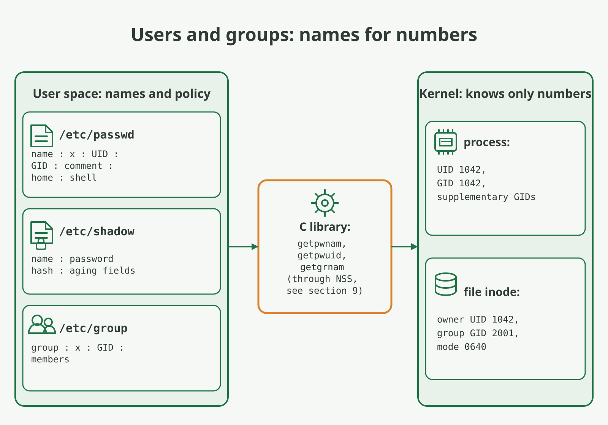

*Figure 1.6.1. Users and groups: names for numbers.*

Read the arrows from top to bottom. The names pass through the C library before the kernel sees anything.

### `/etc/passwd`: the user table

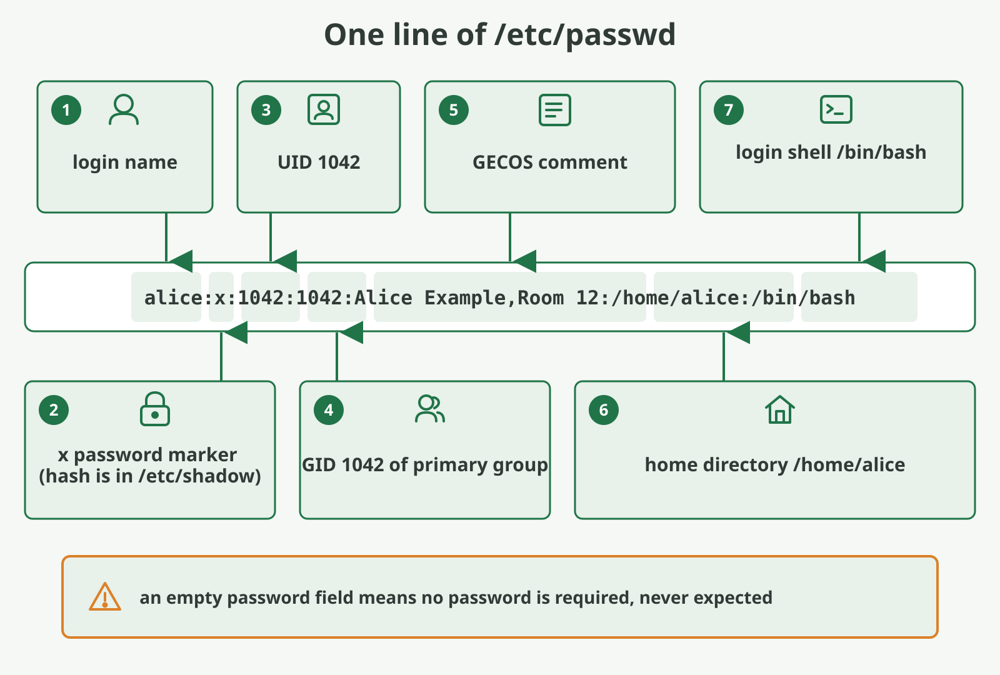

*Figure 1.6.2. Each passwd line has seven fields: name, password marker, UID, GID, comment, home and shell.*

Open `/etc/passwd` on any Linux machine and you will find one short line per user. Each line holds seven fields, separated by colons. Here is a sample line:

```
alice:x:1042:1042:Alice Example,Room 12:/home/alice:/bin/bash
```

The table below explains each field in that line. Use it as a key when you read your own `/etc/passwd`.

| Field | Meaning |
|---|---|
| `alice` | the login name |
| `x` | historically the password hash; now a marker meaning "the hash is in `/etc/shadow`". An asterisk `*` means this account cannot log in with a password. An **empty** field means *no password is required*, which you should never see. |
| `1042` | the UID |
| `1042` | the GID of the user's **primary group** |
| `Alice Example,...` | the "GECOS" comment: real name, sometimes room and phone, separated by commas |
| `/home/alice` | the home directory |
| `/bin/bash` | the login shell (must be listed in `/etc/shells` for `chsh` to accept it) |

The file is plain text with strict syntax, and it has no comments and no blank lines. Many people call a passwd entry plus a home directory an "account", but that is only a habit. Programs recognize a user from the passwd entry alone. Users can also come from a network directory service with no local line at all, as section 9 explains. UIDs should be unique. If two entries share a UID, the kernel treats both names as one person, which is confusing at best.

**Special users.** root has UID 0 and GID 0. Alongside it live several pseudo-users, accounts that exist so a service can run without root's power. Examples include `daemon`, `www-data`, `postgres`, munge and `slurm`. They normally cannot log in, because their shell is `/usr/sbin/nologin` or `/bin/false`, or their password field is `*`. The system still starts their processes under their UIDs, and that limits what a compromised service can do. The traditional nobody user owns nothing. On Debian and Ubuntu it is UID 65534, with group `nogroup`; the number differs on some distributions. Programs use it for deliberately unprivileged processes. None of these users has special meaning to the kernel. If you made nobody the owner of everything, it would stop being unprivileged. By convention, UIDs below 1000 belong to system accounts and 1000 and above belong to people. The exact minimum is set as `UID_MIN` in `/etc/login.defs`, and some older distributions used 500.

### `/etc/shadow`: passwords and aging

The shadow file holds authentication data, and only root, together with the `shadow` group, can read it. That separation keeps ordinary users from grabbing hashes and cracking them offline. The file has nine fields. They are the name, the **password hash**, and several aging fields that cover the last change, the minimum and maximum age, the warning period, the inactivity period and the account expiry.

```
alice:$y$j9T$salt$hash...:20380:0:99999:7:::
```

A hash is a one-way transformation of the password, mixed with a random salt. The prefix names the algorithm that produced it. `$6$` is SHA-512 crypt, `$y$` is yescrypt, the default on current Debian and Ubuntu, and `$5$` is SHA-256. A leading `!` or `*` in the field means the password is locked or unset. Password login is then impossible, although key-based SSH may still work. Change these files with the tools, not an editor: `passwd`, `chage`, `usermod` and `useradd`. If you must edit the files by hand, for example to recover from corruption, use `vipw` for `/etc/passwd` and `vipw -s` for `/etc/shadow`. Both lock the file and keep a backup, so a concurrent change cannot corrupt it.

### `/etc/group`: the group table

```
projx:x:2001:alice,bob
```

The fields are the group name, a password marker, the GID and a comma-separated list of members. The marker `x` means the entry is in `/etc/gshadow`, and it is nearly always a locked `!` or `*`. A user belongs to a group in two ways. The group can be their primary group, named in their passwd entry by GID. Or they can appear in the group's member list, which makes it a **supplementary** group. The `id` command shows both, and `groups` lists the names.

```bash
id                # uid=1042(alice) gid=1042(alice) groups=1042(alice),2001(projx),27(sudo)
groups alice      # the same, names only
getent group projx  # query through the C library, including network sources (section 9)
```

Leave group passwords alone. Unix group passwords are hardly ever used, and you should not set one. In most cases, `sudo` is the better tool for granting access. Groups once mattered most when many users shared one machine or network. As workstations are shared less often now, group-based file sharing matters less than it used to. The GID must be unique within the group file, because that number goes into each user's passwd entry. Any user whose passwd line names that GID belongs to the group, even when the member list leaves them out.

Many distributions create a **user-private group** for each new user, with the same name and number as the user. So alice's primary group is simply alice. That sounds odd until you see what it buys. A file is group-owned by a group that contains only you, so a permissive group-write bit does not expose it to anyone else. This is also why the default umask on such systems can be `002`, which section 3 explains.

### Why `/etc` is split into subdirectories

For decades, every program and service dropped its configuration files straight into `/etc`. The directory filled up fast, and two problems followed. Files were hard to find on a running system, and the system was hard to maintain. Suppose you customize the `sudo` rules in `/etc/sudoers`. A distribution upgrade can overwrite that file, and your changes disappear with it.

Over the years, the habit has shifted toward grouping settings into subdirectories under `/etc`. You have already met this with `/etc/systemd`. To keep an upgrade from overwriting your customizations, put them in separate files inside those subdirectories, such as the ones in `/etc/grub.d`. Run `ls -F /etc` and most of what you see will be subdirectories. Settings for one machine, such as the user table `/etc/passwd` and network details `/etc/network`, still belong in `/etc`. General application defaults do not. Prepackaged system defaults that you should not customize, such as the systemd unit files in `/usr/lib/systemd`, live elsewhere.

## 2. Managing users and groups

A new teammate starts on Monday and needs an account before lunch. You could open `/etc/passwd` and type a line by hand, but resist that urge. Use the tools, not hand edits. They update several files together, create the home directory from a template, and handle locking for you. Here is the set of commands that covers most daily work.

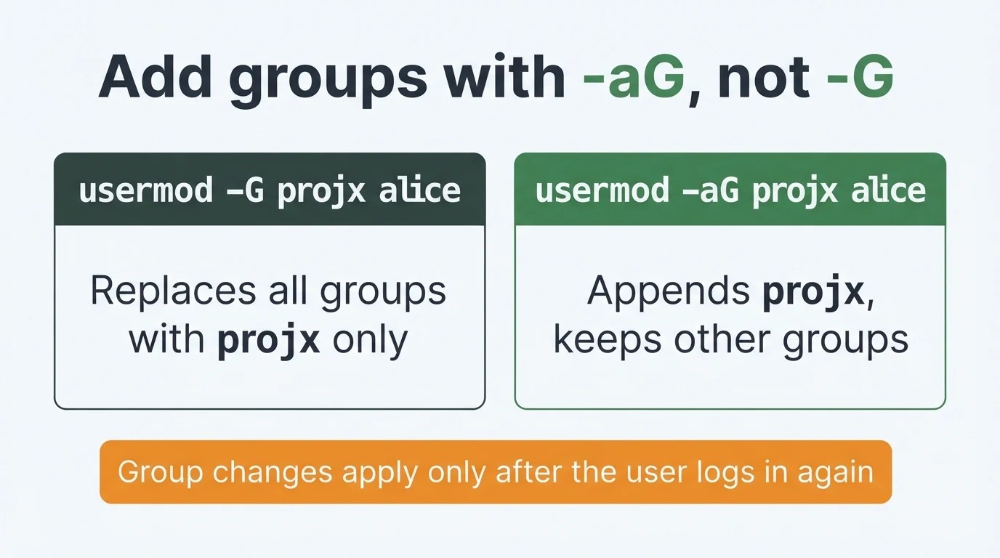
*Figure 1.6.3. One missing letter a silently removes a user from groups like sudo.*


```bash
sudo useradd -m -s /bin/bash -c "Alice Example" alice      # create user with a home directory (-m)
sudo useradd -r -s /usr/sbin/nologin -d /var/lib/svc svc   # a system (-r) account for a service
sudo passwd alice                                          # set or change the password
sudo groupadd -g 2001 projx                                # create a group, with an explicit GID
sudo usermod -aG projx alice                               # ADD alice to a supplementary group (see warning)
sudo usermod -L alice ; sudo usermod -U alice              # lock / unlock the password
sudo chage -l alice                                        # show password aging; chage -E 0 expires the account
sudo userdel -r alice                                      # delete the user and the home directory
id alice ; getent passwd alice                             # verify
```

On Debian and Ubuntu, `adduser` and `addgroup` are friendlier front ends. `useradd` is the portable low-level tool, and it works the same way on most systems.

Hand editing is a poor default, even for root. A single typo can lock someone out. Another tool may also change the same file at the same moment, and then the two edits collide. The commands above avoid both problems. If a file is somehow corrupted and you really must edit it directly, use `vipw`. It backs up and locks `/etc/passwd` while you work, excluding other writers as an added precaution. `vipw -s` does the same for `/etc/shadow`. Hopefully you will never need either.

:::warning The classic `usermod` mistake
`usermod -G projx alice` **replaces** alice's supplementary groups with only projx, silently removing her from `sudo`, `docker` and the rest. You almost always want **`-aG`**, where `-a` means append. Group membership is also read only at **login**. After you add someone to a group, their existing sessions do not see the change. They must log in again, or run `newgrp projx`, or use `su - alice` in a test.
:::

Users can make some changes to their own accounts. `passwd` changes your password, `chsh` changes your login shell, and `chfn` changes the comment. The shell you set must be listed in `/etc/shells`. These programs must write root-owned files, and they can do so because they are **setuid-root** executables, a mechanism section 5 explains. On passwords, length matters more than cleverness. A long, memorable phrase of 16 or more characters is stronger than a short string full of symbols. On servers, prefer key-based SSH and turn off password login, as chapters 1.5 and 1.21 explain.

**Locking and restricting accounts.** Blocking someone from a system is an escalation to use sparingly, for example after a serious policy violation or when an employee leaves. Know the options and their limits before you pick one.

- `usermod -L` locks the password, but SSH keys may still work.
- Setting the shell to `/usr/sbin/nologin` or `/bin/false` with `chsh -s` blocks interactive use. The shell must be in `/etc/shells` for that to work. Every command, including `ssh host command`, runs through the shell, so this also blocks remote commands. Some configurations can still bypass it through port forwarding. It also does not stop file transfer when an SFTP server is allowed. A restricted shell called `scponly` allows only `scp` and `sftp`.
- In `sshd_config`, `DenyUsers user1 user2` blocks named users. `AllowUsers ...` or `AllowGroups` permits only the listed ones, which is useful during maintenance when only administrators should get in. Reload `sshd` afterwards. Sessions that are already open continue. `sshd_config(5)` evaluates these directives in the order `DenyUsers`, `AllowUsers`, `DenyGroups`, `AllowGroups`. The simplest policy is a single allow-list, as chapter 1.29 explains.
- **`pam_access`** works through the PAM chain. Add `account required pam_access.so` to the chain for `sshd`, then write rules in `/etc/security/access.conf` in the form `permission : users-or-groups : origins`. For example, `+:@admins:ALL` followed by `-:ALL:ALL` allows only the admins group. Rules are checked from top to bottom, so put the allow rule for administrators first, or you may lock yourself out.
- On a cluster, the **scheduler** is the real gate for compute resources. Remove the user's associations or set limits in Slurm (chapter 6.9).

Always keep a second administrator session open when you test a lock-down change.

## 3. File permissions: read, write, execute

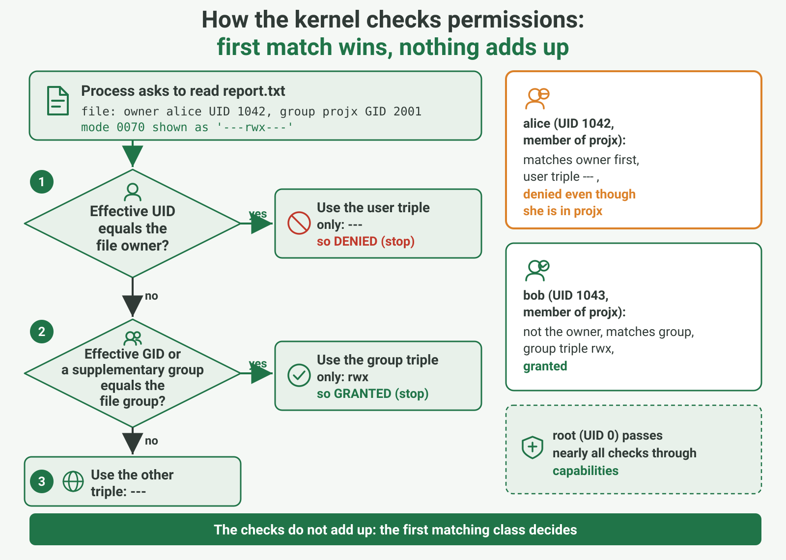

*Figure 1.6.4. The owner triple is used if you are the owner, even when the group triple would allow more, so alice is denied and bob is granted.*

A teammate messages you in the afternoon: she cannot open a file the whole group needs to edit. You run `ls -l` and see a string of letters and dashes. `ls -l` shows the mode as ten characters. Every file and directory has an owner, which is a UID, a group, which is a GID, and a **mode**, which is a set of permission bits. The diagram below labels each part.

```
-rw-r-----  1 alice projx 7041 Oct 23 19:34 endnotes.html
dr-xr-sr-x  2 root  projx 4096 Oct 23 19:34 shared
 ^^^ ^^^ ^^^
 |   |   +-- other: everyone else
 |   +------ group: members of the file's group
 +---------- user (owner)
```

The first character is the file type, which chapter 1.3 covers. The other nine form three triples, one each for the **user** (`u`), the **group** (`g`) and **other** (`o`). Each triple is some combination of `r` for read, `w` for write, `x` for execute and `-` for not granted. When the kernel checks access, it goes in a fixed order and stops at the first match. If your effective UID is the file's owner, the user triple applies. If not, and your effective GID or one of your supplementary groups matches the file's group, the group triple applies. Otherwise, the other triple applies. The checks do not add up. If the owner's triple is `---` and the group's is `rwx`, the owner is still denied, because the owner matched first. Also, root, which the kernel knows as UID 0, gets past nearly all of these checks through capabilities, as chapter 1.21 explains.

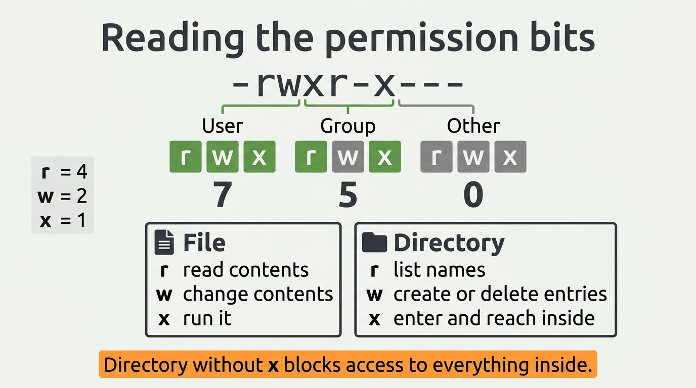

*Figure 1.6.5. Reading -rwxr-x---: three triples, octal 750, and what r, w, x mean on files versus directories.*

### What the bits mean: files versus directories

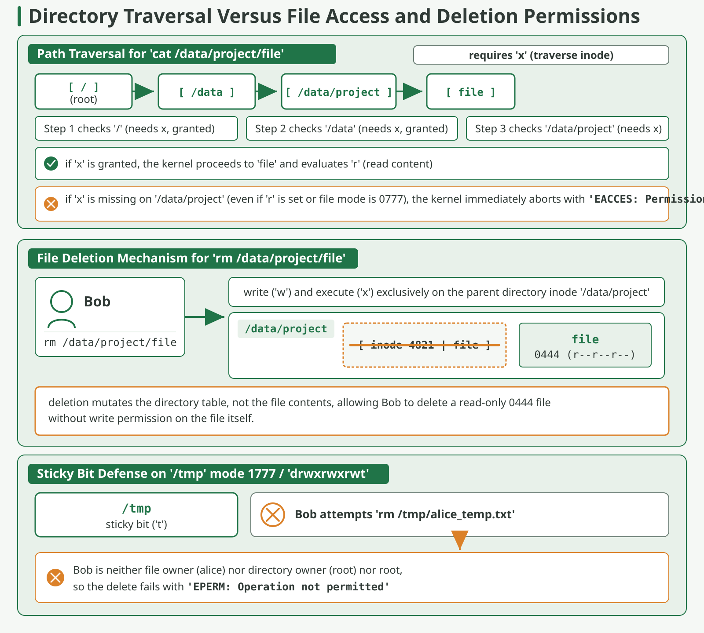

*Figure 1.6.6. Path traversal checks execute permission at every path segment, and file deletion modifies the directory inode rather than the file itself.*

The same three letters mean different things on a file and on a directory. The table shows both meanings.

| Bit | On a regular file | On a directory |
|---|---|---|
| `r` read | read the contents | **list the names** in the directory (`ls`) |
| `w` write | modify the contents (not delete the file) | **create, delete and rename entries** in the directory (requires `x` as well) |
| `x` execute | run it as a program (a script also needs `r`) | **traverse**: access an entry by name (`cd` into it, open `dir/file`) |

These directory rules explain many puzzling denials. To read `/data/project/file`, you need `x` on `/`, on `data` and on `project`, and you also need `r` on `file`. With `r` on a directory but no `x`, you can see the names but not open anything. Deleting a file needs `w` on the directory, not on the file itself. That is why a read-only file can still be removed from a writable directory, and why the sticky bit exists. A common mistake with absolute modes on directories is dropping the `x` bit by accident, which locks everyone out.

### Changing permissions: `chmod`, `chown`, `chgrp`

Symbolic mode changes specific bits and leaves the rest alone. You choose who: `u`, `g`, `o`, or `a` for all. Then an operator: `+` to add, `-` to remove, `=` to set exactly. Last come the permissions themselves.

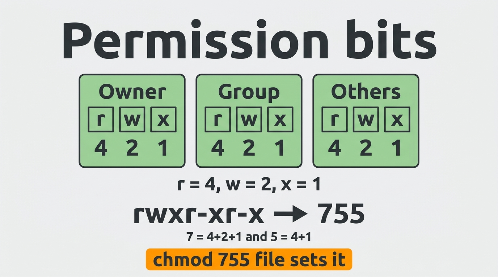

*Figure 1.6.7. Add the numbers per group. 7 is rwx, 5 is r-x, 4 is r only.*

```bash
chmod u+x script.sh            # make it executable for the owner
chmod go+r file ; chmod go-r file   # give/remove read for group and other
chmod g=rw,o= file             # group read-write, others nothing
chmod -R u+rwX,go+rX dir       # capital X: add execute only to directories (and files already executable)
```

Absolute mode, which people call octal mode, sets all the bits at once. Each triple becomes a number: read is 4, write is 2 and execute is 1. You add them together, so `rw-` is 6, `r-x` is 5 and `rwx` is 7.

| Mode | Meaning | Typical use |
|---|---|---|
| `644` | owner read/write; group, other read | ordinary files |
| `600` | owner read/write; nobody else | private files, SSH private keys |
| `755` | owner all; group, other read and execute | programs, directories |
| `700` | owner all; nobody else | private directories (`~/.ssh`) |
| `711` | owner all; others execute only | directories others may pass through but not list |
| `664` / `775` | like 644 / 755 with group write | shared project files / directories |
| `777` | everyone everything | almost never correct |

Do not try to fix a permission problem with `chmod -R 777`. It removes protection from every file at once. It usually misses the real cause, which is a wrong owner, a wrong group or a missing directory `x`. It also makes things executable that should not be. To find the actual mismatch, run `namei -l /full/path/to/file`. It prints the owner and mode of every component along the path. Run `id` to confirm your own identity.

**Ownership.** `chown alice file` changes the owner, and only root can do that. `chown alice:projx file` changes both the owner and the group. `chgrp projx file` changes the group, and the owner may move a file to any group they belong to. Add `-R` to recurse. `stat file` shows the owner, group and mode in full.

### Absolute modes: memorize the ones you use

An absolute change sets all of the permission bits at once. That is quick, but it is blunt, because the whole mode is replaced. Each digit in the mode is a number from 0 to 7 in base 8, and each digit stands for one permission set. You do not need to build these numbers from scratch every time. Learn the handful you use most often, such as `644` for ordinary files and `755` for programs and directories. The `chmod(1)` manual page or its info manual has the full rules.

Be careful with world-writable files. Obviously, you should not make a file writable by everyone, because that lets any user on the system change it. Could someone on the internet change it too? Probably not, unless the system has a network security hole. In that case, file permissions will not protect you anyway.

### `umask`: default permissions for new files

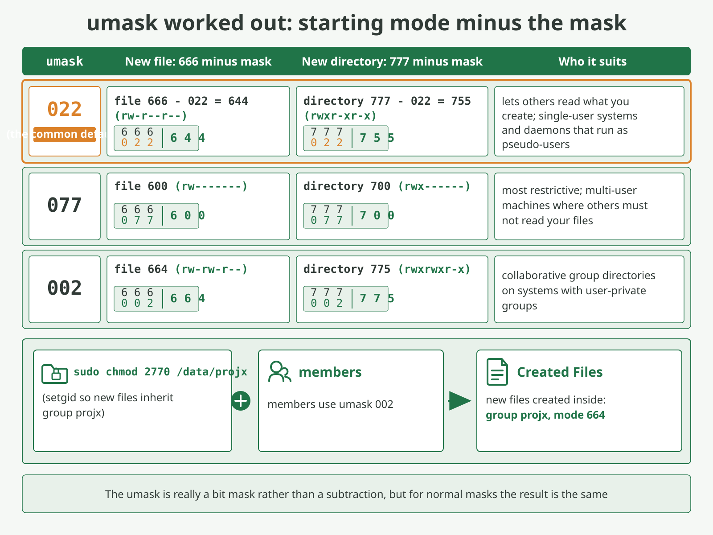

*Figure 1.6.8. A new file starts from 666 and a new directory from 777, and the umask removes bits from those starting modes.*

Every new file starts life with a default set of permissions, and the umask decides what those are. New regular files start from 666, which is read-write for everyone. New files are not executable by default. New directories start from 777. The **umask** is a mask of bits to remove from those starting values. With the common `umask 022`, a new file gets `666 - 022 = 644`, and a new directory gets `755`. With `umask 077`, they get `600` and `700`, which is private. With `umask 002`, which allows group write, files get `664` and directories get `775`. The umask is really a bit mask rather than a subtraction, but for normal masks the result is the same.

```bash
umask                # show the current mask, for example 0022
umask 077            # make new files private in this shell
umask -S             # symbolic form
```

Choosing a value is a matter of who should see your files. `077` is the most restrictive. It suits a multi-user machine where others should not read your files. The cost is that sharing gets harder, which can tempt inexperienced users to make things world-writable. `022` lets others read what you create. That fits a single-user system, and it also suits daemons that run as pseudo-users and must read your files. `002` is for collaborative group directories on systems that use user-private groups. The mask belongs to each process and is inherited by children. Set it in a startup file, as section 6 explains, so it applies to every shell. Some programs, such as mail clients, `ssh-keygen` and key stores, deliberately override it to stay private.

### The special bits: setuid, setgid, sticky

Sometimes plain ownership is not enough, and three extra mode bits fill the gap. They live in a fourth, leading octal digit: `4000`, `2000` and `1000`. They appear as `s` or `t` in the `ls -l` triples. Their meaning depends on whether the item is a file or a directory.

| Bit | On an executable file | On a directory |
|---|---|---|
| **setuid** (`u+s`, 4000) | the program runs with the **file owner's** identity (as its *effective* UID) instead of the invoker's. The mode shows `s` in the owner's execute slot (`-rwsr-xr-x`). | ignored on Linux |
| **setgid** (`g+s`, 2000) | runs with the file's **group** | **new files and subdirectories inherit the directory's group** instead of the creator's primary group. It shows `s` in the group slot. |
| **sticky** (`+t`, 1000) | ignored on Linux | **only the owner of a file (or of the directory, or root) may delete or rename entries**, even if others have write permission on the directory. It shows `t` in the other's execute slot. |

Two familiar examples show the bits at work. `/usr/bin/passwd` and `/usr/bin/sudo` are setuid-root, so ordinary users can change `/etc/shadow` through a vetted program. `/tmp` is `1777`, which reads as `drwxrwxrwt`, so everyone can create files there, but nobody can delete someone else's. Setuid has no effect on interpreted scripts on Linux. The kernel honors it only for real executables, for security reasons.

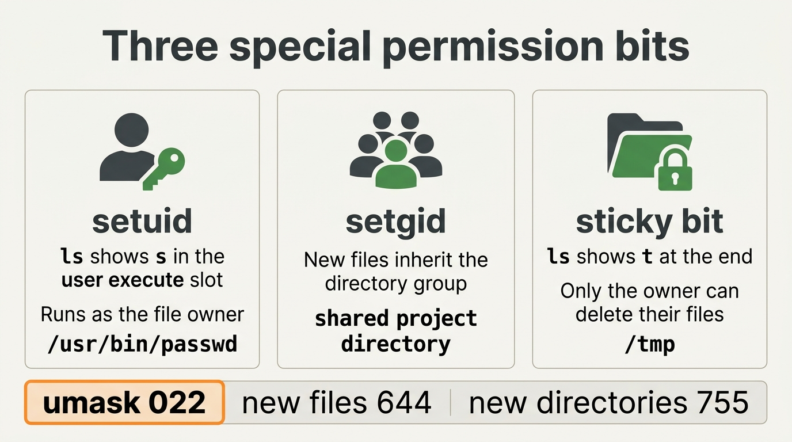

*Figure 1.6.9. The three special bits, with a umask 022 example.*

### A recipe: a safe shared project directory

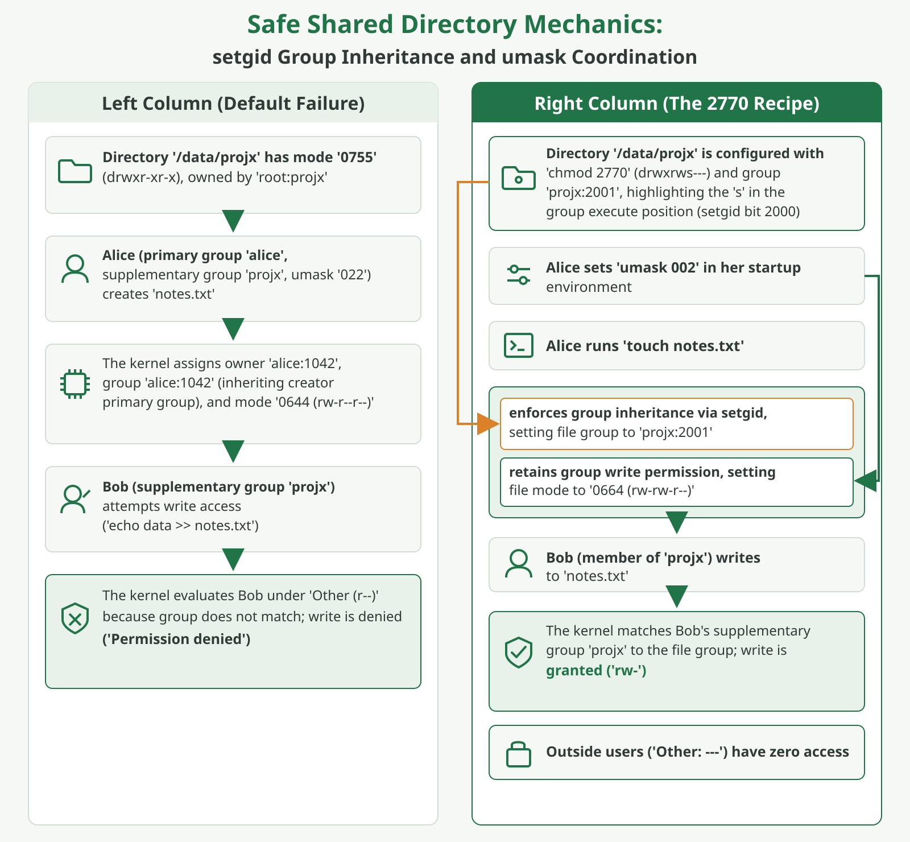

*Figure 1.6.10. The setgid bit on a directory forces new files to inherit the parent group while umask 002 preserves group write permissions for teammates.*

Suppose a team called projx, with GID 2001, needs a directory on a shared filesystem. Every member should read and write the others' files, and outsiders should have no access. Here is how to set that up.

```bash
sudo groupadd -g 2001 projx
sudo usermod -aG projx alice ; sudo usermod -aG projx bob      # members log in again to pick this up
sudo mkdir -p /data/projx
sudo chown root:projx /data/projx
sudo chmod 2770 /data/projx          # setgid so new files inherit group projx; group rwx; others none
# members use umask 002 so files they create are group-writable (set it in their startup file)
```

With `2770` and `umask 002`, anything created in the directory belongs to the group projx and is group-writable, and you do not need any extra steps. If you cannot control each user's umask, default ACL entries, which the next section introduces, enforce the permissions from the directory side.

Before you hand a directory to a team, set the setgid bit and check that members' umasks allow group write.

## 4. Access control lists (ACLs)

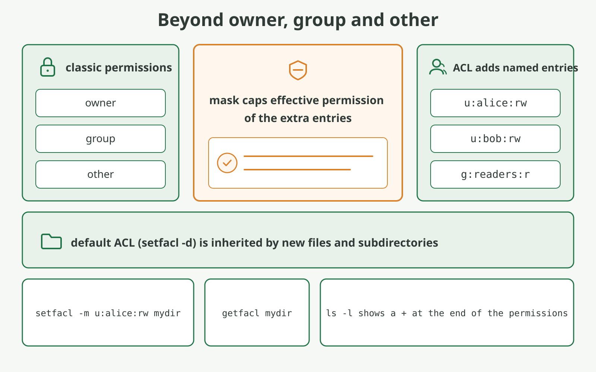

*Figure 1.6.11. An ACL lets you grant specific users or groups access without changing the owner or group.*

A teammate from another team needs to read one project directory, and nothing else. Classic permissions give you one owner, one group and "everyone else", so there is nowhere obvious to put her. Real teams often need a rule like this: alice and bob can read and write, carol can only read, and nobody else gets in. Without ACLs, you would need a special group for every combination. **POSIX ACLs** solve the problem. They add lists of extra users and groups, each with its own permissions, to a file or directory. Common Linux filesystems support them. ext4 and XFS support them by default, and others need the `acl` mount option. NFSv4 has its own form of ACLs. Not every network or parallel filesystem supports them, so check before you depend on them.

The commands below cover the whole life of an ACL, from granting access to removing it.

```bash
setfacl -m u:alice:rw,u:bob:rw mydir          # grant specific users (-m modifies)
setfacl -m u:user1:rw,u:user2:rw,u:user3:rw mydir # grant three writers (SCL Ch. 12 example)
setfacl -m u:reader1:r,u:reader2:r,u:reader3:r mydir # grant three read-only users
setfacl -m g:readers:r mydir                  # grant a group
chmod o-rwx mydir                             # classic bits: remove access for everyone else
getfacl mydir                                 # view the ACL
setfacl -d -m g:projx:rwx /data/projx         # DEFAULT ACL (-d): applied to new files created inside
setfacl -R -m u:carol:rX /data/projx          # recurse (capital X = execute only for dirs)
setfacl -b mydir                              # remove all ACL entries
ls -l mydir                                   # a '+' sign at the end of permissions means an ACL is set
```

Read the first three lines as grants for named users, the fourth as a grant for a group, and the rest as tools for viewing, removing and inheriting the rules. The default ACL on the directory is the one that reaches new files, and the recursive form reaches the files that already exist.

When an ACL is set, `ls -l` adds a `+` at the end of the ten-character permission string. Use `getfacl` to read the full rule list. Two ideas matter most when you work with ACLs. The first is the **mask**. It is an entry that caps the effective permission of every named user, every named group and the owning group. However generous an entry looks, it can never grant more than the mask allows. If you run `chmod g=...` on a file that has an ACL, you change the mask, not the owning group's bits. So a file can look group-writable in `ls -l` while the mask limits it to `r--`. `getfacl` prints `#effective:` notes whenever the mask reduces an entry's rights.

The second idea is the **default ACL**. A default entry set with `setfacl -d` on a directory gives every new file and subdirectory created inside it an initial ACL. That enforces the team's sharing rules, whatever each user's umask happens to be.

Check that your filesystem supports ACLs before you rely on them, and run `getfacl` after every `chmod`.

## 5. Process identity, setuid and `sudo`

How does a machine learn who you are? The answer starts the moment you sit down at a terminal, so this section follows one login from the first prompt to the shell. Then it looks at what a running process carries with it, and at the two mechanisms, setuid and `sudo`, that let a process change its identity on purpose.

### `getty` and `login`: how a terminal login starts

The `getty` program attaches to a terminal and displays the login prompt. On most Linux systems it is uncomplicated, because the system uses it only for logins on virtual terminals. In a process list, it usually looks like this when it runs on `/dev/tty1`:

```bash
$ ps ao args | grep getty
/sbin/agetty -o -p -- \u --noclear tty1 linux
```

On many systems you may not see a getty process until you switch to a virtual terminal with something like Ctrl-Alt-F1. The example shows `agetty`, the version many distributions include by default. When you type your login name, getty replaces itself with the `login` program, which asks for your password. A correct password makes `login` replace itself with your shell, using `exec()`. A wrong one gives you a "Login incorrect" message. PAM does much of the real authentication work here, as chapter 1.21 explains.

A baud rate such as "38400" may appear when you investigate getty. Treat that setting as all but obsolete. Virtual terminals ignore the baud rate, and it matters only for real serial lines. You will rarely configure getty or login, because most people log in through a graphical interface such as `gdm`, or remotely with SSH, and neither uses getty or login.

### How a process gets its identity, and how it changes

Every process runs with a UID and a GID, plus any supplementary groups. Where do those come from? `login`, `sshd` or the display manager first authenticates a user. Then it starts that user's shell with the user's IDs. Every process the shell creates inherits the same IDs, as chapter 1.1 showed. Changing identity later means changing these numbers, and the kernel allows that only under strict rules:

1. A process may run a **setuid executable** if it has permission to execute the file. The program then starts with the file owner's UID as its effective UID.
2. A process running as root (UID 0) may call the `setuid()` family of system calls to become *any* user.
3. A process that is not root can use `setuid()` only in very limited ways, mostly to switch among IDs it already holds.

Utilities such as `su` and `sudo` combine these rules. They are setuid-root programs, so they start with root's power. Then they call `setuid()` to become the target user, or to stay root. At the kernel level, switching users has nothing to do with passwords. Authentication, whether by password, key or token, is a user-space step that happens *before* the program changes IDs.

### Real, effective, saved (and filesystem) IDs

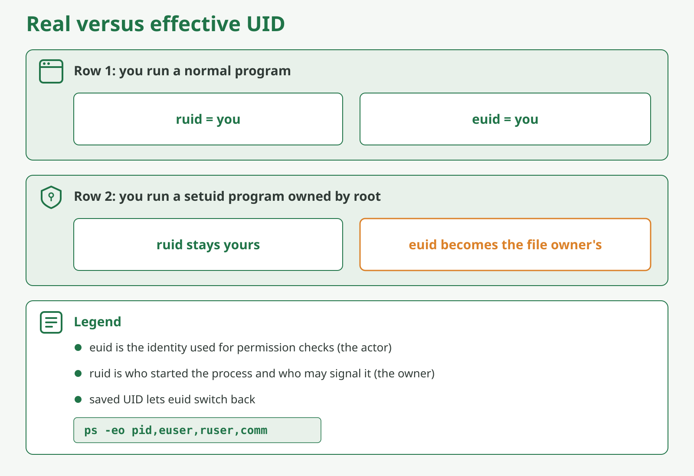

*Figure 1.6.12. The effective UID is used for permission checks while the real UID records who started the process.*

A setuid program has to act as another user and then give that power back. For that reason, a process carries more than one user ID.

| ID | Purpose |
|---|---|
| **effective UID (euid)** | the identity used for permission checks, notably on files; this is the "actor" |
| **real UID (ruid)** | who actually *started* the process; it determines who may send it signals and kill it; the "owner" |
| **saved UID** | a stored ID the process can switch its euid back to later |
| **filesystem UID (fsuid)** | used for filesystem access checks; rarely distinct (used by some file-serving programs) |

When you run a setuid program, the euid becomes the file owner's. The ruid stays yours. `ps` normally shows only the effective user, so use `ps -eo pid,euser,ruser,comm` to see both. In practice, `sudo` and similar programs set all the IDs to the target user on purpose. That avoids odd side effects when the IDs differ. It is also why a process you started with `sudo` can often be killed only with `sudo` too. A sudoers option, `Defaults stay_setuid`, changes this. Leave it alone unless you understand the consequences.

### Why setuid is dangerous: security implications

Every setuid-root program is a place where an ordinary user's input crosses into root's authority. That makes the risk severe. Both the number of setuid programs and their quality matter. Two things need control: how many such programs exist, and what each one does. A copy of a shell with the setuid-root bit set gives any local user a root shell. A copy of `bash` made setuid root would give any local user the whole system, and nothing more is needed. Even a special-purpose setuid-root program is risky when it contains a bug, because a bug in a legitimate setuid program becomes a privilege-escalation vulnerability. Attackers get into systems mainly by exploiting weaknesses in programs that run as root, and the list of such exploits is very long.

You can still act on the risk in concrete ways. Audit the system from time to time with `find / -xdev -perm -4000 -type f 2>/dev/null`. You can also limit where setuid files can be created. Mount user-writable filesystems, such as home directories, `/tmp` and container volumes, with the `nosuid` option. For the same reason, containers should not run with extra capabilities, and they should drop setuid binaries, as chapters 5.1 and 18.3 explain. With so many routes into a system, preventing intrusion is a multifaceted affair on any multiuser machine. The most essential way to keep unwanted activity off your system is to enforce user authentication, with usernames and good passwords.

### Identification, authentication, authorization

Keep three words distinct. **Identification** answers "who are you?" and is ultimately a username, which maps to a UID. **Authentication** answers "prove it" with a password, an SSH key, a token or a smart card. **Authorization** answers "what may you do?" through file permissions, `sudo` rules and scheduler limits. The kernel handles identification by number and authorization for files and processes. It knows nothing about authentication, which is entirely user space.

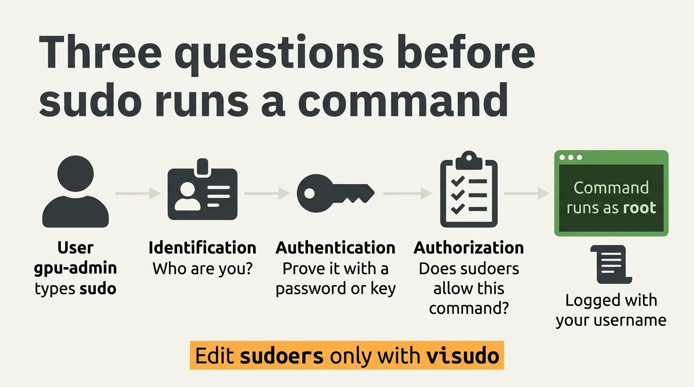

*Figure 1.6.13. The three questions sudo answers before a command runs as root.*

A program that needs its own username calls `geteuid()` to get the number. Then it asks the C library to map that number to a name with `getpwuid()`. The library decides where to look, and the site can configure that, as section 8.5 explains. This extra step is what lets a site move from local files to a network directory without changing any program. The old approach of simply reading `/etc/passwd` had three limits. It used one fixed hashing method, it always prompted for a password, and it had no support for tokens or smart cards. **PAM**, the Pluggable Authentication Modules framework, was created to remove those limits, as chapter 1.21 explains.

### `sudo`: administrative power with a trail

You will need root from time to time. The disciplined way is **`sudo`**. It runs one command as another user, root by default, after you authenticate *as yourself*, and it logs the event. A root shell has real costs. Nothing records which commands were run or by whom. You lose your normal environment. With `su`, you also share a single root password. Use `sudo command` for individual commands. Use `sudo -i` or `sudo -s` for a root shell only when you really need a sequence of commands, and remember that the logging is coarser then.

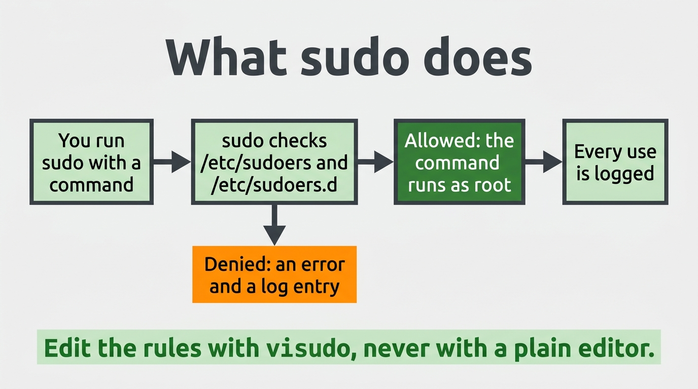

*Figure 1.6.14. sudo checks the rules, runs the command as root, and leaves a log entry.*

```bash
sudo systemctl restart slurmd           # one command as root
sudo -u slurm scontrol show config      # run as another user
sudo -l                                 # what am I allowed to run?
sudo -k                                 # forget cached credentials
sudoedit /etc/ssh/sshd_config           # edit a root file with YOUR editor (see chapter 1.5)
echo "x" | sudo tee /root/file          # NOT: sudo echo x > /root/file (the redirection is done by YOUR shell)
```

**Configuration.** `sudo` reads `/etc/sudoers` and every file in `/etc/sudoers.d/`. File names there must not contain a dot or end in `~`, and the mode should be `0440`. Always edit with `visudo`, for example `visudo -f /etc/sudoers.d/aiteam`. It locks the file and checks the syntax before saving. A syntax error in sudoers can disable `sudo` entirely, so keep a root shell open while you change it. The rule format is:

```
who   where = (run-as-user:run-as-group)   [NOPASSWD:]  commands
```

The example below is a small drop-in file for GPU administrators.

```
# /etc/sudoers.d/gpu-admins
User_Alias  GPUADMINS = alice, bob
Cmnd_Alias  GPUCMDS   = /usr/bin/nvidia-smi, /usr/bin/systemctl restart nvidia-persistenced
GPUADMINS   ALL = (root) NOPASSWD: GPUCMDS      # these users may run only these commands as root, no password
%sre        ALL = (ALL:ALL) ALL                   # members of group "sre": any command as anyone, password required
Defaults    secure_path="/usr/local/sbin:/usr/local/bin:/usr/sbin:/usr/bin:/sbin:/bin"
Defaults    logfile="/var/log/sudo.log"
```

Reading the rule: the first `ALL` means "any host", which helps when one file serves many machines. `(root)` names the user you may become. `NOPASSWD:` skips the password prompt. The last field lists the allowed commands, and `ALL` there means everything. A line such as `ADMINS ALL = NOPASSWD: ALL` gives a group unrestricted root without a password. That is convenient, and it is also dangerous. Choose the narrowest command list that works, and require a password or hardware-token confirmation for broad rights. Grant access to a group, such as `%sudo` on Debian and Ubuntu or `%wheel` on the Red Hat family, instead of naming individuals. That way, access follows group membership.

**Logging.** Each `sudo` use goes to syslog under the auth facility. On systemd systems, query it with `journalctl SYSLOG_IDENTIFIER=sudo`. On others, check `/var/log/auth.log` or `/var/log/secure`. Ship these logs to a central place, because they are your audit trail, as chapter 17.3 explains. `sudo` resets the environment with `env_reset` and uses `secure_path`, so a variable or `PATH` you exported will not reach the command unless the policy allows it, through `sudo -E`, or `env_keep`, or `env VAR=value cmd`. That explains why `CUDA_VISIBLE_DEVICES` set in your shell can vanish under `sudo`.

## 6. Shell startup files: the user environment

Have you ever opened a terminal and found that your `PATH` or your editor setting was missing? When a shell starts, it reads configuration files that set its defaults. Those defaults include the command path, the prompt, aliases, the umask and the editor. These are the **startup files**, also called dot files because their names start with a `.`. Keep them simple, short and well commented. Over time they collect clutter, and the clutter causes confusing problems in subshells and batch jobs.

### Which file is read when (bash)

As chapter 1.2 introduced, the file that gets read depends on the kind of shell instance. The diagram shows the choices.

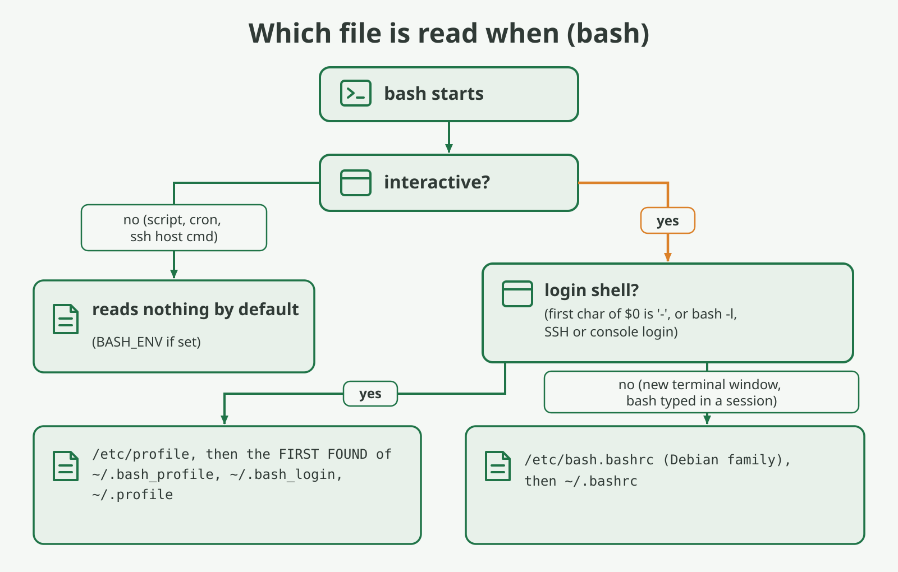

*Figure 1.6.15. Which file is read when (bash).*

Two practical facts govern bash startup. First, login shells do not read `~/.bashrc`, and non-login shells do not read `~/.bash_profile`. The standard fix is to keep your settings in `~/.bashrc` and have `~/.bash_profile` or `~/.profile` source it. You can do that with a symlink or a one-liner, `[ -f ~/.bashrc ] && . ~/.bashrc`, and that is what the default files on Ubuntu do. Second, you can test which kind of shell you are in. `echo $0` shows a leading `-` for a login shell. Inside a startup file, `case $- in *i*)` tests for an interactive shell, because `$-` contains `i` only then. That keeps commands that print output or need a terminal away from scripts.

**Why are there two kinds?** The split dates from the days when people logged in on a plain terminal and then started subshells inside a window system or `screen`. Heavy setup, such as the path, environment variables and programs that start agents, ran once in the login shell. Lightweight things, such as aliases, went in `~/.bashrc` for the subshells. That avoided repeating the work. Today most desktop users log in through a graphical display manager, which usually starts one login shell for the session, so the old model still holds. Where it does not, your terminal windows never see the environment set in `~/.bash_profile`, and you must put the whole environment in `~/.bashrc` instead. Console and SSH logins are login shells that skip `~/.bashrc`, so you still need the `~/.bash_profile` that sources it. That pair is the robust arrangement. A mismatch between the two sits behind most reports of "my environment is missing in the terminal" or "in SSH".

`tcsh` is simpler. It does not distinguish login from non-login shells. It reads `~/.tcshrc`, or `~/.cshrc` if that is absent. Stick with `~/.cshrc`, which also works for the older `csh`. Few people use `tcsh` today, but a new-user template should include a minimal file in case someone meets it. The file below uses `setenv` and a different prompt syntax.

```csh
# ~/.cshrc  (the C shell family; note setenv and set prompt instead of export and PS1)
setenv PATH $HOME/bin:/usr/local/bin:/usr/bin:/bin
setenv EDITOR vi
setenv VISUAL vi
setenv PAGER less
setenv LESS meiX
umask 022
# %n user, %m host, %/ current directory, %h history number, %l terminal
set prompt="%m%% "
```

`zsh` uses four startup files. `~/.zshenv` is read for every shell. `~/.zprofile` is for login shells, `~/.zshrc` is for interactive shells, and `~/.zlogin` completes the set.

### What belongs in a startup file

Start with the command path. Put `/usr/local/bin`, `/usr/bin` and `/bin` in that order, so that local versions override system ones. Administrators also add `/usr/local/sbin`, `/usr/sbin` and `/sbin`. A personal `$HOME/bin` or `$HOME/.local/bin`, a newer convention, goes at the front. Do not change the path for every new installation directory. A symlink in `/usr/local/bin` is cleaner.

Never put `.`, the current directory, in `PATH`. At the front, it lets a malicious file named `ls` in any directory you visit run instead of the real command. At the end, it still invites typo attacks, such as `sl` or `ks`. It also makes commands behave differently depending on where you happen to be.

Do not set `MANPATH`. Doing so overrides the system defaults.

The prompt, `PS1`, should be short and useful. Avoid characters the shell gives special meaning to, such as `{ } = & <` and `>`. A `>` in a prompt that you copy and paste can create stray files by redirecting output. `PS1='\u@\h:\w\$ '` shows the user, the short hostname, the working directory, and `$` for a normal user or `#` for root. Other escapes include `\W` for the last path component only, `\!` for the history number and `\s` for the shell name.

Aliases are convenient, but they have drawbacks. They are awkward with arguments, hard to trace back to where they were defined, and not inherited by subshells or scripts. The classic mistake is aliasing a standard command with extra options, such as `alias ls='ls -F'`, which changes behavior users do not expect. Prefer a shell function or a small script, and keep aliases for simple shortcuts. To change the *environment* of the current shell, you need a function or a sourced file. A script runs in a subshell and cannot change your variables.

Finally, set the umask to `022` or `077`, as section 3 suggests, then set `EDITOR`, `VISUAL` and `PAGER`, which is `less`, along with the `LESS` options. Remember to `export` environment variables.

### An example `~/.bashrc`

The file below stays small and commented. It sets the path, the prompt, the default programs, the umask and a few interactive-only settings.

```bash
# ~/.bashrc : keep it small and commented
# Command path: personal bin first, then system defaults
PATH="$HOME/.local/bin:$HOME/bin:/usr/local/bin:/usr/bin:/bin"
# Prompt: user, host, directory
PS1='\u@\h:\w\$ '
# Default programs
export EDITOR=vim VISUAL=vim PAGER=less LESS='-FRX'
# New files readable by others; use 077 on shared machines if you prefer privacy
umask 022
# Interactive-only settings
case $- in *i*)
    alias ll='ls -lah'
    ;;
esac
export PATH
```

### Defaults for new users and cluster-wide defaults

New home directories are filled from the skeleton directory, **`/etc/skel`**. Any file you place there appears in every new user's home. System-wide shell settings live in **`/etc/profile`**. On most distributions, drop-in files in **`/etc/profile.d/*.sh`** hold the site policy, such as module environments (chapter 6.6) or proxy variables.

Develop defaults with a **test user** who has an empty home directory. Write the startup files from scratch. Then log in as that user in every way your users will: at the console, over SSH, in a Slurm job and in a container. Only after that should you distribute the files. Make **bash** the default shell for new users. It is the shell they will also script in, it supports `readline` editing, and it gives clear control of redirection. The default editor should be something you can count on to exist, such as `vi`, although distributions often pick `nano` for beginners.

### Startup-file pitfalls and further startup topics

Keep graphical commands out of shell startup files. Desktop sessions use `.xsession` and `.xinitrc` for that job instead. Do not set `DISPLAY` or the terminal type in these files. Do not run commands that print output, because they break `scp`, `rsync` and `sftp` over SSH, which expect a clean stream. Do not hide errors silently either.

Never set `LD_LIBRARY_PATH` globally in a startup file. It changes which shared libraries every program loads, which breaks unrelated software, and security-sensitive programs ignore it. Use wrapper scripts, the `module` system or proper `RPATH` settings (chapter 1.11) instead.

Comment generously. A startup file you cannot understand next year is a liability.

Before you roll out a new startup file, log in as a test user in every way your users will, and check the result each time.

## 7. Limits and quotas (an introduction)

A login node slows to a crawl because one user's runaway script has spawned thousands of processes, and everyone's work stops with it. Permissions could not prevent that. The user was allowed to run the script; the problem is how much of the machine it could use. Permissions decide whether you may do something. Limits decide how much of it you may do. Two mechanisms matter on shared systems, and later chapters cover both in depth.


*Figure 1.6.16. Permissions decide whether you may act; limits decide how much you may use.*


The first is the per-process resource limit, set with `ulimit`. Run `ulimit -a` to see the limits on file size, open files, locked memory, stack size, CPU time, processes and more. Sensible defaults protect shared login nodes. A common step is to limit the number of processes per user to 50 to 100, which stops a **fork bomb**. A fork bomb is a program that spawns copies of itself until the machine stops responding.

A CPU-time limit on login nodes is also worth considering, but set it too low and large `scp` or `sftp` transfers fail, because their CPU time counts against the limit. Compute nodes need *higher* limits instead, for two reasons. Each SSH connection or socket uses a file descriptor, so open files need room. RDMA memory registration needs pinned memory, so locked memory (`ulimit -l`) must be large. A small default there causes InfiniBand failures.

Limits live in `/etc/security/limits.conf` and in `/etc/security/limits.d/*.conf`, which `pam_limits` applies. Services can set their own limits in systemd unit files (`LimitNOFILE=`, `LimitMEMLOCK=`), and cgroups enforce limits too, as chapter 1.18 explains. The kernel also sets ceilings, such as `fs.file-max`. A per-process limit above the kernel ceiling has no effect. The stack-size limit matters for OpenMP programs, as chapter 1.8 explains.

The second mechanism is disk quotas. A filesystem can enforce **soft** and **hard** limits on space, counted in blocks, and on the number of files, counted in inodes. You can set them per user or per group. A soft limit may be exceeded for a **grace period**. When the grace period ends, the soft limit acts like a hard one. A hard limit stops allocation at once, so writes fail with an error. To enable quotas, mount the filesystem with `usrquota` and `grpquota`, create the accounting data with `quotacheck`, and switch quotas on with `quotaon`. Manage them with `edquota`, `setquota` and `repquota`. For example, `setquota -p alice -u bob` copies alice's quota template to bob. NFS exports can be quota-enforced on the server through the `rpc.rquotad` service. ZFS, Btrfs, XFS with project quotas, and Lustre have their own tools, as chapters 1.12 and 6.19 explain.

Before you change a login node's limits, test them with a throwaway user, because a limit that is too small will break transfers you never meant to block.

## 8. Identity in a cluster: keeping the numbers consistent (*Supercomputers for Linux Sysadmins* Chapter 11)

Picture a new compute node joining the cluster tomorrow morning. Its local files know nothing about your users, and the first Slurm job that lands on it fails before it starts. On a single Linux server, the local `/etc/passwd`, `/etc/shadow` and `/etc/group` files are all you need. A supercomputer or GPU cluster is different. Account management becomes an architectural problem right away, because every node must agree on every account. You can meet that need in one of two ways. You can query a single central data source over the network, such as **LDAP** or **NIS+**. Or you can run periodic, or event-driven, synchronization of the static account files.

### 8.1 What must match everywhere and what must differ by node role

Why is account synchronization non-negotiable on a cluster? Shared filesystems, such as NFS, `Lustre` and `WEKA`, and workload managers, such as Slurm with munge (chapter 6.7), pass around **numeric UIDs and GIDs**, not usernames. Suppose alice is UID `1042` on the login node and UID `1043` on `gpu05`. Her training job on `gpu05` cannot read her own files on the shared home directory. And munge rejects her job steps when it validates their credentials.

In most clusters, keeping the core identity fields in sync is enough. Those fields are the `uid`, the `gid`, the supplementary groups, the home directory and the login shell. Sergey Zhumatiy warns in *Supercomputers for Linux SysAdmins* (Chapter 11) that you should think through two subtleties in advance.

1. Quotas, `ulimit` resource caps and access limits are stored separately from basic credentials. They often *must* differ by node role. CPU time (`ulimit -t`) should never be limited on a compute node, where training jobs run for days. On the login or head node, though, a CPU-time limit is essential, because it stops users from running heavy computations interactively.
2. Service nodes still need user account records, even when user login is forbidden. Interactive access to a backup server or storage gateway is undesirable, so you would use `DenyUsers` or `/usr/sbin/nologin`. The backup server must still receive the synchronized `/etc/passwd` and `/etc/group` tables. Otherwise tools such as `tar`, `rsync` and Bacula cannot preserve the right numeric owners and group names.

### 8.2 The classic file-synchronization approach and the pull-based `/usr/sbin/master-sync` design

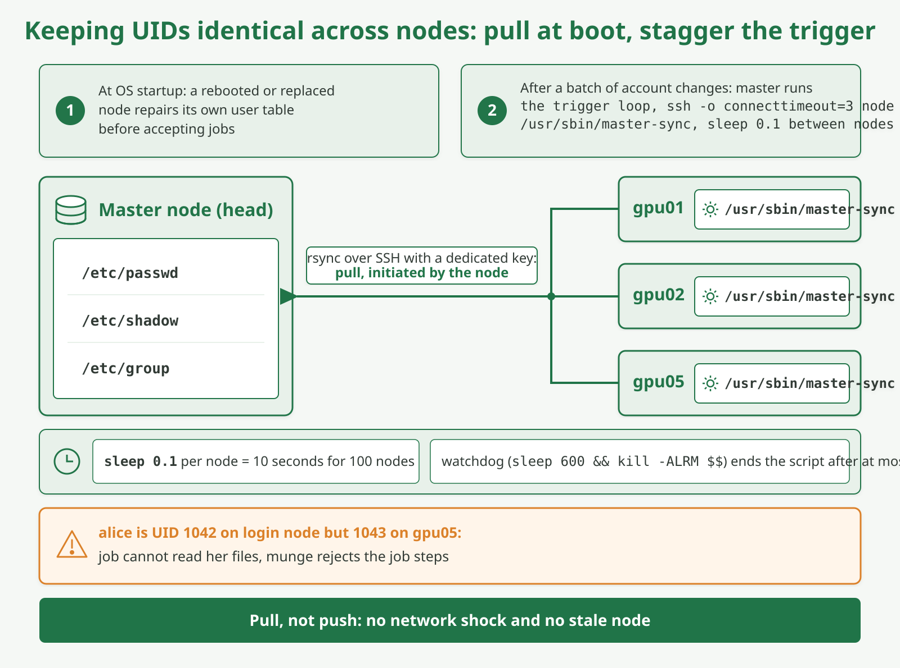

*Figure 1.6.17. Each node pulls the account files from the master at boot and on a staggered trigger, so a replaced node repairs itself and the network is not shocked.*

Historically, Linux stored accounts in `/etc/passwd`, `/etc/shadow` and `/etc/group`. Keeping an identical copy of those three files on every node has clear trade-offs compared with a network directory server.

- The classic file approach excels at job launch. First, when a large job starts across hundreds of compute nodes at once, each node resolves `uid` and `gid` from its local disk or page cache in microseconds. It does not hammer a central server. Second, the lookup is a local file read, not a network round trip, so latency stays low. Third, a short directory-server hiccup cannot block logins or job steps across the cluster, because no single network service sits in the path.
- Naive file copying fails in four ways. Silent desynchronization happens when a sync fails or a node is replaced. If a node was powered off during a push, or a dead compute node was swapped for a spare, that node comes up with missing or stale user records. The scheduler then places a task on it, and the job fails in a way that is hard to diagnose. Pushing from the master also creates a network shock. Hundreds of simultaneous `scp` processes from the master produce a sudden burst of network and SSH load. Repeated copying during bulk changes is another problem. A push script that runs after each of 50 `useradd` commands copies the account files 50 times across the fleet. Finally, flat files offer less schema flexibility than a full database directory.

How do you remove both bottlenecks, the desynchronization on rebooted or replaced nodes and the network shock? Zhumatiy's key design rule is to initiate the copy on the destination compute node, which is a **pull**, and not on the master node, which would be a **push**.

Put the synchronization commands in a dedicated script on every node, called `/usr/sbin/master-sync`. Configure the node to run it at OS startup, for example through an init script or a systemd service. Also let the master trigger it remotely over SSH when needed.

```bash
#!/usr/bin/env bash
# /usr/sbin/master-sync (runs on each destination node at boot and on demand)
SYNC="rsync -e 'ssh -i /root/secret_key'"
SRC_ADDR=root@master.cluster
$SYNC $SRC_ADDR:/etc/passwd /etc/passwd
$SYNC $SRC_ADDR:/etc/shadow /etc/shadow
$SYNC $SRC_ADDR:/etc/group /etc/group
```

Here is what each line does.

1. `SYNC="rsync -e 'ssh -i /root/secret_key'"` defines the `rsync` command. It uses an SSH transport, authenticated by a dedicated key at `/root/secret_key`. On the master, that key is restricted to reading the account files.
2. `SRC_ADDR=root@master.cluster` points to the authoritative copy on the head node.
3. The three `$SYNC` lines pull `/etc/passwd`, `/etc/shadow` and `/etc/group` onto the local node. Because the script runs at every boot, a compute node that was offline for maintenance or freshly imaged repairs its own user table before it accepts any jobs.

What about the case where the administrator adds or removes a batch of users on the running cluster? Do not trigger a sync inside every `useradd` wrapper. Finish all the credential edits first, then run one fleet-wide refresh. To avoid overloading the management network, stagger the remote calls by `0.1` to `0.5` seconds. You can also run them in bounded pools with `pdsh` or `clush`. Wrap the loop in an `ALRM` timeout trap, so a hung node cannot stall the script forever.

```bash
#!/usr/bin/env bash
# Fleet-wide trigger script run on the master node after account changes
TIMEOUT=600
CT=3
# Exit the script cleanly if the overall ALRM watchdog timer fires
trap 'exit' ALRM
# Schedule an ALRM signal to this script's PID ($$) after 600 seconds
(sleep $TIMEOUT && kill -ALRM "$$") &
# Trigger /usr/sbin/master-sync on each node listed in /etc/nodes with a 0.1s stagger
for i in $(grep -v \# /etc/nodes); do
    ssh -o connecttimeout=$CT $i /usr/sbin/master-sync
    echo -n .
    sleep 0.1
done
echo
```

In this script, `CT=3` (`-o connecttimeout=3`) limits each SSH connection attempt to 3 seconds. `sleep 0.1` spaces the node pulls 100 milliseconds apart, which adds up to 10 seconds for a 100-node cluster. The line `(sleep $TIMEOUT && kill -ALRM "$$") &` guarantees that the whole run ends after at most 600 seconds, which is 10 minutes.

### 8.3 NIS and NIS+: why the commands start with `yp` and why 30 to 40 clients is the ceiling

Why do all the NIS commands start with `yp`? The answer is a trademark story from 1985. Sun Microsystems created **NIS**, the *Network Information System*, to distribute configuration tables that must stay identical across a network, such as `/etc/passwd`, `/etc/group` and `/etc/hosts`. Sun first called it Yellow Pages. British Telecom owned the *Yellow Pages* trademark and sued, so Sun renamed the product NIS. The daemons, commands and configuration files kept the `yp` prefix, though. You will still see `ypserv`, `yppasswdd`, `ypxfrd`, `ypbind`, `/var/yp` and `/etc/yp.conf`.

The original NIS protocol had serious security flaws, so Sun introduced a replacement called **NIS+**. The two share program names and similar configuration ideas. They are still protocol-incompatible, though. An NIS client cannot talk to an NIS+ server, and an NIS+ client cannot talk to an NIS server.

Modern large clusters rarely use NIS+, for two reasons. Its security model is weak compared with modern Kerberos or TLS directories. Its RPC design also hits a reliability and performance wall once one server serves more than 30 to 40 clients. NIS+ is simple to administer and supports master and slave server redundancy, so you may still meet it on smaller legacy clusters.

Setting up NIS+ takes eight steps across the server and the clients.

1. Enable the three server daemons at boot. They are `ypserv`, the main lookup server; `yppasswdd`, which processes password updates; and `ypxfrd`, the map-transfer daemon that synchronizes databases to slave servers.
2. Open the firewall ports for `rpcbind` or `portmap`, `ypserv`, `yppasswdd` and `ypxfrd`.
3. Define the NIS+ domain name in `ypserv`'s startup options, and write it into `/etc/defaultdomain` on every client. This domain name is completely separate from your DNS domain.
4. On the server, create `/etc/ypserv.conf` and `/etc/sysconfig/ypserv`. They point to the map source directory, which is normally `/var/yp`, and they define which client subnets may access the server.
5. Configure `/var/yp/Makefile` and `/var/yp/securenets`. The `Makefile` compiles the text files `passwd`, `shadow` and `group` into network maps when you run `make` inside `/var/yp`. `securenets` lists the IP network segments allowed to query the server.
6. On every client, including the management node, configure `/etc/defaultdomain` and `/etc/yp.conf` with the NIS+ domain name and the server addresses.
7. Start the `ypbind` service on all clients.
8. Add `nis+` to the `passwd`, `shadow` and `group` lines in `/etc/nsswitch.conf`, so the C library queries NIS+. When you add a user or change a password on the master, run `cd /var/yp && make` to publish the update. Larger sites deploy slave servers through `ypxfrd` to spread the RPC load.

### 8.4 LDAP, explosive job-launch storms, and SSSD caching

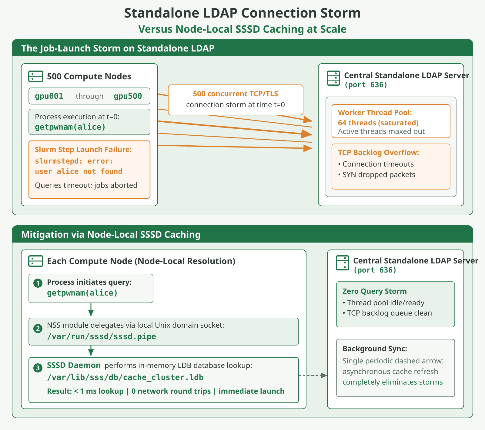

*Figure 1.6.18. A standalone LDAP server drops requests during synchronized multi-node job launches unless node-local SSSD caches absorb the query burst.*

**LDAP**, the *Lightweight Directory Access Protocol*, is a universal, schema-driven directory database for organizations, users, hosts and access policies. Where NIS+ only distributes lines from flat text files, LDAP stores structured records that can hold attributes, links between records, binary data and fine-grained access control lists for each record. Common implementations include **OpenLDAP**, Microsoft **Active Directory** (an LDAP server with Kerberos and Microsoft schema extensions), **Fedora Directory Server** (389 Directory Server, also known as FreeIPA), the **Apache Directory Project** and **Mandriva Directory Server**. On Red Hat family distributions, client setup has traditionally been automated with `authconfig`, or `authselect` on newer releases. Administrators often manage directory trees through web interfaces such as `phpLDAPadmin` or `LDAP Account Manager`.

Why does a naive LDAP deployment fail on a large supercomputer or GPU cluster? An office network sends steady, uniform LDAP queries as employees log in over a morning. A compute cluster sends **explosive burst access**. The moment Slurm or Kubernetes launches a 500-node job, all 500 nodes query the LDAP server at once for the submitting user's UID, GID and group list. Under that synchronized connection storm, a standalone LDAP server runs out of worker threads and drops requests. Job launch then fails on the nodes whose lookups were discarded.

To survive these job-start bursts, pair LDAP with one of two things. One option is a hierarchy of replica or caching LDAP servers. The other is node-local caching with **SSSD** (*System Security Services Daemon*), which chapter 6.24 covers in depth.

The table compares the three approaches. Use it to see why each one behaves the way it does on a cluster.

| Approach | How It Works | Strengths on a Cluster | Failure Mode & Scaling Limit |
|---|---|---|---|
| **Pull-based file sync (`/usr/sbin/master-sync`)** | Each node pulls `/etc/passwd`, `/etc/shadow`, `/etc/group` via `rsync` over SSH at boot and on staggered master triggers (`0.1–0.5s`) | Zero network lookup storm at job launch; microsecond local reads; no central daemon SPOF; self-heals on node reboot/replacement | Requires disciplined trigger script (`ALRM` timeout wrapper) after bulk account edits |
| **NIS / NIS+ (`ypserv`, `yppasswdd`, `ypxfrd`, `ypbind`)** | Sun's 1985 *Yellow Pages* (`yp`); admin edits source files and runs `make` in `/var/yp` | Simple text-to-map workflow; supports slave servers via `ypxfrd` | Weak security; NIS and NIS+ are incompatible; single server struggles above **30–40 clients** due to RPC load |
| **LDAP (`OpenLDAP`, Active Directory, FreeIPA)** | Schema-typed directory database queried via NSS/PAM (with `SSSD` caching) | Rich attributes, fine-grained access control, integrates with web/enterprise SSO (`phpLDAPadmin`, `LDAP Account Manager`) | **Explosive job-launch lookup storm** drops requests unless protected by local `SSSD` caching or replica hierarchy |

Each row trades something away. The file sync is fast and resilient, but it needs a disciplined trigger after bulk changes. NIS is simple, but it hits a wall at 30 to 40 clients. LDAP is rich, but it needs caching before a large job starts.

### 8.5 How a program finds a user: the Name Service Switch (NSS)

Programs never open `/etc/passwd` directly. They call C library functions, such as `getpwnam`, `getpwuid` and `getgrnam`. Those functions consult the **Name Service Switch (NSS)**, which is configured in `/etc/nsswitch.conf`.

```
passwd:   files systemd sss
group:    files systemd sss
hosts:    files dns
```

Read each line from left to right. The local files come first, `/etc/passwd` and `/etc/group`. Next comes `systemd`, which handles dynamic service users. Then comes `sss`, which is SSSD for LDAP or Active Directory. On NIS+ systems, the last entry is `nis+` instead. That is why `getent passwd alice` is the authoritative test on any node. It queries the full NSS chain, while `grep alice /etc/passwd` looks only at one file.

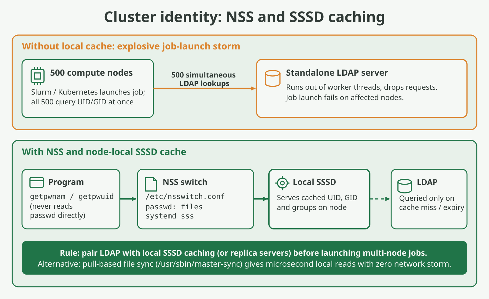

*Figure 1.6.19. Cluster identity: NSS and SSSD caching.*

Before you move a site from local files to a directory service, confirm that `getent passwd` returns the same answer on every node.

## 9. AI-infrastructure patterns

The rules in this chapter stop being abstract the first time a container run leaves root-owned files in a teammate's project directory. A few identity and permission habits matter a great deal on GPU clusters, and each one below connects a Linux rule from this chapter to a problem you will see in practice.

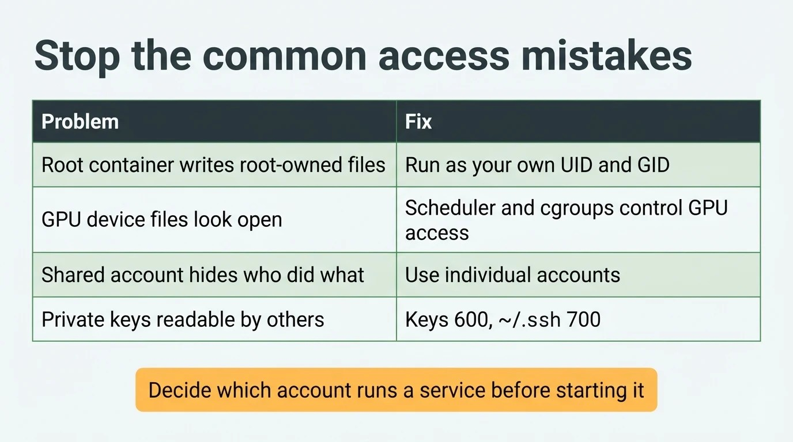
*Figure 1.6.20. Each access habit ties a Linux permission rule to a real cluster problem.*


**Container processes are real users.** A container's root is the host's UID 0, unless user namespaces remap it (chapter 1.19). If a root container writes to a bind-mounted or network directory, the files belong to root on the host, and you cannot write to them. Run training containers as your own user instead. Use `docker run --user "$(id -u):$(id -g)"`, or set `securityContext: runAsUser`, `runAsGroup` and `fsGroup` in Kubernetes. Give datasets and checkpoint directories the group-setgid recipe from section 3.

**GPU device files are not the access control.** `/dev/nvidia*` is usually created world-accessible, with mode `0666`. Access to GPUs is controlled by the scheduler and the cgroup device controller, not by file permissions (chapters 6.10 and 11.2). Some distributions place DRM devices, `/dev/dri/*`, in the `video` and `render` groups. Do not rely on file modes to divide GPUs between users.

**Slurm and munge depend on matching numbers.** Both carry the numeric UID and GID. That makes identity consistency (section 8) a hard requirement. A job runs as the submitting user, with that user's groups.

**Shared filesystems depend on matching numbers too.** NFS exports often use **root squash**, which maps remote root to an unprivileged user. Because of that, `sudo` on a node cannot touch files that belong to root on the server. That is a feature, not a bug.

**Shared accounts destroy accountability.** A single `ubuntu` or `ml` login used by the whole team makes it impossible to tell who did what, and it makes revocation impossible. Prefer individual accounts, with `sudo` groups, SSH certificates and audit logs.

**Secrets need strict modes.** SSH private keys should be `600`, and `~/.ssh` should be `700`. Token files should be `600` and owned by the service account. For a quick audit, run `find ~ -xdev -type f \(-perm -g+r -o -perm -o+r \) -name '*key*'`.

Before you start a new shared service on the cluster, decide which account runs it and who can read its files.

## How it fails

Identity failures usually show up as "permission denied" or as a job that cannot find a user. Each entry below gives the symptom you see first, the usual causes in the order to check them, and the fix. Fix the real cause, not the mode.

### 1. "Permission denied" although the file looks readable
**Symptom:** the file mode seems to allow access. **Causes (check in order):** a parent directory lacks `x` for you (check the whole path with `namei -l /path/to/file`); you are matched earlier by an owner or group triple that denies access; the effective ACL mask is more restrictive than the visible bits (`getfacl`); the filesystem is mounted read-only or `noexec`; the immutable attribute is set (`lsattr`); an SELinux or AppArmor policy is blocking it (chapter 1.21; check with `ausearch -m avc` and `dmesg`); or the group membership you just added is not in your running session, so you need to log in again. **Fix:** correct the actual cause, not the mode.

### 2. New files in a shared directory have the wrong group or permissions
**Symptom:** teammates cannot edit each other's files. **Cause:** the directory has no setgid bit, so new files get the creator's primary group, and/or `umask 022` removes group write. **Fix:** set `chmod 2770` and use a group-write umask, or add a **default ACL** with `setfacl -d -m g:projx:rwx`. Fix the existing files once with `chgrp -R` and `chmod -R g+rwX`.

### 3. After "fixing" with `chmod -R 777`, everything is wide open
**Symptom:** SSH refuses your keys, services complain about unsafe permissions, and the security audit fails. **Cause:** blanket permissions break the strict-mode checks that `sshd` and other programs run, and they expose data. **Fix:** restore sane modes. Use `755` or `750` for directories, `644` or `640` for files, and `600` for secrets. Then fix the real mismatch, whether that is the owner, the group or a missing `x`.

### 4. Files owned by `root` in your project after running a container
**Symptom:** you cannot modify or delete the outputs. **Cause:** the container ran as UID 0 and wrote to a bind-mounted directory. **Fix:** run `sudo chown -R "$USER:" dir` once. From then on, run the container with `--user`, or use `fsGroup` or user namespaces, and avoid running training as root.

### 5. The same user, different UID on different nodes
**Symptom:** on some nodes, files show a numeric owner such as 1043 instead of alice. Jobs fail to read the home directory, and munge or Slurm complains about unknown users. **Cause:** accounts were created in different orders on different nodes, a sync failed, or a node is missing its directory service. **Diagnose:** run `id alice` and `getent passwd alice` on every node, for example with `pdsh -w gpu[01-64] 'id alice' | dshbak -c`. **Fix:** make one source of truth for identity. Sync from a master, or use LDAP with SSSD. Allocate UIDs and GIDs centrally, and never reuse them. Then repair the file ownership with `find ... -uid OLD -exec chown NEW`.

### 6. Locked out by a `sudoers` mistake
**Symptom:** `sudo` reports a syntax error and refuses everything. **Cause:** someone edited `/etc/sudoers` directly and left a bad line. **Prevention:** always use `visudo`, keep a root shell open while you test, and put changes in `/etc/sudoers.d/` files, so a bad one can be removed on its own. **Recovery:** use the BMC console or a recovery boot to log in as root, then fix or delete the broken file (chapter 1.5, section 8).

### 7. A `sudo` command behaves differently: environment and redirection surprises
**Symptom:** `sudo ./train.sh` cannot find a variable or program that works for you. Or `sudo echo x > /root/f` reports permission denied. **Cause:** `sudo` resets the environment and `PATH`. Also, the `>` redirection is performed by *your* shell before `sudo` starts. **Fix:** use `sudo env VAR=value command`, or `sudo -E` where the policy allows it, and use full paths. For writing a root file, use `echo x | sudo tee /root/f` or `sudo sh -c 'echo x > /root/f'`.

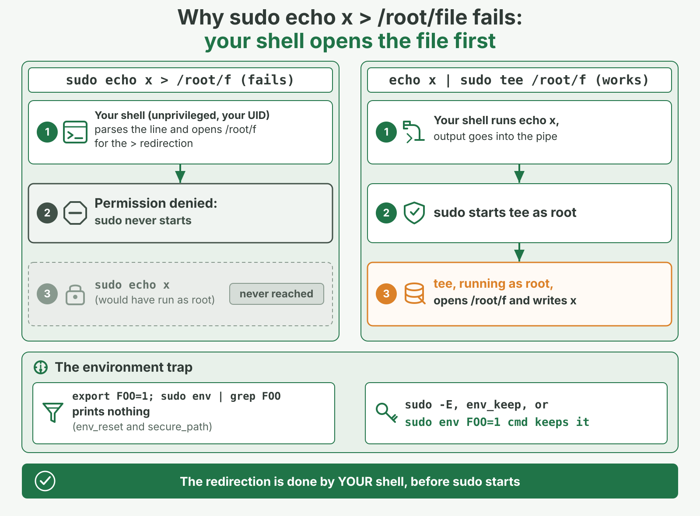

*Figure 1.6.21. The redirection happens in your own shell before sudo runs, so let a root process such as tee open the file instead.*

## Hands-on lab: permissions, ACLs, sudo, and VM drills

Start with the self-checking Python lab, which you can run locally. It verifies several behaviors from this chapter. It checks the non-cumulative u/g/o permission evaluation. It checks the umask results for `022`, `077` and `002`, and the way the ACL mask caps entries. It also checks setuid real, effective and saved UID transitions, sticky-bit (1000) deletion rules, and the `master-sync` stagger and the NIS+ limit of 30 to 40 clients.

```bash
python3 code/part01/users_permissions_lab.py
```

Next, use a GCP Ubuntu VM with `sudo` rights. Every interactive VM command below has not been run on live hardware, so run each one on a test machine first. The exercises are grouped by topic.

**Part A: identity files and tools.**
1. Read the real files with `head -5 /etc/passwd`, `sudo head -3 /etc/shadow` and `head -5 /etc/group`. Pick one line from each file and name every field. Then run `id`, `groups` and `getent passwd $USER`, and compare the result with `grep $USER /etc/passwd`.
2. Create a test user and group with `sudo useradd -m -s /bin/bash -c "Lab One" lab1`, `sudo passwd lab1` and `sudo groupadd -g 2001 projx`. Add `lab1` and your own user to projx with `usermod -aG`. Then run `usermod -G projx lab1` on a throwaway user to see what it removes, and correct it.
3. Show that new group membership needs a new session. Add yourself to projx, run `id`, and confirm that projx is not listed. Then run `newgrp projx`, or log out and back in, and run `id` again.

**Part B: permissions.**
4. In a scratch directory, create a file and a directory. Set the modes with both symbolic and octal forms, and predict the `ls -l` output before you run it. Remove the directory's `x` bit, then try `cd`, `ls` and `cat dir/file`. Restore `x`, remove `r` instead, and repeat. Record what each combination allows.
5. Show that deletion depends on the directory. Create a read-only file with `chmod 444` in a writable directory and remove it. Then try the same in a directory without `w`.
6. Show the non-cumulative checks. Make a file that you own with mode `070` and group projx. As yourself, try to read it. You will be denied, even though the group triple allows it, because the owner matched first.
7. Study umask. Run umask, then create a file and a directory. Repeat with `umask 077` and `umask 002`, and tabulate the resulting modes.

**Part C: special bits and a shared directory.**
8. Build the `2770` project directory recipe from section 3, using two test users. As user one, create a file and check its group and mode. As user two, edit it. Then remove the setgid bit and repeat, so you can see the difference. Confirm the sticky bit on `/tmp` with `ls -ld /tmp`. Show that user two cannot delete user one's file in a `1777` directory, but can do so in a `777` one.
9. List the setuid programs on the system with `find / -xdev -perm -4000 -type f 2>/dev/null`, and explain two of them, `passwd` and `sudo`. In a test directory, make a setuid copy of `sleep`. Run it in one terminal. In another terminal, run `ps -eo pid,euser,ruser,comm | grep sleep` to see the real and effective users. Then delete the copy.

**Part D: ACLs.**
10. Install the ACL tools if they are missing, with `sudo apt-get install -y acl`. Create a directory. Grant two users read-write and one user read-only with `setfacl`. Remove access for "other", view the result with `getfacl`, and test access as each user. Add a default ACL and show that new files inherit it. Change the group bits with `chmod g=r`, and watch the mask in `getfacl`.

**Part E: sudo.**
11. Create `/etc/sudoers.d/lab` with `visudo -f`. It should let the test user run one specific command without a password. Verify it with `sudo -l -U lab1`, then run the command. Try a command that is not on the list. Introduce a deliberate syntax error and watch `visudo` refuse to save it. Check the logs with `journalctl SYSLOG_IDENTIFIER=sudo | tail`, or with `/var/log/auth.log`.
12. Show the environment difference. Run `export FOO=1; sudo env | grep FOO`, which shows nothing. Then run it with `sudo -E` or `sudo FOO=1 env`. Show the redirection trap with `sudo echo x > /root/f`, and fix it with `tee`.

**Part F: startup files.**
13. Create a clean test user with an empty home directory. Write a minimal `~/.bashrc` that sets the path, prompt, editor and umask. Write a `~/.bash_profile` that sources it. Log in as that user in four ways: `su - lab1`, `ssh lab1@localhost`, `bash` inside a session, and `ssh lab1@localhost 'echo $PATH'`. Note which file is read in each case.

**Part G: limits and access restriction (mostly reading).**
14. Look at `ulimit -a`. Lower `ulimit -u` in a subshell, then run a small fork loop on a throwaway VM to see the limit stop the fork bomb's effect. Read `/etc/security/limits.conf`, and write the lines you would add for a compute node, covering `nofile` and `memlock`.
15. Restrict a test user. Set `chsh -s /usr/sbin/nologin lab1` and test SSH, then revert the change. In a copy of `sshd_config`, add `DenyUsers lab1` and validate the file with `sshd -t -f`.

**Part H: cluster identity thought exercise.**
16. With two VMs, create user `lab2` with a different UID on each one. Export a directory from one VM over NFS to the other, or use `sshfs`. Create a file as `lab2` on VM1, then look at its owner on VM2. Fix the problem by aligning the UIDs and running `chown` on the files.

## Exercises

Work these on paper or in a scratch directory before you check your answers in the chapter.

1. **Non-Cumulative Permission Evaluation (`u -> g -> o`):** The file `report.txt` is owned by alice (`UID 1042`) and group projx (`GID 2001`), with mode `0070` (`---rwx---`). Both alice (`UID 1042`, member of projx `2001`) and bob (`UID 1043`, member of projx `2001`) try to read `report.txt`. Which user is granted read access and which is denied, and why? Check your answer with `evaluate_posix_permission()` in `code/part01/users_permissions.py`.
2. **umask Default Creation Modes (`022`, `077`, `002`):** Work out the exact octal and symbolic modes for (a) a new regular file, with base `0666`, and (b) a new directory, with base `0777`. Do this under `umask 022`, `umask 077` and `umask 002`.
3. **Special Bits (`4000` setuid, `2000` setgid, `1000` sticky) and Shared Project Directories:** (a) When alice (`UID 1042`) runs `/usr/bin/passwd`, which is owned by root (`UID 0`) with mode `4755` (`-rwsr-xr-x`), what are the process's ruid, euid and `saved_uid`? (b) Why does the shared project directory `/data/projx` use mode `2770` (`drwxrws---`), and why does `/tmp` use mode `1777` (`drwxrwxrwt`)?
4. **POSIX ACL Mask Capping:** An administrator runs `setfacl -m u:alice:rw,u:bob:rw mydir`, then later runs `chmod 640 mydir` (or `chmod g=r mydir`). That sets the ACL `mask::r--` (`04`). What are alice's effective permissions on `mydir`, and how does `getfacl mydir` show the discrepancy?
5. **Pull-Based Cluster Account Synchronization (`/usr/sbin/master-sync`):** This comes from *Supercomputers for Linux Sysadmins* Chapter 11. (a) Why should `/usr/sbin/master-sync` pull `/etc/passwd`, `/etc/shadow` and `/etc/group` from the master at boot, instead of relying only on the master pushing them? (b) In the master trigger loop (`TIMEOUT=600`, `CT=3`, `sleep 0.1`), how long does the stagger delay take across 100 nodes, and how does the script keep a hung node from blocking forever?
6. **NIS / NIS+ (`yp`) vs. LDAP on Compute Clusters:** (a) Why do NIS and NIS+ commands start with `yp`? What is the client limit (30 to 40 clients) before a single NIS+ server struggles, and what do `ypserv`, `yppasswdd` and `ypxfrd` do? (b) Why does a 500-node Slurm job launch cause a standalone LDAP server to drop requests, and how does SSSD solve that problem?

## Checkpoint questions (20)

<details>
<summary>1. What does the Linux kernel know about user and group names, and where do the human-readable names live?</summary>

The kernel knows only numeric UID and GID integers, and `UID 0` is root. Names, password hashes and group memberships live in user space, in `/etc/passwd`, `/etc/shadow` and `/etc/group`. They can also come from a network directory, which the NSS settings in `/etc/nsswitch.conf` control.
</details>

<details>
<summary>2. Name the seven colon-separated fields of `/etc/passwd` and explain `x`, `*`, and an empty second field.</summary>

The seven fields are the login name, the password marker, the numeric UID, the primary GID, the GECOS comment, the home directory and the login shell. An `x` means the password hash is stored in `/etc/shadow`. An `*` disables password login. An empty field means no password is required, which is a severe security hole.
</details>

<details>
<summary>3. Why should you edit `/etc/passwd` with `vipw` and `/etc/shadow` with `vipw -s` instead of a plain text editor?</summary>

`vipw` and `vipw -s` lock the file, so `useradd` or `passwd` cannot edit it at the same time. They also make a backup copy and run basic consistency checks before they replace the live file.
</details>

<details>
<summary>4. What is the difference between a user's primary group and supplementary groups, and what is a user-private group?</summary>

The primary group is the single GID listed in `/etc/passwd`, and it is assigned to new files by default. Supplementary groups are the extra groups listed in `/etc/group`. A user-private group gives each user a dedicated primary group with the same name and ID, such as `alice:1042`. That setup makes `umask 002` safe by default.
</details>

<details>
<summary>5. Why is `usermod -G projx alice` a classic mistake, and when does `usermod -aG projx alice` take effect?</summary>

`usermod -G projx alice` replaces alice's entire supplementary group list with only projx. That removes her from `sudo`, `docker` and the others. `-aG` appends projx safely instead. Group credentials are set at login, so existing shells do not see the new group until alice logs in again or runs `newgrp projx`.
</details>

<details>
<summary>6. Contrast what `r`, `w`, and `x` mean on a regular file versus on a directory.</summary>

On a regular file, `r` reads the contents, `w` changes them, and `x` runs the file. On a directory, `r` lists the names with `ls`. `w`, together with `x`, creates, deletes and renames entries. `x` lets you traverse the directory to reach the inodes inside it, which is what `cd`, `stat` and `open` need.
</details>

<details>
<summary>7. Why can you delete a read-only (`0444`) file owned by another user if you have `wx` on the parent directory (without the sticky bit)?</summary>

Deleting a file changes the parent directory's table of names and inodes. It does not change the file's contents. So the kernel checks write and execute permission on the directory, not on the file itself.
</details>

<details>
<summary>8. Explain why permission checks (`user`, `group`, `other`) are non-cumulative.</summary>

The kernel checks only the first class that matches your process. If your euid equals the file's UID, it evaluates only the owner triple and stops. So a file with mode `0070` (`---rwx---`) denies the owner, even if the owner belongs to the file's group.
</details>

<details>
<summary>9. Starting from base `0666` for files and `0777` for directories, what modes do `umask 022`, `umask 077`, and `umask 002` produce, and what is `rwxr-x---` in octal?</summary>

`umask 022` produces `0644` (`rw-r--r--`) for files and `0755` (`rwxr-xr-x`) for directories. `umask 077` produces `0600` and `0700`. `umask 002` produces `0664` and `0775`. `rwxr-x---` is `0750` in octal, and `0640` is `rw-r-----`.
</details>

<details>
<summary>10. What do the setuid (`4000`), setgid (`2000`), and sticky (`1000`) bits do on files and directories?</summary>

setuid (`4000`) on an executable runs the process with the file owner's euid, as with `/usr/bin/passwd` and `/usr/bin/sudo`. setgid (`2000`) on an executable sets the egid. On a directory such as `2770`, it makes new files and subdirectories inherit the directory's group. sticky (`1000`) on a directory, as with `1777` for `/tmp`, limits deleting or renaming to the file owner, the directory owner or root.
</details>

<details>
<summary>11. What is the POSIX ACL mask, and why does running `chmod 640` after `setfacl` break named user ACL entries?</summary>

The ACL mask sets the maximum effective permission for all named users, named groups and the owning group. `chmod` changes the group bits, and POSIX ACLs store those bits in the mask. So `chmod 640` caps an entry such as `u:alice:rw` down to `#effective:r--`.
</details>

<details>
<summary>12. Distinguish a process's real UID (ruid), effective UID (euid), and saved UID (`suid`).</summary>

The ruid is the user who launched the process, and it decides who can send the process signals. The euid is the identity checked for file and resource access. The `saved_uid` keeps the privileged UID when a setuid program drops privileges temporarily, so the program can restore them later.
</details>

<details>
<summary>13. Why should user-writable filesystems (`/tmp`, `/home`, scratch mounts) be mounted with `nosuid`, and how do you audit existing setuid binaries?</summary>

A `nosuid` mount stops any setuid binary on that filesystem from raising its privileges. To audit setuid files on local filesystems, run `find / -xdev -perm -4000 -type f 2>/dev/null`.
</details>

<details>
<summary>14. Why does `sudo echo x > /root/file` fail with `Permission denied`, and what is the clean fix?</summary>

Your unprivileged shell opens the `>` redirection before `sudo` starts `echo`, so the file open fails. The clean fix is to pipe into `tee`: `echo x | sudo tee /root/file >/dev/null`.
</details>

<details>
<summary>15. Why is putting `.` (the current directory) in `PATH` a serious security hazard on a shared cluster?</summary>

If `.` is in `PATH` and you `cd` into a shared or untrusted directory, such as `/tmp` or a dataset folder, an attacker can place a malicious executable named `ls` or `sl` there. When you type that command, it runs with your privileges.
</details>

<details>
<summary>16. In *Supercomputers for Linux Sysadmins* Chapter 11, why is `/usr/sbin/master-sync` designed as a pull script on each compute node rather than a push script on the master?</summary>

When each compute node pulls `/etc/passwd`, `/etc/shadow` and `/etc/group` from the master at boot, a node that was powered off during an account update, or replaced with spare hardware, syncs its user database before it joins the cluster.
</details>

<details>
<summary>17. How does the master-node trigger loop in *Supercomputers for Linux Sysadmins* Chapter 11 avoid overloading the network and hanging on dead nodes?</summary>

The loop runs manually, and only after a batch of user changes is complete. It sets a 3-second SSH timeout with `-o connecttimeout=3`, and it spaces node connections by 0.1 seconds. A background subshell, `(sleep 600 && kill -ALRM "$$") &`, works with `trap 'exit' ALRM` to stop the script if it runs past 600 seconds.
</details>

<details>
<summary>18. Why do NIS commands start with `yp`, what are the three NIS+ server daemons, and why is NIS+ limited to small clusters?</summary>

Sun created NIS in 1985 under the name *Yellow Pages*, which is why the commands start with `yp`. A trademark lawsuit forced the rename. The three NIS+ server daemons are `ypserv`, the main lookup server; `yppasswdd`, the password change server; and `ypxfrd`, the map transfer daemon for slave servers. A single NIS+ server struggles above 30 to 40 clients under concurrent RPC load.
</details>

<details>
<summary>19. Why does a standalone LDAP server fail when a 500-node Slurm job starts, and how do production clusters prevent it?</summary>

At job launch, all 500 nodes query the LDAP server at once for the user's UID and groups. That burst overflows the request queue, so the server drops requests and job launch fails. Production clusters avoid this by caching lookups on each node with SSSD, or by running a hierarchy of replica LDAP servers.
</details>

<details>
<summary>20. Why does `getent passwd alice` succeed for an LDAP/SSSD user when `grep alice /etc/passwd` returns nothing?</summary>

`grep alice /etc/passwd` searches only the local text file. `getent passwd alice` calls the C library's `getpwnam` lookup, which checks every source listed in `/etc/nsswitch.conf`, such as `files systemd sss`.
</details>

## Sources and review notes

- **Sources read in full:**
  - `how-linux-works-3rd-edition` — Brian Ward, *How Linux Works*, 3rd ed., **Chapter 2: Basic Commands and Directory Hierarchy**, **Chapter 7: System Configuration: Logging, System Time, Batch Jobs, and Users**, and **Chapter 13: User Environments**. Read Chapter 2 sections 2.6, 2.17 (Table 2-4 absolute octal modes), and 2.20 (`sudo` and `/etc/sudoers`) in full. Read Chapter 7 sections 7.2, 7.3 (`/etc/passwd`, special users, `/etc/shadow`, `vipw` and `vipw -s`, `/etc/group` and `groups`), 7.9 (real/effective/saved UIDs and setuid security implications), and 7.10 (PAM overview) in full. Read Chapter 13 sections 13.1–13.7 in full (guidelines for creating startup files, `PATH`, `PS1`, aliases, umask, `.bash_profile`/`.bashrc` and `.cshrc`, `/etc/skel`, and further startup topics).
  - `supercomputers-for-linux-sysadmins-managing-modern-hpc-clusters-and-supercomputers-from-software-to` — Sergey Zhumatiy, *Supercomputers for Linux SysAdmins*, **Chapter 11: Users – Accounting Management** and **Chapter 12: Users – Quotas and Access Rights**. Read Chapter 11 in full. Covers account synchronization across compute and service nodes, classic file sync pros and cons, pull-based `/usr/sbin/master-sync`, the `0.1–0.5s` staggered trigger loop with `TIMEOUT=600` `ALRM` trap, 1985 Sun *Yellow Pages* (`yp`) NIS/NIS+ history, the `30–40` client limit, `ypserv`/`yppasswdd`/`ypxfrd` 8-step setup, and LDAP explosive job-start storms (`authconfig`, `phpLDAPadmin`, `LDAP Account Manager`). Read Chapter 12 in full (filesystem quotas, `ulimit` and `limits.conf`, UNIX groups and `setfacl`/`getfacl` ACLs, and restricting access via `DenyUsers`/`AllowUsers`, `pam_access`, `chsh`, and `scponly`).
- **Run here:** `python3 code/part01/users_permissions_lab.py` (25 passed, 0 failed).
- **Explicitly labelled inferences:** Container `--user` / `fsGroup` ownership and `/dev/nvidia*` `0666` cgroup device isolation connect Linux UID/GID rules to Part 5, Part 6, and Part 11 GPU scheduling.
- **Not verified on live hardware:** All interactive VM commands (`useradd`, `usermod`, `vipw`, `chmod`, `setfacl`, `visudo`, `/usr/sbin/master-sync`) are marked and should be executed on a test VM.
