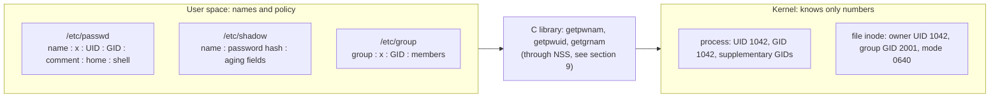
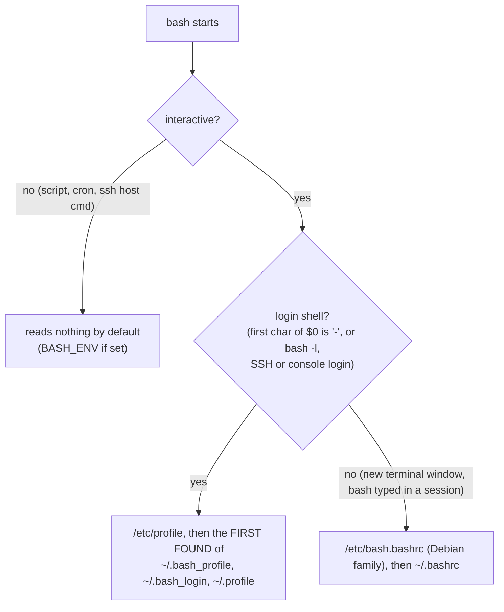

# 1.6 Users, groups, permissions, ACLs, sudo and user environments

**Level:** basics → intermediate · **Tier 0 (foundations)** · **Lab venue:** a small Ubuntu VM on GCP, with sudo rights · **Status:** drafted, labs untested

## Why this matters for AI infrastructure

Almost every "it works for me but not for the job" problem on a shared cluster is an identity or permission problem. A training job that cannot read a dataset, a checkpoint directory that teammates cannot write to, files owned by `root` appearing in your project after a container run, a Slurm job that fails because a user has a different UID on two nodes, a `sudo` rule that locked an admin out, a login node where one user's fork bomb froze everyone. This chapter explains how Linux decides *who you are* and *what you may do*, from the numbers the kernel uses up to the policy files an administrator edits, and how those ideas stretch across hundreds of nodes. It also covers the user environment (startup files), which decides what every new shell and job starts with, and which is a quiet source of cluster-wide breakage when someone "improves" it.

## Prerequisites and outcomes

You need chapters 1.1 to 1.3 (processes and system calls, the shell, files and inodes). After this chapter you will be able to:

- explain that the kernel knows only numeric user and group IDs, and describe where names, passwords and group membership live (`/etc/passwd`, `/etc/shadow`, `/etc/group`) and how programs look them up;
- read any `ls -l` mode, set permissions symbolically and in octal, and explain precisely what read, write and execute mean for files and for directories;
- use `umask`, the setuid, setgid and sticky bits, and build a safe shared project directory;
- use ACLs when classic permissions are too coarse;
- explain real, effective and saved user IDs, and why setuid programs are both necessary and dangerous;
- create, modify, lock and delete users and groups safely, and avoid the classic `usermod` mistake;
- use `sudo` correctly, read and write `sudoers` safely, and know why not to work in a root shell;
- design shell startup files that are simple and portable, and know exactly which file is read when;
- keep identities consistent across a cluster (rsync-style sync, NIS, LDAP and their scaling limits), and restrict access when needed;
- diagnose seven common identity and permission failures.

## 1. Users and groups: names for numbers

To the **kernel**, a user is a number: the **user ID (UID)**. Files record the UID of their owner; processes carry a UID that says on whose behalf they run. Names such as `alice` do not exist in the kernel; they are conveniences in user space. Likewise a **group** is a number, the **group ID (GID)**, and groups exist mainly to share file access among several users. The only UID with special meaning to the kernel is **0**, the superuser, conventionally called `root`; everything else (including the pseudo-users described below) is just policy in user space.

This is the most important fact in the chapter, because it explains many cluster failures later: **when two machines disagree about which number belongs to `alice`, they disagree about who owns every file she created.** Names are labels; numbers are identity.

Where do the names come from? A small set of plain-text files, in `/etc`, normally consulted through the C library.



### `/etc/passwd`: the user table

Each line describes one user as seven colon-separated fields:

```
alice:x:1042:1042:Alice Example,Room 12:/home/alice:/bin/bash
```

| Field | Meaning |
|---|---|
| `alice` | the login name |
| `x` | historically the password hash; now a marker meaning "the hash is in `/etc/shadow`". An asterisk `*` means this account cannot log in with a password. An **empty** field means *no password is required*, which you should never see. |
| `1042` | the UID |
| `1042` | the GID of the user's **primary group** |
| `Alice Example,...` | the "GECOS" comment: real name, sometimes room and phone, separated by commas |
| `/home/alice` | the home directory |
| `/bin/bash` | the login shell (must be listed in `/etc/shells` for `chsh` to accept it) |

The file is plain text with strict syntax: no comments, no blank lines. An **account**, in common usage, is a passwd entry plus a home directory, but that is only a convention: programs recognise a user from the passwd entry alone, and users may also come from a network directory service without any local line at all (section 9). UIDs should be unique; two entries with the same UID make both names the same person as far as the kernel is concerned, which is confusing at best.

**Special users.** `root` is UID 0 and GID 0. A number of **pseudo-users** exist so that services can run without root's power: `daemon`, `www-data`, `postgres`, `munge`, `slurm` and so on. They normally cannot log in (their shell is `/usr/sbin/nologin` or `/bin/false`, or their password field is `*`), but the system starts processes under their UIDs, which limits what a compromised service can do. The traditional `nobody` user (UID 65534 on Debian and Ubuntu, with group `nogroup`; the number differs on some distributions) owns nothing and is used for deliberately unprivileged processes. Remember: none of these have special meaning to the kernel. If you made `nobody` the owner of everything, it would not be unprivileged any more. By convention, UIDs below 1000 (the exact minimum is set in `/etc/login.defs`, as `UID_MIN`) are for system accounts and 1000 and above for people, though some older distributions used 500.

### `/etc/shadow`: passwords and aging

The shadow file holds authentication data and is readable only by root (and the `shadow` group), so that ordinary users cannot grab hashes and try to crack them offline. It has nine fields: the name, the **password hash**, and several aging fields (date of last change, minimum and maximum age, warning period, inactivity period, account expiry).

```
alice:$y$j9T$salt$hash...:20380:0:99999:7:::
```

The hash is a one-way transformation of the password, with a random salt, stored with a prefix that names the algorithm (`$6$` is SHA-512 crypt; `$y$` is yescrypt, the default on current Debian and Ubuntu; `$5$` SHA-256). A leading `!` or `*` in the field means the password is locked or unset, so password login is impossible (key-based SSH may still work). Use the tools, not an editor, to change these files: `passwd`, `chage`, `usermod`, `useradd`. If you must edit the files by hand (corruption, recovery), use **`vipw`** for `/etc/passwd` and **`vipw -s`** for `/etc/shadow`, which lock the file and keep a backup so that a concurrent change cannot corrupt it.

### `/etc/group`: the group table

```
projx:x:2001:alice,bob
```

Fields: group name, a password marker (group passwords are essentially never used; `x` means the entry is in `/etc/gshadow`, and it is nearly always a locked `!` or `*`), the GID, and a **comma-separated list of members**. A user belongs to a group if their passwd entry names it as the primary group (GID) *or* they are listed in the group's member list (a **supplementary** group). `id` shows both, `groups` lists the names:

```bash
id                # uid=1042(alice) gid=1042(alice) groups=1042(alice),2001(projx),27(sudo)
groups alice      # the same, names only
getent group projx  # query through the C library, including network sources (section 9)
```

Many distributions create a **user-private group** for each new user, with the same name and number as the user (`alice` has primary group `alice`). That sounds odd, but it makes sharing safe by default: files are group-owned by a group containing only you, so a permissive group-write bit does not expose them to anyone else. It is also the reason the default `umask` on such systems can be `002` (section 3).

## 2. Managing users and groups

The rule: use the tools. They update several files consistently, create the home directory from a template, and handle locking.

```bash
sudo useradd -m -s /bin/bash -c "Alice Example" alice      # create user with a home directory (-m)
sudo useradd -r -s /usr/sbin/nologin -d /var/lib/svc svc   # a system (-r) account for a service
sudo passwd alice                                          # set or change the password
sudo groupadd -g 2001 projx                                # create a group, with an explicit GID
sudo usermod -aG projx alice                               # ADD alice to a supplementary group (see warning)
sudo usermod -L alice ; sudo usermod -U alice              # lock / unlock the password
sudo chage -l alice                                        # show password aging; chage -E 0 expires the account
sudo userdel -r alice                                      # delete the user and the home directory
id alice ; getent passwd alice                             # verify
```

On Debian and Ubuntu, `adduser`/`addgroup` are friendlier front ends (interactive, sensible defaults); `useradd` is the portable low-level tool.

:::warning The classic `usermod` mistake
`usermod -G projx alice` **replaces** alice's supplementary groups with only `projx`, silently removing her from `sudo`, `docker` and the rest. You almost always want **`-aG`** (`-a` = append). Group membership is also only read at **login**: after adding someone to a group, their existing sessions do not see it; they must log in again (or run `newgrp projx` or `su - alice` in a test), which confuses people who "fixed" a permission and see no change.
:::

Day-to-day account changes users can make themselves: `passwd` changes your password (it asks for the old one, then the new one twice), `chsh` changes your login shell (it must be listed in `/etc/shells`), and `chfn` changes the comment. These programs must modify root-owned files, which they can do because they are **setuid-root** executables (section 5). On passwords: length beats cleverness. A long, memorable phrase of 16 or more characters is better than short strings of symbols. For servers, prefer key-based SSH and disable password login (chapters 1.5 and 1.21).

**Locking and restricting accounts.** Preventing someone from using a system is an escalation to use sparingly (a user who is in serious violation of policy, a departed employee), but you must know the options and their limits:

- `usermod -L` locks the password (but SSH keys may still work).
- Set the shell to `/usr/sbin/nologin` or `/bin/false` (`chsh -s`; the shell must be in `/etc/shells`); every command, including `ssh host command`, runs through the shell, so this blocks interactive and remote command use, although in some configurations it can be bypassed (for example by port forwarding) and it does not stop file transfer if an SFTP server is allowed. A special restricted shell (`scponly`) allows only `scp`/`sftp`.
- In `sshd_config`, `DenyUsers user1 user2` blocks named users, and `AllowUsers ...` (or `AllowGroups`) permits only the listed ones, which is useful during maintenance to admit only administrators. Reload `sshd` afterwards; sessions that are already open continue. Some references say you may use only one of these directives; `sshd_config(5)` says they can be combined and are evaluated in the order DenyUsers, AllowUsers, DenyGroups, AllowGroups (verify on your version), but the simplest, safest policy is a single allow-list. Chapter 1.29 gives the full option reference.
- **`pam_access`**: add `account required pam_access.so` to the PAM chain for `sshd` and write rules in `/etc/security/access.conf`, lines `permission : users-or-groups : origins`, for example `+:@admins:ALL` followed by `-:ALL:ALL` to allow only the admins group. Rules are evaluated top to bottom; put the allow rule for administrators first so you do not lock yourself out.
- For compute resources on a cluster, the **scheduler** is the real gate: remove the user's associations or set limits in Slurm (chapter 6.9).

Always keep a second administrator session open when testing lock-down changes.

## 3. File permissions: read, write, execute

Every file and directory has an owner (UID), a group (GID) and a **mode**: a set of permission bits. `ls -l` shows the mode as ten characters:

```
-rw-r-----  1 alice projx 7041 Oct 23 19:34 endnotes.html
dr-xr-sr-x  2 root  projx 4096 Oct 23 19:34 shared
 ^^^ ^^^ ^^^
 |   |   +-- other: everyone else
 |   +------ group: members of the file's group
 +---------- user (owner)
```

The first character is the file type (chapter 1.3). The remaining nine are three triples, for **user (u)**, **group (g)** and **other (o)**, each some combination of `r` (read), `w` (write), `x` (execute) and `-` (not granted). The kernel decides access by checking **in this order and stopping at the first match**: if your effective UID is the file's owner, the *user* triple applies; otherwise, if your effective GID or one of your supplementary groups is the file's group, the *group* triple applies; otherwise the *other* triple applies. Note the consequence: the checks are **not cumulative**. If the owner's triple is `---` and the group's is `rwx`, the owner is still *denied* (the owner matches first). And `root` (UID 0) bypasses nearly all of these checks (it holds the relevant capabilities, chapter 1.21).

### What the bits mean: files versus directories

| Bit | On a regular file | On a directory |
|---|---|---|
| `r` read | read the contents | **list the names** in the directory (`ls`) |
| `w` write | modify the contents (not delete the file) | **create, delete and rename entries** in the directory (requires `x` as well) |
| `x` execute | run it as a program (a script also needs `r`) | **traverse**: access an entry by name (`cd` into it, open `dir/file`) |

These directory rules explain many puzzles. To read `/data/project/file` you need `x` on `/`, `data` and `project` *and* `r` on `file`. `r` on a directory without `x` lets you see names but not open them. **Deleting a file needs `w` on the *directory*, not on the file itself**, which is why a read-only file can still be removed from a writable directory (and why the sticky bit exists, below). A common mistake when using absolute modes on directories is to drop the `x` bit by accident and lock everyone out.

### Changing permissions: `chmod`, `chown`, `chgrp`

**Symbolic mode** edits specific bits: choose who (`u`, `g`, `o`, or `a` for all), an operator (`+` add, `-` remove, `=` set exactly), and the permissions.

```bash
chmod u+x script.sh            # make it executable for the owner
chmod go+r file ; chmod go-r file   # give/remove read for group and other
chmod g=rw,o= file             # group read-write, others nothing
chmod -R u+rwX,go+rX dir       # capital X: add execute only to directories (and files already executable)
```

**Absolute (octal) mode** sets all bits at once. Each triple is a number: read = 4, write = 2, execute = 1, added together; so `rw-` is 6, `r-x` is 5, `rwx` is 7.

| Mode | Meaning | Typical use |
|---|---|---|
| `644` | owner read/write; group, other read | ordinary files |
| `600` | owner read/write; nobody else | private files, SSH private keys |
| `755` | owner all; group, other read and execute | programs, directories |
| `700` | owner all; nobody else | private directories (`~/.ssh`) |
| `711` | owner all; others execute only | directories others may pass through but not list |
| `664` / `775` | like 644 / 755 with group write | shared project files / directories |
| `777` | everyone everything | almost never correct |

**Do not "fix" permission problems with `chmod -R 777`.** It removes the protection on every file, usually does not address the real cause (wrong owner, group or a missing directory `x`), and makes executable what should not be. Find the actual mismatch with `namei -l /full/path/to/file`, which prints the owner and mode of every component along the path, and `id` for your identity.

**Ownership.** `chown alice file` changes the owner (root only); `chown alice:projx file` changes both; `chgrp projx file` changes the group (the owner may change a file's group to one they belong to). `-R` recurses. `stat file` shows the owner, group and mode in full.

### `umask`: default permissions for new files

New files start from **666** (read-write for all, because new regular files are not executable by default) and new directories from **777**; the **umask** is a mask of bits to *remove*. With the common `umask 022`, a new file gets `666 - 022 = 644` and a new directory `755`. With `umask 077` they get `600` and `700` (private). With `umask 002` (group-writable) files get `664` and directories `775`. Arithmetically, it is a bit mask rather than subtraction, but the result is the same for normal masks.

```bash
umask                # show the current mask, for example 0022
umask 077            # make new files private in this shell
umask -S             # symbolic form
```

Which to choose: **077** is the most restrictive and suits a multi-user machine where you do not want others reading your files; it also makes sharing harder, which tempts inexperienced users into making things world-writable. **022** lets others read what you create, appropriate for a single-user system and for daemons that run as pseudo-users and must read your files. **002** is for collaborative group directories on systems with user-private groups. The mask is per-process and inherited, so set it in a startup file (section 7) to apply to every shell; some programs (mail clients, `ssh-keygen`, key stores) deliberately override it to be private.

### The special bits: setuid, setgid, sticky

Three extra mode bits appear in a fourth, leading octal digit (`4000`, `2000`, `1000`) and show up as `s` or `t` in the `ls -l` triples:

| Bit | On an executable file | On a directory |
|---|---|---|
| **setuid** (`u+s`, 4000) | the program runs with the **file owner's** identity (as its *effective* UID) instead of the invoker's: the mode shows `s` in the owner's execute slot (`-rwsr-xr-x`) | ignored on Linux |
| **setgid** (`g+s`, 2000) | runs with the file's **group** | **new files and subdirectories inherit the directory's group** (instead of the creator's primary group); shows `s` in the group slot |
| **sticky** (`+t`, 1000) | ignored on Linux | **only the owner of a file (or of the directory, or root) may delete or rename entries**, even if others have write permission on the directory; shows `t` in the other's execute slot |

Familiar examples: `/usr/bin/passwd` and `/usr/bin/sudo` are setuid-root so that ordinary users can change `/etc/shadow` through a vetted program; `/tmp` is `1777` (`drwxrwxrwt`) so that everyone can create files but cannot delete each other's. Setuid has no effect on interpreted scripts on Linux (the kernel honours it only for real executables), for security reasons.

### A recipe: a safe shared project directory

A team (`projx`, GID 2001) needs a directory on a shared filesystem where all members read and write each other's files, and outsiders have no access:

```bash
sudo groupadd -g 2001 projx
sudo usermod -aG projx alice ; sudo usermod -aG projx bob      # members log in again to pick this up
sudo mkdir -p /data/projx
sudo chown root:projx /data/projx
sudo chmod 2770 /data/projx          # setgid so new files inherit group projx; group rwx; others none
# members use umask 002 so files they create are group-writable (set it in their startup file)
```

With `2770` and `umask 002`, anything created in the directory is group-owned by `projx` and group-writable, with no extra steps. If you cannot control users' umasks, ACL default entries (next section) enforce the permissions on the directory side.

## 4. Access control lists (ACLs)

Classic permissions have one owner, one group and "everyone else". Real teams need rules like "alice and bob may read and write, carol may only read, everyone else nothing", which would otherwise force you to create a special group for every combination. **POSIX ACLs** extend the model by adding lists of extra users and groups with their own permissions on a file or directory. They are supported by the common Linux filesystems (ext4 and XFS support them by default, others when mounted with the `acl` option) and by NFSv4 in its own form; **not every network or parallel filesystem supports them**, so check before relying on them.

```bash
setfacl -m u:alice:rw,u:bob:rw mydir          # grant specific users (-m modifies)
setfacl -m g:readers:r mydir                  # grant a group
chmod o-rwx mydir                             # classic bits: remove access for everyone else
getfacl mydir                                 # show the ACL
setfacl -d -m g:projx:rwx /data/projx         # DEFAULT ACL (-d): applied to new files created inside
setfacl -R -m u:carol:rX /data/projx          # recurse (capital X = execute only for dirs)
setfacl -b mydir                              # remove all ACL entries
ls -l mydir                                   # a trailing + after the mode means an ACL is present
```

Two ideas to understand. First, an ACL has a **mask** entry that caps the *effective* permission of every named user, every named group and the owning group. `chmod g=...` on a file with an ACL **modifies the mask**, not the owning group's bits, so a file may look group-writable in `ls -l` but be limited by a mask of `r--`; `getfacl` shows "#effective:" annotations when they differ. This is a frequent source of "the ACL is right but access is denied". Second, **default ACLs** on a directory give new files and subdirectories their initial ACL, so a shared directory enforces its sharing rules regardless of each user's umask.

## 5. Process identity, setuid and `sudo`

### How a process gets its identity, and how it changes

Every process runs with a UID and GID (plus supplementary groups). Where do they come from? `login`, `sshd` or the display manager authenticates a user, then starts their shell with the user's IDs; every process the shell creates inherits them (chapter 1.1). Changing identity later means changing these numbers, and the kernel allows it only by strict rules:

1. A process may run a **setuid executable** if it has permission to execute the file; the program starts with the file owner's UID as its effective UID.
2. A process running as root (UID 0) may call the `setuid()` family of system calls to become *any* user.
3. A process not running as root can use `setuid()` only in very limited ways (basically, to switch among IDs it already holds).

Utilities such as `su` and `sudo` combine these rules: they are setuid-root programs, so they start with root's power, and then call `setuid()` to become the target user (or stay root). **User switching has nothing to do with passwords at the kernel level**: authentication (passwords, keys, tokens) is a user-space ceremony performed *before* the program changes IDs.

### Real, effective, saved (and filesystem) IDs

Because setuid programs must be able to act as another user and *then* give that power back, a process carries more than one user ID:

| ID | Purpose |
|---|---|
| **effective UID (euid)** | the identity used for permission checks, notably on files; this is the "actor" |
| **real UID (ruid)** | who actually *started* the process; it determines who may send it signals and kill it; the "owner" |
| **saved UID** | a stored ID the process can switch its euid back to later |
| **filesystem UID (fsuid)** | used for filesystem access checks; rarely distinct (used by some file-serving programs) |

When you run a setuid program, the euid becomes the file owner's, while the ruid remains yours. `ps` normally shows only the effective user; to see both, `ps -eo pid,euser,ruser,comm`. In practice, `sudo` and similar programs set *all* the IDs to the target user on purpose (this avoids odd side effects when the IDs differ), which is why a process you started with `sudo` can often only be killed with `sudo` too. A sudoers option (`Defaults stay_setuid`) changes this; leave it alone unless you understand the consequences.

### Why setuid is dangerous

Every setuid-root program is a place where an ordinary user's input crosses into root's authority, so two things must be controlled: **how many such programs exist and what exactly they do.** A copy of a shell with the setuid-root bit set gives any local user a root shell; a bug in a legitimate setuid program is a privilege-escalation vulnerability, and exploiting those is a primary way systems are broken into. Audit periodically: `find / -xdev -perm -4000 -type f 2>/dev/null`. Also limit the ability to create setuid files: mount user-writable filesystems (home directories, `/tmp`, container volumes) with the `nosuid` option. For the same reason, containers should not run with extra capabilities and should drop setuid binaries (chapter 5.1 and 18.3).

### Identification, authentication, authorization

Three words worth keeping distinct. **Identification** answers *who are you?* (a username, ultimately a UID). **Authentication** answers *prove it* (a password, an SSH key, a token, a smart card). **Authorization** answers *what may you do?* (file permissions, `sudo` rules, scheduler limits). The kernel does **identification by number** and **authorization for files and processes**; it knows nothing about authentication. Everything about passwords and tokens is user space: a program wanting its own username calls `geteuid()` for the number, then asks the C library to map it to a name (`getpwuid()`), and the library decides where to look, which is configurable (section 9). This indirection is what lets a site move from local files to a network directory without changing any program. The same limits of the old "just read `/etc/passwd`" approach (one fixed hashing method, always prompting, no support for tokens or smart cards) are why **PAM**, the Pluggable Authentication Modules framework, was created (chapter 1.21).

### `sudo`: administrative power with a trail

You will need root occasionally. The disciplined way is **`sudo`**: run a single command as another user (by default root), after authenticating *as yourself*, with a log entry. A root shell (`su -`, `sudo -i`) has costs: no record of which commands were run or by whom, no access to your normal environment, and (for `su`) a shared root password. Use `sudo command` for individual commands, and `sudo -i` or `sudo -s` for a root shell only when you really need a sequence, knowing the logging is coarser.

```bash
sudo systemctl restart slurmd           # one command as root
sudo -u slurm scontrol show config      # run as another user
sudo -l                                 # what am I allowed to run?
sudo -k                                 # forget cached credentials
sudoedit /etc/ssh/sshd_config           # edit a root file with YOUR editor (see chapter 1.5)
echo "x" | sudo tee /root/file          # NOT: sudo echo x > /root/file (the redirection is done by YOUR shell)
```

**Configuration.** `sudo` reads `/etc/sudoers` and every file in `/etc/sudoers.d/` (names must not contain a dot or end in `~`; mode `0440`). **Always edit with `visudo`** (`visudo -f /etc/sudoers.d/aiteam`), which locks the file and checks syntax before saving. A syntax error in sudoers can disable `sudo` entirely, so keep a root shell open while changing it. The rule format is:

```
who   where = (run-as-user:run-as-group)   [NOPASSWD:]  commands
```

```
# /etc/sudoers.d/gpu-admins
User_Alias  GPUADMINS = alice, bob
Cmnd_Alias  GPUCMDS   = /usr/bin/nvidia-smi, /usr/bin/systemctl restart nvidia-persistenced
GPUADMINS   ALL = (root) NOPASSWD: GPUCMDS      # these users may run only these commands as root, no password
%sre        ALL = (ALL:ALL) ALL                   # members of group "sre": any command as anyone, password required
Defaults    secure_path="/usr/local/sbin:/usr/local/bin:/usr/sbin:/usr/bin:/sbin:/bin"
Defaults    logfile="/var/log/sudo.log"
```

Reading it: the first `ALL` is "any host" (useful when one file serves many machines), `(root)` names whom you may become, `NOPASSWD:` skips the password prompt, and the last field is the allowed commands. `ALL` for commands means everything. The original example from the book style, `ADMINS ALL = NOPASSWD: ALL`, grants a group of users unrestricted root without a password: convenient, and **dangerous**; prefer the narrowest command list that works, and require passwords or hardware-token confirmation for broad rights. Prefer a **group** (`%sudo` on Debian and Ubuntu, `%wheel` on Red Hat family) over naming individuals, so access is managed by group membership.

**Logging.** `sudo` records each use through syslog (the auth facility): on systemd systems `journalctl SYSLOG_IDENTIFIER=sudo`, and on others `/var/log/auth.log` or `/var/log/secure`. Ship these to central logging; they are your audit trail (chapter 17.3). Note that `sudo` resets the environment (`env_reset`) and uses `secure_path`, so a variable or `PATH` you exported does not reach the command unless allowed (`sudo -E`, or `env_keep`/`env VAR=value cmd`); that is why `CUDA_VISIBLE_DEVICES` set in your shell can vanish under `sudo`.

## 6. Shell startup files: the user environment

When a shell starts it reads configuration files that set its defaults: the command path, prompt, aliases, `umask`, editor. These are the **startup files** (also called dot files, since they start with `.`). Over time they accumulate clutter that causes confusing problems, so treat them as code: keep them short and commented, and change them deliberately.

### Which file is read when (bash)

As chapter 1.2 introduced, it depends on the kind of shell instance:



Two practical facts. First, **login shells do not read `~/.bashrc`**, and non-login shells do not read `~/.bash_profile`. The standard solution is to keep your settings in `~/.bashrc` and make `~/.bash_profile` (or `~/.profile`) source it, either as a symlink or a one-liner (`[ -f ~/.bashrc ] && . ~/.bashrc`), which is exactly what the default files on Ubuntu do. Second, you can test which kind of shell you are in: `echo $0` (a leading `-` means login), and inside a startup file `case $- in *i*)` tests for an interactive shell (`$-` contains `i`), so that commands that print output or need a terminal do not run for scripts. **Why are there two kinds?** The split dates from when people logged in on a plain terminal and then started sub-shells (inside a window system or `screen`). Doing the heavy setup (path, environment variables, programs that start agents) once, in the login shell, and keeping only lightweight things such as aliases in `~/.bashrc` for the sub-shells, avoided repeating work. Today most desktop users log in through a graphical display manager, which usually starts one login shell for the session so the old model still holds; where it does not, your terminal windows never see the environment set in `~/.bash_profile`, and you have to set the whole environment in `~/.bashrc` instead. And because console and SSH logins are login shells that skip `~/.bashrc`, you still need the `~/.bash_profile` that sources it, which is why the pair described above is the robust arrangement. A mismatch between the two is behind most reports of "my environment is missing in the terminal" or "in SSH".

`tcsh` is simpler: it does not distinguish login from non-login shells and reads `~/.tcshrc`, or `~/.cshrc` if that is absent (stick with `~/.cshrc`; it also works for the older `csh`). It is rarely used today, but a new-user template should include a minimal file in case someone meets it. An equivalent starting point uses `setenv` and a different prompt syntax:

```csh
# ~/.cshrc  (the C shell family; note setenv and set prompt instead of export and PS1)
setenv PATH $HOME/bin:/usr/local/bin:/usr/bin:/bin
setenv EDITOR vi
setenv VISUAL vi
setenv PAGER less
setenv LESS meiX
umask 022
# %n user, %m host, %/ current directory, %h history number, %l terminal
set prompt="%m%% "
```

`zsh` uses `~/.zshenv` (read for every shell), `~/.zprofile` (login), `~/.zshrc` (interactive) and `~/.zlogin`.

### What belongs in a startup file

- **The command path.** Include, in this order: `/usr/local/bin`, `/usr/bin`, `/bin` (so that local versions override system ones), then, for administrators, `/usr/local/sbin`, `/usr/sbin`, `/sbin`. A personal `$HOME/bin` or `$HOME/.local/bin` (a newer convention) goes at the front. Do not alter the path for every new installation directory; a symlink in `/usr/local/bin` is cleaner.
- **Never put `.` (the current directory) in `PATH`.** At the front it lets a malicious file named `ls` in any directory you visit run instead of the real one; even at the end, it invites typo attacks (`sl`, `ks`), and it makes commands behave differently depending on where you are.
- **`MANPATH`.** Do not set it; doing so overrides the system defaults.
- **The prompt** (`PS1`). Keep it short and useful; avoid characters meaningful to the shell (`{ } = & < >`; a `>` in a prompt that you copy and paste can create stray files by redirecting output). `PS1='\u@\h:\w\$ '` shows user, short hostname, working directory, and `$` for a normal user or `#` for root. Other escapes: `\W` last path component only, `\!` history number, `\s` shell name.
- **Aliases.** Convenient, but they have drawbacks: they are awkward with arguments, hard to trace to where they were defined, and are not inherited by subshells and scripts. The classic mistake is aliasing a standard command with extra options (`alias ls='ls -F'`), which changes behaviour users do not expect. Prefer a **shell function** or a small script; use aliases only for shortcuts. (To change the *environment* of the current shell, you need a function or `source`d file, since a script runs in a subshell and cannot alter your variables.)
- **`umask`** (`022` or `077`, sections 3 and the table there), `EDITOR`, `VISUAL`, `PAGER` (`less`), and `LESS` options. Remember to `export` environment variables.

### An example `~/.bashrc`

```bash
# ~/.bashrc : keep it small and commented
# Command path: personal bin first, then system defaults
PATH="$HOME/.local/bin:$HOME/bin:/usr/local/bin:/usr/bin:/bin"
# Prompt: user, host, directory
PS1='\u@\h:\w\$ '
# Default programs
export EDITOR=vim VISUAL=vim PAGER=less LESS='-FRX'
# New files readable by others; use 077 on shared machines if you prefer privacy
umask 022
# Interactive-only settings
case $- in *i*)
    alias ll='ls -lah'
    ;;
esac
export PATH
```

### Defaults for new users and cluster-wide defaults

New home directories are populated from the skeleton directory **`/etc/skel`**: files placed there appear in every new user's home. System-wide shell settings live in **`/etc/profile`** and, on most distributions, drop-in files in **`/etc/profile.d/*.sh`**, which is where site policy such as module environments (chapter 6.6) or proxy variables belong. The recommended way to develop defaults: create a **test user** with an empty home directory, write the startup files from scratch, log in as that user in every way users will (console, SSH, a Slurm job, a container), and only then distribute. The default shell for new users should be **bash**: it is the shell they will also script in; it supports `readline` editing, and it gives clear control of redirection. The default editor should be something guaranteed to exist (`vi`), and distributions often choose `nano` for beginners.

### Startup-file pitfalls

- Do not put graphical commands in them (not all shells run in a graphical session); do not set `DISPLAY` or the terminal type; do not run commands that **print output** (they break `scp`, `rsync` and `sftp` over SSH, which expect a clean stream) and do not hide errors silently.
- **Never set `LD_LIBRARY_PATH` globally in a startup file**: it changes which shared libraries every program loads and breaks unrelated software (and security-sensitive programs ignore it). Use wrapper scripts, the `module` system, or proper `RPATH` settings (chapter 1.11).
- Comment generously; a startup file you cannot understand next year is a liability.

## 7. Limits and quotas (an introduction)

Permissions say *whether* you may do something; **limits** say *how much*. Two mechanisms matter on shared systems, and both are developed in later chapters:

- **Per-process resource limits (`ulimit`).** `ulimit -a` shows the limits on file size, open files, locked memory, stack size, CPU time, processes and more. Sensible defaults protect shared login nodes: limit the number of processes per user (50 to 100 is enough for interactive use) to stop a **fork bomb** (a program that spawns itself repeatedly until the machine stops responding), and consider a CPU-time limit on login nodes (too small a limit makes large `scp`/`sftp` transfers fail, because the transfer's CPU time counts). Compute nodes need *higher* limits for specific things: **open files** (each SSH connection or socket is a file descriptor) and **locked memory** (`ulimit -l`; RDMA memory registration needs pinned memory, and a small default is a classic cause of InfiniBand failures). Limits are set in `/etc/security/limits.conf` and `/etc/security/limits.d/*.conf` (applied by the PAM module `pam_limits`), or per service in systemd unit files (`LimitNOFILE=`, `LimitMEMLOCK=`); systemd and cgroups can express the same limits (chapter 1.18). Kernel-wide ceilings exist too (`fs.file-max`), and a per-process limit above the kernel ceiling has no effect. The stack-size limit matters for OpenMP programs. Details in chapter 1.8.
- **Disk quotas.** Filesystems can enforce **soft** and **hard** limits on space (blocks) and on the number of files (inodes) per user or group; a soft limit may be exceeded for a **grace period**, after which it behaves as hard; a hard limit stops allocation immediately (writes fail with an error). Enable by mounting with `usrquota`/`grpquota`, create the accounting data with `quotacheck`, switch it on with `quotaon`, and manage with `edquota`, `setquota`, `repquota` (`setquota -p alice -u bob` copies a template). NFS exports can be quota-enforced on the server (the `rpc.rquotad` service lets clients query it), and ZFS, Btrfs, XFS (project quotas) and Lustre have their own tools. Chapters 1.12 and 6.19 cover the filesystem side.

## 8. Identity in a cluster: keeping the numbers consistent

On a single machine, local files are enough. On a cluster, the whole premise of "my files, my jobs" requires that **user `alice` has the same UID, the same primary GID, the same supplementary groups and the same home directory on every node**, because filesystems (NFS, Lustre) and the scheduler transport *numbers*, not names. A mismatch makes `alice`'s files appear to belong to a stranger on some nodes, produces "Permission denied" on a shared home, and breaks munge-based authentication (chapter 6.7). Account data (UID, GID, home, shell) must be synchronised everywhere; other per-user data (quotas, access restrictions, limits) may need to differ by node type: for example, CPU time is not limited on compute nodes, but should be on login nodes, and service nodes (backup servers) may need the accounts to exist without allowing logins.

Approaches, with their trade-offs:

| Approach | How | Strengths | Weaknesses |
|---|---|---|---|
| **Synchronise files** (classic) | keep a master `passwd`, `shadow` and `group`, and copy them to every node | no network lookups at login or job start (no "storm" when a 1,000-node job starts), fast, no extra failure point | a failed sync or a replaced node gives hard-to-diagnose missing or wrong users; copying many nodes loads the network; low flexibility |
| **NIS / NIS+** | Sun's "Yellow Pages": a server distributes account maps; edit source files and run `make` in `/var/yp` | simple to administer, replication and hierarchy | security weaknesses even in the newer version; reliability and performance suffer at around 30 to 40 clients per server (many simultaneous RPCs); mostly obsolete |
| **LDAP** (OpenLDAP, Active Directory, FreeIPA) | a directory server stores users, groups and more; nodes query it (usually through SSSD) | rich data, access control, integrates with web services and other tools | a cluster produces **bursty** access: when a job starts, every node asks for the user's information at once; a single server drops requests and jobs fail to launch; needs a hierarchy of caching servers and careful network design |

The synchronisation pattern recommended for classic clusters is worth understanding: **pull, not push.** A small script on each node fetches the master files (`rsync`, over SSH with a dedicated key) at boot, so a node that was down or replaced catches up automatically; the administrator triggers a fleet-wide refresh *after* finishing a batch of changes, spacing requests (a delay of 0.1 to 0.5 s between nodes, or `pdsh`/`clush` with a limited fan-out, chapter 1.5) to avoid hammering the network. In modern large environments, **SSSD** (the System Security Services Daemon) caches directory lookups locally, which removes much of the LDAP burst problem and lets nodes keep working through a short directory outage; the choice of directory service and its caching is a design decision for chapter 6.24.

### How a program finds a user: NSS

Programs do not read `/etc/passwd` directly; they call library functions (`getpwnam`, `getpwuid`, `getgrnam`), which consult the **Name Service Switch (NSS)**, configured in `/etc/nsswitch.conf`:

```
passwd:   files systemd sss
group:    files systemd sss
hosts:    files dns
```

Read left to right: first the local files, then `systemd` (for dynamic users), then `sss` (SSSD, for LDAP or Active Directory). That is why `getent passwd alice` is the right test: it shows *what the library sees*, including network sources, whereas `grep alice /etc/passwd` sees only the local file. When a network user "does not exist" on a node, check `nsswitch.conf`, the SSSD service, and `getent`, in that order.

## 9. AI-infrastructure patterns

- **Container processes are real users.** A container's root is the **host's UID 0** unless user namespaces remap it (chapter 1.19). Files a root container writes to a bind-mounted or network directory are owned by root on the host and unwritable by you. Run training containers as your own user (`docker run --user "$(id -u):$(id -g)"`, or Kubernetes `securityContext: runAsUser/runAsGroup/fsGroup`), and give datasets and checkpoint directories the group-setgid recipe above.
- **GPU device files.** `/dev/nvidia*` is typically created world-accessible (mode `0666`); access control on GPUs comes from the **scheduler and cgroup device controller**, not from file permissions (chapters 6.10 and 11.2). Some distributions put DRM devices (`/dev/dri/*`) in the `video` and `render` groups. Do not rely on file modes to partition GPUs between users.
- **Slurm and munge** carry numeric UID and GID, so identity consistency (section 8) is a hard requirement; a job runs as the submitting user, with that user's groups.
- **Shared filesystems** also depend on matching numbers. NFS exports often use **root squash**, mapping remote root to an unprivileged user, so `sudo` on a node cannot touch files that "belong to root" on the server; this is a feature.
- **Shared accounts** (a single `ubuntu` or `ml` login used by the team) destroy accountability and make revocation impossible. Prefer individual accounts with `sudo` groups, SSH certificates, and audit logs.
- **Secrets and permissions.** SSH private keys are `600`, `~/.ssh` is `700`, token files are `600` and owned by the service account; check them with `find ~ -xdev -type f \( -perm -g+r -o -perm -o+r \) -name '*key*'` as a quick audit.

## How it fails

### 1. "Permission denied" although the file looks readable
**Symptom:** the file mode seems to allow access. **Causes (check in order):** a parent directory lacks `x` for you (check the whole path: `namei -l /path/to/file`); you are matched earlier by the owner or group triple that denies; the effective ACL mask is more restrictive than the visible bits (`getfacl`); the filesystem is mounted read-only or `noexec`; the immutable attribute (`lsattr`); an SELinux or AppArmor policy (chapter 1.21; `ausearch -m avc`, `dmesg`); or the group membership you just added is not in your running session (log in again). **Fix:** correct the actual cause, not the mode.

### 2. New files in a shared directory have the wrong group or permissions
**Symptom:** teammates cannot edit each other's files. **Cause:** no setgid on the directory (new files get the creator's primary group) and/or `umask 022` (no group write). **Fix:** `chmod 2770` plus a group-write umask, or a **default ACL** (`setfacl -d -m g:projx:rwx`); fix existing files once with `chgrp -R` and `chmod -R g+rwX`.

### 3. After "fixing" with `chmod -R 777`, everything is wide open
**Symptom:** SSH refuses keys; services complain about unsafe permissions; security audit fails. **Cause:** blanket permissions break the strict-mode checks of `sshd` and others and expose data. **Fix:** restore sane modes (directories `755`/`750`, files `644`/`640`, secrets `600`) and fix the real mismatch (owner, group, missing `x`).

### 4. Files owned by `root` in your project after running a container
**Symptom:** you cannot modify or delete outputs. **Cause:** the container ran as UID 0 and wrote to a bind-mounted directory. **Fix:** `sudo chown -R "$USER:" dir` once; going forward run the container with `--user`, or use `fsGroup`/user namespaces, and avoid running training as root.

### 5. The same user, different UID on different nodes
**Symptom:** on some nodes files show a numeric owner (for example 1043) instead of `alice`, jobs fail to read home, munge or Slurm complain about unknown users. **Cause:** accounts created locally in different orders, a failed sync, or a node missing its directory service. **Diagnose:** `id alice` and `getent passwd alice` on every node (`pdsh -w gpu[01-64] 'id alice' | dshbak -c`). **Fix:** one source of truth for identity (sync from a master, or LDAP/SSSD), UIDs and GIDs allocated centrally and never reused; then repair file ownership with `find ... -uid OLD -exec chown NEW`.

### 6. Locked out by a `sudoers` mistake
**Symptom:** `sudo` reports a syntax error and refuses everything. **Cause:** edited `/etc/sudoers` directly with a bad line. **Fix prevention:** always use `visudo`, keep a root shell open while testing, and put changes in `/etc/sudoers.d/` files so a bad one can be removed. **Recovery:** use the BMC console or recovery boot to log in as root and fix or delete the broken file (chapter 1.5, section 8).

### 7. A `sudo` command behaves differently: environment and redirection surprises
**Symptom:** `sudo ./train.sh` cannot find a variable or program that works for you; `sudo echo x > /root/f` says permission denied. **Cause:** `sudo` resets the environment and `PATH`, and the `>` redirection is performed by *your* shell before `sudo` starts. **Fix:** `sudo env VAR=value command`, `sudo -E` where policy allows, use full paths; use `echo x | sudo tee /root/f` or `sudo sh -c 'echo x > /root/f'`.

## Hands-on lab (a GCP Ubuntu VM; untested)

**Part A: identity files and tools.**
1. Read the real files: `head -5 /etc/passwd`, `sudo head -3 /etc/shadow`, `head -5 /etc/group`. For one line in each, name every field. Run `id`, `groups`, `getent passwd $USER`, and compare with `grep $USER /etc/passwd`.
2. Create a test user and group: `sudo useradd -m -s /bin/bash -c "Lab One" lab1`, `sudo passwd lab1`, `sudo groupadd -g 2001 projx`. Add `lab1` and your user to `projx` with `usermod -aG`. Show what happens with `usermod -G projx lab1` on a throwaway user (it removes other groups), then correct it.
3. Show that new membership needs a new session: add yourself to `projx`, run `id` (not listed), then `newgrp projx` or log out and in and run `id` again.

**Part B: permissions.**
4. In a scratch directory create a file and a directory; set modes with symbolic and octal forms; predict `ls -l` before running it. Remove the directory's `x` bit and try `cd`, `ls`, `cat dir/file`; restore it, remove `r` instead, and repeat. Record exactly what each combination allows.
5. Demonstrate that deletion depends on the directory: create a read-only file (`chmod 444`) in a writable directory and remove it; then try in a directory without `w`.
6. Demonstrate non-cumulative checks: make a file owned by you with mode `070` and group `projx`; as yourself try to read it (denied although the group triple allows it, if you are also in the group, explain why the owner matched first).
7. Study `umask`: `umask`, create a file and a directory, then repeat with `umask 077` and `umask 002`; tabulate the resulting modes.

**Part C: special bits and a shared directory.**
8. Build the `2770` project directory recipe from section 3 with two test users. As user one create a file; check its group and mode; as user two edit it. Remove the setgid bit and repeat to see the difference. Confirm the sticky bit on `/tmp` (`ls -ld /tmp`) and demonstrate that user two cannot delete user one's file in a `1777` directory but can in a `777` one.
9. List the setuid programs on the system (`find / -xdev -perm -4000 -type f 2>/dev/null`) and explain two of them (`passwd`, `sudo`). Make a setuid copy of `sleep` in a test directory, run it in one terminal, and in another run `ps -eo pid,euser,ruser,comm | grep sleep` to see the real versus effective user, then delete it. Do not leave setuid copies of anything on the machine.

**Part D: ACLs.**
10. Install ACL tools if absent (`sudo apt-get install -y acl`). Create a directory, grant two users read-write and one read-only with `setfacl`, remove "other" access, view with `getfacl`, and test access as each user. Add a default ACL and show that new files inherit it. Change group bits with `chmod g=r` and watch the mask in `getfacl`.

**Part E: sudo.**
11. Create `/etc/sudoers.d/lab` with `visudo -f`, allowing the test user to run one specific command without a password. Verify with `sudo -l -U lab1` and by running the command, then try a command not in the list. Introduce a deliberate syntax error and see `visudo` refuse to save it. Check the logs: `journalctl SYSLOG_IDENTIFIER=sudo | tail` (or `/var/log/auth.log`).
12. Show the environment difference: `export FOO=1; sudo env | grep FOO` (absent), then with `sudo -E` (policy permitting) or `sudo FOO=1 env`. Show the redirection trap with `sudo echo x > /root/f` and fix it with `tee`.

**Part F: startup files.**
13. Create a clean test user with an empty home. Write a minimal `~/.bashrc` (path, prompt, editor, umask) and a `~/.bash_profile` that sources it. Log in as that user in four ways (`su - lab1`, `ssh lab1@localhost` after setting up a key, `bash` inside a session, `ssh lab1@localhost 'echo $PATH'`) and note which file is read in each case by adding `echo "bashrc read" >&2` temporarily. Then break it: add a line that prints output and watch `scp` to the account fail, then remove it.

**Part G: limits and access restriction (read-mostly).**
14. Look at `ulimit -a`; lower `ulimit -u` in a subshell and run a small fork loop (in a throwaway VM only) to see the limit prevent a fork bomb's effect; `ulimit -n 20` and try opening many files. Read `/etc/security/limits.conf` and write (but do not apply on a shared machine) the lines you would add for a compute node (`nofile`, `memlock`).
15. Restrict a test user: set `chsh -s /usr/sbin/nologin lab1` and test SSH; revert. In a copy of `sshd_config` add `DenyUsers lab1` and validate with `sshd -t -f`; do not restart production `sshd` without a second session.

**Part H: cluster identity thought exercise.**
16. With two VMs, create user `lab2` with different UIDs on each, export a directory with NFS from one to the other (or use `sshfs`), create a file as `lab2` on VM1, and look at its owner on VM2. Fix by aligning the UIDs and `chown`-ing the files.

## Checkpoint questions

1. What does the kernel know about users? Where do names and passwords live, and how does a program map a UID to a name?
2. Write the seven fields of a passwd line and explain `x`, `*`, and an empty password field.
3. What is the difference between a primary and a supplementary group? What is a user-private group, and why is it useful?
4. What do `r`, `w`, `x` mean on a directory? What is needed to read `/a/b/c.txt`? What is needed to delete a file?
5. Explain how the kernel checks permissions (owner, group, other). Can the owner be denied while the group is allowed? Does root obey the bits?
6. Convert `rwxr-x---` to octal, and `640` to symbolic.
7. What are the effects of setuid, setgid and sticky on a file and on a directory? Give one real example of each.
8. Starting from `umask 022`, what are the default modes of a new file and a new directory? What about `077` and `002`?
9. Describe a recipe for a team directory that stays group-readable and writable regardless of who creates files.
10. What is an ACL mask, and why can it make an ACL "not work"?
11. What are real, effective and saved UIDs? Which is used for file permission checks? Which decides who can kill the process?
12. Why can setuid programs be dangerous, and how do you audit for them?
13. What does `usermod -G` do differently from `usermod -aG`? When does a new group membership take effect?
14. Why prefer `sudo cmd` to a root shell? What does `visudo` do? How do you give a team only the right to restart one service?
15. Explain the order in which bash reads startup files for a login shell, a non-login interactive shell, and a non-interactive shell. Why must startup files not print output?
16. Why is `.` in `PATH` a security problem?
17. Why must UIDs match across the nodes of a cluster? Compare file sync, NIS and LDAP for this purpose, and name the scaling problem of LDAP in a cluster.
18. What does `getent passwd alice` test that `grep alice /etc/passwd` does not?
19. Name two `ulimit` settings you would raise on compute nodes and one you would restrict on login nodes, and why.
20. A container writes root-owned files into your project directory. Why, and how do you prevent it?

### Answers

1. Only numeric UIDs and GIDs (and permission rules); names, passwords and groups are user-space data in `/etc/passwd`, `/etc/shadow`, `/etc/group` or a network directory. Programs call C library functions (`getpwuid`, `getpwnam`) that use NSS (`/etc/nsswitch.conf`) to look up the mapping.
2. Name, password marker, UID, primary GID, comment (GECOS), home directory, shell. `x` means the hash is in `/etc/shadow`; `*` means no password login is possible; an empty field means no password is required, which is dangerous.
3. The primary group is the GID in the passwd entry (the default group of new files); supplementary groups come from membership lists in `/etc/group`. A user-private group has the same name and number as the user and contains only that user, so group permissions do not accidentally expose files to others.
4. On a directory: `r` lists names, `w` creates, deletes and renames entries (with `x`), `x` allows traversing and accessing entries by name. Reading `/a/b/c.txt` needs `x` on `/`, `a` and `b` and `r` on the file. Deleting a file needs `w` and `x` on its directory (the file's own permission is irrelevant), subject to the sticky bit.
5. The kernel selects the owner triple if your effective UID is the owner, else the group triple if you belong to the file's group, else other, and applies only that triple (no accumulation). So the owner can be denied while the group is allowed. Root bypasses the permission bits (via capabilities).
6. `rwxr-x---` is 750. `640` is `rw-r-----`.
7. Setuid on an executable runs it with the owner's identity (`passwd`, `sudo`); ignored on directories. Setgid on an executable runs with the file's group; on a directory new entries inherit the directory's group (shared project directories). Sticky on a directory lets only the owner of an entry (or of the directory, or root) delete or rename it (`/tmp`); ignored on files.
8. With 022: files 644, directories 755. With 077: 600 and 700. With 002: 664 and 775.
9. A group-owned directory with mode `2770` (setgid so new files inherit the group, group rwx, others none), members using `umask 002`, and/or a default ACL granting the group rwx.
10. The mask caps the effective permissions of named users, named groups and the owning group. Setting group bits with `chmod` changes the mask, so a more restrictive mask silently limits ACL entries; `getfacl` shows the effective rights.
11. Real UID: who started the process (owner for signals and kill). Effective UID: the identity used for permission checks. Saved UID: a stored ID the process can switch the effective UID back to. File permission checks use the effective (and filesystem) UID; the real UID decides who may signal or kill it.
12. They run with another user's, often root's, privileges, so bugs or misuse give privilege escalation. Audit with `find / -xdev -perm -4000 -type f` (and `-2000`), minimise the number of such programs, and mount user-writable filesystems `nosuid`.
13. `-G` replaces the supplementary group list; `-aG` appends. Membership takes effect for new login sessions (or `newgrp`), not for sessions already running.
14. `sudo` logs each command with the user's identity, keeps your environment (subject to policy) and does not need a shared root password; a root shell leaves no per-command record. `visudo` locks the sudoers file and checks syntax before saving. For one service: a `Cmnd_Alias` listing exactly `systemctl restart name` (and perhaps `status`) and a rule granting it to the team's group.
15. Login shell: `/etc/profile`, then the first found of `~/.bash_profile`, `~/.bash_login`, `~/.profile`. Non-login interactive: `/etc/bash.bashrc` (some distributions) and `~/.bashrc`. Non-interactive: nothing by default. Startup files must not print output because programs such as `scp`, `rsync` and `sftp` over SSH start a shell and expect a clean data stream.
16. Programs in the current directory then take precedence or can be run by typo, so a hostile file named like a common command in a directory you visit can run with your privileges; it also makes behaviour depend on the working directory.
17. Filesystems and schedulers transmit numeric IDs; mismatched numbers give wrong ownership and permission failures. File sync: no lookup storms, but risk of desynchronisation; NIS: simple, but insecure and slow beyond tens of clients; LDAP: rich, but a job start makes every node query at once, overloading a single server unless cached (for example through SSSD or a hierarchy of replicas).
18. It queries through NSS, including network sources such as LDAP/SSSD, showing what programs actually see; `grep` reads only the local file.
19. Raise `nofile` (open files, many sockets and descriptors) and `memlock` (locked memory for RDMA) on compute nodes. Restrict `nproc` (and possibly CPU time) on login nodes to prevent fork bombs and runaway processes.
20. The container ran as UID 0, which is root on the host unless user namespaces are used, so files in a bind-mounted directory get root ownership. Run containers as your own user (`--user`, `runAsUser`/`fsGroup`) or use user-namespace remapping, and fix existing files with `chown`.

## Sources and further reading

- Brian Ward, *How Linux Works*, 3rd ed.: ch. 2 (changing your password and shell; file modes and permissions, `chmod`, absolute modes, directory permissions and `umask`; symbolic links; running commands as the superuser, `sudo`, `/etc/sudoers`, `sudo` logs), ch. 7 (the structure of `/etc`; `/etc/passwd`, special users, `/etc/shadow`, manipulating users and passwords, `vipw`, groups; user IDs and user switching, real, effective and saved IDs, setuid behaviour and security implications; identification, authentication and authorization, libraries for user information), and ch. 13 (user environments: guidelines, when to alter startup files, command path, manual page path, prompt, aliases, the permissions mask, startup file order for bash and tcsh, default user settings, pitfalls). Sections 3 to 6 follow these chapters; the explanations, the permission-evaluation and ACL treatment, the recipes, the container and GPU material, the failure modes and the lab are original.
- Sergey Zhumatiy, *Supercomputers for Linux SysAdmins*: ch. 11 (account synchronisation, the classic file-sync approach with a pull script and throttled fan-out, NIS/NIS+, LDAP and its bursty-access problem) and ch. 12 (file system quotas with soft and hard limits and the quota tools, `ulimit` and `limits.conf` with recommendations for login and compute nodes, UNIX groups and ACLs, restricting user access through `sshd`, `pam_access` and shells). Quotas and limits are developed further in chapters 1.8, 1.12 and 6.19.
- Manual pages: `passwd(5)`, `shadow(5)`, `group(5)`, `useradd(8)`, `usermod(8)`, `chmod(1)`, `umask(2)`, `acl(5)`, `setfacl(1)`, `getfacl(1)`, `sudo(8)`, `sudoers(5)`, `visudo(8)`, `nsswitch.conf(5)`, `limits.conf(5)`, `pam_access(8)`, `credentials(7)`, `capabilities(7)`.
- Related chapters: 1.5 (SSH keys and permissions), 1.8 (processes and limits), 1.12 (filesystems and quotas), 1.18 and 1.19 (cgroups and namespaces), 1.21 (PAM, SELinux, capabilities, hardening), 6.7 (munge), 6.24 (cluster identity services), 18 (security).

*Notes for review:* default values stated here (`UID_MIN` 1000, nobody UID 65534 on Debian and Ubuntu, yescrypt as the default hash on current Debian and Ubuntu, `0666` mode of GPU device nodes, the `secure_path` and `env_reset` behaviour of sudo) are typical of current mainstream distributions and the NVIDIA driver but vary with distribution, driver options and version; confirm on your systems. NFS and parallel-filesystem ACL support differ by product and version. All lab commands are **untested** and must be run on a VM (with a throwaway user, never on a production machine) before this chapter moves to `reviewed`.
