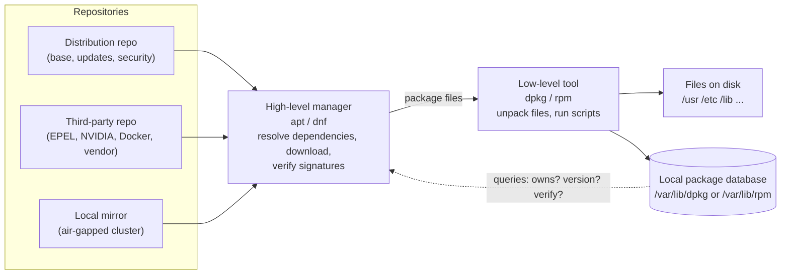
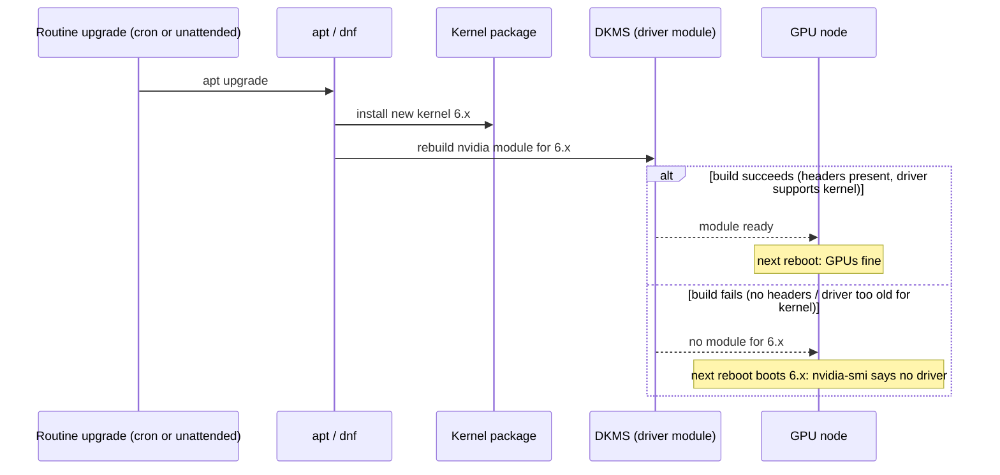
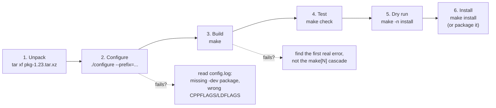
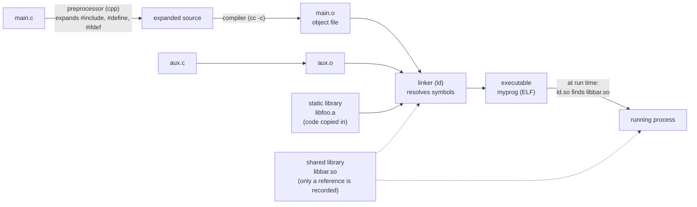

# 1.7 Packages, repositories and software installation

| | |
|---|---|
| Level | Basics |
| Priority tier | 0 |
| Lab venue | GCP / GKE (one Ubuntu VM and, optionally, one Rocky/Alma VM) |
| Part | Part 1: Linux, from the command line to the kernel and performance |
| Status | Drafted, labs **untested** |

## Why this matters for AI infrastructure

Picture a GPU node that worked on Friday. After an automatic upgrade and a reboot on Monday, its GPUs have disappeared. Almost everything you will operate arrives on a node as software somebody else built. The NVIDIA driver, the CUDA toolkit, the container runtime, `nvidia-container-toolkit`, the Slurm daemons, the InfiniBand stack (OFED or the distribution's inbox drivers) and the monitoring agents all arrive this way. Getting this layer wrong produces three kinds of incident in GPU fleets.

1. **Version drift.** One node is auto-upgraded and ends up with a kernel that the installed driver does not support, so the GPUs vanish after the next reboot. Another node has a different CUDA minor version, and a job that worked on the first fails on the second.
2. **Unknown provenance.** A library copied into `/usr/local/lib` years ago shadows the one the package manager installed, and nobody can say where it came from.
3. **Broken dependency resolution.** An engineer forces an install with `--nodeps` or `--force` to get past an error, and the node's package database no longer describes what is on disk.

The rest of this chapter gives you the vocabulary and the mechanics to avoid all three. You will learn what a package is and how the two package families, deb and rpm, work. You will see how repositories and signatures protect you, and how to inspect, verify and hold versions. Software built from source is covered too, including how to do it without damaging the system. You will also learn how shared libraries are found at run time, which causes many "works on my machine" bugs. Finally, you will see how a whole cluster node is assembled in practice, and you will meet `make`, because you will constantly read other people's build instructions, Dockerfiles and driver installers that call it.

## Prerequisites and outcomes

Before you start, you should be comfortable with the shell (1.2), the directory layout (1.3) and users and `sudo` (1.6). This chapter builds on those habits and does not repeat them.

After this chapter you can:

- Explain what a package contains and what metadata it carries, and why dependency metadata makes installation practical.
- Install, remove, query, verify and hold packages with apt and dpkg on Debian-family systems, and dnf and rpm on Red Hat-family systems, and translate between the two.
- Add a third-party repository safely, explain how signature checking works, and say why `--nogpgcheck` is a red flag.
- Find which package owns a file, and which package would provide a missing file or header.
- Build and install software from source with `./configure`, `make` and `make install` into a private prefix, read the build log, and turn the result into a real package.
- Diagnose "cannot open shared object file" and "undefined reference" errors with `ldd`, `ldconfig`, rpath and `LD_LIBRARY_PATH`, and explain why `LD_LIBRARY_PATH` should not be exported globally.
- Read a simple Makefile and apply a source patch.
- Describe the order of operations for building a small HPC cluster node, including NFS, OFED, kickstart, cloning pitfalls and diskless booting.

If one of these outcomes feels unfamiliar, read the matching section before you touch a production node.

## 1. What a package is

Suppose a node needs a new encryption module. You could copy the files over by hand, but then nobody would know what they are, what they depend on or how to remove them. A **package** solves that problem. It is one file, usually a compressed archive, that holds a tree of files belonging to one piece of software. It also carries **metadata**, which describes the software. A web server, a single encryption module and a documentation set are each a package. The files are what gets copied to disk. The metadata is what lets a tool reason about them.

The most useful metadata fields are listed in the table below. Each one exists to answer a question you will ask later.

| Metadata | What it enables |
|---|---|
| Name, version, architecture, description | Searching, comparing versions, refusing to install an x86-64 package on arm64 |
| **Dependencies** | The tool can compute and install everything else that is needed |
| **File checksums** | Later verification that nothing has been altered |
| **Marked configuration files** | Upgrades do not overwrite your edits |
| Maintainer scripts (pre/post install and remove) | Creating a system user, enabling a service, rebuilding a cache |
| Signature | Proof that the package came from the repository owner |

Package systems differ in their fields and in what they can do. The common families are in the next table. Find the one your nodes use before you read anything else.

| Family | Package file | Used by | Low-level tool | High-level manager |
|---|---|---|---|---|
| **deb** | `.deb` | Debian, Ubuntu, Mint | `dpkg` | `apt`, `apt-get`, `aptitude` |
| **rpm** | `.rpm` | Red Hat Enterprise Linux and clones (Rocky, Alma, CentOS Stream), Fedora, SUSE | `rpm` | `dnf` (older: `yum`), `zypper` on SUSE |
| Source-oriented ports | build recipes | Arch (pacman, with a ports-like build system), Gentoo (ebuild), Slackware | | |

For AI infrastructure, you will meet deb on Ubuntu, which is the default for most GPU cloud images and for NVIDIA's DGX OS. You will meet rpm on RHEL-family systems, which are common in HPC and enterprise environments. Know both.

### Two layers, and why they exist

Every package system splits into two layers. Keeping them apart in your head clears up most of the confusion.

The **low-level tool**, `dpkg` or `rpm`, works on one package file. It unpacks files, runs maintainer scripts and records the result in a local database. It does not fetch anything. With a few exceptions, it does not solve dependencies either, so if a dependency is missing, it complains.

The **high-level manager**, `apt` or `dnf`, talks to repositories. It works out the full set of packages that must be installed, removed or upgraded. Then it downloads them and calls the low-level tool to do the unpacking.



### The package database is precious

The low-level tool records every installed package, its files and its checksums in a local database. If that database is damaged, the system no longer knows what is installed, and repairing it is hard. One concrete cause is installing or removing packages on a **filesystem that is 100% full**. The tool can fail halfway through writing its own records. So before a big install on a node, check `df -h /` and `df -i /`. Chapter 1.3 explains inodes. A full `/var` is just as bad as a full `/`.

Two habits protect the database. The first is to avoid the "force" switches. Never use `--force`, `--nodeps` or `dpkg --force-all` as a way to get unblocked, because they produce a system whose database disagrees with the disk. The second is to avoid mixing installation methods. If the distribution already ships `foo`, installing a second copy into `/usr/local` or from a tarball gives you two copies. Which one runs then depends on `$PATH` order (chapter 1.2).

### Configuration files and upgrades

Packages mark certain files as **configuration**. When you upgrade, the manager must neither discard your edits nor ignore the packager's improvements. The two families handle this differently.

On **rpm**, if you changed a config file and the new package also changed it, your file is kept. The new default is written next to it with the suffix `.rpmnew`. If the packager decided the old file must be replaced, your version is saved as `.rpmsave` instead.

On **deb**, `dpkg` asks you interactively whether to keep your version or take the package's, and it can show you the difference. In scripts and automation, you set an option so the choice is made without a prompt. For example, `-o Dpkg::Options::="--force-confold"` keeps your files.

When you **remove** a package, its configuration files normally stay behind, so a later reinstall finds your settings. To remove them as well, use `apt purge` on deb. On rpm, the files are usually already gone, but `.rpmsave` files may linger.

After any large upgrade, search for these leftovers and compare them with the new defaults:

```bash
sudo find /etc -name '*.rpmnew' -o -name '*.rpmsave' -o -name '*.dpkg-dist' -o -name '*.dpkg-old'
```

### Dependencies, and how the two families express them

A dependency says "package A needs package B, possibly at a given version, to work". The managers read these statements and compute the full closure. That closure is what turns "install this driver" into a list of forty packages.

The deb format has a richer vocabulary than rpm. A deb package can mark a dependency as **required** (`Depends`), **strongly recommended** (`Recommends`, which `apt` installs by default), **merely suggested** (`Suggests`, typically documentation or examples), or **in conflict** (`Conflicts`, `Breaks`). A smart interactive manager can choose the optional packages that fit what you want. On the rpm side, installing one package has sometimes pulled in a dozen more that are not strictly needed, because rpm has fewer gradations. Modern `dnf` offers `--setopt=install_weak_deps=False` to skip weak dependencies. That is useful for small compute node images.

A dependency can also name a **capability** instead of a package. For example, it can ask for any package that provides an `smtp-server`, or a library providing `libcuda.so.1`. This is why you can ask the manager which package provides a file you are missing (section 5).

### Integrity: checksums

The package system stores a checksum for every file it installs. That means you can later ask whether anything the package installed has changed. This is a cheap integrity check. It is useful after a suspected compromise, after a disk problem, or when one node behaves differently from its siblings.

```bash
# rpm: verify one package, or everything
rpm -V openssh-server
rpm -Va                      # all packages; output lines show what differs

# deb: debsums is a separate package; dpkg has a built-in verifier too
sudo apt install debsums
sudo debsums -s              # show only files that fail
dpkg --verify openssh-server
```

An `rpm -V` line looks like `S.5....T.  c /etc/ssh/sshd_config`. Each letter flags one thing that differs. For example, S means size, 5 means digest, and T means modification time. The trailing `c` marks a config file. Differences in config files are normal. Differences in `/usr/bin` or `/usr/lib` binaries deserve an explanation. Only files that belong to packages are checked, so a file that someone dropped in by hand stays invisible to this method.

Run the verifier on a suspicious node before you reinstall anything. It shows you what changed, which tells you where to look.

## 2. Repositories: where packages come from

Every package on your node came from somewhere. A **repository** is an indexed directory of packages. You can reach it over HTTP(S), read it from local disk, or read it from an optical medium. The index lets the manager find a package and its dependencies without downloading anything first. When you install an operating system, a repository (the installation medium or a network mirror) is set up for you. After installation, the main network repositories are added. These normally include separate channels for the base release, bug-fix updates and security updates.

Beyond the distribution's own repositories, you will configure three more kinds. Third-party repositories come first. The standard Red Hat repositories, for example, omit many packages, so people enable **EPEL** (Extra Packages for Enterprise Linux), a trusted community repository for the RHEL family. NVIDIA, Docker, Kubernetes and others publish their own repositories for their own software. Vendor mini-repositories are small repositories that a project publishes just for its own software. The InfiniBand OFED distribution is one example.

Local mirrors and internal repositories make up the third kind. Machines without Internet access need them, which is typical for HPC clusters on a private network. Teams that want reproducibility use them too. You copy the packages you need to a server on your network and point nodes at it. That also lets you freeze a known-good set of versions and roll the whole fleet forward on your schedule.

### Signatures and trust

A repository signs its metadata, and for rpm usually each package as well. The manager checks each signature against a key you have **explicitly trusted**. This check is what stops someone who can intercept your download from substituting a malicious package. Two consequences follow.

Adding a repository is a trust decision. Its packages run as root during installation, through maintainer scripts, and then run on your node. Only add repositories from the real owner, over HTTPS, and verify the key fingerprint against the vendor's documentation.

Switches that disable the check are for emergencies and for your own internal test repositories. They include `dnf --nogpgcheck`, `gpgcheck=0` in a repo file, and apt's `--allow-unauthenticated` or `[trusted=yes]`. Do not leave them in configuration.

### Debian-family configuration

Sources live in `/etc/apt/sources.list` and in files inside `/etc/apt/sources.list.d/`. Older entries take one line each, such as `deb [signed-by=/etc/apt/keyrings/vendor.gpg] https://repo.example.com/apt stable main`. Newer Ubuntu and Debian releases are moving to a multi-line "deb822" format in files ending in .sources. Both formats work, so check which one your release uses. *(Review note: confirm the default format on the release you run.)*

Keys belong in a file under `/etc/apt/keyrings/` (or `/usr/share/keyrings/`), and the entry points at it with `signed-by=`. That way each repository's key is trusted for that repository only. The old global keyring managed by apt-key is deprecated. If a guide tells you to run `apt-key add`, it is out of date.

Update the index before you install anything. `sudo apt update` downloads the package lists, but it installs nothing. Forgetting this step, or running it on a node whose repository has moved, is the usual reason for "Unable to locate package" or "404 Not Found".

### Red Hat-family configuration

Repository definitions are files ending in .repo in `/etc/yum.repos.d/`. Each section names a baseurl or a mirrorlist or metalink, and sets enabled=1, gpgcheck=1 and a `gpgkey=` URL. You import a key once with `sudo rpm --import <key-url-or-file>`. Alternatively, the key is fetched the first time you install from a repository that provides `gpgkey=`, and you are asked to accept it.

To control repositories for one command, without editing files, use `--enablerepo=NAME`, `--disablerepo=NAME` or `--disablerepo='*' --enablerepo=NAME` on the command line.

Newer RHEL-family releases split content into **BaseOS** and **AppStream** repositories. They also add *modules*, which are streams of software versions, such as several Python or Node.js versions side by side. Modules and streams are an extra layer. You only need to know they exist, and you should check your distribution's current documentation for details.

### Verbs you need on both sides

Most day-to-day tasks have a matching command in each family. The table below lines them up.

| Task | Debian family | Red Hat family |
|---|---|---|
| Refresh repository metadata | `sudo apt update` | `sudo dnf makecache` (done automatically on most commands) |
| Install | `sudo apt install pkg1 pkg2` | `sudo dnf install pkg1 pkg2` |
| Install a local package file with dependencies | `sudo apt install ./pkg.deb` | `sudo dnf install ./pkg.rpm` |
| Remove | `sudo apt remove pkg` | `sudo dnf remove pkg` |
| Remove and delete config files | `sudo apt purge pkg` | (config files marked as such are saved as `.rpmsave`) |
| Remove packages nobody needs any more | `sudo apt autoremove` | `sudo dnf autoremove` |
| Upgrade installed packages | `sudo apt upgrade` (never removes packages); `sudo apt full-upgrade` (may install/remove to resolve) | `sudo dnf upgrade` |
| Check what has updates | `apt list --upgradable` | `dnf check-update` |
| Reinstall | `sudo apt install --reinstall pkg` | `sudo dnf reinstall pkg` |
| Download without installing | `apt download pkg` or `apt-get install --download-only pkg` | `dnf download pkg` or `--downloadonly` (with `--downloaddir=DIR`) |
| Search by name or description | `apt search word` | `dnf search word` |
| Show details and dependencies | `apt show pkg` ; `apt depends pkg` | `dnf info pkg` ; `dnf repoquery --requires pkg` |
| Which repository / version would be used | `apt policy pkg` | `dnf list --showduplicates pkg` |
| Package groups | `tasksel`, meta-packages | `sudo dnf group install "Development Tools"` |
| Transaction history and undo | `/var/log/apt/history.log` | `dnf history`, `dnf history undo N` |

Read the table as a translation guide. Learn the one family you use daily, then check the other when you move between machines.

A few details surprise people. `yum` is the older name. On current RHEL-family releases, `yum` is a compatibility alias for `dnf`, so the option tables in older books and on forums still work. `apt` is the friendly front end, with progress bars and sensible defaults for people at a terminal. For scripts, Dockerfiles and automation, use `apt-get` and `apt-cache` instead, because their output and behaviour are stable. The `apt` tool itself warns that its interface is not stable for scripting.

In automation, add `-y` to assume yes, and set `DEBIAN_FRONTEND=noninteractive` so debconf does not stop to ask questions. The `--skip-broken` switch on dnf and yum installs what it can and skips what has dependency problems. Use it only when you are certain you understand what is being skipped.

Before you change a repository, confirm which one a package would come from. Run `apt policy` or `dnf list --showduplicates` first, and only then install.

## 3. The low-level tools

Sometimes the high-level manager is not enough. When a package problem lands on your desk, you drop below it and use `dpkg` or `rpm` directly. You do this for three jobs: installing a single package file, interrogating the database, and verifying what is on disk.

### `rpm`: modes and selectors

Every `rpm` command has a **mode**, which says what to do, and a **selector**, which says which packages to act on. The table lists the options on both sides.

| Mode | Meaning | Selector | Meaning |
|---|---|---|---|
| `-q` | Query | `-a` | All installed packages |
| `-i` | Install | `-f /path` | The package that owns this file or directory |
| `-U` | Upgrade (or install if absent) | `-p file.rpm` | A package **file** (not yet installed) |
| `-e` | Erase | | |
| `-V` | Verify | | |

Combined, the modes and selectors answer nearly every question. Read the commands below as questions you can ask a node. Each one tells you something about what is installed there.

```bash
rpm -qa | grep -i cuda          # which CUDA-related packages are installed
rpm -qi openssh-server          # description, version, vendor, build date
rpm -ql openssh-server          # every file the package installed
rpm -qc openssh-server          # only its configuration files
rpm -qf /usr/bin/ssh            # who owns this file?
rpm -qpl downloaded.rpm         # contents of a package file before installing it
rpm -qR somepackage             # its dependencies (what it requires)
rpm -q --whatprovides libcuda.so.1   # which installed package provides this
```

Use `rpm -i` and `-U` only when the dependencies of the package file are already satisfied, because `rpm` will not fetch them for you. The switches `--nodeps` and `--force` exist for repair work. `--nodeps` skips the dependency check. `--force` overwrites files owned by another package, or installs an older version. Treat both as dangerous tools.

### `dpkg`: the equivalents

On Debian-family systems, the same questions go to `dpkg`.

```bash
dpkg -l | grep -i cuda          # installed packages (name, version, status)
dpkg -s openssh-server          # status and metadata of one installed package
dpkg -L openssh-server          # files installed by it
dpkg -S /usr/bin/ssh            # which package owns this file?
dpkg -c pkg.deb                 # contents of a package file
dpkg -I pkg.deb                 # metadata of a package file
sudo dpkg -i pkg.deb            # install (does not fetch dependencies)
sudo apt -f install             # then let apt fix up missing dependencies
```

In `dpkg -l` output, the first two columns are a state code. `ii` means installed and correctly configured. `rc` means removed, but the configuration remains. `iU` or `iF` mean half-installed or failed configuration, and you usually fix those with `sudo dpkg --configure -a`.

### Translation table

If you know one family, the table below gives you the matching command in the other. Use these commands to answer questions before you change anything.

| Question | rpm | dpkg |
|---|---|---|
| Is it installed, which version? | `rpm -q pkg` | `dpkg -s pkg` or `dpkg -l pkg` |
| List installed packages | `rpm -qa` | `dpkg -l` |
| Files in an installed package | `rpm -ql pkg` | `dpkg -L pkg` |
| Which package owns this file? | `rpm -qf path` | `dpkg -S path` |
| Contents of a package file | `rpm -qpl f.rpm` | `dpkg -c f.deb` |
| Verify installed files | `rpm -V pkg` | `dpkg --verify pkg` / `debsums` |
| Which package could provide a file I do not have? | `dnf provides '*/name.h'` | `apt-file search name.h` (after `sudo apt install apt-file && sudo apt-file update`) |

## 4. Holding, pinning and reproducibility

On a GPU node, the goal of package management is not "always newest". The goal is "exactly the versions we validated". Picture a training cluster where every node runs the same driver. If one node quietly moves to a newer driver, its jobs may behave differently from the rest of the fleet. You need tools that keep versions fixed until you choose to change them.

The simplest tool is a hold. `sudo apt-mark hold nvidia-driver-XXX linux-image-generic` tells routine upgrades to skip those packages, and `unhold` releases them. On RHEL-family systems, install the `dnf versionlock` plugin with `sudo dnf install python3-dnf-plugin-versionlock`, then add a package to the lock with `sudo dnf versionlock add pkg`. *(Review note: package names for the plugin differ by release.)*

You can also install an exact version. Use `sudo apt install pkg=1.2.3-1` on Debian-family systems, or `sudo dnf install pkg-1.2.3-1.el9` on Red Hat-family systems. Before you pick a version, run `apt policy pkg` or `dnf list --showduplicates pkg` to see what your repositories offer.

Apt pinning, stored in `/etc/apt/preferences.d/`, goes one step further. It assigns priorities to repositories or versions, so a third-party repository cannot silently replace a base package. Pinning is powerful and easy to get wrong. Reach for `apt-mark hold` first.

For a whole fleet, the strongest approach is to freeze the repositories themselves. Mirror the repositories you depend on at a point in time, or use a snapshot service, and have nodes install only from that snapshot. Two nodes built a month apart then get identical packages.

Unattended upgrades are valuable for security patches on servers. They run as `unattended-upgrades` on Ubuntu and as `dnf-automatic` on RHEL-family systems. On a GPU node, though, they can replace the kernel without rebuilding the driver. Restrict them to security updates for packages outside the driver and kernel set. Alternatively, disable them on compute nodes and patch through a controlled process.

The failure these rules prevent is concrete and common. The diagram below shows how a routine upgrade can leave a node without a working driver.



Chapter 1.22 develops DKMS and kernel modules in detail. The fix at the package layer is to hold the kernel and driver packages together, upgrade them in one controlled step, and test a rebooted canary node before you roll out the change.

## 5. Finding the package you need

Three questions come up almost every day. The first is "which package does this file belong to?" On Red Hat-family systems, use `rpm -qf`. On Debian-family systems, use `dpkg -S`.

The second question is harder. You need a file you do not have, such as a header, a library or a command. Which package provides it? On deb, search with `apt-file search pkg.h`. On rpm, use `dnf provides '*/pkg.h'`, where the older spelling `yum provides` also works. Two cases come up often.

The first case is a compiler error such as `fatal error: foo.h: No such file or directory`. It means the development package for the library is missing. Libraries come in two flavours. The runtime package, such as `libfoo1` on Debian or `foo` on Red Hat, holds the shared library. The development package, such as `libfoo-dev` or `foo-devel`, holds the headers and `.pc` files. The same split explains why `openssl.pc` is absent until you install `libssl-dev` or `openssl-devel`.

The second case is a runtime error such as `error while loading shared libraries: libfoo.so.1: cannot open shared object file`. It means one of two things. Either the runtime package is missing, or the library sits in a location the dynamic linker does not search. Section 8 covers that second case.

The third question is "what would this install do?" Simulate the install before you run it. Use `apt install -s pkg` (or `apt-get -s`), or `dnf install --assumeno pkg`. Then read the list of packages that will be removed. If that list says an unrelated meta-package, such as `ubuntu-desktop` or a driver, will be **removed**, stop and find out why.

Before you run any install on a production node, simulate it and read the removal list first.

## 6. Installing from source

Sometimes the package you need does not exist, or it is the wrong build. You then install from source. Most open-source software is distributed as **source code**, because Unix and Linux come in so many flavours and architectures that shipping a binary for every combination would be impractical. Source distribution also lets users fix bugs and add features, which is the point of open source. Nearly everything on a Linux system, from the kernel to the libraries, can be obtained as source.

You should not replace your distribution's packages with source builds wholesale. Distributions fix security problems quickly, keep dependencies consistent, and let you upgrade with one command. There are good reasons to build from source yourself, though. You may need control over the options, such as building an MPI library with exactly the network backends your cluster has, or a Slurm with specific plugins. You may need control over the version, because the distribution's copy is too old or too new, which is common for add-ons such as language libraries. You may need control over the install location, including keeping several versions of the same software side by side. And you may simply want to understand how the software works and what it depends on.

The costs are real. Building takes time. Custom installs **do not update themselves**, which is a security issue for anything network-facing. You may overwrite files the distribution owns. A typo in an option can leave a half-working build. So the rule is this: prefer the package, build from source into an isolated prefix when you need control, and turn the result into a package if you will deploy it to more than one machine.

### The standard sequence

Most C and C++ projects built with the GNU autotools follow four steps. The pattern transfers to other build systems, such as CMake, Meson and SCons. The diagram below shows the steps and where each one can fail.



**Unpack carefully.** Source archives come as .tar.gz, .tar.bz2 or .tar.xz files. Chapter 1.3 covered `tar`. Before you extract, list the contents with `tar tvf` or `tar ztvf`, for two reasons. The first is that a well-formed archive has everything under one top directory, such as `package-1.23/...`. Some archives instead spill their files straight into the current directory. Picture an engineer who unpacks an archive into a shared home directory and then cannot tell which files came from it. If the listing shows bare names such as `Makefile` and `main.c`, extract into a new, empty directory so you do not make a mess.

The second reason is safety. Never unpack an archive that contains **absolute paths** such as `/etc/passwd` or `/etc/inetd.conf`. That is almost certainly a booby trap, and extracting it as root would overwrite system files. Delete such an archive. Modern `tar` strips leading slashes by default, but do not rely on that.

**Read the documentation in the tree first.** Open `README`, then `INSTALL` if there is one, before you do anything else. They often state special options, prerequisites and supported platforms. Then get a feel for the files by their role. Build-system files include `Makefile`, `Makefile.in`, `configure`, `CMakeLists.txt` and `meson.build`. Very old packages ship a plain `Makefile` that you edit by hand. Most packages use a configuration script or file that generates the `Makefile` for your system. Source files are .c and .h for C, and .cc, .cxx or .C for C++. Object files (.o) and binaries should not be in a source archive. If you find them, run `make clean` so you get a fresh compile.

**Configure.** GNU autoconf-based packages ship a `configure` script and template files that end in .in, such as Makefile.in and config.h.in. Running `./configure` probes your system. It checks which compiler you have, which headers and libraries exist, and which functions are available. It then substitutes the results into the templates to produce the real `Makefile` and a `config.h` header. It also writes config.cache and a detailed log, `config.log`. The output is long and tells you what is being checked. A successful configure does not guarantee a successful build, but the odds are good.

You need the build tools installed first. On Debian and Ubuntu, the quick way is `sudo apt install build-essential`. On RHEL-family systems, use `sudo dnf group install "Development Tools"`. If a tool is absent, search for `gcc` or "C compiler".

### Safe first install: a private prefix

Suppose you want to test a newer version of coreutils on a shared login node. The key option is `--prefix`. By default, an autoconf package installs under `/usr/local`, with programs in `/usr/local/bin` and libraries in `/usr/local/lib`. To experiment safely, install into a directory you own instead.

```bash
mkdir -p ~/src && cd ~/src
tar xf coreutils-9.5.tar.xz            # example archive; the version will differ
cd coreutils-9.5
./configure --prefix=$HOME/mycoreutils
make -j"$(nproc)"                      # -j builds in parallel
make check                             # runs the package's tests (can take a while)
make -n install                        # DRY RUN: print what install would do
make install
$HOME/mycoreutils/bin/ls --version
```

Everything lands under `~/mycoreutils`, independent of the rest of the system. You can delete that directory and nothing else is affected. After `make install` finishes, your home directory holds a `mycoreutils` subdirectory with `bin`, `info`, `lib`, `man` and `share` inside it.

Always do the dry run before the real install. Run `make -n install`, then browse its output. The `install` target of a `Makefile` can copy files anywhere the author thought appropriate. The dry run prints those commands without executing them. If anything would be installed outside your `mycoreutils` prefix, stop.

**Other useful `configure` options.** The table below lists the ones you will meet most often.

| Option | Meaning |
|---|---|
| `--prefix=DIR` | Root of the installation tree |
| `--bindir=DIR`, `--sbindir=DIR`, `--libdir=DIR` | Override where executables, system executables and libraries go |
| `--disable-shared` | Do not build shared libraries (can avoid run-time library hassles for obscure libraries) |
| `--with-pkg=DIR` | Tell the build where a dependency lives, when it is in a nonstandard place. Not every script supports this and the exact spelling varies. |
| `--help` | Lists all options (long; search it) |

**Separate build directory.** If you want to try several option sets, or build for several configurations from one source tree, create a new empty directory anywhere. Then run the `configure` script by its path from there, for example `mkdir build && cd build && ../pkg-1.23/configure ...`. The source tree is not modified. The build directory gets the generated files and links back to the source. Many maintainers prefer this, and it is called an "out-of-tree" build.

**Environment variables.** `configure` reads `CPPFLAGS`, which holds preprocessor options such as `-I` include paths and `-D` macro definitions. It also reads `CFLAGS` for compiler options, `LDFLAGS` for linker options such as `-L` paths, and `CC`. Set them in front of the command or as arguments:

```bash
CPPFLAGS=-DDEBUG ./configure
./configure CPPFLAGS="-I$HOME/opt/zlib/include" LDFLAGS="-L$HOME/opt/zlib/lib -Wl,-rpath=$HOME/opt/zlib/lib"
```

Use `CPPFLAGS`, not `CFLAGS`, for include directories, because `configure` often runs the preprocessor on its own. Be exact with the syntax. A missing dash, as in `CPPFLAGS=Iinclude`, makes the compiler treat the argument as a file name, and `configure` aborts with "C compiler cannot create executables".

**Reading `config.log`.** If something goes wrong during `configure` and the cause is not obvious, examine `config.log`. The file is often gigantic, because `configure` dumps the entire shell environment, `config.h` definitions and cache variables at the bottom. That makes the exact source of the failure hard to find. The efficient technique is to open the file with `less config.log`, press `G` (shift-G) to jump to the very end, and then press `?` to search **backward** for a string from the failing output. Good search strings include `for more details` or the specific test that failed. The error appears right above that match. It shows the exact compiler command line and the compiler diagnostic that triggered the failure.

**Targets in an autoconf `Makefile`.** Besides `all`, which is the default, and `install`, the file has several targets. `clean` removes built objects. `distclean` removes everything generated, including `Makefile` and `config.h`, which returns the tree to its freshly unpacked state. `check` runs the tests, and `install-strip` installs with debug symbols stripped, which saves space.

### `pkg-config`: how builds find libraries

When libraries are scattered across prefixes, a build must be told where each library's headers and libraries are, and which link flags it needs. Most libraries solve this with a small text file that ends in .pc. The `pkg-config` program reads those files:

```bash
pkg-config --cflags --libs zlib      # prints e.g. "-lz" (flags vary by system)
pkg-config --modversion openssl      # installed version
pkg-config --list-all | less         # everything it knows
```

A `.pc` file holds variables, such as `prefix`, `libdir` and `includedir`. It also holds the name, the version, the dependencies (`Requires`), and the flags to compile and link (`Cflags` and `Libs`). By default, `pkg-config` looks only in the `lib/pkgconfig` directory of its **own** installation prefix, plus `share/pkgconfig`. Files stored elsewhere are invisible to it. An example is `/opt/openssl/lib/pkgconfig/openssl.pc`, or any `/opt/foo/lib/pkgconfig` directory. Two methods make them visible. You can make symbolic links, or copies, from the actual `.pc` files into the central `pkgconfig` directory. Or you can set the `PKG_CONFIG_PATH` environment variable to include the extra `pkgconfig` directories. The second method works well for one build, but it does not work well system-wide. You will also find that most `.pc` files do not appear until you install the matching development packages, such as `libssl-dev` or `openssl-devel`.

### Turning a source build into a package

Plain `make install` leaves files with no record in any package database. You cannot cleanly remove, upgrade or inventory them afterwards. If you plan to install the build on more than one machine, make a real package instead.

On the Debian family, **`checkinstall`** wraps `make install`, tracks the files it installs, and produces a `.deb` that you then install and remove with `dpkg`.

```bash
sudo checkinstall make install
```

On the RPM family, create a build tree with `rpmdev-setuptree` from `rpmdevtools`. Then write a `.spec` file that describes the build, and `rpmbuild -ba name.spec` produces the package. This takes more work, so follow a tutorial for your release. Consider `mock`, which builds in a clean chroot, when you need repeatable results.

On a build server, use **`DESTDIR`**. Running `make install DESTDIR=/tmp/stage` installs into a staging directory without touching the live system. You then pack that directory with `tar`, `fpm` or your packaging tool. This is the foundation of every packaging workflow.

If you do install by hand into `/usr/local`, remember that operating system upgrades leave `/usr/local` alone. That is convenient, but it also means unrecorded files pile up, and nobody remembers where they came from. When that becomes unmanageable, package them.

For large numbers of nodes, a better answer is usually one of two. You can put the software in a **shared, versioned location**, such as a network filesystem mount with per-version directories, and select it with *environment modules* (section 10). Or you can bake it into a container image (chapter 7).

### Applying a patch

A **patch** is a text file, produced by `diff -u`, that describes changes to source files. Developers also distribute fixes this way. The header of each file section looks like this:

```text
--- src/file.c.orig   2015-07-17 14:29:12 +0100
+++ src/file.c        2015-09-18 10:22:17 +0100
@@ -2,16 +2,12 @@
```

Search the patch for lines that start with `---` to see which files it changes, and read the paths. The **working directory matters**. The path `src/file.c` means you must run `patch` from the directory that *contains* `src`, not from `src` itself.

```bash
patch -p0 < fix.patch        # paths are used as written
patch -p1 < fix.patch        # strip one leading path component (typical for patches made from git)
patch -p1 --dry-run < fix.patch   # test without changing anything
```

If a path in the patch begins with a directory such as `package-3.42/src/file.c`, and your directory is named differently, `-p1` removes that first component so the rest matches. If `patch` asks "File to patch:", you are probably in the wrong directory, or the source does not match the version the patch was made against. Stop rather than guess. A partly applied patch leaves source that will not build. With git, you can also use `git apply --check` and `git apply`.

### Where to go next with builds

Once the autotools routine feels comfortable, three directions are worth knowing. The first is other build systems, such as **CMake**, **Meson**, **SCons**, and language-specific ones such as `cargo` or `go build`. Each has its own configure-then-build-then-install shape. The second is the **Linux kernel build**. It has its own configuration system, with `make menuconfig` and `make modules_install`. Attempt it only while the previous kernel stays bootable as a fallback (chapters 1.14 and 1.22). The third is **distribution source packages**. They carry the distribution's own patches and build recipes, so you can rebuild or patch a packaged program the supported way. Use `debuild` or `dpkg-buildpackage` on the Debian family, and `rpmbuild` and `mock` on the RPM family. Rebuilding a distribution source package, instead of compiling a tarball by hand, usually gives you a proper package at the end.

### Troubleshooting builds

Picture a build that stops with a wall of errors. First, learn to read `make` output. `make: *** [target] Error 1` is a real failure. A line with `Error 1 (ignored)` is a failure the author expected and tolerates, so you can ignore it.

GNU `make` calls itself recursively, and each level is labelled `make[N]`. When something fails deep inside the build, you see a cascade. The compiler error comes first, then `make[3]: *** [file.o] Error 1`, then `make[2]`, `make[1]` and finally `make`. **The first error is the one that matters.** The rest of the cascade is only the unwinding. Scroll up to the first compiler message and the directory it names. The line `Leaving directory ...` tells you where you are.

Common failures and what they mean are in the table below.

| Message | Meaning and fix |
|---|---|
| `conflicting types for 'item'` / `previous declaration` | The source declares something twice; remove or guard the offending line (comment, `#ifdef`). Often a sign you are building on a system the package does not support. |
| `'time_t' undeclared` (or any unknown type or function) | A header is missing from the source. Look up the function's manual page (`man 2 time` / `man 3 time`): its `SYNOPSIS` shows the header to `#include`. |
| `pkg.h: No such file or directory` | Development package missing, or the header is in a nonstandard place: add `-I` to `CPPFLAGS` (and probably a matching `-L` to `LDFLAGS`). Find the package with `apt-file search pkg.h` or `dnf provides '*/pkg.h'`. If nothing looks missing, you may be building for an OS the source does not support: read the `README`. |
| `undefined reference to 'initscr'` (linker) | A library was not linked, or one of your own object files was left off the link line. Search for the function name to find which library (here, curses) and add `-lcurses` (and `-L` if it is in a nonstandard place). |
| `make: prog: Command not found` | Build tool missing (`cc`, `gcc`, `ld`: install the toolchain). If you are sure it is installed, a badly written `Makefile` may assume `.` is in your `$PATH`; use `./prog` in the `Makefile`, or temporarily put `.` on your path. |
| `Makefile:7: *** missing separator. Stop.` | A recipe line starts with spaces instead of a **tab**. |

When a build fails, read the first error, not the last one. Fix that line, then rebuild from the top.

## 7. The build toolchain: compiler, linker, headers and `make`

You do not need to write C to run a cluster. You will still read build logs, edit `Makefile` variables and chase library errors. Each of those tasks goes faster once you have a clear picture of how a program gets built.

### From source to executable

The diagram below follows one program from source text to a running process. Read it left to right.



The source code is the human-written text, such as the .c and .cc files. A compiler translates it into object files, which end in .o. An object file holds binary code with loose ends. It refers to functions defined elsewhere, and it lacks the information the operating system needs to start it.

The linker, `ld`, combines object files and libraries into an executable, and it resolves each reference along the way. People rarely run `ld` directly. The compiler driver does it for them. The driver is `cc`, `gcc`, `g++` or `clang`. `cc` is the traditional name for the system's C compiler. On Linux it is usually GNU gcc, and clang, from the LLVM project, is the common alternative.

A library is a bundle of compiled components. It is essentially object files plus the header files that declare them. A standard C library, called `libc`, is always linked in unless you say otherwise. Beyond that you will find a math library and thousands of others.

A minimal two-file example shows all these steps. It is small enough to retype.

```bash
mkdir -p ~/lab/build && cd ~/lab/build
cat > greet.h <<'EOF'
void greet(const char *who);
EOF
cat > greet.c <<'EOF'
#include <stdio.h>
#include "greet.h"
void greet(const char *who) { printf("hello, %s\n", who); }
EOF
cat > main.c <<'EOF'
#include "greet.h"
int main(void) { greet("cluster"); return 0; }
EOF

cc -c greet.c            # produces greet.o
cc -c main.c             # produces main.o
cc -o hello main.o greet.o   # links them into 'hello'
./hello
```

If you omit `-o`, the compiler writes an executable called `a.out`, so always name your output. To see the intermediate stages, run `cc -E main.c` for preprocessor output only, `cc -S main.c` for assembly, and `file main.o hello` to tell object files from executables.

### Linking against libraries

Libraries matter at **link time**. Suppose a program calls a function, and you do not link the library that defines it. The linker then stops with a message like this one.

```text
badobject.o: undefined reference to 'initscr'
```

The important part of that message is the function name. A web search for it, or `man initscr`, tells you which library provides it. Here that library is curses. Note that "undefined reference" does not always mean a missing library. One of your own object files may have been left off the link command. That is usually easy to spot, because you recognise your own functions.

To link, name the library with `-l`. You give the filename minus the `lib` prefix and the suffix. If the library is not in a default directory, tell the linker where to look with `-L`.

```bash
cc -o badobject badobject.o -lcurses                       # in a default directory
cc -o badobject badobject.o -lcurses -L/usr/junk/lib -lcrud   # extra library in a custom directory
```

The default library directories are `/lib`, `/usr/lib` and, on modern multiarch distributions, architecture-specific subdirectories such as `/usr/lib/x86_64-linux-gnu`. To find which library defines a function, run `nm` on the library. Use `nm --defined-only libcurses.a | grep initscr` for a static library, or `nm -D --defined-only /usr/lib/.../libncurses.so.6 | grep initscr` for a shared one.

### Static and shared libraries

The table compares the two kinds. The difference matters most at run time and during updates.

| | Static library (`libfoo.a`) | Shared library (`libfoo.so.N`) |
|---|---|---|
| At link time | Needed code is **copied** into the executable | Executable records only the library's **name** |
| At run time | The library file is not needed; the executable behaves identically forever | The dynamic loader `ld.so` finds and maps the library; many processes **share** the same copy in memory |
| Updating the library | Requires **relinking every executable** | Fix the library once; programs pick it up (usually without recompiling) |
| Cost | Larger binaries, more disk and RAM; a security fix means finding and rebuilding every user | Management complexity: the right version must be found at run time |

Shared libraries are why a library security update from your package manager protects every program that uses it. They are also why the update tool sometimes asks you to reboot or restart services. Running processes keep the old library until they drop it. Shared libraries are also the source of the most common run-time failures, which section 8 covers.

### Headers, the preprocessor and include paths

Header files, which end in .h, contain declarations for libraries: types and function signatures. The compiler never goes looking for them itself. A separate program, the C preprocessor, runs first and rewrites the source. You can call it directly as `cpp`, or as `cc -E`.

Preprocessor commands, called directives, begin with `#`. `#include <stdio.h>` inserts a file. Angle brackets mean "search the system include directories". Double quotes, as in `#include "greet.h"`, mean "look next to this source file first". If you hit a problem with a double-quoted include, the source is probably incomplete.

`#define NAME value` defines a macro, and every occurrence of `NAME` is replaced by `value`. You can also define one without touching the source, with `cc -DNAME=value`. `#ifdef MACRO` and `#if cond`, closed by `#endif`, include or skip a block depending on a macro. This is how one code base supports different platforms or a debug mode.

The preprocessor knows nothing about C syntax. It only manipulates text, so many confusing build errors come from a macro that substitutes something unexpected.

The default system include directory is `/usr/include`, plus architecture-specific subdirectories. Picture a build that works on one machine and fails on another, because the header sits in a different place. If a header lives elsewhere, add `-I/path/to/include` to the compile command.

```text
badinclude.c:1:22: fatal error: notfound.h: No such file or directory
```

```bash
cc -c -I/usr/junk/include badinclude.c
```

When the compiler cannot find a header, search for it with `locate`, `find`, or the package tools from section 5. Several headers can share a name in different places, so confirm you are using the right one.

### `make`

Compiling a handful of files by hand does not scale. Unix therefore has `make`, which reads a file named `Makefile` (or `makefile`) and rebuilds only what is out of date. The model has three ideas.

A **target** is something to produce. It can be a file, such as `main.o` or `myprog`, or a label, such as `all` or `clean`. A target has **dependencies**, which are other targets that must exist, and be at least as new, first. A **rule** is the recipe: the shell commands that build the target from its dependencies.

Using the example files above, here is a sample Makefile.

```make
# Makefile  (the indented lines MUST start with a TAB character, not spaces)
OBJS = main.o greet.o

all: hello

hello: $(OBJS)
	$(CC) -o hello $(OBJS)

clean:
	rm -f $(OBJS) hello
```

Notice a few things. `OBJS = ...` defines a macro, which you use as `$(OBJS)`. `CC` is predefined, with the default `cc`. The first target in the file, `all` here, is the default when you run `make` with no arguments. You wrote no rule for `main.o` or `greet.o`, because `make` has built-in rules that know how to get a .o file from a .c file, using `$(CC) -c` and the standard flag variables. The recipe lines must start with a tab. Spaces cause `*** missing separator. Stop.`

`make` brings targets up to date and does the minimum. Run it twice, and the second run says `make: 'hello' is up to date` (or `Nothing to be done`). Now run `touch greet.c` and `make` again. It recompiles only `greet.o` and relinks `hello`, because `greet.o` became older than its source, and `hello` became older than `greet.o`. That chain reaction, driven purely by file timestamps, is the whole idea.

Commands you will use daily:

```bash
make                     # build the default target
make hello               # build one target
make -n                  # print what would run, run nothing (dry run)
make -f other.mk         # use a different file
make -j8                 # run up to 8 jobs in parallel (builds go much faster)
make CC=clang            # override a macro from the command line
make CFLAGS="-O2 -g"    # likewise
```

You do not even need a Makefile for tiny programs. `make blah`, with a `blah.c` in the directory, uses built-in rules to compile it. This is a handy trick with unfamiliar languages such as Fortran, lex and yacc. `make` may work out the right commands, and even its failure message hints at the tool you need.

The standard macros below can be set in the Makefile, in an environment variable, or on the command line.

| Macro | Meaning |
|---|---|
| `CC` | C compiler (default `cc`) |
| `CFLAGS` | Compiler options (optimisation, warnings, `-g`) |
| `CPPFLAGS` | Preprocessor options (`-I`, `-D`) |
| `CXXFLAGS` | Flags for the C++ compiler (GNU `make`) |
| `LDFLAGS` | Linker options (`-L`, `-Wl,-rpath=...`) |
| `LDLIBS` | Libraries to link (`-lm`, `-lcurses`), when you want to keep them separate from search paths |

Inside a rule, automatic variables stand in for parts of the target and its dependencies. `$@` is the current target. `$<` is the first dependency. `$*` is the stem of the target name, so for `blah.o` it is `blah`. A pattern such as `.c.o:` in older Makefiles defines how to produce a .o file from a .c file.

Nearly every project has the same conventional targets. The table lists them.

| Target | Purpose |
|---|---|
| `all` | Build everything (usually the first target) |
| `clean` | Remove object files and executables |
| `distclean` | Remove everything not in the original distribution, including generated Makefiles |
| `install` | Copy built files to their destination. **Dangerous**; always `make -n install` first |
| `test` / `check` | Run the test suite |
| `depend` | Regenerate header dependencies (an older practice) |

**Organisation tips (HLW Section 15.2.8).** Many Makefile styles exist, but most programmers follow a few rules of thumb. In the first part of the Makefile, inside the macro definitions, group the libraries and includes by package.

```make
MYPACKAGE_INCLUDES=-I/usr/local/include/mypackage
MYPACKAGE_LIB=-L/usr/local/lib/mypackage -lmypackage
PNG_INCLUDES=-I/usr/local/include
PNG_LIB=-L/usr/local/lib -lpng
CFLAGS=$(CFLAGS) $(MYPACKAGE_INCLUDES) $(PNG_INCLUDES)
LDFLAGS=$(LDFLAGS) $(MYPACKAGE_LIB) $(PNG_LIB)
```

Group the object files by executable as well. Suppose a package builds two executables, `boring` and `trite`. Each has its own .c file, and both share `util.c`. Define `UTIL_OBJS=util.o`, `BORING_OBJS=$(UTIL_OBJS) boring.o` and `TRITE_OBJS=$(UTIL_OBJS) trite.o`, then set `PROGS=boring trite`. Give `boring` and `trite` separate rules under `all: $(PROGS)`. Combining the two executables into one rule is a trap. `trite` would then depend on `boring.c`, and `boring` would depend on `trite.c`. `make` would rebuild both programs whenever either source file changed. If you need a special rule for an object file, place it just above the executable rule that uses it.

GNU `make` has many extensions that other implementations, such as BSD and Solaris, lack. That is fine on Linux, and it is the reason portable projects layer autotools or CMake on top. For more depth, read the GNU make manual with `info make`.

**Lex and Yacc (HLW Section 15.3).** You may meet Lex and Yacc when you compile programs that parse configuration files or commands. Lex is a tokenizer. It turns text into numbered tags with labels. The GNU version is named flex, and it needs a `-ll` or `-lfl` linker flag. Yacc is a parser. It reads tokens according to a grammar. The GNU parser is bison, and you run `bison -y` for Yacc compatibility, with the `-ly` linker flag.

Before you change a Makefile, run `make -n` and read what it would do.

## 8. Shared libraries at run time

Picture an on-call engineer who starts a tool and sees `error while loading shared libraries`. Most of the time the cause is found at run time, not at build time. A dynamically linked executable knows only the names of the libraries it needs. When you start the program, a small dynamic linker/loader runs first. It is `ld.so`, shown as `ld-linux-x86-64.so.2` on x86-64. The loader finds those libraries and maps them into the process.

You can list what a program needs with `ldd`:

```bash
ldd /bin/bash
#   linux-vdso.so.1 (0x00007ffd...)
#   libtinfo.so.6 => /lib/x86_64-linux-gnu/libtinfo.so.6 (0x00007f...)
#   libc.so.6 => /lib/x86_64-linux-gnu/libc.so.6 (0x00007f...)
#   /lib64/ld-linux-x86-64.so.2 (0x00007f...)
```

The name on the left of the arrow is what the executable asked for. The path on the right is where the loader found it. A line that reads `libfoo.so.1 => not found` is your problem. Do not run `ldd` on untrusted binaries, because some implementations execute the program. Use `readelf -d prog | grep NEEDED` instead.

### The search order

The loader searches in a fixed order, which `ld.so(8)` describes in detail. There are four steps.

1. The executable's embedded RPATH or RUNPATH, if the program was linked with one.
2. The LD_LIBRARY_PATH environment variable, if it is set. For the classic RPATH, the order is RPATH first and then LD_LIBRARY_PATH. For `RUNPATH`, LD_LIBRARY_PATH comes first. Check `ld.so(8)` for your system.
3. The cache at /etc/ld.so.cache. That cache is a fast index of libraries found in the directories listed in /etc/ld.so.conf, which usually includes files from /etc/ld.so.conf.d/.
4. The default directories /lib and /usr/lib, and their architecture variants, which are always implicit.

The cache is rebuilt by `sudo ldconfig`. Add `-v` for details. Whenever you add a library to a directory in the cache's path, or change ld.so.conf, run `ldconfig`. Otherwise the loader will not know about the new library. To see what the cache knows, run `ldconfig -p | grep libcuda`.

### Do not add directories carelessly to ld.so.conf

It is tempting to put every unusual library directory into ld.so.conf. Resist that. You should know what is in the system cache, and a cache stuffed with odd directories causes conflicts and a disorganised system. The better ways to find a library in a nonstandard place are below.

The first is to link with an rpath at build time. Suppose `libweird.so.1` lives in `/opt/obscure/lib`:

```bash
cc -o myprog myprog.o -Wl,-rpath=/opt/obscure/lib -L/opt/obscure/lib -lweird
```

The `-Wl,-rpath=...` part passes `-rpath` to the linker, which embeds the directory into the executable. You still need `-L` for the link step. To change the rpath of a binary you cannot rebuild, use `patchelf`, for example `patchelf --set-rpath /opt/obscure/lib myprog`. Compile-time is still the better choice. Inspect the result with `readelf -d myprog | grep -E 'RPATH|RUNPATH'`. A relative form, `-Wl,-rpath='$ORIGIN/../lib'`, makes a relocatable tree whose libraries sit beside the program. This is how many vendors ship software that works wherever it is unpacked.

### The danger of LD_LIBRARY_PATH

LD_LIBRARY_PATH is a colon-separated list of directories that the loader searches before the normal places. It causes more shared-library trouble than anything else. It is tempting because it is a cheap way to make a program run when you do not have the source and cannot use patchelf. But you pay for that convenience in three ways.

The first cost is performance. The loader may scan each listed directory for every library of every program started with the variable set. The second cost is wrong libraries. If you export the variable in your shell startup files, every program you run, including system tools, searches those directories first. Any of them can pick up an incompatible library. The result is baffling crashes and "symbol lookup error" messages far from the real cause. The third cost is invisible state. Two users with different values see different behaviour from the same binary.

So never set LD_LIBRARY_PATH in global shell startup files, and never compile software with it set. If you must use it for one program, use a wrapper script that sets it only for that command.

```bash
#!/bin/sh
LD_LIBRARY_PATH=/opt/crummy/lib
export LD_LIBRARY_PATH
exec /opt/crummy/bin/crummy.bin "$@"
```

The `exec` replaces the shell with the program. `"$@"` passes your arguments through and preserves spaces. Quote it. The unquoted form in older scripts breaks on arguments that contain spaces. Cluster environment modules, covered in section 10, do something similar. They do it on purpose and per job, which is the acceptable form of the same idea.

A second problem shows up with developers. A library's API can change slightly between minor versions and break software that was installed against the old one. The preventive fixes are to install each library version consistently under its own prefix and link with an rpath. Another option is to link obscure libraries statically.

### Quick diagnosis

When a program will not start, run through these checks. Each one answers a different question.

```bash
ldd ./prog | grep 'not found'          # which names are unresolved
ldconfig -p | grep libname             # does the cache know it?
find / -name 'libname.so*' 2>/dev/null # where is it, if anywhere?
readelf -d ./prog | grep -E 'NEEDED|RPATH|RUNPATH'
LD_DEBUG=libs ./prog 2>&1 | head -50   # trace the loader's search (debugging only)
strace -e trace=openat ./prog 2>&1 | grep -E 'ENOENT|\.so'   # chapter 1.11
```

Chapter 1.11 returns to ELF, the loader and `strace` in depth. Before you change any search path, find out which of these checks shows the missing library, because that tells you which fix applies.

## 9. Interpreters, shebang lines, scripting languages, and Java (`HLW` Sections 15.4–15.6)

Many of the tools on a cluster are scripts, not compiled programs. When one of them fails with a strange error about a path, the cause is often the interpreter line at the top. A script is an executable text file that an interpreter runs. If the file is executable and its first line begins with `#!`, which is called the **shebang**, the kernel runs the program named after `#!`. It passes the rest of the file to that program as input.

```bash
#!/usr/bin/env python3
print("hello")
```

The path after `#!` is taken literally. `#!/usr/bin/python3` hard-codes one location. `#!/usr/bin/env python3` finds the first `python3` on your `$PATH`. That is better when interpreters live in different places or inside virtual environments. The price is that the script now depends on `$PATH`.

The most common failure looks like `bash: ./myscript: /usr/bin/tail: bad interpreter: No such file or directory`. It means the path after `#!` does not exist on this system. For example, `tail` may live in `/bin` rather than `/usr/bin`. Another common failure comes from a script saved on Windows with CRLF line endings. The interpreter name then ends with an invisible `\r`. Fix it with `dos2unix` or `sed -i 's/\r$//'`.

Avoid relying on more than one argument on the shebang line, such as `#!/usr/bin/tail -2`. Different Unix kernels treat everything after the interpreter path as a single combined argument, spaces and all.

### Scripting languages and Java you will encounter on Linux systems

The languages below are the ones you are likely to meet on a Linux system. Each one has a different job, so you only need to recognise them when you see them.

Python (`python` or `python3`) is a scripting language with a strong following. It has powerful features for text processing, database access, networking, multithreading, data analysis, web applications and AI/ML. David M. Beazley's *Python Distilled* (Addison-Wesley, 2021) is a classic concise reference. Part 3 of this handbook covers Python for infrastructure in depth. Treat the system Python as part of the operating system. Many distribution tools depend on it, so do not `pip install` into it as root. Instead, you should use a virtual environment for your own packages, for example `python3 -m venv .venv` followed by `.venv/bin/pip install ...`. You can also use `uv`, or a container (chapter 7).

Perl (`perl`) is one of the older third-party Unix scripting languages. It is the original "Swiss army chainsaw" of programming tools. Perl has lost ground to Python in recent years. It still excels at text processing, conversion and file manipulation, and many legacy system and InfiniBand tools are written in it. Classic references are *Learning Perl*, 7th edition, by Randal L. Schwartz, brian d foy and Tom Phoenix (O'Reilly, 2016), and *Modern Perl*, 4th edition, by chromatic (Onyx Neon Press, 2016).

Other scripting languages come next (HLW 15.4.3). If you find one of these in a script, you will know what it is for. PHP (http://www.php.net/) is a hypertext-processing language for dynamic web scripts and standalone CLI scripts. Ruby (http://www.ruby-lang.org/) is favored by object-oriented and web developers. JavaScript is ubiquitous in web browsers, and it also runs on the server through Node.js, whose executable is `node`. Emacs Lisp is the Lisp dialect used by the Emacs text editor. MATLAB is a commercial matrix and mathematical language, and Octave is its free software counterpart. R (http://www.r-project.org/) is a statistical analysis language. See Norman Matloff's *The Art of R Programming* (No Starch Press, 2011). Mathematica is a commercial mathematical language. m4 is a macro-processing language used inside GNU autotools. Tcl (*Tool Command Language*, http://www.tcl.tk/) pairs with the Tk GUI toolkit, the Expect automation utility and the classic Tcl-based Environment Modules.

Java (`.class`, `.jar`, JRE vs JDK, HLW 15.5) is a compiled object-oriented language. The compiler turns `.java` source files into `.class` bytecode files. A bytecode interpreter runs them. That interpreter is the Java Virtual Machine, and it lives inside the Java Runtime Environment, or JRE. Run a compiled class with `java file.class`. Run an archived collection of classes, called a `.jar`, with `java -jar file.jar`. Some Java services need `JAVA_HOME` set to the installation prefix, or `CLASSPATH` set. `CLASSPATH` is a colon-delimited list of class directories, much like `PATH`. To compile `.java` files or bundle `.jar` archives, install the Java Development Kit, or JDK. Then you use `javac file.java`, and `jar`, which works like `tar`. You will rarely need more than that.

Modern compiled systems languages and LLVM come last (HLW 15.6). Go (`golang`) and Rust (`cargo`) dominate modern cloud-native and Kubernetes infrastructure. The LLVM compiler infrastructure, at http://llvm.org/, underpins `clang` and many GPU and ML compiler backends. For deeper study of compiler design, Brian Ward recommends *Compilers: Principles, Techniques, and Tools*, 2nd edition, by Alfred V. Aho and others (Addison-Wesley, 2006). He also recommends *Modern Compiler Design*, 2nd edition, by Dick Grune and others (Springer, 2012).

A shared principle ties packages, libraries and interpreters together. Every language has its own packaging ecosystem, such as `pip`, `conda`, `npm`, `cargo` or `go install`, in addition to the distribution's own. Mixing those ecosystems without isolation is how nodes become unreproducible. For GPU Python stacks, which depend on CUDA-matched wheels or conda packages, isolation is mandatory. Use a venv, a conda environment or a container image.

Before you install a language package on a node, decide which environment you want it in.

## 10. Software installation on a cluster

A cluster is a different problem from one machine. The same software must be present, identical and quickly reachable on hundreds of nodes. This section follows the practical order in which a small cluster is built, and it explains what each service is for along the way.

### Drivers, InfiniBand and RAID

Suppose you are choosing network hardware for a new rack. Most Ethernet cards need no extra work, because their drivers ship in the Linux kernel. Some vendors' cards need a separate driver, though. Check the list of supported operating systems and the warranty terms before you choose one. Also check how the switch is managed. Some management interfaces require a browser plug-in or a Java applet that does not work on every OS version. Prefer a device with a command-line or web interface that needs nothing special.

InfiniBand has an in-kernel stack, called the "inbox" drivers. In most cases it is not worth using that bare stack on an HPC or AI cluster, because application performance may come out lower than expected. For efficient HPC work, use the **OFED** package (*OpenFabrics Enterprise Distribution*), or the NVIDIA-supplied equivalent. Confirm the current names, MLNX_OFED or DOCA-OFED, in the vendor documentation. OFED contains the drivers for most InfiniBand cards. It also has the user-space libraries, such as `libibverbs` and friends, and the subnet-management and diagnostic utilities, such as `ibstat`, `ibv_devinfo` and the `perftest` suite. It adds IP-over-InfiniBand (`IPoIB`) support and sometimes bundles MPI builds. A few rules of thumb keep the installation safe.

- OFED is strict about kernel and C library versions. Prefer the vendor's prebuilt packages for your exact OS release, or run the installer, which compiles packages for the running system.
- Back up the existing packages first. The installer removes previously installed OFED packages before it builds, so if the build fails you are left without InfiniBand.
- Some packages in the build output are mutually exclusive, so not all of them get installed. If your hardware vendor supplies its own stack for its equipment, try that first.
- MPI libraries bundled with OFED are built with preset options. For tuned production use, build your own with exactly the options you need.
- InfiniBand needs unlimited locked memory. Set it in `/etc/security/limits.conf`, or in a file in `limits.d`, with lines such as `* soft memlock unlimited` and `* hard memlock unlimited`. Chapter 1.8 explains limits. Under systemd, the service-level equivalent is `LimitMEMLOCK=infinity`.

If the network is used through IPoIB (IP over InfiniBand), a scheduler that generates the Ethernet node names will start jobs that talk over Ethernet, not InfiniBand. You then need a way to map node names to their IB addresses. Separate hostnames such as `node01-ib` do that job.

**RAID** deserves a clear picture too. Hardware RAID protects against disk failure. It does not protect against a failed controller, a failed motherboard, or several disks lost in one power event. Keep backups regardless. Where you can choose, mirroring is the safest layout. Adding striping with RAID 0 for speed is better done in the Linux software layer (chapter 1.13). There it costs little CPU, and it often recovers more gracefully.

### Installing OFED on the cluster

OFED is a job you do once, carefully, because every node must end up with the same stack. Unpack the kit on a network filesystem first. Then every node can see the same files when it is time to install.

Unpack the kit with `tar xzvf OFED-<version>.tgz`. Then run `install.pl` with no parameters, from inside the unpacked directory. Run it on the control node, or on the first compute node if the control node has no InfiniBand card. The installer asks questions first, mostly about which components to install. Check the list of base OS components the instructions require, and install any that are missing before you start.

After that, the installer works without help. It compiles the kernel modules, builds packages and installs them. It also builds each MPI implementation with every compiler on the system. By default, the results go into `/usr/mpi`. Do not run this on a production system that is already in use, because the installer removes earlier OFED versions first.

### A sensible build order

Build the cluster in an order that lets you test early. Otherwise you will clone mistakes into fifty nodes. A small cluster is typically built in these steps.

1. Install the **control (management) server**.
2. Set up the **network file system** if you use one.
3. Install **one compute node**.
4. Install the **communication software** (OFED).
5. Install the **second compute node**, forming a *mini-cluster* of one control and two compute nodes.
6. Install **compilers and test packages**.
7. **Test** the communication hardware, checking bandwidth and latency against the manufacturer's numbers.
8. Install the **job scheduler** (Slurm, chapter 6.7).
9. Test **job completion** end to end.
10. Only then **clone** the compute node, or build a network-boot image, and add the rest of the nodes.

The principle is simple. Reach maximum readiness and test it fully before you replicate, so you do not clone a defect hundreds of times. Check network bandwidth and node performance against what the vendors claim. A mini-cluster will not reveal everything. Response time as the request rate grows, and the reliability of network services under load, only show up at scale. A mini-cluster does find most issues early, though. When the cluster is ready to run jobs, there is strong pressure to open it to users at once. Resist that until **monitoring and backups are in place**. Otherwise you will have almost no time to build them later.

### The login node

The login node is where users connect, and where compute nodes send certain requests. It needs two network interfaces, **external** and **internal**. Internal services must not be reachable from outside, so configure a **firewall** on the external interface. On small clusters the login node often doubles as the management node. A separate management node is safer, though, because you keep control when users do something destructive on the login node. If the cluster has a high-speed fabric, connect the management node to it too. That simplifies network management and statistics. If this node stores user data and exports it to the compute nodes, its disk subsystem must be fast and large. For big clusters, use a dedicated file server or a distributed filesystem.

### NFS server and client

Here is how to export a directory over NFS on the server. Package and service names differ between distributions.

1. Install the NFS server package and enable the service with `sudo systemctl enable --now nfs-server`.
2. If the internal interface has a firewall, open the RPC and NFS services there.
3. List the exports in `/etc/exports`. Each line gives the directory, the clients allowed to mount it and the options, for example `/export  10.0.0.0/24(rw,sync,no_subtree_check)`.
4. Re-read the configuration with `sudo exportfs -ra`. Use `exportfs -av` to export everything, and `exportfs -v` to display the result.

On each client, add one line to `/etc/fstab`.

```text
myserver:/export  /export  nfs  defaults  0  0
```

The six fields are the source (the server and the exported directory), the mount point, the filesystem type, the mount options, the `dump` flag and the `fsck` pass number. A `dump` flag of 0 means the filesystem is not included in backups. A `fsck` pass of 0 means it is not checked at boot. Chapters 1.12 and 5, and the parallel-file-system chapters in Part 6, cover options such as `hard`, `vers=` and `nconnect`, along with tuning.

### Compilers and libraries on nodes

Install compilers once, on the network filesystem. That way the compute nodes see both the compilers and the libraries the compiled programs need. Do not copy compilers over from the control node as a shortcut. Either run a full compiler install on each node, so the system records it and the communications build can use it, or reach the compiler over NFS. Once the cluster is running, compute nodes only need the runtime libraries.

You can make the libraries visible to the dynamic linker in one of two ways. The first is to set `LD_LIBRARY_PATH` per job through environment modules. The second is to list the directories in `ld.so.conf` and run `ldconfig`. In the second case, remember to update the file and rerun `ldconfig` on every node whenever the compiler version changes, because the library path changes with it.

Environment modules, from Environment Modules or Lmod, are the standard answer. Suppose a user runs `module load gcc/13 openmpi/5`. That edits `PATH`, `LD_LIBRARY_PATH`, `MANPATH` and similar variables for the current shell or job only. Running `module purge` undoes it. Several versions of the same software can coexist on the shared filesystem, and users pick one. This is also the clean answer to the earlier rule about not exporting `LD_LIBRARY_PATH` globally. Chapter 6.20 covers modules in depth.

### The compute node

A compute node exists to run user work. Its design follows from that purpose, and the points below are the ones to decide first.

The disk comes first. A compute node can run diskless, but that increases the load on a network that is already busy, and it consumes RAM. Network filesystems can bottleneck on programs that create many temporary files, even parallel filesystems. Keep a **local `/tmp`** as scratch space, and encourage users to use it. Container runtimes such as `enroot` also unpack images there by default.

If the OS is local, the layout matters. Give the system a 50 to 100 GB partition. Make the swap small, because it is only a small reserve for RAM. A job that needs lots of swap spends its time waiting for pages. Put all the remaining space into `/tmp`. With two disks, put swap on each. Then combine the `/tmp` partitions as software RAID-1 if you want resilience, or stripe them if you want speed and can afford to lose scratch.

The network needs two kinds of traffic. Provide a fast fabric, such as InfiniBand or RoCE, for inter-process traffic, and Ethernet for control. Heavy NFS traffic often justifies a **separate network for storage**.

Keep the node lean. Disable everything it does not need, including the mail server, the print server, desktop services, and cron jobs that update the manual page index or the `locate` database. Every daemon steals CPU time, and it adds jitter to synchronous parallel jobs.

Compilers are not needed at run time, but they are needed when you build the communications stack. So either do a full install on the node, or reach the compilers through NFS. Finally, install the scheduler's client. For Slurm, that means `slurmd` and munge (chapter 6.7).

### Getting an operating system onto many nodes

Several methods put an operating system on many nodes, and the table compares them.

| Method | How | Notes |
|---|---|---|
| **Manual install** from media or virtual media over IPMI/BMC | Good for the first (reference) node | Remember to remove the installation media from the repository list afterwards |
| **Automated network install** (PXE + kickstart/preseed/autoinstall) | An answer file describes disk layout, network, package list | Scales to hundreds; the answer file can be edited and reused |
| **Cloning** a disk image | Copy a prepared node to others | Needs preparation, see below |
| **Diskless/network-root** (NFS-root or an image loaded into RAM) | Nodes boot from the network; one image to maintain | Reduces drift; costs RAM for RAM-based images |
| **Image-based provisioning** (BCM, xCAT, Warewulf, MAAS and similar) | A tool manages images, node identity and updates | The modern default for clusters (chapter 6.x and the BCM part) |

Kickstart is the answer-file method used on the Red Hat family. An interactive install writes `/root/anaconda-ks.cfg`, a record of every choice you made, such as partitioning, network and package list. Edit that file. Then place it on a USB stick named `ks.cfg`, or serve it over the network, and any number of nodes can install unattended. For network installs, the DHCP server points each installing node to the file. In an ISC DHCP configuration, that looks like this.

```text
filename "/opt/ks.cfg";
next-server server.cluster.myorg;
```

If the returned filename ends in `/`, the client mounts that directory over NFS and looks for a file named `<IP-address>-kickstart`. A node with address `10.0.0.2` therefore reads `10.0.0.2-kickstart`, which lets different nodes get different installations. With no file or directory given, the client tries `/kickstart` on the NFS server. Debian and Ubuntu have their equivalents, which are preseed and Ubuntu autoinstall with cloud-init. *(Review note: the exact DHCP and installer parameters differ by release and by DHCP software; confirm against current documentation.)*

**Cloning pitfalls.** Suppose you copy a disk image with `dd if=/dev/sda of=/dev/sdb`, or with a tool such as Clonezilla. The clone may not boot unless you prepared the prototype first. Three things usually break.

First, many systems record disks by factory identifiers, in the bootloader and in the mount configuration. An example is `root=/dev/disk/by-id/ata-WDC_...-part1`. On a different disk, that name is wrong. Replace such entries in `/boot/grub/grub.cfg` and in `/etc/fstab` before you take the image. Change the source settings and regenerate the grub file, because grub.cfg is generated. Use something portable instead, such as `UUID=`, which identifies each filesystem and is set at clone time, or plain device names.

Second, if the OS binds network interface names to MAC addresses, clones will get the wrong names or no network at all. Historically that binding lived in `/etc/udev/rules.d/70-persistent-net.rules` or a similar file. Correct it or remove it. Also remove host-specific state, such as SSH host keys and `/etc/machine-id`. The machine ID is regenerated at first boot. If you skip this step, you end up with many machines that share the same identity.

Third, watch the first boot of the clone carefully.

**NFS-root** is safer and faster in this respect. Build a minimal image. Export it read-write so you can install and configure packages. Set up DHCP, TFTP, PXE boot and an initial ramdisk (chapter 1.14). Boot the node and install the software. Then switch the export to **read-only**. Do not put the node's name in configuration files in the image, because the name must come from DHCP. Update the software later by running `chroot` into the image on the NFS server. During the first install, set up passwordless SSH for root. That rescues you when the home-directory partition is not mounted.

**Final acceptance test.** Run this check before you add the remaining nodes.

1. Passwordless remote commands work for the superuser.
2. A regular user exists and has passwordless remote commands.
3. The user's environment is set up for each installed MPI.
4. A test program from the communications package is submitted as a script.
5. It starts, runs and writes its result into the working directory.

If that whole chain works, you can connect the rest of the nodes.

### Remote and RAM-disk installs

Installing each compute node at a console does not scale. Many distributions can install a compute node remotely, from the management node. Text mode runs over `ssh`, and graphical mode runs over VNC. Almost all distributions also support automated installs, which follow an answer file without questions.

For a single node, you can install from a USB drive. Write the installer image to the drive first. If the node's management controller supports a virtual drive over IPMI, you can use that instead. Afterwards, remove the drive's path from the node's repository settings, because the drive is no longer there.

You can also load the OS into a RAM disk. That works, but it reduces the memory left for user jobs.

## 11. AI-infrastructure patterns

**The GPU stack is a chain of version constraints.** The kernel, the driver, the CUDA toolkit, the user-space libraries (cuDNN, NCCL), the container runtime and the framework must all match. A package manager is the tool that expresses these constraints and holds them steady. The table shows how each layer is usually sourced and pinned.

| Layer | Typical package source | Pin how |
|---|---|---|
| Kernel and headers | Distribution | `apt-mark hold` / `versionlock` the kernel and headers, upgrade in a controlled step |
| NVIDIA driver (kernel module) | Distribution or NVIDIA repository; DKMS or precompiled modules | Choose one install method and keep it (mixing the `.run` installer with packages is a classic mess) |
| CUDA toolkit | NVIDIA repository (installed through the `cuda-keyring` package on Debian family); can be several versions side by side under `/usr/local/cuda-X.Y` | Install a specific versioned meta-package, not the unversioned one |
| `nvidia-container-toolkit` | NVIDIA repository | Pin with the driver; restart the container runtime after changes |
| Python and ML libraries | `pip`/`conda` inside a venv or container | Lock files; image digest |
| Cluster software (Slurm, OFED) | Distribution, vendor or your own build | Mirror or build once, package, deploy the same artefact everywhere |

*(Review note: repository URLs, key-installation commands, and package names for NVIDIA software change over time; always use the instructions in NVIDIA's current installation guide rather than copying commands from an old page.)*

Read each row as a decision you have to make. Choose the source, then choose how you will hold it steady.

**Be wary of installers that bypass the package manager.** A vendor .run file that copies files into `/usr` produces exactly the unrecorded state this chapter warns about. If you must use one, record what you did in your node build automation, and prefer the packaged route.

**Reproduce nodes from automation, not memory.** The goal is that any node can be rebuilt from a script plus a pinned package set. The script can be Ansible (chapter 4.x), cloud-init, or a BCM image. Terraform builds machines. Configuration management installs and configures packages on them. The package manager is the engine underneath. Ansible's apt, dnf, package, `yum_repository` and `apt_key`/`deb822_repository` modules express everything in sections 2 to 4 as idempotent tasks.

**Containers move the problem, they do not remove it.** Inside a container image you still run apt-get install or dnf install, so the same rules apply. Pin versions. Install only what you need, with `--no-install-recommends`. Clean the package cache in the same layer, for example with rm -rf /var/lib/apt/lists/*. Build from a base image whose digest you control. The NVIDIA driver, however, is **not** inside the image. The host's driver, plus nvidia-container-toolkit, provides it (chapter 7).

**Supply chain.** Anyone who can publish into a repository you trust can run code as root on your nodes. Mirror from the real source, verify signatures, and restrict who can add repositories to nodes. Record which packages are installed, with `dpkg -l` or `rpm -qa`, in your build logs. Then you can answer "which nodes ran the vulnerable version?" quickly.

Before you add any new source to a fleet, decide who is allowed to publish into it.

## How it fails

When a node misbehaves, the symptom often points at one of the failures below. Each item names the message or behaviour you will see, then the usual cause and the first fix to try.

1. **`apt update` errors such as "404 Not Found", "NO_PUBKEY" or "The repository ... does not have a Release file".** The repository moved, the release reached end of life, or the signing key is missing or has rotated. Check the URL in the sources file, the `signed-by` key and the release codename. For end-of-life Ubuntu or CentOS releases, the repository has moved to an archive server.
2. **"E: Unable to locate package".** You forgot `apt update`, you have the wrong release, or the repository (for example `universe`) is not enabled.
3. **Dependency conflict or "held broken packages".** A third-party repository offers a newer library than the distribution's, or a package is held. Read the list of what would change. Do not force it.
4. **The driver disappears after a reboot.** An unattended kernel upgrade rebuilt nothing, or DKMS failed because there were no headers, or the driver was too old for the kernel. Diagnose it with `dkms status`, `journalctl -b -u nvidia-*` and `dmesg | grep -i nvidia`. Prevention is covered in section 4.
5. **"dpkg was interrupted, you must manually run `dpkg --configure -a`".** An install was killed, for example by a full disk or a lost SSH session. Run the command. If the disk is full, free space first. Using `tmux` for long upgrades keeps a dropped session from killing the install (chapter 1.5).
6. **`/var` or `/` is 100% full during an upgrade.** This can corrupt the package database. Check `df -h` and `df -i`, clean the caches with `apt clean` or `dnf clean all`, and free space before you retry.
7. **A "fixed" dependency problem with `--nodeps` or `--force`.** The package database now lies. Later upgrades fail strangely, or they silently break the forced package. Remove the package and reinstall it properly.
8. **"cannot open shared object file".** The library is missing, not in the cache (run `ldconfig`), or not on the search path. Fix it with an rpath, a module, or a corrected install. Do not reach for `LD_LIBRARY_PATH` in `.bashrc`.
9. **Two versions of a library, and the wrong one loads.** A source build into `/usr/local/lib` shadows the packaged copy, or a stale `LD_LIBRARY_PATH` redirects everything. Use `ldd`, `ldconfig -p` and `LD_DEBUG=libs` to see which file is in use, then remove the stray copy.
10. **`./configure` fails on a missing library.** The runtime package is installed, but the **development** package (`-dev`, `-devel`) is not. Install it and run the configure step again. Read `config.log`, searching backward from the end, for the exact failing probe.
11. **The program builds, but `make install` scatters files over `/usr/local`, and later nobody knows where they came from.** Use `--prefix` with a dedicated directory, or use `checkinstall` or `DESTDIR` packaging.
12. **A `Makefile` fails with `missing separator`.** Your recipe lines have spaces where they need tabs. Your editor probably converted the tabs to spaces.
13. **A cloned node boots but has no network, or two nodes share an identity.** The cause is usually a persistent MAC-to-name rule, the same `machine-id`, or the same SSH host keys. Prepare the image before you clone it.
14. **An upgrade overwrote or ignored an edited configuration file.** You probably answered the prompt incorrectly in an unattended run. Find the `.rpmnew` or `.dpkg-dist` files and merge them by hand.

Work through the list from the top when the symptom is vague. Start with the failure whose message you recognise.

## Hands-on lab: packages, shared libraries, Makefiles, and VM drills

Start with the self-checking Python lab, and run it locally before you touch a VM. It verifies `.rpmnew` versus `.rpmsave` config upgrade rules, `ld.so` search precedence (`DT_RPATH`, `LD_LIBRARY_PATH`, `DT_RUNPATH`, `/etc/ld.so.cache`), `make` timestamp rebuilds, `patch -p0`/`-p1` path stripping, and the 10-step mini-cluster build order and cloning readiness checks.

```bash
python3 code/part01/packages_toolchain_lab.py
```

Next, work through steps A to I on a disposable GCP Ubuntu VM with `sudo`. Every interactive VM command below is `untested here`, so confirm each one on your own VM before you rely on it.

**A. Inspect the package database (Ubuntu).**

```bash
dpkg -l | wc -l                         # (untested here) how many packages are installed?
dpkg -S /usr/bin/ssh                    # (untested here) which package owns ssh? (openssh-client)
dpkg -L openssh-client | head -20       # (untested here) what did it install?
apt show openssh-client | head -30      # (untested here) metadata and dependencies
apt depends openssh-client              # (untested here) its dependency list
apt policy openssh-client               # (untested here) which repository and version
sudo apt install -s tree                # (untested here) simulate installing 'tree' (-s = simulate)
sudo apt install -y tree && tree -L 1 /etc | head # (untested here)
dpkg -S "$(which tree)"                 # (untested here)
sudo apt remove -y tree                 # (untested here)
sudo apt purge -y tree                  # (untested here)
```

Write down what changed between `remove` and `purge`. Look in `/var/lib/dpkg/info`, and run `dpkg -l tree` to see whether the package shows `rc` (removed, configuration left behind) or is gone.

**B. Verify integrity.**

```bash
sudo apt install -y debsums             # (untested here)
sudo debsums -s                         # (untested here) should be quiet on a fresh VM
sudo cp /bin/ls /tmp/ls.bak             # (untested here)
echo x | sudo tee -a /bin/ls >/dev/null # (untested here) corrupt a packaged binary (on a throwaway VM only)
sudo debsums coreutils | grep -v OK     # (untested here) detects the change
sudo cp /tmp/ls.bak /bin/ls             # (untested here)
```

**C. Holds.**

```bash
sudo apt-mark hold tree 2>/dev/null || sudo apt install -y tree && sudo apt-mark hold tree # (untested here)
apt-mark showhold                       # (untested here)
sudo apt-mark unhold tree               # (untested here)
```

**D. Find which package provides a header.**

```bash
sudo apt install -y apt-file build-essential # (untested here)
sudo apt-file update                    # (untested here)
apt-file search zlib.h | head           # (untested here)
echo '#include <zlib.h>
int main(void){return 0;}' > z.c
cc z.c -o z                             # (untested here) fails: header missing
sudo apt install -y zlib1g-dev          # (untested here)
cc z.c -o z && echo built               # (untested here)
pkg-config --cflags --libs zlib         # (untested here)
```

**E. Build from source in a private prefix.**

```bash
mkdir -p ~/src && cd ~/src              # (untested here)
curl -LO https://ftp.gnu.org/gnu/hello/hello-2.12.1.tar.gz # (untested here)
tar tzf hello-2.12.1.tar.gz | head      # (untested here) list BEFORE extracting; check for absolute paths
tar xzf hello-2.12.1.tar.gz && cd hello-2.12.1 # (untested here)
less README INSTALL | head -5           # (untested here)
./configure --prefix=$HOME/opt/hello-2.12.1 # (untested here)
make -j"$(nproc)" && make check         # (untested here)
make -n install | head -20              # (untested here)
make install                            # (untested here)
$HOME/opt/hello-2.12.1/bin/hello        # (untested here)
ldd $HOME/opt/hello-2.12.1/bin/hello    # (untested here)
make distclean                          # (untested here)
```

Write down which `configure` option you would need to move the install to `/opt/tools/hello`, and what `DESTDIR` would let you do.

**F. Break and fix the linker, by hand.**

```bash
cd ~/lab/build                          # (untested here) the greet/main example from section 7
cc -o hello main.o                      # (untested here) undefined reference to 'greet'
cc -o hello main.o greet.o && ./hello   # (untested here)
cc -fPIC -shared -o libgreet.so greet.c # (untested here) make a shared library
cc -o hello2 main.c -L. -lgreet         # (untested here)
./hello2                                # (untested here) fails: cannot open shared object file
ldd ./hello2 | grep greet               # (untested here)
LD_LIBRARY_PATH=. ./hello2              # (untested here) works, for this command only
cc -o hello3 main.c -L. -lgreet -Wl,-rpath='$ORIGIN' # (untested here)
./hello3                                # (untested here) works with no environment variable
readelf -d hello3 | grep -E 'RPATH|RUNPATH' # (untested here)
```

**G. A Makefile.**

```bash
cat > Makefile <<'EOF'
OBJS = main.o greet.o
all: hello
hello: $(OBJS)
	$(CC) -o $@ $(OBJS)
clean:
	rm -f $(OBJS) hello
EOF
make && make                            # (untested here) second run: nothing to do
touch greet.c && make                   # (untested here) only greet.o and hello rebuild
make -n clean                           # (untested here)
```

Break it on purpose. Replace the tab before `$(CC)` with spaces, and note the error you get.

**H. A patch.**

```bash
mkdir -p ~/lab/patch && cd ~/lab/patch  # (untested here)
printf 'one\ntwo\nthree\n' > a.txt      # (untested here)
cp a.txt b.txt && sed -i 's/two/TWO/' b.txt # (untested here)
diff -u a.txt b.txt > fix.patch         # (untested here)
patch -p0 --dry-run < fix.patch         # (untested here) (a.txt, as named in the patch)
patch -p0 < fix.patch && cat a.txt      # (untested here)
```

**I. (Optional, Rocky/Alma) rpm and dnf.** Repeat A and B with the RPM-family equivalents: `rpm -qa | wc -l`, `rpm -qf /usr/bin/ssh`, `rpm -ql openssh-clients | head`, `sudo dnf install -y tree`, `dnf history`, `rpm -V openssh-server`, and `dnf provides '*/zlib.h'` (untested here).

## Exercises

1. **RPM and Debian Configuration Upgrade Resolution (`.rpmnew` vs `.rpmsave` vs `apt purge`):** Suppose an administrator edits `/etc/ssh/sshd_config` on a Rocky Linux node. Later, `dnf upgrade openssh-server` brings a changed upstream default for that same file. First, which file stays active? Which sidecar file gets written, when the spec marks the file %config(noreplace) and when it marks it %config (replace)? Second, on Ubuntu, what is the difference between `apt remove pkg` and `apt purge pkg`, and what do ii and rc mean in dpkg -l? Verify your answers with `resolve_rpm_config_upgrade()` in `code/part01/packages_toolchain.py`.
2. **Dynamic Linker (`ld.so`) Search Order and `RPATH` vs `LD_LIBRARY_PATH`:** An executable `myprog` needs `libweird.so.1`, which lives in `/opt/obscure/lib`. First, in what order does ld.so search `DT_RPATH`, LD_LIBRARY_PATH, `DT_RUNPATH`, `/etc/ld.so.cache`, and the default directories `/lib` and `/usr/lib`? Second, write the exact `cc` linker flags that embed `/opt/obscure/lib` into `myprog` at build time, so that `myprog` runs without setting `LD_LIBRARY_PATH`.
3. **`Makefile` Timestamp-Driven Dependency Graph:** You have the rules `main.o: main.c greet.h`, `greet.o: greet.c greet.h`, and `hello: main.o greet.o`. The starting timestamps are `greet.h = 10`, `main.c = 10`, `greet.c = 10`, `main.o = 20`, `greet.o = 20`, and `hello = 30`. Which targets get rebuilt when you run make with no file changes, when you run touch greet.c and make, and when you run touch greet.h and make?
4. **Source Builds (`./configure --prefix`), `config.log`, `pkg-config`, and `patch -pN`:** First, why should you always run tar tzf before extracting a source tarball, and make -n install before make install? Second, if a patch header contains `--- package-3.42/src/file.c`, and you are already inside your `src_tree/` directory (which contains `src/file.c`), which `patch -pN` flag strips `package-3.42/`?
5. **10-Step Mini-Cluster Build Order and OFED Precautions (`SCL` Chapter 24):** First, why does the 10-step build order from SCL Chapter 24 install a second compute node (Step 5), and test MPI, OFED communication and Slurm job completion (Steps 6–9), before it clones the image across the remaining nodes (Step 10)? Second, what two precautions apply before you run the OFED installer, and which `limits.conf` entries does InfiniBand RDMA require?
6. **Preparing a Prototype Node Before Disk Cloning (`dd` / Clonezilla):** Before you clone a prototype compute node's disk to 50 sibling nodes, state the three preparation changes required in `/boot/grub/grub.cfg` and `/etc/fstab`, the network udev rules, and the per-host identity files (`ssh_host_*_key`, `/etc/machine-id`).

## Checkpoint questions (20)

<details>
<summary>1. What does a package contain besides files, and what is the difference between `dpkg`/`rpm` and `apt`/`dnf`?</summary>

Picture a node where the package database and the files on disk disagree. A package holds more than its files. It also carries metadata: the name, version and architecture; the dependency declarations; a checksum for each file; the paths of the configuration files; the maintainer scripts; and a digital signature. The low-level tools, `dpkg` and `rpm`, unpack one local package file and update `/var/lib/dpkg` or `/var/lib/rpm`. They do not fetch dependencies. The high-level managers, `apt` and `dnf`, fetch the repository indexes, verify signatures and work out the full set of dependencies. Then they call `dpkg` or `rpm` to do the unpacking.
</details>

<details>
<summary>2. Why is it dangerous to install packages when `/` or `/var` is 100% full or to use `--nodeps` / `--force`?</summary>

Picture a root filesystem that fills up halfway through an upgrade. If you run out of space or inodes in the middle of a transaction, `dpkg` or `rpm` can stop while it writes `/var/lib/dpkg` or `/var/lib/rpm`. That corrupts the package database. Using `--nodeps` or `--force` installs files whose requirements or ownership conflict with the database. Later upgrades can then fail, or they can overwrite files without any warning.
</details>

<details>
<summary>3. How do `rpm`/`dnf` and `dpkg`/`apt` handle modified configuration files during upgrades and removals?</summary>

On RPM systems, if you changed a `%config(noreplace)` file and the package ships a new default, your file is kept. The new default is saved next to it as `.rpmnew`. If your version is replaced instead, it is saved as `.rpmsave`. On Debian and Ubuntu, `dpkg` prompts you, or it honours `--force-confold` in automation. `apt remove` leaves the config files on disk, which shows up as the `rc` state in `dpkg -l`. `apt purge` deletes them.
</details>

<details>
<summary>4. Give the both-family commands to (a) find which installed package owns `/usr/bin/ssh`, (b) verify package file checksums, and (c) find which uninstalled package provides `zlib.h`.</summary>

For (a), use `dpkg -S /usr/bin/ssh` on Debian and Ubuntu, or `rpm -qf /usr/bin/ssh` on RHEL and Rocky. For (b), use `dpkg --verify pkg` or `sudo debsums -s` on Debian and Ubuntu. On RHEL and Rocky, use `rpm -V pkg` or `rpm -Va`. In that output, `S.5....T. c` flags a change in size, digest and modification time on a config file. For (c), use `apt-file search zlib.h` or `dnf provides '*/zlib.h'`.
</details>

<details>
<summary>5. What does a repository GPG signature protect against, and how does modern `apt` (`signed-by=`) improve on the deprecated `apt-key`?</summary>

A repository signature proves that the package metadata and archives came from the repository owner. It also shows that nothing was changed in transit or on a mirror. Modern `apt` stores each vendor's key in `/etc/apt/keyrings/*.gpg`. It binds that key to one repository with `signed-by=` in `/etc/apt/sources.list.d/`. That stops a third-party key from signing packages for the base OS. The deprecated `apt-key` used the old global keyring, which trusted every key for every repository.
</details>

<details>
<summary>6. Why should automation scripts use `apt-get` with `DEBIAN_FRONTEND=noninteractive` instead of `apt`?</summary>

`apt` is built for people typing at a terminal, and its output format can change between releases. `apt-get` keeps a stable command-line contract, so scripts can rely on it. Set `DEBIAN_FRONTEND=noninteractive` and use `-y`, so that `debconf` prompts do not hang an unattended run.
</details>

<details>
<summary>7. How can an unattended upgrade cause `nvidia-smi` to fail after the next reboot, and how do you prevent it?</summary>

If `apt upgrade` or `dnf-automatic` installs a newer kernel, such as a `6.x` kernel, and DKMS cannot build `nvidia.ko` for it, the next reboot boots that kernel without a GPU driver. The build can fail because `linux-headers` are missing, or because the driver version is not compatible with the kernel. Prevent this by holding the kernel and driver packages together, with `sudo apt-mark hold` or `sudo dnf versionlock add`. Then test upgrades on a canary node first.
</details>

<details>
<summary>8. List the six steps of building an autotools package from source into a private prefix.</summary>

The six steps are these. (1) Inspect and unpack. Run `tar tzf` to check for a top-level directory and for absolute paths, then run `tar xzf`. (2) Read `README` and `INSTALL`. (3) Configure with `./configure --prefix=$HOME/mycoreutils`. (4) Build with `make -j"$(nproc)"`. (5) Test with `make check`. (6) Dry-run, then install. Run `make -n install` to confirm that nothing writes outside the prefix, and then run `make install`.
</details>

<details>
<summary>9. How do you find the root cause of a `./configure` failure in a huge `config.log` file, and why use `CPPFLAGS` for `-I` paths?</summary>

Open `config.log` in `less`, and press `G` to jump to the bottom, past the large environment dump. Then search backward with `?for more details`, or with the name of the failing check. That shows the exact compiler command and error message. Pass `-I/path/include` in `CPPFLAGS`, not `CFLAGS`, because `./configure` often runs the C preprocessor, `cpp`, by itself, without `CFLAGS`.
</details>

<details>
<summary>10. What does `pkg-config` do, and what are the two ways to make it find `/opt/openssl/lib/pkgconfig/openssl.pc`?</summary>

`pkg-config` reads `.pc` metadata files, which ship in `-dev` and `-devel` packages. It prints compiler flags with `--cflags`, linker flags with `--libs`, and versions with `--modversion`. If a `.pc` file sits outside the default `lib/pkgconfig` directory, you have two fixes. Either symlink or copy the `.pc` file into the central `pkgconfig` directory, or add its directory to `PKG_CONFIG_PATH` for the build.
</details>

<details>
<summary>11. Why is plain `sudo make install` into `/usr/local` hard to maintain across a fleet, and what are three better alternatives?</summary>

Plain `make install` records nothing in `/var/lib/dpkg` or `/var/lib/rpm`. So the files cannot be queried, verified or removed cleanly. There are three better options. (1) Wrap the install into a real `.deb` or `.rpm`, using `checkinstall`, `rpmbuild`, or `make install DESTDIR=/tmp/stage` followed by `fpm`. (2) Install into a versioned shared directory, such as `/opt/apps/foo/1.2`, and manage it with Environment Modules or Lmod. (3) Build a container image.
</details>

<details>
<summary>12. How do you apply a unified diff (`diff -u`) when its headers say `--- package-3.42/src/file.c`, and how do you test it safely first?</summary>

Run the command from the top of your unpacked source directory, the one that contains `src/file.c`. Pass `-p1` to strip the leading `package-3.42/` component. Test first with `--dry-run`. Run `patch -p1 --dry-run < fix.patch`, and only then run `patch -p1 < fix.patch`.
</details>

<details>
<summary>13. Distinguish the roles of the C preprocessor (`cpp`), compiler (`cc -c`), and linker (`ld`), and the flags `-I`, `-D`, `-L`, and `-l`.</summary>

The preprocessor, `cpp` or `cc -E`, expands `#include` headers, which it finds through `-I/dir`, and `#define` macros, which you can set with `-DNAME=val`. The compiler, `cc -c`, turns the expanded C or C++ source into `.o` object files. The linker, `ld`, runs through `cc -o`. It combines the `.o` files and resolves external symbols against libraries. It takes libraries named with `-lname`, which it looks for as `libname.so` or `libname.a`, in the directories given with `-L/dir`.
</details>

<details>
<summary>14. Compare static libraries (`libfoo.a`) and shared libraries (`libfoo.so.N`).</summary>

A static library copies the object code it needs into the executable at link time. The result is a larger standalone binary that never breaks because a runtime `.so` file is missing. The cost is that you must relink every binary to pick up a security fix. A shared library records only its name in the ELF binary. For example, one copy of a library serves every program that loads it. The loader, `ld.so`, maps it at run time. Many processes share one copy in RAM, so a single package upgrade patches every program that depends on it.
</details>

<details>
<summary>15. In what order does `ld.so` search for shared libraries at runtime, and when must you run `sudo ldconfig`?</summary>

`ld.so` searches in this order. (1) The binary's embedded `DT_RPATH`, if `DT_RUNPATH` is absent. (2) `LD_LIBRARY_PATH`. (3) The binary's `DT_RUNPATH`. (4) `/etc/ld.so.cache`, which is built from `/etc/ld.so.conf` and `/etc/ld.so.conf.d/*.conf`. (5) `/lib` and `/usr/lib`, plus the multiarch equivalents. Run `sudo ldconfig` whenever you add a library to a configured directory or edit a file in `/etc/ld.so.conf.d/`.
</details>

<details>
<summary>16. Why should `LD_LIBRARY_PATH` never be exported globally in `.bashrc`, and how do `-Wl,-rpath` and `$ORIGIN` solve the problem?</summary>

Exporting `LD_LIBRARY_PATH` globally forces every process in your session to scan those directories first, system binaries included. The result is symbol lookup crashes and extra overhead. Linking with `-Wl,-rpath=/opt/obscure/lib` embeds the path in that one executable's ELF header. The relocatable form, `-Wl,-rpath='$ORIGIN/../lib'`, does the same for a tree that moves. You can check the result with `readelf -d prog | grep -E 'RPATH|RUNPATH'`.
</details>

<details>
<summary>17. How does `make` decide which targets to rebuild, what do `$@`, `$<`, and `$*` expand to, and why does `Makefile:7: *** missing separator` happen?</summary>

`make` compares the modification time, or mtime, of each target with its dependencies. It runs the recipe only when the target is missing, or when it is older than one of its dependencies. Inside a recipe, `$@` is the target name, `$<` is the first prerequisite, and `$*` is the stem, which is `blah` for `blah.o`. The `missing separator` error happens when a recipe line is indented with spaces instead of a literal TAB character.
</details>

<details>
<summary>18. In a parallel `make -j8` build that fails with `make[3]`, `make[2]`, and `make[1]` errors, how do you find the actual problem?</summary>

The recursive `make[N]` lines at the bottom are only the parent `make` processes unwinding after a child failed. Scroll up above the first `make[3]: *** [file.o] Error 1` line, and ignore any `Error 1 (ignored)` lines. Read the first real compiler or linker diagnostic, and the `Leaving directory` path that comes with it.
</details>

<details>
<summary>19. Summarize the 10-step mini-cluster build order from `SCL` Chapter 24 and why you test a 2-compute-node mini-cluster before cloning.</summary>

The 10 steps are these. (1) Control server. (2) NFS. (3) First compute node. (4) OFED communication stack. (5) Second compute node, forming a mini-cluster. (6) Compilers and tests. (7) Fabric bandwidth and latency, checked against vendor specs. (8) Slurm scheduler. (9) End-to-end job test. (10) Cloning and scaling to the remaining nodes. Testing the mini-cluster catches configuration and performance defects once. Otherwise you would copy those defects across hundreds of nodes.
</details>

<details>
<summary>20. What three things must you clean up on a prototype node before cloning its disk with `dd` or Clonezilla, and what two precautions apply to OFED?</summary>

Before you clone, do three things. (1) Replace hardware-specific `/dev/disk/by-id/...` entries in GRUB and `/etc/fstab` with portable `UUID=` values or device names. (2) Remove the MAC-bound network udev rules in `70-persistent-net.rules`. (3) Remove the SSH host keys and `/etc/machine-id`. For OFED, back up the existing OFED packages first, because the installer removes them before it builds. Then set `soft` and `hard` `memlock unlimited` in `/etc/security/limits.conf`.
</details>

## Sources and review notes

- **Sources read in full:**
  - `how-linux-works-3rd-edition` — Brian Ward, *How Linux Works*, 3rd ed., **Chapter 15: Development Tools** (sections 15.1–15.6: C compiler `cc`/`gcc`/`clang`, compiling multiple source files, linking `-l`/`-L` and `nm`, static `.a` vs shared `.so` libraries, `ldd`, `ld.so` search order `/etc/ld.so.cache` and `ldconfig`, `-Wl,-rpath` and `patchelf`, `LD_LIBRARY_PATH` wrapper scripts, C preprocessor `cpp` `#include`/`#define`/`#ifdef`, `make` dependency graph, built-in rules, `$@`/`$<`/`$*`, `Makefile` organization for `boring` and `trite`, `flex`/`bison -y`, shebang `#!` scripts, Python/Beazley *Python Distilled*, Perl/Schwartz *Learning Perl* 7th ed. & chromatic *Modern Perl* 4th ed., PHP/Ruby/Node.js/Emacs Lisp/MATLAB/Octave/R Matloff *The Art of R Programming*/Mathematica/`m4`/Tcl/Tk/Expect, Java `.class`/`.jar` JRE vs JDK `javac`, Go/Rust/LLVM, and Aho et al. / Grune et al. compiler references) and **Chapter 16: Introduction to Compiling Software from C Source Code** (sections 16.1–16.7: source tarballs, GNU autoconf `./configure --prefix=$HOME/mycoreutils`, `make`, `make check`, `make -n install`, `config.log` backward search in `less`, `pkg-config` and `PKG_CONFIG_PATH`, `checkinstall`/`rpmbuild`/`DESTDIR`, `patch -p0`/`-p1`, and troubleshooting compiler/make errors).
  - `supercomputers-for-linux-sysadmins-managing-modern-hpc-clusters-and-supercomputers-from-software-to` — Sergey Zhumatiy, *Supercomputers for Linux SysAdmins*, **Chapter 7: UNIX and Linux – the Basics** (package metadata, dependencies, checksum verification `rpm -V`, `.rpmnew`/`.rpmsave` config handling, repositories, `yum`/`dnf` and `rpm` flags) and **Chapter 24: Node Setup and Software Installation** (Ethernet/switch management, InfiniBand OFED backup and `memlock unlimited` rules, `IPoIB` hostnames, RAID, the 10-step mini-cluster build order, login node firewall/dual-NIC design, NFS `/etc/exports` + `exportfs -ra` and `/etc/fstab` 6 fields, shared compilers and Environment Modules, compute node 50–100 GB OS + `/tmp` scratch layout, Kickstart `/root/anaconda-ks.cfg` and `<IP-address>-kickstart`, disk cloning `/dev/disk/by-id` and MAC binding pitfalls, NFS-root read-only switch, and the 5-step acceptance test; cross-referenced with Chapters 21, 23, 25, 26, 27, and 28 in Part 6).
- **Run here:** `python3 code/part01/packages_toolchain_lab.py` (24 passed, 0 failed).
- **Explicitly labelled inferences:** Modern `deb822` `.sources` keyrings (`/etc/apt/keyrings/` with `signed-by=`) and `nvidia-container-toolkit` / `cuda-keyring` pinning connect the classic package-management model to current Ubuntu LTS and RHEL 9 GPU node operations.
- **Not verified on live hardware:** All interactive VM and cluster installation commands (`apt`, `dpkg`, `dnf`, `rpm`, `debsums`, `./configure`, `make`, `ldconfig`, `exportfs`) are marked (untested here) and should be executed on a disposable Linux VM.
