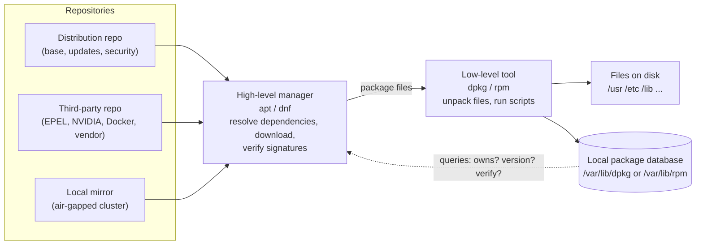
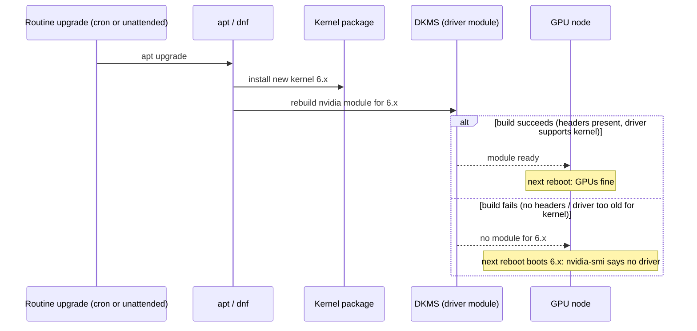
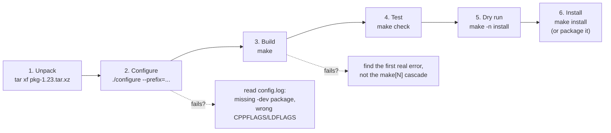
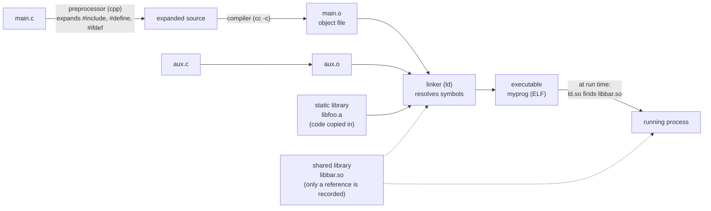

# 1.7 Packages, repositories and software installation

| | |
|---|---|
| Level | Basics |
| Priority tier | 0 |
| Lab venue | GCP / GKE (one Ubuntu VM and, optionally, one Rocky/Alma VM) |
| Part | Part 1: Linux, from the command line to the kernel and performance |
| Status | Drafted, labs **untested** |

## Why this matters for AI infrastructure

Almost everything you will operate arrives on a node as software somebody else built: the NVIDIA driver, the CUDA toolkit, the container runtime, `nvidia-container-toolkit`, the Slurm daemons, the InfiniBand stack (OFED or the distribution's inbox drivers), monitoring agents. Three kinds of incident in GPU fleets come from getting this layer wrong:

1. **Version drift.** One node is auto-upgraded and ends up with a kernel that the installed driver does not support, so the GPUs vanish after the next reboot. Another node has a different CUDA minor version, and a job that worked on the first fails on the second.
2. **Unknown provenance.** A library copied into `/usr/local/lib` years ago shadows the one the package manager installed, and nobody can say where it came from.
3. **Broken dependency resolution.** An engineer forces an install with `--nodeps` or `--force` to get past an error, and the node's package database no longer describes what is on disk.

This chapter gives you the vocabulary and the mechanics to avoid all three. It covers what a package is, how the two package families (deb and rpm) work, how repositories and signatures protect you, how to inspect and verify what is installed, how to hold versions, how software is built from source when no package exists (and how to do that without damaging the system), how shared libraries are found at run time (the cause of many "works on my machine" bugs), and how a whole cluster node is assembled in practice. It also introduces `make`, because you will constantly read other people's build instructions, Dockerfiles and driver installers that call it.

## Prerequisites and outcomes

You should be comfortable with the shell (1.2), the directory layout (1.3) and users and `sudo` (1.6).

After this chapter you can:

- Explain what a package contains, what metadata it carries, and why dependency metadata makes installation tractable.
- Install, remove, query, verify and hold packages with `apt`/`dpkg` on Debian-family systems and `dnf`/`rpm` on Red Hat-family systems, and translate between the two.
- Add a third-party repository safely, and say how signature checking works and why `--nogpgcheck` is a smell.
- Find which package owns a file, and which package would provide a missing file or header.
- Build and install software from source with `./configure`, `make` and `make install` into a private prefix, read the build log, and turn the result into a real package.
- Diagnose "cannot open shared object file" and "undefined reference" errors with `ldd`, `ldconfig`, `rpath` and `LD_LIBRARY_PATH`, and explain why `LD_LIBRARY_PATH` should not be exported globally.
- Read a simple `Makefile` and apply a source patch.
- Describe the order of operations for building a small HPC cluster node, including NFS, OFED, kickstart, cloning pitfalls and diskless booting.

## 1. What a package is

A **package** is one file (usually a compressed archive) that holds a tree of files belonging to one piece of software, plus **metadata** describing it. A web server, a single encryption module, a documentation set: each is a package. The files are what gets copied to disk; the metadata is what lets a tool reason about them.

The most useful metadata fields are:

| Metadata | What it enables |
|---|---|
| Name, version, architecture, description | Searching, comparing versions, refusing to install an x86-64 package on arm64 |
| **Dependencies** | The tool can compute and install everything else that is needed |
| **File checksums** | Later verification that nothing has been altered |
| **Marked configuration files** | Upgrades do not overwrite your edits |
| Maintainer scripts (pre/post install and remove) | Creating a system user, enabling a service, rebuilding a cache |
| Signature | Proof that the package came from the repository owner |

The set of fields differs between package systems, and so do their capabilities. The common families are:

| Family | Package file | Used by | Low-level tool | High-level manager |
|---|---|---|---|---|
| **deb** | `.deb` | Debian, Ubuntu, Mint | `dpkg` | `apt`, `apt-get`, `aptitude` |
| **rpm** | `.rpm` | Red Hat Enterprise Linux and clones (Rocky, Alma, CentOS Stream), Fedora, SUSE | `rpm` | `dnf` (older: `yum`), `zypper` on SUSE |
| Source-oriented ports | build recipes | Arch (pacman, with a ports-like build system), Gentoo (ebuild), Slackware | | |

For AI infrastructure you will meet deb on Ubuntu (the default for most GPU cloud images and NVIDIA's DGX OS) and rpm on RHEL-family systems (common in HPC and enterprise). Know both.

### Two layers, and why they exist

Every package system splits into two layers, and keeping them apart in your head resolves most confusion:

- The **low-level tool** (`dpkg`, `rpm`) works on **one package file**. It unpacks files, runs maintainer scripts and records the result in a local database. It does **not** fetch anything and, with a few exceptions, it does not solve dependencies: if a dependency is missing it complains.
- The **high-level manager** (`apt`, `dnf`) talks to **repositories**, works out the full set of packages that must be installed, removed or upgraded, downloads them, and then calls the low-level tool to do the unpacking.



### The package database is precious

The low-level tool records every installed package, its files and its checksums in a local database. If that database is damaged, the system no longer knows what is installed and repairing it is difficult. One concrete cause is installing or removing packages on a **filesystem that is 100% full**, because the tool can fail halfway while writing its own records. So before a big install on a node, check `df -h /` and `df -i /` (chapter 1.3 explains inodes); a full `/var` is just as bad as a full `/`.

Two related habits:

- Never use the "force" switches (`--force`, `--nodeps`, `dpkg --force-all`) as a way to get unblocked. They produce a system whose database disagrees with the disk.
- Do not mix installation methods for the same software. If the distribution already ships `foo`, installing a second `foo` into `/usr/local` or via a tarball creates two copies and the one that runs depends on `$PATH` order (chapter 1.2).

### Configuration files and upgrades

Packages mark certain files as **configuration**. When you upgrade, the manager must not discard your edits and also must not ignore the packager's improvements. The conventions are:

- On **rpm**, if you changed a config file and the new package also changed it, your file is kept and the new default is written next to it with the suffix `.rpmnew` (or, if the packager decided the old file must be replaced, your version is saved as `.rpmsave`).
- On **deb**, `dpkg` asks you interactively whether to keep your version or take the package's, and offers to show the difference. In scripts and automation you set an option so the choice is made without a prompt (for example `-o Dpkg::Options::="--force-confold"`, which keeps your files).
- When you **remove** a package, its configuration files normally stay behind so a later reinstall finds your settings. To remove them too, use `apt purge` (deb) or remove the leftover files (rpm, where the files are usually already gone but `.rpmsave` files may linger).

After any large upgrade, search for the leftovers and compare them:

```bash
sudo find /etc -name '*.rpmnew' -o -name '*.rpmsave' -o -name '*.dpkg-dist' -o -name '*.dpkg-old'
```

### Dependencies, and how the two families express them

A dependency says "package A needs package B (possibly at a given version) to work". The managers read these and compute the full closure, which is what turns "install this driver" into a list of forty packages.

The deb format has a richer vocabulary than rpm. A deb package can say a dependency is **required** (`Depends`), **strongly recommended** (`Recommends`, installed by default by `apt`), **merely suggested** (`Suggests`, typically documentation or examples), or **in conflict** (`Conflicts`, `Breaks`). A smart interactive manager can choose the set of optional packages that fits what you want. On the rpm side, installing one package has historically sometimes pulled in a dozen more that are not strictly needed, because there are fewer gradations; modern `dnf` has `--setopt=install_weak_deps=False` to skip "weak" dependencies, which is useful for small compute node images.

A dependency can also name a **capability** instead of a package: "any package that provides an `smtp-server`", or "a library providing `libcuda.so.1`". This is why you can ask the manager which package provides a file you are missing (section 5).

### Integrity: checksums

Because the package system stores a checksum for every file, you can later ask "has anything the package installed been changed?" This is a cheap integrity check, useful after a suspected compromise, after a disk problem, and when a node behaves differently from its siblings:

```bash
# rpm: verify one package, or everything
rpm -V openssh-server
rpm -Va                      # all packages; output lines show what differs

# deb: debsums is a separate package; dpkg has a built-in verifier too
sudo apt install debsums
sudo debsums -s              # show only files that fail
dpkg --verify openssh-server
```

An `rpm -V` line looks like `S.5....T.  c /etc/ssh/sshd_config`, where each letter flags what differs (S size, 5 digest, T modification time, and so on) and the trailing `c` marks a config file. Differences in config files are normal; differences in `/usr/bin` or `/usr/lib` binaries deserve an explanation. Only files that belong to packages are checked: a file that was dropped in by hand is invisible to this method.

## 2. Repositories: where packages come from

A **repository** is an indexed directory of packages, served over HTTP(S), from local disk, or from an optical medium. The index lets the manager find a package and its dependencies without downloading them. When you install an operating system, a repository (the installation medium, or a network mirror) is configured for you. After installation the main network repositories are added, normally including separate channels for the base release, bug-fix updates and security updates.

Beyond the distribution's own repositories there are three more kinds you will configure:

- **Third-party repositories.** The standard Red Hat repositories, for example, omit many packages, so people enable **EPEL** (Extra Packages for Enterprise Linux), a trusted community repository for the RHEL family. NVIDIA, Docker, Kubernetes and others publish their own repositories for their own software.
- **Vendor mini-repositories.** Some projects, like the InfiniBand OFED distribution, publish their own small repositories just for their software.
- **Local mirrors and internal repositories.** For machines without Internet access (typical for HPC clusters on a private network) or for reproducibility, you copy the packages you need to a server on your network and point nodes at it. That also lets you freeze a known-good set of versions and roll the whole fleet forward on your schedule.

### Signatures and trust

A repository signs its metadata (and, for rpm, usually each package). The manager checks the signature against a key you have **explicitly trusted**. This is the mechanism that stops someone who can intercept your download from substituting a malicious package. Consequences:

- **Adding a repository is a trust decision**, because its packages run as root during installation (maintainer scripts) and then run on your node. Only add repositories from the real owner, over HTTPS, and verify the key fingerprint against the vendor's documentation.
- Switches that disable the check (`dnf --nogpgcheck`, `gpgcheck=0` in a repo file, apt's `--allow-unauthenticated` or `[trusted=yes]`) are for emergencies and for your own internal test repositories; do not leave them in configuration.

### Debian-family configuration

- **Sources**: `/etc/apt/sources.list` and files in `/etc/apt/sources.list.d/`. Older entries are one line each (`deb [signed-by=/etc/apt/keyrings/vendor.gpg] https://repo.example.com/apt stable main`). Newer Ubuntu and Debian releases are moving to a multi-line "deb822" format in files ending `.sources`; both formats work, but check which your release uses. *(Review note: confirm the default format on the release you run.)*
- **Keys**: the modern practice is a key file in `/etc/apt/keyrings/` (or `/usr/share/keyrings/`) referenced from the entry with `signed-by=`, so each repository's key is trusted for that repository only. The old global keyring managed by `apt-key` is deprecated; guides that tell you to run `apt-key add` are out of date.
- **Update the index** before installing: `sudo apt update` downloads the package lists (it does not install anything). Forgetting this, or running it on a node whose repository has moved, is the usual reason for "Unable to locate package" or "404 Not Found".

### Red Hat-family configuration

- **Repository definitions**: files ending `.repo` in `/etc/yum.repos.d/`. Each section has a `baseurl` or `mirrorlist`/`metalink`, `enabled=1`, `gpgcheck=1` and a `gpgkey=` URL.
- **Keys**: imported once with `sudo rpm --import <key-url-or-file>` or fetched automatically when you first install from a repository that provides `gpgkey=` (you are asked to accept it).
- **Temporary control** without editing files: `--enablerepo=NAME`, `--disablerepo=NAME` and `--disablerepo='*' --enablerepo=NAME` on the command line.
- Newer RHEL-family releases split content into **BaseOS** and **AppStream** repositories and add *modules* (streams of software versions such as multiple Python or Node.js versions). Modules and streams are an extra layer you only need to know exist; check your distribution's current documentation.

### Verbs you need on both sides

| Task | Debian family | Red Hat family |
|---|---|---|
| Refresh repository metadata | `sudo apt update` | `sudo dnf makecache` (done automatically on most commands) |
| Install | `sudo apt install pkg1 pkg2` | `sudo dnf install pkg1 pkg2` |
| Install a local package file with dependencies | `sudo apt install ./pkg.deb` | `sudo dnf install ./pkg.rpm` |
| Remove | `sudo apt remove pkg` | `sudo dnf remove pkg` |
| Remove and delete config files | `sudo apt purge pkg` | (config files marked as such are saved as `.rpmsave`) |
| Remove packages nobody needs any more | `sudo apt autoremove` | `sudo dnf autoremove` |
| Upgrade installed packages | `sudo apt upgrade` (never removes packages); `sudo apt full-upgrade` (may install/remove to resolve) | `sudo dnf upgrade` |
| Check what has updates | `apt list --upgradable` | `dnf check-update` |
| Reinstall | `sudo apt install --reinstall pkg` | `sudo dnf reinstall pkg` |
| Download without installing | `apt download pkg` or `apt-get install --download-only pkg` | `dnf download pkg` or `--downloadonly` (with `--downloaddir=DIR`) |
| Search by name or description | `apt search word` | `dnf search word` |
| Show details and dependencies | `apt show pkg` ; `apt depends pkg` | `dnf info pkg` ; `dnf repoquery --requires pkg` |
| Which repository / version would be used | `apt policy pkg` | `dnf list --showduplicates pkg` |
| Package groups | `tasksel`, meta-packages | `sudo dnf group install "Development Tools"` |
| Transaction history and undo | `/var/log/apt/history.log` | `dnf history`, `dnf history undo N` |

A few details that surprise people:

- `yum` is the older name; on current RHEL-family releases `yum` is a compatibility alias for `dnf`. The option tables you find in older books and on forums still work.
- `apt` is the friendly front end with progress bars and sensible defaults for humans; **`apt-get`** and `apt-cache` have stable output and behaviour and are what you should use in scripts, Dockerfiles and automation. (`apt` warns you that its interface is not stable for scripting.)
- Add `-y` (assume yes) in automation, and `DEBIAN_FRONTEND=noninteractive` so debconf does not stop to ask questions.
- `--skip-broken` (dnf/yum) installs what it can and skips what has dependency problems. Use it only when you are certain you understand what is being skipped.

## 3. The low-level tools

You use `dpkg` and `rpm` directly for three jobs: installing a single package file, interrogating the database, and verifying.

### `rpm`: modes and selectors

`rpm` has **modes** (what to do) and **selectors** (which packages):

| Mode | Meaning | Selector | Meaning |
|---|---|---|---|
| `-q` | Query | `-a` | All installed packages |
| `-i` | Install | `-f /path` | The package that owns this file or directory |
| `-U` | Upgrade (or install if absent) | `-p file.rpm` | A package **file** (not yet installed) |
| `-e` | Erase | | |
| `-V` | Verify | | |

Combined, they answer nearly every question:

```bash
rpm -qa | grep -i cuda          # which CUDA-related packages are installed
rpm -qi openssh-server          # description, version, vendor, build date
rpm -ql openssh-server          # every file the package installed
rpm -qc openssh-server          # only its configuration files
rpm -qf /usr/bin/ssh            # who owns this file?
rpm -qpl downloaded.rpm         # contents of a package file before installing it
rpm -qR somepackage             # its dependencies (what it requires)
rpm -q --whatprovides libcuda.so.1   # which installed package provides this
```

Use `rpm -i` and `-U` only for a package file whose dependencies are already satisfied. Switches such as `--nodeps` (skip dependency check) and `--force` (overwrite files owned by another package, or install an older version) exist for repair work. Treat them as dangerous tools.

### `dpkg`: the equivalents

```bash
dpkg -l | grep -i cuda          # installed packages (name, version, status)
dpkg -s openssh-server          # status and metadata of one installed package
dpkg -L openssh-server          # files installed by it
dpkg -S /usr/bin/ssh            # which package owns this file?
dpkg -c pkg.deb                 # contents of a package file
dpkg -I pkg.deb                 # metadata of a package file
sudo dpkg -i pkg.deb            # install (does not fetch dependencies)
sudo apt -f install             # then let apt fix up missing dependencies
```

In `dpkg -l` output the first two columns are a state code. `ii` means installed and correctly configured; `rc` means removed but configuration remains; `iU` or `iF` mean half-installed or failed configuration (usually fixed with `sudo dpkg --configure -a`).

### Translation table

| Question | rpm | dpkg |
|---|---|---|
| Is it installed, which version? | `rpm -q pkg` | `dpkg -s pkg` or `dpkg -l pkg` |
| List installed packages | `rpm -qa` | `dpkg -l` |
| Files in an installed package | `rpm -ql pkg` | `dpkg -L pkg` |
| Which package owns this file? | `rpm -qf path` | `dpkg -S path` |
| Contents of a package file | `rpm -qpl f.rpm` | `dpkg -c f.deb` |
| Verify installed files | `rpm -V pkg` | `dpkg --verify pkg` / `debsums` |
| Which package could provide a file I do not have? | `dnf provides '*/name.h'` | `apt-file search name.h` (after `sudo apt install apt-file && sudo apt-file update`) |

## 4. Holding, pinning and reproducibility

On GPU nodes the point of package management is not "always newest". It is "exactly the versions we validated". Tools for that:

- **Hold a package** so routine upgrades skip it: `sudo apt-mark hold nvidia-driver-XXX linux-image-generic` (and `unhold`); on RHEL-family, the `dnf versionlock` plugin (`sudo dnf install python3-dnf-plugin-versionlock`, then `sudo dnf versionlock add pkg`). *(Review note: package names for the plugin differ by release.)*
- **Install an exact version**: `sudo apt install pkg=1.2.3-1` ; `sudo dnf install pkg-1.2.3-1.el9`. Use `apt policy pkg` or `dnf list --showduplicates pkg` to see what versions your repositories offer.
- **Apt pinning** (`/etc/apt/preferences.d/`) assigns priorities to repositories or versions, so a third-party repository cannot silently replace a base package. It is powerful and easy to get wrong; reach for `apt-mark hold` first.
- **Freeze the whole repository.** The strongest approach for a fleet is to mirror the repositories you depend on at a point in time (or use a snapshot service) and have nodes install only from that snapshot. Two nodes built a month apart then get identical packages.
- **Unattended upgrades** (`unattended-upgrades` on Ubuntu, `dnf-automatic` on RHEL-family) are valuable for security patches on servers, but on a GPU node they can replace the kernel without rebuilding the driver. Restrict them to security updates for packages outside the driver/kernel set, or disable them on compute nodes and patch via a controlled process.

The failure this prevents is concrete and common:



Chapter 1.22 develops DKMS and kernel modules. The package-layer fix is: hold kernel and driver packages together, upgrade them in a controlled step, and test a rebooted canary node before rolling out.

## 5. Finding the package you need

Three questions come up daily.

**"Which package does this file belong to?"** Use `rpm -qf`, `dpkg -S`.

**"I need a file I do not have (a header, a library, a command). Which package provides it?"** On deb: `apt-file search pkg.h`. On rpm: `dnf provides '*/pkg.h'` (the older spelling `yum provides` works). The usual cases:

- A compiler error `fatal error: foo.h: No such file or directory` means the **development package** for the library is missing. Libraries are packaged in two flavours: the runtime package (`libfoo1` on Debian, `foo` on Red Hat) with the shared library, and the development package (`libfoo-dev`, `foo-devel`) with the headers and `.pc` files. The same distinction explains why `openssl.pc` is absent until you install `libssl-dev`/`openssl-devel`.
- A runtime error `error while loading shared libraries: libfoo.so.1: cannot open shared object file` means the runtime package is missing, or the library is installed in a location the dynamic linker does not search (section 8).

**"What would this install do?"** Simulate first: `apt install -s pkg` (or `apt-get -s`), `dnf install --assumeno pkg`, and read the list of packages that will be removed. A line that says an unrelated meta-package such as `ubuntu-desktop` or a driver will be **removed** is a reason to stop.

## 6. Installing from source

Packages exist because most open-source software is distributed as **source code**: Unix and Linux come in so many flavours and architectures that distributing binaries for every combination is impractical. Source distribution also lets users fix bugs and add features, which is the point of open source. Nearly everything on a Linux system, from the kernel to the libraries, can be obtained as source.

You should not replace your distribution's packages with source builds wholesale. Distributions fix security problems quickly, keep dependencies consistent, and let you upgrade with one command. But there are good reasons to build from source yourself:

- **Control of options**, for example building an MPI library with exactly the network backends your cluster has, or a Slurm with specific plugins.
- **Control of the version**, when the distribution's is too old or too new (particularly for add-ons such as language libraries).
- **Install location**, including keeping several versions of the same software side by side.
- **Understanding** how the software works and what it depends on.

The costs are real: it takes time; custom installs **do not update themselves** (a security issue for anything network-facing); you may overwrite files the distribution owns; and a typo in an option can leave a half-working build. So the rule is: *prefer the package; build from source into an isolated prefix when you need control; turn the result into a package if you will deploy it to more than one machine*.

### The standard sequence

Most C and C++ projects built with the GNU autotools follow four steps, and the pattern transfers to other build systems (CMake, Meson, SCons):



**Unpack carefully.** Source archives come as `.tar.gz`, `.tar.bz2` or `.tar.xz` (chapter 1.3 covered `tar`). *Before* extracting, list the contents with `tar tvf` or `tar ztvf`, for two reasons:

- A well-formed archive has everything under one top directory (`package-1.23/...`). Some archives instead spill files directly into the current directory; if the listing shows bare names such as `Makefile` and `main.c`, extract into a new, empty directory so you do not make a mess.
- Never unpack an archive that contains **absolute paths** such as `/etc/passwd` or `/etc/inetd.conf`. That is almost certainly a booby trap, and extracting as root would overwrite system files. Delete such an archive. (Modern `tar` strips leading slashes by default, but do not rely on that.)

**Read the documentation in the tree first.** Open `README`, then `INSTALL` if there is one, before doing anything else; they often state special options, prerequisites and supported platforms. Then get a feel for the files by their role:

- Build-system files: `Makefile`, `Makefile.in`, `configure`, `CMakeLists.txt`, `meson.build`. Very old packages ship a plain `Makefile` you edit by hand; most use a configuration script or file that generates the `Makefile` for your system.
- Source files: `.c`, `.h` for C; `.cc`, `.cxx`, `.C` for C++.
- Object files (`.o`) or binaries should not be in a source archive. If you find them, run `make clean` so you get a fresh compile.

**Configure.** GNU autoconf-based packages ship a `configure` script and template files ending in `.in` (`Makefile.in`, `config.h.in`). Running `./configure` probes your system (which compiler, which headers and libraries exist, which functions are available) and substitutes the results into the templates to produce the real `Makefile` and a `config.h` header. It also writes `config.cache` and a detailed log, `config.log`. The output is long and tells you what is being checked; a successful configure does not guarantee a successful build, but the odds are good.

You need the build tools installed first. On Debian and Ubuntu the quick way is `sudo apt install build-essential`; on RHEL-family, `sudo dnf group install "Development Tools"`. If some tool is absent, search for `gcc` or "C compiler".

### Safe first install: a private prefix

The key option is `--prefix`. By default an autoconf package installs under `/usr/local` (programs in `/usr/local/bin`, libraries in `/usr/local/lib`, and so on). To experiment safely, install into a directory you own:

```bash
mkdir -p ~/src && cd ~/src
tar xf coreutils-9.5.tar.xz            # example archive; the version will differ
cd coreutils-9.5
./configure --prefix=$HOME/mycoreutils
make -j"$(nproc)"                      # -j builds in parallel
make check                             # runs the package's tests (can take a while)
make -n install                        # DRY RUN: print what install would do
make install
$HOME/mycoreutils/bin/ls --version
```

Everything lands under `~/mycoreutils`, independent of the rest of the system, so you can delete that directory and nothing else is affected. After `make install` finishes, you have a subdirectory named `mycoreutils` in your home directory containing `bin`, `info`, `lib`, `man`, and `share`. Always do the dry run (`make -n install`) and browse through its output before running `make install` for real: the `install` target of a `Makefile` can copy files anywhere the author thought appropriate, and the dry run prints the commands without executing them. If anything is installed outside your `mycoreutils` prefix, stop.

**Other useful `configure` options:**

| Option | Meaning |
|---|---|
| `--prefix=DIR` | Root of the installation tree |
| `--bindir=DIR`, `--sbindir=DIR`, `--libdir=DIR` | Override where executables, system executables and libraries go |
| `--disable-shared` | Do not build shared libraries (can avoid run-time library hassles for obscure libraries) |
| `--with-pkg=DIR` | Tell the build where a dependency lives, when it is in a nonstandard place. Not every script supports this and the exact spelling varies. |
| `--help` | Lists all options (long; search it) |

**Separate build directory.** If you want to try several option sets, or build for several configurations from one source tree, create a new empty directory anywhere and run the `configure` script by its path from there (`mkdir build && cd build && ../pkg-1.23/configure ...`). The source tree is not modified; the build directory gets generated files and links back. Many maintainers prefer this ("out-of-tree" build).

**Environment variables.** `configure` reads `CPPFLAGS` (preprocessor options, such as `-I` include paths and `-D` macro definitions), `CFLAGS` (compiler options), `LDFLAGS` (linker options such as `-L` paths) and `CC`. Set them in front of the command or as arguments:

```bash
CPPFLAGS=-DDEBUG ./configure
./configure CPPFLAGS="-I$HOME/opt/zlib/include" LDFLAGS="-L$HOME/opt/zlib/lib -Wl,-rpath=$HOME/opt/zlib/lib"
```

Use `CPPFLAGS`, not `CFLAGS`, for include directories, because `configure` often runs the preprocessor on its own. Be exact: a missing dash (`CPPFLAGS=Iinclude`) makes the compiler treat the argument as a file name and `configure` aborts with "C compiler cannot create executables".

**Reading `config.log` (autoconf logfiles).** If something goes wrong during the `configure` process and the cause is not obvious, you can examine `config.log` to find the problem. Unfortunately, `config.log` is often a gigantic file because `configure` dumps the entire shell environment, `config.h` definitions, and cache variables at the bottom, which makes it hard to locate the exact source of the failure. The efficient technique is to open `config.log` with `less config.log`, press `G` (shift-G) to go to the very end of the file, and then use `?` to search **backward** for a string from the failing output—such as `for more details` or the specific test string that failed. The error is right above that match, showing the exact compiler command line and compiler diagnostic that triggered the failure.

**Targets in an autoconf `Makefile`.** Besides `all` (default) and `install`: `clean` (remove built objects), `distclean` (remove everything generated, including `Makefile` and `config.h`, returning the tree to its freshly unpacked state), `check` (run tests) and `install-strip` (install with debug symbols stripped, saving space).

### `pkg-config`: how builds find libraries

When libraries are scattered across prefixes, a build must be told where each one's headers and libraries are and which link flags it needs. Most libraries solve this with a small text file ending `.pc`, read by the `pkg-config` program:

```bash
pkg-config --cflags --libs zlib      # prints e.g. "-lz" (flags vary by system)
pkg-config --modversion openssl      # installed version
pkg-config --list-all | less         # everything it knows
```

A `.pc` file contains variables (`prefix`, `libdir`, `includedir`), the name, version, dependencies (`Requires`), and the flags to compile and link (`Cflags`, `Libs`). By default `pkg-config` looks only in the `lib/pkgconfig` directory of its **own** installation prefix (and `share/pkgconfig`). Files elsewhere (say `/opt/openssl/lib/pkgconfig/openssl.pc` or `/opt/foo/lib/pkgconfig`) are invisible unless you use one of two methods:
1. Make symbolic links (or copies) from the actual `.pc` files to the central `pkgconfig` directory.
2. Set your `PKG_CONFIG_PATH` environment variable to include any extra `pkgconfig` directories. Note that this strategy works well per build, but does not work well on a systemwide basis. You will not see `.pc` files for most libraries until you install their development packages (`libssl-dev` / `openssl-devel`).

### Turning a source build into a package

Installing with plain `make install` leaves files with no record in any package database, so you cannot cleanly remove, upgrade or inventory them. If you are going to install the build on more than one machine, make a real package:

- On Debian family, **`checkinstall`** wraps `make install`, tracks the files it installs, and produces a `.deb` you install and remove with `dpkg`:
  ```bash
  sudo checkinstall make install
  ```
- On RPM family, create a build tree with `rpmdev-setuptree` (from `rpmdevtools`) and write a `.spec` file that describes the build; then `rpmbuild -ba name.spec` produces the package. This is more work; follow a tutorial for your release, and consider `mock` (clean-chroot builds) for repeatable results.
- On a build server, use **`DESTDIR`**: `make install DESTDIR=/tmp/stage` installs into a staging directory without touching the live system, and you pack that directory (with `tar`, `fpm` or your packaging tool). This is the foundation of every packaging workflow.

If you do install by hand into `/usr/local`, remember that operating system upgrades leave `/usr/local` alone. That is convenient, but it also means lots of unrecorded files accumulate and nobody remembers their origin. When it becomes unmanageable, package them.

For large numbers of nodes, an even better answer is to put software in a **shared, versioned location** (a network filesystem mount with per-version directories) selected by *environment modules* (section 10), or to bake it into a container image (chapter 7).

### Applying a patch

A **patch** (or diff) is a text file, produced by `diff -u`, that describes changes to source files. Developers also distribute fixes as patches. The header of each file section looks like:

```text
--- src/file.c.orig   2015-07-17 14:29:12 +0100
+++ src/file.c        2015-09-18 10:22:17 +0100
@@ -2,16 +2,12 @@
```

Search the patch for lines starting with `---` to see which files it changes, and read the paths. The **working directory matters**: the path `src/file.c` means you must run `patch` from the directory that *contains* `src`, not from `src` itself.

```bash
patch -p0 < fix.patch        # paths are used as written
patch -p1 < fix.patch        # strip one leading path component (typical for patches made from git)
patch -p1 --dry-run < fix.patch   # test without changing anything
```

If a path in the patch begins with a directory such as `package-3.42/src/file.c` and your directory is named differently, `-p1` removes the first component so the rest matches. If `patch` asks "File to patch:", you are probably in the wrong directory or the source does not match the version the patch was made against; stop rather than guess, because a partly applied patch leaves source that will not build. With git you can also use `git apply --check` and `git apply`.

### Where to go next with builds

Once the autotools routine is comfortable, three directions are worth knowing about: other build systems (**CMake**, **Meson**, **SCons**, and language-specific ones such as `cargo` or `go build`), each with its own configure-then-build-then-install shape; the **Linux kernel build**, which has its own configuration system (`make menuconfig`, `make modules_install`) and which you should only attempt while keeping the previous kernel bootable as a fallback (chapters 1.14 and 1.22); and **distribution source packages**, which carry the distribution's own patches and build recipes and let you rebuild or patch a packaged program the supported way (`debuild`/`dpkg-buildpackage` on Debian family, `rpmbuild` and `mock` on RPM family). Rebuilding a distribution source package, rather than compiling a tarball by hand, usually gives you a proper package at the end.

### Troubleshooting builds

First learn to read `make` output:

- `make: *** [target] Error 1` is a real failure. A line with `Error 1 (ignored)` is a failure the author expected and tolerates; ignore it.
- GNU `make` calls itself recursively, and each level is labelled `make[N]`. When something fails deep inside, you see a cascade: the compiler error, then `make[3]: *** [file.o] Error 1`, then `make[2]`, `make[1]` and finally `make`. **The first error is the one that matters**; the cascade is only the unwinding. Scroll up to the first compiler message and the directory it names (`Leaving directory ...` tells you where).

Common failures and what they mean:

| Message | Meaning and fix |
|---|---|
| `conflicting types for 'item'` / `previous declaration` | The source declares something twice; remove or guard the offending line (comment, `#ifdef`). Often a sign you are building on a system the package does not support. |
| `'time_t' undeclared` (or any unknown type or function) | A header is missing from the source. Look up the function's manual page (`man 2 time` / `man 3 time`): its `SYNOPSIS` shows the header to `#include`. |
| `pkg.h: No such file or directory` | Development package missing, or the header is in a nonstandard place: add `-I` to `CPPFLAGS` (and probably a matching `-L` to `LDFLAGS`). Find the package with `apt-file search pkg.h` or `dnf provides '*/pkg.h'`. If nothing looks missing, you may be building for an OS the source does not support: read the `README`. |
| `undefined reference to 'initscr'` (linker) | A library was not linked, or one of your own object files was left off the link line. Search for the function name to find which library (here, curses) and add `-lcurses` (and `-L` if it is in a nonstandard place). |
| `make: prog: Command not found` | Build tool missing (`cc`, `gcc`, `ld`: install the toolchain). If you are sure it is installed, a badly written `Makefile` may assume `.` is in your `$PATH`; use `./prog` in the `Makefile`, or temporarily put `.` on your path. |
| `Makefile:7: *** missing separator. Stop.` | A recipe line starts with spaces instead of a **tab**. |

## 7. The build toolchain: compiler, linker, headers and `make`

You do not need to write C to operate a cluster, but you will constantly read build logs, fix `Makefile` variables and chase library errors, so you need the model of how a program is built.

### From source to executable



The vocabulary:

- **Source code** is the human-written text (`.c`, `.cc`). A compiler translates it into **object files** (`.o`), binary code with loose ends: references to functions defined elsewhere and no information the operating system needs to start it.
- The **linker** (`ld`) combines object files and libraries into an **executable** and resolves each reference. People rarely run `ld` directly: the compiler driver (`cc`, `gcc`, `g++`, `clang`) calls it for you. `cc` is the traditional name for the system's C compiler; on Linux it is usually GNU `gcc`, and `clang` (from the LLVM project) is the common alternative.
- A **library** is a bundle of compiled components (essentially object files plus header files that declare them). There is a standard C library (`libc`) that is always linked in unless you say otherwise, a math library, and thousands of others.

A minimal two-file example to see the steps (my own, small enough to retype):

```bash
mkdir -p ~/lab/build && cd ~/lab/build
cat > greet.h <<'EOF'
void greet(const char *who);
EOF
cat > greet.c <<'EOF'
#include <stdio.h>
#include "greet.h"
void greet(const char *who) { printf("hello, %s\n", who); }
EOF
cat > main.c <<'EOF'
#include "greet.h"
int main(void) { greet("cluster"); return 0; }
EOF

cc -c greet.c            # produces greet.o
cc -c main.c             # produces main.o
cc -o hello main.o greet.o   # links them into 'hello'
./hello
```

If you omit `-o`, the compiler writes an executable called `a.out`; always name your output. To see the intermediate stages: `cc -E main.c` (preprocessor only), `cc -S main.c` (assembly), `file main.o hello` (object vs executable).

### Linking against libraries

Libraries matter at **link time**. If a program calls a function and you do not link the library that defines it, the linker stops with:

```text
badobject.o: undefined reference to 'initscr'
```

The important part is the function name. A web search for it (or `man initscr`) tells you which library provides it (here, curses). Note that "undefined reference" does **not** always mean a missing library: one of your own object files may be missing from the link command; it is usually easy to tell, because you will recognise your own functions.

To link, name the library with **`-l`** (the filename minus the `lib` prefix and the suffix) and, if it is not in a default directory, tell the linker where with **`-L`**:

```bash
cc -o badobject badobject.o -lcurses                       # in a default directory
cc -o badobject badobject.o -lcurses -L/usr/junk/lib -lcrud   # extra library in a custom directory
```

The default library directories are `/lib`, `/usr/lib` and, on modern multiarch distributions, architecture-specific subdirectories such as `/usr/lib/x86_64-linux-gnu`. To find which library defines a function: `nm --defined-only libcurses.a | grep initscr` (static) or `nm -D --defined-only /usr/lib/.../libncurses.so.6 | grep initscr` (shared).

### Static and shared libraries

| | Static library (`libfoo.a`) | Shared library (`libfoo.so.N`) |
|---|---|---|
| At link time | Needed code is **copied** into the executable | Executable records only the library's **name** |
| At run time | The library file is not needed; the executable behaves identically forever | The dynamic loader `ld.so` finds and maps the library; many processes **share** the same copy in memory |
| Updating the library | Requires **relinking every executable** | Fix the library once; programs pick it up (usually without recompiling) |
| Cost | Larger binaries, more disk and RAM; a security fix means finding and rebuilding every user | Management complexity: the right version must be found at run time |

Shared libraries are why a library security update from your package manager protects every program that uses it, and why the update tool sometimes asks you to reboot or restart services (so running processes drop the old library). They are also the source of the most common run-time failures, which section 8 covers.

### Headers, the preprocessor and include paths

**Header files** (`.h`) contain declarations (types and function signatures) for libraries. The compiler never looks for them itself: a separate program, the **C preprocessor** (`cpp`, or `cc -E`), runs first and rewrites the source. Preprocessor commands, **directives**, begin with `#`, and there are three kinds:

- `#include <stdio.h>` inserts a file. Angle brackets mean "search the system include directories"; double quotes (`#include "greet.h"`) mean "look next to this source file first". If you hit a problem with a double-quoted include, you probably have incomplete source.
- `#define NAME value` defines a **macro**: every occurrence of `NAME` is replaced by `value`. You can also define one without touching source: `cc -DNAME=value`.
- `#ifdef MACRO` / `#if cond` ... `#endif` includes or skips a block depending on a macro. This is how one code base supports different platforms or a debug mode.

The preprocessor knows nothing about C syntax; it only manipulates text. Many a confusing build error comes from a macro substituting something unexpected.

The default system include directory is `/usr/include` (plus architecture-specific subdirectories). If a header lives elsewhere, add `-I/path/to/include` to the compile command:

```text
badinclude.c:1:22: fatal error: notfound.h: No such file or directory
```

```bash
cc -c -I/usr/junk/include badinclude.c
```

When the compiler cannot find a header, look for it with `locate`, `find`, or the package tools from section 5; there can be several with the same name in different places, so confirm you are using the right one.

### `make`

Compiling a handful of files by hand does not scale, so Unix has **`make`**, which reads a file named `Makefile` (or `makefile`) and rebuilds only what is out of date. The model has three ideas:

- A **target** is something to produce: a file (`main.o`, `myprog`) or a label (`all`, `clean`).
- A target has **dependencies**: other targets that must exist, and be at least as new, first.
- A **rule** is the recipe, the shell commands that build the target from its dependencies.

Using the example files above, here is a sample Makefile:

```make
# Makefile  (the indented lines MUST start with a TAB character, not spaces)
OBJS = main.o greet.o

all: hello

hello: $(OBJS)
	$(CC) -o hello $(OBJS)

clean:
	rm -f $(OBJS) hello
```

Points to notice:

- `OBJS = ...` defines a **macro** (variable), used as `$(OBJS)`. `CC` is predefined (default `cc`).
- The **first target** in the file (`all` here) is the default when you run `make` with no arguments.
- You wrote no rule for `main.o` or `greet.o`; `make` has **built-in rules** that know how to get a `.o` from a `.c` using `$(CC) -c` and the standard flag variables.
- The recipe lines start with a tab. Spaces cause `*** missing separator. Stop.`

`make` brings targets up to date and does the minimum: run it twice and the second says `make: 'hello' is up to date` (or `Nothing to be done`). Run `touch greet.c` and `make` again: it recompiles only `greet.o` and relinks `hello`, because `greet.o` became older than its source and `hello` older than `greet.o`. That chain reaction, driven purely by file timestamps, is the whole idea.

**Commands you will use daily:**

```bash
make                     # build the default target
make hello               # build one target
make -n                  # print what would run, run nothing (dry run)
make -f other.mk         # use a different file
make -j8                 # run up to 8 jobs in parallel (builds go much faster)
make CC=clang            # override a macro from the command line
make CFLAGS="-O2 -g"    # likewise
```

You do not even need a `Makefile` for tiny programs: `make blah` with a `blah.c` in the directory uses built-in rules to compile it. This is a handy trick with unfamiliar languages (Fortran, lex, yacc), because `make` may figure out the right commands, and even its failure message hints at the tool you need.

**Standard macros** (set in the `Makefile`, an environment variable, or the command line):

| Macro | Meaning |
|---|---|
| `CC` | C compiler (default `cc`) |
| `CFLAGS` | Compiler options (optimisation, warnings, `-g`) |
| `CPPFLAGS` | Preprocessor options (`-I`, `-D`) |
| `CXXFLAGS` | Flags for the C++ compiler (GNU `make`) |
| `LDFLAGS` | Linker options (`-L`, `-Wl,-rpath=...`) |
| `LDLIBS` | Libraries to link (`-lm`, `-lcurses`), when you want to keep them separate from search paths |

**Automatic variables** inside a rule: `$@` is the current target, `$<` the first dependency, `$*` the stem of the target name (for `blah.o`, `blah`). A pattern like `.c.o:` in older Makefiles defines how to produce a `.o` from a `.c`.

**Conventional targets** found in nearly every project:

| Target | Purpose |
|---|---|
| `all` | Build everything (usually the first target) |
| `clean` | Remove object files and executables |
| `distclean` | Remove everything not in the original distribution, including generated Makefiles |
| `install` | Copy built files to their destination. **Dangerous**; always `make -n install` first |
| `test` / `check` | Run the test suite |
| `depend` | Regenerate header dependencies (an older practice) |

**Organisation tips (`HLW` Section 15.2.8).** Even though there are many different `Makefile` styles, most programmers adhere to a few general rules of thumb. In the first part of the `Makefile`, inside the macro definitions, libraries and includes are grouped according to package:

```make
MYPACKAGE_INCLUDES=-I/usr/local/include/mypackage
MYPACKAGE_LIB=-L/usr/local/lib/mypackage -lmypackage
PNG_INCLUDES=-I/usr/local/include
PNG_LIB=-L/usr/local/lib -lpng
CFLAGS=$(CFLAGS) $(MYPACKAGE_INCLUDES) $(PNG_INCLUDES)
LDFLAGS=$(LDFLAGS) $(MYPACKAGE_LIB) $(PNG_LIB)
```

Object files are grouped according to executables. For example, if a package builds two executables called `boring` and `trite` that each have their own `.c` file and share `util.c`, you define `UTIL_OBJS=util.o`, `BORING_OBJS=$(UTIL_OBJS) boring.o`, `TRITE_OBJS=$(UTIL_OBJS) trite.o`, and `PROGS=boring trite`, and give `boring` and `trite` separate rules under `all: $(PROGS)`. Combining two executables into one rule is a trap: `trite` would depend on `boring.c`, `boring` would depend on `trite.c`, and `make` would rebuild both programs whenever either source file changed. If you need a special rule for an object file, place it just above the executable rule that uses it.

GNU `make` has many extensions that other implementations (BSD, Solaris) lack; this is fine on Linux and is the reason portable projects layer autotools or CMake on top. For more depth, read the GNU `make` manual (`info make`).

**Lex and Yacc (`HLW` Section 15.3).** You may encounter Lex and Yacc when compiling programs that parse configuration files or commands. Lex is a tokenizer that transforms text into numbered tags with labels; the GNU/Linux version is named `flex`, and requires a `-ll` or `-lfl` linker flag. Yacc is a parser that reads tokens according to a grammar; the GNU parser is `bison` (run `bison -y` for Yacc compatibility, with the `-ly` linker flag).

## 8. Shared libraries at run time

A dynamically linked executable knows only the **names** of the libraries it needs. A small program, the **dynamic linker/loader** (`ld.so`, shown as `ld-linux-x86-64.so.2` on x86-64), runs first when you start the program, finds those libraries and maps them into the process.

List what a program needs with `ldd`:

```bash
ldd /bin/bash
#   linux-vdso.so.1 (0x00007ffd...)
#   libtinfo.so.6 => /lib/x86_64-linux-gnu/libtinfo.so.6 (0x00007f...)
#   libc.so.6 => /lib/x86_64-linux-gnu/libc.so.6 (0x00007f...)
#   /lib64/ld-linux-x86-64.so.2 (0x00007f...)
```

The name on the left of `=>` is what the executable asked for; the path on the right is where `ld.so` found it. A line reading `libfoo.so.1 => not found` is your problem. (On untrusted binaries, do not run `ldd`; some implementations execute the program. Use `readelf -d prog | grep NEEDED` instead.)

### The search order

`ld.so` looks in this order (details in `ld.so(8)`):

1. The executable's embedded **`RPATH`/`RUNPATH`**, if the program was linked with one.
2. The **`LD_LIBRARY_PATH`** environment variable, if set. (For the classic `RPATH` the order is `RPATH`, then `LD_LIBRARY_PATH`; for `RUNPATH` it is `LD_LIBRARY_PATH` first. Check `ld.so(8)` for your system.)
3. The **cache** `/etc/ld.so.cache`, a fast index of libraries found in the directories listed in `/etc/ld.so.conf` (which usually includes files from `/etc/ld.so.conf.d/`).
4. The **default directories** `/lib` and `/usr/lib` (and their architecture variants), which are implicit.

The cache is rebuilt by **`sudo ldconfig`** (add `-v` for details). Whenever you add a library to a directory in the cache's path, or change `ld.so.conf`, run `ldconfig`, or the loader will not know. Useful: `ldconfig -p | grep libcuda` lists what the cache knows.

### Do not add directories carelessly to `/etc/ld.so.conf`

It is tempting to put every unusual library directory in `ld.so.conf`. Resist: you should know what is in the system cache, and a cache stuffed with odd directories causes conflicts and a disorganised system. The better ways to find a library in a nonstandard place are:

**Link with an `rpath`** (build time). Say `libweird.so.1` lives in `/opt/obscure/lib`:

```bash
cc -o myprog myprog.o -Wl,-rpath=/opt/obscure/lib -L/opt/obscure/lib -lweird
```

`-Wl,-rpath=...` passes `-rpath` to the linker and embeds the directory into the executable. You still need `-L` for the link step. To change the `rpath` of a binary you cannot rebuild, use **`patchelf`** (`patchelf --set-rpath /opt/obscure/lib myprog`), but compile-time is better. Inspect with `readelf -d myprog | grep -E 'RPATH|RUNPATH'`. A relative form, `-Wl,-rpath='$ORIGIN/../lib'`, makes a relocatable tree whose libraries sit beside the program; this is how many vendors ship software that works wherever it is unpacked.

### The danger of `LD_LIBRARY_PATH`

`LD_LIBRARY_PATH` is a colon-separated list of directories searched **before** the normal places. It is the number-one cause of shared-library trouble, because it is a cheap way to make a program run when you do not have the source and cannot use `patchelf`. You get what you pay for:

- **Performance.** The loader may scan each listed directory for every library of every program started with the variable set.
- **Wrong libraries.** If you export it in your shell startup files, every program you run, including system tools, searches those directories first and can pick up an incompatible library. This produces baffling crashes and "symbol lookup error" messages far from the real cause.
- **Invisible state.** Two users with different values see different behaviour from the same binary.

So: **never set `LD_LIBRARY_PATH` in global shell startup files, and never compile software with it set.** If you must use it for one program, use a **wrapper script** that sets it only for that command:

```bash
#!/bin/sh
LD_LIBRARY_PATH=/opt/crummy/lib
export LD_LIBRARY_PATH
exec /opt/crummy/bin/crummy.bin "$@"
```

(The `exec` replaces the shell with the program; `"$@"` passes your arguments through preserving spaces. Quote it; the unquoted form from older scripts breaks on arguments with spaces.) Cluster **environment modules** (section 10) do something similar, on purpose and per job, which is the acceptable form of the same idea.

A second problem appears with developers: a library's API changes slightly between minor versions and breaks installed software. The preventive solutions are to install each library version consistently under its own prefix and link with `rpath`, or to link obscure libraries statically.

### Quick diagnosis

```bash
ldd ./prog | grep 'not found'          # which names are unresolved
ldconfig -p | grep libname             # does the cache know it?
find / -name 'libname.so*' 2>/dev/null # where is it, if anywhere?
readelf -d ./prog | grep -E 'NEEDED|RPATH|RUNPATH'
LD_DEBUG=libs ./prog 2>&1 | head -50   # trace the loader's search (debugging only)
strace -e trace=openat ./prog 2>&1 | grep -E 'ENOENT|\.so'   # chapter 1.11
```

Chapter 1.11 returns to ELF, the loader and `strace` in depth.

## 9. Interpreters, shebang lines, scripting languages, and Java (`HLW` Sections 15.4–15.6)

A script is an executable text file run by an interpreter. If the file is executable and its first line begins with `#!` (the **shebang**), the kernel runs the program named after `#!` with the rest of the file passed as input:

```bash
#!/usr/bin/env python3
print("hello")
```

- `#!/usr/bin/python3` hard-codes a path. `#!/usr/bin/env python3` finds the first `python3` on your `$PATH`, which is better when interpreters live in different places or in virtual environments, at the cost of depending on `$PATH`.
- The most common failure is `bash: ./myscript: /usr/bin/tail: bad interpreter: No such file or directory`. The path after `#!` does not exist on this system (for example `tail` is in `/bin`, not `/usr/bin`). Another common one is a script saved on Windows with CRLF line endings, so the interpreter name ends with an invisible `\r`; fix with `dos2unix` or `sed -i 's/\r$//'`.
- Do not rely on more than one argument on the shebang line (such as `#!/usr/bin/tail -2`); different Unix kernels treat everything after the interpreter path as a single combined argument, spaces and all.

### Scripting languages and Java you will encounter on Linux systems

- **Python (`python` / `python3`):** A scripting language with a strong following and powerful features for text processing, database access, networking, multithreading, data analysis, web applications, and AI/ML. David M. Beazley's *Python Distilled* (Addison-Wesley, 2021) is a classic concise reference, and Part 3 of this handbook covers Python for infrastructure in depth. Treat the system Python as part of the operating system: many distribution tools depend on it, so do not `pip install` into it as root. Use a virtual environment (`python3 -m venv .venv`, then `.venv/bin/pip install ...`), `uv`, or a container (chapter 7).
- **Perl (`perl`):** One of the older third-party Unix scripting languages—the original "Swiss army chainsaw" of programming tools. Although Perl has lost ground to Python in recent years, it excels at text processing, conversion, and file manipulation, and many legacy system and InfiniBand tools are written in it. Classic references are *Learning Perl*, 7th edition, by Randal L. Schwartz, brian d foy, and Tom Phoenix (O'Reilly, 2016) and *Modern Perl*, 4th edition, by chromatic (Onyx Neon Press, 2016).
- **Other scripting languages (`HLW` 15.4.3):** **PHP** (`http://www.php.net/`, hypertext-processing language for dynamic web scripts and standalone CLI scripts); **Ruby** (`http://www.ruby-lang.org/`, favored by object-oriented and web developers); **JavaScript** (ubiquitous in web browsers and used server-side via **Node.js**, executable `node`); **Emacs Lisp** (the Lisp dialect used by the Emacs text editor); **MATLAB** and **Octave** (commercial matrix/mathematical language and its free software counterpart); **R** (`http://www.r-project.org/`, statistical analysis language; see Norman Matloff's *The Art of R Programming*, No Starch Press, 2011); **Mathematica** (commercial mathematical language); **m4** (macro-processing language used inside GNU autotools); and **Tcl** (*Tool Command Language*, `http://www.tcl.tk/`, paired with the **Tk** GUI toolkit, **Expect** automation utility, and classic Tcl-based Environment Modules).
- **Java (`.class`, `.jar`, JRE vs JDK, `HLW` 15.5):** Java is a compiled object-oriented language that compiles `.java` source files into `.class` bytecode files executed by a bytecode interpreter (the Java Virtual Machine, inside the **Java Runtime Environment, JRE**). Run a compiled class with `java file.class`, or an archived collection of classes (`.jar`) with `java -jar file.jar`. Some Java services require setting `JAVA_HOME` to the installation prefix or `CLASSPATH` (a colon-delimited list of class directories like `PATH`). To compile `.java` files into bytecode or bundle `.jar` archives, install the **Java Development Kit (JDK)** and run `javac file.java` and `jar` (which works like `tar`).
- **Modern compiled systems languages and LLVM (`HLW` 15.6):** Compiled languages such as **Go** (`golang`) and **Rust** (`cargo`) dominate modern cloud-native and Kubernetes infrastructure, while the **LLVM** compiler infrastructure (`http://llvm.org/`) underpins `clang` and many GPU/ML compiler backends. For deeper study of compiler design, Brian Ward recommends *Compilers: Principles, Techniques, and Tools*, 2nd edition, by Alfred V. Aho et al. (Addison-Wesley, 2006) and *Modern Compiler Design*, 2nd edition, by Dick Grune et al. (Springer, 2012).

A shared principle links packages, libraries, and interpreters: **every language has its own packaging ecosystem** (`pip`, `conda`, `npm`, `cargo`, `go install`) in addition to the distribution's, and mixing them without isolation is how nodes become unreproducible. For GPU Python stacks, which depend on CUDA-matched wheels or conda packages, isolation via a `venv`, conda environment, or container image is mandatory.

## 10. Software installation on a cluster

A cluster is a different problem from one machine: the same software must be present, identical and quickly reachable on hundreds of nodes. This section follows the practical order in which a small cluster is built, which also explains what each service is for.

### Drivers, InfiniBand and RAID

- **Network drivers** for most Ethernet cards ship in the Linux kernel. Some vendors' cards need a separate driver; check the list of supported operating systems and the warranty terms before choosing one. Also check how the *switch* is managed: some management interfaces require a browser plug-in or Java applet that does not work on every OS version, which is a reason to prefer devices with a command-line or web interface that needs nothing special.
- **InfiniBand** has an in-kernel stack ("inbox" drivers), but in most cases it is not worth using the bare inbox stack on an HPC or AI cluster because application performance may be lower than expected. For efficient operation of HPC applications, it is better to use the **OFED** (*OpenFabrics Enterprise Distribution*) package or the NVIDIA-supplied equivalent (MLNX_OFED / DOCA-OFED; confirm current names in the vendor documentation). It contains the drivers for most InfiniBand cards, the user-space libraries (`libibverbs` and friends), subnet-management and diagnostic utilities (`ibstat`, `ibv_devinfo`, the `perftest` suite), IP-over-InfiniBand (`IPoIB`) support, and sometimes bundled MPI builds. Rules of thumb:
  - OFED is **strict about kernel and C library versions**. Prefer the vendor's prebuilt packages for your exact OS release, or run the installer, which compiles packages for the running system.
  - **Back up the existing packages first.** The installer removes previously installed OFED packages before it builds; if the build fails you are left without InfiniBand.
  - Some packages in the build output are mutually exclusive, so not all get installed. If your hardware vendor supplies its own stack for its equipment, try that first.
  - MPI libraries bundled with OFED are built with preset options; for tuned production use, build your own with exactly the options you need.
  - Remember `/etc/security/limits.conf` (or a file in `limits.d`): InfiniBand needs unlimited locked memory, e.g. `* soft memlock unlimited` and `* hard memlock unlimited` (chapter 1.8 explains limits, and under systemd the service-level equivalent is `LimitMEMLOCK=infinity`).
  - If the network is used through **IPoIB** (IP over InfiniBand), a scheduler that generates the Ethernet node names will start jobs that talk over Ethernet, not InfiniBand. You then need a way to map node names to their IB addresses, for example separate hostnames such as `node01-ib`.
- **RAID.** Hardware RAID protects against disk failure, not against a failed controller or motherboard or multiple disks lost in a power event. Keep backups regardless. Where you can choose, mirroring is the safest; adding striping (RAID 0) for speed is better done in the Linux software layer (chapter 1.13), where it costs little CPU and often recovers more gracefully.

### A sensible build order

Building a cluster in an order that lets you test early prevents cloning mistakes into fifty nodes. A small cluster is typically built like this:

1. Install the **control (management) server**.
2. Set up the **network file system** if you use one.
3. Install **one compute node**.
4. Install the **communication software** (OFED).
5. Install the **second compute node**, forming a *mini-cluster* of one control and two compute nodes.
6. Install **compilers and test packages**.
7. **Test** the communication hardware (bandwidth and latency against the manufacturer's numbers).
8. Install the **job scheduler** (Slurm, chapter 6.7).
9. Test **job completion** end to end.
10. Only then **clone** the compute node (or build a network-boot image) and add the rest of the nodes.

The principle: reach maximum readiness and test it fully *before* you replicate, so you do not clone a defect hundreds of times. Check network bandwidth and node performance against what the vendors claim. A mini-cluster will not reveal everything (response time as request rate grows, reliability of network services under load), but it finds most issues early. And when the cluster is ready to run jobs there is strong pressure to open it to users at once; resist until **monitoring and backups are in place**, otherwise there will be almost no time to build them later.

### The login node

The login node is where users connect and where compute nodes send certain requests. It needs two network interfaces, **external** and **internal**; internal services must not be reachable from outside, so configure a **firewall** on the external interface. On small clusters it often doubles as the management node, but a separate management node is safer: you keep control when users do something destructive on the login node. If the cluster has a high-speed fabric, connect the management node to it too, which simplifies network management and statistics. If this node stores user data and exports it to the compute nodes, its disk subsystem must be fast and large; for big clusters use a dedicated file server or a distributed filesystem.

### NFS server and client

Exporting a directory over NFS, on the server (package and service names differ between distributions):

1. Install the NFS server package and enable the service: `sudo systemctl enable --now nfs-server`.
2. If the internal interface has a firewall, open the RPC/NFS services there.
3. List the exports in `/etc/exports`, each with the directory, the clients allowed to mount it and the options, for example `/export  10.0.0.0/24(rw,sync,no_subtree_check)`.
4. Re-read the configuration with `sudo exportfs -ra` (or `exportfs -av`, and `exportfs -v` to display it).

On each client, add one line to `/etc/fstab`:

```text
myserver:/export  /export  nfs  defaults  0  0
```

The six fields are: the source (server and exported directory), the mount point, the filesystem type, the mount options, the `dump` flag (0 means not included in backups) and the `fsck` pass number (0 means not checked at boot). Chapters 1.12 and 5 and the parallel-file-system chapters in Part 6 cover options such as `hard`, `vers=`, `nconnect` and tuning.

### Compilers and libraries on nodes

Compilers are usually installed once, on the network filesystem, so compute nodes see them and the libraries the compiled programs need. Make the libraries visible to the dynamic linker in one of two ways: set `LD_LIBRARY_PATH` **per job through environment modules**, or list the directories in `ld.so.conf` and run `ldconfig`. In the second case, remember to update the file and rerun `ldconfig` on **every node** whenever the compiler version (and thus the library path) changes.

**Environment modules** (Environment Modules or Lmod) are the standard answer: `module load gcc/13 openmpi/5` edits `PATH`, `LD_LIBRARY_PATH`, `MANPATH` and similar variables for the current shell or job only, and `module purge` undoes it. Several versions of the same software can coexist on the shared filesystem and users pick one. This is also the clean answer to the earlier rule about not exporting `LD_LIBRARY_PATH` globally. Chapter 6.20 covers modules in depth.

### The compute node

A compute node exists to run user work. Design points:

- **Disk.** It can run diskless, but this increases load on a network that is already busy and consumes RAM. Network filesystems can bottleneck on programs that create many temporary files, even parallel filesystems. Keep a **local `/tmp`** as scratch space and encourage users to use it (container runtimes such as `enroot` also unpack images there by default).
- **Layout** if the OS is local: a 50 to 100 GB partition for the system; a small **swap** (it is only a small reserve for RAM; a job that needs lots of swap spends its time waiting for pages); and **all the remaining space for `/tmp`**. With two disks, put swap on each and combine the `/tmp` partitions as software RAID-1 if you want resilience, or stripe them if you want speed and can afford to lose scratch.
- **Network.** Provide fast fabric (InfiniBand or RoCE) for inter-process traffic and Ethernet for control. Heavy NFS traffic often justifies a **separate network for storage**.
- **Fewer services.** Disable everything the node does not need: mail server, print server, desktop services, and cron-scheduled jobs that update the manual page index or the `locate` database. Every daemon steals CPU time and adds jitter to synchronous parallel jobs.
- **Compilers** are not needed at run time but are needed when building the communications stack, so either do a full install on the node or reach the compilers through NFS.
- Finally install the **scheduler's client** (for Slurm, `slurmd` and munge, chapter 6.7).

### Getting an operating system onto many nodes

| Method | How | Notes |
|---|---|---|
| **Manual install** from media or virtual media over IPMI/BMC | Good for the first (reference) node | Remember to remove the installation media from the repository list afterwards |
| **Automated network install** (PXE + kickstart/preseed/autoinstall) | An answer file describes disk layout, network, package list | Scales to hundreds; the answer file can be edited and reused |
| **Cloning** a disk image | Copy a prepared node to others | Needs preparation, see below |
| **Diskless/network-root** (NFS-root or an image loaded into RAM) | Nodes boot from the network; one image to maintain | Reduces drift; costs RAM for RAM-based images |
| **Image-based provisioning** (BCM, xCAT, Warewulf, MAAS and similar) | A tool manages images, node identity and updates | The modern default for clusters (chapter 6.x and the BCM part) |

**Kickstart** (Red Hat family) works like this. An interactive install writes `/root/anaconda-ks.cfg`, a record of every choice you made (partitioning, network, package list). Edit that file, place it on a USB stick named `ks.cfg`, or serve it over the network, and any number of nodes can install unattended. For network installs the DHCP server points installing nodes to the file, for example in an ISC DHCP configuration:

```text
filename "/opt/ks.cfg";
next-server server.cluster.myorg;
```

If the returned filename ends in `/`, the client mounts that directory over NFS and looks for a file named `<IP-address>-kickstart`, so a node with address `10.0.0.2` reads `10.0.0.2-kickstart`; this lets different nodes get different installations. With no file or directory given, the client tries `/kickstart` on the NFS server. (Debian and Ubuntu have their equivalents: preseed and Ubuntu autoinstall/cloud-init.) *(Review note: the exact DHCP and installer parameters differ by release and by DHCP software; confirm against current documentation.)*

**Cloning pitfalls.** If you copy a disk image with `dd if=/dev/sda of=/dev/sdb`, or with a tool such as Clonezilla, the clone may not boot unless you prepared the prototype first:

- Many systems record disks by **factory identifiers** in the bootloader and mount configuration, for example `root=/dev/disk/by-id/ata-WDC_...-part1`. On a different disk that name is wrong. Replace such entries in `/boot/grub/grub.cfg` (generated, so change the source settings and regenerate) and in `/etc/fstab` with something portable such as `UUID=` for per-filesystem identity set at clone time, or with plain device names, before taking the image.
- If the OS **binds network interface names to MAC addresses** (historically in `/etc/udev/rules.d/70-persistent-net.rules` or similar), clones will have the wrong names or no network. Correct or remove the binding. Also remove host-specific state such as SSH host keys and `/etc/machine-id` (regenerated at first boot) or you will have many machines with the same identity.
- Watch the first boot of the clone carefully.

**NFS-root** is safer and faster in this respect: build a minimal image, export it read-write to install and configure packages, set up DHCP, TFTP, PXE boot and an initial ramdisk (chapter 1.14), boot the node, install software, and then switch the export to **read-only**. Do not put the node's name in configuration files in the image (it must come from DHCP). Update software later by `chroot` into the image on the NFS server. During the first install, set up passwordless SSH for root, which rescues you when the home-directory partition is not mounted.

**Final acceptance test** before you add the remaining nodes:

1. Passwordless remote commands work for the superuser.
2. A regular user exists and has passwordless remote commands.
3. The user's environment is set up for each installed MPI.
4. A test program from the communications package is submitted as a script.
5. It starts, runs and writes its result into the working directory.

If that whole chain works, connect the rest.

## 11. AI-infrastructure patterns

**The GPU stack is a chain of version constraints.** Kernel, driver, CUDA toolkit, user-space libraries (cuDNN, NCCL), container runtime and framework must match. A package manager is the tool that expresses and enforces these constraints, and holds them steady:

| Layer | Typical package source | Pin how |
|---|---|---|
| Kernel and headers | Distribution | `apt-mark hold` / `versionlock` the kernel and headers, upgrade in a controlled step |
| NVIDIA driver (kernel module) | Distribution or NVIDIA repository; DKMS or precompiled modules | Choose one install method and keep it (mixing the `.run` installer with packages is a classic mess) |
| CUDA toolkit | NVIDIA repository (installed through the `cuda-keyring` package on Debian family); can be several versions side by side under `/usr/local/cuda-X.Y` | Install a specific versioned meta-package, not the unversioned one |
| `nvidia-container-toolkit` | NVIDIA repository | Pin with the driver; restart the container runtime after changes |
| Python and ML libraries | `pip`/`conda` inside a venv or container | Lock files; image digest |
| Cluster software (Slurm, OFED) | Distribution, vendor or your own build | Mirror or build once, package, deploy the same artefact everywhere |

*(Review note: repository URLs, key-installation commands, and package names for NVIDIA software change over time; always use the instructions in NVIDIA's current installation guide rather than copying commands from an old page.)*

**Be wary of installers that bypass the package manager.** A vendor `.run` file that copies files into `/usr` produces exactly the unrecorded state this chapter warns about. If you must use one, record what you did in your node build automation, and prefer the packaged route.

**Reproduce nodes from automation, not memory.** The goal is that any node can be rebuilt from a script (Ansible, chapter 4.x; cloud-init; BCM image) plus a pinned package set. Terraform builds machines; configuration management installs and configures packages on them; the package manager is the engine underneath. Ansible's `apt`, `dnf`, `package`, `yum_repository` and `apt_key`/`deb822_repository` modules express everything in sections 2 to 4 as idempotent tasks.

**Containers move the problem, they do not remove it.** Inside a container image you still run `apt-get install` or `dnf install`, so the same rules apply: pin versions, install only what you need (`--no-install-recommends`), clean the package cache in the same layer (`rm -rf /var/lib/apt/lists/*`), and build from a base image whose digest you control. The NVIDIA driver, however, is **not** inside the image; the host's driver plus `nvidia-container-toolkit` provide it (chapter 7).

**Supply chain.** Anyone who can publish into a repository you trust can run code as root on your nodes. Mirror from the real source, verify signatures, restrict who can add repositories to nodes, and record which packages are installed (`dpkg -l`, `rpm -qa`) in your build logs so you can answer "which nodes ran the vulnerable version?" quickly.

## How it fails

1. **`apt update` errors: "404 Not Found", "NO_PUBKEY", "The repository ... does not have a Release file".** The repository moved, the release reached end of life, or the signing key is missing or rotated. Check the URL in the sources file, the `signed-by` key and the release codename; for end-of-life Ubuntu or CentOS releases the repository is moved to an archive server.
2. **"E: Unable to locate package".** Forgot `apt update`; wrong release; the repository (for example `universe`) is not enabled.
3. **Dependency conflict or "held broken packages".** A third-party repository offers a newer library than the distribution's, or a package is held. Read the list of what would change; do not force.
4. **The driver disappears after a reboot.** An unattended kernel upgrade rebuilt nothing, or DKMS failed (no headers, driver too old for the kernel). Diagnose with `dkms status`, `journalctl -b -u nvidia-*`, `dmesg | grep -i nvidia`; prevention is section 4.
5. **dpkg interrupted: "dpkg was interrupted, you must manually run `dpkg --configure -a`".** An install was killed (full disk, lost SSH). Run it; if the disk is full, free space first. Using `tmux` for long upgrades prevents a dropped session from killing the install (chapter 1.5).
6. **`/var` or `/` is 100% full during an upgrade.** Can corrupt the package database. Check `df -h`, `df -i`; clean caches (`apt clean`, `dnf clean all`), and free space *before* retrying.
7. **A "fixed" dependency problem with `--nodeps` or `--force`.** The package database now lies. Later upgrades fail strangely or silently break the forced package. Remove, reinstall properly.
8. **"cannot open shared object file".** Library missing, not in the cache (run `ldconfig`), or not on the search path (use `rpath`, a module, or fix the install). Not `LD_LIBRARY_PATH` in `.bashrc`.
9. **Two versions of a library, the wrong one loads.** A source build into `/usr/local/lib` shadows the packaged one, or a stale `LD_LIBRARY_PATH` redirects everything. Use `ldd`, `ldconfig -p` and `LD_DEBUG=libs` to see which file is used; remove the stray copy.
10. **`./configure` fails on a missing library.** The runtime package is installed but the **development** package (`-dev`, `-devel`) is not. Install it and re-run; read `config.log` (backward search from the end) for the exact failing probe.
11. **The program builds, but `make install` scatters files over `/usr/local` and later nobody knows where they came from.** Use `--prefix` with a dedicated directory, or `checkinstall`/`DESTDIR` packaging.
12. **A `Makefile` fails with `missing separator`.** Spaces instead of tabs; your editor converted tabs to spaces.
13. **Cloned node boots but has no network, or two nodes share an identity.** Persistent MAC-to-name rules, the same `machine-id`, or the same SSH host keys; prepare the image before cloning.
14. **Upgrade overwrote or ignored an edited configuration file.** You answered the prompt incorrectly in an unattended run; find `.rpmnew`/`.dpkg-dist` files and merge by hand.

## Hands-on lab: packages, shared libraries, Makefiles, and VM drills

First, run the self-checking Python lab (`code/part01/packages_toolchain_lab.py`) locally. It verifies `.rpmnew` vs `.rpmsave` config upgrade rules, `ld.so` search precedence (`DT_RPATH`, `LD_LIBRARY_PATH`, `DT_RUNPATH`, `/etc/ld.so.cache`), `make` timestamp rebuilds, `patch -p0`/`-p1` path stripping, and the 10-step mini-cluster build order and cloning readiness checks.

```bash
python3 code/part01/packages_toolchain_lab.py
```

Next, on a disposable GCP Ubuntu VM with `sudo` (all interactive VM commands below are `untested here`), work through these steps:

**A. Inspect the package database (Ubuntu).**

```bash
dpkg -l | wc -l                         # (untested here) how many packages are installed?
dpkg -S /usr/bin/ssh                    # (untested here) which package owns ssh? (openssh-client)
dpkg -L openssh-client | head -20       # (untested here) what did it install?
apt show openssh-client | head -30      # (untested here) metadata and dependencies
apt depends openssh-client              # (untested here) its dependency list
apt policy openssh-client               # (untested here) which repository and version
sudo apt install -s tree                # (untested here) simulate installing 'tree' (-s = simulate)
sudo apt install -y tree && tree -L 1 /etc | head # (untested here)
dpkg -S "$(which tree)"                 # (untested here)
sudo apt remove -y tree                 # (untested here)
sudo apt purge -y tree                  # (untested here)
```

Write down what changed between `remove` and `purge` (look in `/var/lib/dpkg/info` and `dpkg -l tree`: `rc` versus gone).

**B. Verify integrity.**

```bash
sudo apt install -y debsums             # (untested here)
sudo debsums -s                         # (untested here) should be quiet on a fresh VM
sudo cp /bin/ls /tmp/ls.bak             # (untested here)
echo x | sudo tee -a /bin/ls >/dev/null # (untested here) corrupt a packaged binary (on a throwaway VM only)
sudo debsums coreutils | grep -v OK     # (untested here) detects the change
sudo cp /tmp/ls.bak /bin/ls             # (untested here)
```

**C. Holds.**

```bash
sudo apt-mark hold tree 2>/dev/null || sudo apt install -y tree && sudo apt-mark hold tree # (untested here)
apt-mark showhold                       # (untested here)
sudo apt-mark unhold tree               # (untested here)
```

**D. Find which package provides a header.**

```bash
sudo apt install -y apt-file build-essential # (untested here)
sudo apt-file update                    # (untested here)
apt-file search zlib.h | head           # (untested here)
echo '#include <zlib.h>
int main(void){return 0;}' > z.c
cc z.c -o z                             # (untested here) fails: header missing
sudo apt install -y zlib1g-dev          # (untested here)
cc z.c -o z && echo built               # (untested here)
pkg-config --cflags --libs zlib         # (untested here)
```

**E. Build from source in a private prefix.**

```bash
mkdir -p ~/src && cd ~/src              # (untested here)
curl -LO https://ftp.gnu.org/gnu/hello/hello-2.12.1.tar.gz # (untested here)
tar tzf hello-2.12.1.tar.gz | head      # (untested here) list BEFORE extracting; check for absolute paths
tar xzf hello-2.12.1.tar.gz && cd hello-2.12.1 # (untested here)
less README INSTALL | head -5           # (untested here)
./configure --prefix=$HOME/opt/hello-2.12.1 # (untested here)
make -j"$(nproc)" && make check         # (untested here)
make -n install | head -20              # (untested here)
make install                            # (untested here)
$HOME/opt/hello-2.12.1/bin/hello        # (untested here)
ldd $HOME/opt/hello-2.12.1/bin/hello    # (untested here)
make distclean                          # (untested here)
```

Write down which `configure` option you would need to move the install to `/opt/tools/hello`, and what `DESTDIR` would let you do.

**F. Break and fix the linker, by hand.**

```bash
cd ~/lab/build                          # (untested here) the greet/main example from section 7
cc -o hello main.o                      # (untested here) undefined reference to 'greet'
cc -o hello main.o greet.o && ./hello   # (untested here)
cc -fPIC -shared -o libgreet.so greet.c # (untested here) make a shared library
cc -o hello2 main.c -L. -lgreet         # (untested here)
./hello2                                # (untested here) fails: cannot open shared object file
ldd ./hello2 | grep greet               # (untested here)
LD_LIBRARY_PATH=. ./hello2              # (untested here) works, for this command only
cc -o hello3 main.c -L. -lgreet -Wl,-rpath='$ORIGIN' # (untested here)
./hello3                                # (untested here) works with no environment variable
readelf -d hello3 | grep -E 'RPATH|RUNPATH' # (untested here)
```

**G. A Makefile.**

```bash
cat > Makefile <<'EOF'
OBJS = main.o greet.o
all: hello
hello: $(OBJS)
	$(CC) -o $@ $(OBJS)
clean:
	rm -f $(OBJS) hello
EOF
make && make                            # (untested here) second run: nothing to do
touch greet.c && make                   # (untested here) only greet.o and hello rebuild
make -n clean                           # (untested here)
```

Break it on purpose: replace the tab before `$(CC)` with spaces and note the error.

**H. A patch.**

```bash
mkdir -p ~/lab/patch && cd ~/lab/patch  # (untested here)
printf 'one\ntwo\nthree\n' > a.txt      # (untested here)
cp a.txt b.txt && sed -i 's/two/TWO/' b.txt # (untested here)
diff -u a.txt b.txt > fix.patch         # (untested here)
patch -p0 --dry-run < fix.patch         # (untested here) (a.txt, as named in the patch)
patch -p0 < fix.patch && cat a.txt      # (untested here)
```

**I. (Optional, Rocky/Alma) rpm and dnf.** Repeat A and B with `rpm -qa | wc -l`, `rpm -qf /usr/bin/ssh`, `rpm -ql openssh-clients | head`, `sudo dnf install -y tree`, `dnf history`, `rpm -V openssh-server`, `dnf provides '*/zlib.h'` (untested here).

## Exercises

1. **RPM and Debian Configuration Upgrade Resolution (`.rpmnew` vs `.rpmsave` vs `apt purge`):** An administrator modifies `/etc/ssh/sshd_config` on a Rocky Linux node, and a subsequent `dnf upgrade openssh-server` brings a modified upstream default config file. (a) What file is left active and what sidecar file is written when the spec marks the file `%config(noreplace)` versus `%config` (replace)? (b) On Ubuntu, what is the difference between `apt remove pkg` and `apt purge pkg`, and what do `ii` and `rc` mean in `dpkg -l`? Verify with `resolve_rpm_config_upgrade()` in `code/part01/packages_toolchain.py`.
2. **Dynamic Linker (`ld.so`) Search Order and `RPATH` vs `LD_LIBRARY_PATH`:** An executable `myprog` needs `libweird.so.1` located in `/opt/obscure/lib`. (a) In what order does `ld.so` search `DT_RPATH`, `LD_LIBRARY_PATH`, `DT_RUNPATH`, `/etc/ld.so.cache`, and default directories (`/lib`, `/usr/lib`)? (b) Write the exact `cc` linker flags to embed `/opt/obscure/lib` into `myprog` at build time so `myprog` runs without setting `LD_LIBRARY_PATH`.
3. **`Makefile` Timestamp-Driven Dependency Graph:** Given the rules `main.o: main.c greet.h`, `greet.o: greet.c greet.h`, and `hello: main.o greet.o` with initial timestamps `greet.h = 10`, `main.c = 10`, `greet.c = 10`, `main.o = 20`, `greet.o = 20`, and `hello = 30`: which targets are rebuilt when you run (a) `make` with no file changes, (b) `touch greet.c && make`, and (c) `touch greet.h && make`?
4. **Source Builds (`./configure --prefix`), `config.log`, `pkg-config`, and `patch -pN`:** (a) Why should you always run `tar tzf` before extracting a source tarball and `make -n install` before `make install`? (b) If a patch header contains `--- package-3.42/src/file.c` and you are already inside your `src_tree/` directory (which contains `src/file.c`), what `patch -pN` flag strips `package-3.42/`?
5. **10-Step Mini-Cluster Build Order and OFED Precautions (`SCL` Chapter 24):** (a) Why does `SCL` Chapter 24's 10-step build order install a second compute node (Step 5) and test MPI/OFED communication and Slurm job completion (Steps 6–9) *before* cloning the image across the remaining nodes (Step 10)? (b) What two precautions apply before running the OFED installer, and what `limits.conf` entries are required for InfiniBand RDMA?
6. **Preparing a Prototype Node Before Disk Cloning (`dd` / Clonezilla):** Before cloning a prototype compute node's disk to 50 sibling nodes, state the three preparation changes required in `/boot/grub/grub.cfg` and `/etc/fstab`, network udev rules, and per-host identity files (`ssh_host_*_key`, `/etc/machine-id`).

## Checkpoint questions (20)

<details>
<summary>1. What does a package contain besides files, and what is the difference between `dpkg`/`rpm` and `apt`/`dnf`?</summary>
Besides the payload file tree, a package contains metadata: name/version/architecture, dependency declarations, per-file cryptographic checksums, marked configuration file paths, maintainer scripts, and a digital signature. Low-level tools (`dpkg`, `rpm`) unpack a single local package file and update `/var/lib/dpkg` or `/var/lib/rpm` without fetching dependencies; high-level managers (`apt`, `dnf`) fetch repository indexes, verify signatures, solve the full dependency closure, and invoke `dpkg`/`rpm`.
</details>

<details>
<summary>2. Why is it dangerous to install packages when `/` or `/var` is 100% full or to use `--nodeps` / `--force`?</summary>
Running out of space or inodes mid-transaction can abort `dpkg` or `rpm` while writing `/var/lib/dpkg` or `/var/lib/rpm`, corrupting the package database. Using `--nodeps` or `--force` installs files whose requirements or ownership conflict with the database, causing future upgrades to fail or overwrite files silently.
</details>

<details>
<summary>3. How do `rpm`/`dnf` and `dpkg`/`apt` handle modified configuration files during upgrades and removals?</summary>
On RPM systems, if you modified a `%config(noreplace)` file and the package ships a new default, your file is kept and the new default is saved alongside it as `.rpmnew` (or your version is saved as `.rpmsave` if replaced). On Debian/Ubuntu, `dpkg` prompts (or honours `--force-confold` in automation), and `apt remove` leaves config files on disk (`rc` state in `dpkg -l`) whereas `apt purge` deletes them.
</details>

<details>
<summary>4. Give the both-family commands to (a) find which installed package owns `/usr/bin/ssh`, (b) verify package file checksums, and (c) find which uninstalled package provides `zlib.h`.</summary>
(a) Owner of `/usr/bin/ssh`: `dpkg -S /usr/bin/ssh` (Debian/Ubuntu) and `rpm -qf /usr/bin/ssh` (RHEL/Rocky). (b) Verify checksums: `dpkg --verify pkg` or `sudo debsums -s` (Debian/Ubuntu) and `rpm -V pkg` or `rpm -Va` (RHEL/Rocky, where `S.5....T. c` flags size, digest, and mtime changes on a config file). (c) Uninstalled header provider: `apt-file search zlib.h` and `dnf provides '*/zlib.h'`.
</details>

<details>
<summary>5. What does a repository GPG signature protect against, and how does modern `apt` (`signed-by=`) improve on the deprecated `apt-key`?</summary>
Repository signatures prove that package metadata and archives came from the repository owner and were not tampered with in transit or on a mirror. Modern `apt` stores each vendor's key in `/etc/apt/keyrings/*.gpg` and binds it to a single repository via `signed-by=` in `/etc/apt/sources.list.d/`, preventing a third-party key from signing packages for the base OS.
</details>

<details>
<summary>6. Why should automation scripts use `apt-get` with `DEBIAN_FRONTEND=noninteractive` instead of `apt`?</summary>
`apt` is designed for interactive human use and its output format can change between releases, whereas `apt-get` guarantees a stable CLI contract for scripts. Setting `DEBIAN_FRONTEND=noninteractive` with `-y` prevents `debconf` prompts from hanging unattended runs.
</details>

<details>
<summary>7. How can an unattended upgrade cause `nvidia-smi` to fail after the next reboot, and how do you prevent it?</summary>
If `apt upgrade` or `dnf-automatic` installs a newer kernel (`6.x`) for which DKMS cannot build `nvidia.ko` (missing `linux-headers` or an incompatible driver version), the next reboot boots into the new kernel without a GPU driver. Prevent this by holding kernel and driver packages together (`sudo apt-mark hold` or `sudo dnf versionlock add`) and testing upgrades on a canary node.
</details>

<details>
<summary>8. List the six steps of building an autotools package from source into a private prefix.</summary>
(1) Inspect and unpack (`tar tzf` to check for a top-level directory and ensure no absolute paths, then `tar xzf`); (2) read `README` and `INSTALL`; (3) configure (`./configure --prefix=$HOME/mycoreutils`); (4) build (`make -j"$(nproc)"`); (5) test (`make check`); and (6) dry-run then install (`make -n install` to verify nothing writes outside the prefix, followed by `make install`).
</details>

<details>
<summary>9. How do you find the root cause of a `./configure` failure in a huge `config.log` file, and why use `CPPFLAGS` for `-I` paths?</summary>
Open `config.log` in `less`, press `G` to jump to the bottom (skipping past the giant environment dump at the very end), and search backward with `?for more details` or the failing check's name to see the exact compiler command and error message. Pass `-I/path/include` in `CPPFLAGS` rather than `CFLAGS` because `./configure` frequently invokes the C preprocessor (`cpp`) standalone without `CFLAGS`.
</details>

<details>
<summary>10. What does `pkg-config` do, and what are the two ways to make it find `/opt/openssl/lib/pkgconfig/openssl.pc`?</summary>
`pkg-config` reads `.pc` metadata files (shipped in `-dev`/`-devel` packages) to print compiler flags (`--cflags`), linker flags (`--libs`), and versions (`--modversion`). When a `.pc` file sits outside the default `lib/pkgconfig` directory, either symlink/copy the `.pc` file into the central `pkgconfig` directory or add its directory to `PKG_CONFIG_PATH` for the build.
</details>

<details>
<summary>11. Why is plain `sudo make install` into `/usr/local` hard to maintain across a fleet, and what are three better alternatives?</summary>
Plain `make install` records nothing in `/var/lib/dpkg` or `/var/lib/rpm`, so files cannot be queried, verified, or cleanly removed. Better alternatives are: (1) wrap the install into a real `.deb`/`.rpm` (`checkinstall`, `rpmbuild`, or `make install DESTDIR=/tmp/stage` + `fpm`), (2) install into a versioned shared directory (`/opt/apps/foo/1.2`) managed by Environment Modules / Lmod, or (3) build a container image.
</details>

<details>
<summary>12. How do you apply a unified diff (`diff -u`) when its headers say `--- package-3.42/src/file.c`, and how do you test it safely first?</summary>
From the top of your unpacked source directory (which contains `src/file.c`), pass `-p1` to strip the leading `package-3.42/` component, and test first with `--dry-run`: `patch -p1 --dry-run < fix.patch` followed by `patch -p1 < fix.patch`.
</details>

<details>
<summary>13. Distinguish the roles of the C preprocessor (`cpp`), compiler (`cc -c`), and linker (`ld`), and the flags `-I`, `-D`, `-L`, and `-l`.</summary>
The preprocessor (`cpp` / `cc -E`) expands `#include` headers (searched via `-I/dir`) and `#define` macros (`-DNAME=val`). The compiler (`cc -c`) translates expanded C/C++ source into `.o` object files. The linker (`ld`, invoked by `cc -o`) combines `.o` files and resolves external symbols against libraries `-lname` (`libname.so` / `libname.a`) searched in `-L/dir`.
</details>

<details>
<summary>14. Compare static libraries (`libfoo.a`) and shared libraries (`libfoo.so.N`).</summary>
A static library copies needed object code directly into the executable at link time, producing a larger standalone binary that never breaks on missing runtime `.so` files but requires relinking every binary to pick up a security fix. A shared library records only the library name in the ELF binary and is mapped at runtime by `ld.so`, sharing a single copy in RAM and allowing one package upgrade to patch every dependent program.
</details>

<details>
<summary>15. In what order does `ld.so` search for shared libraries at runtime, and when must you run `sudo ldconfig`?</summary>
`ld.so` searches: (1) the binary's embedded `DT_RPATH` (if `DT_RUNPATH` is absent), (2) `LD_LIBRARY_PATH`, (3) the binary's `DT_RUNPATH`, (4) `/etc/ld.so.cache` (built from `/etc/ld.so.conf` and `/etc/ld.so.conf.d/*.conf`), and (5) `/lib` and `/usr/lib` (and multiarch equivalents). Run `sudo ldconfig` whenever you add a library to a configured directory or edit `/etc/ld.so.conf.d/`.
</details>

<details>
<summary>16. Why should `LD_LIBRARY_PATH` never be exported globally in `.bashrc`, and how do `-Wl,-rpath` and `$ORIGIN` solve the problem?</summary>
Exporting `LD_LIBRARY_PATH` globally forces every process in your session (including system binaries) to scan those directories first, causing symbol lookup crashes and performance overhead. Linking with `-Wl,-rpath=/opt/obscure/lib` (or `-Wl,-rpath='$ORIGIN/../lib'` for relocatable directories) embeds the library path inside that specific executable's ELF header (`readelf -d prog | grep -E 'RPATH|RUNPATH'`).
</details>

<details>
<summary>17. How does `make` decide which targets to rebuild, what do `$@`, `$<`, and `$*` expand to, and why does `Makefile:7: *** missing separator` happen?</summary>
`make` compares the modification timestamp (`mtime`) of each target against its dependencies and runs the recipe only if a target is missing or older than a dependency. Inside a recipe, `$@` is the target name, `$<` is the first prerequisite, and `$*` is the stem (`blah` for `blah.o`). `missing separator` occurs when a recipe line is indented with spaces instead of a literal TAB character.
</details>

<details>
<summary>18. In a parallel `make -j8` build that fails with `make[3]`, `make[2]`, and `make[1]` errors, how do you find the actual problem?</summary>
Recursive `make[N]` lines at the bottom are just the parent `make` processes unwinding after a child failed. Scroll upward above the first `make[3]: *** [file.o] Error 1` line (ignoring any `Error 1 (ignored)` lines) to read the first real compiler or linker diagnostic and the `Leaving directory` path.
</details>

<details>
<summary>19. Summarize the 10-step mini-cluster build order from `SCL` Chapter 24 and why you test a 2-compute-node mini-cluster before cloning.</summary>
(1) Control server, (2) NFS, (3) first compute node, (4) OFED communication stack, (5) second compute node (forming a mini-cluster), (6) compilers/tests, (7) fabric bandwidth/latency verification against vendor specs, (8) Slurm scheduler, (9) end-to-end job test, and (10) cloning/scaling to the remaining nodes. Testing on the mini-cluster catches configuration and performance defects once rather than replicating them across hundreds of nodes.
</details>

<details>
<summary>20. What three things must you clean up on a prototype node before cloning its disk with `dd` or Clonezilla, and what two precautions apply to OFED?</summary>
Before cloning: (1) replace hardware-specific `/dev/disk/by-id/...` entries in GRUB and `/etc/fstab` with portable `UUID=` or device names, (2) remove MAC-bound network udev rules (`70-persistent-net.rules`), and (3) remove SSH host keys and `/etc/machine-id`. For OFED: back up existing OFED packages before running the installer (which removes old packages before building) and set `soft`/`hard memlock unlimited` in `/etc/security/limits.conf`.
</details>

## Sources and review notes

- **Sources read in full:**
  - `how-linux-works-3rd-edition` — Brian Ward, *How Linux Works*, 3rd ed., **Chapter 15: Development Tools** (sections 15.1–15.6: C compiler `cc`/`gcc`/`clang`, compiling multiple source files, linking `-l`/`-L` and `nm`, static `.a` vs shared `.so` libraries, `ldd`, `ld.so` search order `/etc/ld.so.cache` and `ldconfig`, `-Wl,-rpath` and `patchelf`, `LD_LIBRARY_PATH` wrapper scripts, C preprocessor `cpp` `#include`/`#define`/`#ifdef`, `make` dependency graph, built-in rules, `$@`/`$<`/`$*`, `Makefile` organization for `boring` and `trite`, `flex`/`bison -y`, shebang `#!` scripts, Python/Beazley *Python Distilled*, Perl/Schwartz *Learning Perl* 7th ed. & chromatic *Modern Perl* 4th ed., PHP/Ruby/Node.js/Emacs Lisp/MATLAB/Octave/R Matloff *The Art of R Programming*/Mathematica/`m4`/Tcl/Tk/Expect, Java `.class`/`.jar` JRE vs JDK `javac`, Go/Rust/LLVM, and Aho et al. / Grune et al. compiler references) and **Chapter 16: Introduction to Compiling Software from C Source Code** (sections 16.1–16.7: source tarballs, GNU autoconf `./configure --prefix=$HOME/mycoreutils`, `make`, `make check`, `make -n install`, `config.log` backward search in `less`, `pkg-config` and `PKG_CONFIG_PATH`, `checkinstall`/`rpmbuild`/`DESTDIR`, `patch -p0`/`-p1`, and troubleshooting compiler/make errors).
  - `supercomputers-for-linux-sysadmins-managing-modern-hpc-clusters-and-supercomputers-from-software-to` — Sergey Zhumatiy, *Supercomputers for Linux SysAdmins*, **Chapter 7: UNIX and Linux – the Basics** (package metadata, dependencies, checksum verification `rpm -V`, `.rpmnew`/`.rpmsave` config handling, repositories, `yum`/`dnf` and `rpm` flags) and **Chapter 24: Node Setup and Software Installation** (Ethernet/switch management, InfiniBand OFED backup and `memlock unlimited` rules, `IPoIB` hostnames, RAID, the 10-step mini-cluster build order, login node firewall/dual-NIC design, NFS `/etc/exports` + `exportfs -ra` and `/etc/fstab` 6 fields, shared compilers and Environment Modules, compute node 50–100 GB OS + `/tmp` scratch layout, Kickstart `/root/anaconda-ks.cfg` and `<IP-address>-kickstart`, disk cloning `/dev/disk/by-id` and MAC binding pitfalls, NFS-root read-only switch, and the 5-step acceptance test; cross-referenced with Chapters 21, 23, 25, 26, 27, and 28 in Part 6).
- **Run here:** `python3 code/part01/packages_toolchain_lab.py` (24 passed, 0 failed).
- **Explicitly labelled inferences:** Modern `deb822` `.sources` keyrings (`/etc/apt/keyrings/` with `signed-by=`) and `nvidia-container-toolkit` / `cuda-keyring` pinning connect the classic package-management model to current Ubuntu LTS and RHEL 9 GPU node operations.
- **Not verified on live hardware:** All interactive VM and cluster installation commands (`apt`, `dpkg`, `dnf`, `rpm`, `debsums`, `./configure`, `make`, `ldconfig`, `exportfs`) are marked (untested here) and should be executed on a disposable Linux VM.
