# 1.8 Processes, signals and job control

| | |
|---|---|
| Level | Basics |
| Priority tier | 0 |
| Lab venue | GCP / GKE (one Ubuntu VM; a GPU VM is optional) |
| Part | Part 1: Linux, from the command line to the kernel and performance |
| Status | Drafted, labs **untested** |

## Why this matters for AI infrastructure

It is the middle of the night, and a training run that was fast yesterday now crawls. Or a pod refuses to terminate. Or a node shows a load average of 90 while its CPUs sit idle. Each of these problems is a process problem, and each one looks impossible until you can picture what the process itself is doing. That picture is what this chapter builds.

Everything an AI platform runs is a process. A training script and its data-loader workers are processes. So are the NCCL communication threads, `slurmd` and `slurmstepd`, `containerd`, the NVIDIA persistence daemon and a vLLM server. When something goes wrong, the questions you ask are process questions:

- "The job is hung. Is it computing, waiting for the network, or stuck in the kernel?" (process states, `D` state, stack traces)
- "The pod will not terminate." (signals, `SIGTERM` versus `SIGKILL`, PID 1 in a container, zombies)
- "The node is slow, load average is 90, but CPUs are idle." (what load average really counts)
- "The job was killed and I do not know why." (exit status, the OOM killer, resource limits, cgroups)
- "Which process is holding this GPU or this file?" (`lsof`, `fuser`, `nvidia-smi`)
- "The scheduler asked my job to stop and it lost its checkpoint." (signals delivered to batch jobs)

Each question points to a different part of the same model, so this chapter builds that model first and then uses it. Start at the bottom. The first sections explain what the kernel does for a process, and how a program becomes one. Then you will see the life cycle and the states a process can be in, and how to look at a process from the outside with `ps`, `top`, `/proc`, `lsof` and `strace`.

Signals come next, followed by job control, priority and limits. The chapter then covers load, the first resource-monitoring tools, and how control groups cap what a group of processes may consume. It ends with the AI-infrastructure consequences: signals in containers and schedulers, hung training jobs and graceful shutdown.

Later chapters go deeper. Memory is in 1.17, CPU scheduling and cgroups in 1.18, namespaces in 1.19, the performance method in 1.23 and observability tools in 1.24.

## Prerequisites and outcomes

Before you start, you should be comfortable with the shell (1.2). You should also know files and `/proc` as a directory tree (1.3), users and permissions (1.6), and the big picture of kernel, user space and system calls from 1.1.

When you finish this chapter, you should be able to do the following:

- Describe a process (PID, PPID, owner, address space, file descriptors, state) and distinguish it from a thread and from a program.
- Explain `fork`, `exec`, `wait`, zombies, orphans and why PID 1 is special.
- Read the state letters in `ps` and `top` and say what `D` and `Z` mean for troubleshooting.
- List processes in several ways, find which process owns a file, port or GPU, and inspect a process through `/proc/<pid>`.
- Send, trap and understand signals, including `SIGTERM`, `SIGKILL`, `SIGHUP`, `SIGINT`, `SIGSTOP`/`SIGCONT`, `SIGCHLD`, `SIGPIPE` and `SIGUSR1`, and write a script that cleans up on exit.
- Use shell job control: background, foreground, suspend, `nohup`, `disown`, `setsid`, and say when to use `tmux` instead.
- Change CPU priority with `nice`/`renice`, I/O priority with `ionice`, and limits with `ulimit`/`prlimit`.
- Interpret load average, `vmstat`, `iostat`, `pidstat`, page faults and `time`.
- Place a process in a cgroup and read its resource accounting under cgroup v2.
- Diagnose hung and zombie processes and handle graceful shutdown in containers and batch schedulers.

## 1. What the kernel does for processes

### The operating system in one picture

Picture the machine underneath your training job. Several things are happening at once: the GPU driver is servicing an interrupt, the network stack is draining a socket, the filesystem is writing a checkpoint, and your Python code is running on two cores. One program has to keep order over all of it, and that program is the kernel.

The kernel is the program that is always running. It manages the hardware and shares it among processes. Linux uses a **monolithic kernel**, which means scheduling, memory management, filesystems, network protocols and device drivers all run together in one privileged program. Other designs exist. Microkernels keep very little inside the kernel, and unikernels compile the application and the kernel together. Linux's kernel is still extensible, through loadable modules (chapter 1.22).

Around the kernel sit **system libraries**. The C library, `libc`, is one of them, and it wraps system calls in a friendlier interface. Applications sit above the libraries. Programs normally reach the kernel through libraries, but they can also invoke system calls directly, as some language runtimes, such as Go's, do.

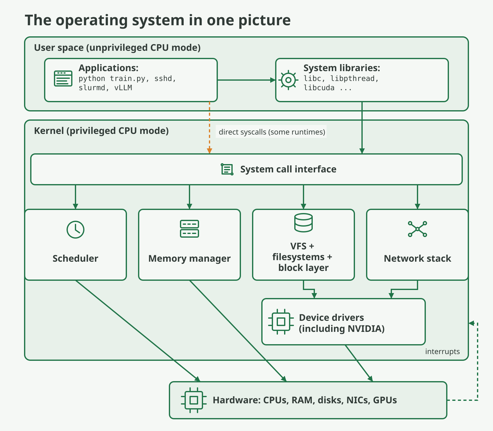

*Figure 1.8.1. The operating system in one picture.*

### Kernel mode and user mode

Imagine what a stray instruction could do if every program could run any instruction. One bad pointer could reach into another job's memory, or stop the disk controller halfway through a write. The CPU avoids that with two modes.

In **privileged mode** (kernel mode), every instruction and all the hardware are accessible. In **unprivileged mode** (user mode), a privileged instruction raises an exception. The kernel turns that exception into an error, typically "permission denied" or a crash. On x86 this is implemented with protection **rings**. Ring 0 is the kernel and ring 3 is user code.

Processes run in user mode, so you rarely see the kernel at work. You see only its results. When a process needs privileged work, mainly I/O, it asks the kernel with a **system call**. Switching between the two modes is a **mode switch**. Switching from one thread to another is a **context switch**, in which the CPU registers are swapped.

Every system call causes a mode switch. Calls that block, such as waiting for disk or network, also cause a context switch. That lets another thread use the CPU while the first one waits.

Each switch costs a little time, so the kernel offers ways to avoid them on the hot paths you care about. Some "system calls", such as reading the clock, are served entirely in user space through a kernel-supplied page called the **vDSO**. Memory-mapped files let a program read file data without one call per access. **Kernel bypass** technologies let user space talk to a device directly.

DPDK does this for networking, RDMA verbs for InfiniBand, and GPUDirect. That matters on GPU clusters (chapters on RDMA and NCCL). The Meltdown mitigation, kernel page-table isolation (KPTI), made mode switches more expensive on affected CPUs. How much that costs depends on how often a workload makes system calls.

### System calls

If you trace a program, you will see system calls one after another. A system call is a small, well-defined request to the kernel. There are hundreds of them. Each has a manual page in section 2, a simple interface, and an error code on failure. Errors come back through `errno`, as `ENOENT` ("no such file or directory"), `EACCES`, `EINTR` and so on. These are the ones worth remembering:

| System call | What it does |
|---|---|
| `read`, `write` | Move bytes to or from a file descriptor (file, pipe, socket, device) |
| `open`/`openat`, `close` | Open and close a file, returning a **file descriptor** (a small integer) |
| `fork`, `clone` | Create a new process (or, with flags, a thread or a process in new namespaces) |
| `execve` (the `exec` family) | Replace the running program with a different one |
| `wait`/`waitpid` | Collect a child's exit status |
| `exit_group` | Terminate the process |
| `kill` | Send a signal |
| `connect`, `accept` | Network connection setup |
| `stat` | Fetch file metadata |
| `ioctl` | A catch-all control call, used heavily by device drivers (the NVIDIA driver is driven mostly through `ioctl` on `/dev/nvidia*`) |
| `mmap`, `brk` | Map files or anonymous memory into the address space; grow the heap |
| `futex` | The kernel half of a user-space lock; blocked threads wait here |

`ioctl` deserves a note. Instead of adding one new system call for every operation on every device, a driver exposes one file descriptor and a set of numbered `ioctl` commands. That is why `strace` on a CUDA program shows mostly `ioctl` calls on `/dev/nvidiactl` and `/dev/nvidia0` (chapter 1.11).

### Interrupts, the clock and idle

A **hardware interrupt** is a signal from a device, such as "disk request complete", "packet arrived" or "key pressed". It makes the CPU stop what it is doing, enter the kernel and run an **interrupt service routine**. Interrupts are asynchronous, so you cannot predict when one arrives. By the time a disk finishes, the process that asked for the data may no longer be running on that CPU.

Driver work is split so that interrupts stay disabled for as short a time as possible. The **top half** acknowledges the device quickly. The **bottom half**, made of softirqs, tasklets and work queues, does the real processing later, and it can be scheduled like threads.

Software also causes events of its own. A **trap** is a deliberate entry to the kernel, such as a system call. An **exception** is something like a divide by zero. A **fault** is a page fault, covered in section 8. A few interrupts cannot be masked. These are the non-maskable interrupts, such as a hardware watchdog that reboots a hung machine.

The time between an interrupt arriving and its handler running is the **interrupt latency**. It is a key concept for real-time systems, and for pinning GPU and NIC interrupts to the right cores (chapter 1.28).

The kernel also keeps a **clock tick**. This is a periodic timer interrupt, commonly 250 times per second on Linux, set by `CONFIG_HZ`. Each tick updates the time, expires timers, accounts CPU usage and lets the scheduler preempt a running thread. Ticks wake idle CPUs and disturb applications slightly. That disturbance is called "OS jitter". Modern kernels are therefore **tickless** when idle (`NO_HZ`). They can also omit the tick for a CPU that runs a single task (`nohz_full`), a setting used when tuning latency-sensitive nodes. When there is nothing to run, a CPU executes an **idle thread**. It halts the core until the next interrupt arrives, which saves power.

### Preemption

When you see high latency on a GPU node, interrupt latency is one place to look. **Preemption** is the ability to take the CPU away from something. User threads can always be preempted by the scheduler. Whether the kernel itself can be interrupted depends on a build option. With no preemption you get the best throughput and the worst latency. **Voluntary preemption**, the common server default, has the kernel check for preemption at certain points. Full preemption gives low latency for real-time use, through the `PREEMPT_RT` patch set. You can check the setting yourself with `uname -v` or in the kernel config.

Before you tune for latency, find out which preemption model the kernel was built with.

## 2. What a process is

Suppose a colleague asks you to look at "the thing that is eating the node". You run `ps`, and you get a wall of numbers with one line per something. Before any of those numbers can mean anything, you need a clear idea of what one of those somethings is.

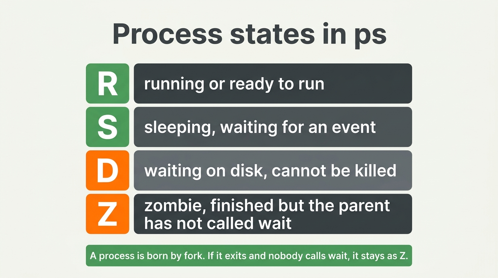

*Figure 1.8.2. Process states seen in ps. D means waiting on disk and cannot be killed. Z means finished but not yet reaped.*

A **program** is a file on disk. A **process** is what the kernel makes when it runs that program. The kernel builds an environment around the program so it can execute. A process consists of:

- an **address space** (virtual memory: the program's code, libraries, heap, stacks, mapped files);
- one or more **threads**, each with a stack and a set of CPU registers (including the program counter);
- a table of **open file descriptors**;
- **credentials** (real, effective and saved user and group IDs, plus supplementary groups and capabilities, chapter 1.6);
- a **current working directory**, a **root directory**, a **umask**, an **environment** (the `KEY=value` strings) and **resource limits**;
- scheduling attributes (priority, nice value, CPU affinity);
- kernel bookkeeping: the **process ID (PID)**, **parent PID (PPID)**, state, accounting.

Think of a process as a small virtual computer that runs one program, with its own registers and memory. The kernel runs thousands of these on a few cores by giving each one short slices of CPU time. That is the scheduler's job (chapter 1.18). The program believes it has the CPU to itself. Suppose you run ten CPU-bound programs on two cores. Each one gets roughly a fifth of a core.

### Threads

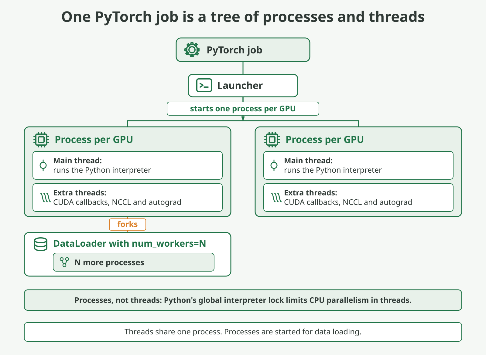

*Figure 1.8.3. A PyTorch job is a tree: a launcher starts one process per GPU, and each DataLoader forks worker processes.*

A **thread** is the unit the scheduler actually runs. Every process starts with one thread, the **main thread**, and it can create more. Threads inside a process share the address space and the file descriptors. Each thread still has its own stack and registers.

Threads start faster than separate processes, and they can communicate by reading and writing shared memory. A multithreaded program can therefore use several cores without copying data between processes. The price is that you must protect shared memory with careful locking.

On Linux, threads and processes are both **tasks**. The kernel treats a thread as a process that shares resources with its siblings. It is created with clone() and sharing flags. If you start a multithreaded program, `ps -eLf` shows you its threads. Each thread has a **TID** (thread ID). The main thread's TID equals the process's PID.

A PyTorch training job shows all three at once. The launcher starts one **process per GPU**. Each process has a **main thread** that runs the Python interpreter, plus extra **threads** for CUDA callbacks, NCCL and autograd. Each `DataLoader` with `num_workers=N` forks **N more processes** for data loading. It uses processes rather than threads because Python's global interpreter lock limits CPU parallelism in threads.

### Where processes come from: `fork` and `exec`

Every process on a Unix system begins the same way, and it is worth slowing down for, because the pattern explains a great deal of later behaviour. On Unix, a new process starts with **fork()**, which on Linux is a wrapper around `clone()`. `fork()` makes a near-exact **copy** of the caller. The copy has the same program, the same memory contents and the same open files, but a new PID.

The copy is cheap because Linux uses **copy-on-write**. Both processes first point at the same physical memory pages. A page is copied only when one of them writes to it. The original is the **parent**, and the copy is the **child**.

To run a different program, the child calls **exec** (the kernel call is `execve`). That replaces its memory with the new program and starts it. The PID stays the same. When a shell runs `ls`, it forks a child, the child execs `ls`, and the shell waits.


*Figure 1.8.4. Where processes come from: `fork` and `exec`.*

Three practical consequences follow, and you will meet all of them.

- **Children inherit almost everything.** A child gets the parent's environment variables, open file descriptors, working directory, `umask`, resource limits and signal dispositions. That is why `ulimit` in a shell affects every program started from it. It is also why a leaked file descriptor in a parent shows up in every child.
- **Every process has a parent**, shown as `PPID`. Run `pstree -p` or `ps fax` to draw the tree. Its root is **PID 1**, the first process the kernel starts. Today that is usually `systemd` (chapter 1.15). Inside a container, PID 1 is whatever the container's entrypoint is.
- **Every process ends with an exit status**, an integer where 0 means success and other values are errors. The shell's `$?` holds the status of the last command. A process killed by a signal has status `128 + signal number` as seen by a shell. So 137 means `SIGKILL` and 143 means `SIGTERM`. That is why "Exit code 137" in Kubernetes usually points to the kernel's out-of-memory killer or a forced kill.

### Zombies and orphans

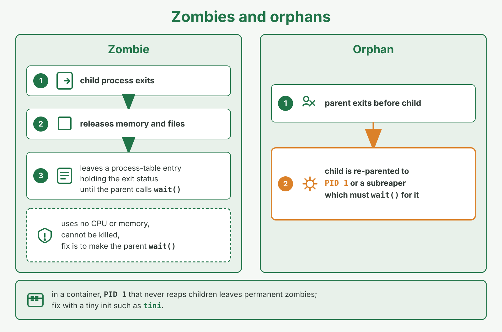

*Figure 1.8.5. A zombie holds only a PID slot until the parent calls wait(), and orphans are adopted by PID 1.*

When a process exits, it releases its memory and files. The kernel keeps a small **process-table entry**, though, and that entry holds the exit status until the **parent** collects it with `wait()`. Until then the process is a **zombie** (state `Z`, shown as `<defunct>`).

A zombie consumes **no CPU and no memory**. It holds only a PID slot, and you can see it in `ps` if you look. You **cannot kill it**, because it is already dead. The fix is to make the parent call `wait()`. You can also restart or terminate the parent. The zombie is then adopted by PID 1, which reaps it. A few zombies are harmless. Thousands of them can exhaust the PID table.

Suppose, for example, a parent exits before its children do. Those children become **orphans**. The kernel re-parents them to PID 1, or to the nearest "subreaper", and that process must `wait()` for them.

This is why **PID 1 in a container matters**. If your container's PID 1 is a Python script that never reaps children, every orphaned subprocess becomes a permanent zombie. The standard fixes are to run a tiny init as PID 1, such as `tini`, `docker run --init`, or Kubernetes `shareProcessNamespace` with a proper init. The init forwards signals and reaps children (section 10).

### Process states

Every task is in exactly one state at any moment, and the kernel writes that state down as a single letter. `ps` and `top` simply report the letter. In practice you only ever need a handful of them, but the ones you do need, you need badly.

| State | Letter | Meaning |
|---|---|---|
| Running / runnable | `R` | On a CPU now, or in the **run queue** waiting for one |
| Interruptible sleep | `S` | Waiting for an event (input, a timer, a child); can be woken by a signal. Most processes are here most of the time |
| Uninterruptible sleep | `D` | Waiting inside the kernel for hardware or a filesystem (typically disk or **network filesystem** I/O); signals, **including `SIGKILL`, are not acted on** until the wait finishes |
| Stopped | `T` | Suspended by `SIGSTOP`/`SIGTSTP` (or by a debugger); resumed by `SIGCONT` |
| Zombie | `Z` | Terminated, waiting for the parent to reap it |
| Idle kernel thread | `I` | Kernel worker with nothing to do (newer kernels) |

`ps` adds modifier characters: `s` session leader, `l` multithreaded, `+` in the foreground process group of its terminal, `<` high priority, `N` low priority.

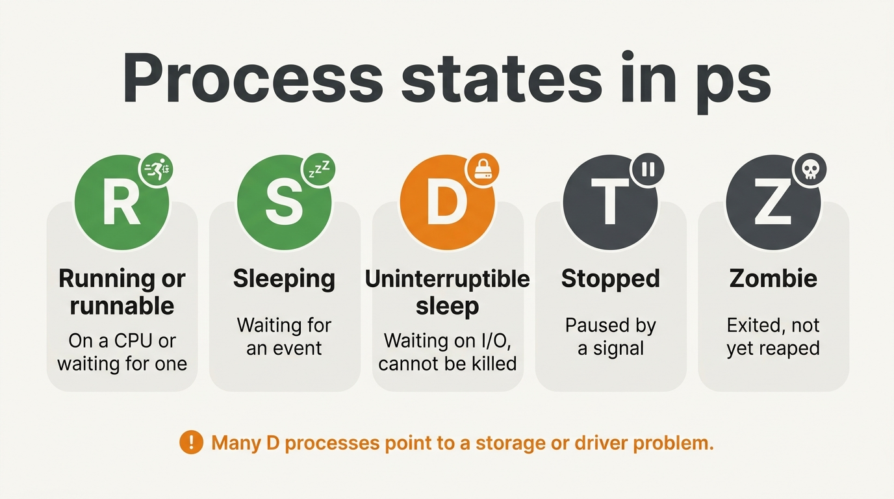

*Figure 1.8.6. The five process states you will see in the ps STAT column.*

**The `D` state causes the worst cluster days.** A process in `D` is waiting on a kernel operation that has not returned. The usual causes are a hung NFS, Lustre or GPFS mount, a failing disk, or a driver waiting for a GPU that has fallen off the bus.

You cannot kill it. `kill -9` is ignored until the I/O completes, and the process still counts in the load average. Fix the underlying cause first. Restore the server, fix the mount, reset the GPU or reboot. To see what the process is waiting for, read `cat /proc/<pid>/stack` (as root) or `/proc/<pid>/wchan`.

### The run queue and the load average

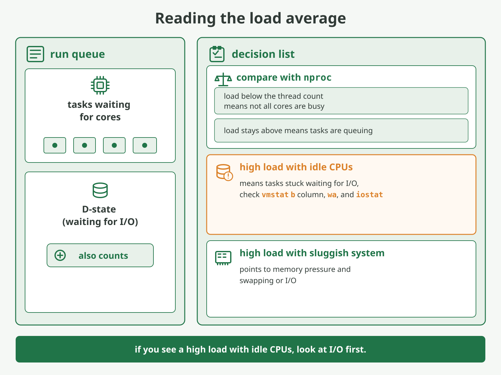

*Figure 1.8.7. A high load with idle CPUs means many tasks are stuck waiting for I/O.*

Here is a scene that confuses almost everyone the first time. A node reports a load average of 90, dashboards turn red, and the CPUs sit idle. Nothing is computing, yet the machine looks busy. To understand how that is possible, you need to know what the number actually counts.

The scheduler keeps runnable tasks in **run queues** and gives each one a time slice. With more runnable tasks than cores, the extra tasks wait their turn. The **load average** is an exponentially smoothed count of tasks that are running or runnable. On Linux it also counts tasks in uninterruptible sleep (`D`). The kernel samples it over 1, 5 and 15 minutes, which are the three numbers in `uptime`.

Most desktop systems show a load average of about `0` (`0.00` to `0.15`) when you do anything except compile a program or play a game. A load near `0` is a good sign. It means the processor is not being challenged and the system is saving power. Modern background indexing and browser processes often push an idle desktop's load to `0.1` or `0.2`, though.

When you read the load on a server, a few checks help:

- Compare it with the number of CPU threads (`nproc`). A load below that number means not all cores are busy. A load that stays above it means tasks are queuing.
- Because `D` tasks count, **a high load with idle CPUs means many tasks are stuck waiting for I/O**, not CPU contention. Look at `vmstat`'s `b` column and `wa`, and at `iostat`.
- A high load with a responsive system is often fine, because many short compute jobs share the cores. A high load with a sluggish system points to memory pressure and swapping (thrashing) or to I/O.
- Short-lived processes can start and exit between samples, so a busy build or web server may be under-reported.

Before you blame the CPU for a slow node, check whether the load comes from tasks that are waiting. If you see a high load with idle CPUs, look at I/O first.

## 3. Looking at processes from outside

You now have the model. The next skill is observation: given a real machine and a real complaint, how do you see what is actually happening instead of guessing? Every tool in this section reads the same kernel bookkeeping, and each one reads it from a different angle.

### `ps`

When a job misbehaves, you usually start by asking what the process is doing right now. `ps` answers that with a snapshot. Its options are a historical tangle of UNIX, BSD and GNU styles. On Linux, some options need a leading dash and some must not have one. These are the invocations worth memorising:

```bash
ps aux                  # all processes, BSD style: user, %cpu, %mem, VSZ, RSS, state, command
ps -ef                  # all processes, UNIX style: shows PPID
ps fax                  # all processes as a forest (who descended from whom); add u for owners
ps -eLf                 # one line per thread (LWP = thread ID, NLWP = number of threads)
ps -o pid,ppid,user,stat,etime,pcpu,pmem,rss,wchan:32,comm -p 1234   # custom columns
ps -eo pid,ppid,user,vsize,pmem,pcpu,stat,wchan:32,comm --sort=-pcpu | head
ps -o pid,min_flt,maj_flt -p 1234     # page faults of one process (section 8)
ps -u alice            # processes of one user
ps -C python3          # by command name
ps axo stat,pid,comm | awk '$1 ~ /^D/'   # find processes in uninterruptible sleep
ps axo stat,ppid,pid,comm | awk '$1 ~ /^Z/'   # find zombies and their parents
```

Add `w` (up to three times) to widen the command column. `VSZ` is the virtual size, and `RSS` is the resident set, which is the physical RAM the process holds right now. Chapter 1.17 explains the difference.

To list threads inside a multithreaded process, such as `Xorg` or a multi-worker Python process, pass `ps m` (BSD style) or `ps m -o pid,tid,command`. See *How Linux Works* Listings 8-1 and 8-2. Lines with a dash (`-`) in the `PID` column are individual threads of the process above them. The `tid` column shows each thread's kernel Thread ID (`TID`).

### What the default `ps` columns mean

The default `ps` output is short, but each column tells you something when a job misbehaves. Here is a listing from a small machine, which you can read against the table below.

```
$ ps
PID TTY STAT TIME COMMAND
520 p0 S 0:00 -bash
545 ? S 3:59 /usr/X11R6/bin/ctwm -W
548 ? S 0:10 xclock -geometry -0-0
2159 pd SW 0:00 /usr/bin/vi lib/addresses
31956 p3 R 0:00 ps
```

| Field | What it tells you |
|---|---|
| `PID` | The process ID, a number that identifies the running program. After a process ends, the kernel can reuse its number for a new process. |
| `TTY` | The terminal device where the process is running. |
| `STAT` | The process status: what the process is doing and where its memory resides. `S` means sleeping and `R` means running. The `ps(1)` manual page lists the other symbols. |
| `TIME` | The CPU time the process has used so far. This is not the wall-clock time since it started, because processes do not run constantly. |
| `COMMAND` | The command that started the program. A process can change this field, and the shell's glob expansion appears here instead of what you typed. |

The `ps` command accepts Unix, BSD and GNU option styles. Many people find the BSD style the most comfortable, so this book uses it. `ps x` shows all of your running processes, and `ps ax` shows every process on the system. `ps u` adds detail, and `ps w` shows full command names instead of cutting them to fit one line.

Options combine, as in `ps aux` and `ps auxw`. To inspect one process, give its PID, or use `ps u $$`, because `$$` expands to the PID of the current shell.

### Viewing threads with `ps m`

Most of the time, `ps` and `top` show only processes, and that is usually enough. A process starts with one thread, called the main thread. A process with one thread is single-threaded. A process with more than one thread is multithreaded, and the main thread can start the others. When you need to see inside, add the `m` option to see every thread on its own line.

```text
$ ps m -o pid,tid,command
PID TID COMMAND
3587 - bash
- 3587 -
3592 - bash
- 3592 -
12534 - /usr/lib/xorg/Xorg -core :0
- 12534 -
- 13227 -
- 14443 -
- 14448 -
```

Lines with a number in the `PID` column are processes. Lines with a dash in that column are threads of the process above them. The two `bash` shells have one thread each, so their TIDs match their PIDs. The main thread of `Xorg` (process 12534) has the same TID as its PID. That process has four threads in all.

Threads make resource monitoring harder. Individual threads of one process can use resources at the same time, and `top` hides them until you press `H`. Most other monitors need an extra option too. You rarely act on one thread by itself. Doing that safely requires knowing how the program was written.

### `top`, `htop`, `atop`

`top` is the interactive display. Where `ps` gives you one snapshot, `top` keeps refreshing, so you can watch a machine change while you look at it. Its summary header shows a task line such as `Tasks: 244 total, 2 running, 242 sleeping, 0 stopped, 0 zombie`. It shows a CPU line such as `%Cpu(s): 31.7%us, 2.8%sy, 0.0%ni, 65.4%id, 0.2%wa, 0.0%hi, 0.0%si, 0.0%st`. It also shows `Mem:` (total, used, free, buffers) and `Swap:` (total, used, free, cached).

Below the header, a live table of processes refreshes every few seconds. Keys are case-sensitive, so you must type them exactly. For example, a key that works in one case may do nothing in the other:

| Key | Action |
|---|---|
| `P` / `M` / `T` | Sort by CPU / resident memory / cumulative CPU time |
| `1` | Toggle per-CPU rows (essential on many-core machines) |
| `H` | Show **threads** instead of processes |
| `u` | Filter by user |
| `k` | Send a signal to a process |
| `r` | Renice a process |
| `f` | Choose and order columns (e.g. add `nMaj`, `vMj`, major page faults) |
| `c` | Toggle full command line |
| `Space` | Refresh immediately |
| `q` | Quit |

`top -p PID1 -p PID2` follows specific processes. `top -b -n 1` is the batch form, which suits scripts. **`htop`** is friendlier. It adds colour, a tree view (`F5`), mouse support, and tagging many processes with Space. On the selected process it offers `s` (trace system calls), `l` (open files), `w` (full command line) and `x` (locks). `atop` records history to disk.

Keep in mind that `top` and the tools below show CPU use as a percentage of **one core**. A multi-threaded process can therefore show 800%.

### `pgrep`, `pidof`, `pstree`, `fuser`

These tools find processes by name, by tree, or by what they hold open. For example, `pgrep -a python` lists every matching process with its full command line.

```bash
pgrep -a python                 # PIDs and full command lines matching a name
pgrep -u alice -f 'train.py'    # match against the whole command line
pidof sshd
pstree -ap 1234                 # tree under a PID, with arguments and PIDs
fuser -v /dev/nvidia0           # which processes have this file open
fuser -vn tcp 8080              # which process is listening on TCP port 8080
```

### `/proc`: the kernel's window on every process

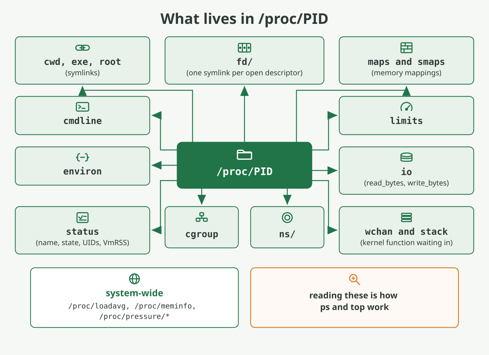

*Figure 1.8.8. Reading /proc files is how ps and top work, and you can read them yourself.*

`/proc` is a virtual filesystem (chapter 1.10). Each process has a directory, `/proc/<pid>`. Reading these files is how `ps` and `top` work. You can read them yourself when the tools are missing, as in a stripped container, or when you need more detail.

| Path | Contents |
|---|---|
| `/proc/PID/status` | Human-readable summary: name, state, PID, PPID, UIDs and GIDs, thread count, memory (`VmRSS`, `VmSwap`), voluntary and non-voluntary context switches, signal masks |
| `/proc/PID/cmdline` | The command line (NUL-separated) |
| `/proc/PID/environ` | The environment (NUL-separated; readable by the owner and root) |
| `/proc/PID/cwd`, `exe`, `root` | Symlinks: working directory, the executable, root directory |
| `/proc/PID/fd/` | One symlink per open file descriptor (files, sockets, pipes) |
| `/proc/PID/maps`, `smaps` | Memory mappings, with per-mapping RSS in `smaps` (chapter 1.17) |
| `/proc/PID/limits` | The process's resource limits (soft and hard) |
| `/proc/PID/stat`, `schedstat` | Raw numbers (times, state, priority, CPU) used by `ps`; scheduling statistics |
| `/proc/PID/task/TID/` | The same, per thread |
| `/proc/PID/wchan`, `stack` | What kernel function a sleeping task is waiting in; the kernel stack (root) |
| `/proc/PID/cgroup` | Which cgroups the process is in (section 9) |
| `/proc/PID/ns/` | Which namespaces it is in (chapter 1.19) |
| `/proc/PID/io` | Bytes read and written by the process (`read_bytes`, `write_bytes`) |
| `/proc/loadavg`, `/proc/stat`, `/proc/meminfo`, `/proc/pressure/*` | System-wide counters; pressure stall information (PSI) for CPU, memory, I/O |

```bash
cat /proc/$$/status | head -20            # $$ is the PID of the current shell
ls -l /proc/$$/fd                        # the shell's open file descriptors
tr '\0' ' ' < /proc/$$/cmdline; echo
grep -E 'Name|State|Threads|VmRSS|Cpus_allowed_list' /proc/$$/status
cat /proc/$$/limits
```

### `lsof`: who has what open?

Unix treats files, devices, pipes and sockets alike. So "open files" covers a lot, and **`lsof`** (list open files) is one of the most useful diagnostic tools you have.

Each line of its output has several columns. `COMMAND`, `PID` and `USER` say who holds the file. `FD` is a descriptor number with a mode, such as `3u` for read-write, or a role such as `cwd`, `rtd` for root, `txt` for program text, or `mem` for a memory-mapped library. `TYPE` says what kind of object it is, such as `REG` for a regular file, `DIR`, `CHR` for a character device, `IPv4` or `unix`. The last columns are `DEVICE`, `SIZE/OFF`, `NODE` (the inode number) and `NAME`.

```bash
sudo lsof -p 1234                 # everything one process has open
sudo lsof +D /var/log             # every open file under a directory (slow on big trees)
sudo lsof /dev/nvidia0            # who has the GPU device open
sudo lsof -i :8080                # what is using TCP/UDP port 8080
sudo lsof -iTCP -sTCP:LISTEN -P -n   # all listening TCP sockets, numeric
sudo lsof -u alice                # files opened by a user
sudo lsof +L1                     # files that are deleted but still open (space not freed)
```

Suppose `df` reports a full disk, but `du` cannot find the files that fill it. Two classic cases come up again and again.

The first is "**`df` shows the disk full but `du` cannot find the files**". A process still holds a deleted log open. `lsof +L1` finds it, and restarting that process frees the space.

The second is "**cannot unmount, device is busy**". Here `lsof` or `fuser -vm /mountpoint` shows who is inside. Run as root for complete output. `lsof` depends on kernel interfaces, so after a kernel and `lsof` update it may misbehave until you reboot into the new kernel.

### Reading `lsof` output

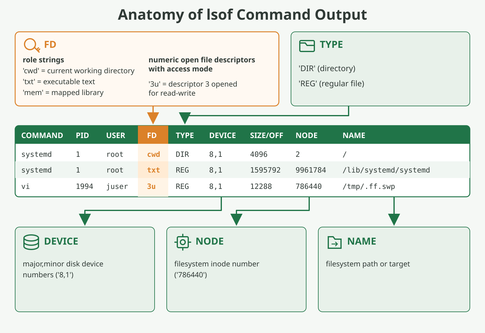

*Figure 1.8.9. The lsof command exposes process ownership, descriptor roles like cwd or descriptor 3u, filesystem node IDs, and device numbers.*

Unix puts a lot of weight on files, so a tool that lists them is a good place to start an investigation. `lsof` does not stop at regular files. It also reports network sockets, dynamic libraries, pipes and similar objects.

`lsof` prints a lot of lines, so learning its columns matters more than reading every row. The excerpt below comes from the `systemd` init process and a running `vi` editor.

```text
# lsof
COMMAND PID USER FD TYPE DEVICE SIZE/OFF NODE NAME
systemd 1 root cwd DIR 8,1 4096 2 /
systemd 1 root rtd DIR 8,1 4096 2 /
systemd 1 root txt REG 8,1 1595792 9961784 /lib/systemd/systemd
systemd 1 root mem REG 8,1 1700792 9961570 /lib/x86_64-linux-gnu/libm-2.27.so
systemd 1 root mem REG 8,1 121016 9961695 /lib/x86_64-linux-gnu/libudev.so.1
vi 1994 juser cwd DIR 8,1 4096 4587522 /home/juser
vi 1994 juser 3u REG 8,1 12288 786440 /tmp/.ff.swp
```

The first columns name the owner. `COMMAND` is the command name, `PID` is the process ID, and `USER` is the user running it. The `FD` column holds either the purpose of the file or a file descriptor number. The `cwd` lines show each process's current working directory. The last line is the `vi` process (PID 1994) using a temporary swap file. Its descriptor is `3`, a number the kernel hands out when a file opens.

`TYPE` gives the kind of file, such as a regular file or a directory. `DEVICE` holds the major and minor numbers of the disk that stores it. `SIZE/OFF` is the file's size, `NODE` is its inode number, and `NAME` is its filename. The `lsof(1)` manual page lists every value you might see in each field. You can run `lsof` as a regular user, but you get more information as root.

### Narrowing `lsof` output

There are two ways to work with `lsof`. You can list everything, pipe the output to `less`, and search for what you want. That works, but the output can take a long time to scan. The other way is to narrow the list with command-line options. `lsof` also lists network connections, dynamic libraries and pipes, not only regular files, so narrowing helps a lot.

Pass a path, and `lsof` lists only the entries under it. This command shows the open files in `/usr` and all of its subdirectories.

```bash
lsof +D /usr                # open files under /usr, recursively
lsof -p 1994                # open files of one process ID
lsof -h                     # a short summary of the options
```

Most options only change the output format. Use the summary to find the one you need.

### `strace` and `ltrace`: what is this program actually doing?

If a program dies immediately, hangs, or "cannot find a file" with no useful message, tools that examine active processes will not help. You need to see what the program **asks of the kernel**. `strace` prints every system call with its arguments and return value. The trace starts just after the `fork`, so its first line is the `execve` of the program. Then comes a flurry of library loading, such as `openat` on `/etc/ld.so.cache` and `libc.so.6`, and `mmap`. After that you see the program's real work.

```bash
strace -o /tmp/ls.trace ls /nonexistent       # trace a command, save to a file
grep -n ENOENT /tmp/ls.trace | head           # the failed lookups
strace -f -o /tmp/trace -ff crummyd           # follow forks; -ff writes one file per process (trace.PID)
strace -p 1234                                # attach to a running process (Ctrl-C to detach)
strace -e trace=openat,connect -p 1234        # only selected calls
strace -c -p 1234                             # summary table of calls and time instead of a trace
strace -tt -T -p 1234                         # timestamps and time spent in each call
```

Here is how to read the output. A successful `open` returns a **file descriptor**, a small integer. Descriptors 0, 1 and 2 are standard input, output and error, so the first new descriptor you see is usually 3. A failure returns `-1`, followed by the error name and text, for example `openat(AT_FDCWD, "not_a_file", O_RDONLY) = -1 ENOENT (No such file or directory)`.

Missing files and wrong permissions (`EACCES`) are the most common reasons programs misbehave. So grepping a trace for `ENOENT` and `EACCES` solves a large share of mysteries, even for daemons.

A hung process shows which call it is stuck in, such as a `read` on a socket, a `futex` wait or a `connect`. That is half the diagnosis. `strace -p` on a hung training process quickly tells you whether it waits on the network or on a lock. `strace` slows the target considerably, so use it on production processes with care. It needs permission to trace the target, which means being the owner or root, subject to `ptrace_scope`.

`ltrace` does the same job for **shared-library calls** rather than kernel calls. There are many more of those, so you should filter the output, or you will drown in it. It does not work on statically linked programs. Chapter 1.11 goes deeper into both tools.

When a program fails silently, trace it before you guess.

## 4. Signals

Picture a moment every Linux user meets eventually. A long job is running in your terminal, and you press Ctrl-C. Sometimes the program stops at once, and sometimes it ignores you completely. Another time you press Ctrl-Z by accident, and the shell reports `Stopped` instead of ending the job. Both keys did the same kind of thing: each sent the program a short message, and the program decided how to respond. That message is a signal.

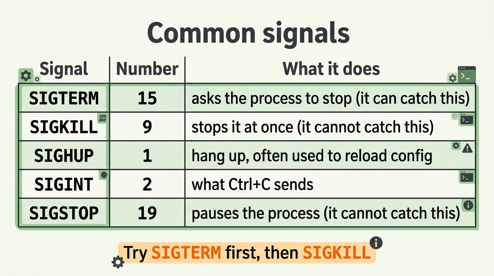

*Figure 1.8.10. Ask politely with SIGTERM first. SIGKILL cannot be caught.*

A **signal** is a small, asynchronous notification sent to a process. It says that something happened and asks the process to react. Signals are the simplest form of inter-process communication. They carry almost no information, only which event occurred.

The kernel sends some of them, for example after a bad memory access, when a child exits, or on Ctrl-C from the terminal. Other processes send signals with `kill`, and a process can send one to itself. If you need to stop a runaway job, you send it a signal. A process may signal another process only if both have the same owner. Root may signal anyone.

Each signal has a **disposition** in each process. The process can take the **default action**, which is usually to terminate, and sometimes to write a core dump, ignore, stop or continue. It can also **ignore** the signal, or **catch** it by running a **handler** function.

Two signals can never be caught, ignored or blocked. They are **`SIGKILL`** and **`SIGSTOP`**, and the kernel acts on them directly. Every other signal can be handled. The table lists the ones you will meet most often.

| # | Name | Default action | Typical meaning and use |
|---|---|---|---|
| 1 | `SIGHUP` | Terminate | "Hang up": the controlling terminal closed. Many daemons reuse it to mean **reload configuration** (`systemctl reload`, `kill -HUP`) |
| 2 | `SIGINT` | Terminate | Keyboard interrupt (**Ctrl-C**) |
| 3 | `SIGQUIT` | Terminate + core | Keyboard quit (**Ctrl-\\**); gives a core dump or a stack trace in some runtimes |
| 4 | `SIGILL` | Terminate + core | Illegal CPU instruction (bad binary, e.g. built for a newer CPU) |
| 6 | `SIGABRT` | Terminate + core | Program called `abort()`, often a failed assertion |
| 7 | `SIGBUS` | Terminate + core | Bad memory access (alignment, truncated memory-mapped file, I/O error on mapped data) |
| 8 | `SIGFPE` | Terminate + core | Arithmetic error (divide by zero) |
| 9 | `SIGKILL` | Terminate | **Cannot be caught or ignored.** Immediate termination, no cleanup |
| 10 | `SIGUSR1` | Terminate | User-defined; often used to trigger a checkpoint or dump state |
| 11 | `SIGSEGV` | Terminate + core | Invalid memory reference (segmentation fault) |
| 12 | `SIGUSR2` | Terminate | User-defined |
| 13 | `SIGPIPE` | Terminate | Wrote to a pipe or socket whose reader has gone (why `yes \| head` ends quietly) |
| 14 | `SIGALRM` | Terminate | A timer set with `alarm()` expired |
| 15 | `SIGTERM` | Terminate | **Polite request to terminate.** The default of `kill`; programs should clean up and exit |
| 17 | `SIGCHLD` | Ignore | A child process stopped or terminated |
| 18 | `SIGCONT` | Continue | Resume a stopped process |
| 19 | `SIGSTOP` | Stop | **Cannot be caught.** Suspend the process |
| 20 | `SIGTSTP` | Stop | Terminal stop (**Ctrl-Z**); catchable |
| 21, 22 | `SIGTTIN`, `SIGTTOU` | Stop | Background process tried to read from or write to its terminal |
| 28 | `SIGWINCH` | Ignore | Terminal window resized |

The numbers are for x86 Linux, so use names in scripts. `kill -l` lists all of them.

### Sending signals

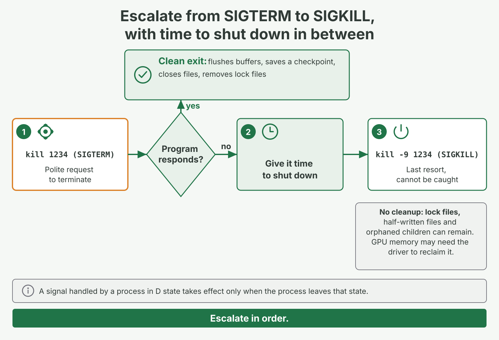

*Figure 1.8.11. Send SIGTERM first and give the program time to clean up, and use SIGKILL only when it does not respond.*

```bash
kill 1234               # SIGTERM (15)
kill -TERM 1234         # same, by name
kill -9 1234            # SIGKILL, last resort
kill -HUP $(pidof sshd) # ask a daemon to reload
kill -STOP 2345         # freeze a process
kill -CONT 2345         # let it continue
kill -0 1234            # no signal sent: tests whether the process exists and you may signal it
pkill -u alice -TERM    # signal all of a user's processes
pkill -f 'train.py'     # match on the full command line
killall python3         # all processes with that exact name (careful on non-Linux systems)
kill -- -1234           # signal the whole PROCESS GROUP 1234 (note the minus)
```

**Escalate in order.** When you are tempted to reach for `kill -9`, try `SIGTERM` first, and give the program time to shut down. It can flush buffers, save a checkpoint, close files and remove lock files. Use `SIGKILL` only when the program does not respond.

A killed process gets no chance to clean up. That can leave lock files, half-written files and orphaned children. For GPU jobs it can also leave GPU memory that the driver must reclaim. A signal handled by a process in `D` state takes effect only when the process leaves that state.

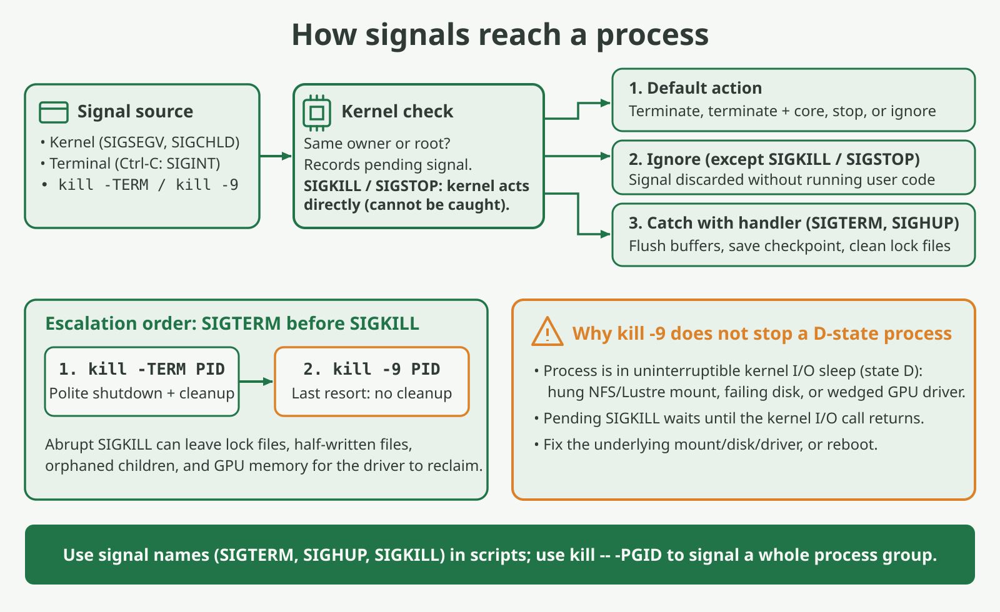

*Figure 1.8.12. How signals reach a process, dispositions, and why D state delays SIGKILL.*

### Stopping, continuing and processes that resist

Stopping a process does not end it. `kill -STOP` freezes a process, which stays in memory and waits. `kill -CONT` lets it pick up where it left off. Pressing Ctrl-C in a terminal sends the INT (interrupt) signal, which is the same as ending the process with `kill -INT`.

Most processes get a chance to clean up. The kernel lets a process install a signal handler, a function that runs when a signal arrives. Some processes choose a non-terminating response, get wedged while handling the signal, or simply ignore it. A plain `kill` can therefore leave a process running.

KILL is the most brutal option, and it cannot be ignored, because the operating system does not give the process any chance to respond. The kernel ends it and removes it from memory by force, so use it only as a last resort.

Do not kill processes indiscriminately, especially ones you do not understand. You may be shooting yourself in the foot. Signals have both names and numbers, so `kill -9` and `kill -KILL` mean the same thing. Run `kill -l` to see the mapping from each number to its name.

### Catching signals in shell scripts

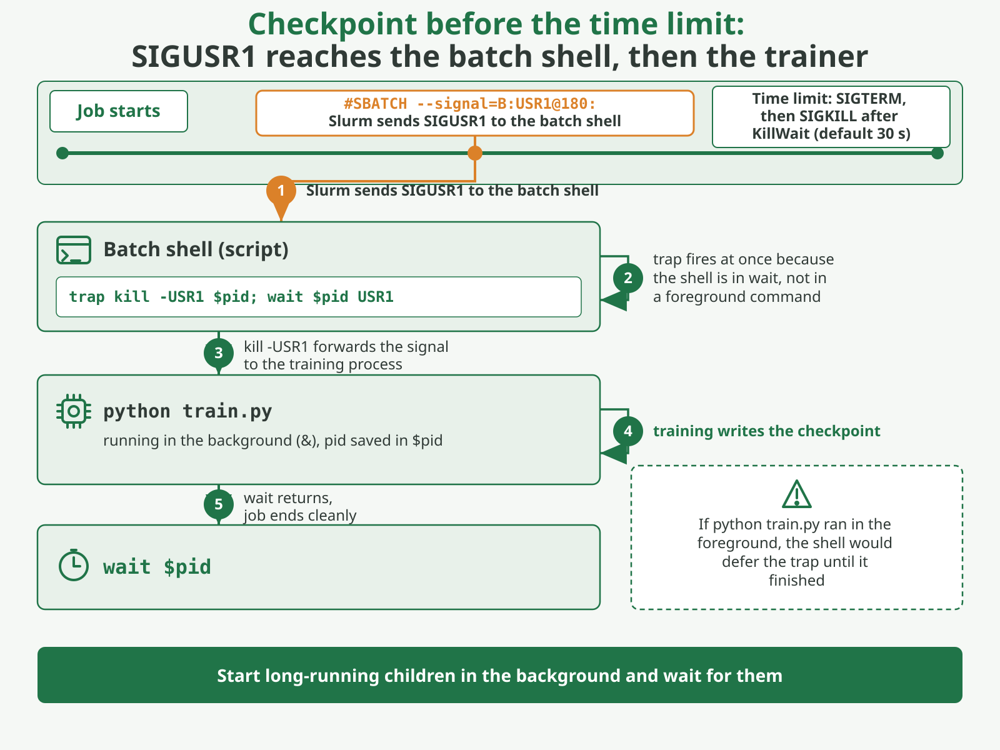

*Figure 1.8.13. Run training in the background and wait for it, so the trap fires immediately and forwards SIGUSR1 to save a checkpoint before the time limit.*

A shell script handles signals with `trap`. A batch script can use it to clean up its scratch files, or to turn `SIGTERM` into a graceful stop.

```bash
#!/usr/bin/env bash
set -euo pipefail
workdir=$(mktemp -d)
cleanup() { echo "cleaning up $workdir"; rm -rf "$workdir"; }
trap cleanup EXIT                       # runs on any exit, including after errors
trap 'echo "got SIGTERM, stopping"; kill "$child" 2>/dev/null; wait "$child"; exit 143' TERM INT

sleep 1000 &                            # stand-in for a long-running command
child=$!
wait "$child"
```

A few details matter here. The `EXIT` pseudo-signal covers normal exits and error exits. `trap '' SIGHUP` ignores a signal, and `trap - SIGINT` restores the default.

There is one catch. A shell waiting on a foreground command defers its trap until that command finishes. So if you want the script to react promptly, start long-running children in the background and wait for them, as the script above does.

`exec` replaces the shell with the command, so signals go straight to it. Use `exec` as the last line of a container entrypoint script, so the real program receives `SIGTERM`. Section 10 has the details.

### Core dumps

When a program dies from a signal marked "core" (`SIGSEGV`, `SIGABRT` and so on), the kernel can write its memory image to a **core file**. You analyse that file later with a debugger such as `gdb`.

Two settings control this. `ulimit -c` sets the core size limit, where 0 disables dumps. `/proc/sys/kernel/core_pattern` sets the path, or a pipe to a handler such as `systemd-coredump`. In that case you use `coredumpctl`.

If you hit a crash and want to debug it, you can ask for a core file. Core files from large training processes can run to many gigabytes. For that reason clusters usually keep the limit at 0 and enable dumps on purpose.

On a shared cluster, keep core dumps off by default, and turn them on only when you are debugging a specific crash.

## 5. Shell job control

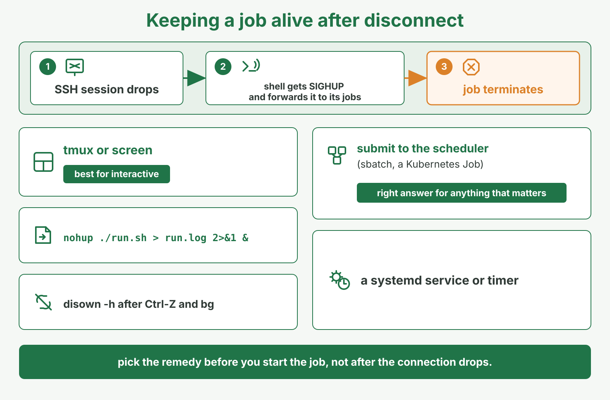

*Figure 1.8.14. Choose tmux, the scheduler, nohup, disown or systemd before the connection drops.*

You have seen this happen, or you will. You start a long command over SSH, the VPN hiccups, the session drops, and the job dies with the terminal. Or you press Ctrl-Z in front of a long task, and the shell says `Stopped`. Both events come from the same small mechanism, and once you can see it, you can also outwit it.

An interactive shell lets you manage several commands from one terminal. A **job** is a pipeline that the shell started. The shell puts the job's processes into a **process group**, and groups belong to a **session** tied to the controlling terminal. Exactly one process group is in the **foreground**. It receives keyboard signals such as Ctrl-C and Ctrl-Z, and it may read from the terminal. The others run in the **background**. The table lists the commands you use to move jobs between these states.

| Action | Command |
|---|---|
| Run in the background | `command &` |
| Suspend the foreground job | **Ctrl-Z** (sends `SIGTSTP`) |
| List jobs | `jobs -l` |
| Resume in the background | `bg %1` |
| Bring to the foreground | `fg %1` (`%1` job number, `%%` current, `%name` by command) |
| Kill a job | `kill %1` |
| Wait for background jobs | `wait` (all), `wait %1` |
| Start immune to hangups | `nohup command > out.log 2>&1 &` |
| Detach an already-running job from the shell | `disown -h %1` (or `disown -a`) |
| Run in a new session with no controlling terminal | `setsid command` |

Closing your terminal, or dropping your SSH session, sends the shell a `SIGHUP`. By default, for an interactive login shell (depending on `huponexit`), the shell forwards that signal to its jobs, and they terminate. This is the classic cause of "my job died when my VPN dropped". You have five remedies, listed here in order of preference.

1. **Run it in `tmux` (or `screen`)** (chapters 1.5 and 1.29). The multiplexer owns the terminal, survives your disconnection and lets you reattach. It suits interactive work best.
2. **Submit it to the scheduler** (`sbatch`, a Kubernetes Job). This is the right answer for anything that matters on a cluster. The job is no longer a child of your login shell at all.
3. **`nohup` or `setsid`** for a quick one-off: `nohup ./run.sh > run.log 2>&1 &`. The process ignores `SIGHUP`, and its output goes to the file. Otherwise the output goes to `nohup.out`.
4. **`disown`** for a job you forgot to protect: `Ctrl-Z`, `bg`, `disown -h`.
5. **A systemd service or timer** for anything permanent (chapter 1.15).

Two details catch people out. A background job that tries to read the terminal gets `SIGTTIN` and is stopped. That is why `command &` for an interactive program shows "Stopped (tty input)". Also, `command &` leaves the child attached to your shell's session. It is therefore *not* protected from `SIGHUP` unless you add `nohup` or `disown`.

Pick the remedy before you start the job, not after the connection drops.

### Job control: useful, but easy to get lost in

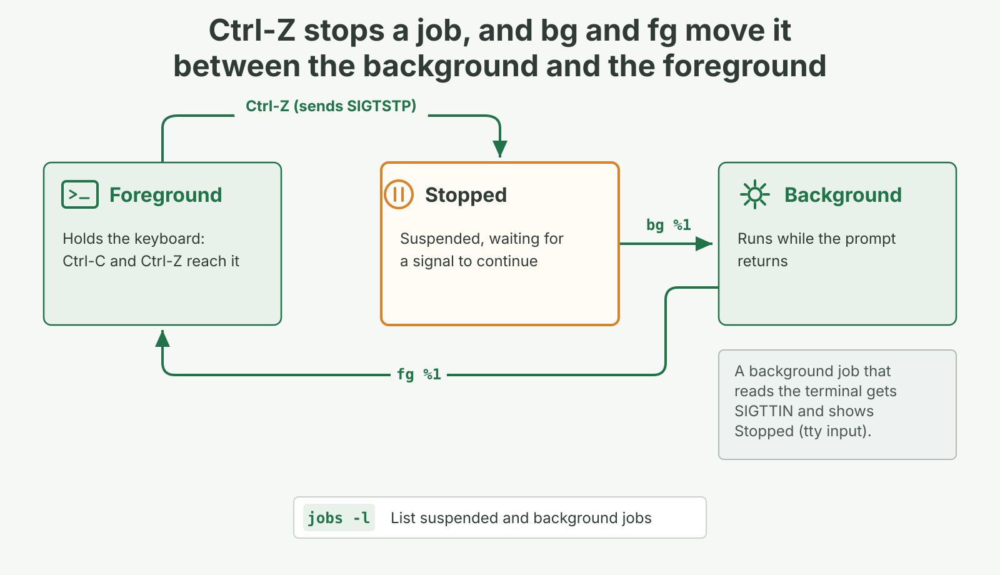

*Figure 1.8.15. Ctrl-Z suspends the foreground job, bg resumes it in the background, and fg brings it back to the foreground.*

Job control lets you suspend a program with Ctrl-Z and resume it later with `fg` or `bg`. It works by sending TSTP and CONT signals for you, which is handy. It is not required, though, and it can confuse beginners. Many people press Ctrl-Z when they meant Ctrl-C, forget what they were running, and end up with several suspended processes. Run `jobs` to see whether you have suspended anything in the current terminal.

If you want to run several programs, give each one its own terminal window, or send non-interactive work to the background. Learn `screen` and `tmux` as well, as chapter 1.5 describes.

### Background processes and stray output

A normal command holds your prompt until it finishes. Adding `&` runs the command in the background and returns the prompt at once. For example, `gunzip file.gz &` decompresses a large file while you keep working. The shell prints the PID of the new background process. A long job can keep running after you log out, which suits number crunching, and the shell usually reports when it finishes.

The trouble is that a background program may still expect the terminal. If it reads standard input, it can freeze or stop, and `fg` brings it back. If it writes to standard output or standard error, its text can appear in the middle of your work. The best fix is to redirect its output to a file, as chapter 1.2 shows.

When stray output clutters the screen, press Ctrl-L to redraw it. Many full-screen programs support Ctrl-L, and so does bash. Ctrl-R usually redraws the current line in a program that reads input, but at the bash prompt it starts a reverse search, and Esc exits that mode. Pressing the wrong key at the wrong time can make things worse, so check the screen before you type again.

## 6. Priority: `nice`, `ionice`, CPU affinity

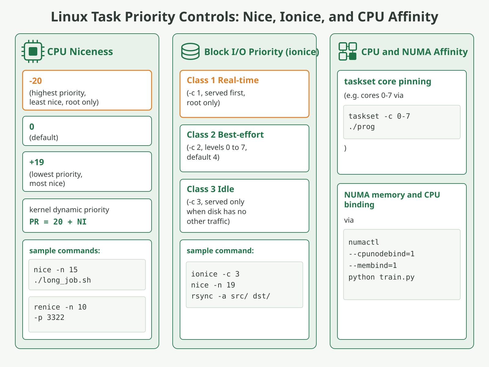

*Figure 1.8.16. Combining nice, ionice, and taskset or numactl controls CPU shares, disk scheduling priority, and NUMA core pinning independently.*

Picture a shared login node on a Friday afternoon. One user starts a compile with many parallel jobs, and every other shell on the machine turns sluggish. Nobody has done anything wrong, and the scheduler is working exactly as designed. The lever you have for this situation is priority, and it is gentler than it sounds.

When more tasks are runnable than there are cores, the scheduler decides who runs. Every task has a **priority**, but you cannot set it directly. You influence it through the **nice value**, a number from **-20 to +19** (default 0). A higher nice value makes the process nicer to others, so its priority drops. A normal user may only increase niceness. Only root can lower it below 0.

```bash
nice -n 15 ./long_job.sh           # start with low priority (nice 15)
renice -n 10 -p 3322               # make an existing process nicer
sudo renice -n -5 -p 3322          # more priority (root only; almost always a bad idea)
renice -n 19 -u alice              # all of one user's processes
ps -o pid,ni,pri,stat,comm -p 3322 # see NI (nice) and PRI (kernel priority)
```

`top` shows two numbers. `PR` is the kernel's current priority, where lower means more important in the display's scale. `NI` is your hint. The kernel combines nice with recent CPU use.

Nice values matter little on a lightly loaded machine, and a lot when a login node is shared. A user who runs a compile at nice 19 barely disturbs interactive users. Recent kernels apply nice per autogroup or cgroup, so the effect between sessions can be subtler than between processes in one session (chapter 1.18).

**I/O priority** is separate. Processes also queue for the disk, and `ionice` sets their class. **Idle** (`-c 3`) runs only when no one else needs the disk. **Best-effort** (`-c 2`) is the default. It has levels 0 to 7, and a lower number is more important. **Real-time** (`-c 1`) is served first and needs root. The setting takes effect only with I/O schedulers that honour priorities, such as BFQ. On NVMe, the `none` or `mq-deadline` schedulers may ignore it.

```bash
ionice -c 3 -p 89                       # idle I/O class for an existing process
ionice -c 3 nice -n 19 rsync -a src/ dst/   # polite background copy
ionice -p 89                            # show the current class
```

**CPU affinity** restricts which cores a task may run on. That is central for NUMA-aware GPU feeding (chapters 1.17 and 1.28).

```bash
taskset -cp 1234                  # show the CPU list of a process
taskset -c 0-7 ./prog             # start restricted to cores 0..7
taskset -cp 8-15 1234             # change a running process
numactl --cpunodebind=1 --membind=1 python train.py   # bind CPU and memory to NUMA node 1
```

Real-time scheduling policies, such as `chrt -f 50 cmd` (FIFO and round-robin), exist for latency-critical work. A runaway real-time task can starve the whole machine, though. So they are rare, and dangerous outside tuned systems.

On a shared node, lower the nice value of batch work before you reach for anything stronger.

### Seeing priorities in `top`

A `top` sample shows priority at work. The `PR` and `NI` columns sit next to the process names. This sample is from a desktop with several browser processes running.

```text
$ top
Tasks: 244 total, 2 running, 242 sleeping, 0 stopped, 0 zombie
Cpu(s): 31.7%us, 2.8%sy, 0.0%ni, 65.4%id, 0.2%wa, 0.0%hi, 0.0%si, 0.0%st
Mem: 6137216k total, 5583560k used, 553656k free, 72008k buffers
Swap: 4135932k total, 694192k used, 3441740k free, 767640k cached
PID USER PR NI VIRT RES SHR S %CPU %MEM TIME+ COMMAND
28883 bri 20 0 1280m 763m 32m S 58 12.7 213:00.65 chromium-browse
1175 root 20 0 210m 43m 28m R 44 0.7 14292:35 Xorg
4022 bri 20 0 413m 201m 28m S 29 3.4 3640:13 chromium-browse
```

`PR` is the kernel's current priority for the process. A higher number makes the kernel less likely to schedule that process when others need CPU time. The kernel can also change `PR` while the program runs, based on how much CPU the process has used. `NI` is the nice value, which is the setting you control. The kernel adds it to the current priority to pick the next time slot. Here every row shows `NI` as `0`, the default.

To make a background job yield, raise its nice value with `renice`. Use a positive number, and keep negative values for rare cases. A negative value can starve system processes of CPU time. Today many systems have a single user, so nice matters less than it did when many people shared one machine.

## 7. Limits: `ulimit` and `prlimit`

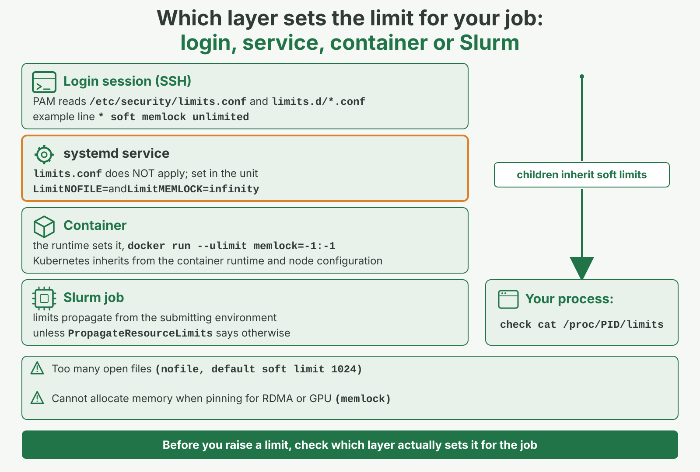

*Figure 1.8.17. Raising limits.conf does nothing for a systemd service or container, so find which layer actually starts the process.*

Two error messages account for a surprising number of GPU cluster tickets. One says "Too many open files", and the other says "Cannot allocate memory". Both appear while the machine has plenty of RAM and disk free. Neither is really about the machine. Both are about a per-process ceiling that was set long before the job started.

Each process has **resource limits**, called rlimits. Each limit has a *soft* value, which the kernel enforces, and a *hard* value, the ceiling the process may raise the soft limit to. Children inherit them. The table lists the limits you are most likely to hit.

| Limit | `ulimit` flag | Meaning |
|---|---|---|
| `nofile` | `-n` | Open file descriptors. Raise for servers and data loaders; exhaustion shows as "Too many open files" |
| `nproc` | `-u` | Processes/threads per user. Restrict on login nodes (fork bombs) |
| `memlock` | `-l` | Locked (pinned) memory. **Set to unlimited for RDMA/InfiniBand and CUDA pinned memory** |
| `stack` | `-s` | Stack size (MPI/Fortran codes sometimes need unlimited) |
| `core` | `-c` | Core file size |
| `cpu` | `-t` | CPU seconds before `SIGXCPU`/kill |
| `as` / `data` | `-v` / `-d` | Address space / data segment |
| `fsize` | `-f` | Largest file the process may create |

```bash
ulimit -a                       # show all soft limits of this shell
ulimit -Hn                      # show the hard limit for open files
ulimit -n 65536                 # raise the soft limit for this shell and its children
cat /proc/1234/limits           # limits of a running process
sudo prlimit --pid 1234 --nofile=65536:65536   # change a running process
```

**Where limits are set persistently.** For login sessions, PAM reads `/etc/security/limits.conf` and `/etc/security/limits.d/*.conf`. Each line has the form `user_or_@group  soft|hard  item  value`, for example `* soft memlock unlimited`.

For **systemd services**, `limits.conf` does *not* apply. You set `LimitNOFILE=`, `LimitMEMLOCK=infinity` and so on in the unit (chapter 1.15). For **containers**, the runtime sets the limits. You can pass them with `docker run --ulimit memlock=-1:-1`, and Kubernetes inherits them from the container runtime and node configuration.

For **Slurm jobs**, the limits propagate from the submitting environment unless `PropagateResourceLimits` says otherwise (chapter 6). A frequent bug looks like this. You raised `limits.conf`, but the job runs under a daemon, or under `sshd` with `UsePAM no`, that never reads it.

Limits apply per process, so they do not stop a user who runs many processes. For group-wide caps, use cgroups (section 9). Disk **quotas** are a separate, per-user filesystem mechanism (chapter 1.12).

Before you raise a limit, check which layer actually sets it for the job.

## 8. First resource monitoring: CPU time, memory, I/O

A job that should take minutes takes most of the morning, and you have no idea where the time went. Guessing rarely helps. The tools in this section each answer one narrow question about where the time went, and together they cover the three resources that processes compete for.

Those resources are **CPU, memory and I/O**. The kernel is a resource too, since it creates processes and talks to other processes. Resist the urge to tune a system that already works. The default settings are sensible. Use these tools to understand what the kernel is doing, and tune only when a measurement shows a real problem. The method is covered in chapter 1.23.

### Measuring CPU time: `time`

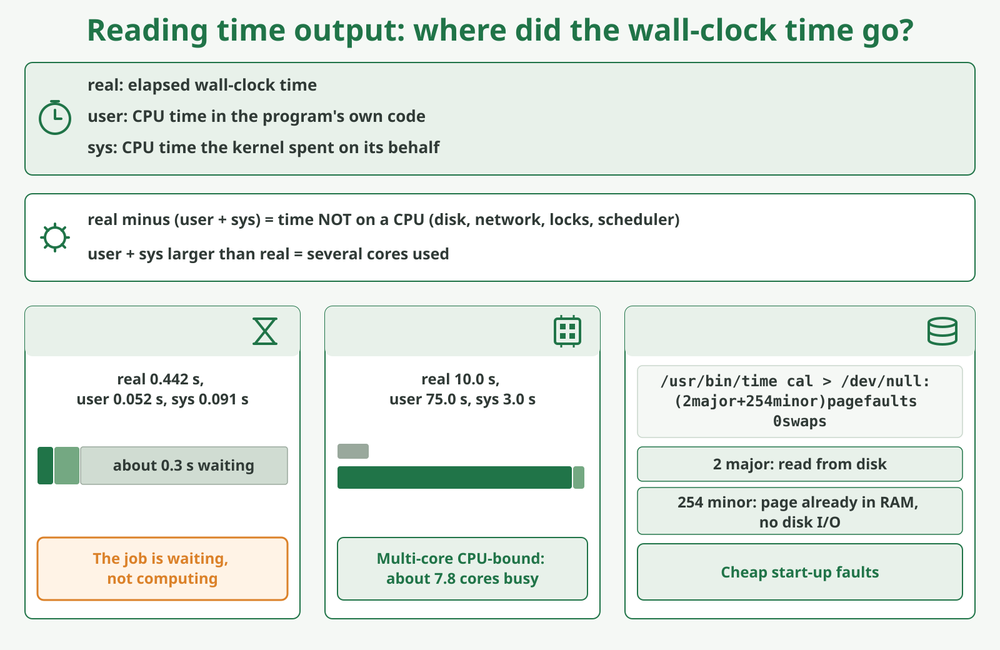

*Figure 1.8.18. When real is much bigger than user plus sys the job is waiting, and when user plus sys is bigger than real it used several cores.*

```bash
time ls /usr/lib
# real  0m0.442s   elapsed wall-clock time
# user  0m0.052s   CPU time spent running the program's own code
# sys   0m0.091s   CPU time the kernel spent on its behalf (system calls)
```

When you run `time`, read `real` first. `real - (user + sys)` is the time a job spends **not on a CPU**. That is time waiting for disk, network, locks or the scheduler. So when `real` is much larger than `user+sys`, the job is waiting. When `user+sys` is larger than `real`, the job used several cores.

Most shells have a built-in `time`. The external `/usr/bin/time -v command` prints much more, including peak resident memory, page faults, context switches and exit status.

```bash
/usr/bin/time -v python3 -c 'print(sum(range(10**7)))' 2>&1 | grep -E 'Elapsed|Maximum resident|faults|Voluntary|Involuntary|Exit'
```

### Load averages with `uptime`

`uptime` prints the load average over the last 1, 5 and 15 minutes, after the time the system has been up. Here is a sample from a machine that had been idle for a long time.

```text
$ uptime
... up 91 days, ... load average: 0.08, 0.03, 0.01
```

Desktop systems used to show a load average of about 0, except while you compiled a program or played a game. A load near 0 is a good sign. The processor is not being challenged, and you save power. Modern desktops run heavier user interfaces, though. Some websites and their advertisements can turn a browser into a resource hog.

The 15-minute value of `0.01` means that, across all processors, only 0.01 processes were running on average. On a single-processor machine, that is about 1 percent of the time spent running user programs. This system was barely busy.

On a one-core machine, a load near `1` usually means one process uses the CPU nearly all of the time. Run `top` to find it, and that process will usually sit at the top. On a two-core machine, a load of `1` means only one core is busy at any moment. A load of `2` means both cores have just enough work all of the time.

A high load average does not always mean trouble. A system with enough memory and I/O can run many processes, and they share the CPU in turn. Web and compute servers can also show high load, because processes start and exit so quickly that the measurement cannot keep up. If the system still responds well, leave it alone.

If the load is high and the system drags, check memory. When memory runs short, the kernel can thrash, swapping pages to and from disk. Many processes then wait for memory while they stay ready to run, so the load stays high for longer. That is the point where memory, not the CPU, is the problem.

### Memory in brief, and page faults

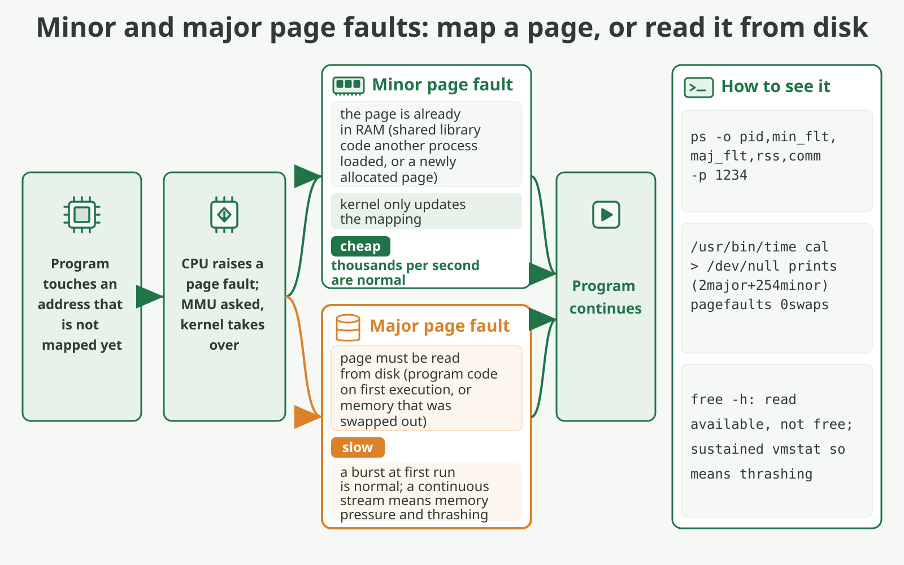

*Figure 1.8.19. A minor fault only updates a mapping, while a major fault must read from disk and a steady stream of them means memory pressure.*

Chapter 1.17 is the full treatment. For now, hold one idea: the CPU's **memory management unit (MMU)** translates **virtual addresses**, which processes use, into **physical addresses**. It does this with page tables that the kernel maintains, in units called **pages**. A page is 4 KiB normally, and `getconf PAGE_SIZE` reports the size on your system.

The kernel loads and allocates pages **on demand**, which is called demand paging. A program that starts up has only its first pages in memory. When it touches an address that is not mapped yet, the CPU raises a **page fault**, and the kernel fixes things up.

- A **minor page fault** happens when the page is already in RAM. Examples are shared library code that another process already loaded, or a newly allocated page. The kernel only has to update the mapping. This is cheap, and thousands per second are normal.
- A **major page fault** means the page must be read from **disk**. That covers program code on first execution, or memory that was swapped out. It is slow. A burst when a program first runs is normal. A continuous stream means memory pressure, when the kernel spends its time moving pages to and from swap (thrashing).

```bash
free -h                             # total, used, free, shared, buff/cache, available
grep -E 'MemTotal|MemAvailable|SwapTotal|SwapFree|Dirty' /proc/meminfo
ps -o pid,min_flt,maj_flt,rss,comm -p 1234
/usr/bin/time cal >/dev/null        # e.g. 0.00user 0.00system 0:00.06elapsed ... (2major+254minor)pagefaults 0swaps
```

When `/usr/bin/time cal > /dev/null` runs (*How Linux Works* Section 8.5.4), it prints a summary line such as `0.00user 0.00system 0:00.06elapsed 0%CPU (0avgtext+0avgdata 3328maxresident)k 648inputs+0outputs (2major+254minor)pagefaults 0swaps`. That line shows `2` major page faults, which read from disk, and `254` minor page faults, which map pages already in RAM.

When you run `free`, read the **available** figure, not **free**. Linux deliberately uses spare RAM for the page cache and gives it back on demand, so a small "free" is normal. A system is short of memory when *available* is small **and** it is swapping (`vmstat` `si`/`so`) or taking many major faults.

### `vmstat`: the whole machine in one line per interval

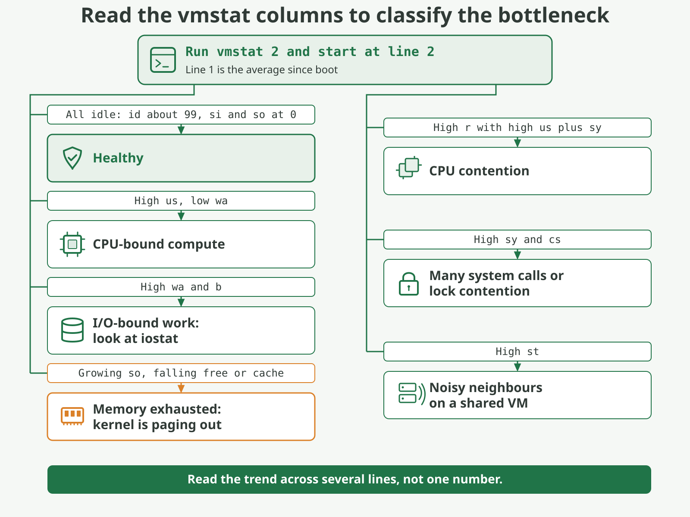

*Figure 1.8.20. Reading vmstat columns in patterns tells you whether the machine is CPU-bound, I/O-bound, out of memory or sharing a VM with noisy neighbours.*

The first time you run `vmstat`, it looks like a wall of columns with no story. Learn what one or two of them count, and the story appears. Running `vmstat 2` reports statistics every two seconds.

One rule matters more than the rest. **You should always start looking at the second line of output—the first line is an average for the entire uptime of the system since boot.**

```text
$ vmstat 2
procs -----------memory---------- ---swap-- -----io---- -system-- ------cpu-----
 r  b   swpd   free   buff  cache   si   so    bi    bo   in   cs us sy id wa st
 2  0 320416 3027696 198636 1072568   0    0     1     1    2    0 15  2 83  0  0
 2  0 320416 3027288 198636 1072564   0    0     0  1182  407  636  2  1 97  0  0
```

This quiet-system output comes from *How Linux Works* (Section 8.5.4). The system has `320,416 KB` of memory swapped out (`swpd`) from some earlier pressure, and `3,027,696 KB` free. The `si` and `so` columns are both `0`, so the kernel is not swapping anything in or out right now.

When a large program starts up (Listing 8-3), `free` drops to `2861252` KB. `bi` jumps as code pages are faulted in from disk, and `us` rises from `25%` to `27%`. The `si` and `so` columns stay at `0` as long as RAM is sufficient.

| Column | Meaning |
|---|---|
| `r` | Runnable tasks (queued for CPU); compare to the number of cores |
| `b` | Tasks blocked in uninterruptible sleep (usually I/O) |
| `swpd`, `free`, `buff`, `cache` | Swap used, free memory, buffer and page-cache memory (KiB) |
| `si`, `so` | Memory swapped **in** from / **out** to disk per second. **Non-zero `so` sustained = trouble** |
| `bi`, `bo` | Blocks read from / written to block devices per second |
| `in`, `cs` | Interrupts and context switches per second |
| `us`, `sy`, `id`, `wa`, `st` | CPU percent in user code, kernel, idle, **waiting for I/O**, stolen by the hypervisor (VMs) |

Here is how you should read the patterns. All idle (`id` about 99, with no `si` or `so`) means the system is healthy. High `us` with low `wa` is CPU-bound compute. High `wa` and `b` mean I/O-bound work, so look at `iostat`.

Growing `so` with falling `free` or `cache` means memory is exhausted and the kernel is paging out. High `r` with high `us` plus `sy` means CPU contention. High `sy` and `cs` mean many system calls or lock contention. High `st` points to noisy neighbours on a shared VM.

### Watching memory run out in `vmstat`

A program that starts up needs memory for its code and data. `vmstat` shows what that does to the machine. Start with a quiet system, then launch a big program and watch the same columns change. At first the CPU spends more time in user code. The kernel uses spare RAM for buffers and cache, and free memory drops only slowly. The listing below shows the start of a big program, with the first and last rows kept as printed.

```text
procs -----------memory---------- ---swap-- -----io---- -system-- ----cpu----
r b swpd free buff cache si so bi bo in cs us sy id wa
1 0 320412 2861252 198920 1106804 0 0 0 0 2477 4481 25 2 72 0 1
0 3 320244 2727632 202104 1175420 20 0 1890 216 4631 8706 36 4 46 14
```

The `si` column can rise when the kernel pulls pages back in from swap. This often happens when the new program uses shared library code that another process already loaded and that was swapped out. A few processes may also appear in the `b` column while they wait for memory pages. Disk traffic shows up in the `bi` and `bo` columns.

Running out of memory looks different. Buffer and cache sizes shrink because the kernel needs that space for user processes. Then the `so` column starts to move, which means pages are going out to disk. System time rises, and more processes stay blocked in `b` because their memory sits in swap. Watch the trend across several lines of output, not one number.

### I/O: `iostat`, `iotop`, `pidstat`, `sar`

Many of these I/O tools are not installed by default. You get `iostat`, `pidstat`, `sar` and `mpstat` from the `sysstat` package, and `iotop` from its own package.

If you run `iostat` without options, it shows averages since boot. It prints an `avg-cpu:` block with `%user`, `%nice`, `%system`, `%iowait`, `%steal` and `%idle`. Then it prints a `Device` block with `tps`, `kB_read/s`, `kB_wrtn/s`, `kB_read` and `kB_wrtn`. By default, `iostat` leaves out partition information. Pass `-p ALL` to show partitions such as `sda1` alongside whole devices such as `sda`.

```bash
iostat                    # uptime average CPU and block device tps, kB_read/s, kB_wrtn/s
iostat -p ALL             # include all partitions (e.g., sda1, sda2, nvme0n1p1)
iostat -xz 2              # extended per-device stats every 2 s; -z hides idle devices
iostat -dp ALL 5          # per-partition, device report only
sudo iotop -oPa           # processes actually doing I/O, accumulated
pidstat -p 1329 1         # CPU of one process every second (UID, PID, %usr, %system, %guest, %CPU, CPU, Command)
pidstat -u -r -d -t 2     # CPU, memory, disk I/O, per thread, every 2 s
mpstat -P ALL 2           # per-core utilisation (spot one saturated core)
sar -u 1 5                # CPU; sar also records history (see below)
```

When you open `iostat -x`, you will see that `r/s` and `w/s` are requests per second, and `rkB/s` and `wkB/s` are throughput. `await` is the average time, in milliseconds, that a request spends queued and being serviced. It is the latency number to watch. `aqu-sz` is the average queue length. `%util` is the fraction of time the device was busy. It is meaningful for a single spinning disk, but misleading for NVMe or for arrays that handle many requests in parallel.

To see the I/O used by individual processes, use `iotop`. It gives a continuously updating, `top`-like display. The top lines show total and current disk read and write bandwidth. Each row is a thread (`TID`) with its `PRIO` (`be/4` is best-effort level 4, `rt` is real-time, and `idle` is idle), plus `USER`, `DISK READ`, `DISK WRITE`, `SWAPIN`, `IO>` and `COMMAND`.

`pidstat` prints a scrolling trace over time, such as `pidstat -p 1329 1` (*How Linux Works* Section 8.5.6). Its columns are `UID`, `PID`, `%usr`, `%system`, `%guest`, `%CPU`, `CPU` and `Command`. It does not overwrite the screen the way `top` does. So you can watch a process move between CPU cores, for example from `CPU 1` to `CPU 3`, second by second.

The book's further topics (*How Linux Works* Section 8.7) cover **`sar`**. It comes from `sysstat`, and a collector cron job or systemd timer feeds it. Because `sar` records statistics, you can look back. Ask what the CPU was doing at 03:10 last night with `sar -u -f /var/log/sa/sa23`, or use `sar -r` for memory. Related tools are `acct` and `psacct`, which record every process that ran and its resource use, and quotas.

### Partitions, per-process I/O and `pidstat` in detail

By default, `iostat` shows whole disks only. Add `-p ALL` to list the partitions too. A typical machine has many partitions, so the output grows fast. This part of the output comes from a system with one disk and its partitions.

```text
$ iostat -p ALL
Device: tps kB_read/s kB_wrtn/s kB_read kB_wrtn
sda 4.67 7.27 49.83 9496139 65051472
sda1 4.38 7.16 49.51 9352969 64635440
sda2 0.00 0.00 0.00 6 0
sda5 0.01 0.11 0.32 141884 416032
scd0 0.00 0.00 0.00 0 0
sde 0.00 0.00 0.00 1230 0
```

The partitions `sda1`, `sda2` and `sda5` belong to the `sda` disk. Their read and write columns overlap with the disk line, so the partition numbers do not add up to the disk total. A read from `sda1` also counts as a read from `sda`. You can also read `sda` directly, for example when the kernel reads the partition table.

`iotop` answers a different question: which process is moving the data. It works like `top`, but it sorts by I/O instead of CPU. The top lines show the total read and write rates. The rows below show each busy process.

```text
# iotop
Total DISK READ: 4.76 K/s | Total DISK WRITE: 333.31 K/s
TID PRIO USER DISK READ DISK WRITE SWAPIN IO> COMMAND
260 be/3 root 0.00 B/s 38.09 K/s 0.00 % 6.98 % [jbd2/sda1-8]
2611 be/4 juser 4.76 K/s 10.32 K/s 0.00 % 0.21 % zeitgeist-daemon
2636 be/4 juser 0.00 B/s 84.12 K/s 0.00 % 0.20 % zeitgeist-fts
```

The column is `TID`, not `PID`. `iotop` is one of the few tools that shows threads instead of processes. The `PRIO` column is the I/O priority. A lower number is more important, so `be/3` gets more disk time than `be/4`. The first part of the value is the scheduling class.

There are three classes. `be` (best effort) is the default, and most processes use it. The kernel tries to share I/O fairly in this class. `rt` (real time) is served before any other class, every time. `idle` gets disk time only when no other I/O is waiting, and it has no level number. You can check or change the class with `ionice`. Most people never need to touch it.

`pidstat` solves a different problem from `top` and `iotop`. Those tools redraw the screen and erase the last update. `pidstat` prints a new line for each sample, so you can compare them.

```bash
pidstat -p 1329 1          # CPU of one process, one sample per second
```

```text
$ pidstat -p 1329 1
Linux 5.4.0-48-generic (duplex) 11/09/2020 _x86_64_ (4 CPU)
09:26:55 PM UID PID %usr %system %guest %CPU CPU Command
09:27:03 PM 1000 1329 8.00 0.00 0.00 8.00 1 myprocess
09:27:04 PM 1000 1329 0.00 0.00 0.00 0.00 3 myprocess
09:27:05 PM 1000 1329 3.00 0.00 0.00 3.00 1 myprocess
```

The default columns show user time (`%usr`), kernel time (`%system`) and the total (`%CPU`). They also show the CPU where the process ran. The `%guest` column is time spent inside a virtual machine. Ignore it unless you run VMs. Add `-r` to watch memory and `-d` to watch disk I/O. The `pidstat(1)` manual page lists more options.

Before you tune anything, measure which resource is short.

## 9. Control groups (cgroups)

Here is a limit that `nice` and `ulimit` cannot express. One user starts a data loader that forks several workers, and each worker looks harmless on its own: small memory, modest CPU, a few files open. Together they saturate the node. Per-process limits never see the problem, because the problem only exists in aggregate.

`nice` and `ulimit` work per process. If you want to limit what a **set of processes** may consume **in total**, Linux offers **control groups**, or cgroups. A cgroup is a group of processes. **Controllers** apply limits and accounting to that group. The main controllers are cpu (CPU time share or quota), memory (RAM and swap cap), `io` (block I/O bandwidth and IOPS), pids (number of tasks), cpuset (which cores and memory nodes), hugetlb, rdma, and more.

cgroups sit behind systemd's resource control, container limits in Docker and Kubernetes, and Slurm's job confinement. They are part of the kernel and do not depend on systemd, although systemd manages most of them on modern systems.

### v1 versus v2

Both versions exist, and a system may even run both, which is confusing. The table compares them.

| | cgroup v1 | cgroup v2 |
|---|---|---|
| Hierarchy | One separate tree **per controller** | **One unified tree**; each cgroup can enable several controllers |
| Process membership | A process can be in a *different* cgroup for each controller | A process belongs to **exactly one** cgroup |
| Mount | `/sys/fs/cgroup/<controller>/` | `/sys/fs/cgroup/` (a `cgroup2` filesystem) |
| Status | Legacy, being phased out | The default on current distributions |

The flexibility of v1 turned out to be rarely used, and it made things complicated. v2 is simpler. A controller in use under v1 cannot be used under v2 at the same time. You can identify the version in use with `stat -fc %T /sys/fs/cgroup/`, where `cgroup2fs` means v2, or with `mount | grep cgroup`. Chapter 1.18 compares them in detail. The rest of this section uses **v2**.

### Viewing cgroups

Everything is a file. A process's cgroups are listed in `/proc/PID/cgroup`.

```bash
cat /proc/self/cgroup
# 0::/user.slice/user-1000.slice/session-2.scope        (v2 line: "0::path")
```

If you run `cat /proc/self/cgroup`, you see the cgroup of the `cat` process itself. Names are hierarchical paths. systemd names them. **`system.slice`** holds system services such as `ssh.service` and `docker.service`. **`user.slice`** holds login sessions (`session-N.scope`), and `machine.slice` holds virtual machines. Containers appear under runtime-specific paths. Kubernetes places pods under `kubepods.slice/...`. To look inside a cgroup, use these commands.

```bash
cd /sys/fs/cgroup/$(awk -F: '$1=="0"{print $3}' /proc/self/cgroup)
ls
cat cgroup.procs        # PIDs in this cgroup (cgroup.threads also lists threads)
cat cgroup.controllers  # controllers available here, e.g. "memory pids"
cat memory.max          # "max" means no limit here (a parent may still limit)
cat memory.current      # current memory use of the group
cat pids.current        # number of tasks
cat cpu.stat            # usage_usec, user_usec, system_usec, throttling counters
systemd-cgls            # tree view of the cgroup hierarchy with the processes
systemd-cgtop           # top-style live resource use per cgroup
```

`cpu.stat` accumulates the CPU used over the whole life of the group, including short-lived children. That is exactly what you want for a service or job that spawns many subprocesses. **Pressure stall information** (`cpu.pressure`, `memory.pressure`, `io.pressure`) reports the share of time that tasks stalled for each resource. It is a better health signal than raw utilisation.

### Creating and changing cgroups

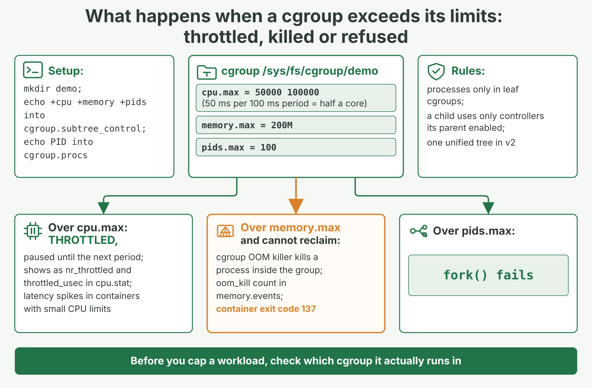

*Figure 1.8.21. Exceeding the CPU quota throttles the group, exceeding the memory limit triggers an OOM kill, and exceeding the pids limit makes fork fail.*

Writing to these files changes behaviour. Run them as root.

```bash
sudo mkdir /sys/fs/cgroup/demo                         # creating a directory creates a cgroup
echo "+cpu +memory +pids" | sudo tee /sys/fs/cgroup/cgroup.subtree_control   # enable controllers for children
echo 200M | sudo tee /sys/fs/cgroup/demo/memory.max    # cap memory at 200 MiB
echo 100 | sudo tee /sys/fs/cgroup/demo/pids.max       # at most 100 tasks
echo "50000 100000" | sudo tee /sys/fs/cgroup/demo/cpu.max   # 50 ms CPU per 100 ms period = half a core
echo $$ | sudo tee /sys/fs/cgroup/demo/cgroup.procs    # move this shell into the group
sudo rmdir /sys/fs/cgroup/demo                         # removable when it has no processes
```

Three rules trip people up. Processes can live only in **leaf** cgroups, which have no child cgroups. The root cgroup is the exception. A child can use only the controllers that its **parent** has enabled in `cgroup.subtree_control`. And you must enable controllers explicitly.

Editing `/sys/fs/cgroup` by hand on a systemd machine can conflict with systemd's own management. For anything beyond experiments, let **systemd** create the cgroup. It then gets a unit name and persists.

```bash
sudo systemd-run --scope -p MemoryMax=500M -p CPUQuota=50% -p TasksMax=200 stress-ng --vm 1 --vm-bytes 1G --timeout 30s
systemd-run --user --scope -p MemoryMax=1G python3 big.py        # as an ordinary user (needs delegation)
```

When a cgroup exceeds `memory.max` and cannot reclaim memory, the kernel's **OOM killer** kills a process inside that cgroup. The `memory.events` file shows `oom_kill` counts. This is exactly the "Exit code 137" you see for a container that hit its memory limit.

CPU limits work differently. A group over its `cpu.max` quota is **throttled**. It is paused until the next period, which shows up as `nr_throttled` and `throttled_usec` in `cpu.stat`. That causes puzzling latency in containers with small CPU limits.

Why this matters: cgroups give a Slurm job, a systemd service and a Kubernetes pod each **their own box**. They implement `--mem`, `--cpus-per-task` and Kubernetes `resources.limits`. Chapter 1.18 and the container chapters build on this section. Chapter 1.19 adds namespaces, the other half of a container.

Before you cap a workload, check which cgroup it actually runs in.

## 10. AI-infrastructure patterns

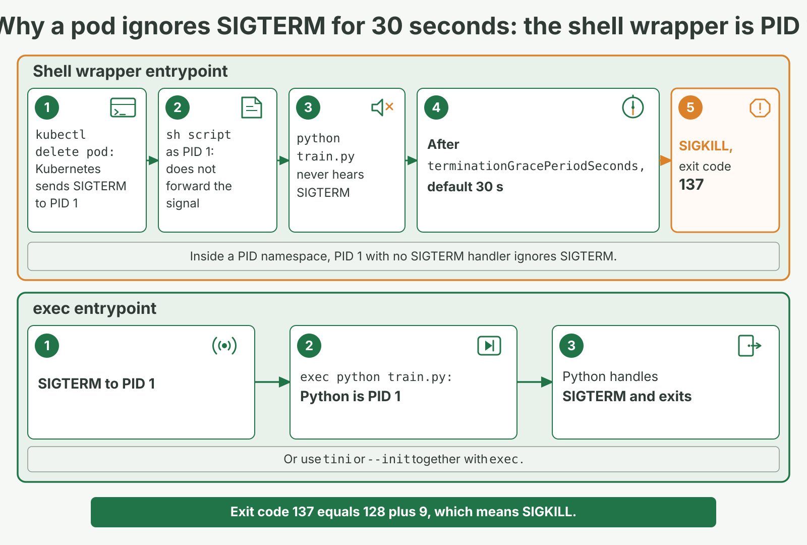

*Figure 1.8.22. When the shell wrapper stays PID 1 the training job never gets SIGTERM and is killed after 30 seconds, but exec fixes it.*

Everything so far was about one process on one machine. On a cluster, the same rules apply inside containers and batch jobs, where you do not control the parent process and cannot press Ctrl-C. These are the patterns you will meet most often.

**Signals in containers and Kubernetes.** When you delete a pod, Kubernetes sends **`SIGTERM`** to PID 1 of each container. It waits `terminationGracePeriodSeconds` (default 30 s), then sends **`SIGKILL`**. If your training job does not handle `SIGTERM`, it is killed hard after 30 s and loses unsaved state. Watch for these common problems.

- The entrypoint is a **shell script** that starts Python as a child. The shell receives `SIGTERM`, does not forward it, and Python never hears it. Fix this by ending the script with `exec python train.py`, so Python *is* PID 1. Or use `tini` or `--init` together with `exec`.
- PID 1 has special treatment. The kernel **does not apply default signal actions** to PID 1 inside a PID namespace. A program that registers no `SIGTERM` handler therefore ignores `SIGTERM` as PID 1, though it dies to that signal elsewhere. Containers that "will not stop" are often this case.
- Zombies accumulate because PID 1 never reaps them (see section 2). Use an init.
- Exit code 137 equals 128 plus 9. It means `SIGKILL`, usually from the OOM killer or a grace-period timeout. Exit code 143 means `SIGTERM`.

**Signals in batch schedulers.** Slurm stops a job with `SIGTERM`. After `KillWait` (default 30 s), it sends `SIGKILL`. `scancel --signal=USR1 JOBID` delivers a signal you choose. `sbatch --signal=B:USR1@120` asks Slurm to send `SIGUSR1` to the batch shell 120 seconds before the time limit.

This is how you checkpoint before a time-limit kill. Trap `USR1` in the script, signal the training process, and wait for it to write the checkpoint (chapter 6). Preempted jobs are signalled in a similar way.

```bash
#!/bin/bash
#SBATCH --signal=B:USR1@180        # SIGUSR1 to the batch shell 180 s before time limit
trap 'echo "checkpointing"; kill -USR1 "$pid"; wait "$pid"' USR1
python train.py --resume-latest &
pid=$!
wait "$pid"
```

**Hung training jobs.** When your distributed job stops making progress, with GPUs at 100% or 0% utilisation, it is usually waiting on a **collective operation**. One rank died or stalled, and the others wait in NCCL.

Triage from the process side. Check the `ps` states and `wchan`. Use `strace -p` to see whether all the ranks sit in the same `futex` or `poll`. Use `py-spy dump --pid PID` for Python stacks without stopping the process (a separate tool you install). Use `gdb -p PID -batch -ex 'thread apply all bt'` for native stacks. Run `nvidia-smi` to see which processes hold GPUs, and `dmesg | grep -i -E 'xid|nvrm'` for GPU errors. Also check the NCCL debug variables (`NCCL_DEBUG=INFO`) and the watchdog timeout in PyTorch.

The fix is rarely on the hung rank. Find the first rank that failed (chapters on NCCL and Slurm).

**Processes holding a GPU.** `nvidia-smi` shows compute processes by PID. A process inside a container appears with its **host PID**. The command `nvidia-smi --query-compute-apps=pid,used_memory --format=csv` is scriptable. `fuser -v /dev/nvidia*` finds everything with a GPU device open, including zombies and processes that other users started.

A "ghost" GPU memory allocation with no visible process usually means a defunct process is still being torn down by the driver (often a `D`-state process). It can also mean a process in another PID namespace.

**`D`-state diagnosis on shared storage.** A login or compute node with a hung NFS or Lustre mount has many processes in `D`. Load climbs, `ls` on the mount hangs, and `kill -9` does nothing. Find the mount with `cat /proc/<pid>/stack` or `wchan`. Look for functions such as `nfs_*` or `ll_*`. Then check `mount | grep nfs` and the server's reachability. Options include a lazy unmount (`umount -l`) once the clients are stopped, or restoring the server. Mount options such as `soft`, `timeo` and `intr` trade hangs for I/O errors (chapter 5 and the storage chapters).

**Priority and noisy neighbours.** On a shared login node, enforce **cgroup limits** per user. Use systemd `user-.slice` with `CPUQuota` and `MemoryMax`, or `pam_slurm_adopt` and Slurm's cgroup plugin on compute nodes. Do not rely on `nice` alone, because it does not protect memory. Limit `nproc` on login nodes.

**Observability agents.** Metrics systems read the same sources you do. `node_exporter` parses `/proc/stat`, `/proc/meminfo`, `/proc/loadavg` and `/proc/pressure/*`. `cAdvisor` and `kubelet` read cgroup files. `process-exporter` reads `/proc/PID/*`. When a dashboard looks wrong, read the underlying file to see why.

When a job hangs, start from the process states, not from the dashboard.

## Kernel background reference (from the operating-systems chapter of the performance book)

This section collects the supporting concepts that the performance literature builds on. Most are developed in the chapters named.

- **Terminology.** The *operating system* is the kernel plus administration tools and system libraries. A *process* is an environment for running a program in user mode. A *thread* is a schedulable executable context. A *task* is Linux's runnable entity, which can be a process, a thread or a kernel thread. *Kernel space* and *user space* are the two virtual address ranges. You will meet these words often in performance papers. A *trap* is a request for a privileged action: a system call, a processor exception or an interrupt. A *context switch* swaps CPU register sets between threads. A *mode switch* flips the CPU between user and kernel mode.
- **Stacks.** A stack is a last-in, first-out region of memory. It holds return addresses, saved registers and local variables for each function call, which is called a *stack frame*. Walking the saved return addresses gives a **stack trace**. When you read a stack trace, start at the top, because the first line is the function that is executing now. Each thread has a user stack and a kernel stack, which system calls use. Interrupts use their own stack. Stack traces answer "why is this code running?", and they are the basis of profilers (chapter 1.24).
- **Virtual memory and paging.** Virtual memory gives each process a private, nearly unbounded address space. It lets memory be over-committed, by mapping it to RAM on demand and to disk when needed. Modern kernels **page**, which means they move fixed-size pages, rather than swapping whole processes. Linux's word "swapping" means paging to the swap area (chapter 1.17). Address 0 is deliberately unmapped. So dereferencing a null pointer crashes the program instead of silently corrupting data.
- **Schedulers.** Unix is a time-sharing system. The scheduler divides CPU time among threads, using per-CPU run queues, priorities and scheduling policies. Workloads are **CPU-bound**, meaning long compute that the CPU limits, or **I/O-bound**, meaning mostly waiting and wanting a quick response. The classic policy, which you will see described often, lowers the priority of CPU hogs, so interactive and I/O-bound tasks run promptly. Linux has several classes: the default fair scheduler, real-time FIFO and round-robin, and deadline scheduling (chapter 1.18).
- **Filesystems.** Files and directories form one tree from `/`. Filesystems are assembled into that tree by **mounting** them at directories. The **virtual file system (VFS)** layer lets many filesystem types coexist behind one interface. The path from a program to a disk is the **I/O stack**: application, system call, VFS, filesystem, block layer, device driver, device. Some filesystems, such as `/proc`, `/sys` and `/dev`, are created in memory by the kernel. `chroot` and mount namespaces confine a process to part of the tree (chapters 1.12 and 1.19).
- **Caching.** Disks are slow, so many layers cache reads and buffer writes. These include application caches, database caches, the kernel's dentry and inode caches, the **page cache** (which also absorbed the old buffer cache), and controller and device caches. A read can be satisfied at any of these layers, so when you see a slow read, ask which layer answered it. That is why the same read can take microseconds or milliseconds.
- **Networking.** The kernel provides the TCP/IP stack, and applications reach it through **sockets**. The network card is the interface. Addresses are assigned manually or by DHCP. New protocols and TCP options usually need kernel support, so check that before you rely on one (chapter on networking).
- **Device drivers.** Drivers manage devices and present them as **character** devices, which are unbuffered byte streams such as keyboards and serial ports. They also present **block** devices, which have fixed blocks and random access, such as disks. Loadable modules can add drivers without a reboot, so you rarely need to restart the machine for a new driver (chapter 1.22).
- **Multiprocessor and NUMA.** Symmetric multiprocessing treats all CPUs equally. On multi-socket machines, though, you will find that memory banks hang off different sockets. This is **NUMA**, and remote access is slower (chapter 1.17). CPUs coordinate with **inter-processor interrupts**, for example to tell the others that a cached address translation is stale.
- **Resource management.** The historic controls are `nice` and `ulimit`. The modern ones are cgroups, introduced in Linux 2.6.24 with version 2 usable from 4.5, and namespaces (chapters 1.18 and 1.19).
- **Observability.** If you want to know where a tool gets its numbers, look at the kernel interface it reads. Tools are programs in `/usr/bin` and `/usr/sbin`, built on kernel interfaces such as `/proc`, `/sys`, tracepoints, perf events and BPF (chapters 1.23 and 1.24).
- **Linux history in one paragraph.** UNIX, from Bell Labs in 1969, introduced layers, system calls, processes, priorities and the single file tree. It kept the kernel small, with "only one way to do one thing". BSD added paged virtual memory, demand paging, the fast file system, TCP/IP and sockets, and jails. Solaris added VFS, a slab allocator, DTrace, zones and ZFS. Linux, from 1991, took ideas from all of these. It added, among many others, control groups, namespaces, KVM, `epoll`, `futex`, huge pages and transparent huge pages, the Completely Fair Scheduler, `perf`, tracepoints, extended BPF, `io_uring`, cgroup v2 and pressure stall information. Each of these appears in the chapter where it matters. The number of documented system calls grew from about 48 in UNIX Version 7 to nearly 500 in recent Linux manual pages. That growth is a measure of kernel growth, and it is the reason performance tuning has so many knobs.
- **Kernel page-table isolation (KPTI)** is the mitigation for the Meltdown processor vulnerability (Linux 4.14, 2018). It adds work to mode switches and context switches, so if your workload makes many system calls, you may lose a few percent. Huge pages and fewer system calls reduce the cost.
- **BPF** (extended Berkeley Packet Filter) is a safe, verified virtual machine inside the kernel. Programs attach to tracepoints, kprobes, uprobes and events, and collect data in maps. This powers modern tracing tools such as `bpftrace` and BCC (chapter 1.24).
- **`systemd-analyze`** reports boot time through `systemd-analyze`, `blame`, `critical-chain` and `plot`. It helps when you tune a slow boot (chapter 1.15).
- **Other topics and kernel designs (`SP` Section 3.5).** Microkernels keep the kernel small and run drivers in user space, as QNX and Minix 3 do. Hybrid kernels include Windows NT. Unikernels put the application and the kernel in one image. Plan 9 is a distributed operating system. **Profile-guided optimisation** of the kernel build is another topic. These designs explain, by contrast, why Linux is a monolithic design with loadable modules. Linux has dominated the TOP500 list since 2017, which is why this book teaches it.

## How it fails

Most cluster failures in this chapter come down to a handful of patterns. When you see a symptom, find it below. Each item gives the symptom, then the cause, and then the fix you can apply.

1. **`kill -9` does nothing.** The process is in `D` state, which means it is waiting on the kernel. Typical causes are a hung NFS or Lustre mount, a dying disk, or a GPU in error. Fix the resource. As a last resort, reboot. To find such processes, run `ps axo stat,pid,wchan,comm | grep '^D'`.
2. **A process "cannot be killed" but shows `Z`.** It is already dead, and its parent has not called `wait()`. Restart or signal the parent. In containers, make PID 1 a reaping init.
3. **Orphans after the login node closes your session.** The job received `SIGHUP`. Use `tmux`, `nohup`, `setsid`, or submit the job to the scheduler.
4. **`Too many open files`.** The `nofile` limit is too low, and the default soft limit is 1024. Raise `LimitNOFILE` for a service, `limits.conf` for a login, or `--ulimit nofile` for a container. Check the current state with `ls /proc/PID/fd | wc -l` and `/proc/PID/limits`.
5. **`Cannot allocate memory` when pinning for RDMA or GPU.** The `memlock` limit is too low. Set it to unlimited with `limits.conf`, with `LimitMEMLOCK=infinity`, or with `--ulimit memlock=-1:-1` in a container.
6. **Pod takes 30 s to die and loses data.** `SIGTERM` never reaches the training process, because the shell wrapper is PID 1. Use `exec`, handle `SIGTERM`, or raise `terminationGracePeriodSeconds`.
7. **High load, idle CPUs.** If you see this, look at I/O first. Tasks in `D` count in the load average. Check `vmstat` `b` and `wa`, `iostat -x` `await`, and any stuck mounts.
8. **Container exit code 137.** That means `SIGKILL`. Either the cgroup's memory limit triggered an OOM kill (check `dmesg` and `memory.events`), or a grace-period timeout fired.
9. **Disk full but `du` shows free space.** You can find the cause: deleted files are still held open. Run `lsof +L1`, then restart the holder.
10. **A script's trap never fires.** A foreground command defers the trap. Background the command and `wait` for it. Or the child ignores the signal because it never received it. Use `exec`, or signal the process group with `kill -- -PGID`.
11. **Load average misleads.** Short-lived processes escape the sampling. Use `pidstat`, `perf` or `/proc/pressure/*` for finer data.
12. **Throttled containers with low CPU limits.** `nr_throttled` rises in `cpu.stat`. Raise or remove the CPU limits, or tune the period. Latency-sensitive services suffer most.
13. **`strace` attach denied.** `ptrace_scope` or a different owner blocks the attach. Run as root, or relax `kernel.yama.ptrace_scope` on a debugging host. That is a security trade-off.
14. **`nice` ineffective.** Tasks in the same cgroup share CPU, or autogroup applies. Nice only ranks tasks within a group. For priority between groups, use `cpu.weight` in cgroup v2, or systemd `CPUWeight=`.

## Hands-on lab: processes, signals, cgroups, and VM drills

Start with the self-checking Python lab (`code/part01/processes_signals_lab.py`), and run it on your own machine first. It verifies uncatchable signals (`SIGKILL` `9` and `SIGSTOP` `19`) and signal delivery to `D` and `Z` states and container `PID 1`. It also checks load average and `vmstat` bottleneck classification, `time` `real` vs `user + sys` classification, and `cgroup v2` `cpu.max` and leaf-process constraints.

```bash
python3 code/part01/processes_signals_lab.py
```

After each step, compare what you see with the result the text describes. Next, on a disposable GCP Ubuntu VM (none of the interactive VM commands below has been run on live hardware), work through these steps:

**A. Process basics.**

```bash
echo "my shell PID is $$, parent is $PPID"
ps -o pid,ppid,stat,etime,cmd -p $$
pstree -ap $$ | head
ls -l /proc/$$/fd
grep -E 'State|Threads|VmRSS' /proc/$$/status
sleep 300 &                             # a background job
jobs -l; ps -o pid,ppid,pgid,sid,tty,stat,cmd -p $!
```

**B. Zombies.** Create one on purpose and observe it.

```bash
python3 - <<'EOF' &
import os, time
pid = os.fork()
if pid == 0:
    os._exit(0)          # child exits immediately
time.sleep(60)           # parent never calls wait()
EOF
sleep 1
ps axo stat,pid,ppid,comm | awk '$1 ~ /^Z/' # the defunct child
kill %1                                 # kill the parent: the zombie disappears (re-parented to PID 1 and reaped)
```

**C. Signals.**

```bash
cat > /tmp/sig.sh <<'EOF'
#!/usr/bin/env bash
trap 'echo "TERM received, cleaning up"; exit 0' TERM
trap 'echo "USR1 received"' USR1
trap 'echo "bye (EXIT trap)"' EXIT
echo "pid $$"
while true; do sleep 1; done
EOF
chmod +x /tmp/sig.sh
/tmp/sig.sh &  P=$!
sleep 1; kill -USR1 $P; sleep 1; kill -TERM $P; wait $P; echo "exit status $?"
/tmp/sig.sh & P=$!; sleep 1; kill -9 $P; wait $P; echo "exit status after SIGKILL: $?" # 137, no EXIT trap
```

Explain why the `EXIT` trap did not run under `SIGKILL`.

**D. Job control.**

```bash
sleep 200                               # press Ctrl-Z
jobs; bg %1; jobs; fg %1                # then Ctrl-C
nohup sleep 500 > /dev/null 2>&1 &
disown -a
```

**E. Open files and deleted files.**

```bash
dd if=/dev/zero of=/tmp/big bs=1M count=200
tail -f /tmp/big > /dev/null &          # holds the file open
rm /tmp/big
df -h /tmp | tail -1                    # space NOT freed
sudo lsof +L1 | grep big
kill %1; df -h /tmp | tail -1           # now freed
```

**F. Trace a failure.**

```bash
strace -f -e trace=openat,stat -o /tmp/cat.trace cat /no/such/file; grep ENOENT /tmp/cat.trace
strace -c ls /usr/lib > /dev/null        # summary of calls and times
```

**G. Priority and limits.**

```bash
yes > /dev/null & Y1=$!
nice -n 19 yes > /dev/null & Y2=$!
top -b -n 1 -p $Y1,$Y2 | tail -4        # compare CPU shares (on a one- or two-core VM)
kill $Y1 $Y2
ulimit -n; ulimit -n 256; ulimit -n     # lower the soft limit in this shell
cat /proc/$$/limits | grep -i 'open files'
```

**H. Observe load and memory.**

```bash
vmstat 1 5
iostat -xz 1 3                          # install sysstat first: sudo apt install -y sysstat
sudo apt install -y stress-ng && stress-ng --cpu 2 --timeout 20s &
uptime; sleep 15; uptime                # load average rises
```

**I. cgroup v2 limits.**

```bash
stat -fc %T /sys/fs/cgroup/             # expect cgroup2fs
cat /proc/self/cgroup
sudo systemd-run --scope -p MemoryMax=100M -p TasksMax=50 --unit=lab.scope bash -c 'python3 -c "x=bytearray(400*1024*1024)"'; echo "status $?"
sudo dmesg | tail -5                    # OOM-kill message for the cgroup
systemd-cgls | head -30
```

**J. (GPU VM, optional)** `nvidia-smi --query-compute-apps=pid,used_memory --format=csv`, `sudo fuser -v /dev/nvidia*`, `ps -o pid,stat,wchan:32,cmd -p <pid>` for a running CUDA process.

## Exercises

1. **Signal Delivery Across Process States (`R`, `S`, `D`, `Z`) and Container `PID 1`:** State the exact outcome when the kernel delivers: (a) `SIGKILL` (`9`) to a process in state `D` waiting on a hung NFS mount, (b) `SIGKILL` (`9`) to a zombie process in state `Z`, (c) `SIGTERM` (`15`) to a container's `PID 1` that has not registered a `SIGTERM` handler, and (d) `SIGKILL` (`9`) to that same container `PID 1`. Verify with `evaluate_signal_delivery()` in `code/part01/processes_signals.py`.
2. **Diagnosing Load Average and `vmstat` Columns (`r`, `b`, `so`, `id`):** A 16-core node reports a 1-minute load average of `60.0`. Classify the bottleneck under two different `vmstat 2` readings (reading from line 2 onward): (a) `r = 1`, `b = 48`, `so = 0`, `id = 90%`; and (b) `r = 4`, `b = 2`, `so = 500`, `id = 40%`. Why must you ignore the first line of `vmstat 2`?
3. **Interpreting `time` (`real`, `user`, `sys`) and Page Faults (`min_flt` vs `maj_flt`):** Classify each workload profile from its `time` measurements: (a) `real = 0.442s`, `user = 0.052s`, `sys = 0.091s`; (b) `real = 10.0s`, `user = 75.0s`, `sys = 3.0s`; and (c) `/usr/bin/time cal > /dev/null` reporting `(2major+254minor)pagefaults 0swaps`. Explain why `254` minor page faults require zero disk I/O.
4. **Control Groups v2 (`cpu.max`, `memory.max`, and Leaf Constraint):** An administrator configures `/sys/fs/cgroup/demo` with `cpu.max` set to `"50000 100000"`, `memory.max` set to `200M`, and `pids.max` set to `100`. (a) How many CPU cores can processes in `/sys/fs/cgroup/demo` consume, and what happens when they exceed `cpu.max` versus when they exceed `memory.max`? (b) Why can't you write a PID into `/sys/fs/cgroup/demo/cgroup.procs` if `/sys/fs/cgroup/demo/sub1` exists as a child cgroup?
5. **Priorities (`nice`/`renice` and `ionice`) and Resource Limits (`ulimit` / `prlimit`):** (a) State the numeric range of `nice` values (`-20` to `+19`), which direction lowers priority, and why `ionice -c 3 nice -n 19 rsync -a src/ dst/` is used for background copies on shared nodes; (b) why does `/etc/security/limits.conf` (`* soft memlock unlimited`) not apply to a `systemd` service unit unless `LimitMEMLOCK=infinity` is set in the unit?
6. **Graceful Shutdown in Containers and Slurm (`trap` and `--signal=B:USR1@180`):** (a) Why does a shell-script container entrypoint that ends with `python train.py` (without `exec`) fail to deliver `SIGTERM` to Python on `kubectl delete pod`, resulting in a 30-second stall and exit code `137`? (b) In the `#SBATCH --signal=B:USR1@180` script in Section 10, why is `python train.py` launched in the background (`&`) followed by `wait "$pid"`?

## Checkpoint questions (20)

<details>
<summary>1. What are the main components of a Linux process, and how does a thread (`TID`) differ from a process (`PID`)?</summary>

A process has a virtual address space, one or more threads (each with its own stack and CPU registers), an open file descriptor table, credentials (`ruid`, `euid`, `suid`, groups, capabilities), a `cwd`, a `umask`, an environment block, `rlimits`, signal dispositions, and a `PID` and `PPID`. Linux schedules both processes and threads as kernel tasks, created with `clone()`. Threads inside a process share its address space and file descriptors. Separate processes have isolated address spaces.
</details>

<details>
<summary>2. What is the difference between a mode switch and a context switch, and how do `vDSO` and `KPTI` affect them?</summary>

A mode switch moves the CPU between unprivileged user mode (ring 3) and privileged kernel mode (ring 0) within the same thread. A non-blocking system call is one example. A context switch saves one thread's registers and loads another thread's. The `vDSO` maps timekeeping code into user space, so calls such as `gettimeofday` and `clock_gettime` avoid mode switches. `KPTI` is the Meltdown mitigation, added in Linux `4.14` and softened by `PCID`. It adds page-table and TLB overhead to mode and context switches.
</details>

<details>
<summary>3. Why does `fork()` use copy-on-write (CoW), and how do `fork()`, `execve()`, and `wait4()` work together?</summary>

Copy-on-write lets the child share the parent's physical pages, which are marked read-only after `fork()`. A `4 KiB` page is copied only when one of the processes writes to it. If the child calls `execve()` straight away to load a new binary, few pages need copying. When the child exits through `exit_group()`, the kernel sends `SIGCHLD` to the parent. The parent then reaps the exit status with `wait4()`.
</details>

<details>
<summary>4. What do the `ps` state letters `R`, `S`, `D`, `T`, `Z`, and `I` mean?</summary>

If you see `R` in `ps`, it means running on a CPU or waiting in the run queue. `S` means interruptible sleep, waiting for an event. `D` means uninterruptible sleep inside the kernel, waiting on hardware or storage I/O. `T` means stopped by `SIGSTOP`, `SIGTSTP` or `ptrace`. `Z` is a zombie, shown as `<defunct>`, which waits for its parent to call `wait()`. `I` is an idle kernel worker thread.
</details>

<details>
<summary>5. Why does `kill -9` (`SIGKILL`) fail to remove a process in state `D` or state `Z`, and how do you resolve each?</summary>

A process in `D` sits inside a kernel wait that has not returned, such as a hung NFS or Lustre mount or a dead disk or GPU. It does not act on pending signals until the call returns. Fix the storage or device, or reboot. A process in `Z` is already dead and holds only a PID-table slot. Make its parent call `wait()`, or kill or restart the parent so that `PID 1` adopts and reaps it.
</details>

<details>
<summary>6. What does Linux's load average (`uptime`) actually count, and how can load be `60` on a 16-core server while CPUs are `90%` idle?</summary>

On Linux, the 1-, 5- and 15-minute load averages count runnable tasks (`R`) and also tasks in uninterruptible sleep (`D`). If 60 processes are blocked in `D` on a stalled NFS or Lustre filesystem, the load climbs to `60`. The CPUs can still sit `90%` idle. In that case `vmstat` shows high `b` and `wa`.
</details>

<details>
<summary>7. How do you view individual threads of a process with `ps` and `top`?</summary>

In `ps`, run `ps -eLf`, `ps m`, or `ps m -o pid,tid,command` (*How Linux Works* Listings 8-1 and 8-2). Each thread appears under its parent `PID`, with its `TID` or `LWP`. In interactive `top`, press `H` to toggle thread view, and `1` to toggle per-CPU core rows.
</details>

<details>
<summary>8. What information lives in `/proc/<pid>/status`, `/proc/<pid>/fd/`, `/proc/<pid>/limits`, and `/proc/<pid>/wchan`?</summary>

`/proc/<pid>/status` shows a readable state, UIDs and GIDs, the thread count, `VmRSS`, `VmSwap` and context switches. `/proc/<pid>/fd/` holds a symlink for every open file descriptor. `/proc/<pid>/limits` shows soft and hard `rlimits`. `/proc/<pid>/wchan`, together with `/proc/<pid>/stack`, shows the kernel function where a sleeping task is blocked. If you need to know where a process is stuck, read those two files.
</details>

<details>
<summary>9. Name three production problems solved immediately by `lsof` (`lsof +L1`, `lsof /dev/nvidia0`, `lsof -i :8080`).</summary>

Suppose the disk is full and `du` cannot explain it. `sudo lsof +L1` finds deleted files that a running process still holds open. This explains a full disk that `df` reports but `du` does not. `sudo lsof /dev/nvidia0`, or `fuser -v /dev/nvidia0`, identifies every process that holds a GPU open. `sudo lsof -i :8080` shows which process owns TCP or UDP port `8080`.
</details>

<details>
<summary>10. How do you use `strace` to diagnose a failing binary versus a hung multi-process daemon?</summary>

For a failing command, run `strace -o /tmp/trace cmd`, then `grep -E 'ENOENT|EACCES' /tmp/trace` to find the open that returned `-1`. For a daemon that forks children, run `strace -f -o /tmp/trace -ff daemon`. Or attach to a hung process with `strace -p PID`. Either way you see which system call each child is blocked in, such as `futex`, `read` or `connect`.
</details>

<details>
<summary>11. Contrast `SIGTERM` (`15`), `SIGKILL` (`9`), `SIGHUP` (`1`), `SIGINT` (`2`), `SIGTSTP` (`20`), and `SIGSTOP` (`19`).</summary>

`SIGTERM` (`15`) is the default of `kill`. It is a catchable request to shut down cleanly. `SIGKILL` (`9`) cannot be caught or ignored, and it ends the process at once with no cleanup. `SIGHUP` (`1`) reports a terminal hangup, or tells daemons to reload their configuration. `SIGINT` (`2`) is the keyboard interrupt from Ctrl-C. `SIGTSTP` (`20`) is the catchable terminal suspend from Ctrl-Z. `SIGSTOP` (`19`) is an uncatchable suspend, and `SIGCONT` (`18`) resumes a stopped process.
</details>

<details>
<summary>12. What happens to background jobs when your SSH session disconnects, and what are the five ways to keep work running?</summary>

When the SSH session closes, the login shell receives `SIGHUP` and forwards it to its child process groups. You can prevent the termination in five ways. Run inside `tmux` or `screen`. Submit a batch job through `sbatch` or Kubernetes. Start the command with `nohup cmd > out.log 2>&1 &` or `setsid`. Detach a running job with `disown -h %1`. Or run the work as a `systemd` service.
</details>

<details>
<summary>13. How do `nice`/`renice` (`-20` to `+19`) and `ionice` (`-c 1`, `-c 2`, `-c 3`) control CPU and disk priority?</summary>

For example, you can use `nice` and `renice` to set a task's CPU niceness, from `-20` (highest priority, root only) to `+19` (lowest priority, most polite to others). `ionice` sets the block I/O class under schedulers such as BFQ. `-c 1` is real-time and needs root. `-c 2` is best-effort, with levels `0` to `7` and a default of `4`. `-c 3` is idle, so disk I/O runs only when no other process requests disk access.
</details>

<details>
<summary>14. Why must `memlock` (`ulimit -l`) and `nofile` (`ulimit -n`) be raised on GPU compute nodes, and how do `limits.conf` and `systemd` differ?</summary>

InfiniBand or RoCE RDMA and CUDA pinned host memory must lock large buffers in RAM, so they need `memlock unlimited`. Distributed training opens thousands of sockets and dataset shards, so it needs `nofile 65536` or more. PAM applies `/etc/security/limits.conf` only to login sessions. `systemd` services ignore that file, and they need `LimitMEMLOCK=infinity` and `LimitNOFILE=65536` in the unit file.
</details>

<details>
<summary>15. In `time` output, what do `real`, `user`, and `sys` measure, and what is the difference between a minor and a major page fault?</summary>

`real` is wall-clock elapsed time. `user` is CPU time spent in user-space code. `sys` is CPU time the kernel spends on the process's behalf. A **minor page fault** maps a page that is already in RAM, or a freshly zeroed page, with no disk I/O. A **major page fault** blocks while the page is read from disk or swap.
</details>

<details>
<summary>16. In `vmstat 2`, why do you ignore the first line, and what do `r`, `b`, `si`, `so`, `bi`, `bo`, and `wa` tell you?</summary>

When you run `vmstat 2`, the first line is the average since boot. Line 2 onward shows live two-second intervals. `r` counts runnable tasks, and `b` counts tasks blocked in `D` state. `si` and `so` are KiB per second swapped in and out. A sustained non-zero `so` means memory is thrashing. `bi` and `bo` are block device reads and writes. `wa` is the CPU percent spent waiting on I/O.
</details>

<details>
<summary>17. How do `iostat -p ALL`, `iotop`, `pidstat -p PID 1`, and `sar` complement each other?</summary>

`iostat -p ALL` shows throughput for each device and partition, with `kB_read/s`, `kB_wrtn/s` and `await`. `iotop` attributes live disk read and write bandwidth to individual threads (`TID`). `pidstat -p PID 1` prints a scrolling per-second history of a process's `%usr`, `%system` and CPU core, without overwriting the screen. `sar` records historical system counters under `/var/log/sa/`.
</details>

<details>
<summary>18. How does `cgroup v2` differ from `cgroup v1`, and what do `memory.max`, `cpu.max`, and `pids.max` enforce?</summary>

`cgroup v1` mounts a separate hierarchy per controller, and a process can sit in different groups for different controllers. `cgroup v2` uses one unified hierarchy under `/sys/fs/cgroup/`, and each process belongs to one leaf cgroup. Exceeding `memory.max` triggers reclaim and the cgroup OOM killer. That shows up as `oom_kill` in `memory.events` and as exit `137`. Exceeding `cpu.max`, such as `"50000 100000"` for `0.5` cores, throttles the group and raises `nr_throttled`. For example, `pids.max` caps the total number of tasks, and `fork()` fails when the limit is reached.
</details>

<details>
<summary>19. Why does a Kubernetes pod whose entrypoint is `#!/bin/sh` followed by `python train.py` ignore `SIGTERM` for 30 seconds and die with `137`?</summary>

Kubernetes sends `SIGTERM` only to `PID 1` in the container. When `/bin/sh` is `PID 1`, it does not forward `SIGTERM` to the `python` child. After `terminationGracePeriodSeconds` (`30 s`), Kubernetes sends `SIGKILL`, which gives exit `137`. End the script with `exec python train.py` so that `python` becomes `PID 1`. Running under `tini` or `--init` also reaps any orphaned data-loader workers.
</details>

<details>
<summary>20. How do you configure a Slurm batch script to save a checkpoint automatically 3 minutes before the job's walltime expires?</summary>

Add `#SBATCH --signal=B:USR1@180`, so that Slurm sends `SIGUSR1` to the batch shell 180 seconds before the time limit. Register `trap 'kill -USR1 "$pid"; wait "$pid"' USR1`. Run `python train.py &`, then `wait "$pid"`. The shell then catches `SIGUSR1` at once and forwards it to the training process.
</details>

## Sources and review notes

- **Sources read in full:**
  - `how-linux-works-3rd-edition` — Brian Ward, *How Linux Works*, 3rd ed., **Chapter 2: Basic Commands and Directory Hierarchy** (section 2.16 listing and manipulating processes `ps`, `kill`, `kill -STOP`/`-CONT`, background `&`, `Ctrl-Z`, `fg`/`bg`) and **Chapter 8: Process and Resource Utilization** (sections 8.1–8.7: tracking processes with `top`, `lsof` output fields, `strace` and `ltrace`, single- and multithreaded processes and viewing `TID`s with `ps m` and `ps m -o pid,tid,command` Listings 8-1 & 8-2, CPU time `/usr/bin/time cal` `(2major+254minor)pagefaults`, `nice`/`renice` `-20` to `19`, load averages, minor vs major page faults, `vmstat 2` Listing 8-3 `320416` KB `swpd`, `iostat` and `iostat -p ALL`, `iotop`, `pidstat -p 1329 1`, cgroups v1 vs v2 `/sys/fs/cgroup`, `cpu.stat`, `memory.max`, `cpu.max`, `systemd-cgls`/`systemd-cgtop`, and `sar`/`acct`).
  - `supercomputers-for-linux-sysadmins-managing-modern-hpc-clusters-and-supercomputers-from-software-to` — Sergey Zhumatiy, *Supercomputers for Linux SysAdmins*, **Chapter 7: UNIX and Linux – the Basics** (processes: states `R`/`S`/`D`/`T`/`Z`, load average, `STOP`/`CONT`, zombies and `PPID`, `ps`, `top`/`htop`, signal table, `kill`/`pkill`, `nice`/`renice`, `ionice`) and **Chapter 12: Users – Quotas and Access Rights** (`ulimit` and `/etc/security/limits.conf` for login and compute nodes).
  - `systems-performance-2nd-edition` — Brendan Gregg, *Systems Performance*, 2nd ed., **Chapter 3: Operating Systems** (sections 3.1–3.8: terminology, monolithic vs microkernel/hybrid/unikernel/distributed OS Plan 9, kernel vs user mode, `vDSO`, system calls, interrupts top/bottom halves, `CONFIG_HZ`/`NO_HZ`/`nohz_full`, preemption, process life cycle and copy-on-write `fork()`, leaf-to-root stack traces, virtual memory and demand paging, VFS and the I/O stack, UNIX/BSD/Solaris/Linux kernel history from 48 syscalls in V7 to ~500, `systemd-analyze critical-chain`, `KPTI`/`PCID` 0.1%–6% syscall overhead, extended BPF verifier/maps/BTF, PGO/LTO/AutoFDO kernels 5%–20% Windows / Google LPC 2020, and 100% Linux on TOP500 since 2017).
- **Run here:** `python3 code/part01/processes_signals_lab.py` (24 passed, 0 failed).
- **Explicitly labelled inferences:** Kubernetes `terminationGracePeriodSeconds` (`30 s`), Slurm `KillWait` (`30 s`) and `--signal=B:USR1@180`, and PyTorch `DataLoader` / NCCL hang triage connect Linux process/signal/cgroup semantics to Chapters 1.9, 1.25, and Parts 5, 6, and 10 (including `vmstat` `25%` `us`, `26`–`29` `%CPU` ranges in *How Linux Works* Listing 8-3).
- **Not verified on live hardware:** All interactive VM commands (`ps`, `top`, `lsof`, `strace`, `vmstat`, `iostat`, `iotop`, `pidstat`, `systemd-run`) are marked and should be executed on a disposable Linux VM.
