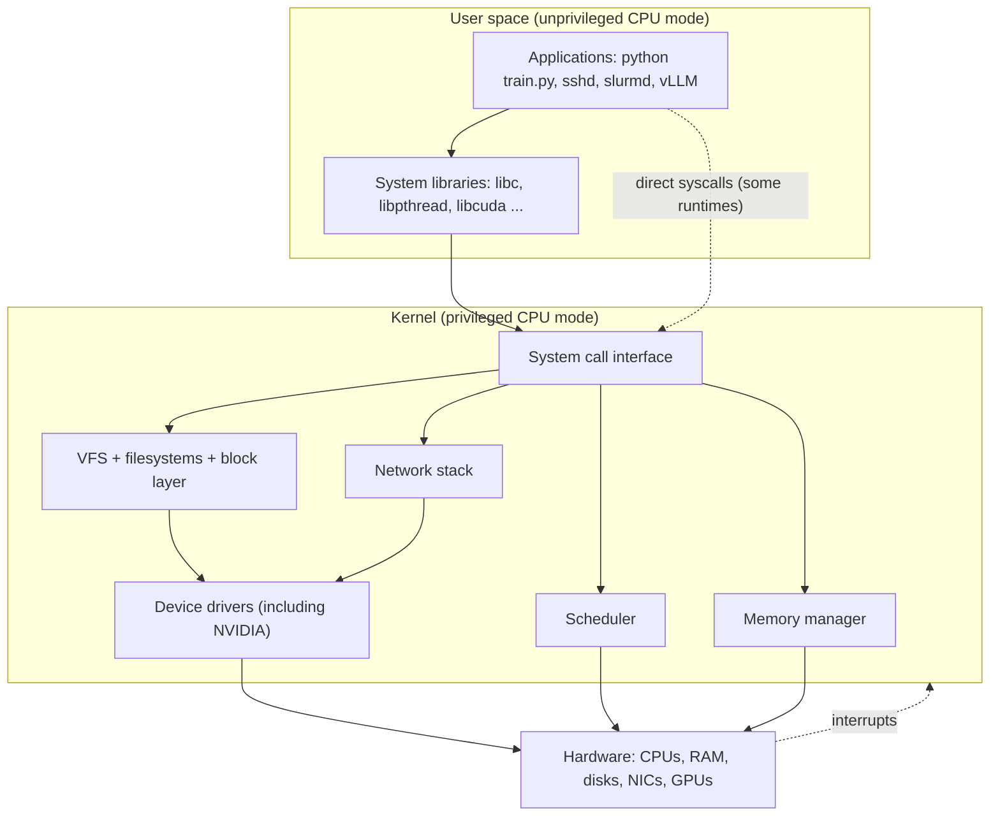
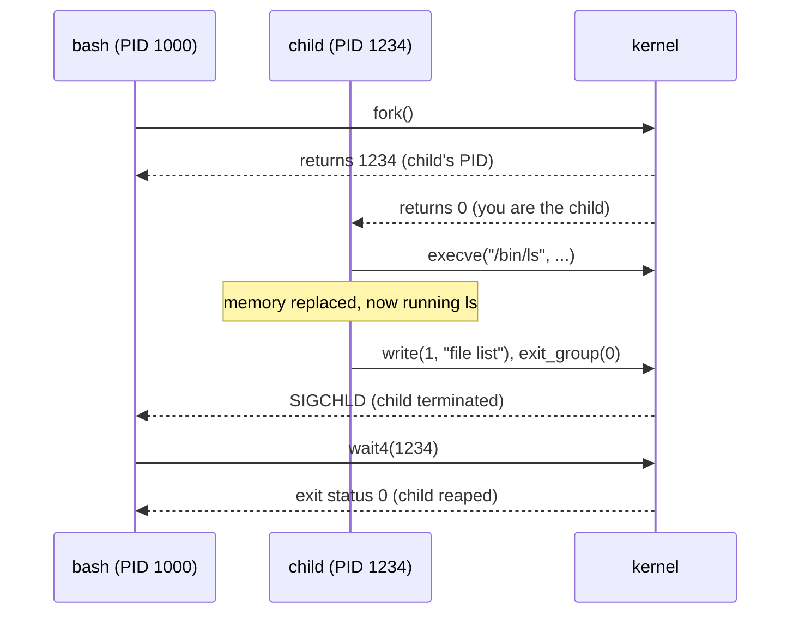
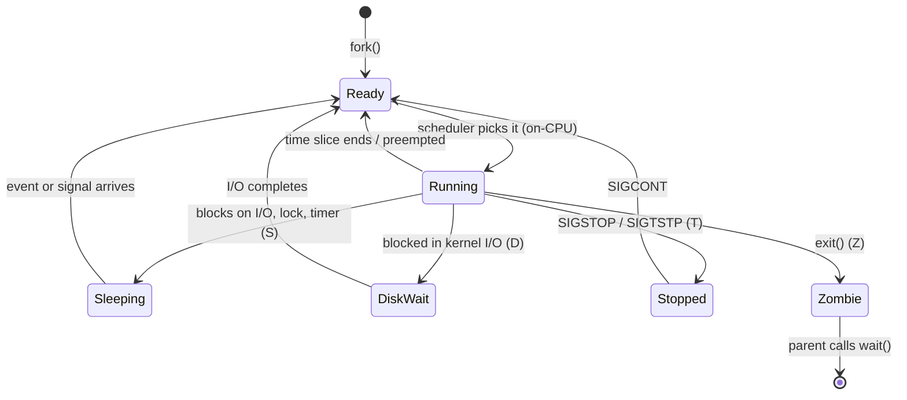

# 1.8 Processes, signals and job control

| | |
|---|---|
| Level | Basics |
| Priority tier | 0 |
| Lab venue | GCP / GKE (one Ubuntu VM; a GPU VM is optional) |
| Part | Part 1: Linux, from the command line to the kernel and performance |
| Status | Drafted, labs **untested** |

## Why this matters for AI infrastructure

Everything an AI platform runs is a process: a training script and its data-loader workers, the NCCL communication threads, `slurmd` and `slurmstepd`, `containerd`, the NVIDIA persistence daemon, a vLLM server. When something goes wrong, the questions are always process questions:

- "The job is hung. Is it computing, waiting for the network, or stuck in the kernel?" (process states, `D` state, stack traces)
- "The pod will not terminate." (signals, `SIGTERM` versus `SIGKILL`, PID 1 in a container, zombies)
- "The node is slow, load average is 90, but CPUs are idle." (what load average really counts)
- "The job was killed and I do not know why." (exit status, the OOM killer, resource limits, cgroups)
- "Which process is holding this GPU or this file?" (`lsof`, `fuser`, `nvidia-smi`)
- "The scheduler asked my job to stop and it lost its checkpoint." (signals delivered to batch jobs)

This chapter builds the model from the bottom: what the kernel does for a process and how a program becomes one, the life cycle and states, how to look at a process from the outside (`ps`, `top`, `/proc`, `lsof`, `strace`), how signals work and how to send and catch them, how the shell's job control works, how to change a process's priority and limits, how to read load and the first resource-monitoring tools, and how control groups cap what a group of processes may consume. It ends with the AI-infrastructure consequences: signals in containers and schedulers, hung training jobs and graceful shutdown.

Deeper kernel treatments follow in later chapters: memory in 1.17, CPU scheduling and cgroups in 1.18, namespaces in 1.19, performance method in 1.23 and observability tools in 1.24.

## Prerequisites and outcomes

You should know the shell (1.2), files and `/proc` as a directory tree (1.3), users and permissions (1.6) and have the big picture of kernel, user space and system calls from 1.1.

After this chapter you can:

- Describe a process (PID, PPID, owner, address space, file descriptors, state) and distinguish it from a thread and from a program.
- Explain `fork`, `exec`, `wait`, zombies, orphans and why PID 1 is special.
- Read the state letters in `ps` and `top` and say what `D` and `Z` mean for troubleshooting.
- List processes in several ways, find which process owns a file, port or GPU, and inspect a process through `/proc/<pid>`.
- Send, trap and understand signals, including `SIGTERM`, `SIGKILL`, `SIGHUP`, `SIGINT`, `SIGSTOP`/`SIGCONT`, `SIGCHLD`, `SIGPIPE` and `SIGUSR1`, and write a script that cleans up on exit.
- Use shell job control: background, foreground, suspend, `nohup`, `disown`, `setsid`, and say when to use `tmux` instead.
- Change CPU priority with `nice`/`renice`, I/O priority with `ionice`, and limits with `ulimit`/`prlimit`.
- Interpret load average, `vmstat`, `iostat`, `pidstat`, page faults and `time`.
- Place a process in a cgroup and read its resource accounting under cgroup v2.
- Diagnose hung and zombie processes and handle graceful shutdown in containers and batch schedulers.

## 1. What the kernel does for processes

### The operating system in one picture

The kernel is the always-present program that manages the hardware and shares it among processes. Linux uses a **monolithic kernel**: scheduling, memory management, filesystems, network protocols and device drivers all run together in one privileged program (other designs exist, such as microkernels, which keep very little in the kernel, and unikernels, which compile the application and kernel together; Linux's kernel is nevertheless extensible by loadable modules, chapter 1.22). Around the kernel sit **system libraries** (the C library, `libc`, wraps system calls in a friendlier interface) and above them the applications. Programs normally reach the kernel through libraries, but they can invoke system calls directly (some language runtimes, such as Go's, do).



### Kernel mode and user mode

The CPU has a **privileged mode** (kernel mode) in which every instruction and all hardware are accessible, and an **unprivileged mode** (user mode) in which privileged instructions raise an exception that the kernel turns into an error (typically "permission denied" or a crash). On x86 this is implemented with protection **rings**; ring 0 is the kernel and ring 3 user code. Processes run in user mode and ask the kernel to do privileged work, mainly I/O, with a **system call**. Switching between modes is a **mode switch**; switching from one thread to another is a **context switch** (the CPU registers are swapped). All system calls cause a mode switch; calls that block, such as waiting for disk or network, also cause a context switch so another thread can use the CPU while the first waits. Each switch costs a little time, so the kernel provides tricks to avoid them for hot paths: some "system calls" such as reading the clock are served entirely in user space through a kernel-supplied page called the **vDSO**; memory-mapped files let a program read file data without a call per access; and **kernel bypass** technologies (DPDK for networking, RDMA verbs for InfiniBand, GPUDirect) let user space talk to a device directly, which matters on GPU clusters (chapters on RDMA and NCCL). The Meltdown-era mitigation (kernel page-table isolation, KPTI) made mode switches somewhat more expensive on affected CPUs; the cost depends on how often a workload makes system calls.

### System calls

A system call is a small, well-defined request to the kernel. There are hundreds, each with a manual page in section 2, a simple interface and an error code on failure (`ENOENT` "no such file or directory", `EACCES`, `EINTR`, and so on, reported through `errno`). The ones worth remembering:

| System call | What it does |
|---|---|
| `read`, `write` | Move bytes to or from a file descriptor (file, pipe, socket, device) |
| `open`/`openat`, `close` | Open and close a file, returning a **file descriptor** (a small integer) |
| `fork`, `clone` | Create a new process (or, with flags, a thread or a process in new namespaces) |
| `execve` (the `exec` family) | Replace the running program with a different one |
| `wait`/`waitpid` | Collect a child's exit status |
| `exit_group` | Terminate the process |
| `kill` | Send a signal |
| `connect`, `accept` | Network connection setup |
| `stat` | Fetch file metadata |
| `ioctl` | A catch-all control call, used heavily by device drivers (the NVIDIA driver is driven mostly through `ioctl` on `/dev/nvidia*`) |
| `mmap`, `brk` | Map files or anonymous memory into the address space; grow the heap |
| `futex` | The kernel half of a user-space lock; blocked threads wait here |

`ioctl` deserves a note: instead of adding one new system call for every operation on every device, a driver exposes one file descriptor and a set of numbered `ioctl` commands. That is why `strace` on a CUDA program is mostly `ioctl` on `/dev/nvidiactl` and `/dev/nvidia0` (chapter 1.11).

### Interrupts, the clock and idle

A **hardware interrupt** is a signal from a device ("disk request complete", "packet arrived", "key pressed") that makes the CPU stop what it is doing, enter the kernel and run an **interrupt service routine**. Interrupts are asynchronous: by the time the disk finishes, the process that asked may no longer be running on that CPU. To keep the time with interrupts disabled short, Linux splits driver work into a **top half** (acknowledge the device quickly) and a **bottom half** (softirqs, tasklets and work queues that do the real processing later and can be scheduled like threads). Software also generates synchronous events: **traps** (deliberate entry to the kernel such as a system call), **exceptions** (divide by zero) and **faults** (page faults, section 8). A few interrupts cannot be masked (non-maskable interrupts), for example a hardware watchdog that reboots a hung machine. The time between an interrupt arriving and its handler running is the interrupt latency, a key concept for real-time systems and for pinning GPU and NIC interrupts to the right cores (chapter 1.28).

The kernel also has a **clock tick**: a periodic timer interrupt (commonly 250 times per second on Linux, set by `CONFIG_HZ`) that updates time, expires timers, accounts CPU usage and lets the scheduler preempt a running thread. Ticks wake idle CPUs and perturb applications slightly ("OS jitter"), so modern kernels are **tickless** when idle (`NO_HZ`), and can also omit the tick for a CPU running a single task (`nohz_full`), a feature used when tuning latency-sensitive nodes. When there is nothing to run, a CPU executes an **idle thread** that halts the core until the next interrupt to save power.

### Preemption

**Preemption** is the ability to take the CPU away from something. User threads are always preemptible by the scheduler. Whether the *kernel itself* can be interrupted depends on a build option: no preemption (best throughput, worst latency), **voluntary preemption** (the kernel checks at certain points, the common server default) or full preemption (low latency for real-time use, `PREEMPT_RT` patch set). You see the setting with `uname -v` or the kernel config.

## 2. What a process is

A **program** is a file on disk. A **process** is a running instance: an environment the kernel builds around a program so it can execute. A process consists of:

- an **address space** (virtual memory: the program's code, libraries, heap, stacks, mapped files);
- one or more **threads**, each with a stack and a set of CPU registers (including the program counter);
- a table of **open file descriptors**;
- **credentials** (real, effective and saved user and group IDs, plus supplementary groups and capabilities, chapter 1.6);
- a **current working directory**, a **root directory**, a **umask**, an **environment** (the `KEY=value` strings) and **resource limits**;
- scheduling attributes (priority, nice value, CPU affinity);
- kernel bookkeeping: the **process ID (PID)**, **parent PID (PPID)**, state, accounting.

You can think of a process as a small virtual computer running one program with its own registers and memory. The kernel multitasks thousands of them on a few cores by giving each short slices of CPU time (the scheduler's job, chapter 1.18). From a program's point of view it has the CPU to itself; it is just that, with ten CPU-bound programs on two cores, each gets roughly a fifth of a core.

### Threads

A **thread** is the unit the scheduler actually runs. Every process starts with one thread, the **main thread**; it can create more. Threads inside a process **share** the address space and the file descriptors, but each has its own stack and registers. Compared with separate processes, threads start faster and can communicate by simply reading and writing shared memory, so multithreaded programs use several cores without the cost of copying data between processes. (The price is that sharing memory demands careful locking.) On Linux, threads and processes are both **tasks**: the kernel treats a thread as a process that shares resources with its siblings, created with `clone()` and sharing flags. Each thread has a **TID** (thread ID); the main thread's TID equals the process's PID.

A PyTorch training job illustrates all three: the launcher starts one **process per GPU**; each process has a **main thread** running the Python interpreter, extra **threads** for CUDA callbacks, NCCL, and autograd; and each `DataLoader` with `num_workers=N` forks **N more processes** for data loading (processes rather than threads because Python's global interpreter lock limits CPU parallelism in threads).

### Where processes come from: `fork` and `exec`

On Unix a new process is made by **`fork()`** (on Linux a wrapper around `clone()`), which creates a near-exact **copy** of the caller: same program, same memory contents, same open files, but a new PID. The copy is cheap because Linux uses **copy-on-write**: both processes initially point at the same physical memory pages, and a page is physically copied only when one of them writes to it. The original is the **parent**, the copy the **child**. To run a *different* program, the child then calls **`exec`** (the kernel call is `execve`), which replaces its memory with the new program and starts it (the PID stays the same). When a shell runs `ls`, it forks a child, the child execs `ls`, and the shell waits.



Several practical results follow:

- **Everything inherits.** A child inherits the parent's environment variables, open file descriptors, working directory, `umask`, resource limits and signal dispositions. This is why `ulimit` in a shell affects every program started from it, and why a leaked file descriptor in a parent shows up in every child.
- **Every process has a parent**, shown as `PPID`. `pstree -p` or `ps fax` draw the tree. The root of the tree is **PID 1**, the first process the kernel starts (`init`, today usually `systemd`, chapter 1.15; in a container, whatever the container's entrypoint is).
- **Exit status.** A process ends with an integer exit status (0 means success; other values are errors). The shell's `$?` holds the status of the last command. A process killed by a signal has status `128 + signal number` as seen by a shell (so 137 is `SIGKILL`, 143 is `SIGTERM`, which is why "Exit code 137" in Kubernetes usually means the kernel's out-of-memory killer or a forced kill).

### Zombies and orphans

When a process exits it releases its memory and files but the kernel keeps a small **process-table entry** holding its exit status until the **parent** collects it with `wait()`. Until then it is a **zombie** (state `Z`, shown `<defunct>`). A zombie consumes **no CPU and no memory** (only a PID slot) and you **cannot kill it**: it is already dead. The fix is to make the parent call `wait()` (or restart or terminate the parent; the zombie is then adopted by PID 1, which reaps it). A few zombies are harmless; thousands can exhaust the PID table.

If a parent exits first, its children are **orphans** and are re-parented to PID 1 (or to the nearest "subreaper"), whose duty is to `wait()` for them. This is why **PID 1 in a container matters**: if your container's PID 1 is a Python script that never reaps children, every orphaned subprocess becomes a permanent zombie. The standard remedies are to run a tiny init as PID 1 (`tini`, `docker run --init`, Kubernetes `shareProcessNamespace` with a proper init) so signals are forwarded and children are reaped (section 10).

### Process states

The kernel records what each task is doing. The letters you see in `ps` and `top`:

| State | Letter | Meaning |
|---|---|---|
| Running / runnable | `R` | On a CPU now, or in the **run queue** waiting for one |
| Interruptible sleep | `S` | Waiting for an event (input, a timer, a child); can be woken by a signal. Most processes are here most of the time |
| Uninterruptible sleep | `D` | Waiting inside the kernel for hardware or a filesystem (typically disk or **network filesystem** I/O); signals, **including `SIGKILL`, are not acted on** until the wait finishes |
| Stopped | `T` | Suspended by `SIGSTOP`/`SIGTSTP` (or by a debugger); resumed by `SIGCONT` |
| Zombie | `Z` | Terminated, waiting for the parent to reap it |
| Idle kernel thread | `I` | Kernel worker with nothing to do (newer kernels) |

`ps` adds modifier characters: `s` session leader, `l` multithreaded, `+` in the foreground process group of its terminal, `<` high priority, `N` low priority.



**The `D` state is the one that wrecks cluster days.** A process in `D` is waiting on a kernel operation that has not returned, usually a hung NFS, Lustre or GPFS mount, a failing disk, or a driver that is waiting for a GPU that has fallen off the bus. You cannot kill it, `kill -9` is ignored until the I/O completes, and it counts in the load average. Fix the underlying cause (restore the server, fix the mount, reset the GPU or reboot); look at what it is waiting for with `cat /proc/<pid>/stack` (as root) or `/proc/<pid>/wchan`.

### The run queue and the load average

The scheduler keeps runnable tasks in **run queues** and gives each a time slice; with more runnable tasks than cores, tasks wait their turn. The **load average** is an exponentially smoothed count of tasks that are *running or runnable*, **and, on Linux, also those in uninterruptible sleep (`D`)**, sampled over 1, 5 and 15 minutes (the three numbers in `uptime`). Traditionally, most desktop systems exhibit a load average of about `0` (`0.00` to `0.15`) when you are doing anything except compiling a program or playing a game; a load average near `0` is a good sign because it means your processor is not being challenged and your system is saving power, though modern background indexing and browser processes often push an idle desktop's load to `0.1` or `0.2`. Reading it on servers:

- Compare with the number of CPU threads (`nproc`). Load below that number: not all cores are busy. Load persistently above it: tasks are queuing.
- Because `D` tasks count, **a high load with idle CPUs means many tasks are stuck waiting for I/O**, not CPU contention. Look at `vmstat`'s `b` column and `wa`, and at `iostat`.
- A high load with a responsive system is often fine (many short compute jobs sharing cores). A high load with a sluggish system points to memory pressure and swapping (thrashing) or I/O.
- Short-lived processes can start and exit between samples, so a busy build or web server may be under-reported.

## 3. Looking at processes from outside

### `ps`

`ps` prints a snapshot. Its options are an historical tangle (UNIX, BSD and GNU styles); on Linux some options need a leading dash and some must not have one. The invocations worth memorising:

```bash
ps aux                  # all processes, BSD style: user, %cpu, %mem, VSZ, RSS, state, command
ps -ef                  # all processes, UNIX style: shows PPID
ps fax                  # all processes as a forest (who descended from whom); add u for owners
ps -eLf                 # one line per thread (LWP = thread ID, NLWP = number of threads)
ps -o pid,ppid,user,stat,etime,pcpu,pmem,rss,wchan:32,comm -p 1234   # custom columns
ps -eo pid,ppid,user,vsize,pmem,pcpu,stat,wchan:32,comm --sort=-pcpu | head
ps -o pid,min_flt,maj_flt -p 1234     # page faults of one process (section 8)
ps -u alice            # processes of one user
ps -C python3          # by command name
ps axo stat,pid,comm | awk '$1 ~ /^D/'   # find processes in uninterruptible sleep
ps axo stat,ppid,pid,comm | awk '$1 ~ /^Z/'   # find zombies and their parents
```

Add `w` (up to three times) to widen the command column. `VSZ` is virtual size and `RSS` the resident set (physical RAM currently held), a distinction explained in chapter 1.17. To list threads inside a multithreaded process (such as `Xorg` or a multi-worker Python process), pass `ps m` (BSD style) or `ps m -o pid,tid,command` (`HLW` Listings 8-1 and 8-2): lines with a dash (`-`) in the `PID` column are individual threads belonging to the process above them, and `tid` shows each thread's kernel Thread ID (`TID`).

### `top`, `htop`, `atop`

`top` is the interactive display: a summary header (`Tasks: 244 total, 2 running, 242 sleeping, 0 stopped, 0 zombie`, `%Cpu(s): 31.7%us, 2.8%sy, 0.0%ni, 65.4%id, 0.2%wa, 0.0%hi, 0.0%si, 0.0%st`, `Mem:` total/used/free/buffers, and `Swap:` total/used/free/cached) over a live table of processes refreshed every few seconds. Keys are case-sensitive:

| Key | Action |
|---|---|
| `P` / `M` / `T` | Sort by CPU / resident memory / cumulative CPU time |
| `1` | Toggle per-CPU rows (essential on many-core machines) |
| `H` | Show **threads** instead of processes |
| `u` | Filter by user |
| `k` | Send a signal to a process |
| `r` | Renice a process |
| `f` | Choose and order columns (e.g. add `nMaj`, `vMj`, major page faults) |
| `c` | Toggle full command line |
| `Space` | Refresh immediately |
| `q` | Quit |

`top -p PID1 -p PID2` follows specific processes; `top -b -n 1` is its batch (script-friendly) form. **`htop`** is friendlier: colour, tree view (`F5`), mouse support, tagging many processes with Space, and `s` (trace system calls), `l` (open files), `w` (full command line) and `x` (locks) on the selected process; `atop` records history to disk. `top` and the tools below show CPU use as a percentage of **one core**, so a multi-threaded process can show 800%.

### `pgrep`, `pidof`, `pstree`, `fuser`

```bash
pgrep -a python                 # PIDs and full command lines matching a name
pgrep -u alice -f 'train.py'    # match against the whole command line
pidof sshd
pstree -ap 1234                 # tree under a PID, with arguments and PIDs
fuser -v /dev/nvidia0           # which processes have this file open
fuser -vn tcp 8080              # which process is listening on TCP port 8080
```

### `/proc`: the kernel's window on every process

`/proc` is a virtual filesystem (chapter 1.10); each process has a directory `/proc/<pid>`. Reading these files is how `ps` and `top` work, and you can read them directly when the tools are not installed (a stripped container) or when you need detail.

| Path | Contents |
|---|---|
| `/proc/PID/status` | Human-readable summary: name, state, PID, PPID, UIDs and GIDs, thread count, memory (`VmRSS`, `VmSwap`), voluntary and non-voluntary context switches, signal masks |
| `/proc/PID/cmdline` | The command line (NUL-separated) |
| `/proc/PID/environ` | The environment (NUL-separated; readable by the owner and root) |
| `/proc/PID/cwd`, `exe`, `root` | Symlinks: working directory, the executable, root directory |
| `/proc/PID/fd/` | One symlink per open file descriptor (files, sockets, pipes) |
| `/proc/PID/maps`, `smaps` | Memory mappings, with per-mapping RSS in `smaps` (chapter 1.17) |
| `/proc/PID/limits` | The process's resource limits (soft and hard) |
| `/proc/PID/stat`, `schedstat` | Raw numbers (times, state, priority, CPU) used by `ps`; scheduling statistics |
| `/proc/PID/task/TID/` | The same, per thread |
| `/proc/PID/wchan`, `stack` | What kernel function a sleeping task is waiting in; the kernel stack (root) |
| `/proc/PID/cgroup` | Which cgroups the process is in (section 9) |
| `/proc/PID/ns/` | Which namespaces it is in (chapter 1.19) |
| `/proc/PID/io` | Bytes read and written by the process (`read_bytes`, `write_bytes`) |
| `/proc/loadavg`, `/proc/stat`, `/proc/meminfo`, `/proc/pressure/*` | System-wide counters; pressure stall information (PSI) for CPU, memory, I/O |

```bash
cat /proc/$$/status | head -20            # $$ is the PID of the current shell
ls -l /proc/$$/fd                        # the shell's open file descriptors
tr '\0' ' ' < /proc/$$/cmdline; echo
grep -E 'Name|State|Threads|VmRSS|Cpus_allowed_list' /proc/$$/status
cat /proc/$$/limits
```

### `lsof`: who has what open?

Because Unix treats files, devices, pipes and sockets alike, "open files" covers a lot, and **`lsof`** (list open files) is among the most useful diagnostic tools. A line of output contains: `COMMAND`, `PID`, `USER`, `FD` (a descriptor number with mode, such as `3u`, read-write, or a role such as `cwd`, `rtd` root, `txt` program text, `mem` memory-mapped library), `TYPE` (`REG` regular, `DIR`, `CHR` character device, `IPv4`, `unix`), `DEVICE`, `SIZE/OFF`, `NODE` (inode number) and `NAME`.

```bash
sudo lsof -p 1234                 # everything one process has open
sudo lsof +D /var/log             # every open file under a directory (slow on big trees)
sudo lsof /dev/nvidia0            # who has the GPU device open
sudo lsof -i :8080                # what is using TCP/UDP port 8080
sudo lsof -iTCP -sTCP:LISTEN -P -n   # all listening TCP sockets, numeric
sudo lsof -u alice                # files opened by a user
sudo lsof +L1                     # files that are deleted but still open (space not freed)
```

Two classic uses: "**`df` shows the disk full but `du` cannot find the files**" (a process still holds a deleted log open; `lsof +L1` finds it, and restarting that process frees the space), and "**cannot unmount, device is busy**" (`lsof` or `fuser -vm /mountpoint` shows who is inside). Run as root for complete output. `lsof` depends on kernel interfaces, so after a kernel and `lsof` update it may misbehave until you reboot into the new kernel.

### `strace` and `ltrace`: what is this program actually doing?

If a program dies immediately, or hangs, or "cannot find a file" with no useful message, tools that examine active processes will not help; you want to see what it **asks of the kernel**. `strace` prints every system call with its arguments and return value. The trace starts just after the `fork`, so the first line is the `execve` of the program, followed by a flurry of library loading (`openat` on `/etc/ld.so.cache` and `libc.so.6`, `mmap`), and then the program's real work.

```bash
strace -o /tmp/ls.trace ls /nonexistent       # trace a command, save to a file
grep -n ENOENT /tmp/ls.trace | head           # the failed lookups
strace -f -o /tmp/trace -ff crummyd           # follow forks; -ff writes one file per process (trace.PID)
strace -p 1234                                # attach to a running process (Ctrl-C to detach)
strace -e trace=openat,connect -p 1234        # only selected calls
strace -c -p 1234                             # summary table of calls and time instead of a trace
strace -tt -T -p 1234                         # timestamps and time spent in each call
```

How to read it: a successful `open` returns a **file descriptor** (a small integer, 3 and up since 0, 1, 2 are standard input, output and error); a failure returns `-1` followed by the error name and text, e.g. `openat(AT_FDCWD, "not_a_file", O_RDONLY) = -1 ENOENT (No such file or directory)`. Missing files and wrong permissions (`EACCES`) are the most common reasons programs misbehave, so grepping a trace for `ENOENT` and `EACCES` solves a large fraction of mysteries, even for daemons. A process that hangs shows *which* call it is stuck in (a `read` on a socket, a `futex` wait, a `connect`), which is half the diagnosis; `strace -p` on a hung training process quickly tells you whether it is waiting on the network or a lock. `strace` slows the target considerably, so use it on production processes with care. It needs permission to trace the target (owner, or root, subject to `ptrace_scope`).

`ltrace` does the same for **shared-library calls** (not kernel calls); there are many more of them, so filter. It does not work on statically linked programs. Chapter 1.11 goes deeper into both.

## 4. Signals

A **signal** is a small asynchronous notification sent to a process: a number saying "something happened, please react". Signals are the simplest inter-process communication mechanism: they carry almost no information, only which event. They come from the kernel (a bad memory access, a child exiting, the terminal's Ctrl-C), from other processes (`kill`), or from the process itself. A process may send a signal to another **if it has the same owner**; root may signal anyone.

For each signal a process has a **disposition**: take the **default action** (usually terminate, sometimes also write a core dump, ignore, stop or continue), **ignore** it, or **catch** it by running a **handler** function. Two signals cannot be caught, ignored or blocked: **`SIGKILL`** and **`SIGSTOP`** (the kernel acts on them directly). Everything else can be handled.

| # | Name | Default action | Typical meaning and use |
|---|---|---|---|
| 1 | `SIGHUP` | Terminate | "Hang up": the controlling terminal closed. Many daemons reuse it to mean **reload configuration** (`systemctl reload`, `kill -HUP`) |
| 2 | `SIGINT` | Terminate | Keyboard interrupt (**Ctrl-C**) |
| 3 | `SIGQUIT` | Terminate + core | Keyboard quit (**Ctrl-\\**); gives a core dump or a stack trace in some runtimes |
| 4 | `SIGILL` | Terminate + core | Illegal CPU instruction (bad binary, e.g. built for a newer CPU) |
| 6 | `SIGABRT` | Terminate + core | Program called `abort()`, often a failed assertion |
| 7 | `SIGBUS` | Terminate + core | Bad memory access (alignment, truncated memory-mapped file, I/O error on mapped data) |
| 8 | `SIGFPE` | Terminate + core | Arithmetic error (divide by zero) |
| 9 | `SIGKILL` | Terminate | **Cannot be caught or ignored.** Immediate termination, no cleanup |
| 10 | `SIGUSR1` | Terminate | User-defined; often used to trigger a checkpoint or dump state |
| 11 | `SIGSEGV` | Terminate + core | Invalid memory reference (segmentation fault) |
| 12 | `SIGUSR2` | Terminate | User-defined |
| 13 | `SIGPIPE` | Terminate | Wrote to a pipe or socket whose reader has gone (why `yes \| head` ends quietly) |
| 14 | `SIGALRM` | Terminate | A timer set with `alarm()` expired |
| 15 | `SIGTERM` | Terminate | **Polite request to terminate.** The default of `kill`; programs should clean up and exit |
| 17 | `SIGCHLD` | Ignore | A child process stopped or terminated |
| 18 | `SIGCONT` | Continue | Resume a stopped process |
| 19 | `SIGSTOP` | Stop | **Cannot be caught.** Suspend the process |
| 20 | `SIGTSTP` | Stop | Terminal stop (**Ctrl-Z**); catchable |
| 21, 22 | `SIGTTIN`, `SIGTTOU` | Stop | Background process tried to read from or write to its terminal |
| 28 | `SIGWINCH` | Ignore | Terminal window resized |

(Numbers are for x86 Linux; use names in scripts. `kill -l` lists all.)

### Sending signals

```bash
kill 1234               # SIGTERM (15)
kill -TERM 1234         # same, by name
kill -9 1234            # SIGKILL, last resort
kill -HUP $(pidof sshd) # ask a daemon to reload
kill -STOP 2345         # freeze a process
kill -CONT 2345         # let it continue
kill -0 1234            # no signal sent: tests whether the process exists and you may signal it
pkill -u alice -TERM    # signal all of a user's processes
pkill -f 'train.py'     # match on the full command line
killall python3         # all processes with that exact name (careful on non-Linux systems)
kill -- -1234           # signal the whole PROCESS GROUP 1234 (note the minus)
```

**Order of escalation.** Always try `SIGTERM` first and give the program time to shut down: it can flush buffers, save a checkpoint, close files and remove lock files. Use `SIGKILL` only when it does not respond, because the process gets no chance to clean up (leaving lock files, half-written files, orphaned children, and for GPU jobs sometimes GPU memory that the driver must reclaim). A signal handled by a process in `D` state takes effect only when the process leaves that state.

### Catching signals in shell scripts

A shell script handles signals with `trap`. This is how a batch script cleans up its scratch files, or turns `SIGTERM` into a graceful stop:

```bash
#!/usr/bin/env bash
set -euo pipefail
workdir=$(mktemp -d)
cleanup() { echo "cleaning up $workdir"; rm -rf "$workdir"; }
trap cleanup EXIT                       # runs on any exit, including after errors
trap 'echo "got SIGTERM, stopping"; kill "$child" 2>/dev/null; wait "$child"; exit 143' TERM INT

sleep 1000 &                            # stand-in for a long-running command
child=$!
wait "$child"
```

Notes: the `EXIT` pseudo-signal covers normal and error exits; `trap '' SIGHUP` ignores a signal; `trap - SIGINT` restores the default. **A shell waiting on a foreground command defers its trap until that command finishes**, which is why long-running children are started in the background and waited for (as above) if you want the script to react promptly. `exec` replaces the shell with the command, so signals go directly to it (use `exec` as the last line of a container entrypoint script so the real program receives `SIGTERM`; see section 10).

### Core dumps

When a program is killed by a signal marked "core" (`SIGSEGV`, `SIGABRT`, ...) the kernel can write its memory image to a **core file** for later analysis with a debugger such as `gdb`. Whether and where it is written is controlled by `ulimit -c` (core size limit; 0 disables) and `/proc/sys/kernel/core_pattern` (a path or a pipe to a handler such as `systemd-coredump`, in which case use `coredumpctl`). Core files of large training processes can be many gigabytes, so clusters usually keep the limit at 0 and enable dumps deliberately.

## 5. Shell job control

An interactive shell lets you manage several commands from one terminal. A **job** is a pipeline the shell started; the shell groups its processes into a **process group**, and groups belong to a **session** tied to the controlling terminal. Exactly one process group is the **foreground** group and receives keyboard-generated signals (Ctrl-C, Ctrl-Z) and may read from the terminal; the others run in the **background**.

| Action | Command |
|---|---|
| Run in the background | `command &` |
| Suspend the foreground job | **Ctrl-Z** (sends `SIGTSTP`) |
| List jobs | `jobs -l` |
| Resume in the background | `bg %1` |
| Bring to the foreground | `fg %1` (`%1` job number, `%%` current, `%name` by command) |
| Kill a job | `kill %1` |
| Wait for background jobs | `wait` (all), `wait %1` |
| Start immune to hangups | `nohup command > out.log 2>&1 &` |
| Detach an already-running job from the shell | `disown -h %1` (or `disown -a`) |
| Run in a new session with no controlling terminal | `setsid command` |

What happens when you close your terminal or your SSH session drops: the shell receives `SIGHUP` and, by default (for an interactive login shell, depending on `huponexit`), forwards it to its jobs, which terminate. This is the classic cause of "my job died when my VPN dropped". The remedies, in order of preference:

1. **Run it in `tmux` (or `screen`)** (chapter 1.5, 1.29). The multiplexer owns the terminal, survives your disconnection and lets you reattach. Best for interactive work.
2. **Submit it to the scheduler** (`sbatch`, a Kubernetes Job). The right answer for anything that matters on a cluster; the job is no longer a child of your login shell at all.
3. **`nohup` or `setsid`** for a quick one-off: `nohup ./run.sh > run.log 2>&1 &`. The process ignores `SIGHUP`; output goes to the file (otherwise `nohup.out`).
4. **`disown`** for a job you forgot to protect: `Ctrl-Z`, `bg`, `disown -h`.
5. **A systemd service or timer** for anything permanent (chapter 1.15).

Two details: a background job that tries to read the terminal gets `SIGTTIN` and is stopped, which is why `command &` for an interactive program shows "Stopped (tty input)"; and `command &` leaves the child attached to your shell's session, so it is *not* protected from `SIGHUP` without `nohup`/`disown`.

## 6. Priority: `nice`, `ionice`, CPU affinity

When more tasks are runnable than there are cores, the scheduler decides who runs. Every task has a **priority**, and you cannot set it directly; you influence it with the **nice value**, a number from **-20 to +19** (default 0): *higher nice means nicer to others, hence lower priority*. A normal user may only increase niceness (be nicer); only root can lower it below 0.

```bash
nice -n 15 ./long_job.sh           # start with low priority (nice 15)
renice -n 10 -p 3322               # make an existing process nicer
sudo renice -n -5 -p 3322          # more priority (root only; almost always a bad idea)
renice -n 19 -u alice              # all of one user's processes
ps -o pid,ni,pri,stat,comm -p 3322 # see NI (nice) and PRI (kernel priority)
```

`top` shows both `PR` (the kernel's current priority number, where lower means more important in the display's scale) and `NI` (your hint); the kernel combines nice with recent CPU consumption. Nice values matter little on a lightly loaded machine and matter a lot when a login node is shared: a user running a compile at nice 19 barely disturbs interactive users. Recent kernels apply nice per *autogroup/cgroup*, so the effect between sessions can be subtler than between processes in one session (chapter 1.18).

**I/O priority** is separate. Processes also queue for the disk, and `ionice` sets the class: **idle** (`-c 3`, only runs when no one else needs the disk), **best-effort** (`-c 2`, with levels 0 to 7, lower number is more important; the default) and **real-time** (`-c 1`, served first, root only). It takes effect only with I/O schedulers that honour priorities (for example BFQ; `none`/`mq-deadline` on NVMe may ignore it).

```bash
ionice -c 3 -p 89                       # idle I/O class for an existing process
ionice -c 3 nice -n 19 rsync -a src/ dst/   # polite background copy
ionice -p 89                            # show the current class
```

**CPU affinity** restricts which cores a task may run on, which is central for NUMA-aware GPU feeding (chapter 1.17, 1.28):

```bash
taskset -cp 1234                  # show the CPU list of a process
taskset -c 0-7 ./prog             # start restricted to cores 0..7
taskset -cp 8-15 1234             # change a running process
numactl --cpunodebind=1 --membind=1 python train.py   # bind CPU and memory to NUMA node 1
```

Real-time scheduling policies (`chrt -f 50 cmd`, FIFO and round-robin) exist for latency-critical work, but a runaway real-time task can starve the whole machine, so they are rare and dangerous outside tuned systems.

## 7. Limits: `ulimit` and `prlimit`

Each process has **resource limits** (rlimits): a *soft* limit (enforced) and a *hard* limit (the ceiling to which the process may raise the soft limit). Children inherit them.

| Limit | `ulimit` flag | Meaning |
|---|---|---|
| `nofile` | `-n` | Open file descriptors. Raise for servers and data loaders; exhaustion shows as "Too many open files" |
| `nproc` | `-u` | Processes/threads per user. Restrict on login nodes (fork bombs) |
| `memlock` | `-l` | Locked (pinned) memory. **Set to unlimited for RDMA/InfiniBand and CUDA pinned memory** |
| `stack` | `-s` | Stack size (MPI/Fortran codes sometimes need unlimited) |
| `core` | `-c` | Core file size |
| `cpu` | `-t` | CPU seconds before `SIGXCPU`/kill |
| `as` / `data` | `-v` / `-d` | Address space / data segment |
| `fsize` | `-f` | Largest file the process may create |

```bash
ulimit -a                       # show all soft limits of this shell
ulimit -Hn                      # show the hard limit for open files
ulimit -n 65536                 # raise the soft limit for this shell and its children
cat /proc/1234/limits           # limits of a running process
sudo prlimit --pid 1234 --nofile=65536:65536   # change a running process
```

**Where limits are set persistently:** for login sessions, PAM reads `/etc/security/limits.conf` and `/etc/security/limits.d/*.conf` (`user_or_@group  soft|hard  item  value`, for example `* soft memlock unlimited`); for **systemd services**, `limits.conf` does *not* apply, you set `LimitNOFILE=`, `LimitMEMLOCK=infinity` and so on in the unit (chapter 1.15); for **containers**, the runtime sets them (`docker run --ulimit memlock=-1:-1`, Kubernetes inherits from the container runtime and node configuration); for **Slurm jobs**, the limits propagate from the submitting environment unless `PropagateResourceLimits` says otherwise (chapter 6). A frequent bug: you raised `limits.conf`, but the job runs under a daemon (or `sshd` with `UsePAM no`) that never read it.

Limits are *per process*, so they do not stop a user from consuming resources with many processes; for group-wide caps use cgroups (section 9). Disk **quotas** are a separate, per-user filesystem mechanism (chapter 1.12).

## 8. First resource monitoring: CPU time, memory, I/O

There are three basic hardware resources processes compete for: **CPU, memory and I/O**. The kernel is also a resource (creating processes, talking to other processes). Resist the urge to "tune" a system that works; the default settings are sensible. Use these tools to *understand what the kernel is doing*, and tune only when a measurement shows a problem (the method is chapter 1.23).

### Measuring CPU time: `time`

```bash
time ls /usr/lib
# real  0m0.442s   elapsed wall-clock time
# user  0m0.052s   CPU time spent running the program's own code
# sys   0m0.091s   CPU time the kernel spent on its behalf (system calls)
```

`real - (user + sys)` is time spent **not on a CPU**: waiting for disk, network, locks or the scheduler. A job that has `real` much larger than `user+sys` is waiting; one with `user+sys` larger than `real` used several cores. Most shells have a built-in `time`; the external `/usr/bin/time -v command` prints much more (peak resident memory, page faults, context switches, exit status):

```bash
/usr/bin/time -v python3 -c 'print(sum(range(10**7)))' 2>&1 | grep -E 'Elapsed|Maximum resident|faults|Voluntary|Involuntary|Exit'
```

### Memory in brief, and page faults

(Chapter 1.17 is the full treatment.) The CPU's **memory management unit (MMU)** translates **virtual addresses**, which processes use, into **physical addresses**, using page tables maintained by the kernel in units of **pages** (4 KiB normally; `getconf PAGE_SIZE`). The kernel loads and allocates pages **on demand** (demand paging): a program starting up has only its first pages in memory, and when it touches an address that is not mapped yet the CPU raises a **page fault** and the kernel fixes things up:

- A **minor page fault**: the page is already in RAM (for example shared library code another process already loaded, or a newly allocated page); the kernel only has to update the mapping. Cheap and constant; thousands per second are normal.
- A **major page fault**: the page must be read from **disk** (program code on first execution, or memory that was swapped out). Slow. A burst when a program first runs is normal; a continuous stream means memory pressure (thrashing, when the kernel spends its time moving pages to and from swap).

```bash
free -h                             # (untested here) total, used, free, shared, buff/cache, available
grep -E 'MemTotal|MemAvailable|SwapTotal|SwapFree|Dirty' /proc/meminfo # (untested here)
ps -o pid,min_flt,maj_flt,rss,comm -p 1234 # (untested here)
/usr/bin/time cal >/dev/null        # (untested here) e.g. 0.00user 0.00system 0:00.06elapsed ... (2major+254minor)pagefaults 0swaps
```

When `/usr/bin/time cal > /dev/null` runs (`HLW` Section 8.5.4), it prints a summary line such as `0.00user 0.00system 0:00.06elapsed 0%CPU (0avgtext+0avgdata 3328maxresident)k 648inputs+0outputs (2major+254minor)pagefaults 0swaps`, showing `2` major page faults (reading from disk) and `254` minor page faults (mapping pages already in RAM). On `free`, **"available"** (not "free") is the number to read: Linux deliberately uses spare RAM for the page cache and gives it back on demand, so "free" being small is normal. A system is short of memory when *available* is small **and** swapping (`vmstat` `si`/`so`) or major faults are high.

### `vmstat`: the whole machine in one line per interval

The trick to unlocking the power of `vmstat` is to understand its output columns. Running `vmstat 2` reports statistics every two seconds. **You should always start looking at the second line of output—the first line is an average for the entire uptime of the system since boot.**

```text
$ vmstat 2
procs -----------memory---------- ---swap-- -----io---- -system-- ------cpu-----
 r  b   swpd   free   buff  cache   si   so    bi    bo   in   cs us sy id wa st
 2  0 320416 3027696 198636 1072568   0    0     1     1    2    0 15  2 83  0  0
 2  0 320416 3027288 198636 1072564   0    0     0  1182  407  636  2  1 97  0  0
```

In this quiet-system output from *How Linux Works* (Section 8.5.4), the system has `320,416 KB` of memory swapped out (`swpd`) from some earlier pressure, `3,027,696 KB` free, and `si` and `so` are both `0` (the kernel is not actively swapping anything in or out right now). When a large program starts up (`HLW` Listing 8-3), `free` drops (`2861252` KB), `bi` jumps as code pages are faulted in from disk, and `us` rises (`25%` to `27%`) while `si`/`so` remain `0` as long as RAM is sufficient.

| Column | Meaning |
|---|---|
| `r` | Runnable tasks (queued for CPU); compare to the number of cores |
| `b` | Tasks blocked in uninterruptible sleep (usually I/O) |
| `swpd`, `free`, `buff`, `cache` | Swap used, free memory, buffer and page-cache memory (KiB) |
| `si`, `so` | Memory swapped **in** from / **out** to disk per second. **Non-zero `so` sustained = trouble** |
| `bi`, `bo` | Blocks read from / written to block devices per second |
| `in`, `cs` | Interrupts and context switches per second |
| `us`, `sy`, `id`, `wa`, `st` | CPU percent in user code, kernel, idle, **waiting for I/O**, stolen by the hypervisor (VMs) |

How to read patterns: all idle (`id` ~99, no `si`/`so`): healthy. High `us`, low `wa`: CPU-bound compute. High `wa` and `b`: I/O-bound, look at `iostat`. Growing `so` with falling `free`/`cache`: memory exhausted, the kernel is paging out. High `r` with high `us+sy`: CPU contention. High `sy` and `cs`: lots of system calls or lock contention. High `st`: noisy neighbours on a shared VM.

### I/O: `iostat`, `iotop`, `pidstat`, `sar`

Many of the I/O utilities discussed here are not installed on distributions by default, but they are easily installed via the `sysstat` package (`iostat`, `pidstat`, `sar`, `mpstat`) and the `iotop` package. Like `vmstat`, when run without any options, `iostat` shows the statistics for your machine's current uptime since boot (`avg-cpu:` `%user`, `%nice`, `%system`, `%iowait`, `%steal`, `%idle`, followed by `Device` `tps`, `kB_read/s`, `kB_wrtn/s`, `kB_read`, `kB_wrtn`). By default, `iostat` omits individual partition information; to show all partition statistics alongside whole devices (`sda`, `sda1`, `sda2`), pass `-p ALL` (`iostat -p ALL` or `iostat -dp ALL 5`).

```bash
iostat                    # (untested here) uptime average CPU and block device tps, kB_read/s, kB_wrtn/s
iostat -p ALL             # (untested here) include all partitions (e.g., sda1, sda2, nvme0n1p1)
iostat -xz 2              # (untested here) extended per-device stats every 2 s; -z hides idle devices
iostat -dp ALL 5          # (untested here) per-partition, device report only
sudo iotop -oPa           # (untested here) processes actually doing I/O, accumulated
pidstat -p 1329 1         # (untested here) CPU of one process every second (UID, PID, %usr, %system, %guest, %CPU, CPU, Command)
pidstat -u -r -d -t 2     # (untested here) CPU, memory, disk I/O, per thread, every 2 s
mpstat -P ALL 2           # (untested here) per-core utilisation (spot one saturated core)
sar -u 1 5                # (untested here) CPU; sar also records history (see below)
```

In `iostat -x`: `r/s`, `w/s` (requests per second), `rkB/s`, `wkB/s` (throughput), `await` (average time, ms, a request spends queued plus serviced; the latency number to watch), `aqu-sz` (average queue length) and `%util` (fraction of time the device was busy; meaningful for a single spinning disk, **misleading for NVMe or arrays that handle many requests in parallel**). If you need to dig deeper to see I/O resources used by individual processes, `iotop` generates a continuously updating `top`-like display showing total and current disk read/write bandwidth at the top and per-thread (`TID`) `PRIO` (`be/4` best-effort level 4, `rt` real-time, `idle`), `USER`, `DISK READ`, `DISK WRITE`, `SWAPIN`, `IO>`, and `COMMAND`.

`pidstat` (such as `pidstat -p 1329 1`, `HLW` Section 8.5.6) prints a scrolling trace over time (`UID`, `PID`, `%usr`, `%system`, `%guest`, `%CPU`, `CPU`, `Command`) rather than overwriting the screen like `top`, so you can watch a process (`myprocess`) migrate between CPU cores (`CPU 1` -> `CPU 3`) second by second. Under further topics (`HLW` Section 8.7), **`sar`** (from `sysstat`, with a collector cron job or systemd timer) *records* statistics, so you can look back ("what was the CPU doing at 03:10 last night?") with `sar -u -f /var/log/sa/sa23` or `sar -r` for memory. Related: `acct`/`psacct` (process accounting records every process that ran and its resource use) and quotas.

## 9. Control groups (cgroups)

`nice` and `ulimit` are per process. To limit what a **set of processes** may consume **in total**, Linux has **control groups (cgroups)**. A cgroup is a group of processes to which **controllers** apply limits and accounting: `cpu` (CPU time share or quota), `memory` (RAM and swap cap), `io` (block I/O bandwidth and IOPS), `pids` (number of tasks), `cpuset` (which cores and memory nodes), `hugetlb`, `rdma`, and more. cgroups are the mechanism behind **systemd's resource control, container limits (Docker, Kubernetes), and Slurm's job confinement**. They are part of the kernel and independent of systemd, though systemd manages most of them on modern systems.

### v1 versus v2

Both versions exist, and a system may even use both, which is confusing:

| | cgroup v1 | cgroup v2 |
|---|---|---|
| Hierarchy | One separate tree **per controller** | **One unified tree**; each cgroup can enable several controllers |
| Process membership | A process can be in a *different* cgroup for each controller | A process belongs to **exactly one** cgroup |
| Mount | `/sys/fs/cgroup/<controller>/` | `/sys/fs/cgroup/` (a `cgroup2` filesystem) |
| Status | Legacy, being phased out | The default on current distributions |

(Flexibility in v1 turned out to be rarely used and made things complicated; v2 is simpler.) A controller in use under v1 cannot be used under v2 at the same time. Identify the version in use with `stat -fc %T /sys/fs/cgroup/` (`cgroup2fs` means v2) or `mount | grep cgroup`. Chapter 1.18 compares them in detail; the rest of this section uses **v2**.

### Viewing cgroups

Everything is a file. A process's cgroups are in `/proc/PID/cgroup`:

```bash
cat /proc/self/cgroup
# 0::/user.slice/user-1000.slice/session-2.scope        (v2 line: "0::path")
```

Names are hierarchical paths. systemd names them: **`system.slice`** holds system services (`ssh.service`, `docker.service`), **`user.slice`** login sessions (`session-N.scope`), and `machine.slice` virtual machines. Containers appear under runtime-specific paths (Kubernetes places pods under `kubepods.slice/...`). Look inside:

```bash
cd /sys/fs/cgroup/$(awk -F: '$1=="0"{print $3}' /proc/self/cgroup)
ls
cat cgroup.procs        # PIDs in this cgroup (cgroup.threads also lists threads)
cat cgroup.controllers  # controllers available here, e.g. "memory pids"
cat memory.max          # "max" means no limit here (a parent may still limit)
cat memory.current      # current memory use of the group
cat pids.current        # number of tasks
cat cpu.stat            # usage_usec, user_usec, system_usec, throttling counters
systemd-cgls            # tree view of the cgroup hierarchy with the processes
systemd-cgtop           # top-style live resource use per cgroup
```

`cpu.stat` accumulates the CPU consumed over the whole life of the group, including short-lived children, which is exactly what you want to see for a service or job that spawns many subprocesses. **Pressure stall information** (`cpu.pressure`, `memory.pressure`, `io.pressure`) reports the share of time tasks were stalled for that resource, a better health signal than raw utilisation.

### Creating and changing cgroups

Writing to files changes behaviour (as root):

```bash
sudo mkdir /sys/fs/cgroup/demo                         # creating a directory creates a cgroup
echo "+cpu +memory +pids" | sudo tee /sys/fs/cgroup/cgroup.subtree_control   # enable controllers for children
echo 200M | sudo tee /sys/fs/cgroup/demo/memory.max    # cap memory at 200 MiB
echo 100 | sudo tee /sys/fs/cgroup/demo/pids.max       # at most 100 tasks
echo "50000 100000" | sudo tee /sys/fs/cgroup/demo/cpu.max   # 50 ms CPU per 100 ms period = half a core
echo $$ | sudo tee /sys/fs/cgroup/demo/cgroup.procs    # move this shell into the group
sudo rmdir /sys/fs/cgroup/demo                         # removable when it has no processes
```

The rules that trip people: processes can live only in **leaf** cgroups (those with no child cgroups; the root cgroup is an exception); a child can have only controllers its **parent** has enabled in `cgroup.subtree_control`; and you must enable controllers explicitly. Directly editing `/sys/fs/cgroup` on a systemd machine can conflict with systemd's own management, so for anything beyond experiments let **systemd** create the cgroup, which gives it a unit name and persists:

```bash
sudo systemd-run --scope -p MemoryMax=500M -p CPUQuota=50% -p TasksMax=200 stress-ng --vm 1 --vm-bytes 1G --timeout 30s
systemd-run --user --scope -p MemoryMax=1G python3 big.py        # as an ordinary user (needs delegation)
```

When a cgroup exceeds `memory.max` and cannot reclaim memory, the kernel's **OOM killer** kills a process *inside that cgroup*, and `memory.events` shows `oom_kill` counts. That is exactly the "Exit code 137" you see for a container that hit its memory limit. CPU limits act differently: a group over its `cpu.max` quota is **throttled** (paused until the next period, visible as `nr_throttled`/`throttled_usec` in `cpu.stat`), which causes puzzling latency in containers with small CPU limits.

Why this matters: cgroups are how a Slurm job, a systemd service and a Kubernetes pod each get **their own box**; they implement `--mem`, `--cpus-per-task`, and Kubernetes `resources.limits`. Chapter 1.18 and the container chapters build on this section, and chapter 1.19 adds namespaces, the other half of a container.

## 10. AI-infrastructure patterns

**Signals in containers and Kubernetes.** When a pod is deleted, Kubernetes sends **`SIGTERM`** to PID 1 of each container, waits `terminationGracePeriodSeconds` (default 30 s), then sends **`SIGKILL`**. If your training job does not handle `SIGTERM`, it is killed hard after 30 s and loses unsaved state. Common problems:

- The entrypoint is a **shell script** that starts Python as a child. The shell receives `SIGTERM`, does not forward it, and Python never hears it. Fix: end the script with `exec python train.py` so Python *is* PID 1 (or use `tini`/`--init` and `exec`).
- PID 1 has special treatment: the kernel **does not apply default signal actions** to PID 1 inside a PID namespace, so a program that registers no `SIGTERM` handler *ignores* `SIGTERM` as PID 1 (but dies to it elsewhere). Containers that "will not stop" are often this.
- Zombies accumulate because PID 1 never reaps (see section 2). Use an init.
- Exit code 137 = 128 + 9: killed by `SIGKILL`, usually the OOM killer or a grace-period timeout. 143 = `SIGTERM`.

**Signals in batch schedulers.** Slurm stops a job with `SIGTERM` followed after `KillWait` (default 30 s) by `SIGKILL`; `scancel --signal=USR1 JOBID` delivers a chosen signal, and `sbatch --signal=B:USR1@120` asks Slurm to send `SIGUSR1` to the batch shell 120 seconds before the time limit. This is how you checkpoint before a time-limit kill: trap `USR1` in the script, signal the training process, wait for it to write the checkpoint (chapter 6). Preempted jobs are signalled in a similar way.

```bash
#!/bin/bash
#SBATCH --signal=B:USR1@180        # SIGUSR1 to the batch shell 180 s before time limit
trap 'echo "checkpointing"; kill -USR1 "$pid"; wait "$pid"' USR1
python train.py --resume-latest &
pid=$!
wait "$pid"
```

**Hung training jobs.** A distributed job that stops making progress with GPUs at 100% (or 0%) utilisation is usually waiting for a **collective operation**: one rank died or stalled and the others wait in NCCL. Triage from the process side: `ps` states and `wchan`; `strace -p` (are they all in the same `futex` or `poll`?); `py-spy dump --pid PID` (Python stacks without stopping the process; a separate tool to install); `gdb -p PID -batch -ex 'thread apply all bt'` for native stacks; `nvidia-smi` for which processes hold GPUs and `dmesg | grep -i -E 'xid|nvrm'` for GPU errors; and the NCCL debug variables (`NCCL_DEBUG=INFO`, a watchdog timeout in PyTorch). The fix is rarely on the hung rank; find the first rank that failed (chapters on NCCL and Slurm).

**Processes holding a GPU.** `nvidia-smi` shows compute processes by PID; a process in a container appears with the **host PID**, and `nvidia-smi --query-compute-apps=pid,used_memory --format=csv` is scriptable. `fuser -v /dev/nvidia*` finds everything with a GPU device open, including zombies and processes started by other users. A "ghost" GPU memory allocation with no process usually means a defunct process is still being torn down by the driver (often a `D`-state process) or a process in another PID namespace.

**`D`-state diagnosis on shared storage.** A login or compute node with a hung NFS/Lustre mount has many processes in `D`, load climbing, `ls` on the mount hanging and `kill -9` doing nothing. Identify the mount with `cat /proc/<pid>/stack` or `wchan` (functions such as `nfs_*` or `ll_*`), `mount | grep nfs`, and the server's reachability; options include a lazy unmount (`umount -l`) once clients are stopped, or restoring the server. Mount options such as `soft`, `timeo` and `intr` trade hangs for I/O errors (chapter 5 and the storage chapters).

**Priority and noisy neighbours.** On a shared login node, enforce **cgroup limits** per user (systemd `user-.slice` with `CPUQuota`/`MemoryMax`, or `pam_slurm_adopt` and `Slurm`'s cgroup plugin on compute nodes) rather than relying on `nice`, which does not protect memory. Limit `nproc` on login nodes.

**Observability agents.** Metrics systems read the same sources you do: `node_exporter` parses `/proc/stat`, `/proc/meminfo`, `/proc/loadavg` and `/proc/pressure/*`; `cAdvisor`/`kubelet` read cgroup files; `process-exporter` reads `/proc/PID/*`. When a dashboard looks wrong, reading the underlying file explains it.

## Kernel background reference (from the operating-systems chapter of the performance book)

This section collects the supporting concepts that the performance literature builds on. Most are developed in the chapters named.

- **Terminology.** *Operating system* = kernel + administration tools + system libraries. *Process* = environment for running a program in user mode. *Thread* = schedulable executable context. *Task* = Linux's runnable entity (a process, a thread or a kernel thread). *Kernel space* and *user space* are the two virtual address ranges. *Trap* = request for a privileged action: system call, processor exception or interrupt. *Context switch* swaps CPU register sets between threads; *mode switch* flips between user and kernel mode.
- **Stacks.** A stack is a last-in-first-out region of memory holding return addresses, saved registers and local variables for each function call (a *stack frame*). Walking the saved return addresses gives a **stack trace** (leaf to root: the first line is the function currently executing). Each thread has a user stack and a kernel stack used during system calls; interrupts use their own. Stack traces answer "why is this code running?" and are the basis of profilers (chapter 1.24).
- **Virtual memory and paging.** Virtual memory gives each process a private, nearly unbounded address space and lets memory be over-committed by mapping it to RAM on demand and to disk when needed. Modern kernels **page** (move fixed-size pages) rather than swapping whole processes; Linux's word "swapping" means paging to the swap area (chapter 1.17). Address 0 is deliberately unmapped so that dereferencing a null pointer crashes instead of silently corrupting data.
- **Schedulers.** Unix is a time-sharing system: the scheduler divides CPU time among threads using per-CPU run queues, priorities and scheduling policies. Workloads are **CPU-bound** (long compute, limited by CPU) or **I/O-bound** (mostly waiting, wanting quick response). The classic policy lowers the priority of CPU hogs so interactive and I/O-bound tasks run promptly. Linux has multiple classes: the default fair scheduler, real-time FIFO/round-robin, and deadline scheduling (chapter 1.18).
- **Filesystems.** Files and directories form one tree from `/`, assembled by **mounting** filesystems at directories. The **virtual file system (VFS)** layer lets many filesystem types coexist behind one interface. The path from a program to a disk is the **I/O stack**: application, system call, VFS, filesystem, block layer, device driver, device. Some filesystems are created in memory by the kernel (`/proc`, `/sys`, `/dev`). `chroot` and mount namespaces confine a process to part of the tree (chapters 1.12 and 1.19).
- **Caching.** Because disks are slow, many layers cache reads and buffer writes: application caches, database caches, the kernel's dentry/inode caches, the **page cache** (which also absorbed the old buffer cache), controller and device caches. A read may be satisfied at any layer; knowing the layers explains why the same read can take microseconds or milliseconds.
- **Networking.** The kernel provides the TCP/IP stack; applications reach it through **sockets**. The network card is the interface; addresses are assigned manually or by DHCP; new protocols and TCP options usually require kernel support (chapter on networking).
- **Device drivers.** Drivers manage devices and present **character** devices (byte streams, unbuffered; keyboards, serial ports) or **block** devices (fixed blocks, randomly addressable; disks). Loadable modules can add drivers without a reboot (chapter 1.22).
- **Multiprocessor and NUMA.** Symmetric multiprocessing treats all CPUs equally, but on multi-socket machines memory banks hang off different sockets (**NUMA**) and remote access is slower (chapter 1.17). CPUs coordinate with **inter-processor interrupts** (for example, to tell others that a cached address translation is stale).
- **Resource management.** Historic controls: `nice`, `ulimit`. Modern: cgroups (introduced in Linux 2.6.24, version 2 usable from 4.5) and namespaces (chapters 1.18 and 1.19).
- **Observability.** Tools are programs in `/usr/bin` and `/usr/sbin` built on kernel interfaces (`/proc`, `/sys`, tracepoints, perf events, BPF); chapters 1.23 and 1.24.
- **Linux history in one paragraph.** UNIX (Bell Labs, 1969) introduced layers, system calls, processes, priorities and the single file tree, and kept the kernel small ("only one way to do one thing"). BSD added paged virtual memory, demand paging, the fast file system, TCP/IP and sockets, and jails. Solaris added VFS, a slab allocator, DTrace, zones and ZFS. Linux (1991) took ideas from all of these and added, among many others: control groups, namespaces, KVM, `epoll`, `futex`, huge pages and transparent huge pages, the Completely Fair Scheduler, `perf`, tracepoints, extended BPF, `io_uring`, cgroup v2 and pressure stall information. Each of these appears in the chapter where it matters. The number of documented system calls grew from about 48 in UNIX Version 7 to nearly 500 documented in recent Linux manual pages, a measure of kernel growth and the reason performance tuning has so many knobs.
- **Kernel page-table isolation (KPTI)** is the mitigation for the Meltdown processor vulnerability (Linux 4.14, 2018); it adds work to mode switches and context switches, so workloads with high system-call rates can lose a few percent; huge pages and fewer syscalls reduce the cost.
- **BPF** (extended Berkeley Packet Filter) is a safe, verified in-kernel virtual machine. Programs attach to tracepoints, kprobes, uprobes and events and collect data in maps, powering modern tracing tools (`bpftrace`, BCC); chapter 1.24.
- **`systemd-analyze`** reports boot time (`systemd-analyze`, `blame`, `critical-chain`, `plot`), useful for tuning slow boots (chapter 1.15).
- **Other topics and kernel designs (`SP` Section 3.5)**: microkernels (small kernel, drivers in user space; QNX, Minix 3), hybrid kernels (Windows NT), unikernels (application and kernel in one image), distributed operating systems (Plan 9), and **profile-guided optimisation** of the kernel build. They explain by contrast why Linux is a monolithic, loadable-module design. Linux has dominated the TOP500 list since 2017, which is why this book teaches it.

## How it fails

1. **`kill -9` does nothing.** The process is in `D` state, waiting on the kernel (hung NFS/Lustre mount, dying disk, GPU in error). Fix the resource; as a last resort reboot. `ps axo stat,pid,wchan,comm | grep '^D'`.
2. **A process "cannot be killed" but is `Z`.** It is already dead; its parent has not called `wait()`. Restart or signal the parent; make PID 1 in containers a reaping init.
3. **Orphans after the login node closes your session.** The job got `SIGHUP`. Use `tmux`, `nohup`, `setsid`, or submit to the scheduler.
4. **`Too many open files`.** `nofile` limit too low (default 1024 soft). Raise `LimitNOFILE` (service), `limits.conf` (login), `--ulimit nofile` (container). Check with `ls /proc/PID/fd | wc -l` and `/proc/PID/limits`.
5. **`Cannot allocate memory` pinning for RDMA/GPU.** `memlock` limit too low; set unlimited (limits.conf, `LimitMEMLOCK=infinity`, container `--ulimit memlock=-1:-1`).
6. **Pod takes 30 s to die and loses data.** `SIGTERM` not delivered to the training process because the shell wrapper is PID 1; use `exec`, handle `SIGTERM`, or raise `terminationGracePeriodSeconds`.
7. **High load, idle CPUs.** Tasks in `D` count in the load average. Check `vmstat` `b` and `wa`, `iostat -x` `await`, and stuck mounts.
8. **Container exit code 137.** `SIGKILL`: the cgroup's memory limit (OOM kill; check `dmesg`, `memory.events`) or a grace-period timeout.
9. **Disk full but `du` shows free space.** Deleted files still held open; `lsof +L1`; restart the holder.
10. **A script's trap never fires.** A foreground command defers the trap; background the command and `wait` for it; or the child ignores the signal because it did not receive it (use `exec`, signal the process group with `kill -- -PGID`).
11. **Load average misleads.** Short-lived processes escape the sampling; use `pidstat`, `perf` or `/proc/pressure/*` for finer data.
12. **Throttled containers with low CPU limits.** `nr_throttled` rising in `cpu.stat`; raise or remove CPU limits or tune the period; latency-sensitive services suffer.
13. **`strace` attach denied.** `ptrace_scope` or different owner; run as root or relax `kernel.yama.ptrace_scope` on a debugging host (security trade-off).
14. **`nice` ineffective.** Same cgroup shares versus autogroup; nice affects tasks within a group; use `cpu.weight` (cgroup v2) or systemd `CPUWeight=` for between-group priority.

## Hands-on lab: processes, signals, cgroups, and VM drills

First, run the self-checking Python lab (`code/part01/processes_signals_lab.py`) locally. It verifies uncatchable signals (`SIGKILL` `9` and `SIGSTOP` `19`), signal delivery to `D` and `Z` states and container `PID 1`, load average and `vmstat` bottleneck classification, `time` `real` vs `user + sys` classification, and `cgroup v2` `cpu.max` and leaf-process constraints.

```bash
python3 code/part01/processes_signals_lab.py
```

Next, on a disposable GCP Ubuntu VM (all interactive VM commands below are `untested here`), work through these steps:

**A. Process basics.**

```bash
echo "my shell PID is $$, parent is $PPID" # (untested here)
ps -o pid,ppid,stat,etime,cmd -p $$     # (untested here)
pstree -ap $$ | head                    # (untested here)
ls -l /proc/$$/fd                       # (untested here)
grep -E 'State|Threads|VmRSS' /proc/$$/status # (untested here)
sleep 300 &                             # (untested here) a background job
jobs -l; ps -o pid,ppid,pgid,sid,tty,stat,cmd -p $! # (untested here)
```

**B. Zombies.** Create one on purpose and observe it.

```bash
python3 - <<'EOF' &
import os, time
pid = os.fork()
if pid == 0:
    os._exit(0)          # child exits immediately
time.sleep(60)           # parent never calls wait()
EOF
sleep 1                                 # (untested here)
ps axo stat,pid,ppid,comm | awk '$1 ~ /^Z/' # (untested here) the defunct child
kill %1                                 # (untested here) kill the parent: the zombie disappears (re-parented to PID 1 and reaped)
```

**C. Signals.**

```bash
cat > /tmp/sig.sh <<'EOF'
#!/usr/bin/env bash
trap 'echo "TERM received, cleaning up"; exit 0' TERM
trap 'echo "USR1 received"' USR1
trap 'echo "bye (EXIT trap)"' EXIT
echo "pid $$"
while true; do sleep 1; done
EOF
chmod +x /tmp/sig.sh                    # (untested here)
/tmp/sig.sh &  P=$!                     # (untested here)
sleep 1; kill -USR1 $P; sleep 1; kill -TERM $P; wait $P; echo "exit status $?" # (untested here)
/tmp/sig.sh & P=$!; sleep 1; kill -9 $P; wait $P; echo "exit status after SIGKILL: $?" # (untested here) 137, no EXIT trap
```

Explain why the `EXIT` trap did not run under `SIGKILL`.

**D. Job control.**

```bash
sleep 200                               # (untested here) press Ctrl-Z
jobs; bg %1; jobs; fg %1                # (untested here) then Ctrl-C
nohup sleep 500 > /dev/null 2>&1 &      # (untested here)
disown -a                               # (untested here)
```

**E. Open files and deleted files.**

```bash
dd if=/dev/zero of=/tmp/big bs=1M count=200 # (untested here)
tail -f /tmp/big > /dev/null &          # (untested here) holds the file open
rm /tmp/big                             # (untested here)
df -h /tmp | tail -1                    # (untested here) space NOT freed
sudo lsof +L1 | grep big                # (untested here)
kill %1; df -h /tmp | tail -1           # (untested here) now freed
```

**F. Trace a failure.**

```bash
strace -f -e trace=openat,stat -o /tmp/cat.trace cat /no/such/file; grep ENOENT /tmp/cat.trace # (untested here)
strace -c ls /usr/lib > /dev/null        # (untested here) summary of calls and times
```

**G. Priority and limits.**

```bash
yes > /dev/null & Y1=$!                 # (untested here)
nice -n 19 yes > /dev/null & Y2=$!      # (untested here)
top -b -n 1 -p $Y1,$Y2 | tail -4        # (untested here) compare CPU shares (on a one- or two-core VM)
kill $Y1 $Y2                            # (untested here)
ulimit -n; ulimit -n 256; ulimit -n     # (untested here) lower the soft limit in this shell
cat /proc/$$/limits | grep -i 'open files' # (untested here)
```

**H. Observe load and memory.**

```bash
vmstat 1 5                              # (untested here)
iostat -xz 1 3                          # (untested here) install sysstat first: sudo apt install -y sysstat
sudo apt install -y stress-ng && stress-ng --cpu 2 --timeout 20s & # (untested here)
uptime; sleep 15; uptime                # (untested here) load average rises
```

**I. cgroup v2 limits.**

```bash
stat -fc %T /sys/fs/cgroup/             # (untested here) expect cgroup2fs
cat /proc/self/cgroup                   # (untested here)
sudo systemd-run --scope -p MemoryMax=100M -p TasksMax=50 --unit=lab.scope bash -c 'python3 -c "x=bytearray(400*1024*1024)"'; echo "status $?" # (untested here)
sudo dmesg | tail -5                    # (untested here) OOM-kill message for the cgroup
systemd-cgls | head -30                 # (untested here)
```

**J. (GPU VM, optional)** `nvidia-smi --query-compute-apps=pid,used_memory --format=csv`, `sudo fuser -v /dev/nvidia*`, `ps -o pid,stat,wchan:32,cmd -p <pid>` for a running CUDA process (untested here).

## Exercises

1. **Signal Delivery Across Process States (`R`, `S`, `D`, `Z`) and Container `PID 1`:** State the exact outcome when the kernel delivers: (a) `SIGKILL` (`9`) to a process in state `D` waiting on a hung NFS mount, (b) `SIGKILL` (`9`) to a zombie process in state `Z`, (c) `SIGTERM` (`15`) to a container's `PID 1` that has not registered a `SIGTERM` handler, and (d) `SIGKILL` (`9`) to that same container `PID 1`. Verify with `evaluate_signal_delivery()` in `code/part01/processes_signals.py`.
2. **Diagnosing Load Average and `vmstat` Columns (`r`, `b`, `so`, `id`):** A 16-core node reports a 1-minute load average of `60.0`. Classify the bottleneck under two different `vmstat 2` readings (reading from line 2 onward): (a) `r = 1`, `b = 48`, `so = 0`, `id = 90%`; and (b) `r = 4`, `b = 2`, `so = 500`, `id = 40%`. Why must you ignore the first line of `vmstat 2`?
3. **Interpreting `time` (`real`, `user`, `sys`) and Page Faults (`min_flt` vs `maj_flt`):** Classify each workload profile from its `time` measurements: (a) `real = 0.442s`, `user = 0.052s`, `sys = 0.091s`; (b) `real = 10.0s`, `user = 75.0s`, `sys = 3.0s`; and (c) `/usr/bin/time cal > /dev/null` reporting `(2major+254minor)pagefaults 0swaps`. Explain why `254` minor page faults require zero disk I/O.
4. **Control Groups v2 (`cpu.max`, `memory.max`, and Leaf Constraint):** An administrator configures `/sys/fs/cgroup/demo` with `cpu.max` set to `"50000 100000"`, `memory.max` set to `200M`, and `pids.max` set to `100`. (a) How many CPU cores can processes in `/sys/fs/cgroup/demo` consume, and what happens when they exceed `cpu.max` versus when they exceed `memory.max`? (b) Why can't you write a PID into `/sys/fs/cgroup/demo/cgroup.procs` if `/sys/fs/cgroup/demo/sub1` exists as a child cgroup?
5. **Priorities (`nice`/`renice` and `ionice`) and Resource Limits (`ulimit` / `prlimit`):** (a) State the numeric range of `nice` values (`-20` to `+19`), which direction lowers priority, and why `ionice -c 3 nice -n 19 rsync -a src/ dst/` is used for background copies on shared nodes; (b) why does `/etc/security/limits.conf` (`* soft memlock unlimited`) not apply to a `systemd` service unit unless `LimitMEMLOCK=infinity` is set in the unit?
6. **Graceful Shutdown in Containers and Slurm (`trap` and `--signal=B:USR1@180`):** (a) Why does a shell-script container entrypoint that ends with `python train.py` (without `exec`) fail to deliver `SIGTERM` to Python on `kubectl delete pod`, resulting in a 30-second stall and exit code `137`? (b) In the `#SBATCH --signal=B:USR1@180` script in Section 10, why is `python train.py` launched in the background (`&`) followed by `wait "$pid"`?

## Checkpoint questions (20)

<details>
<summary>1. What are the main components of a Linux process, and how does a thread (`TID`) differ from a process (`PID`)?</summary>

A process consists of a virtual address space, one or more threads (each with its own stack and CPU registers), an open file descriptor table, credentials (`ruid`, `euid`, `suid`, groups, capabilities), `cwd`, `umask`, environment block, `rlimits`, signal dispositions, and `PID`/`PPID`. Linux schedules both processes and threads as kernel tasks (`clone()`): threads within a process share the address space and file descriptors, whereas separate processes have isolated address spaces.
</details>

<details>
<summary>2. What is the difference between a mode switch and a context switch, and how do `vDSO` and `KPTI` affect them?</summary>

A mode switch transitions the CPU between unprivileged user mode (ring 3) and privileged kernel mode (ring 0) within the same thread (such as a non-blocking system call). A context switch saves one thread's CPU registers and loads another thread's registers. The `vDSO` maps timekeeping code into user space to avoid mode switches on `gettimeofday`/`clock_gettime`, whereas `KPTI` (Meltdown mitigation, Linux `4.14`, softened by `PCID`) adds page-table/TLB overhead to mode and context switches.
</details>

<details>
<summary>3. Why does `fork()` use copy-on-write (CoW), and how do `fork()`, `execve()`, and `wait4()` work together?</summary>

Copy-on-write lets the child share the parent's physical memory pages marked read-only after `fork()`, copying a `4 KiB` page only if either process writes to it. When the child immediately calls `execve()` to load a new binary, no memory pages had to be copied up front; when the child exits via `exit_group()`, the kernel sends `SIGCHLD` to the parent, which reaps the exit status with `wait4()`.
</details>

<details>
<summary>4. What do the `ps` state letters `R`, `S`, `D`, `T`, `Z`, and `I` mean?</summary>

`R` is running on a CPU or runnable in the run queue; `S` is interruptible sleep waiting for an event; `D` is uninterruptible sleep inside the kernel waiting on hardware/storage I/O; `T` is stopped by `SIGSTOP`/`SIGTSTP` or `ptrace`; `Z` is a zombie (`<defunct>`) waiting for its parent to call `wait()`; and `I` is an idle kernel worker thread.
</details>

<details>
<summary>5. Why does `kill -9` (`SIGKILL`) fail to remove a process in state `D` or state `Z`, and how do you resolve each?</summary>

A process in state `D` is inside an uninterruptible kernel wait (such as a hung NFS/Lustre mount or dead disk/GPU) and does not process pending signals until the kernel call returns; resolve it by fixing the underlying storage/device or rebooting. A process in state `Z` is already dead and holds only a PID-table slot; resolve it by making its parent call `wait()` or killing/restarting the parent so `PID 1` adopts and reaps it.
</details>

<details>
<summary>6. What does Linux's load average (`uptime`) actually count, and how can load be `60` on a 16-core server while CPUs are `90%` idle?</summary>

On Linux, the 1-, 5-, and 15-minute load averages count both runnable tasks (`R`) **and** tasks in uninterruptible sleep (`D`). If 60 processes are blocked in state `D` on a stalled NFS or Lustre filesystem, the load average climbs to `60` even though the CPUs sit `90%` idle (`vmstat` shows high `b` and `wa`).
</details>

<details>
<summary>7. How do you view individual threads of a process with `ps` and `top`?</summary>

In `ps`, run `ps -eLf`, `ps m`, or `ps m -o pid,tid,command` (`HLW` Listings 8-1 and 8-2) to see each thread (`TID` / `LWP`) under its parent `PID`. In interactive `top`, press `H` to toggle thread view and `1` to toggle per-CPU core rows.
</details>

<details>
<summary>8. What information lives in `/proc/<pid>/status`, `/proc/<pid>/fd/`, `/proc/<pid>/limits`, and `/proc/<pid>/wchan`?</summary>

`/proc/<pid>/status` shows human-readable state, UIDs/GIDs, thread count, `VmRSS`, `VmSwap`, and context switches; `/proc/<pid>/fd/` contains symlinks for every open file descriptor; `/proc/<pid>/limits` shows soft and hard `rlimits`; and `/proc/<pid>/wchan` (plus `/proc/<pid>/stack`) shows the kernel function where a sleeping task is blocked.
</details>

<details>
<summary>9. Name three production problems solved immediately by `lsof` (`lsof +L1`, `lsof /dev/nvidia0`, `lsof -i :8080`).</summary>

`sudo lsof +L1` finds deleted files still held open by a running process (when `df` shows a full disk but `du` does not); `sudo lsof /dev/nvidia0` (or `fuser -v /dev/nvidia0`) identifies every process holding a GPU open; and `sudo lsof -i :8080` identifies which process owns TCP/UDP port `8080`.
</details>

<details>
<summary>10. How do you use `strace` to diagnose a failing binary versus a hung multi-process daemon?</summary>

For a failing command, run `strace -o /tmp/trace cmd` and `grep -E 'ENOENT|EACCES' /tmp/trace` to see which file open returned `-1`. For a daemon that forks children, run `strace -f -o /tmp/trace -ff daemon` (or attach to a hung process with `strace -p PID`) to see which system call (`futex`, `read`, `connect`) each child is blocked in.
</details>

<details>
<summary>11. Contrast `SIGTERM` (`15`), `SIGKILL` (`9`), `SIGHUP` (`1`), `SIGINT` (`2`), `SIGTSTP` (`20`), and `SIGSTOP` (`19`).</summary>

`SIGTERM` (`15`, default of `kill`) is a catchable request to shut down cleanly; `SIGKILL` (`9`) cannot be caught or ignored and terminates the process immediately without cleanup; `SIGHUP` (`1`) reports terminal hangup (or tells daemons to reload config); `SIGINT` (`2`, Ctrl-C) is keyboard interrupt; `SIGTSTP` (`20`, Ctrl-Z) is catchable terminal suspend; and `SIGSTOP` (`19`) is uncatchable suspend (resumed by `SIGCONT` `18`).
</details>

<details>
<summary>12. What happens to background jobs when your SSH session disconnects, and what are the five ways to keep work running?</summary>

When the SSH session closes, the login shell receives `SIGHUP` and forwards it to its child process groups. Prevent termination by: (1) running inside `tmux` or `screen`, (2) submitting a batch job via `sbatch` or Kubernetes, (3) starting with `nohup cmd > out.log 2>&1 &` or `setsid`, (4) detaching an already-running job with `disown -h %1`, or (5) running as a `systemd` service.
</details>

<details>
<summary>13. How do `nice`/`renice` (`-20` to `+19`) and `ionice` (`-c 1`, `-c 2`, `-c 3`) control CPU and disk priority?</summary>

`nice` and `renice` adjust a task's CPU niceness from `-20` (highest priority, root only) to `+19` (lowest priority, most polite to others). `ionice` sets block I/O priority class under schedulers like BFQ: `-c 1` is real-time (root only), `-c 2` is best-effort (levels `0`–`7`, default `4`), and `-c 3` is idle (disk I/O runs only when no other process requests disk access).
</details>

<details>
<summary>14. Why must `memlock` (`ulimit -l`) and `nofile` (`ulimit -n`) be raised on GPU compute nodes, and how do `limits.conf` and `systemd` differ?</summary>

InfiniBand/RoCE RDMA and CUDA pinned host memory require locking large buffers in RAM (`memlock unlimited`), and distributed training opens thousands of sockets and dataset shards (`nofile 65536+`). PAM applies `/etc/security/limits.conf` only to login sessions, whereas `systemd` services ignore `limits.conf` and require `LimitMEMLOCK=infinity` and `LimitNOFILE=65536` in the unit file.
</details>

<details>
<summary>15. In `time` output, what do `real`, `user`, and `sys` measure, and what is the difference between a minor and a major page fault?</summary>

`real` is wall-clock elapsed time, `user` is CPU time spent in user-space code, and `sys` is CPU time spent in the kernel on the process's behalf. A **minor page fault** maps a page that is already resident in RAM (or freshly zero-allocated) with zero disk I/O, whereas a **major page fault** blocks while reading the page from disk or swap.
</details>

<details>
<summary>16. In `vmstat 2`, why do you ignore the first line, and what do `r`, `b`, `si`, `so`, `bi`, `bo`, and `wa` tell you?</summary>

The first line of `vmstat 2` is the cumulative average since boot; line 2 onward shows live 2-second intervals. `r` is runnable tasks, `b` is tasks blocked in `D` state, `si`/`so` are KiB/s swapped in and out from swap (non-zero sustained `so` indicates memory thrashing), `bi`/`bo` are block device reads/writes, and `wa` is CPU percent waiting on I/O.
</details>

<details>
<summary>17. How do `iostat -p ALL`, `iotop`, `pidstat -p PID 1`, and `sar` complement each other?</summary>

`iostat -p ALL` shows device and per-partition throughput (`kB_read/s`, `kB_wrtn/s`, `await`), `iotop` attributes live disk read/write bandwidth to individual threads (`TID`), `pidstat -p PID 1` prints a scrolling per-second history of a process's `%usr`, `%system`, and CPU core without overwriting the screen, and `sar` records historical system counters under `/var/log/sa/`.
</details>

<details>
<summary>18. How does `cgroup v2` differ from `cgroup v1`, and what do `memory.max`, `cpu.max`, and `pids.max` enforce?</summary>

`cgroup v1` mounts a separate hierarchy per controller and allows a process to sit in different groups across controllers; `cgroup v2` uses a single unified hierarchy under `/sys/fs/cgroup/` where each process belongs to one leaf cgroup. Exceeding `memory.max` triggers reclamation and the cgroup OOM killer (`oom_kill` in `memory.events`, exit `137`), exceeding `cpu.max` (`"50000 100000"` = `0.5` cores) throttles the group (`nr_throttled`), and `pids.max` caps total tasks (`fork()` fails when reached).
</details>

<details>
<summary>19. Why does a Kubernetes pod whose entrypoint is `#!/bin/sh` followed by `python train.py` ignore `SIGTERM` for 30 seconds and die with `137`?</summary>

Kubernetes sends `SIGTERM` only to `PID 1` inside the container. When `/bin/sh` is `PID 1`, it does not forward `SIGTERM` to its child `python` process, so after `terminationGracePeriodSeconds` (`30 s`) Kubernetes sends `SIGKILL` (`137`). Ending the script with `exec python train.py` replaces the shell so `python` becomes `PID 1` (and running under `tini` / `--init` reaps any orphaned data-loader workers).
</details>

<details>
<summary>20. How do you configure a Slurm batch script to save a checkpoint automatically 3 minutes before the job's walltime expires?</summary>

Add `#SBATCH --signal=B:USR1@180` to ask Slurm to send `SIGUSR1` to the batch shell 180 seconds before the time limit, register `trap 'kill -USR1 "$pid"; wait "$pid"' USR1`, and run `python train.py &` followed by `wait "$pid"` so the shell catches `SIGUSR1` immediately and forwards it to the training process.
</details>

## Sources and review notes

- **Sources read in full:**
  - `how-linux-works-3rd-edition` — Brian Ward, *How Linux Works*, 3rd ed., **Chapter 2: Basic Commands and Directory Hierarchy** (section 2.16 listing and manipulating processes `ps`, `kill`, `kill -STOP`/`-CONT`, background `&`, `Ctrl-Z`, `fg`/`bg`) and **Chapter 8: Process and Resource Utilization** (sections 8.1–8.7: tracking processes with `top`, `lsof` output fields, `strace` and `ltrace`, single- and multithreaded processes and viewing `TID`s with `ps m` and `ps m -o pid,tid,command` Listings 8-1 & 8-2, CPU time `/usr/bin/time cal` `(2major+254minor)pagefaults`, `nice`/`renice` `-20` to `19`, load averages, minor vs major page faults, `vmstat 2` Listing 8-3 `320416` KB `swpd`, `iostat` and `iostat -p ALL`, `iotop`, `pidstat -p 1329 1`, cgroups v1 vs v2 `/sys/fs/cgroup`, `cpu.stat`, `memory.max`, `cpu.max`, `systemd-cgls`/`systemd-cgtop`, and `sar`/`acct`).
  - `supercomputers-for-linux-sysadmins-managing-modern-hpc-clusters-and-supercomputers-from-software-to` — Sergey Zhumatiy, *Supercomputers for Linux SysAdmins*, **Chapter 7: UNIX and Linux – the Basics** (processes: states `R`/`S`/`D`/`T`/`Z`, load average, `STOP`/`CONT`, zombies and `PPID`, `ps`, `top`/`htop`, signal table, `kill`/`pkill`, `nice`/`renice`, `ionice`) and **Chapter 12: Users – Quotas and Access Rights** (`ulimit` and `/etc/security/limits.conf` for login and compute nodes).
  - `systems-performance-2nd-edition` — Brendan Gregg, *Systems Performance*, 2nd ed., **Chapter 3: Operating Systems** (sections 3.1–3.8: terminology, monolithic vs microkernel/hybrid/unikernel/distributed OS Plan 9, kernel vs user mode, `vDSO`, system calls, interrupts top/bottom halves, `CONFIG_HZ`/`NO_HZ`/`nohz_full`, preemption, process life cycle and copy-on-write `fork()`, leaf-to-root stack traces, virtual memory and demand paging, VFS and the I/O stack, UNIX/BSD/Solaris/Linux kernel history from 48 syscalls in V7 to ~500, `systemd-analyze critical-chain`, `KPTI`/`PCID` 0.1%–6% syscall overhead, extended BPF verifier/maps/BTF, PGO/LTO/AutoFDO kernels 5%–20% Windows / Google LPC 2020, and 100% Linux on TOP500 since 2017).
- **Run here:** `python3 code/part01/processes_signals_lab.py` (24 passed, 0 failed).
- **Explicitly labelled inferences:** Kubernetes `terminationGracePeriodSeconds` (`30 s`), Slurm `KillWait` (`30 s`) and `--signal=B:USR1@180`, and PyTorch `DataLoader` / NCCL hang triage connect Linux process/signal/cgroup semantics to Chapters 1.9, 1.25, and Parts 5, 6, and 10 (including `vmstat` `25%` `us`, `26`–`29` `%CPU` ranges in `HLW` Listing 8-3).
- **Not verified on live hardware:** All interactive VM commands (`ps`, `top`, `lsof`, `strace`, `vmstat`, `iostat`, `iotop`, `pidstat`, `systemd-run`) are marked (untested here) and should be executed on a disposable Linux VM.
