# 1.9 Shell scripting that survives production

| | |
|---|---|
| Level | Basics |
| Priority tier | 0 |
| Lab venue | GCP / GKE (one Ubuntu VM) |
| Part | Part 1: Linux, from the command line to the kernel and performance |
| Status | Drafted, labs **untested** |

## Why this matters for AI infrastructure

Most of an infrastructure engineer's day is glue work, and the glue is usually shell. You meet it in small places that carry long consequences. It is the entrypoint of a training container and the `sbatch` script that launches 64 ranks. It is the node health check that runs before every job and the `user_data` that bootstraps a cloud VM. It is a Dockerfile `RUN` line, the CI step that builds a driver package, and the prolog and epilog scripts that run as root on every compute node.

Shell has three things going for it. It is available everywhere, it starts instantly, and it composes other tools without ceremony. That is why it is still the first language of a data centre.

Shell is also unforgiving, in a way that Python is not. A missing quote can delete the wrong directory. An unchecked error can let a job "succeed" with no output at all. A script that works on your laptop can break when `cron` or `slurmd` runs it with a different environment. None of these failures announce themselves. You learn about them later, often from the person whose job just failed.

This chapter takes you from the first line of a script to patterns that hold up in production, and it follows two threads. The first is the language itself: quoting, variables, exit codes, tests, loops, functions, expansion and here documents. The second is the discipline that turns a one-off into something a team can run unattended: strict mode and its limits, traps and cleanup, locking, idempotence, logging and linting. Along the way you will also learn when to stop and hand the job to Python.

## Prerequisites and outcomes

Before you start, you should be comfortable with the command line, with redirection and pipes (1.2), with file permissions (1.3, 1.6) and with signals (1.8). This chapter builds directly on those ideas, and it assumes you have met each of them once.

When you finish, you should be able to do the following.

- Write an executable script with a correct shebang, run it, source it, and explain the difference between those three acts.
- Quote correctly, with single quotes, double quotes, or none at all, and predict where word splitting and globbing will bite.
- Use positional parameters, `$@`, `shift`, `getopts`, the special variables and exit codes.
- Write conditionals with `if`, `[ ]`, `[[ ]]`, `case`, `&&` and `||`, choosing the right test for files, strings and numbers.
- Write loops that cope with awkward file names, read a file line by line safely, and iterate over command output without breaking on the first space.
- Use parameter expansion instead of `sed` or `awk` for simple string work.
- Write functions with local variables, here documents, temporary files that are cleaned up, and subshells you understand.
- Make a script fail loudly with `set -euo pipefail`, understand where that switch lies to you, and add logging, locking and retries.
- Lint with ShellCheck and debug with `bash -x`.
- Recognise the moment when the logic should move to Python.

## 1. The shape of a script

Suppose the disk on a shared server is filling up, and you need to know which directories are to blame. You could type the same three commands by hand every time. Or you could save them in a file, give the file a name, and stop thinking about it.

A **shell script** is exactly that: a file of commands that a shell reads and runs as if you had typed them. Nothing more. If you can type it at a prompt, you can script it.

```bash
#!/usr/bin/env bash
# disk-report: print the five largest directories under a path
set -euo pipefail

dir=${1:-.}
du -x -d1 -- "$dir" 2>/dev/null | sort -rn | head -5
```

Read the script line by line, because each line is doing a job. Four details are worth noticing.

- The first line is the **shebang**. It tells the kernel which interpreter to run. Nothing may come before `#!`: no blank line, no space, no byte-order mark. A UTF-8 BOM, which some editors add silently, breaks it.
- A `#` starts a comment, except for the shebang at the top.
- The script needs the **execute** bit and the **read** bit, because the interpreter has to read the file too. Run `chmod u+rx disk-report` to set them. Use `700` or `750` to keep others out.
- You can run it by path, as in `./disk-report /var`, or place it in a directory on `$PATH`. Running `disk-report` without `./` fails when the current directory is not on `$PATH`. That is deliberate, and chapter 1.6 explains why.

### Choosing the interpreter

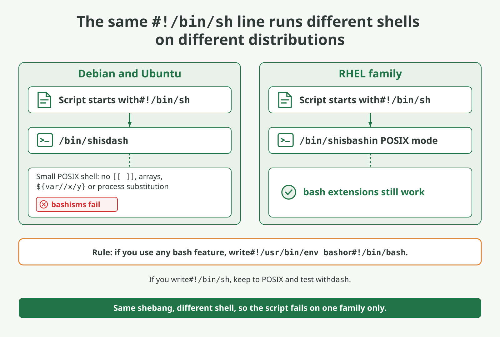

*Figure 1.9.1. The same #!/bin/sh shebang runs dash on Ubuntu and bash on RHEL, so bash features work on one family and fail on the other.*

- `#!/bin/sh` asks for the POSIX shell. On Debian and Ubuntu, `/bin/sh` is **dash**, a small, fast shell without bash extensions such as `[[ ]]`, arrays, `${var//x/y}`, `<<<` and process substitution. On the RHEL family, `/bin/sh` is bash in POSIX mode. A script that uses bash features under `#!/bin/sh` therefore works on one family and fails on the other. This is a classic cross-distribution bug. **Rule: if you use any bash feature, say `#!/usr/bin/env bash` or `#!/bin/bash`. If you write `#!/bin/sh`, keep to POSIX and test with `dash`.**
- `#!/usr/bin/env bash` finds `bash` on `$PATH`. That works when bash sits in an unusual place, but it means a different `bash` can be picked up, such as one inside a conda environment. In locked-down production scripts, a fixed `#!/bin/bash` is often the better choice.
- The shebang is not limited to shells. `#!/usr/bin/env python3` and `#!/usr/bin/awk -f` are valid too. An executable text file that starts with `#!` runs as `interpreter [one-optional-argument] script-path args...`. Do not count on more than one argument after the interpreter, because systems differ in how they split it.
- Running `bash script.sh` ignores the shebang and the execute bit. Running `sh script.sh` on a bash script uses the wrong shell.

Before you pick a shebang, check which shell your target machines actually provide.

### Run, source, or exec

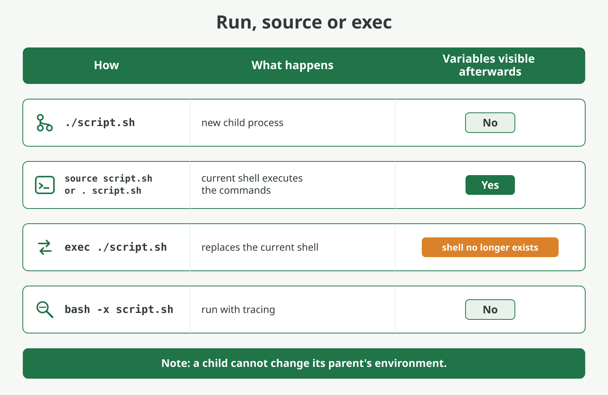

*Figure 1.9.2. Only sourcing leaves the script's variables in your current shell.*

There are four common ways to launch a script, and they differ in one question that matters more than the rest: do the variables the script sets survive afterwards? The table answers that question for each way.

| How | What happens | Variables set in the script visible afterwards? |
|---|---|---|
| `./script.sh` | New child process (forks and execs the interpreter) | No: a child cannot change its parent's environment |
| `source script.sh` or `. script.sh` | The current shell reads and executes the commands | **Yes**: this is how you load configuration and environment files (`source venv/bin/activate`, `. /etc/profile`) |
| `exec ./script.sh` | Replaces the current shell with the script | The shell no longer exists |
| `bash -x script.sh` | Run with tracing | No |

Look at the third column, because it is the whole point. Only sourcing leaves the variables in your shell. A sourced file does not need the execute bit and does not need a shebang. That makes sourcing the right tool for shared function libraries and for configuration files. A script that runs as a child process gives the caller two things back: its **output** and its **exit code**.

### The limits of shell (*How Linux Works* Section 11.1.1)

The Bourne shell handles commands and files with ease. As you saw in chapter 1.2, it can redirect output and chain pipes without effort. But a shell script is only one tool for Unix programming, and it has limits. If you need to pick apart strings, do repeated arithmetic, or reach into a complex database, use a scripting language such as Python, Perl or `awk`. The same advice holds when you want real functions or complex control structures. A compiled language such as C or Go is another option. Whatever you choose, keep your scripts short: a page or two of glue.

Before a script grows past a page, ask whether it should become Python.

## 2. Quoting and expansion: the heart of shell

Here is how a careful deploy script becomes a bad afternoon. Someone writes a cleanup step that removes an old release directory. It is tested on a laptop, where everything works. Months later a variable arrives empty on a build node, and the same line removes something else entirely. Nobody changed the script. What changed was the value that reached it.

You type a command that looks right, and it misbehaves. The cause is usually expansion, the work the shell does before your command runs. The shell performs a series of **expansions** on each line before it executes anything. The command never sees quotes or `$` signs. It sees only the result. Misunderstanding this is the source of most shell bugs.

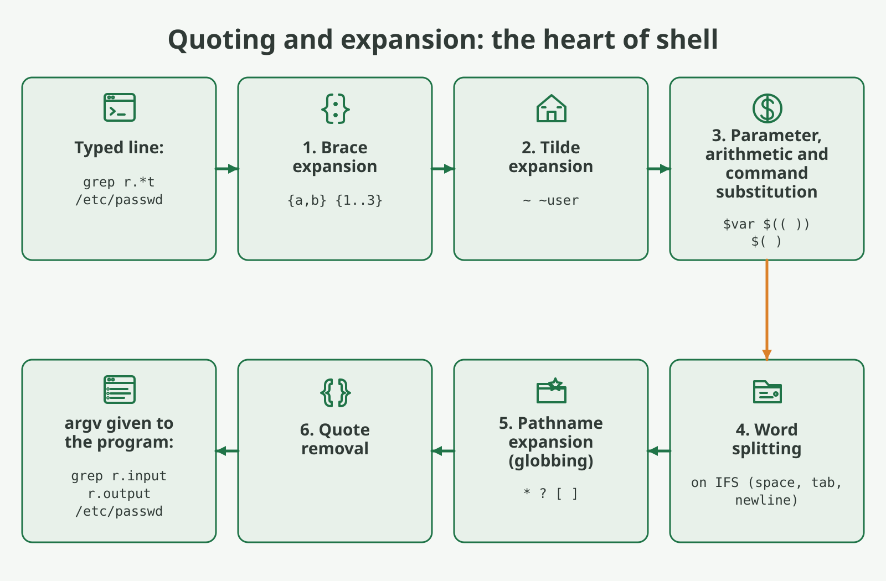

*Figure 1.9.3. Quoting and expansion: the heart of shell.*

Read the diagram from top to bottom. Each box is one step the shell takes before the program receives its arguments. The classic trap shows the danger. Say the current directory has files `r.input` and `r.output`. The unquoted pattern `r.*t` is a glob, so it matches those two files, and `grep` runs on the wrong arguments.

### The three kinds of quoting (*How Linux Works* Section 11.2)

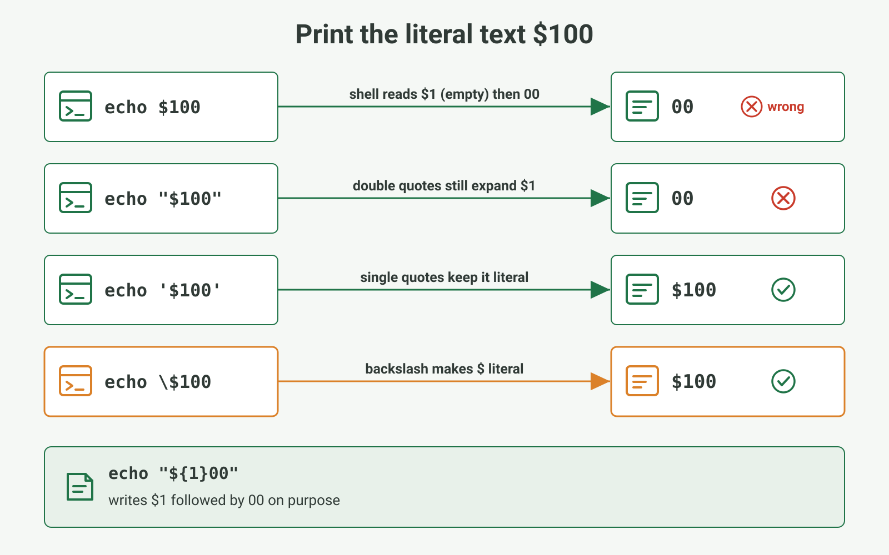

*Figure 1.9.4. Unquoted and double-quoted dollar-100 print 00, while single quotes or a backslash print the literal text dollar-100.*

Quotation marks, and the backslashes that go with them, are where many people get stuck. There are only three kinds, and knowing when and why to use each one is the key to avoiding that.

| Quoting | Effect | Example |
|---|---|---|
| **Single quotes** `'...'` | Everything inside is literal. No expansion at all. Cannot contain a single quote. | `echo '$100 *'` prints `$100 *` |
| **Double quotes** `"..."` | Literal except `$` (parameter/arithmetic/command substitution), backtick, and `\` before `$`, `"`, or `\`. **No word splitting or globbing of the result.** | `echo "There is no * in my path: $PATH"` |
| **Backslash** `\c` | Makes the next single character literal | `echo \$100`, `echo I don\'t` |

Suppose you want to print the string `$100`, so you run `echo $100`. The output is `00`, which surprises most people. The shell reads `$1`, the first positional parameter, which is empty, and then the characters `00`. Double quotes do not help either, because the shell still substitutes variables inside them.

Only `echo '$100'` or `echo \$100` prints `$100`. If you wanted `$1` followed by `00`, write `"${1}00"`. Now look at a different case. When you run `echo "There is no * in my path: $PATH"`, the shell substitutes `$PATH`. It does not glob-expand the `*`.

If you put large multi-line blocks of text inside double quotes, a here document is usually the better tool, and section 6 covers that. As a rule of thumb, reach for single quotes first when you want a literal, because they guarantee no substitutions. Use double quotes when you need variables expanded but want the result kept as one word.

A single quote cannot sit inside single quotes, so you need a trick. Close the quote, add an escaped quote, and reopen: `'this isn'\''t odd'`. That is three pieces: `'this isn'`, then `\'`, then `'t odd'`. Inside double quotes, a lone `'` is fine, as in `echo "isn't"`.

Quotes decide where one argument ends and the next begins. **Everything inside one pair of quotes is a single argument**, spaces included. So `grep 'r.*t /etc/passwd'` passes one argument, and `grep` then reads standard input. The word `a"b c"` is a single word, `ab c`, while `a b c` is three words.

### Word splitting: why `$var` should almost always be `"$var"`

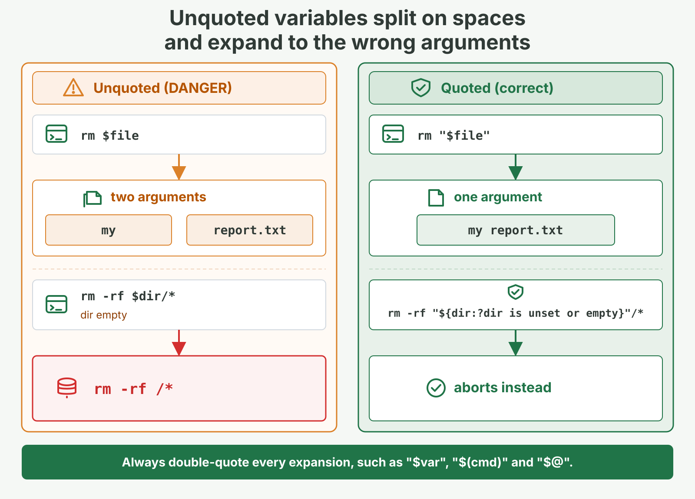

*Figure 1.9.5. Unquoted variables split on spaces and can expand to the root directory when empty, so quote them and guard with a required-value check.*

Here is what happens to an unquoted result. The shell splits it into words wherever it finds whitespace, meaning the characters in `IFS`. Then it glob-expands each word. Look at what that does in practice.

```bash
file="my report.txt"
rm $file              # DANGER: runs  rm my report.txt   (two arguments)
rm "$file"            # correct: one argument
dir=""
rm -rf $dir/*         # DANGER: expands to  rm -rf /*   when dir is empty
rm -rf "${dir:?dir is unset or empty}"/*     # aborts instead
```

Make it a habit to double-quote every expansion, such as `"$var"`, `"$(cmd)"` and `"$@"`. Skip the quotes only when you have a specific reason. There are two exceptions. One is when you want splitting, such as a variable that holds a list of options, where an array usually serves better. The other is when you want globbing. ShellCheck flags the rest with `SC2086`.

### `$@` versus `$*`

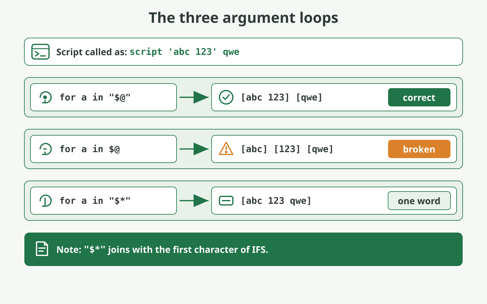

*Figure 1.9.6. Quoted dollar-at keeps each argument as one word, while the other forms split or join them.*

The difference between `$@` and `$*` catches people who pass arguments along to other programs. The loop below shows all three forms, called as `script 'abc 123' qwe`.

```bash
for a in "$@"; do echo "[$a]"; done    # called as: script 'abc 123' qwe  ->  [abc 123] [qwe]
for a in $@;   do echo "[$a]"; done    # unquoted: [abc] [123] [qwe]  (broken)
for a in "$*"; do echo "[$a]"; done    # one word: [abc 123 qwe]
```

`"$@"` expands to each argument as a separate, correctly quoted word, such as `"$1" "$2" ...`. By contrast, `"$*"` joins all arguments into one string, such as `"$1 $2 ..."`, separated by the first character of `IFS`. That is the whole difference, and it decides whether a file name with a space arrives as one argument or two.

When you nest quotes around command substitutions (*Supercomputers for Linux Sysadmins* Ch. 29), old backquotes such as `base="\`basename "$file".bak\`"` become hard to read. Use `$(...)` instead, as in `base="$(basename "$file").bak"`, because it allows clean nested double quotes. To pass your arguments on, use `"$@"`. It is always the right way to forward them, for example `exec python3 train.py "$@"`.

### Even `echo $var` can misbehave

Here is one more trap. If `var` contains `-n` or `-e`, `echo $var` reads it as an option, not as text. For anything that might start with a dash or contain backslashes, use `printf '%s\n' "$var"`, which has no such ambiguity.

### Globbing

Globbing is the shell's pattern matching on file names. `*` matches any string and `?` matches one character. `[abc]` and `[a-z]` match a class of characters, and `[!a-z]` negates the class. Bash adds `{a,b,c}`, which is brace expansion. It generates words and does not match files. With `shopt -s extglob`, Bash also accepts patterns such as `+(a|b)`.

If no file matches, Bash passes the pattern to the command literally. You can change that with `shopt -s nullglob`, which makes the pattern vanish, or with `failglob`, which raises an error. Always put `--` before file arguments that come from globs or variables. That stops a file named `-rf` from being read as an option: `rm -- "$f"`. Chapter 1.2 covers globbing in detail.

Before you pass a glob or a variable to a command, quote it and add `--`.

## 3. Variables, parameters and special variables

A backup script can run every night for months, report success every single time, and copy nothing at all. Nothing in it ever looked at what the commands returned. Before we can talk about catching that, we need two smaller pieces of the language: the places a script keeps its values, and the way every command reports how it went.

### Variables

Variables hold the values your script works with, and a few rules trip people up. The block below shows the common forms.

```bash
name="alice"            # NO spaces around =
echo "$name"
echo "${name}_backup"   # braces mark where the name ends
readonly MAX=8          # cannot be changed
export CUDA_VISIBLE_DEVICES=0,1    # exported: visible to child processes
local_var=1             # not exported: only this shell
unset name
```

Shell variables are strings, with arrays and integers as special cases. A variable set on the same line as a command lasts only for that command. For example, `PATH=/opt/tools/bin:$PATH make` sets `PATH` for `make` alone, and no subshell is needed. `export` passes a variable on to child processes. **`local`** inside a function limits the variable's scope.

### Positional parameters and special variables

Every script receives arguments, and the shell gives you special variables to read them and to inspect the shell itself. The table lists the ones you will use most.

| Variable | Meaning |
|---|---|
| `$0` | The script's name (as invoked); use in usage and error messages |
| `$1` ... `$9`, `${10}` | The arguments (braces are required beyond 9) |
| `$#` | Number of arguments |
| `$@`, `$*` | All arguments (see above) |
| `$?` | Exit status of the last command |
| `$$` | PID of the current shell |
| `$!` | PID of the most recent background command |
| `$_` | Last argument of the previous command |
| `$-` | Current shell option flags |
| `$PPID` | Parent's PID |
| `$LINENO`, `$BASH_SOURCE`, `$FUNCNAME`, `$SECONDS`, `$RANDOM`, `$HOSTNAME`, `$UID`, `$EUID` | Bash conveniences |

`shift` discards `$1` and moves the rest down. `shift 2` discards two. That lets you consume arguments in a loop, as in `while [ "$#" -gt 0 ]; do ... shift; done`. *How Linux Works* Section 11.3.1 shows a small example. A script named `shiftex` runs `echo Argument: $1; shift; echo Argument: $1; shift; echo Argument: $1`. When you invoke it as `./shiftex one two three`, it prints `Argument: one`, `Argument: two`, and `Argument: three`.

Long command lines get hard to read. You can split one across several lines by ending each continued line with a backslash (`\`). Take the Ghostscript command `gs -q -dBATCH -dNOPAUSE -dSAFER -sOutputFile=- -sDEVICE=pnmraw "$@"`. It is a good candidate for that split. Send diagnostics to **standard error**, not standard output, so they cannot corrupt data flowing through a pipeline: `echo "$0: bad option: $1" >&2`.

### Exit codes


*Figure 1.9.7. Exit codes run from 0 for success through error codes to 128 plus N, where 137 means SIGKILL and 143 means SIGTERM.*

Here is the second piece, and it is the one that separates a script from a wish. Every command ends with an **exit code**. Zero means success. Any other value means failure, and the number can say what went wrong. This is the signal the silent backup script never read.

The shell stores the last code in `$?`. Check it right away, because the next command overwrites it. Even `echo $?` resets it to 0. Your script exits with `exit N`. Without an argument, `exit` returns the status of the last command.

Some codes follow common conventions. The table lists the ones you will meet most often.

| Code | Meaning |
|---|---|
| 0 | Success |
| 1 | General error (and, for `grep`/`diff`/`cmp`, "no match" or "files differ", not an error) |
| 2 | Misuse of a command or a real error for `grep`/`diff` |
| 126 | Found but not executable (permissions, wrong architecture) |
| 127 | Command not found |
| 128 + N | Killed by signal N (130 Ctrl-C, 137 `SIGKILL`, 143 `SIGTERM`) |
| 255 | Exit status out of range, or `ssh` connection failure |

Some programs use a non-zero code for normal conditions. `grep` returns 1 when it finds nothing. That is *not* a failure, but it will trip `set -e`, which section 8 covers. When you are unsure what a code means, read the EXIT STATUS section of the manual page.

## 4. Conditionals

Every script you write will have branches: if the GPU count matches, if the mount point exists, if the package is already installed. Shell gives you a small set of tools for those decisions, and they do not behave like the conditionals in other languages.

### `if` runs a command and tests its exit code

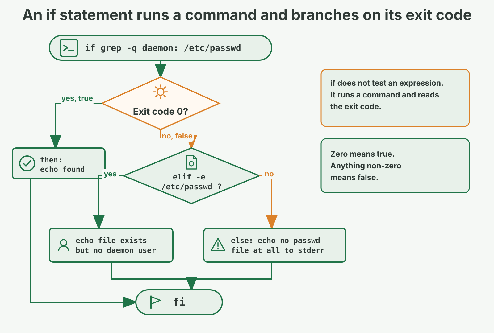

*Figure 1.9.8. An if statement runs a command and takes the branch based on its exit code, where zero means true.*

A conditional is where a script makes a decision, and shell makes that decision in a way that surprises almost everyone the first time. **`if` does not test an expression. It runs a command and looks at the exit code.** Zero means "true", and anything non-zero means "false".

```bash
if grep -q '^daemon:' /etc/passwd; then
  echo "found"
elif [ -e /etc/passwd ]; then
  echo "file exists but no daemon user"
else
  echo "no passwd file at all" >&2
fi
```

When you read a script, ask yourself which command each `if` is really running. The words `if`, `then`, `elif`, `else` and `fi` are shell keywords. Everything else is a command. The semicolon before `then` is the ordinary command separator. If `then` sits on its own line, you do not need it.

### `[`, `test` and `[[`

`[` is a real command. The shell also builds it in for speed, and it is a synonym for `test`. The closing `]` is a required last argument. That is why spacing matters. `[ "$x" = ok ]` is the command `[` with four arguments. By contrast, `[$x = ok]` or `if [$count -gt 10]; then` looks for a command that does not exist, named `[$x` or `[$count`.

The test command sees every word after splitting on spaces, tabs or line feeds. So **quote variables** in tests. Suppose `v=''`. Then `if [ $v = '' ]; then` expands to `[ = '' ]`, which is a syntax error because the first operand vanished. Either `if [ "$v" = '' ]; then` or the classic prefix idiom `if [ "x$v" = 'x' ]; then` works, even when `v` is empty or contains spaces.

Any command in a script can use I/O redirection (*Supercomputers for Linux Sysadmins* Ch. 29), and you will see these forms often. Use `mycommand <./infile` to read standard input from a file, and `mycommand >./outfile` to send standard output to one. `mycommand 2>./errfile` sends standard error to a file, and `mycommand &>./fulloutput` sends both streams to a file in bash. `mycommand | grep failed` pipes standard output onward. `mycommand |& grep error` is bash shorthand for `2>&1 |`, which pipes both streams.

Bash adds **`[[ ... ]]`**, a keyword with saner behaviour. No word splitting happens inside it. `&&` and `||` work inside it. `=~` matches regular expressions. `==` compares against a glob pattern on the right, and `<` and `>` compare strings:

```bash
if [[ $name == a* && -f $file ]]; then ...      # $name need not be quoted on the left
if [[ $line =~ ^([0-9]+)\ GPU ]]; then echo "${BASH_REMATCH[1]}"; fi
```

Use `[[ ]]` in bash scripts. In POSIX `sh` scripts, use `[ ]` with quotes.

### The test operators

Tests come in three groups: string tests, numeric tests and file tests. You will use all three in production scripts, so it helps to know them well.

**String tests**: `=` (equal; `==` in bash), `!=`, `-z str` (empty), `-n str` (non-empty). **Numeric tests**: `-eq -ne -lt -le -gt -ge`. Be careful with the equals sign. It compares *strings*, so `[ 01 = 1 ]` is false, while `[ 01 -eq 1 ]` is true. Inside `[ ]`, a `>` does not compare numbers at all. It redirects output to a file named `1`. Inside `(())`, you can use `>`, `<` and `==` on numbers.

**File tests** ask questions about files. This table lists the common ones.

| Test | True when |
|---|---|
| `-e f` | exists |
| `-f f` | regular file |
| `-d f` | directory |
| `-h f` or `-L f` | symbolic link (other tests follow the link) |
| `-s f` | exists and is non-empty |
| `-r f`, `-w f`, `-x f` | readable, writable, executable by you |
| `-u f`, `-g f`, `-k f` | setuid, setgid, sticky bit |
| `-b`, `-c`, `-p`, `-S` | block device, character device, named pipe, socket |
| `f1 -nt f2`, `f1 -ot f2` | newer than, older than |
| `f1 -ef f2` | same file (same device and inode) |

**Combining tests**: `!` negates a test. `[ A ] && [ B ]` and `[ A ] || [ B ]` combine two commands. `[ A -a B ]` and `[ A -o B ]` combine tests inside one `[`. That form is obsolescent and ambiguous, so prefer two `[` commands. **Do not write `[ "$x" = a || "$x" = b ]`**. The `||` ends the `[` command. Write `[ "$x" = a ] || [ "$x" = b ]` or `[[ $x == a || $x == b ]]` instead.

### Logical constructs: `&&` and `||` as one-line conditionals

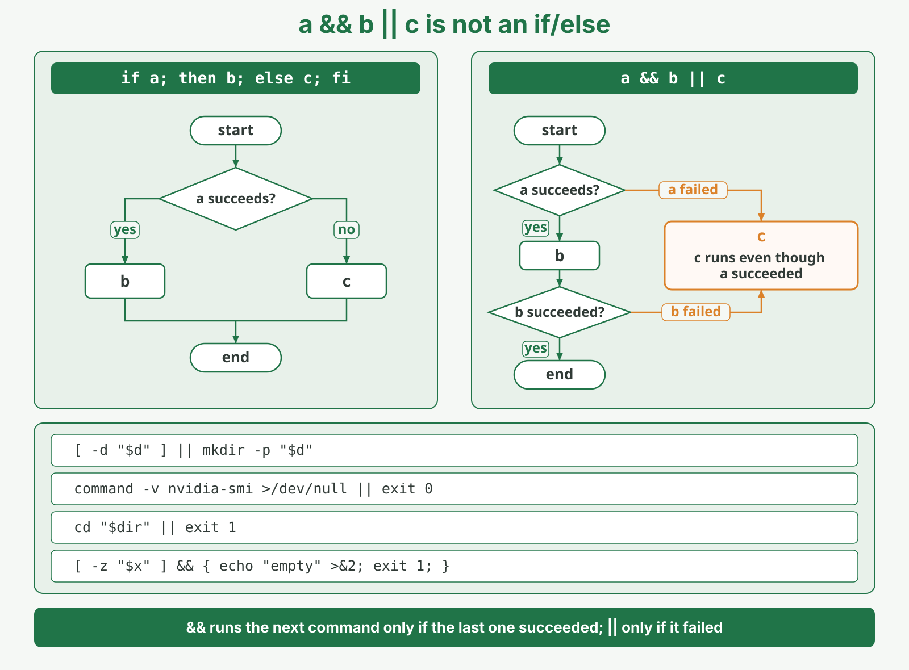

*Figure 1.9.9. In a and b or c, command c runs both when a fails and when b fails, so it is not a true if else.*

`cmd1 && cmd2` runs `cmd2` only if `cmd1` succeeded. `cmd1 || cmd2` runs `cmd2` only if `cmd1` failed. These one-liners work well as guards and error exits. Examples are `[ -d "$d" ] || mkdir -p "$d"`, `command -v nvidia-smi >/dev/null || exit 0`, and `cd "$dir" || exit 1`. Be careful with `a && b || c`. It is *not* an if/else, because `c` also runs when `b` fails. To group several commands with braces, put a semicolon before the closing brace: `[ -z "$x" ] && { echo "empty" >&2; exit 1; }`.

### `case`

`case` matches a string against glob patterns without running any commands. It is the clean way to dispatch on a subcommand or an option:

```bash
case "${1:-}" in
  start|up)    start_service ;;
  stop)        stop_service ;;
  status)      status_service ;;
  restart|r*)  stop_service; start_service ;;
  "")          echo "usage: $0 {start|stop|status|restart}" >&2; exit 2 ;;
  *)           echo "unknown command: $1" >&2; exit 2 ;;
esac
```

Each branch ends with `;;`. Patterns can be alternatives separated by `|`, and `*` is the catch-all. Bash also offers `;&` and `;;&` to fall through.

### `select` and `read`

`select` prints a numbered menu and reads a choice into a variable. Set the prompt in `PS3`, and always `break` out of it. `read` takes a line of input, as in `read -r -p "Continue? [y/N] " ans`. Always use `read -r`, because without `-r` backslashes are interpreted. In unattended scripts, never block on `read`. Offer an option for non-interactive use, such as `--yes`, or check `[ -t 0 ]` to see whether standard input is a terminal.

### Arithmetic

`$(())` computes integers, as in `n=$((n + 1 ))` or `echo $((1024 * 1024 ))`. `((n > 10 ))` is a command that succeeds when the expression is non-zero, so you use it inside an `if`. Bash has no floating point. When you need decimals, you can use `bc`, `awk` or Python, such as `awk 'BEGIN{print 3/7}'`. `expr 1 + 2` is the old, slow way, so avoid it. `let` works much like `(())`.

Before you write a test, quote every variable it uses. If you keep one habit from this section, make it that one.

## 5. Loops

A cluster is a list of machines, and most scripts you will write need to do something to each machine in turn. A loop is how you say that once, instead of repeating yourself and hoping you did not miss a node.

### `for`

Each line below is a common form, and all of them appear in real cluster scripts.

```bash
for node in gpu01 gpu02 gpu03; do ssh "$node" uptime; done      # a list of words
for f in *.log; do gzip -- "$f"; done                            # glob (unquoted, but quote "$f" in the body)
for i in {1..5}; do echo "$i"; done                              # brace sequence (bash)
for ((i=0; i<8; i++)); do echo "GPU $i"; done                    # C-style (bash)
for arg in "$@"; do ...; done                                    # each argument safely
```

If a glob matches nothing, the loop body runs once with the literal pattern (`*.log`). Guard against that with `[ -e "$f" ] || continue` or `shopt -s nullglob`.

### `while` and `until` (*How Linux Works* Section 11.6.2)

The Bourne shell's `while` loop uses exit codes just like the `if` conditional. `while` repeats as long as its condition command exits with `0`. `until` repeats as long as its condition command exits non-zero. `break` leaves a loop immediately, and `continue` skips to the next iteration. If you have written loops in another language, you already know the idea. The exit code is what drives this one. *How Linux Works* Section 11.6.2 gives a longer example: `FILE=/tmp/whiletest.$$; echo firstline > $FILE; while tail -10 $FILE | grep -q firstline; do echo -n Number of lines in $FILE:' '; wc -l $FILE | awk '{print $1}'; echo newline >> $FILE; done; rm -f $FILE`. It appends `newline` for 10 iterations, until `firstline` scrolls out of `tail -10`.

In cluster scripts, `until` is a clean way to wait for a rebooting node:

```bash
until ping -c1 -W1 "$host" >/dev/null 2>&1; do sleep 5; done     # wait for a node to come back
```

### Reading a file line by line (the right way)

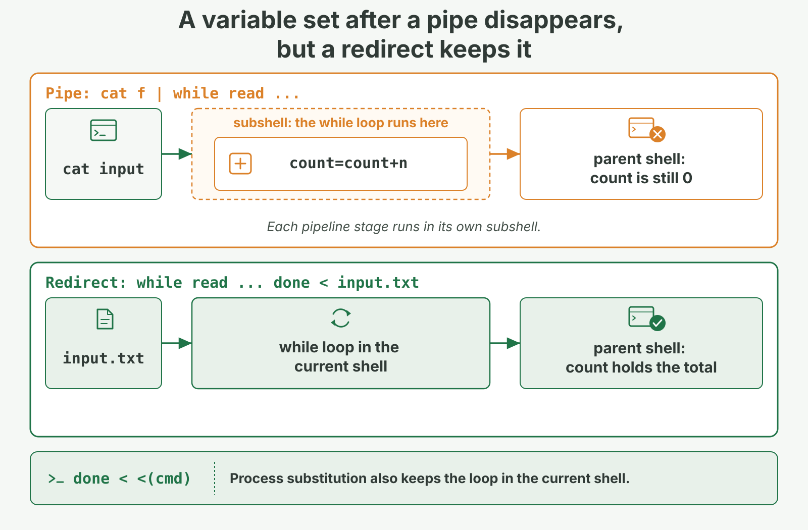

*Figure 1.9.10. Piping into a while loop runs it in a subshell and loses the variable, while redirecting the file into the loop keeps the variable.*

```bash
while IFS= read -r line; do
  printf 'line: %s\n' "$line"
done < input.txt
```

`IFS=` stops leading and trailing whitespace from being trimmed. `-r` stops backslash processing. The redirect feeds the file to the *loop*. A pipe into a `while` loop, as in `cat f | while read ...`, runs the loop in a **subshell**, so any variables set inside are lost afterwards. Section 7 explains subshells. To split fields, use `while IFS=: read -r user _ uid _; do ...; done < /etc/passwd`.

### Loops over command output and find results

Never parse `ls`. File names can contain spaces, newlines and leading dashes. These are the safe patterns:

```bash
for f in ./*.csv; do ...; done                                   # a glob, not ls
find . -name '*.ckpt' -print0 | while IFS= read -r -d '' f; do rm -- "$f"; done
find . -name '*.ckpt' -print0 | xargs -0 -r rm --                # many files, few processes
find . -name '*.ckpt' -exec rm -- {} +                           # no xargs needed
mapfile -t nodes < <(scontrol show hostnames "$SLURM_JOB_NODELIST")   # bash 4+: command output into an array
```

`xargs` batches arguments, which avoids the "argument list too long" error. It can also run in parallel with `-P 8`. Pair `-0` with `find -print0` to handle any file name. `-r` (GNU) skips running when there is no input. Add `--` when file names may start with a dash.

Before you loop over files, check that the pattern matches what you expect, and never parse `ls`.

## 6. Command and process substitution, temporary files, here documents

Shell earns its living by gluing programs together, and three features do most of that work: command substitution, temporary files and here documents. Each one has a classic way to go wrong, so each one gets a warning here.

### Command substitution

`$(command)` is replaced by the command's output, with trailing newlines removed. Prefer it to the older backticks (`` `command` ``), which nest badly and are harder to read. Always quote it. `files="$(ls)"` is rarely what you want, while `now="$(date +%F)"` is a typical use. Do not use it where a glob works, because `for f in $(ls)` is a bug. Avoid it for capturing a pipeline that produces huge output.

```bash
flags=$(grep -m1 '^flags' /proc/cpuinfo | cut -d: -f2)
gpus=$(nvidia-smi --query-gpu=name --format=csv,noheader | sort -u | wc -l)
```

**Process substitution** (`<(cmd)`, `>(cmd)`, bash) presents a command's output as a file name. That helps when a tool insists on files. For example: `diff <(ssh node1 'rpm -qa | sort') <(ssh node2 'rpm -qa | sort')`.

### Temporary files (`mktemp` and `trap`)

A fixed name like `/tmp/out` is a bug, because two runs collide. It is also a security problem, since predictable names in a shared directory can be hijacked with a symlink. Use `mktemp`, which comes from GNU `coreutils`. The script below comes from *How Linux Works* Section 11.8. It creates two unique temporary files with the template `XXXXXX` and compares device interrupts (`/proc/interrupts`) over a two-second window. It also registers an `INT` trap, so pressing Ctrl-C does not leave stale `/tmp/im*` files behind.

```bash
#!/bin/sh
TMPFILE1=$(mktemp /tmp/im1.XXXXXX)
TMPFILE2=$(mktemp /tmp/im2.XXXXXX)
trap "rm -f $TMPFILE1 $TMPFILE2; exit 1" INT
cat /proc/interrupts > $TMPFILE1
sleep 2
cat /proc/interrupts > $TMPFILE2
diff $TMPFILE1 $TMPFILE2
rm -f $TMPFILE1 $TMPFILE2
```

When you trap `INT` or `TERM`, you **must** include an explicit `exit` inside the handler, as in `trap "rm -f ...; exit 1" INT`. Without it, the shell cleans up the files and then carries on executing the script right where it left off. In `bash`, an `EXIT` trap cleans up for you. For example, `tmp=$(mktemp); tmpdir=$(mktemp -d /tmp/myjob.XXXXXX); trap 'rm -rf -- "$tmp" "$tmpdir"' EXIT` runs on a normal exit, on `exit 1`, and on a `set -e` failure. No user-space trap can run on `SIGKILL` (`kill -9`), though.

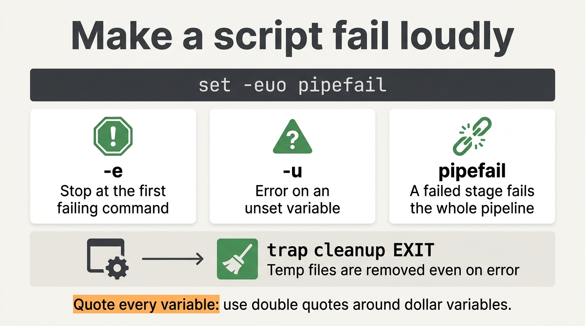

*Figure 1.9.11. Strict mode makes a script fail loudly, and an EXIT trap cleans up after it.*

### Here documents and here strings

A **here document** feeds several lines to a command's standard input:

```bash
cat > /etc/myservice.conf <<EOF
host = $(hostname -f)
generated = $(date -u +%FT%TZ)
EOF

cat <<'EOF'            # quoted delimiter: no expansion inside (for scripts you want literal)
echo "this $HOME is not expanded"
EOF

cat <<-EOF             # <<- strips leading TABS, so you can indent the block
	indented with tabs
	EOF
```

The marker can be any word, though it is conventionally uppercase. It must appear alone on a line to end the block. An unquoted marker lets `$var`, `$(cmd)` and backslashes expand. A quoted marker, as in `<<'EOF'`, suppresses all of that. Quote it when you write another script or a config file that contains `$`. A **here string**, `<<< "$var"`, supplies a single string on standard input in bash. For example, `read -r a b <<< "$line"` splits one line into two variables. Here documents are the clean way to write multi-line files and to run remote scripts, as in `ssh node 'bash -s' <<'EOF' ... EOF`.

## 7. Parameter expansion, functions, grouping and subshells

The pieces in this section are what turn a pile of commands into a small program. You get string handling that stays inside bash, functions with their own scope, and two ways to group commands that differ in a way that matters.

### Parameter expansion: string work without extra processes

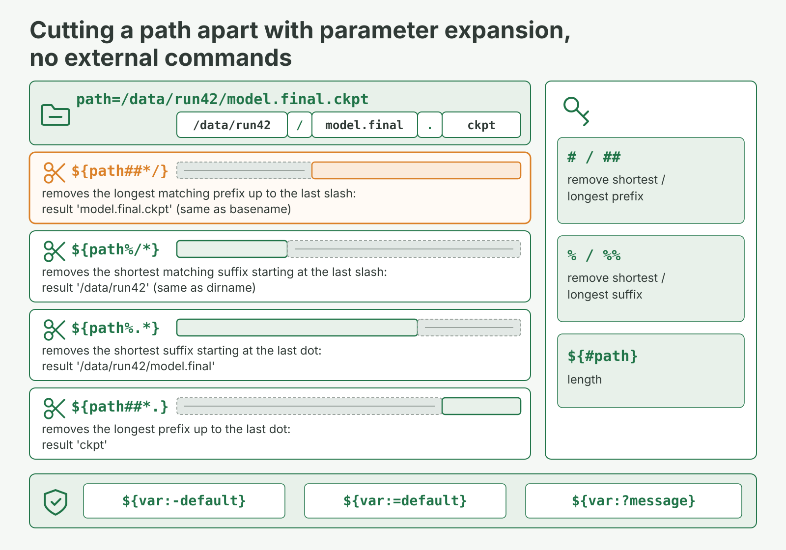

*Figure 1.9.12. Hash removes a prefix and percent removes a suffix, so bash can do basename and dirname work without starting a process.*

Much of what sends people running for `sed`, `awk` or `basename` can be done inside bash itself. Bash does it in the same process, which is faster and avoids a whole family of quoting traps. The table lists the forms you will use most.

| Expression | Result |
|---|---|
| `${var:-default}` | `var`, or `default` if unset or empty |
| `${var:=default}` | same, and also **assigns** the default to `var` |
| `${var:?message}` | if unset or empty, print `message` and exit (a guard) |
| `${var:+alt}` | `alt` if `var` is set and non-empty, else empty |
| `${#var}` | length of the string |
| `${var#pattern}` / `${var##pattern}` | remove the shortest / longest matching **prefix** |
| `${var%pattern}` / `${var%%pattern}` | remove the shortest / longest matching **suffix** |
| `${var/old/new}` / `${var//old/new}` | replace the first / every match (bash) |
| `${var:offset:length}` | substring (bash) |
| `${var^^}` / `${var,,}` | upper / lower case (bash 4) |

Here is what these look like on a real path.

```bash
path=/data/run42/model.final.ckpt
echo "${path##*/}"       # model.final.ckpt   (like basename)
echo "${path%/*}"        # /data/run42        (like dirname)
echo "${path%.*}"        # /data/run42/model.final   (strip last extension)
echo "${path##*.}"       # ckpt
echo "${USER:-unknown}"
: "${CUDA_HOME:=/usr/local/cuda}"   # set a default once (the colon command does nothing)
```

You may already have roundabout versions of these. Some common ones and their better forms are listed here: `echo "$var" | wc -c` → `"${#var}"`; `echo "$var" | sed 's/^.*abc//'` → `"${var#*abc}"`; `[ "x$VAR" = x ]` → `[ -z "${VAR:-}" ]`; `if [ -z "$VAR" ]; then VAR=abc; fi` → `VAR=${VAR:-abc}`; `cat file | grep x` → `grep x file`; `sort | uniq` → `sort -u` (but `sort | uniq -c` stays); `sudo su` → `sudo -s` or `sudo -i`.

### Arrays

Bash has indexed and associative arrays. Use them to hold lists, instead of space-separated strings that break as soon as an item contains a space.

```bash
nodes=(gpu01 gpu02 "gpu 03")
nodes+=(gpu04)
echo "${#nodes[@]} nodes; first is ${nodes[0]}"
for n in "${nodes[@]}"; do echo "[$n]"; done      # quotes keep "gpu 03" as one element
cmd=(python3 train.py --lr 3e-4 --data "/mnt/my data")
"${cmd[@]}"                                        # run a command assembled safely
declare -A rate=([a100]=2.5 [h100]=4.0)            # associative array (bash 4+)
echo "${rate[h100]}"
```

### Functions

Functions let you name a block of logic and reuse it. This example defines a logger, a command check and a GPU counter.

```bash
log() { printf '%s %s\n' "$(date +%T)" "$*" >&2; }

require_cmd() {
  command -v "$1" >/dev/null 2>&1 || { log "missing command: $1"; return 1; }
}

gpu_count() {
  local n                                    # local: do not leak into the caller
  n=$(nvidia-smi -L 2>/dev/null | wc -l)
  echo "$n"                                  # a function "returns" text on stdout...
}                                            # ...and a status with 'return N' (0..255)

require_cmd nvidia-smi || exit 1
count=$(gpu_count)
```

Define a function as `name() { ...; }`. The `function` keyword is a bash and ksh extra, so skip it. Arguments arrive as `$1 $2 ...` and `$@`. **`local`** keeps variables private. Without it, every variable is global. `return` ends the function with a status, while `echo` gives it a value, which you capture with `$(...)`. Because `$(...)` runs the function in a subshell, side effects such as variable changes are lost. To get both a value and a side effect, use a global variable or `printf -v`.

### Options with `getopts`

```bash
usage() { echo "usage: $0 [-h] [-n nodes] [-t dir] file..." >&2; exit 2; }
nodes=1; target=.
while getopts ":hn:t:" opt; do
  case $opt in
    h) usage ;;
    n) nodes=$OPTARG ;;
    t) target=$OPTARG ;;
    :) echo "option -$OPTARG needs an argument" >&2; exit 2 ;;
    \?) echo "unknown option -$OPTARG" >&2; exit 2 ;;
  esac
done
shift $((OPTIND - 1))          # remaining arguments are in "$@"
```

The option string lists single-letter options. A colon after a letter means that option takes an argument, which arrives in `$OPTARG`. A leading colon selects quiet mode, where you report errors yourself. `getopts` handles only short options. For long options, such as `--nodes=4`, write a `while`, `case` and `shift` loop, or use Python's `argparse`.

### Grouping and subshells

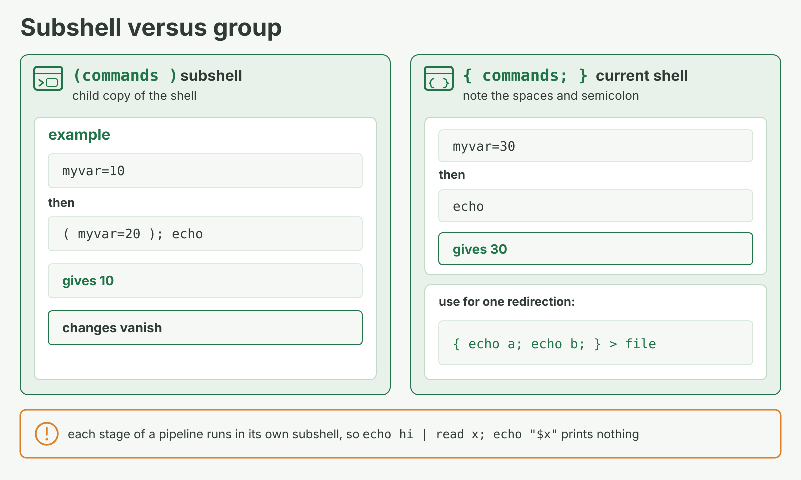

*Figure 1.9.13. Changes made inside a subshell vanish when it ends, but a brace group changes the current shell.*

- `(commands )` runs in a **subshell**, a child copy of the shell. Changes to variables, the working directory and options vanish when it ends. Use it to run `uglyprogram` inside `uglydir`, or with a temporary `PATH`, without touching your parent shell: `(cd uglydir; uglyprogram)` or `(PATH=/usr/confusing:$PATH; uglyprogram)`. For a single command, prefixing `PATH=/usr/confusing:$PATH uglyprogram` avoids the subshell.
- `{ commands; }` runs in the **current shell**. Note the spaces and the semicolon. Use it to group commands under one redirection, as in `{ echo a; echo b; } > file`.
- Each stage of a pipeline runs in its own subshell. In bash, the exception is `shopt -s lastpipe` in a non-interactive script. That is why `echo hi | read x; echo "$x"` prints nothing. *How Linux Works* Section 11.11 has a classic idiom that combines a pipeline and a subshell. It copies a directory tree `orig` into `target` while preserving ownership and permissions: `tar cf - orig | (cd target; tar xvf -)`, or `tar xpf -`. Always check first that `target` exists and is not the same inode as `orig`, using `[ -d orig -a ! orig -ef target ]`.

```bash
myvar=10
( myvar=20 ); echo "$myvar"        # 10: changed only in the subshell
{ myvar=30; }; echo "$myvar"       # 30
tar cf - orig | ( cd target && tar xpf - )     # copy a tree preserving ownership and permissions
```

### Command search and builtins

Before you call a command, it helps to know what kind of thing it is: a builtin, a function, an alias or an external program. Use `type -a cmd` to see every match. Use `command -v cmd` for a portable existence check. Use `which` only for external programs, since it is less reliable.

`exec cmd` replaces the shell with `cmd`, and the shell never returns. Put it on the last line of a wrapper script, so signals go straight to the real program. `source file` includes another file. After you move programs around, run `hash -r` to clear the remembered command locations. `eval` runs a string as code, which makes it a common source of injection bugs. Avoid it, and use arrays instead.

Before you wrap a program, decide whether it should replace the shell with `exec`.

## 8. Making scripts safe: strict mode, traps, locks, retries

Picture the page at 3 a.m. A nightly job stopped half way through, left a half-written file in place, and still reported success. Nobody noticed until a user asked why a week of results was missing. This section is about the handful of habits that make a script complain at the first sign of trouble, while it still knows which line went wrong.

### Strict mode, and its traps

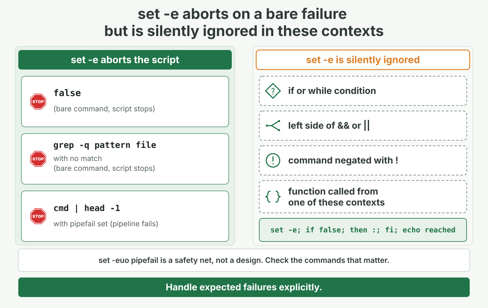

*Figure 1.9.14. Under set -e a bare failing command stops the script, but failures in conditions, and-or lists, negations and functions called from them do not.*

Most production scripts open with the same few lines. They turn on the switches that make bash fail on purpose.

```bash
set -euo pipefail
IFS=$'\n\t'          # optional: split only on newline and tab, not spaces
```

Each switch has a trade-off. The table lists what each one does and where it bites you.

| Option | Effect | Caveat |
|---|---|---|
| `set -e` (`errexit`) | Exit when a command fails | Not applied inside `if`/`while` conditions, in the left side of `&&`/`\|\|`, or when the command is part of a `!` negation. In functions called from those contexts it is suppressed entirely. Commands like `grep` that return 1 "normally" abort the script. `((i++))` returns 1 when `i` was 0. Do not rely on it as your only error handling. |
| `set -u` (`nounset`) | Using an unset variable is an error | Catches typos (`$dri` instead of `$dir`) and the `rm -rf $dir/*` accident. Use `${var:-}` where emptiness is allowed; `"${arr[@]}"` on an empty array fails in old bash (< 4.4). |
| `set -o pipefail` | A pipeline fails if **any** stage fails (not just the last) | `cmd \| head -1` can report failure because `cmd` got `SIGPIPE`. |
| `set -x` (`xtrace`) | Print each command (with expansion) before running it | The debugging switch; set `PS4='+ ${BASH_SOURCE}:${LINENO}: '` to see locations. Beware that secrets in arguments are printed. |

Handle expected failures explicitly, because strict mode cannot know which failures you meant to allow. Write `if ! grep -q pattern file; then ...` when a non-match is normal. Use `grep -q x f || true` to ignore a failure you expect. Or write `cmd || { echo "cmd failed" >&2; exit 1; }` when a failure should stop the script with a message. To debug one section only, wrap it in `set -x; ...; set +x`. Many experienced engineers treat `set -e` as a safety net rather than a design, and they check the commands that matter.

The most important idea here is to **fail loudly and early**. Validate arguments and prerequisites at the top of the script, using `command -v` and `[ -r "$cfg" ]`. Refuse to run when a variable is empty. Then exit non-zero with a message to stderr. A script that returns 0 after silently doing nothing is worse than one that crashes, because nobody goes looking for a problem that reports success.

### Cleanup with `trap`

```bash
workdir=$(mktemp -d)
cleanup() { rm -rf -- "$workdir"; }
trap cleanup EXIT                         # always: normal, error, or exit-from-signal
trap 'echo "interrupted" >&2; exit 130' INT
trap 'echo "terminated" >&2; exit 143' TERM
```

Two more traps are useful. `trap 'echo "error on line $LINENO" >&2' ERR` reports where a failure happened. It needs `set -E` or `errtrace` to apply inside functions. `RETURN` and `DEBUG` help with tracing. Chapter 1.8 covers signals and traps in depth. The main point here is to put **cleanup in one place**. If you need the trap to fire promptly, run long-lived commands in the background and use `wait`.

### Logging and output discipline

- **Send data to stdout and messages to stderr.** A script whose diagnostics go to stdout corrupts every pipeline that consumes it.
- Use a timestamped log function, as section 7 showed, and add a `--verbose` or `-x` switch. That beats editing the script each time you need to debug it.
- Under Slurm or systemd, stdout and stderr already go to files or the journal, so do not reinvent log rotation. To log from a shell script to the journal, use `logger -t mytool -p user.info "message"`.
- To send both streams to a file and keep seeing them, use `exec > >(tee -a "$log") 2>&1` (bash).

### Locking: only one copy at a time

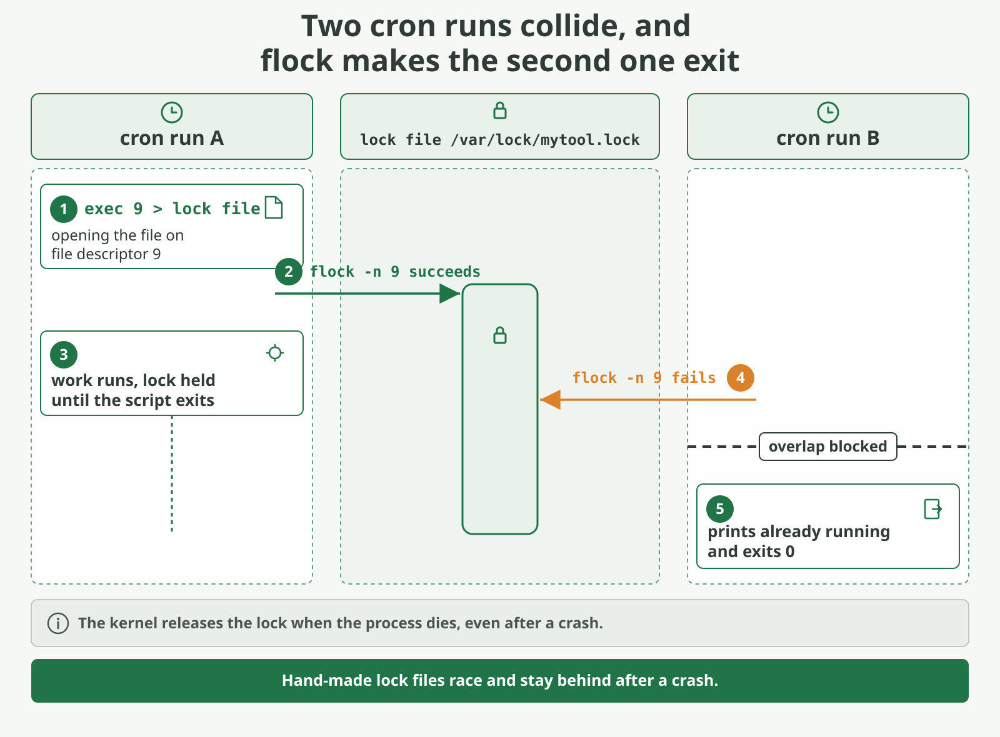

*Figure 1.9.15. The first cron run holds the flock while it works, so a second run that overlaps fails the non-blocking lock and exits.*

Scripts run by `cron` or by timers can overlap. `flock` gives you a reliable advisory lock, and the kernel releases it when the process dies.

```bash
exec 9>/var/lock/mytool.lock
flock -n 9 || { echo "already running" >&2; exit 0; }
# ... work; the lock is held until the script exits ...
```

You can also wrap a whole command, as in `flock -n /var/lock/mytool.lock mytool`. Avoid hand-made lock files such as `[ -e lock ] || touch lock`. They race with each other, and they stay behind after a crash. A second option, `mkdir lockdir`, is atomic and is sometimes used for portability.

### Idempotence

An **idempotent** script can run twice and leave the same result as running it once. That makes it safe to re-run after a partial failure, which is the common case on a busy cluster. It is also the foundation of configuration management, and chapter 4 on Ansible exists to give you this at scale.

Here are some habits that make a script idempotent. Use `mkdir -p`, `ln -sfn`, and `grep -qxF "$line" file || echo "$line" >> file`. Check before you act, as in `id user >/dev/null 2>&1 || useradd user`. Write to a temporary file, then **`mv` it into place**. A rename is atomic, so readers never see half a file. Finally, make destructive operations opt-in with `--apply`, and make a dry run the default.

### Retries and timeouts

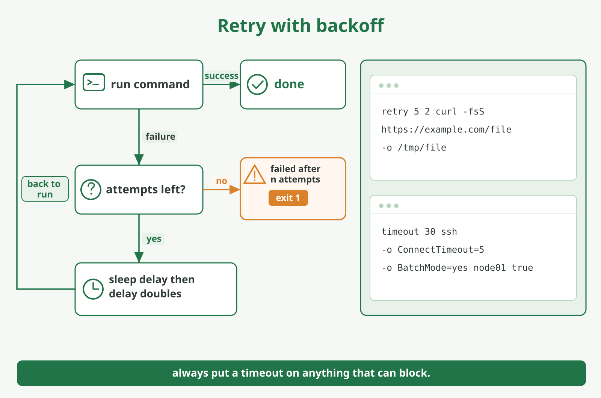

*Figure 1.9.16. Retries with a growing delay and a timeout keep scripts from hanging or failing on transient errors.*

External commands fail transiently. A package mirror, a metadata service or a flaky NFS server can each fail for a moment. A retry helper handles those cases.

```bash
retry() {                       # usage: retry 5 2 cmd args...   (attempts, initial delay)
  local attempts=$1 delay=$2; shift 2
  local n=1
  until "$@"; do
    if (( n >= attempts )); then echo "failed after $n attempts: $*" >&2; return 1; fi
    echo "attempt $n failed; retrying in ${delay}s" >&2
    sleep "$delay"; (( n++, delay *= 2 ))
  done
}
retry 5 2 curl -fsS https://example.com/file -o /tmp/file
timeout 30 ssh -o ConnectTimeout=5 -o BatchMode=yes node01 true      # never hang forever
```

Always put a timeout on anything that can block. Use `timeout 60 cmd`, `ssh -o ConnectTimeout=5 -o BatchMode=yes` (which skips password prompts) and `curl --max-time 20`. Exponential backoff with a cap, plus a total deadline, keeps retries from turning into a thundering herd.

### Lint and debug

- **ShellCheck** (`shellcheck script.sh`) finds the quoting, `[` and portability mistakes in this chapter automatically. Run it in CI. The codes you will see constantly are SC2086 (unquoted variable), SC2046 (unquoted command substitution), SC2155 (declare and assign separately so the exit status is not masked), SC2164 (`cd` without `|| exit`) and SC2162 (`read` without `-r`).
- `bash -n script.sh` checks syntax without running the script. `bash -x script.sh` traces the run. Use `set -x` for individual sections.
- Test in a throwaway directory or container. For destructive scripts, accept a `--dry-run` flag that prints commands instead of running them. The helper `run() { if [ -n "${DRY_RUN:-}" ]; then echo "+ $*"; else "$@"; fi; }` shows the pattern.
- **bats** (Bash Automated Testing System) gives unit tests for functions. It is worth the effort for libraries that other scripts depend on.

Before you ship a script, run ShellCheck on it and test it in a throwaway directory.

## 9. Important shell script utilities (*How Linux Works* Section 11.10)

You met most of these utilities in chapter 1.4. This section shows how they fit inside shell scripts (*How Linux Works* Section 11.10).

- **`basename` / `dirname`** strip directories and suffixes. `basename example.html .html` and `basename /usr/local/bin/example` both return `example`. Consider this loop: `for file in *.gif; do if [ ! -f "$file" ]; then exit; fi; b=$(basename "$file" .gif); echo Converting "$b.gif to $b.png..."; giftopnm "$b.gif" | pnmtopng > "$b.png"; done`. Here `basename` strips `.gif`, so the loop can build the `.png` name. Bash expansions `${f##*/}` and `${f%/*}` do the same job without starting a process.
- **`awk`** is a full programming language. See *The AWK Programming Language* by Alfred V. Aho, Brian W. Kernighan, and Peter J. Weinberger, Addison-Wesley, 1988. In shell scripts, though, most of its use is simpler. About 90% of it picks one field out of an input stream, as in `ls -l | awk '{print $5}'`. It also sums values (`awk '{s+=$1} END {print s}'`), filters rows (`$3 > 100`), or splits on a custom delimiter (`-F:`). If an awk script runs past a few lines, consider Python.
- **`sed`** ("stream editor", like `ed`) takes an address and an operation. Arnold Robbins's *sed & awk Pocket Reference*, 2nd ed., O'Reilly, 2002, is a good companion. `sed 's/:/%/' /etc/passwd` replaces the first colon on each line. `sed 's/:/%/g' /etc/passwd` replaces all colons. `sed 3,6d /etc/passwd` deletes lines 3 through 6. `sed '/exp/d'` deletes lines that match `exp`. `sed -n '3,6p'` prints lines 3 to 6. `sed -i.bak 's/x/y/' file` edits the file in place and keeps a backup. Remember that macOS BSD `sed` needs `-i ''` instead.
- **`xargs`** builds command lines from standard input when a file list would overflow the shell's argument buffer. `find . -name '*.gif' -print0 | xargs -0 file` does this, and so do `find . -name '*.gif' -exec file {} \;` and the `+` form. `-P N` runs N commands in parallel. `-n 1` passes one argument at a time, and `-I{}` substitutes `{}`. Always combine `-print0` with `-0`, and add `--`, when file names are untrusted.
- **`expr`** (`expr 1 + 2` prints `3`) is the legacy external command for arithmetic and string operations. It is clumsy and slow, so prefer `$((1 + 2 ))` or Python.
- **`cut`, `sort`, `uniq`, `tr`, `tee`, `head`, `tail`, `wc`, `paste`, `column`, `jq`, `curl`, `timeout`, `flock`, `mktemp`, `seq`, `date`, `readlink -f`, `realpath`** appear constantly in scripts. `jq` deserves a special mention. It is essential for JSON from APIs, as in `kubectl get pods -o json | jq -r '.items[].metadata.name'`.
- **`exec`** replaces the current shell process with a new program. The `exec()` system call does not return. If you test `exec cat` in a terminal window, the window closes as soon as `cat` exits. Use `exec` as the final line of an entrypoint wrapper.
- **When (not) to use shell scripts (*How Linux Works* Section 11.14):** The shell is rich enough that whole books are devoted to it. Two examples are *Unix Shell Programming*, 3rd edition, by Stephen G. Kochan and Patrick Wood (SAMS Publishing, 2003), and the shell programming chapters of *The UNIX Programming Environment* by Brian W. Kernighan and Rob Pike (Prentice Hall, 1984). Remember what shell scripts do best: manipulate simple files and commands. When you find yourself overusing `read` or writing convoluted string and arithmetic logic, switch to Python.

When you pick a tool, use each utility for the job it does best, and move to Python when the logic gets tangled.

## 10. Common mistakes, collected

Every engineer has written most of these at least once, and the list is short enough to read before a release. As you go, match each item against a script you have already written. Then check the next script you plan to run in production, line by line, against the same list.

1. **Unquoted variables**, as in `rm $f`, `[ $x = y ]` or `for i in $list`. Quote them.
2. **Spaces missing around `[`, `]`, `=`**, as in `[$x = y]` or `x = 1`. `[` is a command, and an assignment takes no spaces.
3. **Using `||` or `&&` inside `[ ]`**, or using `-o` and `-a` carelessly.
4. **Numeric comparison with `=` or `>`.** Use `-eq`, `-gt` or `(())` instead.
5. **`cd dir` without checking.** The following `rm` then runs in the wrong place. Write `cd "$dir" || exit 1`.
6. **Parsing `ls`**, or looping over `$(find ...)`. Use globs, `find -print0` and `xargs -0`.
7. **`cat file | while read` and then expecting variables afterwards.** The loop ran in a subshell. Use `while ...; done < file` or `< <(cmd)`.
8. **Expecting `$?` to survive after another command intervenes.**
9. **`echo` with data** that may start with `-` or contain backslashes. Use `printf '%s\n'`.
10. **Wrong line endings** (`\r\n` from Windows) produce `bad interpreter: /bin/bash^M`. Run `dos2unix` or `sed -i 's/\r$//'`. A BOM at the start of the file also defeats the shebang.
11. **`#!/bin/sh` with bashisms** that fail on Debian and Ubuntu, where `/bin/sh` is dash.
12. **Relying on the caller's environment**, such as `PATH`, locale, `HOME` or the current directory. `cron`, `systemd`, non-interactive `sshd` sessions and Slurm prologs run with minimal environments. Set `PATH` explicitly, use absolute paths for critical tools, and run `cd "$(dirname "$0")"` or compute `script_dir=$(cd -- "$(dirname -- "${BASH_SOURCE[0]}")" && pwd)`.
13. **Locale-dependent output** from `sort`, `date` and error messages. Set `LC_ALL=C` for scripts that parse text.
14. **Time-of-check and time-of-use races** with temp files and predictable names. Use `mktemp`.
15. **Over-trusting `set -e`** (section 8).
16. **Unescaped special characters** in `sed` or `grep` patterns built from variables. Use `grep -F` for fixed strings.
17. **Putting secrets on command lines**, where they show up in `ps` and `/proc/PID/cmdline`, or in `set -x` logs. Pass them through files with mode 600, or through the environment of the child only.
18. **Forgetting that `ssh` reads standard input** inside `while read` loops, where it eats the rest of your list. Use `ssh -n`, or `< /dev/null`.
19. **Changing a running script file.** Bash reads scripts incrementally, so edits can corrupt a running execution. Write a new file and `mv` it over the old one.
20. **Long pipelines of tiny steps in loops.** Performance is the subject of the next section.

Pick the three items that apply to your scripts today, and fix them first.

## 11. Performance in a few lines

Shell is fast at almost everything except starting processes. Each external command costs a `fork` and an `exec`. Picture a loop that runs `sed` on each line of a 100,000-line file. That loop starts 100,000 processes, and most of the time goes into starting them rather than into the work itself.

Several faster options exist. Use bash builtins and parameter expansion. Read once with `awk` rather than calling `grep` or `cut` for every line. If you can, feed whole files to one process, and batch with `xargs -n 100` or `find -exec +`. Run independent work in parallel with `&` and `wait`, or with `xargs -P`. Pass data through pipes rather than temp files.

To measure the difference, you can `time` the script, and use `strace -c -f` or `bash -x` to count process creations. If it still crawls, the right answer is Python, not more tricks.

## 12. AI-infrastructure patterns

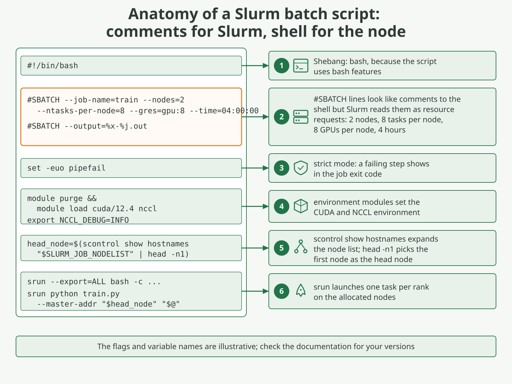

*Figure 1.9.17. The SBATCH lines are comments to the shell but resource requests to Slurm, and the rest is ordinary bash that runs on the allocated nodes.*

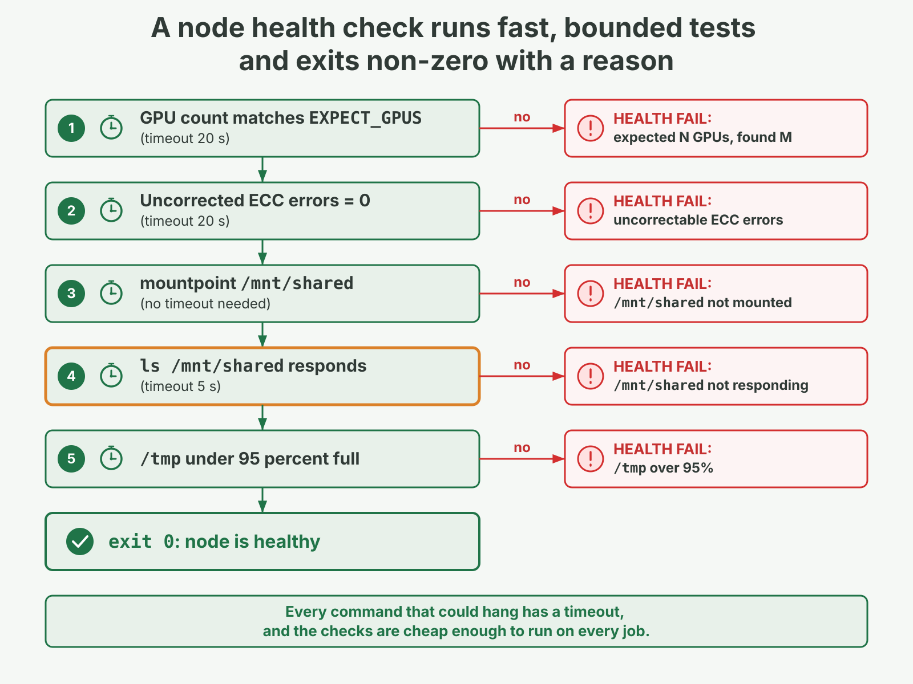

*Figure 1.9.18. A node health check runs five bounded checks in order, and each failed check exits non-zero with a reason.*

Now let us put the pieces together on the systems you will actually run. Each pattern below is a short script that you adapt rather than copy. Read each one, then make it fit your site.

**Training container entrypoint.** The entrypoint should do the minimum setup it needs, and then hand over with `exec`. That makes the real program PID 1, so it receives signals directly. Chapter 1.8 covers signals.

```bash
#!/usr/bin/env bash
set -euo pipefail
: "${MASTER_ADDR:?MASTER_ADDR must be set}"
: "${NODE_RANK:=0}"
export NCCL_DEBUG=${NCCL_DEBUG:-WARN}
ulimit -l unlimited 2>/dev/null || echo "warning: cannot raise memlock" >&2
exec torchrun --nnodes="${NNODES:-1}" --node_rank="$NODE_RANK" \
     --nproc_per_node="${GPUS_PER_NODE:-8}" \
     --rdzv_backend=c10d --rdzv_endpoint="$MASTER_ADDR:29500" \
     train.py "$@"
```

The flags and variable names here are illustrative. Check the `torchrun` and NCCL documentation for your versions.

**Slurm batch script.** A batch script is a shell script with `#SBATCH` comment directives. Pairing `set -euo pipefail` with an explicit environment makes failures visible in the job's exit code.

```bash
#!/bin/bash
#SBATCH --job-name=train --nodes=2 --ntasks-per-node=8 --gres=gpu:8 --time=04:00:00
#SBATCH --output=%x-%j.out
set -euo pipefail
module purge && module load cuda/12.4 nccl                  # environment modules (chapter 6)
export NCCL_DEBUG=INFO
head_node=$(scontrol show hostnames "$SLURM_JOB_NODELIST" | head -n1)
srun --export=ALL bash -c 'echo "$(hostname): rank $SLURM_PROCID of $SLURM_NTASKS"'
srun python train.py --master-addr "$head_node" "$@"
```

**Node health check.** Run this before each job, from a Slurm `HealthCheckProgram` or a prolog (chapter 6). The check has one hard rule: it must be fast, and it must never hang. When it fails, it exits non-zero with a reason, and that reason goes into the drain note.

```bash
#!/usr/bin/env bash
set -u
fail() { echo "HEALTH FAIL: $*"; exit 1; }
want=${EXPECT_GPUS:-8}
have=$(timeout 20 nvidia-smi -L 2>/dev/null | wc -l)
[ "$have" -eq "$want" ] || fail "expected $want GPUs, found $have"
timeout 20 nvidia-smi --query-gpu=ecc.errors.uncorrected.volatile.total --format=csv,noheader 2>/dev/null \
  | awk '$1 > 0 {bad=1} END {exit bad}' || fail "uncorrectable ECC errors"
mountpoint -q /mnt/shared || fail "/mnt/shared not mounted"
timeout 5 ls /mnt/shared >/dev/null 2>&1 || fail "/mnt/shared not responding"
[ "$(df --output=pcent /tmp | tail -1 | tr -dc 0-9)" -lt 95 ] || fail "/tmp over 95%"
exit 0
```

Notice three things. Every command that could hang on a failing device or mount has a `timeout`. The expected counts are explicit. The tests are simple, so they are cheap enough to run on every job.

**Staged shutdown on power or cooling failure.** This pattern comes from the HPC world, and it is rewritten here for Slurm. When the UPS reports battery low, or the room is overheating, a daemon runs a script. The script aims to preserve work, so it shuts down in a deliberate order. It frees nodes first, drains the scheduler, waits, and then powers off everything. Treat it as an example of loops over nodes with timeouts, logging and graceful stages:

```bash
#!/usr/bin/env bash
# staged-shutdown.sh: power off idle nodes first, drain the rest, then halt (illustrative)
set -u
log=/var/log/staged-shutdown.log
say() { printf '%s %s\n' "$(date +%FT%T)" "$*" | tee -a "$log"; }

say "starting staged shutdown"
for node in $(sinfo -h -N -t idle -o '%N'); do
  timeout 20 ssh -n -o ConnectTimeout=5 -o BatchMode=yes "$node" 'sudo /sbin/poweroff' \
    && say "powered off idle $node" || say "could not reach $node"
done
scontrol update PartitionName=ALL State=DOWN 2>/dev/null || true     # stop new jobs (illustrative)
say "waiting 5 min for power or cooling to recover"
sleep 300
if ! on_battery; then say "power restored: aborting"; exit 0; fi       # on_battery: your UPS check
for node in $(sinfo -h -N -o '%N' | sort -u); do
  timeout 20 ssh -n -o ConnectTimeout=5 -o BatchMode=yes "$node" 'sudo /sbin/poweroff' || true
done
say "halting management node"; /sbin/poweroff
```

Treat this script as a sketch of the logic, not as tested guidance for your site. The scheduler commands, the UPS query, the thresholds and the safe shutdown order all depend on your storage, your scheduler and your hardware. Temperature thresholds, if any, should trigger an *immediate* variant. In Slurm, you would typically run `scontrol update NodeName=... State=DOWN Reason=...` or `scontrol shutdown` rather than edit raw states.

**Parallel remote execution.** Looping over nodes with `ssh` runs one node at a time. For large fleets, use `pdsh`, `clush`, `parallel-ssh` or `xargs -P`:

```bash
printf '%s\n' gpu{01..32} | xargs -P 16 -I{} timeout 30 ssh -n -o BatchMode=yes {} 'hostname; nvidia-smi -L | wc -l'
pdsh -w gpu[01-32] 'uptime' | dshbak -c           # grouped output (chapter 1.29)
```

For anything stateful at scale, move to Ansible (Part 4), which gives you idempotence, inventory and reporting.

**Cloud bootstrap (`user_data`/cloud-init).** This script runs once at first boot, as root, with little environment. Use `set -euxo pipefail`, and log to a file. Make every step idempotent, pin package versions (chapter 1.7), and write a completion marker. Anything beyond installing an agent and joining a cluster belongs in configuration management.

**When to switch to Python.** Switch when any of these is true. You need JSON or YAML parsing beyond a `jq` one-liner. You have more than a few levels of nesting, or arithmetic with floats. You need unit-testable logic, or calls to APIs with retries and structured errors. The script also exceeds about 100 lines. A pragmatic hybrid works well: Python for the logic, and a ten-line shell wrapper for the environment and the `exec`.

## How it fails

Each item below starts with a symptom you may see, and ends with the fix that goes with it.

1. **A script works interactively and fails under cron, systemd or Slurm.** The `PATH` is different, there is no terminal, no `HOME`, a different working directory, and no modules are loaded. Print the environment in the failing context, then set `PATH` and use absolute paths.
2. **`rm -rf "$dir/"*` removes the wrong thing.** You will see this when `dir` was empty or unset. Use `${dir:?}` and `set -u`, and test before you delete.
3. **Quote errors on file names with spaces or leading dashes.** Quote every expansion, use `--`, and pair `find -print0` with `xargs -0`.
4. **The script keeps going after a failure.** There is no `set -e` and no explicit check, or `set -e` is ignored inside a condition or function. Check the commands that matter.
5. **A pipeline hides a failure.** `cmd1 | cmd2` returns `cmd2`'s status unless `pipefail` is set. Use `pipefail` and `${PIPESTATUS[@]}`.
6. **`bad interpreter: ^M`.** The file has Windows line endings. Convert it.
7. **A bashism under `#!/bin/sh` on Debian or Ubuntu.** You see `[[: not found` or `Syntax error: "(" unexpected`.
8. **Variables are empty after a `while read` fed by a pipe.** The loop ran in a subshell. Use redirection or process substitution.
9. **Two cron runs collide.** If you see this, add `flock`, so the second run exits.
10. **Cleanup does not run.** The process was killed with `SIGKILL`, or the trap was not set before the work began. Set traps early, and make leftover temporary data harmless with a periodic reaper for stale work directories.
11. **`ssh` in a `while read` loop swallows the input.** Use `ssh -n` or `</dev/null`.
12. **A script is edited while it runs.** You can avoid this by replacing the file atomically with `mv`.
13. **Accidental globbing in variables**, such as a `*` in a message. Quote the variable.
14. **Secrets leak** through `ps`, `set -x` logs, shell history or world-readable temp files.
15. **The script is slow.** Process-per-line loops are the usual cause. Switch to `awk`, builtins, `xargs -P` or Python.
16. **Locale surprises**, such as `sort` ordering or decimal commas in `printf`. Set `LC_ALL=C`.
17. **The script hangs forever** on a dead mount, an unreachable node or a prompt. Wrap the call with `timeout`, use `ssh -o BatchMode=yes -o ConnectTimeout=5`, give `read` a `-t` limit, and never read from a terminal in unattended runs.

## Hands-on lab: shell scripting, strict mode, and VM drills

Start with the self-checking Python lab in `code/part01/shell_scripting_lab.py`, and run it on your own machine before you touch a VM. It checks the bash parameter expansions (`${path##*/}`, `${path%/*}`, `${path%.*}`, `${path##*.}`, `${var:-}`, `${var:?}`). It also checks the `"$@"` vs `$@` vs `"$*"` word splitting. Finally, it covers the `set -e` (`errexit`) suppression contexts, the subshell vs current-shell variable scoping, and the exponential backoff retry timing.

```bash
python3 code/part01/shell_scripting_lab.py
```

Next, use a scratch directory on a disposable GCP Ubuntu VM. Every interactive VM command below has not been run on live hardware, so you are the one who confirms each result as you work through these steps.

**A. Quoting and expansion.**

```bash
mkdir -p ~/lab/sh && cd ~/lab/sh
touch 'my file.txt' r.input r.output -rf
echo $100; echo "$100"; echo '$100'     # observe
grep r.*t /etc/passwd; grep 'r.*t' /etc/passwd # why can they differ here?
for f in *; do echo "[$f]"; done
for f in $(ls); do echo "[$f]"; done    # broken: compare
rm -- -rf 'my file.txt'
set -- 'abc 123' qwe
for a in "$@"; do echo "[$a]"; done; for a in $@; do echo "[$a]"; done
```

**B. A first script with arguments, exit codes, `getopts`.**

```bash
cat > greet.sh <<'EOF'
#!/usr/bin/env bash
set -euo pipefail
usage() { echo "usage: $0 [-u] name..." >&2; exit 2; }
upper=0
while getopts ":uh" o; do case $o in u) upper=1;; h) usage;; \?) usage;; esac; done
shift $((OPTIND-1))
[ $# -ge 1 ] || usage
for n in "$@"; do
  if (( upper )); then printf 'Hello, %s\n' "${n^^}"; else printf 'Hello, %s\n' "$n"; fi
done
EOF
chmod +x greet.sh
./greet.sh; echo "status $?"
./greet.sh -u alice 'bob smith'; echo "status $?"
```

**C. Tests and `case`.**

```bash
cat > kind.sh <<'EOF'
#!/usr/bin/env bash
for p in "$@"; do
  if   [ -d "$p" ]; then echo "$p: directory"
  elif [ -L "$p" ]; then echo "$p: symlink"
  elif [ -f "$p" ] && [ -x "$p" ]; then echo "$p: executable file"
  elif [ -f "$p" ]; then echo "$p: file"
  else echo "$p: other or missing"; fi
done
EOF
bash kind.sh /etc /bin/ls /etc/passwd /nonexistent
```

**D. Parameter expansion.**

```bash
p=/data/run42/model.final.ckpt
echo "${p##*/} ${p%/*} ${p%.*} ${p##*.} ${#p}"
unset X; echo "${X:-fallback}"; echo "[${X:=set-now}]"; echo "$X"
```

**E. Subshell, pipeline and `read`.**

```bash
v=1; ( v=2 ); echo "$v"
count=0; printf '1\n2\n3\n' | while read -r n; do count=$((count+n)); done; echo "count after pipe-loop: $count"
count=0; while read -r n; do count=$((count+n)); done < <(printf '1\n2\n3\n'); echo "count with process substitution: $count"
```

**F. `trap`, `mktemp`, `flock`.**

```bash
cat > safe.sh <<'EOF'
#!/usr/bin/env bash
set -euo pipefail
exec 9>/tmp/safe.lock
flock -n 9 || { echo "already running" >&2; exit 0; }
tmp=$(mktemp -d); trap 'echo cleanup; rm -rf -- "$tmp"' EXIT
echo "work in $tmp"; sleep 30
EOF
chmod +x safe.sh
./safe.sh & sleep 1; ./safe.sh; kill %1; wait; ls /tmp | grep tmp\\. | head -3
```

Why did `cleanup` print when the first copy was killed with `SIGTERM`? Try `kill -9` and explain.

**G. `set -e` surprises.**

```bash
bash -c 'set -e; false; echo "not reached"'; echo "status $?"
bash -c 'set -e; if false; then :; fi; echo "reached"'
bash -c 'set -e; false || true; echo "reached"'
bash -c 'set -e; x=$(false); echo "reached? status of assignment hides nothing here"'
bash -c 'set -eo pipefail; false | cat; echo "not reached"'; echo "status $?"
bash -c 'set -e; f() { false; echo "inside f after false"; }; f && echo "ok"'
```

Predict each result before you run it.

**H. ShellCheck.**

```bash
sudo apt install -y shellcheck
cat > bad.sh <<'EOF'
#!/bin/sh
for f in $(ls *.txt); do cat $f; done
[ $1 = yes ] && echo ok
cd /tmp; rm -rf $dir/*
EOF
shellcheck bad.sh
```

Fix every warning, then run `bash -n`, then `bash -x`.

**I. Retry and timeout.**

```bash
retry() { local n=1 max=$1 d=$2; shift 2; until "$@"; do (( n>=max )) && return 1; sleep "$d"; ((n++)); done; }
retry 3 1 false; echo "status $?"
timeout 2 sleep 10; echo "timeout status $?" # 124
```

**J. A health check.** Write the health check from section 12 with `EXPECT_GPUS=0` on a CPU VM, make it exit 0, then break each condition and confirm the message.

## Exercises

1. **Parameter Expansion Without External Processes (`${var##*/}`, `${var%/*}`, `${var:?}`):** Given `path="/data/run42/model.final.ckpt"`, state the exact string returned by: (a) `${path##*/}`, (b) `${path%/*}`, (c) `${path%.*}`, (d) `${path##*.}`, and (e) `${#path}`. Why does `rm -rf "${dir:?dir is empty}"/*` prevent the `rm -rf /*` catastrophe when `dir=""`? Verify with `evaluate_parameter_expansion()` in `code/part01/shell_scripting.py`.
2. **Positional Parameter Quoting (`"$@"` vs `$@` vs `"$*"`) and `shift`:** A script is invoked as `./script.sh 'abc 123' qwe`. State the exact list of words produced by iterating over (a) `for a in "$@"`, (b) `for a in $@`, and (c) `for a in "$*"`. What are `$1` and `$#` after running `shift` once?
3. **`set -euo pipefail` Suppression Contexts:** In a script starting with `set -euo pipefail`, state whether `set -e` (`errexit`) aborts the script on each of the following lines and explain why: (a) `false`, (b) `if false; then :; fi`, (c) `false || true`, (d) negated `!false`, and (e) `f() { false; echo "still running"; }; f && echo "done"`.
4. **Subshells vs. Current-Shell Scoping in Pipelines and Groups:** State the final value of `v` or `count` printed in the parent shell after: (a) `v=1; (v=2 ); echo "$v"`, (b) `v=1; { v=2; }; echo "$v"`, (c) `count=0; printf '1\n2\n3\n' | while read -r n; do count=$((count+n)); done; echo "$count"`, and (d) `count=0; while read -r n; do count=$((count+n)); done < <(printf '1\n2\n3\n'); echo "$count"`.
5. **Safe Temporary Files (`mktemp` + `trap`) and Non-Blocking Locks (`flock`):** (a) In *How Linux Works* Section 11.8's `/proc/interrupts` comparison script, why must `trap "rm -f $TMPFILE1 $TMPFILE2; exit 1" INT` end with `exit 1`, and what signal cannot be caught by any `trap`? (b) Why is `exec 9>/var/lock/mytool.lock && flock -n 9` superior to `[ -e /tmp/lock ] || touch /tmp/lock` for preventing overlapping cron jobs?
6. **Exponential Backoff `retry` and Container `exec` Entrypoint:** (a) In Section 8's `retry 5 2 curl ...` function (`attempts = 5`, `initial_delay = 2`, doubling `delay *= 2` after each failed attempt), what are the individual sleep durations and total sleep seconds before the 5th attempt fails? (b) Why does Section 12's training container entrypoint end with `exec torchrun ... train.py "$@"` instead of `torchrun ... train.py "$@"`?

## Checkpoint questions (20)

<details>
<summary>1. What must be true of a file for the kernel to execute it directly as a script, and what happens if there is a UTF-8 BOM, blank line, or CRLF before `#!`?</summary>

The file needs both the read and execute permission bits (`chmod u+rx`). Its first two bytes must be `#!`, followed by the interpreter path. A blank line or a UTF-8 BOM before `#!` stops the kernel from recognizing it. With Windows CRLF line endings, each `\r` (shown as `^M`) gets attached to the interpreter path, and you see `bad interpreter: No such file or directory`.
</details>

<details>
<summary>2. What is the difference between `./script.sh`, `source script.sh` (`. script.sh`), and `exec ./script.sh`?</summary>

Suppose you run `./script.sh`. It forks a child process, so any variable or directory change you make disappears when the child exits. `source script.sh` (or `. script.sh`) runs the commands inside your current shell, so the assignments stay. `exec ./script.sh` replaces the current shell with the script through `execve`, and it never returns.
</details>

<details>
<summary>3. Why is writing `#!/bin/sh` at the top of a script that uses `[[ ]]` or arrays a cross-distribution bug?</summary>

On RHEL and Rocky Linux, `/bin/sh` is a symlink to `bash`, so bash extensions still work even when you call it as `sh`. On Debian and Ubuntu, `/bin/sh` is `dash`, a strict POSIX shell. It fails with syntax errors on `[[ ]]`, arrays, `${var//a/b}` and `<(cmd)`. The same script can pass on one family and break on the other.
</details>

<details>
<summary>4. List the six shell expansion stages in order and explain why `grep r.*t /etc/passwd` can silently search the wrong files.</summary>

The six stages run in this order: (1) brace expansion, (2) tilde expansion, (3) parameter, arithmetic and command substitution, (4) word splitting on `IFS`, (5) pathname expansion, or globbing, and (6) quote removal. Say the directory holds `r.input` and `r.output`. At stage 5, the unquoted `r.*t` expands to `grep r.input r.output /etc/passwd`. So `grep` searches the wrong files, and nothing reports an error.
</details>

<details>
<summary>5. Why does `echo $100` print `00`, and how do single quotes (`'...'`) and double quotes (`"..."`) differ?</summary>

The shell reads `$100` as `$1`, which is empty, followed by the literal `00`. Single quotes keep every character literal, so `'$100'` prints `$100`. To embed a single quote, use `'isn'\''t'`. Double quotes still expand `$`, backticks and `\`, so `"${1}00"` is the form to use when you want `$1` followed by `00`. Double quotes also suppress word splitting and globbing.
</details>

<details>
<summary>6. What is the difference between `"$@"`, unquoted `$@`, and `"$*"`?</summary>

`"$@"` expands each positional parameter as a separate, intact word, so internal spaces survive. Unquoted `$@` undergoes word splitting and globbing on every parameter. `"$*"` joins all the positional parameters into one string, separated by the first character of `IFS`.
</details>

<details>
<summary>7. What does `if` actually test in shell, and why do `[$x = y]` and `[ $x = y ]` both fail?</summary>

`if` runs a command and branches on its exit status. `0` is true and non-zero is false. `[` is a real command, a synonym for `test`, and it needs a space after `[` and before `]`. Without that space, `[$x` is looked up as a command name. Unquoted `[ $x = y ]` becomes `[ = y ]` when `x` is empty or unset, which is a syntax error.
</details>

<details>
<summary>8. Why does `[ 01 = 1 ]` evaluate to false whereas `[ 01 -eq 1 ]` evaluates to true, and what happens if you write `[ "$a" > 5 ]`?</summary>

Imagine you write `[ "$a" > 5 ]` in a script. Inside `[ ]`, `=` and `!=` compare strings character by character, so `"01"` differs from `"1"`. The integer operators `-eq`, `-ne`, `-lt`, `-le`, `-gt` and `-ge` compare numbers. Writing `>` inside `[ ]` does not compare anything. The shell treats it as output redirection and creates a file named `5`.
</details>

<details>
<summary>9. Why does `cat input.txt | while IFS= read -r line; do count=$((count+1)); done` leave `count=0` after the loop?</summary>

In bash, each stage of a pipeline runs in its own child subshell. So the increment of `count` happens only on the subshell's copy, and the parent's `count` stays 0. You can avoid this by redirecting input into the loop, as in `while IFS= read -r line; do ...; done < input.txt`, or use `< <(cmd)`.
</details>

<details>
<summary>10. Why must you pass `-n` to `ssh` inside a `while read -r host` loop?</summary>

By default, `ssh` reads standard input and passes it to the remote command. On the first iteration, it drains the rest of the list that the `while read -r host` loop is reading. Pass `ssh -n`, or redirect from `< /dev/null`, so `ssh` leaves standard input alone.
</details>

<details>
<summary>11. How do you iterate safely over `find` results when filenames may contain spaces, newlines, or leading dashes?</summary>

Print the names NUL-delimited with `find . -name '*.ckpt' -print0`. Then read them with `while IFS= read -r -d '' f; do rm -- "$f"; done`, or pass them to `xargs -0 -r rm --`. You can also use `find . -name '*.ckpt' -exec rm -- {} +`.
</details>

<details>
<summary>12. What do `${var:-def}`, `${var:=def}`, `${var:?msg}`, `${var#pat}`, `${var##pat}`, `${var%pat}`, and `${var%%pat}` do?</summary>

`:-` returns `def` when `var` is unset or empty. `:=` does the same and also assigns `def` to `var`. `:?` prints `msg` to stderr and exits when `var` is unset or empty. `#` and `##` strip the shortest and longest matching prefix, so `${path##*/}` acts like `basename`. `%` and `%%` strip the shortest and longest matching suffix, so `${path%/*}` acts like `dirname`.
</details>

<details>
<summary>13. How do bash functions handle variable scope and return values?</summary>

Variables in a bash function are **global** unless you declare them with `local`. A function returns an integer exit code from `0` to `255` with `return N`. It sends string output to stdout, and the caller captures that output with `result=$(my_func)`.
</details>

<details>
<summary>14. How does `while getopts ":hn:t:" opt` parse command-line options?</summary>

The leading `:` turns on silent error reporting. A letter followed by `:` (`n:` or `t:`) requires an argument, which lands in `$OPTARG`. An unknown option sets `opt` to `?`, and a missing argument sets `opt` to `:`. After the loop, `shift $((OPTIND - 1))` removes the parsed flags, so the positional arguments start at `$1`.
</details>

<details>
<summary>15. What is the difference between `(cd "$d" && make )` and `{ echo a; echo b; } > out.txt`?</summary>

Consider the two forms side by side. Parentheses start a child subshell. So `cd "$d"` changes the directory only inside that subshell, and the parent's `pwd` stays the same. Braces group commands in the current shell and do not fork.
</details>

<details>
<summary>16. What does `set -euo pipefail` enable, and what are four contexts where `set -e` is silently ignored?</summary>

`-e` exits when a command returns non-zero. `-u` raises an error on unset variables. `-o pipefail` fails a pipeline if any stage fails. `set -e` is silently ignored in four places: (1) inside `if`, `elif`, `while` or `until` conditions, (2) on the left side of `&&` or `||`, (3) on commands inverted with `!`, and (4) inside any function called from one of those contexts.
</details>

<details>
<summary>17. Why does a non-matching `grep` abort a script under `set -euo pipefail`, and how do you handle it cleanly?</summary>

`grep` exits with status `1` when no lines match, and with `2` on real file or syntax errors. Under `set -e`, a bare `grep` with no match aborts the script. If you put it inside an `if grep -q pat file; then ...` test, or append `|| true`, the script carries on.
</details>

<details>
<summary>18. How do `mktemp` and `trap` work together, and why must a `trap ... INT` handler include `exit`?</summary>

`mktemp` and `mktemp -d` create a uniquely named file or directory in `/tmp`, with mode `0600` or `0700`, in one atomic step. `trap 'rm -rf -- "$tmpdir"' EXIT` deletes it when the script exits. In an `INT` handler, if you leave out `exit 1`, the shell runs the cleanup and then carries on with the rest of the script.
</details>

<details>
<summary>19. How does `flock -n` prevent overlapping cron jobs better than checking `[ -e /tmp/job.lock ]`?</summary>

A check like `[ -e /tmp/job.lock ] || touch /tmp/job.lock` has a race window between the test and the creation. It also leaves a stale lock file behind after a crash or a `SIGKILL`. By contrast, `exec 9>/var/lock/job.lock && flock -n 9` takes a kernel-level lock on a file descriptor. The kernel releases it as soon as the process ends, for any reason.
</details>

<details>
<summary>20. Name five criteria that tell you a shell script should be rewritten in Python.</summary>

Switch from shell to Python when you need any of these five things. (1) Structured JSON, YAML or TOML handling beyond a simple `jq` filter. (2) Floating-point math or multi-dimensional data structures. (3) Complex nested control flow, or a script longer than 100 to 200 lines. (4) Unit tests with `pytest` and rich exception handling. (5) Processing hundreds of thousands of lines, where a fork for each line is too slow.
</details>

## Sources and review notes

- **Sources read in full:**
  - `how-linux-works-3rd-edition` — Brian Ward, *How Linux Works*, 3rd ed., **Chapter 11: Introduction to Shell Scripts** (sections 11.1–11.14: shell script basics and limitations, quoting and literals, single and double quotes, `$1`/`$#`/`$@`/`$0`/`$$`/`$?`, `shiftex` and `gs` backslash line continuation, exit codes, `if`/`elif`/`test`/`[ ]`, string/numeric/file tests, `case`, `for` and `while` loops, command substitution, `mktemp` `/proc/interrupts` comparison and `trap ... INT` explicit `exit`, here documents `<<EOF`, `basename` GIF-to-PNG loop, `awk` and Aho/Kernighan/Weinberger *The AWK Programming Language*, `sed` `3,6d` and Robbins *sed & awk Pocket Reference* 2nd ed., `xargs -0`, `expr`, `exec`, subshells `(cd uglydir; uglyprogram)` and `tar cf - orig | (cd target; tar xvf -)` with `-ef` check, `. config.sh` sourcing, `read`, and Kochan & Wood *Unix Shell Programming* 3rd ed. / Kernighan & Pike *The UNIX Programming Environment* references).
  - `supercomputers-for-linux-sysadmins-managing-modern-hpc-clusters-and-supercomputers-from-software-to` — Sergey Zhumatiy, *Supercomputers for Linux SysAdmins*, **Chapter 28: One-Two-Three Instructions** (staged UPS power-failure shutdown scripts adapted in Section 12, cross-referenced with Chapters 1.16, 1.30, 6.19, 6.23, 6.24, and 6.30) and **Chapter 29: Shell Scripts – Basics and Common Mistakes** (shebang and UTF-8 BOM, command separators, truthiness by return code, `test`/`[ ]`, quoting and `"$@"`, `&&`/`||`, comparison operators, redirection, `select`, `read`, `getopts`, `()` vs `{ ; }`, functions and `local`, `trap`, and the parameter-expansion shortcut table; cross-referenced with Chapters 21, 25, 26, and 27).
- **Run here:** `python3 code/part01/shell_scripting_lab.py` (24 passed, 0 failed).
- **Explicitly labelled inferences:** The `torchrun` container entrypoint, Slurm `#SBATCH` wrapper, and GPU node `HealthCheckProgram` script in Section 12 apply the chapter's production shell patterns (and `SIGINT` / `SIGTERM` trap handling from Chapters 1.5, 1.8, and 1.15) to Parts 5, 6, and 10 (including *Supercomputers for Linux Sysadmins* Chapters 22 and 23).
- **Not verified on live hardware:** All interactive VM shell snippets and cluster health/shutdown scripts are marked and should be tested in a scratch directory on a disposable VM.
