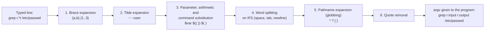

# 1.9 Shell scripting that survives production

| | |
|---|---|
| Level | Basics |
| Priority tier | 0 |
| Lab venue | GCP / GKE (one Ubuntu VM) |
| Part | Part 1: Linux, from the command line to the kernel and performance |
| Status | Drafted, labs **untested** |

## Why this matters for AI infrastructure

Glue is most of an infrastructure engineer's job, and the glue is mostly shell: the entrypoint of a training container, the `sbatch` script that launches 64 ranks, the node health check that runs before every job, the `user_data` that bootstraps a cloud VM, the Dockerfile `RUN` lines, the CI step that builds a driver package, the prolog and epilog scripts that run as root on every compute node. Shell is available everywhere, starts instantly and composes other tools well. It is also unforgiving: a missing quote deletes the wrong directory, an unchecked error lets a job "succeed" with no output, a script that works on your laptop breaks when run by `cron` or `slurmd` with a different environment.

This chapter teaches shell scripting from the first line to patterns that hold up in production. It follows two threads: the language itself (quoting, variables, exit codes, tests, loops, functions, expansion, here documents), and the discipline (strict mode and its limits, traps and cleanup, locking, idempotence, logging, linting) that turns a one-off into something a team can run unattended. It also tells you when to stop and use Python.

## Prerequisites and outcomes

You should be comfortable with the command line, redirection and pipes (1.2), file permissions (1.3, 1.6) and signals (1.8).

After this chapter you can:

- Write an executable script with a correct shebang, run it, source it, and explain the difference.
- Quote correctly (single, double, none) and predict word splitting and globbing.
- Use positional parameters, `$@`, `shift`, `getopts`, special variables and exit codes.
- Write conditionals with `if`, `[ ]`, `[[ ]]`, `case`, `&&` and `||`, using file, string and numeric tests.
- Write loops that handle awkward file names, read files line by line safely, and iterate over command output without breaking.
- Use parameter expansion instead of `sed` or `awk` for simple string work.
- Write functions with local variables, here documents, temporary files that are cleaned up, and subshells.
- Make a script fail loudly (`set -euo pipefail`, understand its traps), log, lock and retry.
- Lint with ShellCheck and debug with `bash -x`.
- Recognise when to move the logic to Python.

## 1. The shape of a script

A **shell script** is a file of commands that a shell reads and runs exactly as if you typed them. Nothing more. If you can type it at a prompt, you can script it.

```bash
#!/usr/bin/env bash
# disk-report: print the five largest directories under a path
set -euo pipefail

dir=${1:-.}
du -x -d1 -- "$dir" 2>/dev/null | sort -rn | head -5
```

Points to notice, each expanded below:

- The first line, the **shebang**, tells the kernel which interpreter to run. Nothing may precede `#!` (no blank line, no space, no byte-order mark; a UTF-8 BOM added by some editors silently breaks it).
- A `#` starts a comment (except the shebang at the top).
- The script needs the **execute** bit *and* the **read** bit (the interpreter has to read it): `chmod u+rx disk-report` (use `700` or `750` to keep others out).
- Run it by path: `./disk-report /var`, or by placing it in a directory on `$PATH`. Running `disk-report` without `./` fails if the current directory is not in `$PATH`, which is deliberate (chapter 1.6).

### Choosing the interpreter

- `#!/bin/sh` asks for the POSIX shell. On Debian and Ubuntu `/bin/sh` is **dash**, a small fast shell without bash extensions (`[[ ]]`, arrays, `${var//x/y}`, `<<<`, process substitution); on RHEL-family `/bin/sh` is bash in POSIX mode. A script that uses bash features under `#!/bin/sh` works on one family and fails on the other, a classic cross-distribution bug. **Rule: if you use any bash feature, say `#!/usr/bin/env bash` or `#!/bin/bash`; if you write `#!/bin/sh`, keep to POSIX and test with `dash`.**
- `#!/usr/bin/env bash` finds `bash` on `$PATH`; it works when bash is in an unusual place but means a different `bash` can be picked up (for example, one in a conda environment). In locked-down production scripts a fixed `#!/bin/bash` is often preferred.
- The shebang is not limited to shells: `#!/usr/bin/env python3`, `#!/usr/bin/awk -f`. An executable text file starting with `#!` is run as `interpreter [one-optional-argument] script-path args...`. Do not count on more than one argument after the interpreter; systems differ in how they split it.
- Running `bash script.sh` ignores the shebang and the execute bit. Running `sh script.sh` on a bash script uses the wrong shell.

### Run, source, or exec

| How | What happens | Variables set in the script visible afterwards? |
|---|---|---|
| `./script.sh` | New child process (forks and execs the interpreter) | No: a child cannot change its parent's environment |
| `source script.sh` or `. script.sh` | The current shell reads and executes the commands | **Yes**: this is how you load configuration and environment files (`source venv/bin/activate`, `. /etc/profile`) |
| `exec ./script.sh` | Replaces the current shell with the script | The shell no longer exists |
| `bash -x script.sh` | Run with tracing | No |

A sourced file does not need the execute bit and does not need a shebang. Use sourcing for shared function libraries and configuration. A script run as a child returns only its **output** and its **exit code** to the caller.

### The limits of shell (`HLW` Section 11.1.1)

The Bourne shell manipulates commands and files with relative ease, and as you saw in Chapter 1.2, it can redirect output and chain pipes effortlessly. However, a shell script is only one tool for Unix programming, and while scripts have considerable power, they also have limitations. If you are trying to pick apart strings, perform repeated arithmetic computations, or access complex databases, or if you want functions and complex control structures, you are much better off using a scripting language like Python, Perl, or `awk`, or even a compiled language like C or Go. Finally, pay attention to the size of your shell scripts: keep them short (a page or two of glue).

## 2. Quoting and expansion: the heart of shell

Before running a command, the shell performs a series of **expansions** on the line, and only then does it execute. The command never sees quotes or `$` signs; it sees the result. Misunderstanding this is the source of most shell bugs.



(The text of the original command here is the classic trap: if the current directory has files `r.input` and `r.output`, the unquoted pattern `r.*t` is a *glob*, matching them, and `grep` is run on the wrong arguments.)

### The three kinds of quoting (`HLW` Section 11.2)

One of the most confusing elements of working with the shell and scripts is knowing when and why to use quotation marks and other punctuation.

| Quoting | Effect | Example |
|---|---|---|
| **Single quotes** `'...'` | Everything inside is literal. No expansion at all. Cannot contain a single quote. | `echo '$100 *'` prints `$100 *` |
| **Double quotes** `"..."` | Literal except `$` (parameter/arithmetic/command substitution), backtick, and `\` before `$`, `"`, or `\`. **No word splitting or globbing of the result.** | `echo "There is no * in my path: $PATH"` |
| **Backslash** `\c` | Makes the next single character literal | `echo \$100`, `echo I don\'t` |

Say you want to print the string `$100` and you run `echo $100`—why does it print `00`? The shell reads `$1` (the first positional parameter, empty) followed by the characters `00`. Double quotes (`echo "$100"`) do not help because the shell still substitutes variables inside double quotes; only `echo '$100'` or `echo \$100` prints `$100` (or `"${1}00"` if you wanted `$1` followed by `00`). Conversely, when you run `echo "There is no * in my path: $PATH"`, the shell substitutes `$PATH` but does *not* glob-expand the `*`. (If you are using double quotes when working with large multi-line blocks of text, use a here document instead, covered in section 6.) **Reach for single quotes first when you want a literal**; they guarantee no substitutions. Use double quotes when you need variables expanded but want the result kept as one word.

To get a single quote inside single quotes, close the quote, add an escaped quote and reopen: `'this isn'\''t odd'` (that is `'this isn'`, `\'`, `'t odd'`). Inside double quotes a lone `'` is fine: `echo "isn't"`.

Quoting joins and splits words: **everything inside one pair of quotes is a single argument**, including spaces. `grep 'r.*t /etc/passwd'` passes one argument and reads standard input. And `a"b c"` is a single word `ab c`, while `a b c` is three.

### Word splitting: why `$var` should almost always be `"$var"`

After substitution, an *unquoted* result is split into words on whitespace (the characters in `IFS`), and each word is then glob-expanded. So:

```bash
file="my report.txt"
rm $file              # DANGER: runs  rm my report.txt   (two arguments)
rm "$file"            # correct: one argument
dir=""
rm -rf $dir/*         # DANGER: expands to  rm -rf /*   when dir is empty
rm -rf "${dir:?dir is unset or empty}"/*     # aborts instead
```

The general rule: **double-quote every expansion** (`"$var"`, `"$(cmd)"`, `"$@"`) unless you have a specific reason not to. The few exceptions are when you intentionally want splitting (for example, a variable holding a list of options, better stored in an array) or globbing. ShellCheck will warn about the rest (`SC2086`).

### `$@` versus `$*`

```bash
for a in "$@"; do echo "[$a]"; done    # called as: script 'abc 123' qwe  ->  [abc 123] [qwe]
for a in $@;   do echo "[$a]"; done    # unquoted: [abc] [123] [qwe]  (broken)
for a in "$*"; do echo "[$a]"; done    # one word: [abc 123 qwe]
```

`"$@"` expands to each argument as a separate, correctly quoted word (`"$1" "$2" ...`), whereas `"$*"` joins all arguments into one string (`"$1 $2 ..."`, separated by the first character of `IFS`). When nesting quotes around command substitutions (`SCL` Ch. 29), old backquotes like `base="\`basename "$file".bak\`"` quickly become unreadable; using `$(...)` (`base="$(basename "$file").bak"`) allows clean nested double quotes. `"$@"` is always the right way to pass your arguments on to another command: `exec python3 train.py "$@"`.

### Even `echo $var` can misbehave

If `var` contains `-n` or `-e`, `echo $var` interprets it as an option. For anything that might start with a dash or contains backslashes, use `printf '%s\n' "$var"`, which has no such ambiguity.

### Globbing

`*` any string, `?` one character, `[abc]`/`[a-z]` a class, `[!a-z]` negation; bash adds `{a,b,c}` (brace expansion; generates words, does not match files) and, with `shopt -s extglob`, patterns like `+(a|b)`. If no file matches, bash passes the pattern literally to the command unless you set `shopt -s nullglob` (pattern vanishes) or `failglob` (error). Always put `--` before file arguments that come from globs or variables so a file named `-rf` cannot be read as an option: `rm -- "$f"`. (Chapter 1.2 covers globbing in detail.)

## 3. Variables, parameters and special variables

### Variables

```bash
name="alice"            # NO spaces around =
echo "$name"
echo "${name}_backup"   # braces mark where the name ends
readonly MAX=8          # cannot be changed
export CUDA_VISIBLE_DEVICES=0,1    # exported: visible to child processes
local_var=1             # not exported: only this shell
unset name
```

All shell variables are strings (arrays and integers are special cases). A variable assigned on the same line as a command is set **only for that command**: `PATH=/opt/tools/bin:$PATH make` (no subshell needed). `export` marks a variable to be inherited by child processes. **`local`** (inside functions) limits scope.

### Positional parameters and special variables

| Variable | Meaning |
|---|---|
| `$0` | The script's name (as invoked); use in usage and error messages |
| `$1` ... `$9`, `${10}` | The arguments (braces are required beyond 9) |
| `$#` | Number of arguments |
| `$@`, `$*` | All arguments (see above) |
| `$?` | Exit status of the last command |
| `$$` | PID of the current shell |
| `$!` | PID of the most recent background command |
| `$_` | Last argument of the previous command |
| `$-` | Current shell option flags |
| `$PPID` | Parent's PID |
| `$LINENO`, `$BASH_SOURCE`, `$FUNCNAME`, `$SECONDS`, `$RANDOM`, `$HOSTNAME`, `$UID`, `$EUID` | Bash conveniences |

`shift` discards `$1` and moves the rest down (`shift 2` discards two), which lets you consume arguments in a loop (`while [ "$#" -gt 0 ]; do ... shift; done`). For example, in `HLW` Section 11.3.1, a tiny script `shiftex` that runs `echo Argument: $1; shift; echo Argument: $1; shift; echo Argument: $1` invoked as `./shiftex one two three` prints `Argument: one`, `Argument: two`, and `Argument: three`. And if a command line in your script gets too long—such as a Ghostscript pipeline `gs -q -dBATCH -dNOPAUSE -dSAFER -sOutputFile=- -sDEVICE=pnmraw "$@"`—you can split it across multiple lines by placing a backslash (`\`) at the very end of each continued line. Send diagnostics to **standard error**, not output, so they do not corrupt data in pipelines: `echo "$0: bad option: $1" >&2`.

### Exit codes

Every command ends with an **exit code**: 0 means success, anything else is a failure, with a number that can say what failed. The shell stores the last one in `$?`; check it immediately, because the next command overwrites it (even `echo $?` resets it to 0). Your script exits with `exit N` (without an argument, it exits with the status of the last command).

Conventions you will meet:

| Code | Meaning |
|---|---|
| 0 | Success |
| 1 | General error (and, for `grep`/`diff`/`cmp`, "no match" or "files differ", not an error) |
| 2 | Misuse of a command or a real error for `grep`/`diff` |
| 126 | Found but not executable (permissions, wrong architecture) |
| 127 | Command not found |
| 128 + N | Killed by signal N (130 Ctrl-C, 137 `SIGKILL`, 143 `SIGTERM`) |
| 255 | Exit status out of range, or `ssh` connection failure |

Some programs use non-zero for normal conditions: `grep` returns 1 when it finds nothing, which is *not* a failure but will trip `set -e` (section 8). Read the manual page's EXIT STATUS section when unsure.

## 4. Conditionals

### `if` runs a command and tests its exit code

This is the point to absorb: **`if` does not test an expression, it runs a command**; zero means "true", non-zero "false".

```bash
if grep -q '^daemon:' /etc/passwd; then
  echo "found"
elif [ -e /etc/passwd ]; then
  echo "file exists but no daemon user"
else
  echo "no passwd file at all" >&2
fi
```

`if`, `then`, `elif`, `else` and `fi` are shell keywords; everything else is a command. The semicolon before `then` is the ordinary command separator; if `then` is on its own line you do not need it.

### `[`, `test` and `[[`

`[` is an actual command (a program, also built into the shell for speed), a synonym for `test`; the closing `]` is a required last argument. That is why the spaces matter: `[ "$x" = ok ]` is the command `[` with four arguments, whereas `[$x = ok]` or `if [$count -gt 10]; then` looks for a nonexistent command named `[$x` or `[$count`. Everything the test command sees has been through word splitting (on spaces, tabs, or line feeds), so **quote variables** in tests: if `v=''`, writing `if [ $v = '' ]; then` expands to `[ = '' ]` (a syntax error because the first operand vanished), whereas `if [ "$v" = '' ]; then` or the classic prefix idiom `if [ "x$v" = 'x' ]; then` works even when `v` is empty or contains spaces.

Any command inside a script can also use I/O redirection (`SCL` Ch. 29): `mycommand <./infile` (stdin from file), `mycommand >./outfile` (stdout to file), `mycommand 2>./errfile` (stderr to file), `mycommand &>./fulloutput` (both stdout and stderr to file in bash), `mycommand | grep failed` (pipe stdout), and `mycommand |& grep error` (bash shorthand for `2>&1 |`, piping both stdout and stderr).

Bash adds **`[[ ... ]]`**, a keyword with saner behaviour: no word splitting inside, `&&` and `||` work, `=~` for regular expressions, `==` with glob patterns on the right, and `<`/`>` string comparison:

```bash
if [[ $name == a* && -f $file ]]; then ...      # $name need not be quoted on the left
if [[ $line =~ ^([0-9]+)\ GPU ]]; then echo "${BASH_REMATCH[1]}"; fi
```

Use `[[ ]]` in bash scripts and `[ ]` (with quotes) in POSIX `sh` scripts.

### The test operators

**String tests**: `=` (equal; `==` in bash), `!=`, `-z str` (empty), `-n str` (non-empty). **Numeric tests**: `-eq -ne -lt -le -gt -ge`. The equals sign compares *strings*: `[ 01 = 1 ]` is false, `[ 01 -eq 1 ]` is true. Comparing numbers with `>` inside `[ ]` redirects output to a file named `1`. (Inside `(( ))` you can use `>`, `<`, `==` on numbers.)

**File tests**:

| Test | True when |
|---|---|
| `-e f` | exists |
| `-f f` | regular file |
| `-d f` | directory |
| `-h f` or `-L f` | symbolic link (other tests follow the link) |
| `-s f` | exists and is non-empty |
| `-r f`, `-w f`, `-x f` | readable, writable, executable by you |
| `-u f`, `-g f`, `-k f` | setuid, setgid, sticky bit |
| `-b`, `-c`, `-p`, `-S` | block device, character device, named pipe, socket |
| `f1 -nt f2`, `f1 -ot f2` | newer than, older than |
| `f1 -ef f2` | same file (same device and inode) |

**Combining tests**: `!` negates; `[ A ] && [ B ]` and `[ A ] || [ B ]` combine two commands; `[ A -a B ]`/`[ A -o B ]` combine within one `[` (considered obsolescent and ambiguous; prefer two `[`). **Do not write `[ "$x" = a || "$x" = b ]`**: `||` ends the `[` command. Write `[ "$x" = a ] || [ "$x" = b ]` or `[[ $x == a || $x == b ]]`.

### Logical constructs: `&&` and `||` as one-line conditionals

`cmd1 && cmd2` runs `cmd2` only if `cmd1` succeeded; `cmd1 || cmd2` only if it failed. Handy for guards (`[ -d "$d" ] || mkdir -p "$d"`, `command -v nvidia-smi >/dev/null || exit 0`) and error exits (`cd "$dir" || exit 1`). Beware `a && b || c`: it is *not* if/else (`c` also runs if `b` fails). Grouping with braces needs a semicolon before the closing brace: `[ -z "$x" ] && { echo "empty" >&2; exit 1; }`.

### `case`

`case` matches a string against glob patterns without running commands. It is the clean way to dispatch on a subcommand or option:

```bash
case "${1:-}" in
  start|up)    start_service ;;
  stop)        stop_service ;;
  status)      status_service ;;
  restart|r*)  stop_service; start_service ;;
  "")          echo "usage: $0 {start|stop|status|restart}" >&2; exit 2 ;;
  *)           echo "unknown command: $1" >&2; exit 2 ;;
esac
```

Each branch ends with `;;`; patterns can be alternatives separated by `|`; `*` is the catch-all. (Bash also offers `;&` and `;;&` to fall through.)

### `select` and `read`

`select` prints a numbered menu and reads a choice into a variable (set the prompt in `PS3`; always `break` out); `read` takes a line of input (`read -r -p "Continue? [y/N] " ans`). Use `read -r` always (without `-r`, backslashes are interpreted). In unattended scripts, never block on `read`: give an option for non-interactive use (`--yes`) or check `[ -t 0 ]` (is standard input a terminal?).

### Arithmetic

`$(( ))` computes integers: `n=$(( n + 1 ))`, `echo $(( 1024 * 1024 ))`; `(( n > 10 ))` is a command that succeeds if the expression is non-zero (use it in `if`). Bash has no floating point; use `bc`, `awk` or Python (`awk 'BEGIN{print 3/7}'`). `expr 1 + 2` is the old, slow way; avoid it. `let` is similar to `(( ))`.

## 5. Loops

### `for`

```bash
for node in gpu01 gpu02 gpu03; do ssh "$node" uptime; done      # a list of words
for f in *.log; do gzip -- "$f"; done                            # glob (unquoted, but quote "$f" in the body)
for i in {1..5}; do echo "$i"; done                              # brace sequence (bash)
for ((i=0; i<8; i++)); do echo "GPU $i"; done                    # C-style (bash)
for arg in "$@"; do ...; done                                    # each argument safely
```

If a glob matches nothing, the loop body runs once with the literal pattern (`*.log`); guard with `[ -e "$f" ] || continue` or `shopt -s nullglob`.

### `while` and `until` (`HLW` Section 11.6.2)

The Bourne shell's `while` loop uses exit codes just like the `if` conditional: `while` repeats as long as its condition command exits with `0`, whereas `until` repeats as long as its condition command exits non-zero. `break` leaves a loop immediately, and `continue` skips to the next iteration. For example, in `HLW` Section 11.6.2, `FILE=/tmp/whiletest.$$; echo firstline > $FILE; while tail -10 $FILE | grep -q firstline; do echo -n Number of lines in $FILE:' '; wc -l $FILE | awk '{print $1}'; echo newline >> $FILE; done; rm -f $FILE` appends `newline` for 10 iterations until `firstline` scrolls out of `tail -10`. And in cluster scripts, `until` cleanly polls a rebooting node:

```bash
until ping -c1 -W1 "$host" >/dev/null 2>&1; do sleep 5; done     # wait for a node to come back
```

### Reading a file line by line (the right way)

```bash
while IFS= read -r line; do
  printf 'line: %s\n' "$line"
done < input.txt
```

`IFS=` stops leading/trailing whitespace trimming; `-r` stops backslash processing; the redirect feeds the file to the *loop*. Piping into a `while` (`cat f | while read ...`) runs the loop in a **subshell**, so variables set inside are lost afterwards (section 7). To split fields: `while IFS=: read -r user _ uid _; do ...; done < /etc/passwd`.

### Loops over command output and find results

Never parse `ls`. File names can contain spaces, newlines and leading dashes. The safe patterns:

```bash
for f in ./*.csv; do ...; done                                   # a glob, not ls
find . -name '*.ckpt' -print0 | while IFS= read -r -d '' f; do rm -- "$f"; done
find . -name '*.ckpt' -print0 | xargs -0 -r rm --                # many files, few processes
find . -name '*.ckpt' -exec rm -- {} +                           # no xargs needed
mapfile -t nodes < <(scontrol show hostnames "$SLURM_JOB_NODELIST")   # bash 4+: command output into an array
```

`xargs` batches arguments to avoid the "argument list too long" error and can run in parallel (`-P 8`); `-0` with `find -print0` handles any file name; `-r` (GNU) skips running with no input; add `--` when file names may start with a dash.

## 6. Command and process substitution, temporary files, here documents

### Command substitution

`$(command)` replaces itself with the command's output (trailing newlines removed). Prefer it to the older backticks (`` `command` ``), which nest badly and are harder to read. Always quote it: `files="$(ls)"` is rarely what you want; `now="$(date +%F)"`. Do not use it where a glob works (`for f in $(ls)` is a bug), and do not use it to capture a pipeline of a huge output.

```bash
flags=$(grep -m1 '^flags' /proc/cpuinfo | cut -d: -f2)
gpus=$(nvidia-smi --query-gpu=name --format=csv,noheader | sort -u | wc -l)
```

**Process substitution** (`<(cmd)`, `>(cmd)`, bash) presents a command's output as a file name, useful when a tool wants files: `diff <(ssh node1 'rpm -qa | sort') <(ssh node2 'rpm -qa | sort')`.

### Temporary files (`mktemp` and `trap`)

A fixed name like `/tmp/out` is a bug (two runs collide) and a security problem (predictable names in a shared directory can be hijacked with a symlink). Use `mktemp` (part of GNU `coreutils`). For example, this script from `HLW` Section 11.8 creates two unique temporary files with template `XXXXXX` to compare device interrupts (`/proc/interrupts`) over a two-second window, and registers an `INT` trap so pressing Ctrl-C does not leave stale `/tmp/im*` files behind:

```bash
#!/bin/sh
TMPFILE1=$(mktemp /tmp/im1.XXXXXX)
TMPFILE2=$(mktemp /tmp/im2.XXXXXX)
trap "rm -f $TMPFILE1 $TMPFILE2; exit 1" INT
cat /proc/interrupts > $TMPFILE1
sleep 2
cat /proc/interrupts > $TMPFILE2
diff $TMPFILE1 $TMPFILE2
rm -f $TMPFILE1 $TMPFILE2
```

Notice that when trapping `INT` (or `TERM`), you **must** include an explicit `exit` inside the handler (`trap "rm -f ...; exit 1" INT`), or the shell will clean up the files and then continue executing the script right where it left off. In `bash`, setting an `EXIT` trap (`tmp=$(mktemp); tmpdir=$(mktemp -d /tmp/myjob.XXXXXX); trap 'rm -rf -- "$tmp" "$tmpdir"' EXIT`) cleans up automatically on normal exit, `exit 1`, or `set -e` failure, though no user-space trap can run on `SIGKILL` (`kill -9`).

### Here documents and here strings

A **here document** feeds multiple lines to a command's standard input:

```bash
cat > /etc/myservice.conf <<EOF
host = $(hostname -f)
generated = $(date -u +%FT%TZ)
EOF

cat <<'EOF'            # quoted delimiter: no expansion inside (for scripts you want literal)
echo "this $HOME is not expanded"
EOF

cat <<-EOF             # <<- strips leading TABS, so you can indent the block
	indented with tabs
	EOF
```

The marker (any word, conventionally uppercase) must appear alone on a line to end it. An unquoted marker lets `$var`, `$(cmd)` and backslashes expand; a quoted marker (`<<'EOF'`) suppresses all that, which is what you want when writing another script or a config containing `$`. A **here string** `<<< "$var"` supplies a single string on stdin (bash): `read -r a b <<< "$line"`. Here documents are the clean way to write multi-line files and to run remote scripts: `ssh node 'bash -s' <<'EOF' ... EOF`.

## 7. Parameter expansion, functions, grouping and subshells

### Parameter expansion: string work without extra processes

Much of what people reach for `sed`, `awk` or `basename` to do is available in bash itself, in the same process, which is faster and avoids quoting traps:

| Expression | Result |
|---|---|
| `${var:-default}` | `var`, or `default` if unset or empty |
| `${var:=default}` | same, and also **assigns** the default to `var` |
| `${var:?message}` | if unset or empty, print `message` and exit (a guard) |
| `${var:+alt}` | `alt` if `var` is set and non-empty, else empty |
| `${#var}` | length of the string |
| `${var#pattern}` / `${var##pattern}` | remove the shortest / longest matching **prefix** |
| `${var%pattern}` / `${var%%pattern}` | remove the shortest / longest matching **suffix** |
| `${var/old/new}` / `${var//old/new}` | replace the first / every match (bash) |
| `${var:offset:length}` | substring (bash) |
| `${var^^}` / `${var,,}` | upper / lower case (bash 4) |

```bash
path=/data/run42/model.final.ckpt
echo "${path##*/}"       # model.final.ckpt   (like basename)
echo "${path%/*}"        # /data/run42        (like dirname)
echo "${path%.*}"        # /data/run42/model.final   (strip last extension)
echo "${path##*.}"       # ckpt
echo "${USER:-unknown}"
: "${CUDA_HOME:=/usr/local/cuda}"   # set a default once (the colon command does nothing)
```

Some common roundabout idioms and their better forms: `echo "$var" | wc -c` → `"${#var}"`; `echo "$var" | sed 's/^.*abc//'` → `"${var#*abc}"`; `[ "x$VAR" = x ]` → `[ -z "${VAR:-}" ]`; `if [ -z "$VAR" ]; then VAR=abc; fi` → `VAR=${VAR:-abc}`; `cat file | grep x` → `grep x file`; `sort | uniq` → `sort -u` (but `sort | uniq -c` stays); `sudo su` → `sudo -s` or `sudo -i`.

### Arrays

Bash has indexed and associative arrays, the right way to hold lists (instead of space-separated strings):

```bash
nodes=(gpu01 gpu02 "gpu 03")
nodes+=(gpu04)
echo "${#nodes[@]} nodes; first is ${nodes[0]}"
for n in "${nodes[@]}"; do echo "[$n]"; done      # quotes keep "gpu 03" as one element
cmd=(python3 train.py --lr 3e-4 --data "/mnt/my data")
"${cmd[@]}"                                        # run a command assembled safely
declare -A rate=([a100]=2.5 [h100]=4.0)            # associative array (bash 4+)
echo "${rate[h100]}"
```

### Functions

```bash
log() { printf '%s %s\n' "$(date +%T)" "$*" >&2; }

require_cmd() {
  command -v "$1" >/dev/null 2>&1 || { log "missing command: $1"; return 1; }
}

gpu_count() {
  local n                                    # local: do not leak into the caller
  n=$(nvidia-smi -L 2>/dev/null | wc -l)
  echo "$n"                                  # a function "returns" text on stdout...
}                                            # ...and a status with 'return N' (0..255)

require_cmd nvidia-smi || exit 1
count=$(gpu_count)
```

Define a function as `name() { ...; }` (the `function` keyword is a bash/ksh extra; skip it). Arguments arrive as `$1 $2 ...` and `$@`; **`local`** keeps variables private (without it, all variables are global); `return` ends the function with a status, while `echo` gives it a value (captured with `$(...)`). `$(...)` runs the function in a subshell, so side effects (variable changes) are lost; to get both a value and side effects use a global variable or `printf -v`.

### Options with `getopts`

```bash
usage() { echo "usage: $0 [-h] [-n nodes] [-t dir] file..." >&2; exit 2; }
nodes=1; target=.
while getopts ":hn:t:" opt; do
  case $opt in
    h) usage ;;
    n) nodes=$OPTARG ;;
    t) target=$OPTARG ;;
    :) echo "option -$OPTARG needs an argument" >&2; exit 2 ;;
    \?) echo "unknown option -$OPTARG" >&2; exit 2 ;;
  esac
done
shift $((OPTIND - 1))          # remaining arguments are in "$@"
```

The option string lists single-letter options; a colon after a letter means it takes an argument (in `$OPTARG`); a leading colon selects quiet mode, where you report errors yourself. `getopts` handles only short options; for long options (`--nodes=4`) write a `while`/`case`/`shift` loop, or use Python's `argparse`.

### Grouping and subshells

- `( commands )` runs in a **subshell**, a child copy of the shell: changes to variables, the working directory and options vanish when it ends. Use it to execute a program (`uglyprogram`) inside a directory (`uglydir`) or with a temporary `PATH` without altering your parent shell: `(cd uglydir; uglyprogram)` or `(PATH=/usr/confusing:$PATH; uglyprogram)` (though for a single command, prefixing `PATH=/usr/confusing:$PATH uglyprogram` avoids the subshell).
- `{ commands; }` runs in the **current shell** (note the spaces and the semicolon); use it to group commands under one redirection (`{ echo a; echo b; } > file`).
- Pipelines run each stage in its own subshell (in bash, unless `shopt -s lastpipe` in a non-interactive script), which is why `echo hi | read x; echo "$x"` prints nothing. A classic pipeline-plus-subshell idiom from `HLW` Section 11.11 duplicates a directory tree `orig` into `target` while preserving ownership and permissions: `tar cf - orig | (cd target; tar xvf -)` (or `tar xpf -`; always verify first that `target` exists and is not the same inode as `orig` via `[ -d orig -a ! orig -ef target ]`).

```bash
myvar=10
( myvar=20 ); echo "$myvar"        # 10: changed only in the subshell
{ myvar=30; }; echo "$myvar"       # 30
tar cf - orig | ( cd target && tar xpf - )     # copy a tree preserving ownership and permissions
```

### Command search and builtins

Know whether a word is a builtin, function, alias or program: `type -a cmd`, `command -v cmd` (portable existence check), `which` (external, less reliable). `exec cmd` replaces the shell with `cmd` (no return), used as the last line of wrapper scripts so signals go straight to the real program. `source file` includes another file. `hash -r` clears the remembered command locations after you move programs. `eval` runs a string as code and is a common source of injection bugs; avoid it, and use arrays instead.

## 8. Making scripts safe: strict mode, traps, locks, retries

### Strict mode, and its traps

The common opening for a bash script:

```bash
set -euo pipefail
IFS=$'\n\t'          # optional: split only on newline and tab, not spaces
```

| Option | Effect | Caveat |
|---|---|---|
| `set -e` (`errexit`) | Exit when a command fails | Not applied inside `if`/`while` conditions, in the left side of `&&`/`\|\|`, or when the command is part of a `!` negation. In functions called from those contexts it is suppressed entirely. Commands like `grep` that return 1 "normally" abort the script. `((i++))` returns 1 when `i` was 0. Do not rely on it as your only error handling. |
| `set -u` (`nounset`) | Using an unset variable is an error | Catches typos (`$dri` instead of `$dir`) and the `rm -rf $dir/*` accident. Use `${var:-}` where emptiness is allowed; `"${arr[@]}"` on an empty array fails in old bash (< 4.4). |
| `set -o pipefail` | A pipeline fails if **any** stage fails (not just the last) | `cmd \| head -1` can report failure because `cmd` got `SIGPIPE`. |
| `set -x` (`xtrace`) | Print each command (with expansion) before running it | The debugging switch; set `PS4='+ ${BASH_SOURCE}:${LINENO}: '` to see locations. Beware that secrets in arguments are printed. |

Handle expected failures explicitly: `if ! grep -q pattern file; then ...`, `grep -q x f || true`, `cmd || { echo "cmd failed" >&2; exit 1; }`. For debugging only a section, `set -x; ...; set +x`. Many senior engineers treat `set -e` as a safety net, not a design, and check the commands that matter.

An important idea is to **fail loudly and early**: validate arguments and prerequisites at the top (`command -v`, `[ -r "$cfg" ]`), refuse to run when a variable is empty, and exit non-zero with a message to stderr. A script that returns 0 after silently doing nothing is worse than one that crashes.

### Cleanup with `trap`

```bash
workdir=$(mktemp -d)
cleanup() { rm -rf -- "$workdir"; }
trap cleanup EXIT                         # always: normal, error, or exit-from-signal
trap 'echo "interrupted" >&2; exit 130' INT
trap 'echo "terminated" >&2; exit 143' TERM
```

Also useful: `trap 'echo "error on line $LINENO" >&2' ERR` (with `set -E`/`errtrace` so it applies in functions), and `RETURN`/`DEBUG` for tracing. Signals and traps are covered in chapter 1.8; the point here is to put **cleanup in one place** and to run long-lived commands in the background plus `wait` if you need the trap to fire promptly.

### Logging and output discipline

- **Data to stdout; messages to stderr.** A script whose diagnostics go to stdout corrupts the pipelines that consume it.
- Timestamped log function (section 7), and a `--verbose`/`-x` switch rather than editing the script to debug.
- Under Slurm or systemd, stdout/stderr already go to files or the journal; do not reinvent log rotation. To log from a shell script to the journal, use `logger -t mytool -p user.info "message"`.
- Send both streams to a file and keep seeing them: `exec > >(tee -a "$log") 2>&1` (bash).

### Locking: only one copy at a time

Scripts run by `cron` or timers can overlap. `flock` gives a reliable advisory lock that the kernel releases when the process dies:

```bash
exec 9>/var/lock/mytool.lock
flock -n 9 || { echo "already running" >&2; exit 0; }
# ... work; the lock is held until the script exits ...
```

Or wrap a command: `flock -n /var/lock/mytool.lock mytool`. Avoid hand-made lock files (`[ -e lock ] || touch lock`): they race and are left behind after a crash. (A second option, `mkdir lockdir`, is atomic and sometimes used for portability.)

### Idempotence

An **idempotent** script can run twice and leave the same result as running once. That is what makes it safe to re-run after a partial failure, and it is the foundation of configuration management (chapter 4 on Ansible exists to give you this at scale). Habits: `mkdir -p`, `ln -sfn`, `grep -qxF "$line" file || echo "$line" >> file`, check-then-act (`id user >/dev/null 2>&1 || useradd user`), write to a temporary file and **`mv` it into place** (rename is atomic, readers never see half a file), and make destructive operations opt-in (`--apply`) with a dry-run default.

### Retries and timeouts

External commands fail transiently (a package mirror, a metadata service, a flaky NFS server):

```bash
retry() {                       # usage: retry 5 2 cmd args...   (attempts, initial delay)
  local attempts=$1 delay=$2; shift 2
  local n=1
  until "$@"; do
    if (( n >= attempts )); then echo "failed after $n attempts: $*" >&2; return 1; fi
    echo "attempt $n failed; retrying in ${delay}s" >&2
    sleep "$delay"; (( n++, delay *= 2 ))
  done
}
retry 5 2 curl -fsS https://example.com/file -o /tmp/file
timeout 30 ssh -o ConnectTimeout=5 -o BatchMode=yes node01 true      # never hang forever
```

Always put a timeout on anything that can block: `timeout 60 cmd`, `ssh -o ConnectTimeout=5 -o BatchMode=yes` (no password prompts), `curl --max-time 20`. Exponential backoff with a cap, and a total deadline, keep retries from turning into a thundering herd.

### Lint and debug

- **ShellCheck** (`shellcheck script.sh`) finds the quoting, `[` and portability mistakes in this chapter automatically; run it in CI. Codes you will see constantly: SC2086 (unquoted variable), SC2046 (unquoted command substitution), SC2155 (declare and assign separately so the exit status is not masked), SC2164 (`cd` without `|| exit`), SC2162 (`read` without `-r`).
- `bash -n script.sh` checks syntax without running; `bash -x script.sh` traces; `set -x` for sections.
- Test non-trivially by running in a throwaway directory or container, and by making destructive scripts accept a `--dry-run` that prints commands (`run() { if [ -n "${DRY_RUN:-}" ]; then echo "+ $*"; else "$@"; fi; }`).
- **bats** (Bash Automated Testing System) gives unit tests for functions; worth it for libraries other scripts depend on.

## 9. Important shell script utilities (`HLW` Section 11.10)

These utilities are covered in depth in chapter 1.4; here is how they fit inside shell scripts (`HLW` Section 11.10):

- **`basename` / `dirname`** strip directories and suffixes (`basename example.html .html` and `basename /usr/local/bin/example` both return `example`). In a loop such as `for file in *.gif; do if [ ! -f "$file" ]; then exit; fi; b=$(basename "$file" .gif); echo Converting "$b.gif to $b.png..."; giftopnm "$b.gif" | pnmtopng > "$b.png"; done`, `basename` strips `.gif` so you can construct `.png`; bash expansions `${f##*/}` and `${f%/*}` do the same without forking a process.
- **`awk`** is a full programming language (see *The AWK Programming Language* by Alfred V. Aho, Brian W. Kernighan, and Peter J. Weinberger, Addison-Wesley, 1988), though in shell scripts 90% of its use is picking a single field out of an input stream (`ls -l | awk '{print $5}'`), summing (`awk '{s+=$1} END {print s}'`), filtering (`$3 > 100`), or splitting on a custom delimiter (`-F:`). If an awk script exceeds a few lines, consider Python.
- **`sed`** ("stream editor", like `ed`; see Arnold Robbins's *sed & awk Pocket Reference*, 2nd ed., O'Reilly, 2002) takes an address and an operation: `sed 's/:/%/' /etc/passwd` replaces the first colon on each line, `sed 's/:/%/g' /etc/passwd` replaces all colons, `sed 3,6d /etc/passwd` deletes lines 3 through 6, `sed '/exp/d'` deletes lines matching `exp`, `sed -n '3,6p'` prints lines 3 to 6, and `sed -i.bak 's/x/y/' file` edits in place with a backup (remember that macOS BSD `sed` requires `-i ''`).
- **`xargs`** builds command lines from standard input when a file list would overflow the shell's argument buffer: `find . -name '*.gif' -print0 | xargs -0 file` (or `find . -name '*.gif' -exec file {} \;` / `+`). `-P N` runs N in parallel, `-n 1` one argument at a time, and `-I{}` substitutes `{}`; always combine `-print0`/`-0` and `--` when filenames are untrusted.
- **`expr`** (`expr 1 + 2` prints `3`) is the legacy external command for arithmetic and string operations; it is clumsy and slow, so prefer `$(( 1 + 2 ))` or Python.
- **`cut`, `sort`, `uniq`, `tr`, `tee`, `head`, `tail`, `wc`, `paste`, `column`, `jq`, `curl`, `timeout`, `flock`, `mktemp`, `seq`, `date`, `readlink -f`, `realpath`** appear constantly. `jq` is essential for JSON from APIs (`kubectl get pods -o json | jq -r '.items[].metadata.name'`).
- **`exec`** replaces the current shell process with a new program (`exec()` system call, no return; testing `exec cat` in a terminal window closes the window as soon as `cat` exits), used as the final line of an entrypoint wrapper.
- **When (not) to use shell scripts (`HLW` Section 11.14):** The shell is so feature-rich that entire books are devoted to it, such as *Unix Shell Programming*, 3rd edition, by Stephen G. Kochan and Patrick Wood (SAMS Publishing, 2003) and the shell programming chapters of *The UNIX Programming Environment* by Brian W. Kernighan and Rob Pike (Prentice Hall, 1984). Remember what shell scripts do best: manipulate simple files and commands. Whenever you start overusing `read` or writing convoluted string and arithmetic logic, switch to Python.

## 10. Common mistakes, collected

1. **Unquoted variables** (`rm $f`, `[ $x = y ]`, `for i in $list`). Quote them.
2. **Spaces missing around `[`, `]`, `=`** (`[$x = y]`, `x = 1`). `[` is a command; assignment has no spaces.
3. **Using `||` or `&&` inside `[ ]`** or `-o`/`-a` carelessly.
4. **Numeric comparison with `=` or `>`.** Use `-eq`, `-gt` (or `(( ))`).
5. **`cd dir` without checking**; the following `rm` then runs in the wrong place: `cd "$dir" || exit 1`.
6. **Parsing `ls`**, or looping over `$(find ...)`. Use globs, `find -print0`, `xargs -0`.
7. **`cat file | while read` and then expecting variables afterwards**; the loop ran in a subshell. Use `while ...; done < file` or `< <(cmd)`.
8. **Expecting `$?` after another command intervenes.**
9. **`echo` with data** that may start with `-` or contain backslashes; use `printf '%s\n'`.
10. **Wrong line endings** (`\r\n` from Windows) producing `bad interpreter: /bin/bash^M`: run `dos2unix` or `sed -i 's/\r$//'`. **A BOM** at the start of the file defeats the shebang.
11. **`#!/bin/sh` with bashisms** that fail on Debian/Ubuntu (dash).
12. **Relying on the caller's environment**: `PATH`, locale, `HOME`, current directory. `cron`, `systemd`, `sshd` non-interactive sessions and Slurm prologs run with minimal environments. Set `PATH` explicitly, use absolute paths for critical tools, `cd "$(dirname "$0")"` or compute `script_dir=$(cd -- "$(dirname -- "${BASH_SOURCE[0]}")" && pwd)`.
13. **Locale-dependent output** (`sort`, `date`, error messages): `LC_ALL=C` for scripts that parse text.
14. **Time-of-check/time-of-use** with temp files and predictable names; use `mktemp`.
15. **Over-trusting `set -e`** (section 8).
16. **Unescaped special characters** in `sed`/`grep` patterns built from variables: use `grep -F` for fixed strings.
17. **Putting secrets on command lines** (visible in `ps` and `/proc/PID/cmdline`) or in `set -x` logs; pass them through files with mode 600 or environment of the child only.
18. **Forgetting that `ssh` reads standard input** inside `while read` loops and eats the rest of your list: use `ssh -n`, or `< /dev/null`.
19. **Changing a running script file** (editing a script while it runs): bash reads scripts incrementally, so edits can corrupt a running execution. Write a new file and `mv` it over.
20. **Long pipelines of tiny steps in loops** (performance, next section).

## 11. Performance in a few lines

Shell is slow where it starts processes. Each external command costs a `fork` and an `exec`; a loop running `sed` on each line of a 100,000-line file starts 100,000 processes. Faster alternatives: use bash builtins and parameter expansion; read once with `awk` rather than calling `grep`/`cut` per line; feed whole files to one process; batch with `xargs -n 100`/`find -exec +`; run independent work in parallel with `&` and `wait` or `xargs -P`; pass data through pipes rather than temp files. A quick way to compare: `time` the script and use `strace -c -f` or `bash -x` to count process creations. If it still crawls, the right answer is Python, not more tricks.

## 12. AI-infrastructure patterns

**Training container entrypoint.** Do the minimum setup, then `exec` the real program so it becomes PID 1 and receives signals (chapter 1.8):

```bash
#!/usr/bin/env bash
set -euo pipefail
: "${MASTER_ADDR:?MASTER_ADDR must be set}"
: "${NODE_RANK:=0}"
export NCCL_DEBUG=${NCCL_DEBUG:-WARN}
ulimit -l unlimited 2>/dev/null || echo "warning: cannot raise memlock" >&2
exec torchrun --nnodes="${NNODES:-1}" --node_rank="$NODE_RANK" \
     --nproc_per_node="${GPUS_PER_NODE:-8}" \
     --rdzv_backend=c10d --rdzv_endpoint="$MASTER_ADDR:29500" \
     train.py "$@"
```

(Flags and variable names are illustrative; check the `torchrun` and NCCL documentation for your versions.)

**Slurm batch script.** A batch script is a shell script with `#SBATCH` comment directives. `set -euo pipefail` plus explicit environment makes failures visible in the job's exit code:

```bash
#!/bin/bash
#SBATCH --job-name=train --nodes=2 --ntasks-per-node=8 --gres=gpu:8 --time=04:00:00
#SBATCH --output=%x-%j.out
set -euo pipefail
module purge && module load cuda/12.4 nccl                  # environment modules (chapter 6)
export NCCL_DEBUG=INFO
head_node=$(scontrol show hostnames "$SLURM_JOB_NODELIST" | head -n1)
srun --export=ALL bash -c 'echo "$(hostname): rank $SLURM_PROCID of $SLURM_NTASKS"'
srun python train.py --master-addr "$head_node" "$@"
```

**Node health check** run before each job (a Slurm `HealthCheckProgram` or prolog; chapter 6): fast, no hang, exits non-zero with a reason that goes in the drain note.

```bash
#!/usr/bin/env bash
set -u
fail() { echo "HEALTH FAIL: $*"; exit 1; }
want=${EXPECT_GPUS:-8}
have=$(timeout 20 nvidia-smi -L 2>/dev/null | wc -l)
[ "$have" -eq "$want" ] || fail "expected $want GPUs, found $have"
timeout 20 nvidia-smi --query-gpu=ecc.errors.uncorrected.volatile.total --format=csv,noheader 2>/dev/null \
  | awk '$1 > 0 {bad=1} END {exit bad}' || fail "uncorrectable ECC errors"
mountpoint -q /mnt/shared || fail "/mnt/shared not mounted"
timeout 5 ls /mnt/shared >/dev/null 2>&1 || fail "/mnt/shared not responding"
[ "$(df --output=pcent /tmp | tail -1 | tr -dc 0-9)" -lt 95 ] || fail "/tmp over 95%"
exit 0
```

(Note the `timeout` on everything that could hang on a failing device or mount, the explicit expected counts, and the use of simple tests that are cheap to run on every job.)

**Staged shutdown on power or cooling failure** (a pattern from the HPC world, rewritten here for Slurm): when the UPS reports battery low or the room is overheating, a daemon runs a script that shuts down in an order that preserves work. Free nodes first, then drain the scheduler, wait, then power off everything. The pattern is useful as an example of loops over nodes with timeouts, logging, and graceful stages:

```bash
#!/usr/bin/env bash
# staged-shutdown.sh: power off idle nodes first, drain the rest, then halt (illustrative)
set -u
log=/var/log/staged-shutdown.log
say() { printf '%s %s\n' "$(date +%FT%T)" "$*" | tee -a "$log"; }

say "starting staged shutdown"
for node in $(sinfo -h -N -t idle -o '%N'); do
  timeout 20 ssh -n -o ConnectTimeout=5 -o BatchMode=yes "$node" 'sudo /sbin/poweroff' \
    && say "powered off idle $node" || say "could not reach $node"
done
scontrol update PartitionName=ALL State=DOWN 2>/dev/null || true     # stop new jobs (illustrative)
say "waiting 5 min for power or cooling to recover"
sleep 300
if ! on_battery; then say "power restored: aborting"; exit 0; fi       # on_battery: your UPS check
for node in $(sinfo -h -N -o '%N' | sort -u); do
  timeout 20 ssh -n -o ConnectTimeout=5 -o BatchMode=yes "$node" 'sudo /sbin/poweroff' || true
done
say "halting management node"; /sbin/poweroff
```

(This is a sketch of the logic, not tested guidance for your site: the scheduler commands, the UPS query, the thresholds and the safe shutdown order depend on your storage, your scheduler and your hardware. Temperature thresholds, if any, should trigger an *immediate* variant. In Slurm you would typically `scontrol update NodeName=... State=DOWN Reason=...` or `scontrol shutdown` rather than raw state edits.)

**Parallel remote execution.** Looping over nodes with `ssh` is serial. For large fleets use `pdsh`/`clush`/`parallel-ssh` or `xargs -P`:

```bash
printf '%s\n' gpu{01..32} | xargs -P 16 -I{} timeout 30 ssh -n -o BatchMode=yes {} 'hostname; nvidia-smi -L | wc -l'
pdsh -w gpu[01-32] 'uptime' | dshbak -c           # grouped output (chapter 1.29)
```

For anything stateful at scale, move to Ansible (Part 4) which gives idempotence, inventory and reporting.

**Cloud bootstrap (`user_data`/cloud-init).** A shell script that runs once at first boot, as root, with little environment. Use `set -euxo pipefail`, log to a file, make every step idempotent, pin package versions (chapter 1.7), and write a completion marker. Anything beyond installing an agent and joining a cluster belongs in configuration management.

**When to switch to Python.** Any of: JSON/YAML parsing beyond a `jq` one-liner; more than a few levels of nesting; arithmetic with floats; unit-testable logic; calling APIs with retries and structured errors; scripts that exceed ~100 lines. A pragmatic hybrid: Python for the logic, a ten-line shell wrapper for environment and `exec`.

## How it fails

1. **A script works interactively and fails under cron/systemd/Slurm.** Different `PATH`, no terminal, no `HOME`, different working directory, no modules loaded. Print the environment in the failing context; set `PATH` and use absolute paths.
2. **`rm -rf "$dir/"*` removes the wrong thing.** `dir` was empty or unset. Use `${dir:?}` and `set -u`; test before deleting.
3. **Quote errors on file names with spaces or leading dashes.** Quote every expansion; use `--`; `find -print0 | xargs -0`.
4. **The script keeps going after a failure.** No `set -e`/explicit checks; or `set -e` ignored inside a condition or function. Check the commands that matter.
5. **Pipeline hides a failure.** `cmd1 | cmd2` returns `cmd2`'s status unless `pipefail` is set. Use `pipefail` and `${PIPESTATUS[@]}`.
6. **`bad interpreter: ^M`.** Windows line endings; convert.
7. **Bashism under `#!/bin/sh`** on Debian/Ubuntu: `[[: not found`, `Syntax error: "(" unexpected`.
8. **Variables empty after a `while read` fed by a pipe.** Subshell; use redirection or process substitution.
9. **Two cron runs collide.** Add `flock`.
10. **Cleanup not run.** Process killed with `SIGKILL`, or trap not set before the work; set traps early and make leftover temporary data harmless (a periodic reaper for stale work directories).
11. **`ssh` in a `while read` loop swallows input.** `ssh -n` or `</dev/null`.
12. **Script edited while running.** Replace the file atomically (`mv`).
13. **Accidental globbing in variables** (`*` in a message): quote.
14. **Secrets leak** through `ps`, `set -x` logs, shell history, or world-readable temp files.
15. **Slow script.** Process-per-line loops; switch to `awk`, builtins, `xargs -P` or Python.
16. **Locale surprises** (`sort` ordering, decimal commas in `printf`): `LC_ALL=C`.
17. **Hangs forever** on a dead mount, unreachable node or prompt: wrap with `timeout`, `ssh -o BatchMode=yes -o ConnectTimeout=5`, `read` with `-t`, and never read from a terminal in unattended runs.

## Hands-on lab: shell scripting, strict mode, and VM drills

First, run the self-checking Python lab (`code/part01/shell_scripting_lab.py`) locally. It verifies bash parameter expansions (`${path##*/}`, `${path%/*}`, `${path%.*}`, `${path##*.}`, `${var:-}`, `${var:?}`), `"$@"` vs `$@` vs `"$*"` word splitting, `set -e` (`errexit`) suppression contexts, subshell vs current-shell variable scoping, and exponential backoff retry timing.

```bash
python3 code/part01/shell_scripting_lab.py
```

Next, in a scratch directory on a disposable GCP Ubuntu VM (all interactive VM commands below are `untested here`), work through these steps:

**A. Quoting and expansion.**

```bash
mkdir -p ~/lab/sh && cd ~/lab/sh        # (untested here)
touch 'my file.txt' r.input r.output -rf # (untested here)
echo $100; echo "$100"; echo '$100'     # (untested here) observe
grep r.*t /etc/passwd; grep 'r.*t' /etc/passwd # (untested here) why can they differ here?
for f in *; do echo "[$f]"; done        # (untested here)
for f in $(ls); do echo "[$f]"; done    # (untested here) broken: compare
rm -- -rf 'my file.txt'                 # (untested here)
set -- 'abc 123' qwe                    # (untested here)
for a in "$@"; do echo "[$a]"; done; for a in $@; do echo "[$a]"; done # (untested here)
```

**B. A first script with arguments, exit codes, `getopts`.**

```bash
cat > greet.sh <<'EOF'
#!/usr/bin/env bash
set -euo pipefail
usage() { echo "usage: $0 [-u] name..." >&2; exit 2; }
upper=0
while getopts ":uh" o; do case $o in u) upper=1;; h) usage;; \?) usage;; esac; done
shift $((OPTIND-1))
[ $# -ge 1 ] || usage
for n in "$@"; do
  if (( upper )); then printf 'Hello, %s\n' "${n^^}"; else printf 'Hello, %s\n' "$n"; fi
done
EOF
chmod +x greet.sh                       # (untested here)
./greet.sh; echo "status $?"            # (untested here)
./greet.sh -u alice 'bob smith'; echo "status $?" # (untested here)
```

**C. Tests and `case`.**

```bash
cat > kind.sh <<'EOF'
#!/usr/bin/env bash
for p in "$@"; do
  if   [ -d "$p" ]; then echo "$p: directory"
  elif [ -L "$p" ]; then echo "$p: symlink"
  elif [ -f "$p" ] && [ -x "$p" ]; then echo "$p: executable file"
  elif [ -f "$p" ]; then echo "$p: file"
  else echo "$p: other or missing"; fi
done
EOF
bash kind.sh /etc /bin/ls /etc/passwd /nonexistent # (untested here)
```

**D. Parameter expansion.**

```bash
p=/data/run42/model.final.ckpt          # (untested here)
echo "${p##*/} ${p%/*} ${p%.*} ${p##*.} ${#p}" # (untested here)
unset X; echo "${X:-fallback}"; echo "[${X:=set-now}]"; echo "$X" # (untested here)
```

**E. Subshell, pipeline and `read`.**

```bash
v=1; ( v=2 ); echo "$v"                 # (untested here)
count=0; printf '1\n2\n3\n' | while read -r n; do count=$((count+n)); done; echo "count after pipe-loop: $count" # (untested here)
count=0; while read -r n; do count=$((count+n)); done < <(printf '1\n2\n3\n'); echo "count with process substitution: $count" # (untested here)
```

**F. `trap`, `mktemp`, `flock`.**

```bash
cat > safe.sh <<'EOF'
#!/usr/bin/env bash
set -euo pipefail
exec 9>/tmp/safe.lock
flock -n 9 || { echo "already running" >&2; exit 0; }
tmp=$(mktemp -d); trap 'echo cleanup; rm -rf -- "$tmp"' EXIT
echo "work in $tmp"; sleep 30
EOF
chmod +x safe.sh                        # (untested here)
./safe.sh & sleep 1; ./safe.sh; kill %1; wait; ls /tmp | grep tmp\\. | head -3 # (untested here)
```

Why did `cleanup` print when the first copy was killed with `SIGTERM`? Try `kill -9` and explain.

**G. `set -e` surprises.**

```bash
bash -c 'set -e; false; echo "not reached"'; echo "status $?" # (untested here)
bash -c 'set -e; if false; then :; fi; echo "reached"' # (untested here)
bash -c 'set -e; false || true; echo "reached"' # (untested here)
bash -c 'set -e; x=$(false); echo "reached? status of assignment hides nothing here"' # (untested here)
bash -c 'set -eo pipefail; false | cat; echo "not reached"'; echo "status $?" # (untested here)
bash -c 'set -e; f() { false; echo "inside f after false"; }; f && echo "ok"' # (untested here)
```

Predict each result before running.

**H. ShellCheck.**

```bash
sudo apt install -y shellcheck          # (untested here)
cat > bad.sh <<'EOF'
#!/bin/sh
for f in $(ls *.txt); do cat $f; done
[ $1 = yes ] && echo ok
cd /tmp; rm -rf $dir/*
EOF
shellcheck bad.sh                       # (untested here)
```

Fix every warning, then run `bash -n`, then `bash -x`.

**I. Retry and timeout.**

```bash
retry() { local n=1 max=$1 d=$2; shift 2; until "$@"; do (( n>=max )) && return 1; sleep "$d"; ((n++)); done; }
retry 3 1 false; echo "status $?"       # (untested here)
timeout 2 sleep 10; echo "timeout status $?" # (untested here) 124
```

**J. A health check.** Write the health check from section 12 with `EXPECT_GPUS=0` on a CPU VM, make it exit 0, then break each condition and confirm the message (untested here).

## Exercises

1. **Parameter Expansion Without External Processes (`${var##*/}`, `${var%/*}`, `${var:?}`):** Given `path="/data/run42/model.final.ckpt"`, state the exact string returned by: (a) `${path##*/}`, (b) `${path%/*}`, (c) `${path%.*}`, (d) `${path##*.}`, and (e) `${#path}`. Why does `rm -rf "${dir:?dir is empty}"/*` prevent the `rm -rf /*` catastrophe when `dir=""`? Verify with `evaluate_parameter_expansion()` in `code/part01/shell_scripting.py`.
2. **Positional Parameter Quoting (`"$@"` vs `$@` vs `"$*"`) and `shift`:** A script is invoked as `./script.sh 'abc 123' qwe`. State the exact list of words produced by iterating over (a) `for a in "$@"`, (b) `for a in $@`, and (c) `for a in "$*"`. What are `$1` and `$#` after running `shift` once?
3. **`set -euo pipefail` Suppression Contexts:** In a script starting with `set -euo pipefail`, state whether `set -e` (`errexit`) aborts the script on each of the following lines and explain why: (a) `false`, (b) `if false; then :; fi`, (c) `false || true`, (d) negated `!false`, and (e) `f() { false; echo "still running"; }; f && echo "done"`.
4. **Subshells vs. Current-Shell Scoping in Pipelines and Groups:** State the final value of `v` or `count` printed in the parent shell after: (a) `v=1; ( v=2 ); echo "$v"`, (b) `v=1; { v=2; }; echo "$v"`, (c) `count=0; printf '1\n2\n3\n' | while read -r n; do count=$((count+n)); done; echo "$count"`, and (d) `count=0; while read -r n; do count=$((count+n)); done < <(printf '1\n2\n3\n'); echo "$count"`.
5. **Safe Temporary Files (`mktemp` + `trap`) and Non-Blocking Locks (`flock`):** (a) In `HLW` Section 11.8's `/proc/interrupts` comparison script, why must `trap "rm -f $TMPFILE1 $TMPFILE2; exit 1" INT` end with `exit 1`, and what signal cannot be caught by any `trap`? (b) Why is `exec 9>/var/lock/mytool.lock && flock -n 9` superior to `[ -e /tmp/lock ] || touch /tmp/lock` for preventing overlapping cron jobs?
6. **Exponential Backoff `retry` and Container `exec` Entrypoint:** (a) In Section 8's `retry 5 2 curl ...` function (`attempts = 5`, `initial_delay = 2`, doubling `delay *= 2` after each failed attempt), what are the individual sleep durations and total sleep seconds before the 5th attempt fails? (b) Why does Section 12's training container entrypoint end with `exec torchrun ... train.py "$@"` instead of `torchrun ... train.py "$@"`?

## Checkpoint questions (20)

<details>
<summary>1. What must be true of a file for the kernel to execute it directly as a script, and what happens if there is a UTF-8 BOM, blank line, or CRLF before `#!`?</summary>

The file must have both read and execute permission bits (`chmod u+rx`) and begin with the exact two bytes `#!` followed by the interpreter path. A leading blank line or UTF-8 BOM prevents the kernel from recognizing `#!`, while Windows CRLF (`\r\n`) appends `\r` (`^M`) to the interpreter path (`bad interpreter: No such file or directory`).
</details>

<details>
<summary>2. What is the difference between `./script.sh`, `source script.sh` (`. script.sh`), and `exec ./script.sh`?</summary>

`./script.sh` forks a child process and executes the interpreter, so variable and directory changes vanish when the child exits. `source script.sh` (or `. script.sh`) reads and runs the commands inside the *current* shell process so variable assignments persist. `exec ./script.sh` replaces the current shell process image with the script (`execve`) and never returns.
</details>

<details>
<summary>3. Why is writing `#!/bin/sh` at the top of a script that uses `[[ ]]` or arrays a cross-distribution bug?</summary>

On RHEL and Rocky Linux, `/bin/sh` is a symlink to `bash`, which accepts bash extensions even when invoked as `sh`. On Debian and Ubuntu, `/bin/sh` is `dash`, a strict POSIX shell that fails with syntax errors on `[[ ]]`, arrays, `${var//a/b}`, and `<(cmd)`.
</details>

<details>
<summary>4. List the six shell expansion stages in order and explain why `grep r.*t /etc/passwd` can silently search the wrong files.</summary>

(1) Brace expansion, (2) tilde expansion, (3) parameter, arithmetic, and command substitution, (4) word splitting on `IFS`, (5) pathname expansion (globbing), and (6) quote removal. If the current directory contains `r.input` and `r.output`, the unquoted `r.*t` is expanded at stage 5 into `grep r.input r.output /etc/passwd`.
</details>

<details>
<summary>5. Why does `echo $100` print `00`, and how do single quotes (`'...'`) and double quotes (`"..."`) differ?</summary>

The shell parses `$100` as positional parameter `$1` (empty) followed by literal `00`. Single quotes (`'$100'`) preserve every character literally (use `'isn'\''t'` to embed a single quote), whereas double quotes (`"${1}00"`) expand `$`, backticks, and `\` while suppressing word splitting and globbing.
</details>

<details>
<summary>6. What is the difference between `"$@"`, unquoted `$@`, and `"$*"`?</summary>

`"$@"` expands each positional parameter as a separate, intact word (preserving internal spaces); unquoted `$@` undergoes word splitting and globbing on every parameter; and `"$*"` joins all positional parameters into a single string separated by the first character of `IFS`.
</details>

<details>
<summary>7. What does `if` actually test in shell, and why do `[$x = y]` and `[ $x = y ]` both fail?</summary>

`if` executes a command and branches on whether its exit status is `0` (true) or non-zero (false). `[` is an actual command (synonym for `test`) requiring a space after `[` and before `]`: `[$x` looks for a command named `[$x`, and unquoted `[ $x = y ]` becomes `[ = y ]` (syntax error) whenever `x` is empty or unset.
</details>

<details>
<summary>8. Why does `[ 01 = 1 ]` evaluate to false whereas `[ 01 -eq 1 ]` evaluates to true, and what happens if you write `[ "$a" > 5 ]`?</summary>

Inside `[ ]`, `=` and `!=` compare *strings* character by character (`"01"` differs from `"1"`), whereas `-eq`, `-ne`, `-lt`, `-le`, `-gt`, and `-ge` compare *integers*. Writing `>` inside `[ ]` is interpreted by the shell as standard-output file redirection, creating a file named `5`.
</details>

<details>
<summary>9. Why does `cat input.txt | while IFS= read -r line; do count=$((count+1)); done` leave `count=0` after the loop?</summary>

In `bash`, each stage of a pipeline runs in its own child subshell, so incrementing `count` inside the piped `while` loop modifies only the subshell's copy. Redirect input into the loop instead (`while IFS= read -r line; do ...; done < input.txt` or `< <(cmd)`).
</details>

<details>
<summary>10. Why must you pass `-n` to `ssh` inside a `while read -r host` loop?</summary>

By default, `ssh` reads from standard input and forwards it to the remote process, which drains all remaining lines from the `while read` loop's input on the very first iteration. Passing `ssh -n` (or `< /dev/null`) prevents `ssh` from consuming stdin.
</details>

<details>
<summary>11. How do you iterate safely over `find` results when filenames may contain spaces, newlines, or leading dashes?</summary>

Use NUL-delimited output (`find . -name '*.ckpt' -print0`) paired with either `while IFS= read -r -d '' f; do rm -- "$f"; done` or `xargs -0 -r rm --` (or `find . -name '*.ckpt' -exec rm -- {} +`).
</details>

<details>
<summary>12. What do `${var:-def}`, `${var:=def}`, `${var:?msg}`, `${var#pat}`, `${var##pat}`, `${var%pat}`, and `${var%%pat}` do?</summary>

`:-` returns `def` if `var` is unset/empty; `:=` also assigns `def` to `var`; `:?` prints `msg` to stderr and exits if unset/empty; `#` and `##` strip the shortest and longest matching prefix (`${path##*/}` = `basename`); and `%` and `%%` strip the shortest and longest matching suffix (`${path%/*}` = `dirname`).
</details>

<details>
<summary>13. How do bash functions handle variable scope and return values?</summary>

Variables in bash functions are **global** by default unless declared with `local`. Functions return an integer exit code (`0`–`255`) via `return N` and emit string output to stdout (captured by callers with `result=$(my_func)`).
</details>

<details>
<summary>14. How does `while getopts ":hn:t:" opt` parse command-line options?</summary>

The leading `:` enables silent error reporting; letters followed by `:` (`n:`, `t:`) require an option argument (placed in `$OPTARG`); unknown options set `opt` to `?` and missing arguments set `opt` to `:`; and after the loop `shift $((OPTIND - 1))` removes the parsed flags so positional arguments start at `$1`.
</details>

<details>
<summary>15. What is the difference between `( cd "$d" && make )` and `{ echo a; echo b; } > out.txt`?</summary>

Parentheses `( ... )` fork a child subshell, so `cd "$d"` changes the working directory only inside the subshell and leaves the parent shell's `pwd` untouched. Braces `{ ...; }` group commands in the current shell without forking.
</details>

<details>
<summary>16. What does `set -euo pipefail` enable, and what are four contexts where `set -e` is silently ignored?</summary>

`-e` exits on non-zero command status, `-u` errors on unset variables, and `-o pipefail` fails a pipeline if any stage fails. `set -e` is ignored: (1) inside `if`, `elif`, `while`, or `until` conditions, (2) on the left side of `&&` or `||`, (3) on commands inverted with `!`, and (4) inside any function called from one of those contexts.
</details>

<details>
<summary>17. Why does a non-matching `grep` abort a script under `set -euo pipefail`, and how do you handle it cleanly?</summary>

`grep` exits with status `1` when zero lines match (and `2` on real file/syntax errors). Under `set -e`, a standalone `grep` with no matches aborts the script; guard it inside `if grep -q pat file; then ...` or append `|| true`.
</details>

<details>
<summary>18. How do `mktemp` and `trap` work together, and why must a `trap ... INT` handler include `exit`?</summary>

`mktemp` / `mktemp -d` atomically creates a uniquely named file or directory in `/tmp` with mode `0600`/`0700`, and `trap 'rm -rf -- "$tmpdir"' EXIT` deletes it when the script exits. In a signal handler like `trap "rm -f $TMP; exit 1" INT`, omitting `exit 1` causes the shell to run the cleanup and then resume executing the rest of the script.
</details>

<details>
<summary>19. How does `flock -n` prevent overlapping cron jobs better than checking `[ -e /tmp/job.lock ]`?</summary>

Checking `[ -e /tmp/job.lock ] || touch /tmp/job.lock` has a race window between test and creation and leaves a stale lock file behind if the script crashes or gets `SIGKILL`ed. `exec 9>/var/lock/job.lock && flock -n 9` acquires an atomic kernel file-descriptor lock that the kernel releases automatically the instant the process terminates for any reason.
</details>

<details>
<summary>20. Name five criteria that tell you a shell script should be rewritten in Python.</summary>

Switch from shell to Python when you need: (1) structured JSON/YAML/TOML manipulation beyond a simple `jq` filter, (2) floating-point math or multi-dimensional data structures, (3) complex nested control flow or >100–200 lines of code, (4) unit testing (`pytest`) and rich exception handling, or (5) processing hundreds of thousands of lines where per-line subprocess forks are too slow.
</details>

## Sources and review notes

- **Sources read in full:**
  - `how-linux-works-3rd-edition` — Brian Ward, *How Linux Works*, 3rd ed., **Chapter 11: Introduction to Shell Scripts** (sections 11.1–11.14: shell script basics and limitations, quoting and literals, single and double quotes, `$1`/`$#`/`$@`/`$0`/`$$`/`$?`, `shiftex` and `gs` backslash line continuation, exit codes, `if`/`elif`/`test`/`[ ]`, string/numeric/file tests, `case`, `for` and `while` loops, command substitution, `mktemp` `/proc/interrupts` comparison and `trap ... INT` explicit `exit`, here documents `<<EOF`, `basename` GIF-to-PNG loop, `awk` and Aho/Kernighan/Weinberger *The AWK Programming Language*, `sed` `3,6d` and Robbins *sed & awk Pocket Reference* 2nd ed., `xargs -0`, `expr`, `exec`, subshells `(cd uglydir; uglyprogram)` and `tar cf - orig | (cd target; tar xvf -)` with `-ef` check, `. config.sh` sourcing, `read`, and Kochan & Wood *Unix Shell Programming* 3rd ed. / Kernighan & Pike *The UNIX Programming Environment* references).
  - `supercomputers-for-linux-sysadmins-managing-modern-hpc-clusters-and-supercomputers-from-software-to` — Sergey Zhumatiy, *Supercomputers for Linux SysAdmins*, **Chapter 28: One-Two-Three Instructions** (staged UPS power-failure shutdown scripts adapted in Section 12, cross-referenced with Chapters 1.16, 1.30, 6.19, 6.23, 6.24, and 6.30) and **Chapter 29: Shell Scripts – Basics and Common Mistakes** (shebang and UTF-8 BOM, command separators, truthiness by return code, `test`/`[ ]`, quoting and `"$@"`, `&&`/`||`, comparison operators, redirection, `select`, `read`, `getopts`, `( )` vs `{ ; }`, functions and `local`, `trap`, and the parameter-expansion shortcut table; cross-referenced with Chapters 21, 25, 26, and 27).
- **Run here:** `python3 code/part01/shell_scripting_lab.py` (24 passed, 0 failed).
- **Explicitly labelled inferences:** The `torchrun` container entrypoint, Slurm `#SBATCH` wrapper, and GPU node `HealthCheckProgram` script in Section 12 apply the chapter's production shell patterns (and `SIGINT` / `SIGTERM` trap handling from Chapters 1.5, 1.8, and 1.15) to Parts 5, 6, and 10 (including `SCL` Chapters 22 and 23).
- **Not verified on live hardware:** All interactive VM shell snippets and cluster health/shutdown scripts are marked (untested here) and should be tested in a scratch directory on a disposable VM.
