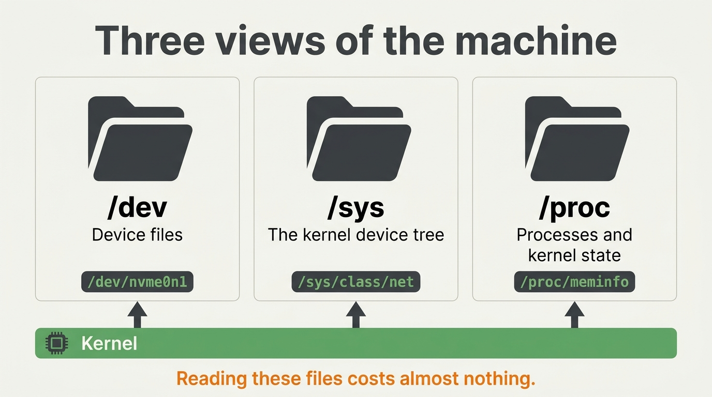
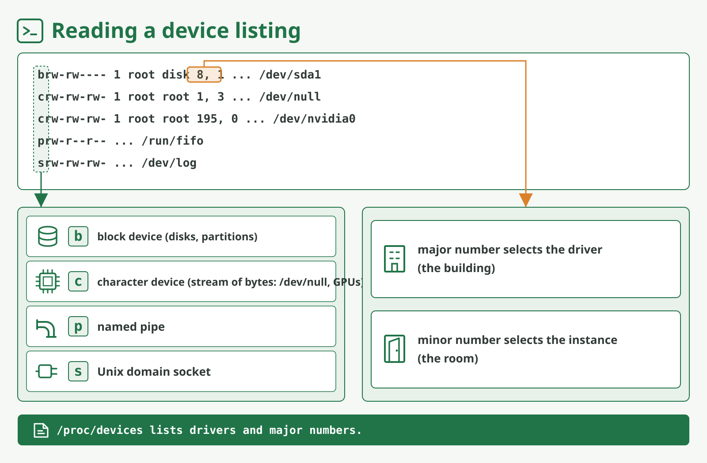
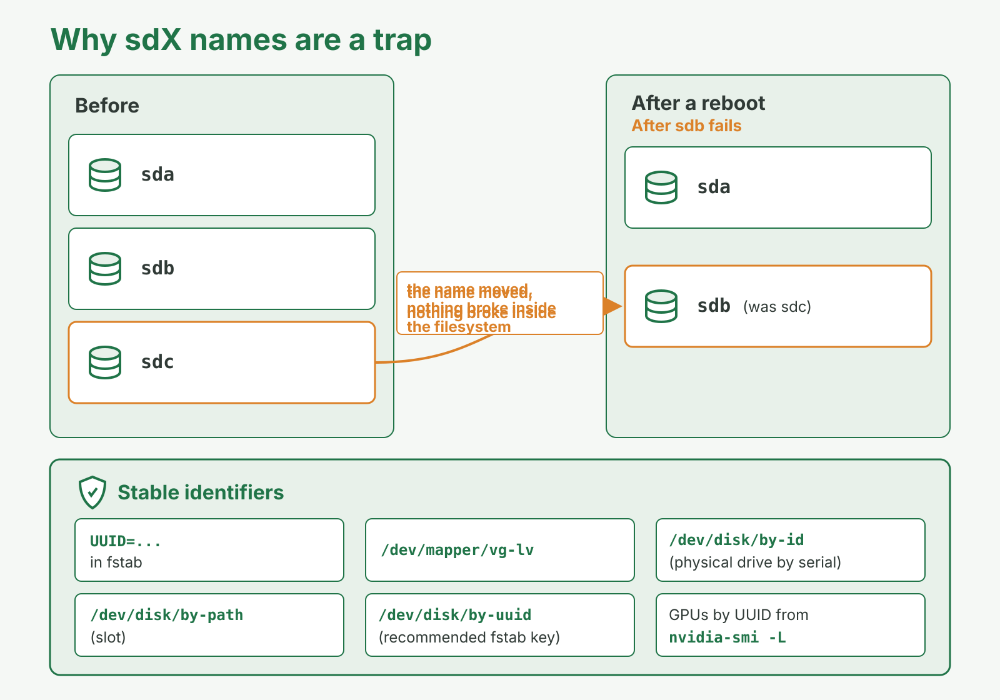
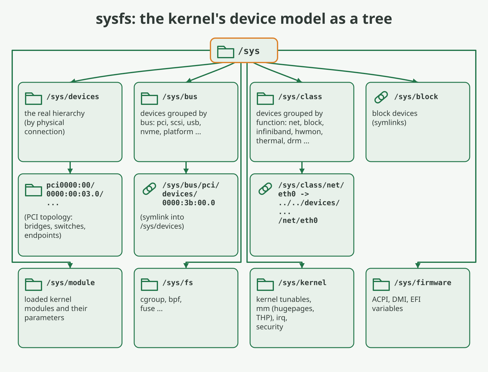
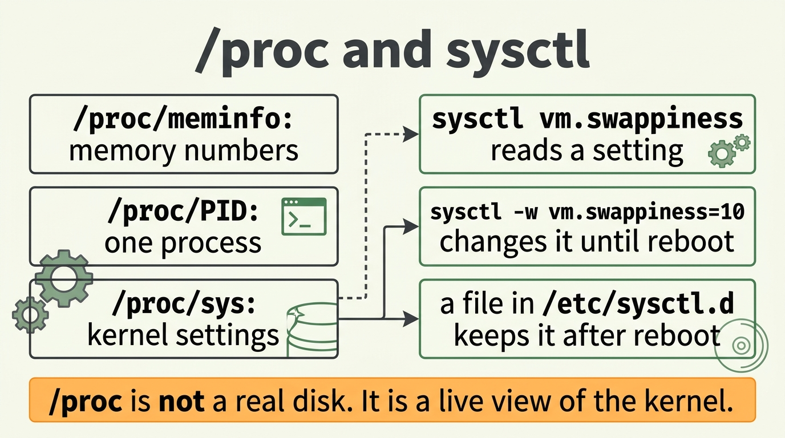
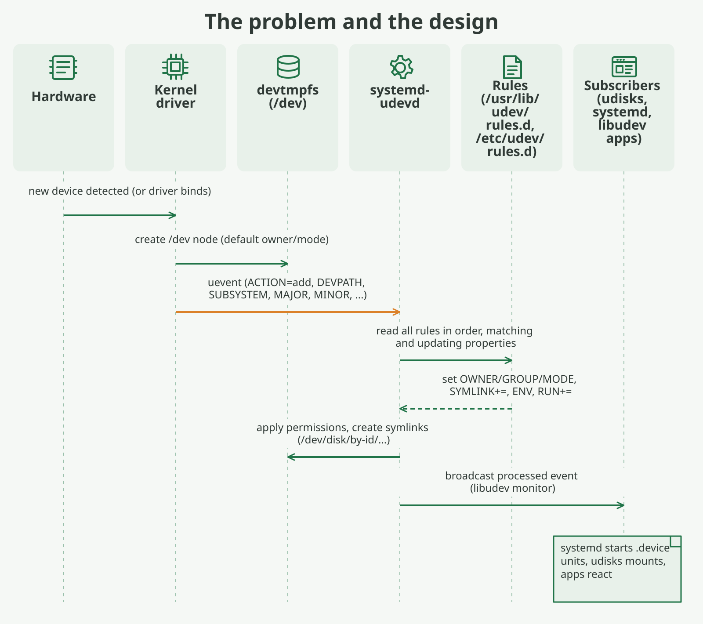
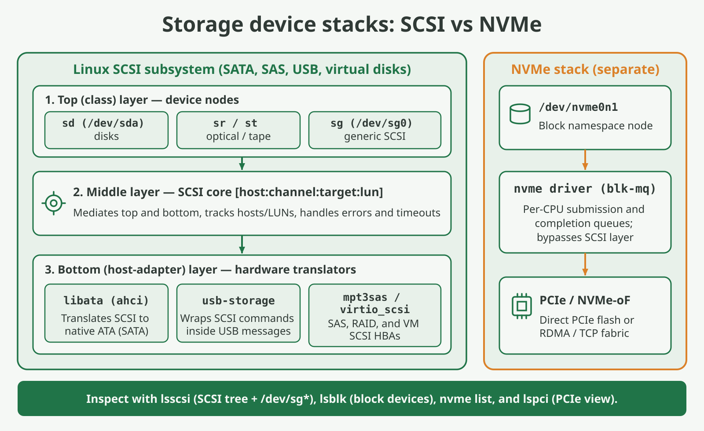
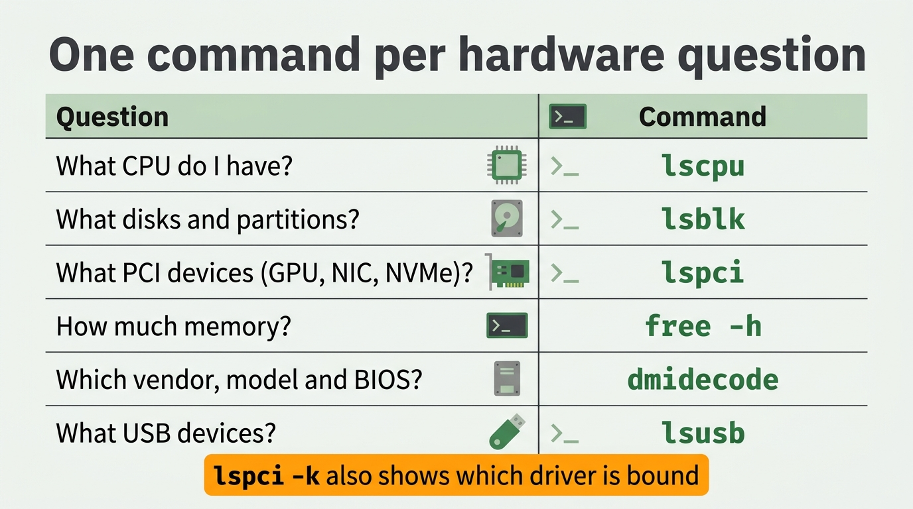
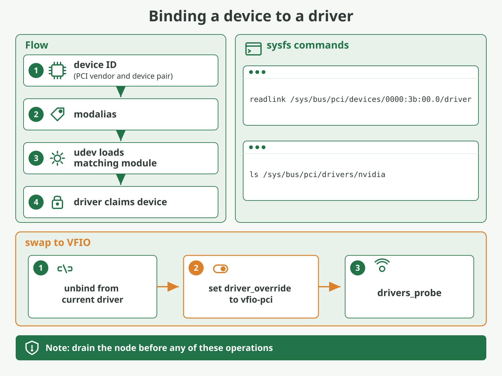

# 1.10 Devices, udev, sysfs and procfs

| | |
|---|---|
| Level | Intermediate |
| Priority tier | 0 |
| Lab venue | GCP / GKE (an Ubuntu VM; a GPU VM is optional but valuable) |
| Part | Part 1: Linux, from the command line to the kernel and performance |
| Status | Drafted, labs **untested** |

## Why this matters for AI infrastructure

Start with a scene from a real on-call shift. A GPU node comes back from a reboot reporting seven GPUs instead of eight, and the scheduler keeps placing jobs on it anyway. Another job runs at half speed because its NIC and its GPU sit on different NUMA nodes. Neither problem is a mystery once you know how Linux presents hardware to the rest of the system, and that knowledge is what this chapter gives you.

An AI node is a pile of devices. It has eight GPUs, several InfiniBand or RoCE NICs, NVMe drives, NVSwitch chips, a BMC, a PCIe switch tree, sensors, and the CPUs and memory banks they hang off. Almost every operational question about such a node is a device question:

- "Which `/dev/nvidia*` files should this container get, and why did it not see them?"
- "Which GPU is next to which NIC, and which NUMA node are they on? That topology decides NCCL performance."
- "Why did the GPU disappear after reboot, or fall off the PCIe bus? Driver binding, kernel messages and link state hold the answer."
- "Why is `/dev/sdb` now `/dev/sdc`? Naming order is the cause, and it is why you never put those names in `fstab`."
- "How do I give a service access to a device without making it world-writable? Use udev rules and groups."
- "Where do I read a temperature, a PCIe link width, an InfiniBand port state or a VF count? Look in sysfs."
- "How do I change a kernel parameter and make it survive reboot? Use procfs and sysctl."

Linux answers all of these with a few consistent interfaces. The first is the device files in `/dev`. The second is sysfs in `/sys`, and the third is procfs in `/proc`. The fourth is udev, the user-space daemon that turns kernel hardware events into device files, permissions, names and actions.

A picture helps here. Think of `/dev` as the doorway you walk through to use a device, `/sys` as the machine's blueprint, and `/proc` as its instrument panel. udev is the clerk who sets up each doorway as the hardware arrives. The rest of this chapter walks through all four.

This chapter explains each interface and shows the tools that read them, including `lsblk`, `lspci`, `lsusb`, `lscpu`, `lsscsi`, `udevadm`, `dmesg`, `dmidecode` and `sysctl`. Then it applies them to GPU nodes and containers. The device-driver side, which covers loading modules and DKMS, is chapter 1.22. Filesystems on block devices are chapter 1.12. SR-IOV and VFIO build on the PCI material here, and you will meet them in the virtualisation chapters.

## Prerequisites and outcomes

Before you start, you should be comfortable at the shell (1.2) and with file types and permissions (1.3, 1.6). You should also know processes and the `/proc` basics (1.8), and have the kernel and user-space picture from 1.1.

When you finish this chapter, you will be able to do the following:

- Explain what a device file is, including its type and its major and minor numbers. You should be able to read `ls -l /dev` output and create a node with `mknod`, and you should know why you rarely should.
- Tell block, character, pipe and socket files apart, and name the common device families: `sd*`, `nvme*`, `dm-*`, `tty*`, `pts/*`, `nvidia*` and `infiniband/*`.
- Navigate `/sys` to find a device's real hardware path, its attributes, its driver, its NUMA node and its links. You should be able to read or set tunables there.
- Use `/proc` for system and per-process information, and use `sysctl`, with persistent configuration, for kernel parameters.
- Explain the udev event flow and read and write a rule. You can debug it with `udevadm` subcommands: `info`, `monitor`, `test`, `trigger` and `control --reload`.
- Use stable device names, such as `by-id`, `by-path`, `by-uuid` and `by-label`, instead of names that depend on enumeration order.
- Inventory hardware with `lspci`, `lsusb`, `lsblk`, `lscpu`, `lsscsi`, `dmidecode`, `lshw`, `ethtool` and `nvidia-smi`.
- Describe how the SCSI, ATA, USB and NVMe stacks fit together in the kernel.
- Apply all of this to GPU, InfiniBand and container device passthrough, and read GPU and NIC topology.

## 1. Device files: hardware as files

Think about what a program must do to talk to a hard disk. One option is to learn that disk's own protocol. The other is to open a file and write bytes to it. The second is the Unix way, and Linux follows it, which is why so much of this chapter looks familiar.



*Figure 1.10.1. Three kernel-backed views of the machine: device files, the device tree and process and kernel state.*

Unix exposes most hardware through the same file interface you use for ordinary files, and that is one of its oldest and most useful tricks. A device file lives in `/dev` and looks like any other file. You can list it, read it, write to it, and check who may use it. When you open it, though, the kernel hands your reads and writes to a device driver instead of a disk filesystem. The file is a doorway, and the driver is the room behind it.

The null device shows the idea in a single line:

```bash
echo blah > /dev/null      # the kernel's null driver accepts and discards the data
```

The data vanishes, and no error comes back. The null driver accepts everything and keeps nothing.

A device file is a convenience, and a big one. Any program that can read and write files can talk to many devices, and some devices work with ordinary tools such as `cat`, `dd` and `less`. A plain read and write interface cannot express everything a device can do, though. The rest goes through the `ioctl` system call, as the NVIDIA driver does, or through `sysfs` attributes.

### Types and numbers



*Figure 1.10.2. The type letter and the major and minor numbers tell you what kind of device a file is.*

Run `ls -l` on a few device files and look at the first character of the mode. That one letter tells you what kind of file you have:

```text
brw-rw---- 1 root disk 8, 1 Sep  6 08:37 /dev/sda1
crw-rw-rw- 1 root root 1, 3 Sep  6 08:37 /dev/null
crw-rw-rw- 1 root root 195, 0 Sep 6 08:37 /dev/nvidia0
prw-r--r-- 1 root root    0 Mar  3 19:17 /run/fifo
srw-rw-rw- 1 root root    0 Dec 18 07:43 /dev/log
```

Four types appear in that output, and each one behaves differently. Disks use the block type. The GPU node `/dev/nvidia0` in the listing is a character device.

| First char | Type | Meaning |
|---|---|---|
| `b` | **Block device** | Data is accessed in fixed-size blocks, with random access by block number; the kernel can cache and reorder it. Disks, partitions, loop devices, device-mapper volumes. |
| `c` | **Character device** | A stream of bytes, no fixed size and no going back. Terminals, `/dev/null`, `/dev/random`, GPUs' control nodes, many drivers' `ioctl` interfaces. |
| `p` | Named pipe (FIFO) | Like a pipe, but with a name: another process is at the other end, not a driver. |
| `s` | Unix domain socket | An inter-process communication endpoint (`/dev/log`, `/run/docker.sock`). Usually found outside `/dev`. |

For block and character devices, the two numbers where a file size would normally be are the **major** and **minor** device numbers. For example, `8, 1` identifies `/dev/sda1`. Those two numbers, and not the file name, are how the kernel knows which device it is talking to.

The major number selects the driver, which is the device class. The minor number selects the instance within that driver. It helps to think of the major number as a building and the minor number as a room inside it. For a disk, minor 0 is the whole disk, and minors 1, 2 and so on are its partitions. A second disk gets a different major number or a different block of minors.

The file in `/dev` is only a labelled pointer. Its owner, group and permission bits decide who may use the device. You can see the loaded drivers and their major numbers in `/proc/devices`.

Network interfaces are the notable exception. `eth0`, `ens3` and `ib0` have no device file, so they are not in `/dev`. The kernel offers them through the socket API and netlink instead.

### Naming: why enumeration order is a trap



*Figure 1.10.3. Names like sdb depend on discovery order, so use a UUID or a /dev/disk link instead.*

Here is a story you will hear on almost every storage team. A server has three data disks, and the kernel names them `sda`, `sdb` and `sdc`. One morning `sdb` fails. The machine reboots, and the old `sdc` comes back as `sdb`. An `fstab` entry that said `/dev/sdb1` now mounts the wrong disk, or none at all.

Nothing broke inside the filesystem. The name moved. Traditional names such as `/dev/sda` and `/dev/sdb` are assigned in the order the kernel's drivers find devices. That order can change between boots, or after a disk is added or fails.

So never write `sdX` names in persistent configuration. Use stable identifiers instead. The filesystem UUID or label works well, as in `UUID=...`, which chapter 1.12 covers. An LVM or device-mapper name such as `/dev/mapper/vg-lv` also works. You can also use the persistent symbolic links that udev creates under `/dev/disk/`; section 6 explains them.

The same idea applies to network interfaces. Modern systems use predictable names such as `enp3s0`. GPUs need care too. The `nvidia0` and `nvidia1` indices can be reordered, so refer to a GPU by its UUID, which `nvidia-smi -L` prints, or by its PCI bus ID when it matters.

### Creating device files

On a modern system you do not create device nodes by hand. The kernel creates them through devtmpfs, and udev does the rest. Knowing how `mknod` works still helps, though, because you will meet it in a minimal container or a rescue environment. Here is what it looks like in practice:

```bash
sudo mknod /tmp/mynull c 1 3        # character device, major 1, minor 3 (same as /dev/null)
sudo mknod /tmp/myfifo p            # a named pipe needs no numbers (mkfifo does the same)
sudo chmod 666 /tmp/mynull && echo test > /tmp/mynull
```

Older systems filled `/dev` with a `MAKEDEV` script and later with a kernel-space `devfs`. The current design replaced both, because device management does not belong in the kernel. A user-space daemon can apply policy, such as names, permissions and actions, with far less risk.

Mounting a filesystem with the **`nodev`** option makes device files on it inert. That is a standard hardening step for `/home`, `/tmp` and removable media. Without it, a user could create a node for the raw disk.

## 2. The common device files

A log line scrolls past with `nvme0n1p1` in it, and you need to know what it is before the next line arrives. Device names follow conventions, and learning them turns a wall of text into something you can read at a glance.

The table below is the lookup you will come back to. Once you see the pattern, you will rarely need it.

| Device file(s) | Meaning |
|---|---|
| `/dev/sd*` (`sda`, `sda1`) | SCSI/SATA/SAS/USB disks (`sd` = "SCSI disk" because the kernel talks SCSI to most storage). Letters per disk, numbers per partition. List with `lsscsi`, `lsblk`. |
| `/dev/nvme*` (`nvme0n1`, `nvme0n1p1`) | NVMe SSDs: controller `nvme0`, namespace `n1`, partition `p1`. List with `nvme list` (package `nvme-cli`) or `lsblk`. |
| `/dev/vd*`, `/dev/xvd*` | Virtio and Xen virtual disks in VMs. (On GCP and AWS you may see `nvme*` for persistent disks too.) |
| `/dev/dm-*`, `/dev/mapper/*` | Device-mapper block devices: LVM volumes, dm-crypt (LUKS), multipath, software RAID layers (chapter 1.13). |
| `/dev/md*` | Linux software RAID (`md`) arrays. |
| `/dev/loop*` | Loop devices: a file used as a block device (`losetup`; container image layers, snaps). |
| `/dev/sr*` | CD and DVD optical drives (`/dev/sr0`, `/dev/sr1`, read-only access; to write discs, user-space tools like `wodim` use the generic SCSI device `/dev/sg*`, section 7); older PATA optical drives may show up as `/dev/hd*`. |
| `/dev/hd*` | Old PATA (Parallel ATA) hard disks (`/dev/hda` primary master, `/dev/hdb` primary slave, `/dev/hdc` secondary master, `/dev/hdd` secondary slave on older kernels/hardware); if a modern SATA disk shows up as `hd*`, its controller is running in a slow legacy compatibility mode. |
| `/dev/tty*`, `/dev/pts/*`, `/dev/tty` | Terminals: `ttyN` (`tty1`, `tty2`, ...) virtual consoles, `pts/N` (`pts/0`, `pts/3`) pseudoterminals (every SSH or GUI terminal-emulator session), and `/dev/tty` (the controlling terminal of the current process). |
| `/dev/ttyS*`, `/dev/ttyUSB*`, `/dev/ttyACM*` | Serial ports and USB serial adapters: Windows `COM1` is `/dev/ttyS0` and `COM2` is `/dev/ttyS1`, while plug-in USB serial and modem/microcontroller adapters appear as `/dev/ttyUSB0`, `/dev/ttyACM0`, `/dev/ttyUSB1`, `/dev/ttyACM1` (BMC serial-over-LAN consoles, switch consoles, microcontrollers). Access usually requires the `dialout` group; talk with `screen /dev/ttyUSB0 115200`. |
| `/dev/null`, `/dev/zero` | Discard sink; endless zero bytes. |
| `/dev/random`, `/dev/urandom` | Kernel random number generator (on current kernels both are cryptographically secure and non-blocking once seeded; `getrandom()` is the preferred API). |
| `/dev/full` | Always reports "no space left" (testing). |
| `/dev/mem`, `/dev/kmem`, `/dev/port` | Raw memory and I/O ports; heavily restricted or absent for security. |
| `/dev/fuse` | The interface for user-space filesystems (SSHFS, rclone mount, containers' overlay helpers). |
| `/dev/kvm`, `/dev/vhost-*`, `/dev/vfio/*` | Hardware virtualisation and device-passthrough interfaces (virtualisation chapters). |
| `/dev/nvidia0 ... N`, `/dev/nvidiactl`, `/dev/nvidia-uvm`, `/dev/nvidia-uvm-tools`, `/dev/nvidia-modeset`, `/dev/nvidia-caps/*` | The NVIDIA driver's nodes: one per GPU, a control node, unified-memory nodes, mode-setting, and MIG/capability nodes. Created by the driver module and by `nvidia-modprobe`. |
| `/dev/infiniband/uverbs*`, `rdma_cm`, `umad*`, `issm*` | RDMA user-space verbs, connection manager and management datagram nodes used by InfiniBand/RoCE stacks and MPI/NCCL. |
| `/dev/gdrdrv` | GPUDirect RDMA helper device (when the module is loaded). |
| `/dev/shm`, `/dev/pts`, `/dev/mqueue` | Not devices: tmpfs/devpts/mqueue filesystems mounted under `/dev` (shared memory, pseudoterminals, POSIX message queues). Containers mount their own. |
| `/dev/disk/by-*`, `/dev/block/MAJ:MIN`, `/dev/char/MAJ:MIN` | udev-maintained symbolic links (section 6). |
| `/dev/stdin`, `/dev/stdout`, `/dev/stderr`, `/dev/fd/N` | Symbolic links into `/proc/self/fd`; how `<(command)` process substitution appears as a file name. |

### Consoles, parallel ports and audio (legacy devices you will still meet)

Not every device in this chapter sits on a GPU node. Some older ones still appear on real systems, and their names turn up in logs, so it helps to recognise them.

**Virtual consoles and display modes (*How Linux Works* Section 3.4.7).** Linux has two primary display modes, text and graphical. Kernel mode setting, or KMS, lets the system switch smoothly between them.

The kernel multiplexes the physical display into virtual consoles, such as `/dev/tty1` and `/dev/tty2`, and each console can run in either mode. In text mode, you switch consoles with **Alt-F1**, **Alt-F2** and so on. A console in graphical mode is reached with **Ctrl-Alt-F1**, **Ctrl-Alt-F2** and so on.

Each text login prompt is run by a `getty` process. A graphical session, from Xorg or Wayland, takes over a console. For example, if `getty` runs on `tty1` and `tty2`, graphics takes `tty3`. Many modern distributions, however, place the graphical display manager on `tty1`. If keyboard switching fails, root can force a switch with `chvt 1`.

Servers use the same idea as a **serial console**, set with `console=ttyS0,115200` on the kernel command line, and as the BMC's serial-over-LAN. That is how you reach a node whose network or display is broken. Chapter 1.14 and the BMC chapters cover the details.

**Parallel ports** are older still. `/dev/lp0` and `/dev/lp1` are unidirectional printer ports, which Windows calls LPT1 and LPT2. `/dev/parport0` is bidirectional. USB and the network replaced these ports. Printing now goes through a print server such as CUPS, not through a direct write to `lp0`.

**Audio (*How Linux Works* Section 3.4.9)** has two sets of device nodes. `/dev/snd/*` belongs to the modern **ALSA** subsystem, which stands for *Advanced Linux Sound Architecture*. The older **OSS** compatibility devices, which stand for *Open Sound System*, are `/dev/dsp` and `/dev/audio`. In theory you could play a WAV file by redirecting it to `/dev/dsp`. In practice, frequency mismatches and contention for the device make raw access impractical. User-space sound servers such as `PulseAudio` and `PipeWire` sit on top of ALSA instead. Compute nodes do not need any of this, but you will see these names in container images and desktop VMs.

## 3. `dd` and devices

`dd` is the tool people reach for when they want to move raw bytes. It is simple, old, and completely unforgiving. It copies bytes from an input to an output in fixed-size blocks. Unlike most tools, it can start and stop at arbitrary points, which is what makes it useful for devices.

Its syntax is unusual, because it follows an old IBM job-control style. You write `option=value` where other tools use `-option`. The table lists the options you will use most. Each one controls where data comes from, how large each block is, or how the copy behaves.

| Option | Meaning |
|---|---|
| `if=FILE` | input (default stdin) |
| `of=FILE` | output (default stdout) |
| `bs=SIZE` | block size for both (`1k`, `1M`, `4M`); too small is slow, too large wastes memory |
| `count=N` | copy only N blocks |
| `skip=N`, `seek=N` | skip N input blocks; skip N output blocks |
| `conv=...` | `noerror,sync` (continue on read errors and pad), `fsync` (flush at the end), `notrunc` |
| `status=progress` | show progress |
| `iflag=direct`, `oflag=direct` | use direct I/O, bypassing the page cache (needed for honest benchmarks of storage) |

Two of these options decide most of what you care about. The `bs` option matters most for speed. The `direct` flags matter most for benchmarks, because they bypass the page cache.

The examples below show the common uses. The first creates a one-block file. The second runs a crude write-throughput test. The third reads the first sector of a disk, and the last writes an image to a device, which is dangerous.

```bash
dd if=/dev/zero of=/tmp/new bs=1k count=1                      # one 1024-byte block of zeros
dd if=/dev/zero of=/tmp/test bs=1M count=1024 oflag=direct status=progress   # crude write throughput test
sudo dd if=/dev/sda bs=512 count=1 | xxd | tail -3              # read the first sector (partition table signature 55 aa)
sudo dd if=disk.img of=/dev/sdX bs=4M status=progress conv=fsync   # write an image to a device (DANGER)
```

**`dd` writes without asking.** A swapped `if=` and `of=`, or the wrong `/dev/sdX`, destroys data instantly. Many a boot disk has been overwritten by a typo. Always check the target with `lsblk -o NAME,SIZE,MODEL,MOUNTPOINT`. Never run `dd` against a mounted device. When in doubt, write to a file first. For serious benchmarking, use `fio`, which chapter 1.25 covers. `dd` gives only a rough indicator.

Check the target every time you run `dd`, and write to a file first whenever you are unsure.

## 4. sysfs: the kernel's device model as a tree

Open `/sys/class/net/eth0/speed` on a healthy server and you get a number. That number is the link speed, and no program had to ask the NIC for it. The kernel simply keeps the value in a file. This is sysfs, the second of our three windows into a Linux machine.

`/dev` lets programs use a device, but it says little about the device itself. **sysfs**, mounted at `/sys`, works differently. It is a virtual filesystem that exists only in memory, and the kernel uses it to expose its device model. Every device, bus, driver and class appears as a directory. Each **attribute** appears as a small file, usually holding one value. Programs are the main readers of sysfs, but you will read it by hand all the time.



*Figure 1.10.4. sysfs: the kernel's device model as a tree.*

Start reading at the top of the tree. Most of what you need lives under `/sys/devices`.

**`/sys/devices`** is the true tree, and it follows how hardware is attached. The SATA disk `/dev/sda` might live at `/sys/devices/pci0000:00/0000:00:17.0/ata3/host0/target0:0:0/0:0:0:0/block/sda`, or at `.../0000:00:1f.2/host0/target0:0:0/0:0:0:0/block/sda`.

That path is long on purpose. It tells you which PCI controller and which ATA or SCSI port the device sits on. Read it the way you read a postal address, from the wide part to the narrow part. The device is the room at the end of a chain of buses and ports.

Listing that directory with `ls` shows files and subdirectories such as `alignment_offset`, `bdi`, `capability`, `dev`, `device`, `discard_alignment`, `events`, `events_async`, `events_poll_msecs`, `ext_range`, `holders`, `inflight`, `power`, `queue`, `range`, `removable`, `ro`, `sda1`, `sda2`, `sda5`, `size`, `slaves`, `stat`, `subsystem`, `trace`, and `uevent`. Most of these files are meant for programs rather than people. For example, `cat dev` prints `8:0`, and `cat size` prints the disk's total 512-byte sector count.

Each partition, such as `sda1` or `sda2`, has its own subdirectory. That subdirectory holds its own `dev`, `partition`, `size`, `start`, `stat` and `uevent` files. The `/dev` file *uses* the device. The sysfs path *describes and manages* it.

**`/sys/bus`, `/sys/class` and `/sys/block`** are convenient views of the same tree. They are symbolic links into `/sys/devices`, organised by bus, by function and by block-ness. Run `ls -l /sys/block` to reveal the real paths behind the shortcuts.

The attribute files inside a device directory each answer one small question. The `dev` file gives the `MAJOR:MINOR` pair. `uevent` lists the event properties. `subsystem` links to the bus or class, and `driver` links to the bound driver. You will also find `power/`, `size`, and `queue/` for block devices, plus bus-specific files.

The table groups the useful attributes by area. Every path in it is relative to `/sys`.

| Path | What it tells you or lets you set |
|---|---|
| `block/sda/size`, `block/sda/queue/{rotational,scheduler,nr_requests,read_ahead_kb,max_sectors_kb}` | Size in 512-byte sectors; whether it is spinning; the I/O scheduler (writable: `echo none > .../scheduler`); queue tuning |
| `block/nvme0n1/device/{model,serial,firmware_rev,numa_node}` | NVMe identity and NUMA locality |
| `class/net/eth0/{address,mtu,speed,duplex,operstate,carrier,statistics/*}`, `class/net/eth0/device -> ../../../0000:3b:00.0` | Link state and counters; which PCI device the NIC is |
| `class/infiniband/mlx5_0/ports/1/{state,phys_state,rate,lid,sm_lid}` | InfiniBand port state ("4: ACTIVE"), link rate, LID |
| `bus/pci/devices/0000:3b:00.0/{vendor,device,class,subsystem_vendor,numa_node,local_cpulist,current_link_speed,current_link_width,max_link_speed,max_link_width,driver,iommu_group,enable,reset,remove,rescan}` | PCI identity, locality, **PCIe link training result**, bound driver, IOMMU group, hot-remove and reset |
| `bus/pci/devices/.../{sriov_totalvfs,sriov_numvfs,driver_override}` | SR-IOV virtual functions (writable); force a driver for passthrough |
| `bus/pci/rescan`, `bus/pci/devices/.../remove` | Re-enumerate the PCI bus after a hot-plug or reset; remove a device |
| `class/hwmon/hwmon*/{name,temp*_input,fan*_input,power*_input}`, `class/thermal/thermal_zone*/temp` | Sensor values (millidegrees for temperatures) |
| `devices/system/cpu/cpu*/{online,topology/*,cpufreq/*,cache/index*/}` | CPU hotplug, topology, frequency scaling governor, caches |
| `devices/system/node/node*/{cpulist,meminfo,distance,hugepages/*}` | **NUMA** topology: which CPUs and memory belong to each node, distances, hugepage pools |
| `kernel/mm/transparent_hugepage/{enabled,defrag}`, `kernel/mm/hugepages/*` | THP and hugepage controls (chapter 1.17) |
| `module/nvidia/parameters/*`, `module/*/version` | Module parameters and versions |
| `fs/cgroup/*` | cgroup v2 tree (chapter 1.18) |
| `firmware/dmi/*`, `class/dmi/id/{product_name,sys_vendor,bios_version,board_serial}` | Hardware identity (what `dmidecode` prints) |

The commands below read and write a few of these values. Each comment says what the value means.

```bash
cat /sys/block/sda/dev                                  # 8:0, the major:minor of /dev/sda
readlink -f /sys/block/sda                              # the real hardware path
cat /sys/bus/pci/devices/0000:3b:00.0/numa_node         # which NUMA node a PCI device (GPU/NIC) is on
cat /sys/class/net/eth0/speed /sys/class/net/eth0/operstate
cat /sys/bus/pci/devices/0000:3b:00.0/current_link_speed /sys/bus/pci/devices/0000:3b:00.0/max_link_width
echo none | sudo tee /sys/block/nvme0n1/queue/scheduler  # change I/O scheduler (not persistent)
```

**Changes made by writing to sysfs are not persistent.** They last until reboot, or until the device is reset. To make them persist, use udev rules (`ATTR{...}=...`), `systemd-tmpfiles` (`w /sys/...`), kernel command-line options, or module parameters in `/etc/modprobe.d/`.

Decide how each sysfs change will persist before you make it, because a plain write is lost at the next reboot.

## 5. procfs and `sysctl`

Where do you look for a machine's pulse? The load average, the memory counters, the interrupts each CPU is serving. All of that lives in `/proc`, the third window, and much of it changes every second.



*Figure 1.10.5. /proc shows live kernel and process state. sysctl changes kernel settings under /proc/sys.*

`/proc` is the older virtual filesystem of the two. It began with process information and later grew to hold everything else. The numeric directories hold per-process information, which chapter 1.8 covers. The rest of `/proc` holds system-wide state, as the table shows.

| Path | Contents |
|---|---|
| `/proc/cpuinfo` | Per-CPU model, flags, frequency (`lscpu` formats it) |
| `/proc/meminfo`, `/proc/vmstat`, `/proc/buddyinfo`, `/proc/slabinfo`, `/proc/pagetypeinfo` | Memory statistics (chapter 1.17) |
| `/proc/loadavg`, `/proc/uptime`, `/proc/stat`, `/proc/pressure/*` | Load, uptime, CPU time counters, PSI |
| `/proc/interrupts`, `/proc/softirqs`, `/proc/irq/N/smp_affinity{,_list}` | Interrupt counts per CPU; **interrupt-to-core affinity** (set a mask to pin a NIC or GPU interrupt) |
| `/proc/devices`, `/proc/misc`, `/proc/partitions`, `/proc/diskstats` | Registered major numbers, partitions, disk counters |
| `/proc/modules` (= `lsmod`), `/proc/kallsyms`, `/proc/driver/nvidia/*` | Modules; symbols; NVIDIA driver version and per-GPU information (`/proc/driver/nvidia/version`, `gpus/*/information`) |
| `/proc/mounts`, `/proc/self/mountinfo` | Mounted filesystems |
| `/proc/net/*` | Network tables (`dev`, `tcp`, `route`, `arp`, `snmp`) |
| `/proc/cmdline`, `/proc/version`, `/proc/config.gz` | Kernel command line; version; build configuration (if enabled) |
| `/proc/sys/` | **Tunable kernel parameters**, one file per value |

### `/proc/sys` and `sysctl`

Everything under `/proc/sys` is a live kernel setting. There is no configuration file here, only the values the kernel is using right now. You read one with `cat`, and you change it by writing to it:

```bash
cat /proc/sys/net/ipv4/ip_forward
echo 1 | sudo tee /proc/sys/net/ipv4/ip_forward      # immediate, lost at reboot
```

The **`sysctl`** command shows the same tree with dots in place of slashes. The path is relative to `/proc/sys`:

```bash
sysctl net.ipv4.ip_forward                  # read
sudo sysctl -w net.ipv4.ip_forward=1        # write (runtime only)
sysctl -a | grep -i hugepages               # search all parameters
sysctl vm.swappiness vm.dirty_ratio kernel.pid_max fs.file-max net.core.rmem_max
sudo sysctl --system                        # apply all configuration files now
```

**Persistence.** A write to the live tree is lost at the next reboot, so put settings in `/etc/sysctl.conf`, or preferably in files named `/etc/sysctl.d/NN-name.conf`. The `systemd-sysctl` service applies them at boot. Later files override earlier ones. Vendor defaults live in `/usr/lib/sysctl.d/`:

```text
# /etc/sysctl.d/90-gpu-node.conf
vm.swappiness = 1
vm.max_map_count = 1048576
kernel.numa_balancing = 0
net.core.rmem_max = 268435456
net.core.wmem_max = 268435456
```

Parameters fall into groups. `kernel.*` covers pid_max, panic behaviour, `kernel.yama.ptrace_scope` and `kernel.core_pattern`. `vm.*` covers swappiness, dirty ratios, overcommit, `nr_hugepages` and `max_map_count`. `net.*` covers buffers, congestion control, forwarding and conntrack. `fs.*` covers `file-max` and `inotify.max_user_watches`. `dev.*` is the last group.

Change **one thing at a time**, and have a measurable reason for each change. Remember that some values only take effect on new connections or processes. A few settings depend on a module being loaded. For example, `net.bridge.*` needs `br_netfilter`. Without that module, a boot-time sysctl can fail silently. Tuned values for GPU and HPC nodes appear in chapters 1.22 and 1.28.

Before you change a parameter, write down why you are changing it and what the value was before.

## 6. udev: from hardware events to device files

### The problem and the design

Plug in a USB drive and watch what happens next. The kernel notices the new hardware, but it does not decide what the device should be called, who may open it, or which extra names should point at it. Those are policy decisions, and policy does not belong in the kernel.

So the kernel emits an event, and a user-space daemon does the rest. That daemon is `systemd-udevd` (historically `udevd`). It reads the event, applies a set of rules, and leaves the device in its final state.

There is a bootstrap problem. Device files are needed very early in boot, but udev itself needs some device files to start. The answer is devtmpfs, an in-memory filesystem mounted on `/dev` early in boot. The kernel creates a node there for every device it discovers. Those nodes default to `root:root` ownership and mode 0600 or 0660.

The kernel also notifies udev. udev does not create the nodes. It adjusts them by setting owner, group and mode. It also creates extra symbolic links, imports properties and runs actions.



*Figure 1.10.6. The problem and the design.*

When you read the diagram, start at the top and work down. The hardware and the kernel act first. udev and its rules then decide the final state of the node. Subscribers react last.

The kernel event is a **uevent**. It is a set of `KEY=value` properties, for example:

```text
ACTION=add
DEVPATH=/devices/pci0000:00/0000:00:1a.0/usb1/1-1/1-1.2/1-1.2:1.0/host4/target4:0:0/4:0:0:3/block/sde
DEVTYPE=disk
MAJOR=8
MINOR=64
SEQNUM=2752
SUBSYSTEM=block
```

`ACTION` is `add`, `remove`, `change`, `bind`, `unbind`, `move`, `online` or `offline`. A `change` event is how media changes, resizes and many driver state changes are announced.

### Rules

Rules files end in `.rules`, and udev reads them from three places. The first is `/usr/lib/udev/rules.d/` (older systems use `/lib/udev/rules.d/`), which holds the vendor defaults. The second is `/etc/udev/rules.d/`, which holds administrator rules and overrides. A file there with the same name as a vendor file masks that vendor file. The third is `/run/udev/rules.d/`.

udev merges all the files and processes them in lexical order of file name. That is why the files carry numeric prefixes, such as `60-persistent-storage.rules`, `70-uaccess.rules` and `99-local.rules`. A lower number runs first, so a higher number gets the last word.

Within that order, udev matches each event against every rule from start to finish. Unlike a firewall, it does not stop at the first match, except where a rule uses `GOTO` or the `:=` operator. Every matching rule can add to the state of the event.

A rule is one line of comma-separated **matches** and **assignments**. The matches ask a question about the device, and the assignments decide what happens to it. Matches use `==` for equal and `!=` for not equal. Assignments use `=` to set a value, which replaces earlier values. They use `+=` to add a value, and `:=` to set a value and forbid later changes. The right-hand side may use shell-style patterns: `*`, `?`, `[ ]` and `|` for alternatives.

Common **match keys**:

| Key | Matches |
|---|---|
| `ACTION` | `add`, `remove`, `change` ... |
| `KERNEL` | The kernel's device name (`sd*`, `nvme[0-9]n[0-9]`, `loop*`) |
| `SUBSYSTEM`, `SUBSYSTEMS` | The device's subsystem; `SUBSYSTEMS` also checks parents |
| `DRIVER`, `DRIVERS` | The driver bound to it (or a parent) |
| `ATTR{name}`, `ATTRS{name}` | A sysfs attribute of the device (or of any parent, for `ATTRS`) |
| `ENV{key}` | A property of the event (including those imported by other rules) |
| `TAG`, `TEST{...}` | A tag; whether a file exists |
| `PROGRAM`, `RESULT` | Run a program and match its output |

Each key tests one property of the event or the device. `ATTR` reads a sysfs value on the device itself. `ATTRS` also checks the parent devices, which is why it is the key you usually want when you match on hardware.

Assignments do the work. `NAME` applies only to network devices, because the kernel names device nodes itself. `SYMLINK+=` adds extra names. `OWNER`, `GROUP` and `MODE` set permissions. `TAG+=` adds a tag. `ENV{key}=` sets a property. `ATTR{name}=` writes a sysfs attribute. `RUN+=` runs a program after processing. `IMPORT{program}=` runs a program and imports its `KEY=value` output as properties. `GOTO` and `LABEL` jump within the file, and `OPTIONS+=` sets options.

Right-hand strings can use substitutions. `%k` gives the kernel name, `%n` the device number, `%p` the device path, and `%M` and `%m` the major and minor numbers. `$attr{file}` or `%s{file}` reads a sysfs attribute. `$env{key}` or `%E{key}` reads a property. `$major`, `$minor`, `$result`, `$parent`, `$devnode` and `$name` are also available. Write `%%` or `$$` for a literal `%` or `$`.

**Reading a vendor rule.** The default persistent-name rules identify a disk and create `by-id` links. Here is a simplified version:

```text
# 60-persistent-storage.rules (simplified)
# 1. Ask ata_id for the serial number of whole ATA disks, import the answer as properties:
KERNEL=="sd*[!0-9]|sr*", ENV{ID_SERIAL}!="?*", SUBSYSTEMS=="scsi", ATTRS{vendor}=="ATA", IMPORT{program}="ata_id --export $devnode"
# 2. Once ID_SERIAL is set, create the by-id symlink:
KERNEL=="sd*|sr*", ENV{DEVTYPE}=="disk", ENV{ID_SERIAL}=="?*", SYMLINK+="disk/by-id/$env{ID_BUS}-$env{ID_SERIAL}"
```

Rule 1 matches a whole-disk device. Its name starts with `sd` and has letters but no digit. It has no `ID_SERIAL` yet, because `!="?*"` means not set. It must be an ATA device behind the SCSI layer.

The rule then runs `IMPORT{program}="ata_id --export $devnode"`, or `$tempnode`. Running `/lib/udev/ata_id --export /dev/sda` on the command line prints `ID_TYPE=disk`, `ID_MODEL=WDC_WD3200AAJS-...`, `ID_SERIAL=WDC_WD3200AAJS-_WD-WMAV2FU80671`, `ID_REVISION=01.03A01`, and `ID_BUS=ata`.

Rule 2 matches any disk that has `ID_SERIAL` set. It then adds a symlink, `SYMLINK+="disk/by-id/$env{ID_BUS}-$env{ID_SERIAL}"`. The result is `/dev/disk/by-id/scsi-SATA_WDC_WD3200AAJS-_WD-WMAV2FU80671 -> ../../sda`. The partition gets a link too, ending in `-part1 -> ../../sda1`. This match, import, then act pattern repeats throughout the udev rule set.

You may wonder how to tell a conditional from a directive. Conditionals use two equal signs (`==`) or a bang followed by an equal sign (`!=`). Directives use a single equal sign (`=`), a plus and an equal sign (`+=`), or a colon and an equal sign (`:=`).

### Writing your own rule

Never edit vendor files. Add your own rules to `/etc/udev/rules.d/`, with a prefix that sorts after the vendor rule you need to override. Here are a few useful examples:

```text
# /etc/udev/rules.d/90-local.rules

# 1. Stable name for a specific serial console adapter, group access for a team
SUBSYSTEM=="tty", ATTRS{idVendor}=="0403", ATTRS{idProduct}=="6001", ATTRS{serial}=="A50285BI", \
    SYMLINK+="ttyBMC-rack3", GROUP="ops", MODE="0660"

# 2. Set the I/O scheduler to 'none' for NVMe, and 'mq-deadline' for rotational disks
ACTION=="add|change", KERNEL=="nvme[0-9]*n[0-9]*", ATTR{queue/scheduler}="none"
ACTION=="add|change", KERNEL=="sd[a-z]", ATTR{queue/rotational}=="1", ATTR{queue/scheduler}="mq-deadline"

# 3. Give members of group 'gpuusers' access to the NVIDIA device nodes (use with care; see section 10)
KERNEL=="nvidia*", GROUP="gpuusers", MODE="0660"

# 4. Pin a NIC name by MAC address (alternative to systemd .link files)
SUBSYSTEM=="net", ACTION=="add", ATTR{address}=="aa:bb:cc:dd:ee:ff", NAME="mgmt0"
```

After you edit a rule, run `sudo udevadm control --reload` to re-read the rules. Then run `sudo udevadm trigger --subsystem-match=block --action=change` to replay events, so existing devices pick up the rule. Verify the result with `udevadm test`.

Rule syntax errors are logged, but they do not stop other rules. So always test. Do not make `RUN+=` programs long-running, because udev kills them after a timeout. Start a systemd service from the rule instead, using `TAG+="systemd", ENV{SYSTEMD_WANTS}="myservice.service"`.

### `udevadm` and device monitoring (*How Linux Works* Sections 3.5.3–3.5.4)

`udevadm` is the tool for inspecting and debugging udev. It answers a different question on each of its subcommands, and the table below lines them up.

| Command | Use |
|---|---|
| `udevadm info --query=all --name=/dev/sda` (or `-p /sys/block/sda`) | Everything udev knows: `P:` sysfs path, `N:` node name, `S:` symlinks, `E:` properties. Add `-a` (`--attribute-walk`) to list the device's sysfs attributes and its parents' (the values you can match with `ATTRS{}`). |
| `udevadm monitor` | Watch events live (insert/remove devices). Shows `KERNEL` (from the kernel) and `UDEV` (after processing) lines; use `--kernel`, `--udev`, `--property`, `--subsystem-match=scsi`. |
| `udevadm test /sys/block/sda` | Simulate processing a device and print which rules ran and what they did. (`udevadm test-builtin` for built-in helpers.) |
| `udevadm trigger [--action=add\|change] [--subsystem-match=... --attr-match=...]` | Replay events for existing devices (apply new rules). |
| `udevadm control --reload` / `--log-level=debug` | Reload rules; raise logging. |
| `udevadm settle` | Wait until all queued events have been processed (use in scripts after triggering). |

The commands below run on a disposable VM. Each line marked `` has not been run on hardware yet.

```bash
udevadm info --query=property --name=/dev/nvme0n1 | grep -E 'ID_MODEL|ID_SERIAL|ID_PATH'
udevadm info -a -n /dev/ttyUSB0 | grep -E 'ATTRS\{(idVendor|idProduct|serial)\}'
sudo udevadm monitor --udev --subsystem-match=block     # then plug/attach a disk in another window
udevadm monitor --kernel --subsystem-match=scsi         # filter for kernel SCSI uevents only
```

When you run `udevadm monitor` and insert a USB flash drive (*How Linux Works* Section 3.5.3), you see two waves of lines. They tell the story of the device in the order it happens.

The first wave is `KERNEL[658299.569485] add /devices/pci0000:00/... (usb)`, then `(scsi)` and `(block)`. These appear as the kernel's drivers discover the device. The second wave is `UDEV  [658300.625456] add /devices/pci0000:00/... (block)`. It appears after `systemd-udevd` finishes the matching rules and creates the `/dev/disk/by-*` symlinks. You can filter the events with `--kernel`, `--udev`, `--property`, or `--subsystem-match=scsi`.

### Persistent device names under `/dev/disk`

udev creates these links for block devices, and they are the names you want in scripts and in `fstab` when you must refer to a device by path. A filesystem UUID is usually the best choice of all.

Each directory answers a different question, so pick the one that matches the question you have:

| Directory | Names by | Use |
|---|---|---|
| `/dev/disk/by-id/` | Bus, vendor, model, serial (`nvme-Samsung_SSD_..._S4EV...`, `wwn-0x500...`) | Identify a **physical** drive wherever it is plugged in; essential in RAID and replacement procedures |
| `/dev/disk/by-path/` | Hardware path (PCI slot and port) | Identify a **slot**; stable when you swap a drive in the same slot |
| `/dev/disk/by-uuid/` | Filesystem UUID | The recommended `fstab` key |
| `/dev/disk/by-label/`, `by-partuuid/`, `by-partlabel/` | Filesystem label; GPT partition UUID or name | Friendly alternatives |

`lsblk -o NAME,SIZE,TYPE,FSTYPE,UUID,MOUNTPOINT` shows several of these at once, and `blkid` prints UUIDs and types.

### udev versus systemd `.link` files and `systemd-hwdb`

`systemd-udevd` decides network interface names. It uses `.link` files in `/usr/lib/systemd/network/` and `/etc/systemd/network/`. For example, `99-default.link` names `enp3s0` from the PCI slot and `eno1` from firmware. A persistent rename by MAC address is a `.link` file with `[Match] MACAddress=` and `[Link] Name=`.

Hardware identification databases come from `systemd-hwdb`. They supply the vendor names that `lspci` and `lsusb` show, along with the USB device classes. The database lives in `/usr/lib/udev/hwdb.d` and is rebuilt with `systemd-hwdb update`. Mentioned here so you recognise them. Networking details are in Part 2.

When a device name matters, choose a udev rule or a stable identifier before you rely on a kernel name.

## 7. How storage devices fit together in the kernel (*How Linux Works* Section 3.6)

A USB stick, a SATA SSD and a SAS drive have almost nothing in common at the hardware level. On Linux they often all appear as `sd` devices, which surprises people until they see the stack underneath.

Most storage sits on the Linux **SCSI subsystem**. That is why `sd*` appears for USB sticks, SATA disks and SAS drives alike. Plug in a USB stick and a SATA disk, and both show up as `sd` devices. The stack beneath them explains why, and it helps you read any `sd` name you meet.

**SCSI addressing.** Run `lsscsi` to list the SCSI devices. It walks the device paths that `sysfs` provides:

```text
$ lsscsi
[0:0:0:0]  disk    ATA      WDC WD3200AAJS-2 01.0  /dev/sda
[1:0:0:0]  cd/dvd  Slimtype DVD A DS8A5SH    XA15  /dev/sr0
[2:0:0:0]  disk    USB2.0   CardReader CF    0100  /dev/sdb
[2:0:0:1]  disk    USB2.0   CardReader SM XD 0100  /dev/sdc
[2:0:0:2]  disk    USB2.0   CardReader MS    0100  /dev/sdd
[2:0:0:3]  disk    USB2.0   CardReader SD    0100  /dev/sde
```

Each line starts with `[host:channel:target:lun]`. The device type comes next, where `disk` maps to `sd` and `cd/dvd` maps to `sr`. Then come the vendor, model and revision, and the `/dev` node.

The four numbers are the host adapter (`0`, `1`, `2`), the bus channel (`0`), the target's SCSI ID (`0`), and the **LUN**, or logical unit number. Notice how one USB card reader on host `2` exposes four slots as LUNs `0` through `3`, from `[2:0:0:0]` to `[2:0:0:3]`. Each slot gets its own block device, from `/dev/sdb` to `/dev/sde`. When you read this output, remember that one physical reader can show up as several LUNs.

**Three layers.** The top, or class, layer has a driver for each device class. `sd` handles disks, `sr` handles optical drives, `st` handles tape, and `sg` provides generic access. These drivers translate kernel block requests into SCSI protocol commands. The middle layer, the SCSI core, mediates between the top and the bottom. It tracks hosts and devices, and it handles errors and timeouts. The bottom, or host-adapter, layer holds hardware-specific drivers, such as `mpt3sas`, `megaraid_sas`, `ahci`, `virtio_scsi`, and the `usb-storage` bridge for USB.

**Everything is made to look like SCSI.** USB storage and libata act as translators. When you plug in a USB disk or flash reader, the USB storage driver speaks SCSI on its upper side and USB on its lower side. It wraps SCSI commands inside USB messages.

SATA disks connect through **libata**, which runs inside the kernel. libata translates SCSI commands into native ATA commands, one command at a time. Optical drives on ATAPI are different, because they already speak a repackaged SCSI command set. Hardware RAID controllers present their virtual disks as SCSI directly.

**NVMe is separate.** NVMe devices use their own stack, the `nvme` driver and the `/dev/nvme*` nodes, not SCSI. The stack uses per-CPU submission and completion queues for very high IOPS. Some NVMe devices show up in `lsscsi` for convenience. NVMe-over-Fabrics carries the same protocol across the network, over RDMA or TCP. The storage chapters cover that.



*Figure 1.10.7. Storage device stacks: the three-layer Linux SCSI subsystem and the separate NVMe stack.*

**Generic SCSI nodes and multiple access methods.** User processes can bypass the top-level class drivers, `sd` and `sr`. They send SCSI protocol commands straight to the device through its generic character device, `/dev/sg*`. Tools from `sg3_utils`, such as `sg_inq` and `sg_map`, do this for you. Run `lsscsi -g` to see the generic node beside each device. It appends the node on the right, as in `/dev/sda /dev/sg0`, `/dev/sr0 /dev/sg1`, and so on up to `/dev/sde /dev/sg5`. The generic nodes use major number `21`.

Why have two device files for one piece of hardware? Standard block reads and writes go through the fast in-kernel block driver, using `/dev/sr0` or `/dev/sda`. Complex or specialized operations run through `/dev/sg1` instead. Examples include burning an optical disc with `wodim`, querying drive health with `smartctl`, or controlling tape changers with `sg3_utils`. Because this code runs in user space, a bug in complex protocol code cannot crash the kernel.

**Multipath.** A SAN LUN that is reachable over several paths appears once per path, as `sdb`, `sdc` and `sdd`. `multipathd` combines them into one `/dev/mapper/mpathX` device. Chapter 1.13 covers this.

The tools for this layer are `lsblk`, `lsscsi`, `nvme list`, `smartctl -a /dev/sdX`, `hdparm -I`, `blkid` and `udevadm info`. `lsblk` shows the tree of block devices. The same tree seen from the hardware side is `lspci`.

When a storage device misbehaves, start with `lsscsi` and `lsblk`, so you know which device you are dealing with.

## 8. Hardware inventory: PCI, USB, CPU, memory, firmware

Someone hands you a node and asks a simple question: what is in this machine? You have ten minutes and no documentation. The tools in this section answer that question, and they answer it in a form you can compare across hundreds of nodes. The table lists them, and each row answers a different question. Start from the question you have.



*Figure 1.10.8. One command per question about the hardware.*

| Tool | Shows |
|---|---|
| `lspci` / `lspci -nn` / `lspci -tv` / `lspci -vvv -s 3b:00.0` | PCI devices; vendor:device IDs (`[10de:2330]` is NVIDIA); the **tree** with bridges and switches; the verbose view with **capabilities and link status** (`LnkCap`, `LnkSta`, `Speed 16GT/s, Width x16`), **AER** (advanced error reporting) counters, `Kernel driver in use`, `Kernel modules` |
| `lsusb`, `lsusb -t` | USB devices and the USB tree |
| `lscpu`, `lscpu -e` | CPU model, sockets, cores, threads, **NUMA nodes and which CPUs are in each**, caches, flags, virtualisation support |
| `numactl -H` / `lstopo` (from `hwloc`) | NUMA distances and the **full topology** (cores, caches, memory, PCI devices, GPUs, NICs); `lstopo --of ascii/png` |
| `free -h`, `dmidecode -t memory` | Memory sizes; DIMM slots, speeds, serial numbers |
| `lsblk`, `lsscsi`, `nvme list`, `smartctl` | Storage |
| `ip -br link`, `ethtool -i eth0`, `ethtool eth0`, `ibstat`, `ibv_devinfo`, `rdma link` | NICs, driver and firmware versions, link speed; InfiniBand/RoCE |
| `dmidecode`, `lshw -short`, `/sys/class/dmi/id/*` | Firmware (SMBIOS/DMI) tables: manufacturer, product, serials, BIOS version, slots; a complete hardware listing |
| `ipmitool`, `redfishtool`/BMC web interface | Out-of-band hardware data (BMC chapters in Part 6/8) |
| `nvidia-smi`, `nvidia-smi -L`, `nvidia-smi topo -m`, `nvidia-smi -q` | GPUs, UUIDs, driver and CUDA versions, **topology matrix**, ECC, clocks, power, throttle reasons |
| `dmesg`, `journalctl -k`, `journalctl -k -b -1` | The **kernel ring buffer**: driver messages from boot and from hot events (the first place to look when hardware misbehaves); `-b -1` is the previous boot |

The commands below pull the most common facts from a node. Each one is a quick check you can run on its own.

```bash
lspci -nn | grep -iE 'nvidia|mellanox|infiniband|ethernet|non-volatile'
lspci -tv | head -60                                     # the PCIe tree
sudo lspci -vvv -s 3b:00.0 | grep -E 'LnkCap|LnkSta|Kernel driver|NUMA|AER'
lscpu | grep -E 'Model name|Socket|NUMA|Thread|Core'
sudo dmidecode -s system-product-name; sudo dmidecode -s bios-version
sudo dmesg --level=err,warn | tail -40
nvidia-smi topo -m
```

**Reading `nvidia-smi topo -m`.** The matrix shows how each pair of GPUs and NICs is connected. `NV#` means that many NVLink lanes, and it is the fastest path. `PIX` means at most one PCIe bridge. `PXB` means several PCIe bridges with no host bridge. `PHB` means a path through a PCIe host bridge, which is a route via the CPU. `NODE` means across the interconnect within a NUMA node. `SYS` means across the inter-socket link, the slowest path. `X` marks the device itself.

The matrix also lists each device's **CPU affinity** and **NUMA affinity**. Communication libraries use this information to choose paths, and you use it to place processes. Chapters 1.17 and 1.28, along with the NCCL chapters, cover this in depth.

Before you place a process, check the matrix, so the job uses the fastest path between its GPUs and NICs.

## 9. Drivers, binding and rescans



*Figure 1.10.9. Drivers claim devices by ID, and the bind and unbind files in sysfs let you swap the driver.*

Every device in a machine needs code that understands it. That code is the driver, and the kernel has to decide which driver owns which device, often within milliseconds of boot.

A **driver** claims a device by matching the device's ID tables. Those tables might hold a PCI vendor and device pair, a USB class, or a device-tree compatible string. The kernel's **modalias** mechanism lets udev load the right module automatically. When a device appears, its uevent carries a `MODALIAS` value, and udev runs `modprobe` for it. Look at each piece on a real system:

```bash
cat /sys/bus/pci/devices/0000:3b:00.0/modalias           # pci:v000010DEd00002330sv...
readlink /sys/bus/pci/devices/0000:3b:00.0/driver        # the bound driver, e.g. .../drivers/nvidia
lsmod | grep -E '^nvidia|^mlx5|^ib_'                     # loaded modules (chapter 1.22)
modinfo mlx5_core | head                                 # what a module is, its parameters and aliases
ls /sys/bus/pci/drivers/nvidia                           # devices bound to that driver
```

You can bind and unbind drivers through sysfs. This is how **VFIO passthrough** and driver swaps work, and the virtualisation chapters cover them. The exact values must be checked for your kernel.

Never do this to a device your system is using. The sequence below is illustrative only:

```bash
# detach a PCI device from its driver and hand it to vfio-pci (illustrative; run only on a device you can spare)
echo 0000:3b:00.0 | sudo tee /sys/bus/pci/devices/0000:3b:00.0/driver/unbind
echo vfio-pci     | sudo tee /sys/bus/pci/devices/0000:3b:00.0/driver_override
echo 0000:3b:00.0 | sudo tee /sys/bus/pci/drivers_probe
```

Other operations belong to the same family. `echo 1 > .../remove` followed by `echo 1 > /sys/bus/pci/rescan` re-enumerates the bus after a surprise removal. `echo 1 > .../reset` performs a function-level reset. `echo N > .../sriov_numvfs` creates N virtual functions, as the SR-IOV chapters describe. **Hot-removing or resetting a device with processes using it hangs or crashes those processes.**

Drain the node before you run any of these operations.

## 10. AI-infrastructure patterns

**What a GPU node looks like to Linux.** After the NVIDIA kernel module loads, `/dev` contains `nvidia0..N-1`, one character device per GPU. It also contains `nvidiactl` for control, `nvidia-uvm` and `nvidia-uvm-tools` for unified virtual memory, and `nvidia-modeset`. With MIG or the fabric manager, you also get `/dev/nvidia-caps/*`.

Programs open these files and talk to the driver with `ioctl`. The user-space CUDA libraries, such as `libcuda.so`, sit above that layer. Check the state with `ls -l /dev/nvidia*`, `lsmod | grep nvidia`, `cat /proc/driver/nvidia/version` and `nvidia-smi`.

If `nvidia-smi` fails with "couldn't communicate with the NVIDIA driver", work through the checks in order. First, confirm the module is loaded with `lsmod`. Next, confirm the device nodes exist under `/dev/nvidia*`. `nvidia-modprobe -u -c=0` can create them. Then check `dmesg` for Xid or NVRM errors. After that, check secure boot and module signing. Last, confirm that the kernel and driver versions match. Chapters 1.7 and 1.22 cover the version side.

**Persistence and device-node creation.** If you run a headless server, this section matters to you. Device nodes appear only when something opens or initialises the GPU. On a headless server, the **persistence daemon**, `nvidia-persistenced`, keeps the driver state loaded. The first job then avoids the initialisation cost, and the device nodes stay in place. Chapters 1.22 and 1.28 cover it.

**Giving containers GPUs.** A container is a process in new namespaces, which chapter 1.19 covers. It cannot see the host's `/dev/nvidia*` unless the runtime bind-mounts or creates those device nodes inside the container's `/dev`, and also allows them in the device cgroup.

The NVIDIA Container Toolkit does both, through `nvidia-container-runtime` or CDI. It also injects the matching user-space driver files from the host, such as `libcuda` and `nvidia-smi`. That is why a container sees GPUs without bundling a driver. The driver version on the host must be compatible with the CUDA version inside the image.

Plain Docker needs `--gpus`, or `--device /dev/nvidia0 --device /dev/nvidiactl --device /dev/nvidia-uvm`, plus the libraries. Kubernetes uses the device plugin, which the Kubernetes chapters cover. A device-cgroup denial shows up as "Operation not permitted" when you open `/dev/nvidiaX`, even though the file is visible. With cgroup v2, the device controller is implemented with BPF programs.

**Permissions.** GPU nodes are usually mode `0666` for `/dev/nvidia*`, so anyone can open them. That sounds careless, but the scheduler is the real gatekeeper: it decides who may use which GPU. Slurm cgroups and the Kubernetes device plugin do that work.

On shared login or multi-tenant nodes, restrict access by group and rely on cgroup device control. Prefer udev rules, using `GROUP=` and `MODE=`, to `chmod`, because a `chmod` is lost on reboot or driver reload. Avoid putting users in a group that grants raw access to disks, such as `disk`, or to all devices.

**InfiniBand and RDMA.** The RDMA stack exposes `/sys/class/infiniband/<hca>/ports/<n>/`, with state, rate, LID and counters. It also exposes `/dev/infiniband/uverbs*`.

Run these quick checks: `ibstat`, which should show State: Active, Physical state: LinkUp and Rate: 200/400; `ibv_devinfo`; `rdma link show`; and `cat /sys/class/infiniband/mlx5_0/ports/1/state`. The hardware counters under `/sys/class/infiniband/*/ports/*/counters/` help you find flaky cables. They include symbol errors, link downed events and port receive errors. A container that uses InfiniBand needs `/dev/infiniband/*` and a high `memlock` limit (chapter 1.8).

**PCIe link health.** A GPU or NIC running at x8 instead of x16, or at Gen3 instead of Gen5, still works. It just halves your bandwidth. Compare `current_link_speed` and `current_link_width` with `max_link_speed` and `max_link_width` in sysfs. You can also compare `LnkSta` against `LnkCap` in `lspci -vvv`. Do this across the fleet. A mismatch points to a bad slot, riser, cable or BIOS setting.

PCIe **AER** and GPU **Xid** errors appear in `dmesg`, as `NVRM: Xid ...` lines. The numbers map to causes in NVIDIA's documentation. A GPU that falls off the bus shows `GPU has fallen off the bus`, and it then needs a reset or a reboot.

**NUMA locality and IRQ placement.** `numa_node` and `local_cpulist` for each GPU and NIC name the cores that should feed it. `/proc/interrupts` shows which CPUs service a NIC's interrupts. Write to `/proc/irq/N/smp_affinity_list` to set them. The `irqbalance` daemon may fight your settings, as chapter 1.28 explains. The vendor scripts `mlnx_affinity` and `set_irq_affinity.sh` automate NIC IRQ pinning.

**Fleet inventory and drift detection.** Collect a small standard set from every node, then diff it. The set includes `lspci -nn | sort`, `nvidia-smi -L`, `lscpu`, `ethtool -i`, firmware versions from `dmidecode` or the BMC, and key sysfs values such as link speed and width, NUMA node and MTU.

The diff catches a node with a missing GPU, a DIMM that fell out of the memory map, or a NIC running at 100 Gb instead of 200 Gb. Wrap the collection in a health script, which chapter 1.9 covers, and run it as a prolog or on a schedule.

**Kubernetes and sysfs/procfs.** The kubelet and cAdvisor read `/proc` and `/sys/fs/cgroup`. `node_exporter` reads `/proc` and `/sys/class/*`, including thermal, hwmon, network and InfiniBand data, so it is a good template for what to monitor. NVIDIA DCGM reads the driver directly, and its exporter turns GPU health into metrics.

Before you trust a node, compare its link speed, NUMA node and driver version against the rest of the fleet.

## How it fails

Use this list when something breaks. Find the symptom you are seeing, read the cause it names, and check that cause before you change anything. Pattern matching is the fastest route to a diagnosis, and it is also the fastest route to the wrong one if you skip the check.

1. **A disk name changed after reboot, and `fstab` mounted the wrong disk.** The `sdX` names depend on order. Use UUIDs, labels, `by-id` links or LVM names instead.
2. **`/dev/nvidia*` is missing, or it exists but `nvidia-smi` fails.** The module may not be loaded, or it may have failed. Secure boot, a kernel and driver mismatch, or a missing DKMS build can cause that. The nodes may not have been created, or the driver and library versions may disagree. Check `lsmod`, `dmesg`, `ls -l /dev/nvidia*` and `journalctl -k`.
3. **The GPU is visible on the host but invisible in the container.** The runtime may not be configured, because the toolkit is missing. The device nodes may not have been injected, or the device cgroup may deny them. The user may also lack permission on the node.
4. **A udev rule does nothing.** The rule may not match, so check it with `udevadm info -a` and `udevadm test`. The prefix order may be wrong, which lets a later vendor rule override yours. There may be a syntax error. The rules may not have been reloaded, or the events may not have been retriggered. The device may also have been created before the rule existed, in which case run `udevadm trigger`.
5. **Permissions reset to 0660 after a driver reload or reboot.** The cause is a `chmod` where a udev rule belongs.
6. **`dd` overwrote the wrong device.** `dd` asks for no confirmation, so you must check the target first. Check `lsblk`, use `by-id` paths, and write to files first.
7. **NIC names change after you add a card or update firmware.** Predictable naming depends on the slot or the firmware index. For critical interfaces, pin the name by MAC address with a `.link` file.
8. **A PCIe device runs at reduced width or speed.** Reseat the card or riser, check the BIOS lane configuration, and update the firmware. Compare the result against `max_link_*`.
9. **The GPU fell off the bus, or it reports Xid 79 or Xid 48/63/64 ECC events.** The cause is a hardware, power or thermal issue. Check `dmesg`, cooling and power, run diagnostics, then reset or RMA the card. The GPU health chapters cover this.
10. **Sysctl or sysfs tuning disappears after reboot.** Writes to `/proc/sys` and `/sys` last only until reboot. To keep them, add a file under `/etc/sysctl.d/*.conf`, a udev rule, a tmpfiles entry, a kernel command-line option or a module option.
11. **A boot-time sysctl is not applied.** The parameter belongs to a module that is not loaded yet when `systemd-sysctl` runs. Load the module early through `/etc/modules-load.d/`, or apply the setting from a unit that runs after the module loads.
12. **A script hangs while reading a device or `/sys` file.** Some attributes block on a broken device. Wrap such probes with `timeout`, so you do not wait on them forever.
13. **Device nodes appear, but the right driver does not bind.** The module may be missing from the initramfs, or a blacklist entry may block it. Firmware may be missing too, so check `dmesg | grep -i firmware`. Chapters 1.14 and 1.22 cover this.
14. **`udevadm settle` times out during boot or in scripts.** A rule may run a slow program, or a device may keep generating events. When you see it, check `udevadm monitor` and the udev journal, `journalctl -u systemd-udevd`.

When a symptom matches one of these, start with the cause it names, not with the fix that feels fastest. Guessing at the wrong layer costs more time than reading the list.

## Hands-on lab: devices, sysfs, udev, and VM drills

Start with the self-checking Python lab, and run it on your own machine first. It checks the parsing of SCSI `[host:channel:target:lun]` addresses. It checks the udev assignment operators (`=`, `+=`, `:=`), detects PCIe link speed and width degradation, ranks `nvidia-smi topo -m` paths (`NV#` > `PIX` > `PXB` > `PHB` > `NODE` > `SYS`), and maps `sysctl` keys to `/proc/sys` paths.

```bash
python3 code/part01/devices_udev_sysfs_lab.py
```

Next, work through these drills on a disposable GCP Ubuntu VM. All the interactive VM commands below have not been run on live hardware, so treat each one as a step to check rather than a known result.

**A. Device files.**

```bash
ls -l /dev | head -40
ls -l /dev/null /dev/zero /dev/random /dev/urandom /dev/tty /dev/sda* /dev/nvme* 2>/dev/null
cat /proc/devices | head -30
stat -c '%F major=%t minor=%T %n' /dev/null /dev/sda 2>/dev/null # hex major/minor
sudo mknod /tmp/mynull c 1 3 && ls -l /tmp/mynull && echo hello > /tmp/mynull && cat /tmp/mynull; sudo rm /tmp/mynull
sudo mount -o nodev,remount /tmp 2>/dev/null; echo "(on a real system, nodev makes such nodes unusable)"
```

**B. sysfs.**

```bash
lsblk -o NAME,MAJ:MIN,SIZE,TYPE,MODEL,MOUNTPOINT
readlink -f /sys/block/sda 2>/dev/null || readlink -f /sys/block/nvme0n1
cat /sys/block/*/dev | head
cat /sys/block/*/queue/scheduler 2>/dev/null | head
for d in /sys/bus/pci/devices/*; do echo "$(basename $d) $(cat $d/vendor) $(cat $d/device) numa=$(cat $d/numa_node)"; done | head
cat /sys/class/net/*/operstate /sys/class/net/*/speed 2>/dev/null
ls /sys/devices/system/node 2>/dev/null; cat /sys/devices/system/node/node0/cpulist 2>/dev/null
cat /sys/class/dmi/id/product_name /sys/class/dmi/id/sys_vendor 2>/dev/null
```

**C. procfs and sysctl.**

```bash
cat /proc/loadavg /proc/uptime; head -5 /proc/meminfo; head -20 /proc/interrupts
sysctl vm.swappiness net.ipv4.ip_forward
sudo sysctl -w vm.swappiness=10; sysctl vm.swappiness
echo 'vm.swappiness = 10' | sudo tee /etc/sysctl.d/99-lab.conf && sudo sysctl --system | grep swappiness
sudo rm /etc/sysctl.d/99-lab.conf; sudo sysctl vm.swappiness=60
```

**D. udev.**

```bash
udevadm info --query=all --name=/dev/sda 2>/dev/null | head -30 || udevadm info --query=all --name=/dev/nvme0n1 | head -30
ls -l /dev/disk/by-id /dev/disk/by-uuid /dev/disk/by-path 2>/dev/null | head -30
sudo udevadm monitor --udev --subsystem-match=block &
sudo udevadm trigger --subsystem-match=block --action=change; sleep 3; kill %1
echo 'KERNEL=="loop0", SYMLINK+="mylab-loop"' | sudo tee /etc/udev/rules.d/90-lab.rules
sudo udevadm control --reload && sudo udevadm trigger --name-match=loop0 --action=add
ls -l /dev/mylab-loop; sudo udevadm test /sys/block/loop0 2>&1 | grep -i 'mylab\|90-lab' | head
sudo rm /etc/udev/rules.d/90-lab.rules; sudo udevadm control --reload
```

Explain why the rule needed a `trigger`, and what would have happened for a USB disk plugged in after the rule existed.

**E. Loop device (a safe block device).**

```bash
dd if=/dev/zero of=/tmp/disk.img bs=1M count=64 status=none
L=$(sudo losetup --find --show /tmp/disk.img); echo "$L"
lsblk "$L"; udevadm info --query=property --name="$L" | head
sudo mkfs.ext4 -q "$L"; sudo blkid "$L"
ls -l /dev/disk/by-uuid | grep "$(basename $L)"
sudo losetup -d "$L"; rm /tmp/disk.img
```

**F. Inventory.**

```bash
lspci -nn | head -20; lspci -tv | head -20
lscpu | grep -E 'Model name|Socket|NUMA|Thread|Core'
sudo dmidecode -t system | head -15; sudo dmidecode -t memory | grep -E 'Size|Speed|Locator' | head
sudo dmesg --level=err,warn | tail -20
ip -br link; ethtool -i $(ls /sys/class/net | grep -v lo | head -1)
```

You can skip section G if you do not have a GPU VM.

**G. (GPU VM, optional.)**

```bash
ls -l /dev/nvidia*; cat /proc/driver/nvidia/version; nvidia-smi -L; nvidia-smi topo -m
for d in $(lspci -D | grep -i nvidia | awk '{print $1}'); do
  echo "$d numa=$(cat /sys/bus/pci/devices/$d/numa_node) link=$(cat /sys/bus/pci/devices/$d/current_link_speed) x$(cat /sys/bus/pci/devices/$d/current_link_width) (max $(cat /sys/bus/pci/devices/$d/max_link_speed) x$(cat /sys/bus/pci/devices/$d/max_link_width))"
done
sudo fuser -v /dev/nvidia* 2>&1 | head
```

## Exercises

Work through these exercises after you finish the drills. Each one asks you to explain or calculate something.

1. **Device Nodes, Major/Minor Numbers, and `mknod` vs `nodev`:** First, in `brw-rw---- 1 root disk 8, 1 /dev/sda1` and `crw-rw-rw- 1 root root 195, 0 /dev/nvidia0`, what do b versus c, and the numbers `8, 1` and `195, 0`, mean to the kernel? Second, what does `sudo mknod /tmp/mynull c 1 3` create, and how does mounting `/tmp` with `nodev` protect the system?
2. **udev Event Flow and Operators (`==`, `!=`, `=`, `+=`, `:=`):** First, state the difference between `==` and `!=` on one side, and `=`, `+=` and `:=` on the other, in `/etc/udev/rules.d/*.rules`. Predict the resulting list of symlinks when matching rules apply `=("=", "disk/by-id/ata-1")` and then `=("+=", "disk/by-uuid/u-1")`. Also predict the result when one rule sets `MODE:="0660"` and a later rule sets `MODE="0666"`. Second, which two `udevadm` commands reload and apply a newly edited rule to a device that is already attached? Verify your answer with `evaluate_udev_assignments()` in `code/part01/devices_udev_sysfs.py`.
3. **SCSI 3-Layer Stack, `[host:channel:target:lun]`, and Generic `/dev/sg*` Nodes:** First, parse `[2:0:0:3] disk USB2.0 CardReader SD 0100 /dev/sde` from `lsscsi`, and explain how a USB flash reader and a SATA disk (libata) both appear as `/dev/sd*` block devices. Second, why does `lsscsi -g` show both `/dev/sr0` (or `/dev/sda`) and `/dev/sg1` (or `/dev/sg0`) for the same physical drive?
4. **PCIe Link Health in sysfs and `lspci -vvv`:** A GPU at `0000:3b:00.0` reports `current_link_speed = 32.0 GT/s` and `current_link_width = 8`. Its `max_link_speed = 32.0 GT/s` and `max_link_width = 16`. Calculate the `bandwidth_ratio` from `check_pcie_link_health()`, and name three physical or firmware causes of width degradation.
5. **`nvidia-smi topo -m` Interconnect Hierarchy and NUMA Affinity:** Rank the six `nvidia-smi topo -m` connection labels, `NV8`, `PIX`, `PXB`, `PHB`, `NODE` and `SYS`, from fastest to slowest. Then state which two files under `/sys/bus/pci/devices/0000:3b:00.0/` tell you which NUMA node and which CPU cores are local to that GPU or NIC.
6. **procfs vs sysfs and Persistent `sysctl` Tuning:** Convert the `sysctl` keys `net.ipv4.ip_forward`, `vm.swappiness` and `kernel.yama.ptrace_scope` to their exact `/proc/sys/` file paths. Then explain why a boot-time setting in `/etc/sysctl.d/90-gpu-node.conf` can fail silently if the kernel module that owns the parameter is not yet loaded.

## Checkpoint questions (20)

Imagine you are on call, and someone asks you each of these questions in turn. For example, you might be asked why `fstab` mounted the wrong disk. Answer in your own words, using the facts you have learned.

<details>
<summary>1. What is a device file in `/dev`, what do `b`, `c`, `p`, and `s` mean, and how does the kernel use major and minor numbers?</summary>

A device file is an inode in `/dev` that sends file operations (`open`, `read`, `write`, `ioctl`) to a kernel device driver instead of to a disk file. `b` is a block device, which has fixed-size addressable blocks and is cached. `c` is a character device, which is an unbuffered byte stream or an `ioctl` interface. `p` is a named pipe (FIFO), and `s` is a Unix domain socket. The kernel identifies block and character devices by two numbers. The **major** number names the driver class, which is listed in `/proc/devices`. The **minor** number names the specific drive, partition or GPU instance.
</details>

<details>
<summary>2. Why do network interfaces (`eth0`, `enp3s0`, `ib0`) have no device nodes in `/dev`?</summary>

Network interfaces carry many connections and protocol stacks at the same time. That does not fit a sequential single-file `read` and `write` stream. So the kernel exposes them through the socket API (`socket`, `bind`, `sendto`) and through `netlink` instead.
</details>

<details>
<summary>3. Why must you never put `/dev/sda1` or `/dev/sdb1` directly into `/etc/fstab`, and what four stable alternatives exist?</summary>

Consider a server where one drive fails and the others are renumbered. The kernel assigns `sda`, `sdb` and `sdc` in enumeration order. That order can change across reboots, or when a drive fails or is hot-plugged. Then `/dev/sdb1` points at a different disk. Use one of four stable identifiers instead. You can use `UUID=...` from `/dev/disk/by-uuid/`, `LABEL=...` from `/dev/disk/by-label/`, a `/dev/disk/by-id/...` path built from bus, model, serial or WWN, or an LVM or device-mapper path such as `/dev/mapper/vg-lv`.
</details>

<details>
<summary>4. How does `mknod` work, why should `/home` and `/tmp` be mounted with `nodev`, and why did `devtmpfs` + `udev` replace static `/dev` trees?</summary>

`sudo mknod /tmp/mynull c 1 3` creates a character device node with major `1` and minor `3`. Mounting user-writable filesystems with `nodev` stops the kernel from honouring device nodes created there. Without it, a user could make a node for `/dev/sda` if permissions were misconfigured. Modern kernels mount `devtmpfs` on `/dev` at boot, and it creates default nodes as hardware is discovered. `systemd-udevd` then applies the naming and permission rules in user space.
</details>

<details>
<summary>5. What is the difference between `/dev/sda` and `/sys/devices/.../block/sda`?</summary>

`/dev/sda` is the block device node that programs open to read and write disk sectors. The `/sys/devices/.../block/sda` directory, which `/sys/block/sda` links to, is different. It is the `sysfs` directory that exposes the kernel's device model and management attributes. Those attributes include `dev`, `size`, `ro`, `queue/scheduler`, `queue/rotational` and `uevent`, plus the partition subdirectories `sda1` and `sda2`.
</details>

<details>
<summary>6. How do `/sys/devices`, `/sys/bus`, `/sys/class`, and `/sys/block` relate to each other?</summary>

`/sys/devices` is the true physical hierarchy. It follows how buses, bridges and ports are wired together. `/sys/bus` groups devices by bus type, such as `pci`, `scsi`, `usb` and `nvme`. `/sys/class` groups them by function, such as `net`, `block`, `infiniband` and `hwmon`. `/sys/block` lists block devices. The last three are symbolic-link views that point back into `/sys/devices`.
</details>

<details>
<summary>7. Which `sysfs` files tell you a PCI device's NUMA node, local CPU cores, and PCIe link training speed and width?</summary>

Under `/sys/bus/pci/devices/<BDF>/`, the file `numa_node` gives the NUMA node index. The file `local_cpulist` lists the local CPU cores. The files `current_link_speed` and `current_link_width` show the negotiated speed and lane width. Compare them with `max_link_speed` and `max_link_width` to see the rated values.
</details>

<details>
<summary>8. How does `sysctl` map to `/proc/sys/`, and how do you make a kernel parameter change survive a reboot?</summary>

`sysctl` turns dots into slashes under `/proc/sys/`. So `net.ipv4.ip_forward` is `/proc/sys/net/ipv4/ip_forward`. Running `sudo sysctl -w key=val` changes only the live value in memory. To survive a reboot, write `key = val` into a file such as `/etc/sysctl.d/90-custom.conf`, and apply it with `sudo sysctl --system`.
</details>

<details>
<summary>9. Trace the full event path from plugging in a USB disk to `/dev/disk/by-id/...` appearing.</summary>

The USB and SCSI drivers enumerate the device first. The kernel then creates the `/dev/sdX` node in `devtmpfs`, with default `root` ownership, and emits a `uevent` with `ACTION=add`, `DEVPATH`, `SUBSYSTEM=block`, `MAJOR` and `MINOR`. `systemd-udevd` evaluates all the `.rules` files in lexical order. It runs helpers such as `ata_id` or `scsi_id` through `IMPORT{program}`, and sets `OWNER`, `GROUP` and `MODE`. It creates the `/dev/disk/by-id/` and `by-uuid/` symlinks, then broadcasts the processed `UDEV` event to subscribers.
</details>

<details>
<summary>10. How does `udev` order rule files across `/usr/lib/udev/rules.d/` and `/etc/udev/rules.d/`, and does it stop at the first matching rule?</summary>

`udev` merges rule files from `/usr/lib/udev/rules.d/`, `/run/udev/rules.d/` and `/etc/udev/rules.d/`. It sorts them lexically by file name, so `60-...` runs before `90-...`. A file in `/etc/udev/rules.d/` with the same name masks the vendor file in `/usr/lib/udev/rules.d/`. Unlike a firewall, `udev` evaluates **every** matching rule from start to finish, unless `GOTO` or `:=` is used.
</details>

<details>
<summary>11. In a `udev` rule, distinguish `==` and `!=` from `=`, `+=`, and `:=`.</summary>

The operators `==` and `!=` are conditional tests. All of them must match for the rule to apply. The operators `=`, `+=` and `:=` are assignments that perform actions. `=` sets a value and overwrites previous values. `+=` appends to a multi-value list, such as `SYMLINK+=`. `:=` sets a value and locks it, so no later rule can change it.
</details>

<details>
<summary>12. How do you inspect a device's matchable attributes, test a new `udev` rule, and apply it without rebooting?</summary>

Run `udevadm info -a -n /dev/sdX` to walk the device's `ATTRS{...}` and those of its parent devices. Simulate the rules with `sudo udevadm test /sys/block/sdX`. To apply changes live, run `sudo udevadm control --reload`, then `sudo udevadm trigger --subsystem-match=block --action=change`.
</details>

<details>
<summary>13. When should you use `/dev/disk/by-id/`, `/dev/disk/by-path/`, and `/dev/disk/by-uuid/`?</summary>

Use `by-id`, which is built from the model and serial or WWN, to identify one physical drive wherever it sits. Use `by-path`, which is built from the PCI slot and port, to identify a drive bay or slot across drive swaps. Use `by-uuid`, the filesystem UUID, in `/etc/fstab`. The right filesystem then mounts regardless of controller or slot changes.
</details>

<details>
<summary>14. What are the three layers of the Linux SCSI subsystem, and how do USB drives and SATA drives end up as `/dev/sd*`?</summary>

The top layer holds the class drivers: `sd` for disks, `sr` for optical drives, `st` for tape and `sg` for generic access. The middle layer is the SCSI core. The bottom layer holds the host-adapter drivers. USB mass storage uses a translator driver, `usb-storage`, which wraps SCSI commands inside USB packets. SATA uses `libata` to translate between SCSI commands and native ATA commands. Both reach the top-level `sd` driver, which presents them as `/dev/sd*`.
</details>

<details>
<summary>15. What does `[2:0:0:3]` mean in `lsscsi`, and why does `lsscsi -g` show `/dev/sg*` alongside `/dev/sd*` and `/dev/sr*`?</summary>

`[2:0:0:3]` means host adapter `2`, bus channel `0`, target ID `0`, and logical unit number (`LUN`) `3`. The LUN could be the fourth slot of a multi-card USB reader. `/dev/sg*` is the SCSI generic character device. It lets user-space programs, such as `smartctl`, `wodim` and the `sg3_utils` tools, send raw SCSI commands straight to the hardware, without going through the block driver.
</details>

<details>
<summary>16. Why are `iflag=direct` and `oflag=direct` important when using `dd` to test storage, and what precautions prevent `dd` disasters?</summary>

The `direct` flags bypass the kernel page cache. That way `dd` measures real device I/O rather than RAM copy speed. `dd` overwrites raw block devices without asking, so always verify the target name with `lsblk`. Make sure you never write to a mounted filesystem, and double-check whether `if=` or `of=` is the input.
</details>

<details>
<summary>17. Explain the `nvidia-smi topo -m` labels `NV#`, `PIX`, `PXB`, `PHB`, `NODE`, and `SYS`.</summary>

`NV#` means the devices connect through `#` NVLink lanes, which is the highest bandwidth. `PIX` crosses at most one PCIe switch. `PXB` crosses several PCIe switches without crossing a host bridge. `PHB` crosses a PCIe host bridge within one NUMA node. `NODE` crosses NUMA nodes within a socket. `SYS` crosses the inter-socket SMP link, which is the slowest.
</details>

<details>
<summary>18. What `/dev` nodes does the NVIDIA GPU driver use, and why is `nvidia-persistenced` needed on headless servers?</summary>

The driver uses `/dev/nvidia0` through `/dev/nvidiaN-1`, one node per GPU. It also uses `/dev/nvidiactl`, `/dev/nvidia-uvm`, `/dev/nvidia-uvm-tools`, `/dev/nvidia-modeset`, and `/dev/nvidia-caps/*` for MIG and NVSwitch. On a headless server, `nvidia-persistenced` keeps the GPU driver initialized when no process has `/dev/nvidia*` open. That avoids multi-second initialization delays and keeps the device nodes present.
</details>

<details>
<summary>19. How does a container get access to GPUs and InfiniBand RDMA devices on a Linux host?</summary>

The container runtime does this, through `nvidia-container-toolkit` with CDI, or through the Kubernetes device plugin. It bind-mounts the required `/dev/nvidia*` and `/dev/infiniband/*` character nodes into the container's `/dev`, such as `uverbs*` and `rdma_cm`. It grants major and minor access in the container's device cgroup, which uses an eBPF program under cgroup v2. It also mounts the matching host `libcuda.so` user-space libraries.
</details>

<details>
<summary>20. How do you unbind a PCI device from its host driver and bind it to `vfio-pci` via `sysfs`?</summary>

First make sure you have stopped every process that uses the device. Then write its PCI BDF, `0000:3b:00.0`, to `/sys/bus/pci/devices/0000:3b:00.0/driver/unbind`. Write `vfio-pci` to `/sys/bus/pci/devices/0000:3b:00.0/driver_override`. Last, write `0000:3b:00.0` to `/sys/bus/pci/drivers_probe`.
</details>

## Sources and review notes

These notes list the sources behind this chapter and how they were checked. Read the originals if you want the full detail, and check any claim you rely on against its source. You can also rerun the lab yourself. If you want to trace a claim, start with the source list below.

- **Sources read in full:**
  - `how-linux-works-3rd-edition`, by Brian Ward, *How Linux Works*, 3rd ed. The relevant part is Chapter 3, Devices, sections 3.1 to 3.6. It covers device files and their block (`b`), character (`c`), pipe (`p`) and socket (`s`) types. It also covers major and minor numbers, the `sysfs` `/sys/devices` path, and the `/sys/block/sda` directory contents. Other topics include `dd` block copying, the `/dev/sd*`, `/dev/sr*` and `wodim` device names, and `/dev/hd*` PATA master and slave devices. The source describes `/dev/tty*` and `/dev/pts/*` virtual consoles and KMS display modes. It covers `/dev/ttyS*` `COM1` and `COM2`, `/dev/ttyUSB*` and `/dev/ttyACM*`, and `/dev/lp0`. It explains `/dev/snd/*` ALSA against `/dev/dsp` OSS audio. It also covers `mknod`, `devtmpfs` and `systemd-udevd` operation. The `60-persistent-storage.rules` file uses `ata_id --export` to build `/dev/disk/by-id/`. The source also explains `==` and `!=` conditionals against `=`, `+=` and `:=` directives, and the `udevadm info`, `monitor` and `trigger` commands. Last, it covers the three-layer SCSI subsystem with `lsscsi`, the USB storage translator, `libata`, and the `lsscsi -g` `/dev/sg*` generic devices. The source was cross-referenced with Chapters 14, 21, 22, 23, 24, 26, 27, 28, 29 and 30.
  - `supercomputers-for-linux-sysadmins-managing-modern-hpc-clusters-and-supercomputers-from-software-to`, by Sergey Zhumatiy, *Supercomputers for Linux SysAdmins*. The relevant parts are Chapter 7, UNIX and Linux, the basics, which covers devices and special files, and Chapter 8, UNIX and Linux, working techniques. Chapter 8 covers `/proc` and `sysctl`, the `udev` subsystem with its match and assignment tables, the `%k`, `%n`, `%p`, `%M` and `%m` substitution variables, and `udevadm info -a`. The source was cross-referenced with Chapters 15, 16, 17, 18 and 20.
- **Run here:** `python3 code/part01/devices_udev_sysfs_lab.py`, which passed 23 checks and failed none.
- **Explicitly labelled inferences:** The `/dev/nvidia*` and `/dev/infiniband/*` node tables are inferences. So are the `nvidia-smi topo -m` legend (`NV#`, `PIX`, `PXB`, `PHB`, `NODE`, `SYS`), the link speed and width comparison (`current_link_speed/width` against `max_link_speed/width`), and the `DEVNAME` uevent properties. The `/proc/PID` against `/proc/sys/...` distinction, the `Documentation/ABI/` and `Documentation/admin-guide/sysctl/` references, and the `vfio-pci` `driver_override` sequence are inferences too. These connect the Linux device model to Chapters 1.11, 1.15, 1.21 and 1.25, and to Parts 5, 6 and 10 (*Supercomputers for Linux Sysadmins* Chapter 25), which cover GPU cluster operations.
- **Not verified on live hardware:** All the interactive VM and GPU hardware commands, including `mknod`, `sysctl`, `udevadm`, `losetup`, `lspci`, `dmidecode` and `nvidia-smi`, are marked ``. Run them on a disposable Linux VM before you rely on them.
