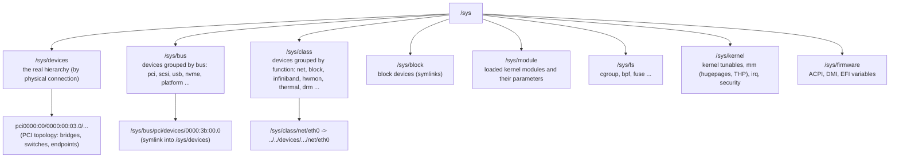
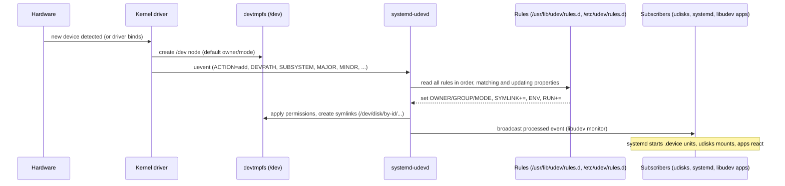

# 1.10 Devices, udev, sysfs and procfs

| | |
|---|---|
| Level | Intermediate |
| Priority tier | 0 |
| Lab venue | GCP / GKE (an Ubuntu VM; a GPU VM is optional but valuable) |
| Part | Part 1: Linux, from the command line to the kernel and performance |
| Status | Drafted, labs **untested** |

## Why this matters for AI infrastructure

An AI node is a pile of devices: eight GPUs, several InfiniBand or RoCE NICs, NVMe drives, NVSwitch chips, a BMC, a PCIe switch tree, sensors, and the CPUs and memory banks they hang off. Almost every operational question about such a node is a device question:

- "Which `/dev/nvidia*` files should this container get, and why did it not see them?"
- "Which GPU is next to which NIC, and which NUMA node are they on?" (the topology that decides NCCL performance)
- "Why did the GPU disappear after reboot, or fall off the PCIe bus?" (driver binding, kernel messages, link state)
- "Why is `/dev/sdb` now `/dev/sdc`?" (naming order, and why you never put those names in `fstab`)
- "How do I give a service access to a device without making it world-writable?" (udev rules, groups)
- "Where do I read a temperature, a PCIe link width, an InfiniBand port state or a VF count?" (sysfs)
- "How do I change a kernel parameter and make it survive reboot?" (procfs, sysctl)

Linux answers all of these through a handful of consistent interfaces: **device files** in `/dev`, **sysfs** in `/sys`, **procfs** in `/proc`, and **udev** (the user-space daemon that turns kernel hardware events into device files, permissions, names and actions). This chapter explains each, shows the tools that read them (`lsblk`, `lspci`, `lsusb`, `lscpu`, `lsscsi`, `udevadm`, `dmesg`, `dmidecode`, `sysctl`), and applies them to GPU nodes and containers. The device-driver side (loading modules, DKMS) is chapter 1.22; filesystems on block devices are chapter 1.12; SR-IOV/VFIO builds on the PCI material here in the virtualisation chapters.

## Prerequisites and outcomes

You should know the shell (1.2), file types and permissions (1.3, 1.6), processes and `/proc` basics (1.8) and have the kernel/user-space picture from 1.1.

After this chapter you can:

- Explain what a device file is (type, major and minor numbers), read `ls -l /dev` output, and create a node with `mknod` (and say why you rarely should).
- Distinguish block, character, pipe and socket files and name common device families (`sd*`, `nvme*`, `dm-*`, `tty*`, `pts/*`, `nvidia*`, `infiniband/*`).
- Navigate `/sys` to find a device's real hardware path, attributes, driver, NUMA node and links, and read or set tunables there.
- Use `/proc` for system and per-process information and `sysctl` (with persistent configuration) for kernel parameters.
- Explain the udev event flow, read and write a rule, and debug it with `udevadm` (`info`, `monitor`, `test`, `trigger`, `control --reload`).
- Use stable device names (`by-id`, `by-path`, `by-uuid`, `by-label`) instead of enumeration-order names.
- Inventory hardware with `lspci`, `lsusb`, `lsblk`, `lscpu`, `lsscsi`, `dmidecode`, `lshw`, `ethtool`, `nvidia-smi`.
- Describe how the SCSI, ATA, USB and NVMe stacks fit together in the kernel.
- Apply all this to GPU, InfiniBand and container device passthrough, and read GPU/NIC topology.

## 1. Device files: hardware as files

Unix exposes most hardware through the same file interface used for ordinary files. A **device file** (also called a **device node**) lives in `/dev` and looks like a file, but opening it makes the kernel hand your reads and writes to a **device driver** instead of a disk filesystem. You can see this with the simplest example:

```bash
echo blah > /dev/null      # the kernel's null driver accepts and discards the data
```

The kernel presents the device files as a convenience: any program that can read and write files can talk to many devices, and some devices can be used with ordinary tools (`cat`, `dd`, `less`). But a plain read/write interface cannot express everything a device can do; the rest goes through the `ioctl` system call (as the NVIDIA driver does) or through `sysfs` attributes.

### Types and numbers

`ls -l` shows the file type as the first character of the mode:

```text
brw-rw---- 1 root disk 8, 1 Sep  6 08:37 /dev/sda1
crw-rw-rw- 1 root root 1, 3 Sep  6 08:37 /dev/null
crw-rw-rw- 1 root root 195, 0 Sep 6 08:37 /dev/nvidia0
prw-r--r-- 1 root root    0 Mar  3 19:17 /run/fifo
srw-rw-rw- 1 root root    0 Dec 18 07:43 /dev/log
```

| First char | Type | Meaning |
|---|---|---|
| `b` | **Block device** | Data is accessed in fixed-size blocks, with random access by block number; the kernel can cache and reorder it. Disks, partitions, loop devices, device-mapper volumes. |
| `c` | **Character device** | A stream of bytes, no fixed size and no going back. Terminals, `/dev/null`, `/dev/random`, GPUs' control nodes, many drivers' `ioctl` interfaces. |
| `p` | Named pipe (FIFO) | Like a pipe, but with a name: another process is at the other end, not a driver. |
| `s` | Unix domain socket | An inter-process communication endpoint (`/dev/log`, `/run/docker.sock`). Usually found outside `/dev`. |

For block and character devices, the two numbers where a file size would be are the **major** and **minor** device numbers (`8, 1` for `/dev/sda1`). The kernel identifies the device by these numbers, **not by the file name**: the major number selects the driver (class) and the minor number selects the instance within it (for a disk, 0 is the whole disk and 1, 2, ... partitions; a second disk has a different major or a different block of minors). The file in `/dev` is just a labelled pointer, with ordinary owner, group and permission bits that control who may use the device. The drivers currently loaded and their major numbers are listed in `/proc/devices`.

Network interfaces are the notable exception: they have **no device file** (`eth0`, `ens3`, `ib0` are not in `/dev`); the kernel offers them through the socket API and netlink instead.

### Naming: why enumeration order is a trap

Traditional names such as `/dev/sda`, `/dev/sdb` are assigned in the order the kernel's drivers find devices, which can differ between boots or after a disk is added or fails. If three disks are `sda`, `sdb`, `sdc` and `sdb` fails, the old `sdc` becomes `sdb`; an `fstab` entry that said `/dev/sdb1` now mounts the wrong disk (or none). So **never write `sdX` names in persistent configuration**. Use stable identifiers: the filesystem **UUID** or **label** (`UUID=...`, covered in chapter 1.12), a **LVM or device-mapper** name (`/dev/mapper/vg-lv`), or the persistent symbolic links that udev creates under `/dev/disk/` (section 6). The same applies to network interface names (modern systems use predictable names like `enp3s0`) and, for GPUs, `nvidia0`/`nvidia1` indices, which can be reordered: refer to GPUs by **UUID** (`nvidia-smi -L` prints it) or **PCI bus ID** when it matters.

### Creating device files

On a modern system you do not create device nodes by hand: the kernel (through **devtmpfs**) and udev do it. For understanding, and for rare cases (a minimal container, a rescue environment), `mknod` creates one:

```bash
sudo mknod /tmp/mynull c 1 3        # character device, major 1, minor 3 (same as /dev/null)
sudo mknod /tmp/myfifo p            # a named pipe needs no numbers (mkfifo does the same)
sudo chmod 666 /tmp/mynull && echo test > /tmp/mynull
```

Historically `/dev` was populated by a `MAKEDEV` script and then by a kernel-space `devfs`; both were replaced by the current design because device management does not belong in the kernel: a user-space daemon can apply policy (names, permissions, actions) with far less risk. Mounting a filesystem with the **`nodev`** option makes device files on it inert, a standard security hardening for `/home`, `/tmp` and removable media (otherwise a user could create a node for the raw disk).

## 2. The common device files

You will meet these constantly; know the naming convention and what each is.

| Device file(s) | Meaning |
|---|---|
| `/dev/sd*` (`sda`, `sda1`) | SCSI/SATA/SAS/USB disks (`sd` = "SCSI disk" because the kernel talks SCSI to most storage). Letters per disk, numbers per partition. List with `lsscsi`, `lsblk`. |
| `/dev/nvme*` (`nvme0n1`, `nvme0n1p1`) | NVMe SSDs: controller `nvme0`, namespace `n1`, partition `p1`. List with `nvme list` (package `nvme-cli`) or `lsblk`. |
| `/dev/vd*`, `/dev/xvd*` | Virtio and Xen virtual disks in VMs. (On GCP and AWS you may see `nvme*` for persistent disks too.) |
| `/dev/dm-*`, `/dev/mapper/*` | Device-mapper block devices: LVM volumes, dm-crypt (LUKS), multipath, software RAID layers (chapter 1.13). |
| `/dev/md*` | Linux software RAID (`md`) arrays. |
| `/dev/loop*` | Loop devices: a file used as a block device (`losetup`; container image layers, snaps). |
| `/dev/sr*` | CD and DVD optical drives (`/dev/sr0`, `/dev/sr1`, read-only access; to write discs, user-space tools like `wodim` use the generic SCSI device `/dev/sg*`, section 7); older PATA optical drives may show up as `/dev/hd*`. |
| `/dev/hd*` | Old PATA (Parallel ATA) hard disks (`/dev/hda` primary master, `/dev/hdb` primary slave, `/dev/hdc` secondary master, `/dev/hdd` secondary slave on older kernels/hardware); if a modern SATA disk shows up as `hd*`, its controller is running in a slow legacy compatibility mode. |
| `/dev/tty*`, `/dev/pts/*`, `/dev/tty` | Terminals: `ttyN` (`tty1`, `tty2`, ...) virtual consoles, `pts/N` (`pts/0`, `pts/3`) pseudoterminals (every SSH or GUI terminal-emulator session), and `/dev/tty` (the controlling terminal of the current process). |
| `/dev/ttyS*`, `/dev/ttyUSB*`, `/dev/ttyACM*` | Serial ports and USB serial adapters: Windows `COM1` is `/dev/ttyS0` and `COM2` is `/dev/ttyS1`, while plug-in USB serial and modem/microcontroller adapters appear as `/dev/ttyUSB0`, `/dev/ttyACM0`, `/dev/ttyUSB1`, `/dev/ttyACM1` (BMC serial-over-LAN consoles, switch consoles, microcontrollers). Access usually requires the `dialout` group; talk with `screen /dev/ttyUSB0 115200`. |
| `/dev/null`, `/dev/zero` | Discard sink; endless zero bytes. |
| `/dev/random`, `/dev/urandom` | Kernel random number generator (on current kernels both are cryptographically secure and non-blocking once seeded; `getrandom()` is the preferred API). |
| `/dev/full` | Always reports "no space left" (testing). |
| `/dev/mem`, `/dev/kmem`, `/dev/port` | Raw memory and I/O ports; heavily restricted or absent for security. |
| `/dev/fuse` | The interface for user-space filesystems (SSHFS, rclone mount, containers' overlay helpers). |
| `/dev/kvm`, `/dev/vhost-*`, `/dev/vfio/*` | Hardware virtualisation and device-passthrough interfaces (virtualisation chapters). |
| `/dev/nvidia0 ... N`, `/dev/nvidiactl`, `/dev/nvidia-uvm`, `/dev/nvidia-uvm-tools`, `/dev/nvidia-modeset`, `/dev/nvidia-caps/*` | The NVIDIA driver's nodes: one per GPU, a control node, unified-memory nodes, mode-setting, and MIG/capability nodes. Created by the driver module and by `nvidia-modprobe`. |
| `/dev/infiniband/uverbs*`, `rdma_cm`, `umad*`, `issm*` | RDMA user-space verbs, connection manager and management datagram nodes used by InfiniBand/RoCE stacks and MPI/NCCL. |
| `/dev/gdrdrv` | GPUDirect RDMA helper device (when the module is loaded). |
| `/dev/shm`, `/dev/pts`, `/dev/mqueue` | Not devices: tmpfs/devpts/mqueue filesystems mounted under `/dev` (shared memory, pseudoterminals, POSIX message queues). Containers mount their own. |
| `/dev/disk/by-*`, `/dev/block/MAJ:MIN`, `/dev/char/MAJ:MIN` | udev-maintained symbolic links (section 6). |
| `/dev/stdin`, `/dev/stdout`, `/dev/stderr`, `/dev/fd/N` | Symbolic links into `/proc/self/fd`; how `<(command)` process substitution appears as a file name. |

### Consoles, parallel ports and audio (legacy devices you will still meet)

- **Virtual consoles and display modes (`HLW` Section 3.4.7).** Linux has two primary display modes: text mode and graphical mode (with kernel mode setting, KMS, allowing smooth switching between them), and multiplexes the physical display into virtual consoles `/dev/tty1`, `/dev/tty2`, ... Each virtual console can run in text or graphics mode. In text mode you switch between consoles with **Alt-F1**, **Alt-F2** and so on; leaving a console in graphical mode requires **Ctrl-Alt-F1**, **Ctrl-Alt-F2**, etc. A text login prompt on a console is run by a `getty` process; an Xorg or Wayland graphical session takes over a console (if `getty` runs on `tty1` and `tty2`, graphics takes `tty3`, though many modern distributions place the graphical display manager on `tty1`). If keyboard switching fails, root can force a switch with `chvt 1`. On servers the same idea appears as the **serial console** (`console=ttyS0,115200` on the kernel command line) and the BMC's serial-over-LAN, which is how you reach a node whose network or display is broken (chapter 1.14 and the BMC chapters).
- **Parallel ports**: `/dev/lp0`, `/dev/lp1` (unidirectional printer ports, LPT1 and LPT2 in Windows) and `/dev/parport0` (bidirectional). Replaced by USB and the network; printing is done through a print server such as CUPS, not by writing to `lp0`.
- **Audio (`HLW` Section 3.4.9)**: Linux has two sets of audio device nodes: `/dev/snd/*` for the modern **ALSA** (*Advanced Linux Sound Architecture*) subsystem, and the older **OSS** (*Open Sound System*) compatibility devices (`/dev/dsp`, `/dev/audio`). While you can theoretically play a WAV file by redirecting it to `/dev/dsp`, frequency mismatches and direct device contention make raw access impractical; user-space sound servers (`PulseAudio`, `PipeWire`) sit on top of ALSA. Irrelevant on compute nodes, but you will see the names in container images and desktop VMs.

## 3. `dd` and devices

`dd` copies bytes from an input to an output in fixed-size blocks and, unlike most tools, can start and stop at arbitrary points. Its syntax is unusual (an old IBM job-control style): `option=value` instead of `-option`.

| Option | Meaning |
|---|---|
| `if=FILE` | input (default stdin) |
| `of=FILE` | output (default stdout) |
| `bs=SIZE` | block size for both (`1k`, `1M`, `4M`); too small is slow, too large wastes memory |
| `count=N` | copy only N blocks |
| `skip=N`, `seek=N` | skip N input blocks; skip N output blocks |
| `conv=...` | `noerror,sync` (continue on read errors and pad), `fsync` (flush at the end), `notrunc` |
| `status=progress` | show progress |
| `iflag=direct`, `oflag=direct` | use direct I/O, bypassing the page cache (needed for honest benchmarks of storage) |

```bash
dd if=/dev/zero of=/tmp/new bs=1k count=1                      # one 1024-byte block of zeros
dd if=/dev/zero of=/tmp/test bs=1M count=1024 oflag=direct status=progress   # crude write throughput test
sudo dd if=/dev/sda bs=512 count=1 | xxd | tail -3              # read the first sector (partition table signature 55 aa)
sudo dd if=disk.img of=/dev/sdX bs=4M status=progress conv=fsync   # write an image to a device (DANGER)
```

**`dd` writes without asking.** A swapped `if=` and `of=`, or the wrong `/dev/sdX`, destroys data instantly; many a boot disk has been overwritten by a typo. Always check the target with `lsblk -o NAME,SIZE,MODEL,MOUNTPOINT`, never run `dd` against a mounted device, and when in doubt write to a file first. For serious benchmarking use `fio` (chapter 1.25); `dd` is only a rough indicator.

## 4. sysfs: the kernel's device model as a tree

`/dev` lets programs *use* a device but says little about it. **sysfs**, mounted at `/sys`, is a virtual filesystem (it exists only in memory) in which the kernel exposes its **device model**: every device, bus, driver and class as directories, with **attributes** as small files (typically one value per file). It is meant to be read mostly by programs, but you will read it by hand constantly.



Key ideas:

- **`/sys/devices`** is the true tree, following how hardware is attached. The SATA disk `/dev/sda` might live at `/sys/devices/pci0000:00/0000:00:17.0/ata3/host0/target0:0:0/0:0:0:0/block/sda` (or `.../0000:00:1f.2/host0/target0:0:0/0:0:0:0/block/sda`). That path is long on purpose: it tells you which PCI controller and ATA/SCSI port the device is on. Listing that directory (`ls`) shows files and subdirectories such as `alignment_offset`, `bdi`, `capability`, `dev`, `device`, `discard_alignment`, `events`, `events_async`, `events_poll_msecs`, `ext_range`, `holders`, `inflight`, `power`, `queue`, `range`, `removable`, `ro`, `sda1`, `sda2`, `sda5`, `size`, `slaves`, `stat`, `subsystem`, `trace`, and `uevent`. These files and subdirectories are meant primarily to be read by user-space programs rather than humans (for example, `cat dev` prints `8:0` and `cat size` prints the disk's total 512-byte sector count), while each partition (`sda1`, `sda2`) has its own subdirectory containing its own `dev`, `partition`, `size`, `start`, `stat`, and `uevent` files. The `/dev` file *uses* the device; the sysfs path *describes and manages* it.
- **`/sys/bus`, `/sys/class` and `/sys/block`** are convenient views (symbolic links into `/sys/devices`) organised by bus, by function and by block-ness. `ls -l /sys/block` reveals the real paths.
- A device directory contains attributes such as `dev` (the `MAJOR:MINOR`), `uevent` (the event properties), `subsystem` (link to its bus or class), `driver` (link to the bound driver), `power/`, `size`, `queue/` for block devices, and bus-specific files.

Useful attributes by area (all under `/sys`):

| Path | What it tells you or lets you set |
|---|---|
| `block/sda/size`, `block/sda/queue/{rotational,scheduler,nr_requests,read_ahead_kb,max_sectors_kb}` | Size in 512-byte sectors; whether it is spinning; the I/O scheduler (writable: `echo none > .../scheduler`); queue tuning |
| `block/nvme0n1/device/{model,serial,firmware_rev,numa_node}` | NVMe identity and NUMA locality |
| `class/net/eth0/{address,mtu,speed,duplex,operstate,carrier,statistics/*}`, `class/net/eth0/device -> ../../../0000:3b:00.0` | Link state and counters; which PCI device the NIC is |
| `class/infiniband/mlx5_0/ports/1/{state,phys_state,rate,lid,sm_lid}` | InfiniBand port state ("4: ACTIVE"), link rate, LID |
| `bus/pci/devices/0000:3b:00.0/{vendor,device,class,subsystem_vendor,numa_node,local_cpulist,current_link_speed,current_link_width,max_link_speed,max_link_width,driver,iommu_group,enable,reset,remove,rescan}` | PCI identity, locality, **PCIe link training result**, bound driver, IOMMU group, hot-remove and reset |
| `bus/pci/devices/.../{sriov_totalvfs,sriov_numvfs,driver_override}` | SR-IOV virtual functions (writable); force a driver for passthrough |
| `bus/pci/rescan`, `bus/pci/devices/.../remove` | Re-enumerate the PCI bus after a hot-plug or reset; remove a device |
| `class/hwmon/hwmon*/{name,temp*_input,fan*_input,power*_input}`, `class/thermal/thermal_zone*/temp` | Sensor values (millidegrees for temperatures) |
| `devices/system/cpu/cpu*/{online,topology/*,cpufreq/*,cache/index*/}` | CPU hotplug, topology, frequency scaling governor, caches |
| `devices/system/node/node*/{cpulist,meminfo,distance,hugepages/*}` | **NUMA** topology: which CPUs and memory belong to each node, distances, hugepage pools |
| `kernel/mm/transparent_hugepage/{enabled,defrag}`, `kernel/mm/hugepages/*` | THP and hugepage controls (chapter 1.17) |
| `module/nvidia/parameters/*`, `module/*/version` | Module parameters and versions |
| `fs/cgroup/*` | cgroup v2 tree (chapter 1.18) |
| `firmware/dmi/*`, `class/dmi/id/{product_name,sys_vendor,bios_version,board_serial}` | Hardware identity (what `dmidecode` prints) |

```bash
cat /sys/block/sda/dev                                  # 8:0, the major:minor of /dev/sda
readlink -f /sys/block/sda                              # the real hardware path
cat /sys/bus/pci/devices/0000:3b:00.0/numa_node         # which NUMA node a PCI device (GPU/NIC) is on
cat /sys/class/net/eth0/speed /sys/class/net/eth0/operstate
cat /sys/bus/pci/devices/0000:3b:00.0/current_link_speed /sys/bus/pci/devices/0000:3b:00.0/max_link_width
echo none | sudo tee /sys/block/nvme0n1/queue/scheduler  # change I/O scheduler (not persistent)
```

**Changes made by writing to sysfs are not persistent.** They last until reboot (or until the device is reset). To persist them use udev rules (`ATTR{...}=...`), `systemd-tmpfiles` (`w /sys/...`), kernel command-line options, or module parameters in `/etc/modprobe.d/`.

## 5. procfs and `sysctl`

`/proc` is the older virtual filesystem, originally for processes and later for everything: the numeric directories are per-process information (chapter 1.8); the rest is system-wide state:

| Path | Contents |
|---|---|
| `/proc/cpuinfo` | Per-CPU model, flags, frequency (`lscpu` formats it) |
| `/proc/meminfo`, `/proc/vmstat`, `/proc/buddyinfo`, `/proc/slabinfo`, `/proc/pagetypeinfo` | Memory statistics (chapter 1.17) |
| `/proc/loadavg`, `/proc/uptime`, `/proc/stat`, `/proc/pressure/*` | Load, uptime, CPU time counters, PSI |
| `/proc/interrupts`, `/proc/softirqs`, `/proc/irq/N/smp_affinity{,_list}` | Interrupt counts per CPU; **interrupt-to-core affinity** (set a mask to pin a NIC or GPU interrupt) |
| `/proc/devices`, `/proc/misc`, `/proc/partitions`, `/proc/diskstats` | Registered major numbers, partitions, disk counters |
| `/proc/modules` (= `lsmod`), `/proc/kallsyms`, `/proc/driver/nvidia/*` | Modules; symbols; NVIDIA driver version and per-GPU information (`/proc/driver/nvidia/version`, `gpus/*/information`) |
| `/proc/mounts`, `/proc/self/mountinfo` | Mounted filesystems |
| `/proc/net/*` | Network tables (`dev`, `tcp`, `route`, `arp`, `snmp`) |
| `/proc/cmdline`, `/proc/version`, `/proc/config.gz` | Kernel command line; version; build configuration (if enabled) |
| `/proc/sys/` | **Tunable kernel parameters**, one file per value |

### `/proc/sys` and `sysctl`

Everything under `/proc/sys` is a live kernel setting. Reading is `cat`; changing is writing:

```bash
cat /proc/sys/net/ipv4/ip_forward
echo 1 | sudo tee /proc/sys/net/ipv4/ip_forward      # immediate, lost at reboot
```

The **`sysctl`** command presents the same tree with dots instead of slashes (path relative to `/proc/sys`):

```bash
sysctl net.ipv4.ip_forward                  # read
sudo sysctl -w net.ipv4.ip_forward=1        # write (runtime only)
sysctl -a | grep -i hugepages               # search all parameters
sysctl vm.swappiness vm.dirty_ratio kernel.pid_max fs.file-max net.core.rmem_max
sudo sysctl --system                        # apply all configuration files now
```

**Persistence**: put settings in `/etc/sysctl.conf` or, preferably, files in `/etc/sysctl.d/NN-name.conf` (applied at boot by `systemd-sysctl`; later files override earlier ones; vendor defaults live in `/usr/lib/sysctl.d/`):

```text
# /etc/sysctl.d/90-gpu-node.conf
vm.swappiness = 1
vm.max_map_count = 1048576
kernel.numa_balancing = 0
net.core.rmem_max = 268435456
net.core.wmem_max = 268435456
```

Parameters are grouped by area: `kernel.*` (pid_max, panic behaviour, `kernel.yama.ptrace_scope`, `kernel.core_pattern`), `vm.*` (swappiness, dirty ratios, overcommit, `nr_hugepages`, `max_map_count`), `net.*` (buffers, congestion control, forwarding, conntrack), `fs.*` (`file-max`, `inotify.max_user_watches`), `dev.*`. Guidance: change **one thing at a time** with a measurable reason; document it; remember some values only take effect on new connections or processes; and note that a few settings depend on a module being loaded (`net.bridge.*` needs `br_netfilter`), so a boot-time sysctl can fail silently. Tuned values for GPU/HPC nodes appear in chapters 1.22 and 1.28.

## 6. udev: from hardware events to device files

### The problem and the design

When hardware appears (a USB drive, a hot-plugged NVMe drive, a GPU that finishes initialising, a VF created by SR-IOV), the system should create a device file, set its owner and permissions, create friendly names, and maybe run a program. This is *policy*, and policy does not belong in the kernel. So the kernel emits an event and a user-space daemon, **`systemd-udevd`** (historically `udevd`), applies rules.

There is a bootstrap problem: device files are needed very early in boot, but udev itself needs some to start. The answer is **devtmpfs**, an in-memory filesystem mounted on `/dev` early: the kernel creates a node there for every device it discovers (with default ownership `root:root` and mode 0600 or 0660) and *also* notifies udev. udev does not create the nodes; it **adjusts** them (owner, group, mode), **creates additional symbolic links**, imports properties, and runs actions.



The kernel event is a **uevent**: a set of `KEY=value` properties, for example:

```text
ACTION=add
DEVPATH=/devices/pci0000:00/0000:00:1a.0/usb1/1-1/1-1.2/1-1.2:1.0/host4/target4:0:0/4:0:0:3/block/sde
DEVTYPE=disk
MAJOR=8
MINOR=64
SEQNUM=2752
SUBSYSTEM=block
```

(`ACTION` is `add`, `remove`, `change`, `bind`, `unbind`, `move`, `online`, `offline`. A `change` event is how media change, resize and many driver state changes are announced.)

### Rules

Rules files end in `.rules` and are read from `/usr/lib/udev/rules.d/` (older systems: `/lib/udev/rules.d/`; vendor defaults), `/etc/udev/rules.d/` (administrator rules and overrides; a file with the same name masks the vendor file) and `/run/udev/rules.d/`. All files are merged and processed **in lexical order of file name**, hence the numeric prefixes (`60-persistent-storage.rules`, `70-uaccess.rules`, `99-local.rules`). Within the order, **each event is matched against every rule from start to finish** (unlike a firewall, it does not stop at the first match, except where a rule uses `GOTO` or `:=` locks); every matching rule can add to the state of the event.

A rule is one line of comma-separated **matches** and **assignments**. Matches use `==` (equal) or `!=`; assignments use `=` (set, replacing earlier values), `+=` (add) or `:=` (set and forbid later changes). The right-hand side may use shell-style patterns `*`, `?`, `[ ]` and `|` for alternatives.

Common **match keys**:

| Key | Matches |
|---|---|
| `ACTION` | `add`, `remove`, `change` ... |
| `KERNEL` | The kernel's device name (`sd*`, `nvme[0-9]n[0-9]`, `loop*`) |
| `SUBSYSTEM`, `SUBSYSTEMS` | The device's subsystem; `SUBSYSTEMS` also checks parents |
| `DRIVER`, `DRIVERS` | The driver bound to it (or a parent) |
| `ATTR{name}`, `ATTRS{name}` | A sysfs attribute of the device (or of any parent, for `ATTRS`) |
| `ENV{key}` | A property of the event (including those imported by other rules) |
| `TAG`, `TEST{...}` | A tag; whether a file exists |
| `PROGRAM`, `RESULT` | Run a program and match its output |

Common **assignments**: `NAME` (network devices only; device nodes are named by the kernel), `SYMLINK+=` (extra names), `OWNER`, `GROUP`, `MODE`, `TAG+=`, `ENV{key}=`, `ATTR{name}=` (write a sysfs attribute), `RUN+=` (run a program after processing; keep it short and non-blocking), `IMPORT{program}=` (run a program and import its `KEY=value` output as properties), `GOTO`/`LABEL`, and `OPTIONS+=`. In the right-hand strings you can substitute `%k` (kernel name), `%n` (device number), `%p` (device path), `%M`/`%m` (major/minor), `$attr{file}` or `%s{file}`, `$env{key}` or `%E{key}`, `$major`, `$minor`, `$result`, `$parent`, `$devnode`, `$name`, and `%%`/`$$` for literal `%`/`$`.

**Reading a vendor rule.** The default persistent-name rules identify a disk and create `by-id` links. Simplified:

```text
# 60-persistent-storage.rules (simplified)
# 1. Ask ata_id for the serial number of whole ATA disks, import the answer as properties:
KERNEL=="sd*[!0-9]|sr*", ENV{ID_SERIAL}!="?*", SUBSYSTEMS=="scsi", ATTRS{vendor}=="ATA", IMPORT{program}="ata_id --export $devnode"
# 2. Once ID_SERIAL is set, create the by-id symlink:
KERNEL=="sd*|sr*", ENV{DEVTYPE}=="disk", ENV{ID_SERIAL}=="?*", SYMLINK+="disk/by-id/$env{ID_BUS}-$env{ID_SERIAL}"
```

Rule 1 matches a whole-disk device (name `sd` plus letters, no digit) that does not yet have `ID_SERIAL` (`!="?*"` means "not set"), on an ATA device behind the SCSI layer, and runs the directive `IMPORT{program}="ata_id --export $devnode"` (or `$tempnode`). Running `/lib/udev/ata_id --export /dev/sda` on the command line prints `ID_TYPE=disk`, `ID_MODEL=WDC_WD3200AAJS-...`, `ID_SERIAL=WDC_WD3200AAJS-_WD-WMAV2FU80671`, `ID_REVISION=01.03A01`, and `ID_BUS=ata`. Rule 2 matches any disk with `ID_SERIAL` set and **adds a symlink** (`SYMLINK+="disk/by-id/$env{ID_BUS}-$env{ID_SERIAL}"`), producing `/dev/disk/by-id/scsi-SATA_WDC_WD3200AAJS-_WD-WMAV2FU80671 -> ../../sda` (and `-part1 -> ../../sda1`). That "match, import, then act" pattern recurs throughout the udev rule set. You may be wondering how to tell a conditional expression from a directive: conditionals are denoted by two equal signs (`==`) or a bang equal (`!=`), and directives by a single equal sign (`=`), a plus equal (`+=`), or a colon equal (`:=`).

### Writing your own rule

Never edit vendor files; add your own in `/etc/udev/rules.d/`, with a prefix that sorts after the vendor rule you need to override. A few useful examples:

```text
# /etc/udev/rules.d/90-local.rules

# 1. Stable name for a specific serial console adapter, group access for a team
SUBSYSTEM=="tty", ATTRS{idVendor}=="0403", ATTRS{idProduct}=="6001", ATTRS{serial}=="A50285BI", \
    SYMLINK+="ttyBMC-rack3", GROUP="ops", MODE="0660"

# 2. Set the I/O scheduler to 'none' for NVMe, and 'mq-deadline' for rotational disks
ACTION=="add|change", KERNEL=="nvme[0-9]*n[0-9]*", ATTR{queue/scheduler}="none"
ACTION=="add|change", KERNEL=="sd[a-z]", ATTR{queue/rotational}=="1", ATTR{queue/scheduler}="mq-deadline"

# 3. Give members of group 'gpuusers' access to the NVIDIA device nodes (use with care; see section 10)
KERNEL=="nvidia*", GROUP="gpuusers", MODE="0660"

# 4. Pin a NIC name by MAC address (alternative to systemd .link files)
SUBSYSTEM=="net", ACTION=="add", ATTR{address}=="aa:bb:cc:dd:ee:ff", NAME="mgmt0"
```

After editing: `sudo udevadm control --reload` (re-read rules), then `sudo udevadm trigger --subsystem-match=block --action=change` (replay events so existing devices get the rule), and verify with `udevadm test`. **Rule syntax errors are logged but do not stop other rules**, so always test. Do not make `RUN+=` programs long-running (udev kills them after a timeout); start a systemd service from the rule instead (`TAG+="systemd", ENV{SYSTEMD_WANTS}="myservice.service"`).

### `udevadm` and device monitoring (`HLW` Sections 3.5.3–3.5.4)

| Command | Use |
|---|---|
| `udevadm info --query=all --name=/dev/sda` (or `-p /sys/block/sda`) | Everything udev knows: `P:` sysfs path, `N:` node name, `S:` symlinks, `E:` properties. Add `-a` (`--attribute-walk`) to list the device's sysfs attributes and its parents' (the values you can match with `ATTRS{}`). |
| `udevadm monitor` | Watch events live (insert/remove devices). Shows `KERNEL` (from the kernel) and `UDEV` (after processing) lines; use `--kernel`, `--udev`, `--property`, `--subsystem-match=scsi`. |
| `udevadm test /sys/block/sda` | Simulate processing a device and print which rules ran and what they did. (`udevadm test-builtin` for built-in helpers.) |
| `udevadm trigger [--action=add\|change] [--subsystem-match=... --attr-match=...]` | Replay events for existing devices (apply new rules). |
| `udevadm control --reload` / `--log-level=debug` | Reload rules; raise logging. |
| `udevadm settle` | Wait until all queued events have been processed (use in scripts after triggering). |

```bash
udevadm info --query=property --name=/dev/nvme0n1 | grep -E 'ID_MODEL|ID_SERIAL|ID_PATH' # (untested here)
udevadm info -a -n /dev/ttyUSB0 | grep -E 'ATTRS\{(idVendor|idProduct|serial)\}' # (untested here)
sudo udevadm monitor --udev --subsystem-match=block     # (untested here) then plug/attach a disk in another window
udevadm monitor --kernel --subsystem-match=scsi         # (untested here) filter for kernel SCSI uevents only
```

When you run `udevadm monitor` and insert a USB flash drive (`HLW` Section 3.5.3), you see two waves of lines: first `KERNEL[658299.569485] add /devices/pci0000:00/... (usb)` / `(scsi)` / `(block)` as the kernel's drivers discover the device, and then `UDEV  [658300.625456] add /devices/pci0000:00/... (block)` after `systemd-udevd` finishes running all matching rules and creating the `/dev/disk/by-*` symlinks. You can filter events with `--kernel`, `--udev`, `--property`, or `--subsystem-match=scsi`.

### Persistent device names under `/dev/disk`

udev creates these links for block devices; use them in scripts and in `fstab` when you must refer to a device (though a filesystem UUID is usually best):

| Directory | Names by | Use |
|---|---|---|
| `/dev/disk/by-id/` | Bus, vendor, model, serial (`nvme-Samsung_SSD_..._S4EV...`, `wwn-0x500...`) | Identify a **physical** drive wherever it is plugged in; essential in RAID and replacement procedures |
| `/dev/disk/by-path/` | Hardware path (PCI slot and port) | Identify a **slot**; stable when you swap a drive in the same slot |
| `/dev/disk/by-uuid/` | Filesystem UUID | The recommended `fstab` key |
| `/dev/disk/by-label/`, `by-partuuid/`, `by-partlabel/` | Filesystem label; GPT partition UUID or name | Friendly alternatives |

(`lsblk -o NAME,SIZE,TYPE,FSTYPE,UUID,MOUNTPOINT` shows several at once; `blkid` prints UUIDs and types.)

### udev versus systemd `.link` files and `systemd-hwdb`

Network interface names are decided by `systemd-udevd` using `.link` files in `/usr/lib/systemd/network/` and `/etc/systemd/network/` (for example, `99-default.link`, naming `enp3s0` from the PCI slot, `eno1` from firmware). Persistent rename by MAC is a `.link` file with `[Match] MACAddress=` and `[Link] Name=`. Hardware identification databases (vendor names for `lspci`, `lsusb`, USB device classes) come from `systemd-hwdb` (`/usr/lib/udev/hwdb.d`), rebuilt with `systemd-hwdb update`. Mentioned here so you recognise them; networking details are in Part 2.

## 7. How storage devices fit together in the kernel (`HLW` Section 3.6)

The Linux **SCSI subsystem** is the common stack beneath most storage, and it explains why `sd*` appears for USB sticks, SATA disks and SAS drives alike.

- **SCSI addressing.** To list the SCSI devices on your system, run `lsscsi`, which walks the device paths provided by `sysfs`:

```text
$ lsscsi
[0:0:0:0]  disk    ATA      WDC WD3200AAJS-2 01.0  /dev/sda
[1:0:0:0]  cd/dvd  Slimtype DVD A DS8A5SH    XA15  /dev/sr0
[2:0:0:0]  disk    USB2.0   CardReader CF    0100  /dev/sdb
[2:0:0:1]  disk    USB2.0   CardReader SM XD 0100  /dev/sdc
[2:0:0:2]  disk    USB2.0   CardReader MS    0100  /dev/sdd
[2:0:0:3]  disk    USB2.0   CardReader SD    0100  /dev/sde
```

Each line starts with `[host:channel:target:lun]`, followed by the device type (`disk` -> `sd`, `cd/dvd` -> `sr`), vendor/model/revision, and `/dev` node. The four numbers are the host adapter (`0`, `1`, `2`), the bus channel (`0`), the target's SCSI ID (`0`), and the **LUN** (*logical unit number*): notice how one USB card reader on host `2`, target `0` exposes four slots as LUNs `0` through `3` (`[2:0:0:0]` to `[2:0:0:3]`), each given its own `/dev/sd*` block device (`/dev/sdb` through `/dev/sde`).
- **Three layers.** The **top (class) layer** has a driver per device class (`sd` for disks, `sr` for optical, `st` for tape, `sg` generic) that translates the kernel's block requests into SCSI protocol commands. The **middle layer** (the SCSI core) moderates between top and bottom, tracks hosts and devices, and handles errors and timeouts. The **bottom (host-adapter) layer** has hardware-specific drivers for host adapters (`mpt3sas`, `megaraid_sas`, `ahci`, `virtio_scsi`, USB's `usb-storage` bridge).
- **Everything is made to look like SCSI (`USB` storage and `libata`).** When you plug in a USB disk or flash reader, the USB storage driver acts as a translator: on its upper side it speaks SCSI to the SCSI lower layer, and on its lower side it speaks USB to the USB subsystem (wrapping SCSI commands inside USB messages). Similarly, SATA disks connect through **libata** inside the kernel, which performs a full command-by-command translation between SCSI commands and native ATA commands (whereas ATAPI optical drives already speak a repackaged SCSI command set). Hardware RAID controllers present virtual disks as SCSI directly.
- **NVMe is separate.** NVMe devices use their own stack (`nvme` driver, `/dev/nvme*`), not SCSI, with per-CPU submission and completion queues for very high IOPS. They sometimes show in `lsscsi` for convenience. NVMe-over-Fabrics (RDMA/TCP) carries the same protocol across the network (storage chapters).
- **Generic SCSI nodes (`/dev/sg*`, `lsscsi -g`) and multiple access methods.** User processes can bypass the top-level device class drivers (`sd`, `sr`) and send SCSI protocol commands directly to devices through their generic character devices (`/dev/sg*`, inspected with tools from `sg3_utils` such as `sg_inq` and `sg_map`). Running `lsscsi -g` appends each device's generic node on the right (`/dev/sda /dev/sg0`, `/dev/sr0 /dev/sg1`, ..., `/dev/sde /dev/sg5`, major number `21`). Why have two device files for one piece of hardware? Standard block reads and writes go through the fast in-kernel block driver (`/dev/sr0` or `/dev/sda`), while complex or specialized operations—such as burning an optical disc (`wodim`), querying SMART drive health (`smartctl`), or controlling tape changers (`sg3_utils`)—run in user space via `/dev/sg1` so bugs in complex protocol code cannot crash the kernel.
- **Multipath.** A SAN LUN reachable over several paths appears once per path (`sdb`, `sdc`, `sdd`) and `multipathd` combines them into one `/dev/mapper/mpathX` device (chapter 1.13).

Tools: `lsblk` (tree of block devices), `lsscsi`, `nvme list`, `smartctl -a /dev/sdX` (drive health), `hdparm -I`, `blkid`, `udevadm info`. The same tree seen from the hardware side is `lspci`.

## 8. Hardware inventory: PCI, USB, CPU, memory, firmware

You need to answer "what is in this machine?" quickly, and in a way that is comparable across hundreds of nodes.

| Tool | Shows |
|---|---|
| `lspci` / `lspci -nn` / `lspci -tv` / `lspci -vvv -s 3b:00.0` | PCI devices; vendor:device IDs (`[10de:2330]` is NVIDIA); the **tree** with bridges and switches; the verbose view with **capabilities and link status** (`LnkCap`, `LnkSta`, `Speed 16GT/s, Width x16`), **AER** (advanced error reporting) counters, `Kernel driver in use`, `Kernel modules` |
| `lsusb`, `lsusb -t` | USB devices and the USB tree |
| `lscpu`, `lscpu -e` | CPU model, sockets, cores, threads, **NUMA nodes and which CPUs are in each**, caches, flags, virtualisation support |
| `numactl -H` / `lstopo` (from `hwloc`) | NUMA distances and the **full topology** (cores, caches, memory, PCI devices, GPUs, NICs); `lstopo --of ascii/png` |
| `free -h`, `dmidecode -t memory` | Memory sizes; DIMM slots, speeds, serial numbers |
| `lsblk`, `lsscsi`, `nvme list`, `smartctl` | Storage |
| `ip -br link`, `ethtool -i eth0`, `ethtool eth0`, `ibstat`, `ibv_devinfo`, `rdma link` | NICs, driver and firmware versions, link speed; InfiniBand/RoCE |
| `dmidecode`, `lshw -short`, `/sys/class/dmi/id/*` | Firmware (SMBIOS/DMI) tables: manufacturer, product, serials, BIOS version, slots; a complete hardware listing |
| `ipmitool`, `redfishtool`/BMC web interface | Out-of-band hardware data (BMC chapters in Part 6/8) |
| `nvidia-smi`, `nvidia-smi -L`, `nvidia-smi topo -m`, `nvidia-smi -q` | GPUs, UUIDs, driver and CUDA versions, **topology matrix**, ECC, clocks, power, throttle reasons |
| `dmesg`, `journalctl -k`, `journalctl -k -b -1` | The **kernel ring buffer**: driver messages from boot and from hot events (the first place to look when hardware misbehaves); `-b -1` is the previous boot |

```bash
lspci -nn | grep -iE 'nvidia|mellanox|infiniband|ethernet|non-volatile'
lspci -tv | head -60                                     # the PCIe tree
sudo lspci -vvv -s 3b:00.0 | grep -E 'LnkCap|LnkSta|Kernel driver|NUMA|AER'
lscpu | grep -E 'Model name|Socket|NUMA|Thread|Core'
sudo dmidecode -s system-product-name; sudo dmidecode -s bios-version
sudo dmesg --level=err,warn | tail -40
nvidia-smi topo -m
```

**Reading `nvidia-smi topo -m`.** The matrix shows how each pair of GPUs (and NICs) is connected: `NV#` (that many NVLink lanes; the fastest), `PIX` (at most one PCIe bridge), `PXB` (several PCIe bridges, no host bridge), `PHB` (through a PCIe host bridge, i.e. via the CPU), `NODE` (across the interconnect within a NUMA node), `SYS` (across the inter-socket link, the slowest), and `X` (self). It also lists each device's **CPU affinity** and **NUMA affinity**. Communication libraries use this to choose paths, and you use it to place processes (chapters 1.17 and 1.28; NCCL chapters).

## 9. Drivers, binding and rescans

A **driver** claims a device by matching its ID tables (PCI vendor:device, USB class, device-tree compatible string). The kernel's **modalias** mechanism lets udev load the right module automatically: when a device appears, the uevent carries a `MODALIAS` value, and udev runs `modprobe` for it. Look at the pieces:

```bash
cat /sys/bus/pci/devices/0000:3b:00.0/modalias           # pci:v000010DEd00002330sv...
readlink /sys/bus/pci/devices/0000:3b:00.0/driver        # the bound driver, e.g. .../drivers/nvidia
lsmod | grep -E '^nvidia|^mlx5|^ib_'                     # loaded modules (chapter 1.22)
modinfo mlx5_core | head                                 # what a module is, its parameters and aliases
ls /sys/bus/pci/drivers/nvidia                           # devices bound to that driver
```

You can bind and unbind through sysfs, which is how **VFIO passthrough** and driver swaps work (virtualisation chapters; the exact values must be checked for your kernel, and you must not do this to a device your system is using):

```bash
# detach a PCI device from its driver and hand it to vfio-pci (illustrative; run only on a device you can spare)
echo 0000:3b:00.0 | sudo tee /sys/bus/pci/devices/0000:3b:00.0/driver/unbind
echo vfio-pci     | sudo tee /sys/bus/pci/devices/0000:3b:00.0/driver_override
echo 0000:3b:00.0 | sudo tee /sys/bus/pci/drivers_probe
```

Other operations in the same family: `echo 1 > .../remove` then `echo 1 > /sys/bus/pci/rescan` (re-enumerate after a surprise removal), `echo 1 > .../reset` (a function-level reset), and `echo N > .../sriov_numvfs` (create N virtual functions, chapters on SR-IOV). **Hot-removing or resetting a device with processes using it hangs or crashes those processes**, so drain the node first.

## 10. AI-infrastructure patterns

**What a GPU node looks like to Linux.** After the NVIDIA kernel module loads, `/dev` contains `nvidia0..N-1` (one character device per GPU), `nvidiactl` (control), `nvidia-uvm` and `nvidia-uvm-tools` (unified virtual memory), `nvidia-modeset`, and with MIG or the fabric manager, `/dev/nvidia-caps/*`. Programs open these and talk to the driver with `ioctl`; the user-space CUDA libraries (`libcuda.so`) are the layer above. Check with `ls -l /dev/nvidia*`, `lsmod | grep nvidia`, `cat /proc/driver/nvidia/version`, `nvidia-smi`. If `nvidia-smi` fails with "couldn't communicate with the NVIDIA driver", check in order: module loaded (`lsmod`), device nodes present (`/dev/nvidia*`; `nvidia-modprobe -u -c=0` can create them), `dmesg` for Xid/NVRM errors, secure boot and module signing, kernel/driver version match (chapters 1.7 and 1.22).

**Persistence and device-node creation.** Device nodes appear only when something opens or initialises the GPU; on headless servers the **persistence daemon** (`nvidia-persistenced`) keeps the driver state loaded so the first job does not pay initialisation cost and so nodes exist (chapter 1.22, 1.28).

**Giving containers GPUs.** A container is just a process in new namespaces (chapter 1.19), so it cannot see the host's `/dev/nvidia*` unless the runtime **bind-mounts or creates those device nodes inside the container's `/dev`** and **allows them in the device cgroup**. The **NVIDIA Container Toolkit** (`nvidia-container-runtime`/CDI) does this and also injects the matching `libcuda`, `nvidia-smi` and other user-space driver files from the host. That is why a container sees GPUs without bundling a driver and why the driver version on the host must be compatible with the CUDA version inside the image. Plain Docker needs `--gpus` or `--device /dev/nvidia0 --device /dev/nvidiactl --device /dev/nvidia-uvm`, plus the libraries; Kubernetes uses the device plugin (Kubernetes chapters). A device-cgroup denial shows up as "Operation not permitted" when opening `/dev/nvidiaX` even though the file is visible; with cgroup v2 the device controller is implemented with BPF programs.

**Permissions.** GPU nodes are usually mode `0666` for `/dev/nvidia*` (anyone can open them), relying on the scheduler (Slurm cgroups, Kubernetes device plugin) to decide who may use which GPU. On shared login or multi-tenant nodes, restrict by group and rely on cgroup device control. Prefer udev rules (`GROUP=`, `MODE=`) to `chmod` (which is lost on reboot or driver reload), and avoid putting users in a group that grants raw access to disks (`disk`) or all devices.

**InfiniBand and RDMA.** The RDMA stack exposes `/sys/class/infiniband/<hca>/ports/<n>/` (state, rate, LID, counters) and `/dev/infiniband/uverbs*`. Quick checks: `ibstat` (State: Active, Physical state: LinkUp, Rate: 200/400), `ibv_devinfo`, `rdma link show`, `cat /sys/class/infiniband/mlx5_0/ports/1/state`. The hardware counters in `/sys/class/infiniband/*/ports/*/counters/` (symbol errors, link downed, port rcv errors) find flaky cables. The IB devices a container needs are `/dev/infiniband/*` plus a high `memlock` limit (chapter 1.8).

**PCIe link health.** A GPU or NIC running at x8 instead of x16, or Gen3 instead of Gen5, still "works" and halves your bandwidth. Compare `current_link_speed`/`current_link_width` with `max_link_speed`/`max_link_width` in sysfs (or `lspci -vvv` `LnkSta` against `LnkCap`) across the fleet; a mismatch means a bad slot, riser, cable or BIOS setting. PCIe **AER** and GPU **Xid** errors appear in `dmesg` (`NVRM: Xid ...`; the numbers map to causes in NVIDIA's documentation); a GPU "falling off the bus" shows as `GPU has fallen off the bus` and needs a reset or reboot.

**NUMA locality and IRQ placement.** `numa_node` and `local_cpulist` for each GPU and NIC give the cores that should feed it. `/proc/interrupts` shows which CPUs service a NIC's interrupts; `/proc/irq/N/smp_affinity_list` sets them; the `irqbalance` daemon may fight your settings (chapter 1.28). The vendor script `mlnx_affinity` and `set_irq_affinity.sh` automate NIC IRQ pinning.

**Fleet inventory and drift detection.** Collect a small standard set from every node and diff it: `lspci -nn | sort`, `nvidia-smi -L`, `lscpu`, `ethtool -i`, firmware versions from `dmidecode`/BMC, and key sysfs values (link speed/width, NUMA node, MTU). This catches the node with a missing GPU, the DIMM that fell out of the map, the NIC at 100 Gb instead of 200 Gb. Wrap it in a health script (chapter 1.9) and run it as a prolog or periodically.

**Kubernetes and sysfs/procfs.** The kubelet and cAdvisor read `/proc` and `/sys/fs/cgroup`; `node_exporter` reads `/proc`, `/sys/class/*` (thermal, hwmon, network, infiniband) and is a good template for what to monitor. NVIDIA DCGM reads the driver directly; its exporter turns GPU health into metrics.

## How it fails

1. **A disk name changed after reboot and `fstab` mounted the wrong disk.** `sdX` names are order-dependent. Use UUIDs, labels, `by-id` links, or LVM names.
2. **`/dev/nvidia*` missing, or exists but `nvidia-smi` fails.** Module not loaded or failed (secure boot, kernel/driver mismatch, missing DKMS build), nodes not created, or driver and library versions disagree. Check `lsmod`, `dmesg`, `ls -l /dev/nvidia*`, `journalctl -k`.
3. **GPU visible on the host, invisible in the container.** Runtime not configured (toolkit missing), device nodes not injected, device cgroup denies them, or user lacks permission on the node.
4. **udev rule does nothing.** Rule file not matching (check with `udevadm info -a` and `udevadm test`), wrong prefix order so a later vendor rule overrides it, syntax error, rules not reloaded or events not retriggered, or the device was created before the rule existed (`udevadm trigger`).
5. **Permissions reset to 0660 after a driver reload or reboot.** You used `chmod` instead of a udev rule.
6. **`dd` overwrote the wrong device.** No confirmation exists; check `lsblk`, use `by-id` paths, and write to files first.
7. **NIC names change after adding a card or a firmware update.** Predictable naming depends on slot or firmware index; pin by MAC with a `.link` file for critical interfaces.
8. **PCIe device at reduced width or speed.** Reseat the card or riser, check BIOS lane configuration, update firmware; compare against `max_link_*`.
9. **GPU fell off the bus / Xid 79, or Xid 48/63/64 ECC events.** Hardware, power or thermal issue; check `dmesg`, cooling and power, run diagnostics, reset or RMA (chapters on GPU health).
10. **Sysctl or sysfs tuning disappears after reboot.** Writes to `/proc/sys` and `/sys` are runtime only. Add `/etc/sysctl.d/*.conf`, udev rules, tmpfiles, kernel command line or module options.
11. **A boot-time sysctl is not applied.** The parameter belongs to a module not loaded yet when `systemd-sysctl` runs; load the module early (`/etc/modules-load.d/`) or apply from a unit after it.
12. **A script hangs reading a device or `/sys` file.** Some attributes block on a broken device; wrap probes with `timeout`.
13. **Device nodes appear but the right driver does not bind.** Module absent from the initramfs, blacklist entry, missing firmware (`dmesg | grep -i firmware`); chapters 1.14 and 1.22.
14. **`udevadm settle` times out in boot or scripts.** Rule runs a slow program, or a device keeps generating events; check `udevadm monitor` and the udev journal (`journalctl -u systemd-udevd`).

## Hands-on lab: devices, sysfs, udev, and VM drills

First, run the self-checking Python lab (`code/part01/devices_udev_sysfs_lab.py`) locally. It verifies SCSI `[host:channel:target:lun]` parsing, `udev` assignment operators (`=`, `+=`, `:=`), PCIe link speed/width degradation detection, `nvidia-smi topo -m` path ranking (`NV#` > `PIX` > `PXB` > `PHB` > `NODE` > `SYS`), and `sysctl` to `/proc/sys` path mapping.

```bash
python3 code/part01/devices_udev_sysfs_lab.py
```

Next, on a disposable GCP Ubuntu VM (all interactive VM commands below are `untested here`), work through these steps:

**A. Device files.**

```bash
ls -l /dev | head -40                   # (untested here)
ls -l /dev/null /dev/zero /dev/random /dev/urandom /dev/tty /dev/sda* /dev/nvme* 2>/dev/null # (untested here)
cat /proc/devices | head -30            # (untested here)
stat -c '%F major=%t minor=%T %n' /dev/null /dev/sda 2>/dev/null # (untested here) hex major/minor
sudo mknod /tmp/mynull c 1 3 && ls -l /tmp/mynull && echo hello > /tmp/mynull && cat /tmp/mynull; sudo rm /tmp/mynull # (untested here)
sudo mount -o nodev,remount /tmp 2>/dev/null; echo "(on a real system, nodev makes such nodes unusable)" # (untested here)
```

**B. sysfs.**

```bash
lsblk -o NAME,MAJ:MIN,SIZE,TYPE,MODEL,MOUNTPOINT # (untested here)
readlink -f /sys/block/sda 2>/dev/null || readlink -f /sys/block/nvme0n1 # (untested here)
cat /sys/block/*/dev | head             # (untested here)
cat /sys/block/*/queue/scheduler 2>/dev/null | head # (untested here)
for d in /sys/bus/pci/devices/*; do echo "$(basename $d) $(cat $d/vendor) $(cat $d/device) numa=$(cat $d/numa_node)"; done | head # (untested here)
cat /sys/class/net/*/operstate /sys/class/net/*/speed 2>/dev/null # (untested here)
ls /sys/devices/system/node 2>/dev/null; cat /sys/devices/system/node/node0/cpulist 2>/dev/null # (untested here)
cat /sys/class/dmi/id/product_name /sys/class/dmi/id/sys_vendor 2>/dev/null # (untested here)
```

**C. procfs and sysctl.**

```bash
cat /proc/loadavg /proc/uptime; head -5 /proc/meminfo; head -20 /proc/interrupts # (untested here)
sysctl vm.swappiness net.ipv4.ip_forward # (untested here)
sudo sysctl -w vm.swappiness=10; sysctl vm.swappiness # (untested here)
echo 'vm.swappiness = 10' | sudo tee /etc/sysctl.d/99-lab.conf && sudo sysctl --system | grep swappiness # (untested here)
sudo rm /etc/sysctl.d/99-lab.conf; sudo sysctl vm.swappiness=60 # (untested here)
```

**D. udev.**

```bash
udevadm info --query=all --name=/dev/sda 2>/dev/null | head -30 || udevadm info --query=all --name=/dev/nvme0n1 | head -30 # (untested here)
ls -l /dev/disk/by-id /dev/disk/by-uuid /dev/disk/by-path 2>/dev/null | head -30 # (untested here)
sudo udevadm monitor --udev --subsystem-match=block & # (untested here)
sudo udevadm trigger --subsystem-match=block --action=change; sleep 3; kill %1 # (untested here)
echo 'KERNEL=="loop0", SYMLINK+="mylab-loop"' | sudo tee /etc/udev/rules.d/90-lab.rules # (untested here)
sudo udevadm control --reload && sudo udevadm trigger --name-match=loop0 --action=add # (untested here)
ls -l /dev/mylab-loop; sudo udevadm test /sys/block/loop0 2>&1 | grep -i 'mylab\|90-lab' | head # (untested here)
sudo rm /etc/udev/rules.d/90-lab.rules; sudo udevadm control --reload # (untested here)
```

Explain why the rule needed a `trigger`, and what would have happened for a USB disk plugged in after the rule existed.

**E. Loop device (a safe block device).**

```bash
dd if=/dev/zero of=/tmp/disk.img bs=1M count=64 status=none # (untested here)
L=$(sudo losetup --find --show /tmp/disk.img); echo "$L" # (untested here)
lsblk "$L"; udevadm info --query=property --name="$L" | head # (untested here)
sudo mkfs.ext4 -q "$L"; sudo blkid "$L" # (untested here)
ls -l /dev/disk/by-uuid | grep "$(basename $L)" # (untested here)
sudo losetup -d "$L"; rm /tmp/disk.img   # (untested here)
```

**F. Inventory.**

```bash
lspci -nn | head -20; lspci -tv | head -20 # (untested here)
lscpu | grep -E 'Model name|Socket|NUMA|Thread|Core' # (untested here)
sudo dmidecode -t system | head -15; sudo dmidecode -t memory | grep -E 'Size|Speed|Locator' | head # (untested here)
sudo dmesg --level=err,warn | tail -20  # (untested here)
ip -br link; ethtool -i $(ls /sys/class/net | grep -v lo | head -1) # (untested here)
```

**G. (GPU VM, optional.)**

```bash
ls -l /dev/nvidia*; cat /proc/driver/nvidia/version; nvidia-smi -L; nvidia-smi topo -m # (untested here)
for d in $(lspci -D | grep -i nvidia | awk '{print $1}'); do
  echo "$d numa=$(cat /sys/bus/pci/devices/$d/numa_node) link=$(cat /sys/bus/pci/devices/$d/current_link_speed) x$(cat /sys/bus/pci/devices/$d/current_link_width) (max $(cat /sys/bus/pci/devices/$d/max_link_speed) x$(cat /sys/bus/pci/devices/$d/max_link_width))"
done # (untested here)
sudo fuser -v /dev/nvidia* 2>&1 | head  # (untested here)
```

## Exercises

1. **Device Nodes, Major/Minor Numbers, and `mknod` vs `nodev`:** (a) In `brw-rw---- 1 root disk 8, 1 /dev/sda1` and `crw-rw-rw- 1 root root 195, 0 /dev/nvidia0`, what do `b` vs `c` and the numbers `8, 1` and `195, 0` mean to the kernel? (b) What does `sudo mknod /tmp/mynull c 1 3` create, and how does mounting `/tmp` with `nodev` protect the system?
2. **`udev` Event Flow and Operators (`==`, `!=`, `=`, `+=`, `:=`):** (a) State the difference between `==`/`!=` and `=`/`+=`/`:=` in `/etc/udev/rules.d/*.rules`, and predict the resulting list of symlinks when matching rules apply `=("=", "disk/by-id/ata-1")` followed by `=("+=", "disk/by-uuid/u-1")`, or when a rule sets `MODE:="0660"` followed by a later rule setting `MODE="0666"`. (b) Which two `udevadm` commands reload and apply a newly edited rule to an already-attached device? Verify with `evaluate_udev_assignments()` in `code/part01/devices_udev_sysfs.py`.
3. **SCSI 3-Layer Stack, `[host:channel:target:lun]`, and Generic `/dev/sg*` Nodes:** (a) Parse `[2:0:0:3] disk USB2.0 CardReader SD 0100 /dev/sde` from `lsscsi`, and explain how a USB flash reader and a SATA disk (`libata`) both appear as `/dev/sd*` block devices. (b) Why does `lsscsi -g` show both `/dev/sr0` (or `/dev/sda`) and `/dev/sg1` (or `/dev/sg0`) for the same physical drive?
4. **PCIe Link Health in `sysfs` and `lspci -vvv`:** A GPU at `0000:3b:00.0` reports `current_link_speed = 32.0 GT/s` and `current_link_width = 8`, while `max_link_speed = 32.0 GT/s` and `max_link_width = 16`. Calculate the `bandwidth_ratio` (`check_pcie_link_health()`) and state three physical or firmware causes of width degradation.
5. **`nvidia-smi topo -m` Interconnect Hierarchy and NUMA Affinity:** Rank the six `nvidia-smi topo -m` connection labels (`NV8`, `PIX`, `PXB`, `PHB`, `NODE`, `SYS`) from fastest to slowest, and state which two files under `/sys/bus/pci/devices/0000:3b:00.0/` tell you which NUMA node and CPU cores are local to that GPU or NIC.
6. **`procfs` vs `sysfs` and Persistent `sysctl` Tuning:** Convert the `sysctl` keys `net.ipv4.ip_forward`, `vm.swappiness`, and `kernel.yama.ptrace_scope` to their exact `/proc/sys/` file paths, and explain why a boot-time setting in `/etc/sysctl.d/90-gpu-node.conf` can fail silently if the kernel module that owns the parameter is not yet loaded.

## Checkpoint questions (20)

<details>
<summary>1. What is a device file in `/dev`, what do `b`, `c`, `p`, and `s` mean, and how does the kernel use major and minor numbers?</summary>

A device file is an inode in `/dev` that routes file operations (`open`, `read`, `write`, `ioctl`) to a kernel device driver instead of a disk file. `b` is a block device (fixed-size addressable blocks, cached), `c` is a character device (unbuffered byte stream / `ioctl`), `p` is a named pipe (FIFO), and `s` is a Unix domain socket. The kernel identifies block and character devices solely by their **major** number (the driver class, listed in `/proc/devices`) and **minor** number (the specific drive/partition or GPU instance).
</details>

<details>
<summary>2. Why do network interfaces (`eth0`, `enp3s0`, `ib0`) have no device nodes in `/dev`?</summary>

Packet-switched network interfaces are multiplexed across many simultaneous connections and protocol stacks, which does not fit a sequential single-file `read`/`write` stream; the kernel exposes them through the socket API (`socket`, `bind`, `sendto`) and `netlink` instead.
</details>

<details>
<summary>3. Why must you never put `/dev/sda1` or `/dev/sdb1` directly into `/etc/fstab`, and what four stable alternatives exist?</summary>

Kernel enumeration order (`sda`, `sdb`, `sdc`) can change across reboots or when a drive fails or is hot-plugged, causing `/dev/sdb1` to point to a different disk. Use stable identifiers instead: (1) `UUID=...` (`/dev/disk/by-uuid/`), (2) `LABEL=...` (`/dev/disk/by-label/`), (3) `/dev/disk/by-id/...` (bus/model/serial/WWN), or (4) LVM/device-mapper paths (`/dev/mapper/vg-lv`).
</details>

<details>
<summary>4. How does `mknod` work, why should `/home` and `/tmp` be mounted with `nodev`, and why did `devtmpfs` + `udev` replace static `/dev` trees?</summary>

`sudo mknod /tmp/mynull c 1 3` creates a character device node with major `1`, minor `3`. Mounting user-writable filesystems with `nodev` prevents the kernel from honouring any device nodes created there (stopping a user from making a node for `/dev/sda` if permissions were misconfigured). Modern kernels mount `devtmpfs` on `/dev` at boot to create default nodes dynamically as hardware is discovered, and `systemd-udevd` applies user-space naming and permission rules.
</details>

<details>
<summary>5. What is the difference between `/dev/sda` and `/sys/devices/.../block/sda`?</summary>

`/dev/sda` is the block device node that programs open to read and write disk sectors. `/sys/devices/.../block/sda` (linked from `/sys/block/sda`) is the `sysfs` directory exposing the kernel's device model and management attributes (`dev`, `size`, `ro`, `queue/scheduler`, `queue/rotational`, `uevent`, and partition subdirectories `sda1`, `sda2`).
</details>

<details>
<summary>6. How do `/sys/devices`, `/sys/bus`, `/sys/class`, and `/sys/block` relate to each other?</summary>

`/sys/devices` is the true physical hardware hierarchy following how buses, bridges, and ports are wired together. `/sys/bus` (grouped by bus type: `pci`, `scsi`, `usb`, `nvme`), `/sys/class` (grouped by function: `net`, `block`, `infiniband`, `hwmon`), and `/sys/block` are symbolic-link views pointing into `/sys/devices`.
</details>

<details>
<summary>7. Which `sysfs` files tell you a PCI device's NUMA node, local CPU cores, and PCIe link training speed and width?</summary>

Under `/sys/bus/pci/devices/<BDF>/`: `numa_node` gives the NUMA node index, `local_cpulist` lists the local CPU cores, and `current_link_speed` / `current_link_width` versus `max_link_speed` / `max_link_width` show negotiated versus rated PCIe speed and lane width.
</details>

<details>
<summary>8. How does `sysctl` map to `/proc/sys/`, and how do you make a kernel parameter change survive a reboot?</summary>

`sysctl` translates dots to slashes under `/proc/sys/` (so `net.ipv4.ip_forward` is `/proc/sys/net/ipv4/ip_forward`). `sudo sysctl -w key=val` changes only the live in-RAM value; to persist it across reboots, write `key = val` into `/etc/sysctl.d/90-custom.conf` and apply with `sudo sysctl --system`.
</details>

<details>
<summary>9. Trace the full event path from plugging in a USB disk to `/dev/disk/by-id/...` appearing.</summary>

The USB and SCSI drivers enumerate the device; the kernel creates the `/dev/sdX` node in `devtmpfs` (with default `root` ownership) and emits a `uevent` (`ACTION=add`, `DEVPATH`, `SUBSYSTEM=block`, `MAJOR`, `MINOR`); `systemd-udevd` evaluates all `.rules` files in lexical order, runs helpers like `ata_id`/`scsi_id` via `IMPORT{program}`, sets `OWNER`/`GROUP`/`MODE`, creates `/dev/disk/by-id/` and `by-uuid/` symlinks, and broadcasts the processed `UDEV` event to subscribers.
</details>

<details>
<summary>10. How does `udev` order rule files across `/usr/lib/udev/rules.d/` and `/etc/udev/rules.d/`, and does it stop at the first matching rule?</summary>

`udev` merges rule files from `/usr/lib/udev/rules.d/`, `/run/udev/rules.d/`, and `/etc/udev/rules.d/` and sorts them lexically by filename (`60-...` before `90-...`); a file in `/etc/udev/rules.d/` with the exact same name masks the vendor file in `/usr/lib/udev/rules.d/`. Unlike a firewall, `udev` evaluates **every** matching rule from start to finish (unless `GOTO` or `:=` is used).
</details>

<details>
<summary>11. In a `udev` rule, distinguish `==` and `!=` from `=`, `+=`, and `:=`.</summary>

Two-character operators (`==`, `!=`) are conditional tests that must all match for the rule to apply. Single/compound assignment operators perform actions: `=` sets a value (overwriting previous values), `+=` appends to a multi-value list (such as `SYMLINK+=`), and `:=` sets a value and locks it so no later rule can modify it.
</details>

<details>
<summary>12. How do you inspect a device's matchable attributes, test a new `udev` rule, and apply it without rebooting?</summary>

Run `udevadm info -a -n /dev/sdX` to walk the device's and parent devices' `ATTRS{...}`, simulate rule execution with `sudo udevadm test /sys/block/sdX`, and apply changes live with `sudo udevadm control --reload` followed by `sudo udevadm trigger --subsystem-match=block --action=change`.
</details>

<details>
<summary>13. When should you use `/dev/disk/by-id/`, `/dev/disk/by-path/`, and `/dev/disk/by-uuid/`?</summary>

Use `by-id` (model + serial / WWN) to identify a specific physical drive regardless of which bay it sits in; use `by-path` (PCI slot + port) to identify a specific physical drive bay/slot across drive swaps; and use `by-uuid` (filesystem UUID) in `/etc/fstab` so the right filesystem mounts regardless of controller or slot changes.
</details>

<details>
<summary>14. What are the three layers of the Linux SCSI subsystem, and how do USB drives and SATA drives end up as `/dev/sd*`?</summary>

The top layer contains class drivers (`sd` disk, `sr` optical, `st` tape, `sg` generic); the middle layer is the SCSI core; and the bottom layer contains host-adapter drivers. USB mass storage uses a translator driver (`usb-storage`) that wraps SCSI commands inside USB packets, while SATA uses `libata` to translate between SCSI commands and native ATA commands—presenting both to the top-level `sd` driver as `/dev/sd*`.
</details>

<details>
<summary>15. What does `[2:0:0:3]` mean in `lsscsi`, and why does `lsscsi -g` show `/dev/sg*` alongside `/dev/sd*` and `/dev/sr*`?</summary>

`[2:0:0:3]` is host adapter `2`, bus channel `0`, target ID `0`, and logical unit number (`LUN`) `3` (for example, the fourth slot of a multi-card USB reader). `/dev/sg*` is the SCSI generic character device that lets user-space programs (`smartctl`, `wodim`, `sg3_utils`) send raw SCSI commands directly to hardware without going through the block driver.
</details>

<details>
<summary>16. Why are `iflag=direct` and `oflag=direct` important when using `dd` to test storage, and what precautions prevent `dd` disasters?</summary>

`direct` bypasses the kernel page cache so `dd` measures actual device I/O rather than RAM copy speed. Because `dd` overwrites raw block devices without confirmation, always verify target names with `lsblk`, never write to a mounted filesystem, and double-check `if=` versus `of=`.
</details>

<details>
<summary>17. Explain the `nvidia-smi topo -m` labels `NV#`, `PIX`, `PXB`, `PHB`, `NODE`, and `SYS`.</summary>

`NV#` means connected via `#` NVLink lanes (highest bandwidth); `PIX` traverses at most one PCIe switch; `PXB` traverses multiple PCIe switches without crossing a host bridge; `PHB` traverses a PCIe Host Bridge within one NUMA node; `NODE` crosses NUMA nodes within a socket; and `SYS` crosses the inter-socket SMP link (slowest).
</details>

<details>
<summary>18. What `/dev` nodes does the NVIDIA GPU driver use, and why is `nvidia-persistenced` needed on headless servers?</summary>

The driver exposes `/dev/nvidia0`..`/dev/nvidiaN-1` (per-GPU nodes), `/dev/nvidiactl`, `/dev/nvidia-uvm`, `/dev/nvidia-uvm-tools`, `/dev/nvidia-modeset`, and `/dev/nvidia-caps/*` (for MIG/NVSwitch). On headless servers, `nvidia-persistenced` keeps the GPU driver state initialized when no process has `/dev/nvidia*` open, avoiding multi-second initialization delays and ensuring device nodes remain present.
</details>

<details>
<summary>19. How does a container get access to GPUs and InfiniBand RDMA devices on a Linux host?</summary>

The container runtime (`nvidia-container-toolkit` / CDI or Kubernetes device plugin) bind-mounts the required `/dev/nvidia*` and `/dev/infiniband/*` (`uverbs*`, `rdma_cm`) character nodes into the container's `/dev`, grants major/minor access in the container's device cgroup (eBPF program in cgroup v2), and mounts the matching host `libcuda.so` user-space libraries.
</details>

<details>
<summary>20. How do you unbind a PCI device from its host driver and bind it to `vfio-pci` via `sysfs`?</summary>

After ensuring no process is using the device, write its PCI BDF (`0000:3b:00.0`) to `/sys/bus/pci/devices/0000:3b:00.0/driver/unbind`, write `vfio-pci` to `/sys/bus/pci/devices/0000:3b:00.0/driver_override`, and write `0000:3b:00.0` to `/sys/bus/pci/drivers_probe`.
</details>

## Sources and review notes

- **Sources read in full:**
  - `how-linux-works-3rd-edition` — Brian Ward, *How Linux Works*, 3rd ed., **Chapter 3: Devices** (sections 3.1–3.6: device files, block `b` / character `c` / pipe `p` / socket `s` types and major/minor numbers, the `sysfs` `/sys/devices` path and `/sys/block/sda` directory contents, `dd` block copying, device name summary `/dev/sd*`, `/dev/sr*` and `wodim`, `/dev/hd*` PATA master/slave, `/dev/tty*` and `/dev/pts/*` virtual consoles and KMS display modes, `/dev/ttyS*` `COM1`/`COM2` and `/dev/ttyUSB*`/`/dev/ttyACM*`, `/dev/lp0`, `/dev/snd/*` ALSA vs `/dev/dsp` OSS audio, `mknod`, `devtmpfs` and `systemd-udevd` operation, `60-persistent-storage.rules` `ata_id --export` and `/dev/disk/by-id/`, `==`/`!=` conditionals vs `=`/`+=`/`:=` directives, `udevadm info`/`monitor`/`trigger`, and the 3-layer SCSI subsystem with `lsscsi`, USB storage translator, `libata`, and `lsscsi -g` `/dev/sg*` generic devices; cross-referenced with Chapters 14, 21, 22, 23, 24, 26, 27, 28, 29, and 30).
  - `supercomputers-for-linux-sysadmins-managing-modern-hpc-clusters-and-supercomputers-from-software-to` — Sergey Zhumatiy, *Supercomputers for Linux SysAdmins*, **Chapter 7: UNIX and Linux – the Basics** (devices and special files) and **Chapter 8: UNIX and Linux – Working Techniques** (`/proc` and `sysctl`, the `udev` subsystem with match and assignment tables and `%k`/`%n`/`%p`/`%M`/`%m` substitution variables, and `udevadm info -a`; cross-referenced with Chapters 15, 16, 17, 18, and 20).
- **Run here:** `python3 code/part01/devices_udev_sysfs_lab.py` (23 passed, 0 failed).
- **Explicitly labelled inferences:** The `/dev/nvidia*` and `/dev/infiniband/*` node tables, `nvidia-smi topo -m` legend (`NV#`, `PIX`, `PXB`, `PHB`, `NODE`, `SYS`), `current_link_speed/width` vs `max_link_speed/width`, `DEVNAME` uevent properties, `/proc/PID` vs `/proc/sys/...` (`Documentation/ABI/` and `Documentation/admin-guide/sysctl/`), and `vfio-pci` `driver_override` sequence connect the Linux device model to Chapters 1.11, 1.15, 1.21, 1.25 and Parts 5, 6, and 10 (`SCL` Chapter 25) GPU cluster operations.
- **Not verified on live hardware:** All interactive VM and GPU hardware commands (`mknod`, `sysctl`, `udevadm`, `losetup`, `lspci`, `dmidecode`, `nvidia-smi`) are marked (untested here) and should be executed on a disposable Linux VM.
