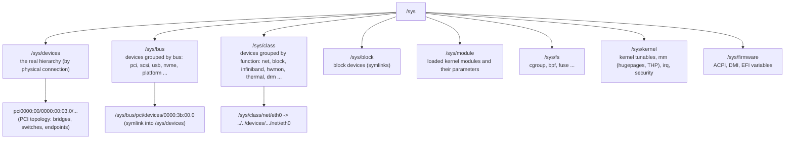
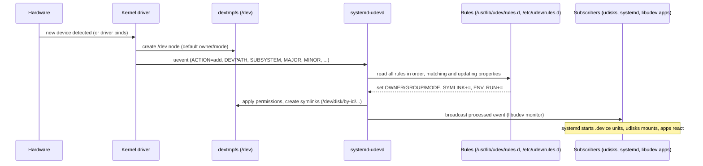

# 1.10 Devices, udev, sysfs and procfs

| | |
|---|---|
| Level | Intermediate |
| Priority tier | 0 |
| Lab venue | GCP / GKE (an Ubuntu VM; a GPU VM is optional but valuable) |
| Part | Part 1: Linux, from the command line to the kernel and performance |
| Status | Drafted, labs **untested** |

## Why this matters for AI infrastructure

An AI node is a pile of devices: eight GPUs, several InfiniBand or RoCE NICs, NVMe drives, NVSwitch chips, a BMC, a PCIe switch tree, sensors, and the CPUs and memory banks they hang off. Almost every operational question about such a node is a device question:

- "Which `/dev/nvidia*` files should this container get, and why did it not see them?"
- "Which GPU is next to which NIC, and which NUMA node are they on?" (the topology that decides NCCL performance)
- "Why did the GPU disappear after reboot, or fall off the PCIe bus?" (driver binding, kernel messages, link state)
- "Why is `/dev/sdb` now `/dev/sdc`?" (naming order, and why you never put those names in `fstab`)
- "How do I give a service access to a device without making it world-writable?" (udev rules, groups)
- "Where do I read a temperature, a PCIe link width, an InfiniBand port state or a VF count?" (sysfs)
- "How do I change a kernel parameter and make it survive reboot?" (procfs, sysctl)

Linux answers all of these through a handful of consistent interfaces: **device files** in `/dev`, **sysfs** in `/sys`, **procfs** in `/proc`, and **udev** (the user-space daemon that turns kernel hardware events into device files, permissions, names and actions). This chapter explains each, shows the tools that read them (`lsblk`, `lspci`, `lsusb`, `lscpu`, `lsscsi`, `udevadm`, `dmesg`, `dmidecode`, `sysctl`), and applies them to GPU nodes and containers. The device-driver side (loading modules, DKMS) is chapter 1.22; filesystems on block devices are chapter 1.12; SR-IOV/VFIO builds on the PCI material here in the virtualisation chapters.

## Prerequisites and outcomes

You should know the shell (1.2), file types and permissions (1.3, 1.6), processes and `/proc` basics (1.8) and have the kernel/user-space picture from 1.1.

After this chapter you can:

- Explain what a device file is (type, major and minor numbers), read `ls -l /dev` output, and create a node with `mknod` (and say why you rarely should).
- Distinguish block, character, pipe and socket files and name common device families (`sd*`, `nvme*`, `dm-*`, `tty*`, `pts/*`, `nvidia*`, `infiniband/*`).
- Navigate `/sys` to find a device's real hardware path, attributes, driver, NUMA node and links, and read or set tunables there.
- Use `/proc` for system and per-process information and `sysctl` (with persistent configuration) for kernel parameters.
- Explain the udev event flow, read and write a rule, and debug it with `udevadm` (`info`, `monitor`, `test`, `trigger`, `control --reload`).
- Use stable device names (`by-id`, `by-path`, `by-uuid`, `by-label`) instead of enumeration-order names.
- Inventory hardware with `lspci`, `lsusb`, `lsblk`, `lscpu`, `lsscsi`, `dmidecode`, `lshw`, `ethtool`, `nvidia-smi`.
- Describe how the SCSI, ATA, USB and NVMe stacks fit together in the kernel.
- Apply all this to GPU, InfiniBand and container device passthrough, and read GPU/NIC topology.

## 1. Device files: hardware as files

Unix exposes most hardware through the same file interface used for ordinary files. A **device file** (also called a **device node**) lives in `/dev` and looks like a file, but opening it makes the kernel hand your reads and writes to a **device driver** instead of a disk filesystem. You can see this with the simplest example:

```bash
echo blah > /dev/null      # the kernel's null driver accepts and discards the data
```

The kernel presents the device files as a convenience: any program that can read and write files can talk to many devices, and some devices can be used with ordinary tools (`cat`, `dd`, `less`). But a plain read/write interface cannot express everything a device can do; the rest goes through the `ioctl` system call (as the NVIDIA driver does) or through `sysfs` attributes.

### Types and numbers

`ls -l` shows the file type as the first character of the mode:

```text
brw-rw---- 1 root disk 8, 1 Sep  6 08:37 /dev/sda1
crw-rw-rw- 1 root root 1, 3 Sep  6 08:37 /dev/null
crw-rw-rw- 1 root root 195, 0 Sep 6 08:37 /dev/nvidia0
prw-r--r-- 1 root root    0 Mar  3 19:17 /run/fifo
srw-rw-rw- 1 root root    0 Dec 18 07:43 /dev/log
```

| First char | Type | Meaning |
|---|---|---|
| `b` | **Block device** | Data is accessed in fixed-size blocks, with random access by block number; the kernel can cache and reorder it. Disks, partitions, loop devices, device-mapper volumes. |
| `c` | **Character device** | A stream of bytes, no fixed size and no going back. Terminals, `/dev/null`, `/dev/random`, GPUs' control nodes, many drivers' `ioctl` interfaces. |
| `p` | Named pipe (FIFO) | Like a pipe, but with a name: another process is at the other end, not a driver. |
| `s` | Unix domain socket | An inter-process communication endpoint (`/dev/log`, `/run/docker.sock`). Usually found outside `/dev`. |

For block and character devices, the two numbers where a file size would be are the **major** and **minor** device numbers (`8, 1` for `/dev/sda1`). The kernel identifies the device by these numbers, **not by the file name**: the major number selects the driver (class) and the minor number selects the instance within it (for a disk, 0 is the whole disk and 1, 2, ... partitions; a second disk has a different major or a different block of minors). The file in `/dev` is just a labelled pointer, with ordinary owner, group and permission bits that control who may use the device. The drivers currently loaded and their major numbers are listed in `/proc/devices`.

Network interfaces are the notable exception: they have **no device file** (`eth0`, `ens3`, `ib0` are not in `/dev`); the kernel offers them through the socket API and netlink instead.

### Naming: why enumeration order is a trap

Traditional names such as `/dev/sda`, `/dev/sdb` are assigned in the order the kernel's drivers find devices, which can differ between boots or after a disk is added or fails. If three disks are `sda`, `sdb`, `sdc` and `sdb` fails, the old `sdc` becomes `sdb`; an `fstab` entry that said `/dev/sdb1` now mounts the wrong disk (or none). So **never write `sdX` names in persistent configuration**. Use stable identifiers: the filesystem **UUID** or **label** (`UUID=...`, covered in chapter 1.12), a **LVM or device-mapper** name (`/dev/mapper/vg-lv`), or the persistent symbolic links that udev creates under `/dev/disk/` (section 6). The same applies to network interface names (modern systems use predictable names like `enp3s0`) and, for GPUs, `nvidia0`/`nvidia1` indices, which can be reordered: refer to GPUs by **UUID** (`nvidia-smi -L` prints it) or **PCI bus ID** when it matters.

### Creating device files

On a modern system you do not create device nodes by hand: the kernel (through **devtmpfs**) and udev do it. For understanding, and for rare cases (a minimal container, a rescue environment), `mknod` creates one:

```bash
sudo mknod /tmp/mynull c 1 3        # character device, major 1, minor 3 (same as /dev/null)
sudo mknod /tmp/myfifo p            # a named pipe needs no numbers (mkfifo does the same)
sudo chmod 666 /tmp/mynull && echo test > /tmp/mynull
```

Historically `/dev` was populated by a `MAKEDEV` script and then by a kernel-space `devfs`; both were replaced by the current design because device management does not belong in the kernel: a user-space daemon can apply policy (names, permissions, actions) with far less risk. Mounting a filesystem with the **`nodev`** option makes device files on it inert, a standard security hardening for `/home`, `/tmp` and removable media (otherwise a user could create a node for the raw disk).

## 2. The common device files

You will meet these constantly; know the naming convention and what each is.

| Device file(s) | Meaning |
|---|---|
| `/dev/sd*` (`sda`, `sda1`) | SCSI/SATA/SAS/USB disks (`sd` = "SCSI disk" because the kernel talks SCSI to most storage). Letters per disk, numbers per partition. List with `lsscsi`, `lsblk`. |
| `/dev/nvme*` (`nvme0n1`, `nvme0n1p1`) | NVMe SSDs: controller `nvme0`, namespace `n1`, partition `p1`. List with `nvme list` (package `nvme-cli`) or `lsblk`. |
| `/dev/vd*`, `/dev/xvd*` | Virtio and Xen virtual disks in VMs. (On GCP and AWS you may see `nvme*` for persistent disks too.) |
| `/dev/dm-*`, `/dev/mapper/*` | Device-mapper block devices: LVM volumes, dm-crypt (LUKS), multipath, software RAID layers (chapter 1.13). |
| `/dev/md*` | Linux software RAID (`md`) arrays. |
| `/dev/loop*` | Loop devices: a file used as a block device (`losetup`; container image layers, snaps). |
| `/dev/sr*` | Optical drives (read-only access); `/dev/sg*` SCSI generic nodes for raw SCSI commands (burning, tape, SMART tools). |
| `/dev/hd*` | Old parallel-ATA disks; if a SATA disk shows up as `hd*`, it is in a slow compatibility mode. |
| `/dev/tty*`, `/dev/pts/*`, `/dev/tty` | Terminals: `ttyN` virtual consoles, `pts/N` pseudoterminals (every SSH or terminal-emulator session), `/dev/tty` = the controlling terminal of the current process. |
| `/dev/ttyS*`, `/dev/ttyUSB*`, `/dev/ttyACM*` | Serial ports and USB serial adapters (BMC serial-over-LAN consoles, switch consoles, microcontrollers). Access usually needs the `dialout` group. Talk with `screen /dev/ttyUSB0 115200`. |
| `/dev/null`, `/dev/zero` | Discard sink; endless zero bytes. |
| `/dev/random`, `/dev/urandom` | Kernel random number generator (on current kernels both are cryptographically secure and non-blocking once seeded; `getrandom()` is the preferred API). |
| `/dev/full` | Always reports "no space left" (testing). |
| `/dev/mem`, `/dev/kmem`, `/dev/port` | Raw memory and I/O ports; heavily restricted or absent for security. |
| `/dev/fuse` | The interface for user-space filesystems (SSHFS, rclone mount, containers' overlay helpers). |
| `/dev/kvm`, `/dev/vhost-*`, `/dev/vfio/*` | Hardware virtualisation and device-passthrough interfaces (virtualisation chapters). |
| `/dev/nvidia0 ... N`, `/dev/nvidiactl`, `/dev/nvidia-uvm`, `/dev/nvidia-uvm-tools`, `/dev/nvidia-modeset`, `/dev/nvidia-caps/*` | The NVIDIA driver's nodes: one per GPU, a control node, unified-memory nodes, mode-setting, and MIG/capability nodes. Created by the driver module and by `nvidia-modprobe`. |
| `/dev/infiniband/uverbs*`, `rdma_cm`, `umad*`, `issm*` | RDMA user-space verbs, connection manager and management datagram nodes used by InfiniBand/RoCE stacks and MPI/NCCL. |
| `/dev/gdrdrv` | GPUDirect RDMA helper device (when the module is loaded). |
| `/dev/shm`, `/dev/pts`, `/dev/mqueue` | Not devices: tmpfs/devpts/mqueue filesystems mounted under `/dev` (shared memory, pseudoterminals, POSIX message queues). Containers mount their own. |
| `/dev/disk/by-*`, `/dev/block/MAJ:MIN`, `/dev/char/MAJ:MIN` | udev-maintained symbolic links (section 6). |
| `/dev/stdin`, `/dev/stdout`, `/dev/stderr`, `/dev/fd/N` | Symbolic links into `/proc/self/fd`; how `<(command)` process substitution appears as a file name. |

### Consoles, parallel ports and audio (legacy devices you will still meet)

- **Virtual consoles.** Linux multiplexes the display into virtual consoles `/dev/tty1`, `/dev/tty2`, ... Each can run in text or graphics mode. In text mode you switch with Alt-F1, Alt-F2 and so on; a console in graphics mode usually needs **Ctrl-Alt-F1** (and so on) to leave. A login prompt on a console is a `getty` process; a graphical session takes over the first free console (if `getty` runs on tty1 and tty2, graphics gets tty3), and some distributions put the graphical session on tty1. If keyboard switching fails, root can force it with `chvt 1`. On servers the same idea appears as the **serial console** (`console=ttyS0,115200` on the kernel command line) and the BMC's serial-over-LAN, which is how you reach a node whose network or display is broken (chapter 1.14 and the BMC chapters).
- **Parallel ports**: `/dev/lp0`, `/dev/lp1` (unidirectional printer ports, LPT1 and LPT2 in Windows) and `/dev/parport0` (bidirectional). Replaced by USB and the network; printing is done through a print server such as CUPS, not by writing to `lp0`.
- **Audio**: `/dev/snd/*` for ALSA and the older OSS nodes (`/dev/dsp`, `/dev/audio`) when compatibility modules are loaded; in practice a user-space sound server (PulseAudio, PipeWire) sits on top. Irrelevant on compute nodes, but you will see the names in container images and desktop VMs.

## 3. `dd` and devices

`dd` copies bytes from an input to an output in fixed-size blocks and, unlike most tools, can start and stop at arbitrary points. Its syntax is unusual (an old IBM job-control style): `option=value` instead of `-option`.

| Option | Meaning |
|---|---|
| `if=FILE` | input (default stdin) |
| `of=FILE` | output (default stdout) |
| `bs=SIZE` | block size for both (`1k`, `1M`, `4M`); too small is slow, too large wastes memory |
| `count=N` | copy only N blocks |
| `skip=N`, `seek=N` | skip N input blocks; skip N output blocks |
| `conv=...` | `noerror,sync` (continue on read errors and pad), `fsync` (flush at the end), `notrunc` |
| `status=progress` | show progress |
| `iflag=direct`, `oflag=direct` | use direct I/O, bypassing the page cache (needed for honest benchmarks of storage) |

```bash
dd if=/dev/zero of=/tmp/new bs=1k count=1                      # one 1024-byte block of zeros
dd if=/dev/zero of=/tmp/test bs=1M count=1024 oflag=direct status=progress   # crude write throughput test
sudo dd if=/dev/sda bs=512 count=1 | xxd | tail -3              # read the first sector (partition table signature 55 aa)
sudo dd if=disk.img of=/dev/sdX bs=4M status=progress conv=fsync   # write an image to a device (DANGER)
```

**`dd` writes without asking.** A swapped `if=` and `of=`, or the wrong `/dev/sdX`, destroys data instantly; many a boot disk has been overwritten by a typo. Always check the target with `lsblk -o NAME,SIZE,MODEL,MOUNTPOINT`, never run `dd` against a mounted device, and when in doubt write to a file first. For serious benchmarking use `fio` (chapter 1.25); `dd` is only a rough indicator.

## 4. sysfs: the kernel's device model as a tree

`/dev` lets programs *use* a device but says little about it. **sysfs**, mounted at `/sys`, is a virtual filesystem (it exists only in memory) in which the kernel exposes its **device model**: every device, bus, driver and class as directories, with **attributes** as small files (typically one value per file). It is meant to be read mostly by programs, but you will read it by hand constantly.



Key ideas:

- **`/sys/devices`** is the true tree, following how hardware is attached. The SATA disk `/dev/sda` might live at `/sys/devices/pci0000:00/0000:00:17.0/ata3/host0/target0:0:0/0:0:0:0/block/sda`. That path is long on purpose: it tells you which controller and port the device is on. The `/dev` file *uses* the device; the sysfs path *describes and manages* it.
- **`/sys/bus`, `/sys/class` and `/sys/block`** are convenient views (symbolic links into `/sys/devices`) organised by bus, by function and by block-ness. `ls -l /sys/block` reveals the real paths.
- A device directory contains attributes such as `dev` (the `MAJOR:MINOR`), `uevent` (the event properties), `subsystem` (link to its bus or class), `driver` (link to the bound driver), `power/`, `size`, `queue/` for block devices, and bus-specific files.

Useful attributes by area (all under `/sys`):

| Path | What it tells you or lets you set |
|---|---|
| `block/sda/size`, `block/sda/queue/{rotational,scheduler,nr_requests,read_ahead_kb,max_sectors_kb}` | Size in 512-byte sectors; whether it is spinning; the I/O scheduler (writable: `echo none > .../scheduler`); queue tuning |
| `block/nvme0n1/device/{model,serial,firmware_rev,numa_node}` | NVMe identity and NUMA locality |
| `class/net/eth0/{address,mtu,speed,duplex,operstate,carrier,statistics/*}`, `class/net/eth0/device -> ../../../0000:3b:00.0` | Link state and counters; which PCI device the NIC is |
| `class/infiniband/mlx5_0/ports/1/{state,phys_state,rate,lid,sm_lid}` | InfiniBand port state ("4: ACTIVE"), link rate, LID |
| `bus/pci/devices/0000:3b:00.0/{vendor,device,class,subsystem_vendor,numa_node,local_cpulist,current_link_speed,current_link_width,max_link_speed,max_link_width,driver,iommu_group,enable,reset,remove,rescan}` | PCI identity, locality, **PCIe link training result**, bound driver, IOMMU group, hot-remove and reset |
| `bus/pci/devices/.../{sriov_totalvfs,sriov_numvfs,driver_override}` | SR-IOV virtual functions (writable); force a driver for passthrough |
| `bus/pci/rescan`, `bus/pci/devices/.../remove` | Re-enumerate the PCI bus after a hot-plug or reset; remove a device |
| `class/hwmon/hwmon*/{name,temp*_input,fan*_input,power*_input}`, `class/thermal/thermal_zone*/temp` | Sensor values (millidegrees for temperatures) |
| `devices/system/cpu/cpu*/{online,topology/*,cpufreq/*,cache/index*/}` | CPU hotplug, topology, frequency scaling governor, caches |
| `devices/system/node/node*/{cpulist,meminfo,distance,hugepages/*}` | **NUMA** topology: which CPUs and memory belong to each node, distances, hugepage pools |
| `kernel/mm/transparent_hugepage/{enabled,defrag}`, `kernel/mm/hugepages/*` | THP and hugepage controls (chapter 1.17) |
| `module/nvidia/parameters/*`, `module/*/version` | Module parameters and versions |
| `fs/cgroup/*` | cgroup v2 tree (chapter 1.18) |
| `firmware/dmi/*`, `class/dmi/id/{product_name,sys_vendor,bios_version,board_serial}` | Hardware identity (what `dmidecode` prints) |

```bash
cat /sys/block/sda/dev                                  # 8:0, the major:minor of /dev/sda
readlink -f /sys/block/sda                              # the real hardware path
cat /sys/bus/pci/devices/0000:3b:00.0/numa_node         # which NUMA node a PCI device (GPU/NIC) is on
cat /sys/class/net/eth0/speed /sys/class/net/eth0/operstate
cat /sys/bus/pci/devices/0000:3b:00.0/current_link_speed /sys/bus/pci/devices/0000:3b:00.0/max_link_width
echo none | sudo tee /sys/block/nvme0n1/queue/scheduler  # change I/O scheduler (not persistent)
```

**Changes made by writing to sysfs are not persistent.** They last until reboot (or until the device is reset). To persist them use udev rules (`ATTR{...}=...`), `systemd-tmpfiles` (`w /sys/...`), kernel command-line options, or module parameters in `/etc/modprobe.d/`.

## 5. procfs and `sysctl`

`/proc` is the older virtual filesystem, originally for processes and later for everything: the numeric directories are per-process information (chapter 1.8); the rest is system-wide state:

| Path | Contents |
|---|---|
| `/proc/cpuinfo` | Per-CPU model, flags, frequency (`lscpu` formats it) |
| `/proc/meminfo`, `/proc/vmstat`, `/proc/buddyinfo`, `/proc/slabinfo`, `/proc/pagetypeinfo` | Memory statistics (chapter 1.17) |
| `/proc/loadavg`, `/proc/uptime`, `/proc/stat`, `/proc/pressure/*` | Load, uptime, CPU time counters, PSI |
| `/proc/interrupts`, `/proc/softirqs`, `/proc/irq/N/smp_affinity{,_list}` | Interrupt counts per CPU; **interrupt-to-core affinity** (set a mask to pin a NIC or GPU interrupt) |
| `/proc/devices`, `/proc/misc`, `/proc/partitions`, `/proc/diskstats` | Registered major numbers, partitions, disk counters |
| `/proc/modules` (= `lsmod`), `/proc/kallsyms`, `/proc/driver/nvidia/*` | Modules; symbols; NVIDIA driver version and per-GPU information (`/proc/driver/nvidia/version`, `gpus/*/information`) |
| `/proc/mounts`, `/proc/self/mountinfo` | Mounted filesystems |
| `/proc/net/*` | Network tables (`dev`, `tcp`, `route`, `arp`, `snmp`) |
| `/proc/cmdline`, `/proc/version`, `/proc/config.gz` | Kernel command line; version; build configuration (if enabled) |
| `/proc/sys/` | **Tunable kernel parameters**, one file per value |

### `/proc/sys` and `sysctl`

Everything under `/proc/sys` is a live kernel setting. Reading is `cat`; changing is writing:

```bash
cat /proc/sys/net/ipv4/ip_forward
echo 1 | sudo tee /proc/sys/net/ipv4/ip_forward      # immediate, lost at reboot
```

The **`sysctl`** command presents the same tree with dots instead of slashes (path relative to `/proc/sys`):

```bash
sysctl net.ipv4.ip_forward                  # read
sudo sysctl -w net.ipv4.ip_forward=1        # write (runtime only)
sysctl -a | grep -i hugepages               # search all parameters
sysctl vm.swappiness vm.dirty_ratio kernel.pid_max fs.file-max net.core.rmem_max
sudo sysctl --system                        # apply all configuration files now
```

**Persistence**: put settings in `/etc/sysctl.conf` or, preferably, files in `/etc/sysctl.d/NN-name.conf` (applied at boot by `systemd-sysctl`; later files override earlier ones; vendor defaults live in `/usr/lib/sysctl.d/`):

```text
# /etc/sysctl.d/90-gpu-node.conf
vm.swappiness = 1
vm.max_map_count = 1048576
kernel.numa_balancing = 0
net.core.rmem_max = 268435456
net.core.wmem_max = 268435456
```

Parameters are grouped by area: `kernel.*` (pid_max, panic behaviour, `kernel.yama.ptrace_scope`, `kernel.core_pattern`), `vm.*` (swappiness, dirty ratios, overcommit, `nr_hugepages`, `max_map_count`), `net.*` (buffers, congestion control, forwarding, conntrack), `fs.*` (`file-max`, `inotify.max_user_watches`), `dev.*`. Guidance: change **one thing at a time** with a measurable reason; document it; remember some values only take effect on new connections or processes; and note that a few settings depend on a module being loaded (`net.bridge.*` needs `br_netfilter`), so a boot-time sysctl can fail silently. Tuned values for GPU/HPC nodes appear in chapters 1.22 and 1.28.

## 6. udev: from hardware events to device files

### The problem and the design

When hardware appears (a USB drive, a hot-plugged NVMe drive, a GPU that finishes initialising, a VF created by SR-IOV), the system should create a device file, set its owner and permissions, create friendly names, and maybe run a program. This is *policy*, and policy does not belong in the kernel. So the kernel emits an event and a user-space daemon, **`systemd-udevd`** (historically `udevd`), applies rules.

There is a bootstrap problem: device files are needed very early in boot, but udev itself needs some to start. The answer is **devtmpfs**, an in-memory filesystem mounted on `/dev` early: the kernel creates a node there for every device it discovers (with default ownership `root:root` and mode 0600 or 0660) and *also* notifies udev. udev does not create the nodes; it **adjusts** them (owner, group, mode), **creates additional symbolic links**, imports properties, and runs actions.



The kernel event is a **uevent**: a set of `KEY=value` properties, for example:

```text
ACTION=add
DEVPATH=/devices/pci0000:00/0000:00:1a.0/usb1/1-1/1-1.2/1-1.2:1.0/host4/target4:0:0/4:0:0:3/block/sde
DEVTYPE=disk
MAJOR=8
MINOR=64
SEQNUM=2752
SUBSYSTEM=block
```

(`ACTION` is `add`, `remove`, `change`, `bind`, `unbind`, `move`, `online`, `offline`. A `change` event is how media change, resize and many driver state changes are announced.)

### Rules

Rules files end in `.rules` and are read from `/usr/lib/udev/rules.d/` (older systems: `/lib/udev/rules.d/`; vendor defaults), `/etc/udev/rules.d/` (administrator rules and overrides; a file with the same name masks the vendor file) and `/run/udev/rules.d/`. All files are merged and processed **in lexical order of file name**, hence the numeric prefixes (`60-persistent-storage.rules`, `70-uaccess.rules`, `99-local.rules`). Within the order, **each event is matched against every rule from start to finish** (unlike a firewall, it does not stop at the first match, except where a rule uses `GOTO` or `:=` locks); every matching rule can add to the state of the event.

A rule is one line of comma-separated **matches** and **assignments**. Matches use `==` (equal) or `!=`; assignments use `=` (set, replacing earlier values), `+=` (add) or `:=` (set and forbid later changes). The right-hand side may use shell-style patterns `*`, `?`, `[ ]` and `|` for alternatives.

Common **match keys**:

| Key | Matches |
|---|---|
| `ACTION` | `add`, `remove`, `change` ... |
| `KERNEL` | The kernel's device name (`sd*`, `nvme[0-9]n[0-9]`, `loop*`) |
| `SUBSYSTEM`, `SUBSYSTEMS` | The device's subsystem; `SUBSYSTEMS` also checks parents |
| `DRIVER`, `DRIVERS` | The driver bound to it (or a parent) |
| `ATTR{name}`, `ATTRS{name}` | A sysfs attribute of the device (or of any parent, for `ATTRS`) |
| `ENV{key}` | A property of the event (including those imported by other rules) |
| `TAG`, `TEST{...}` | A tag; whether a file exists |
| `PROGRAM`, `RESULT` | Run a program and match its output |

Common **assignments**: `NAME` (network devices only; device nodes are named by the kernel), `SYMLINK+=` (extra names), `OWNER`, `GROUP`, `MODE`, `TAG+=`, `ENV{key}=`, `ATTR{name}=` (write a sysfs attribute), `RUN+=` (run a program after processing; keep it short and non-blocking), `IMPORT{program}=` (run a program and import its `KEY=value` output as properties), `GOTO`/`LABEL`, and `OPTIONS+=`. In the right-hand strings you can substitute `%k` (kernel name), `%n` (device number), `%p` (device path), `%M`/`%m` (major/minor), `$attr{file}` or `%s{file}`, `$env{key}` or `%E{key}`, `$major`, `$minor`, `$result`, `$parent`, `$devnode`, `$name`, and `%%`/`$$` for literal `%`/`$`.

**Reading a vendor rule.** The default persistent-name rules identify a disk and create `by-id` links. Simplified:

```text
# 60-persistent-storage.rules (simplified)
# 1. Ask ata_id for the serial number of whole ATA disks, import the answer as properties:
KERNEL=="sd*[!0-9]|sr*", ENV{ID_SERIAL}!="?*", SUBSYSTEMS=="scsi", ATTRS{vendor}=="ATA", IMPORT{program}="ata_id --export $devnode"
# 2. Once ID_SERIAL is set, create the by-id symlink:
KERNEL=="sd*|sr*", ENV{DEVTYPE}=="disk", ENV{ID_SERIAL}=="?*", SYMLINK+="disk/by-id/$env{ID_BUS}-$env{ID_SERIAL}"
```

Rule 1 matches a whole-disk device (name `sd` plus letters, no digit) that does not yet have `ID_SERIAL` (`!="?*"` means "not set"), on an ATA device behind the SCSI layer, and imports properties from `ata_id`. Rule 2 matches any disk with a serial and **adds a symlink**. That "match, import, then act" pattern recurs throughout the udev rule set. To tell conditions from directives: two characters (`==`, `!=`) are tests; one (`=`, `+=`, `:=`) is an action.

### Writing your own rule

Never edit vendor files; add your own in `/etc/udev/rules.d/`, with a prefix that sorts after the vendor rule you need to override. A few useful examples:

```text
# /etc/udev/rules.d/90-local.rules

# 1. Stable name for a specific serial console adapter, group access for a team
SUBSYSTEM=="tty", ATTRS{idVendor}=="0403", ATTRS{idProduct}=="6001", ATTRS{serial}=="A50285BI", \
    SYMLINK+="ttyBMC-rack3", GROUP="ops", MODE="0660"

# 2. Set the I/O scheduler to 'none' for NVMe, and 'mq-deadline' for rotational disks
ACTION=="add|change", KERNEL=="nvme[0-9]*n[0-9]*", ATTR{queue/scheduler}="none"
ACTION=="add|change", KERNEL=="sd[a-z]", ATTR{queue/rotational}=="1", ATTR{queue/scheduler}="mq-deadline"

# 3. Give members of group 'gpuusers' access to the NVIDIA device nodes (use with care; see section 10)
KERNEL=="nvidia*", GROUP="gpuusers", MODE="0660"

# 4. Pin a NIC name by MAC address (alternative to systemd .link files)
SUBSYSTEM=="net", ACTION=="add", ATTR{address}=="aa:bb:cc:dd:ee:ff", NAME="mgmt0"
```

After editing: `sudo udevadm control --reload` (re-read rules), then `sudo udevadm trigger --subsystem-match=block --action=change` (replay events so existing devices get the rule), and verify with `udevadm test`. **Rule syntax errors are logged but do not stop other rules**, so always test. Do not make `RUN+=` programs long-running (udev kills them after a timeout); start a systemd service from the rule instead (`TAG+="systemd", ENV{SYSTEMD_WANTS}="myservice.service"`).

### `udevadm`: the one tool

| Command | Use |
|---|---|
| `udevadm info --query=all --name=/dev/sda` (or `-p /sys/block/sda`) | Everything udev knows: `P:` sysfs path, `N:` node name, `S:` symlinks, `E:` properties. Add `-a` (`--attribute-walk`) to list the device's sysfs attributes and its parents' (the values you can match with `ATTRS{}`). |
| `udevadm monitor` | Watch events live (insert/remove devices). Shows `KERNEL` (from the kernel) and `UDEV` (after processing) lines; use `--kernel`, `--udev`, `--property`, `--subsystem-match=scsi`. |
| `udevadm test /sys/block/sda` | Simulate processing a device and print which rules ran and what they did. (`udevadm test-builtin` for built-in helpers.) |
| `udevadm trigger [--action=add\|change] [--subsystem-match=... --attr-match=...]` | Replay events for existing devices (apply new rules). |
| `udevadm control --reload` / `--log-level=debug` | Reload rules; raise logging. |
| `udevadm settle` | Wait until all queued events have been processed (use in scripts after triggering). |

```bash
udevadm info --query=property --name=/dev/nvme0n1 | grep -E 'ID_MODEL|ID_SERIAL|ID_PATH'
udevadm info -a -n /dev/ttyUSB0 | grep -E 'ATTRS\{(idVendor|idProduct|serial)\}'
sudo udevadm monitor --udev --subsystem-match=block     # then plug/attach a disk in another window
```

### Persistent device names under `/dev/disk`

udev creates these links for block devices; use them in scripts and in `fstab` when you must refer to a device (though a filesystem UUID is usually best):

| Directory | Names by | Use |
|---|---|---|
| `/dev/disk/by-id/` | Bus, vendor, model, serial (`nvme-Samsung_SSD_..._S4EV...`, `wwn-0x500...`) | Identify a **physical** drive wherever it is plugged in; essential in RAID and replacement procedures |
| `/dev/disk/by-path/` | Hardware path (PCI slot and port) | Identify a **slot**; stable when you swap a drive in the same slot |
| `/dev/disk/by-uuid/` | Filesystem UUID | The recommended `fstab` key |
| `/dev/disk/by-label/`, `by-partuuid/`, `by-partlabel/` | Filesystem label; GPT partition UUID or name | Friendly alternatives |

(`lsblk -o NAME,SIZE,TYPE,FSTYPE,UUID,MOUNTPOINT` shows several at once; `blkid` prints UUIDs and types.)

### udev versus systemd `.link` files and `systemd-hwdb`

Network interface names are decided by `systemd-udevd` using `.link` files in `/usr/lib/systemd/network/` and `/etc/systemd/network/` (for example, `99-default.link`, naming `enp3s0` from the PCI slot, `eno1` from firmware). Persistent rename by MAC is a `.link` file with `[Match] MACAddress=` and `[Link] Name=`. Hardware identification databases (vendor names for `lspci`, `lsusb`, USB device classes) come from `systemd-hwdb` (`/usr/lib/udev/hwdb.d`), rebuilt with `systemd-hwdb update`. Mentioned here so you recognise them; networking details are in Part 2.

## 7. How storage devices fit together in the kernel

The Linux **SCSI subsystem** is the common stack beneath most storage, and it explains why `sd*` appears for USB sticks, SATA disks and SAS drives alike.

- **SCSI addressing.** `lsscsi` lists devices as `[host:channel:target:lun]`, for example `[0:0:0:0] disk ATA WDC WD3200AAJS /dev/sda`. The four numbers are the host adapter, the bus (channel), the target's SCSI ID and the **LUN** (logical unit; one target can present several, such as the four slots of a card reader, each a separate device file).
- **Three layers.** The **upper layer** has a driver per device class (`sd` for disks, `sr` for optical, `st` for tape, `sg` generic) that translates the kernel's block requests into SCSI commands. The **middle layer** (the SCSI core) tracks hosts and devices, handles errors and timeouts, and routes commands. The **lower layer** has drivers for specific host adapters (`mpt3sas`, `megaraid_sas`, `ahci`, `virtio_scsi`, USB's `usb-storage` bridge).
- **Everything is made to look like SCSI.** USB mass storage uses a USB-subsystem driver that wraps SCSI commands in USB messages, with a small bridge into the SCSI lower layer. SATA disks use **libata**, which fully *translates* between SCSI commands and ATA commands (optical ATAPI devices merely repackage SCSI). Hardware RAID controllers often present virtual disks as SCSI directly.
- **NVMe is separate.** NVMe devices use their own stack (`nvme` driver, `/dev/nvme*`), not SCSI, with per-CPU submission and completion queues for very high IOPS. They sometimes show in `lsscsi` for convenience. NVMe-over-Fabrics (RDMA/TCP) carries the same protocol across the network (storage chapters).
- **Generic SCSI nodes** (`/dev/sg*`, `lsscsi -g`) let user-space programs send raw SCSI commands, bypassing class drivers, which is how tools such as `sg3_utils` (`sg_inq`, `sg_map`), `smartctl` for some controllers, and disc-burning software work: complex or rare tasks are kept out of the kernel and done in user space.
- **Multipath.** A SAN LUN reachable over several paths appears once per path (`sdb`, `sdc`, `sdd`) and `multipathd` combines them into one `/dev/mapper/mpathX` device (chapter 1.13).

Tools: `lsblk` (tree of block devices), `lsscsi`, `nvme list`, `smartctl -a /dev/sdX` (drive health), `hdparm -I`, `blkid`, `udevadm info`. The same tree seen from the hardware side is `lspci`.

## 8. Hardware inventory: PCI, USB, CPU, memory, firmware

You need to answer "what is in this machine?" quickly, and in a way that is comparable across hundreds of nodes.

| Tool | Shows |
|---|---|
| `lspci` / `lspci -nn` / `lspci -tv` / `lspci -vvv -s 3b:00.0` | PCI devices; vendor:device IDs (`[10de:2330]` is NVIDIA); the **tree** with bridges and switches; the verbose view with **capabilities and link status** (`LnkCap`, `LnkSta`, `Speed 16GT/s, Width x16`), **AER** (advanced error reporting) counters, `Kernel driver in use`, `Kernel modules` |
| `lsusb`, `lsusb -t` | USB devices and the USB tree |
| `lscpu`, `lscpu -e` | CPU model, sockets, cores, threads, **NUMA nodes and which CPUs are in each**, caches, flags, virtualisation support |
| `numactl -H` / `lstopo` (from `hwloc`) | NUMA distances and the **full topology** (cores, caches, memory, PCI devices, GPUs, NICs); `lstopo --of ascii/png` |
| `free -h`, `dmidecode -t memory` | Memory sizes; DIMM slots, speeds, serial numbers |
| `lsblk`, `lsscsi`, `nvme list`, `smartctl` | Storage |
| `ip -br link`, `ethtool -i eth0`, `ethtool eth0`, `ibstat`, `ibv_devinfo`, `rdma link` | NICs, driver and firmware versions, link speed; InfiniBand/RoCE |
| `dmidecode`, `lshw -short`, `/sys/class/dmi/id/*` | Firmware (SMBIOS/DMI) tables: manufacturer, product, serials, BIOS version, slots; a complete hardware listing |
| `ipmitool`, `redfishtool`/BMC web interface | Out-of-band hardware data (BMC chapters in Part 6/8) |
| `nvidia-smi`, `nvidia-smi -L`, `nvidia-smi topo -m`, `nvidia-smi -q` | GPUs, UUIDs, driver and CUDA versions, **topology matrix**, ECC, clocks, power, throttle reasons |
| `dmesg`, `journalctl -k`, `journalctl -k -b -1` | The **kernel ring buffer**: driver messages from boot and from hot events (the first place to look when hardware misbehaves); `-b -1` is the previous boot |

```bash
lspci -nn | grep -iE 'nvidia|mellanox|infiniband|ethernet|non-volatile'
lspci -tv | head -60                                     # the PCIe tree
sudo lspci -vvv -s 3b:00.0 | grep -E 'LnkCap|LnkSta|Kernel driver|NUMA|AER'
lscpu | grep -E 'Model name|Socket|NUMA|Thread|Core'
sudo dmidecode -s system-product-name; sudo dmidecode -s bios-version
sudo dmesg --level=err,warn | tail -40
nvidia-smi topo -m
```

**Reading `nvidia-smi topo -m`.** The matrix shows how each pair of GPUs (and NICs) is connected: `NV#` (that many NVLink lanes; the fastest), `PIX` (at most one PCIe bridge), `PXB` (several PCIe bridges, no host bridge), `PHB` (through a PCIe host bridge, i.e. via the CPU), `NODE` (across the interconnect within a NUMA node), `SYS` (across the inter-socket link, the slowest), and `X` (self). It also lists each device's **CPU affinity** and **NUMA affinity**. Communication libraries use this to choose paths, and you use it to place processes (chapters 1.17 and 1.28; NCCL chapters).

## 9. Drivers, binding and rescans

A **driver** claims a device by matching its ID tables (PCI vendor:device, USB class, device-tree compatible string). The kernel's **modalias** mechanism lets udev load the right module automatically: when a device appears, the uevent carries a `MODALIAS` value, and udev runs `modprobe` for it. Look at the pieces:

```bash
cat /sys/bus/pci/devices/0000:3b:00.0/modalias           # pci:v000010DEd00002330sv...
readlink /sys/bus/pci/devices/0000:3b:00.0/driver        # the bound driver, e.g. .../drivers/nvidia
lsmod | grep -E '^nvidia|^mlx5|^ib_'                     # loaded modules (chapter 1.22)
modinfo mlx5_core | head                                 # what a module is, its parameters and aliases
ls /sys/bus/pci/drivers/nvidia                           # devices bound to that driver
```

You can bind and unbind through sysfs, which is how **VFIO passthrough** and driver swaps work (virtualisation chapters; the exact values must be checked for your kernel, and you must not do this to a device your system is using):

```bash
# detach a PCI device from its driver and hand it to vfio-pci (illustrative; run only on a device you can spare)
echo 0000:3b:00.0 | sudo tee /sys/bus/pci/devices/0000:3b:00.0/driver/unbind
echo vfio-pci     | sudo tee /sys/bus/pci/devices/0000:3b:00.0/driver_override
echo 0000:3b:00.0 | sudo tee /sys/bus/pci/drivers_probe
```

Other operations in the same family: `echo 1 > .../remove` then `echo 1 > /sys/bus/pci/rescan` (re-enumerate after a surprise removal), `echo 1 > .../reset` (a function-level reset), and `echo N > .../sriov_numvfs` (create N virtual functions, chapters on SR-IOV). **Hot-removing or resetting a device with processes using it hangs or crashes those processes**, so drain the node first.

## 10. AI-infrastructure patterns

**What a GPU node looks like to Linux.** After the NVIDIA kernel module loads, `/dev` contains `nvidia0..N-1` (one character device per GPU), `nvidiactl` (control), `nvidia-uvm` and `nvidia-uvm-tools` (unified virtual memory), `nvidia-modeset`, and with MIG or the fabric manager, `/dev/nvidia-caps/*`. Programs open these and talk to the driver with `ioctl`; the user-space CUDA libraries (`libcuda.so`) are the layer above. Check with `ls -l /dev/nvidia*`, `lsmod | grep nvidia`, `cat /proc/driver/nvidia/version`, `nvidia-smi`. If `nvidia-smi` fails with "couldn't communicate with the NVIDIA driver", check in order: module loaded (`lsmod`), device nodes present (`/dev/nvidia*`; `nvidia-modprobe -u -c=0` can create them), `dmesg` for Xid/NVRM errors, secure boot and module signing, kernel/driver version match (chapters 1.7 and 1.22).

**Persistence and device-node creation.** Device nodes appear only when something opens or initialises the GPU; on headless servers the **persistence daemon** (`nvidia-persistenced`) keeps the driver state loaded so the first job does not pay initialisation cost and so nodes exist (chapter 1.22, 1.28).

**Giving containers GPUs.** A container is just a process in new namespaces (chapter 1.19), so it cannot see the host's `/dev/nvidia*` unless the runtime **bind-mounts or creates those device nodes inside the container's `/dev`** and **allows them in the device cgroup**. The **NVIDIA Container Toolkit** (`nvidia-container-runtime`/CDI) does this and also injects the matching `libcuda`, `nvidia-smi` and other user-space driver files from the host. That is why a container sees GPUs without bundling a driver and why the driver version on the host must be compatible with the CUDA version inside the image. Plain Docker needs `--gpus` or `--device /dev/nvidia0 --device /dev/nvidiactl --device /dev/nvidia-uvm`, plus the libraries; Kubernetes uses the device plugin (Kubernetes chapters). A device-cgroup denial shows up as "Operation not permitted" when opening `/dev/nvidiaX` even though the file is visible; with cgroup v2 the device controller is implemented with BPF programs.

**Permissions.** GPU nodes are usually mode `0666` for `/dev/nvidia*` (anyone can open them), relying on the scheduler (Slurm cgroups, Kubernetes device plugin) to decide who may use which GPU. On shared login or multi-tenant nodes, restrict by group and rely on cgroup device control. Prefer udev rules (`GROUP=`, `MODE=`) to `chmod` (which is lost on reboot or driver reload), and avoid putting users in a group that grants raw access to disks (`disk`) or all devices.

**InfiniBand and RDMA.** The RDMA stack exposes `/sys/class/infiniband/<hca>/ports/<n>/` (state, rate, LID, counters) and `/dev/infiniband/uverbs*`. Quick checks: `ibstat` (State: Active, Physical state: LinkUp, Rate: 200/400), `ibv_devinfo`, `rdma link show`, `cat /sys/class/infiniband/mlx5_0/ports/1/state`. The hardware counters in `/sys/class/infiniband/*/ports/*/counters/` (symbol errors, link downed, port rcv errors) find flaky cables. The IB devices a container needs are `/dev/infiniband/*` plus a high `memlock` limit (chapter 1.8).

**PCIe link health.** A GPU or NIC running at x8 instead of x16, or Gen3 instead of Gen5, still "works" and halves your bandwidth. Compare `current_link_speed`/`current_link_width` with `max_link_speed`/`max_link_width` in sysfs (or `lspci -vvv` `LnkSta` against `LnkCap`) across the fleet; a mismatch means a bad slot, riser, cable or BIOS setting. PCIe **AER** and GPU **Xid** errors appear in `dmesg` (`NVRM: Xid ...`; the numbers map to causes in NVIDIA's documentation); a GPU "falling off the bus" shows as `GPU has fallen off the bus` and needs a reset or reboot.

**NUMA locality and IRQ placement.** `numa_node` and `local_cpulist` for each GPU and NIC give the cores that should feed it. `/proc/interrupts` shows which CPUs service a NIC's interrupts; `/proc/irq/N/smp_affinity_list` sets them; the `irqbalance` daemon may fight your settings (chapter 1.28). The vendor script `mlnx_affinity` and `set_irq_affinity.sh` automate NIC IRQ pinning.

**Fleet inventory and drift detection.** Collect a small standard set from every node and diff it: `lspci -nn | sort`, `nvidia-smi -L`, `lscpu`, `ethtool -i`, firmware versions from `dmidecode`/BMC, and key sysfs values (link speed/width, NUMA node, MTU). This catches the node with a missing GPU, the DIMM that fell out of the map, the NIC at 100 Gb instead of 200 Gb. Wrap it in a health script (chapter 1.9) and run it as a prolog or periodically.

**Kubernetes and sysfs/procfs.** The kubelet and cAdvisor read `/proc` and `/sys/fs/cgroup`; `node_exporter` reads `/proc`, `/sys/class/*` (thermal, hwmon, network, infiniband) and is a good template for what to monitor. NVIDIA DCGM reads the driver directly; its exporter turns GPU health into metrics.

## How it fails

1. **A disk name changed after reboot and `fstab` mounted the wrong disk.** `sdX` names are order-dependent. Use UUIDs, labels, `by-id` links, or LVM names.
2. **`/dev/nvidia*` missing, or exists but `nvidia-smi` fails.** Module not loaded or failed (secure boot, kernel/driver mismatch, missing DKMS build), nodes not created, or driver and library versions disagree. Check `lsmod`, `dmesg`, `ls -l /dev/nvidia*`, `journalctl -k`.
3. **GPU visible on the host, invisible in the container.** Runtime not configured (toolkit missing), device nodes not injected, device cgroup denies them, or user lacks permission on the node.
4. **udev rule does nothing.** Rule file not matching (check with `udevadm info -a` and `udevadm test`), wrong prefix order so a later vendor rule overrides it, syntax error, rules not reloaded or events not retriggered, or the device was created before the rule existed (`udevadm trigger`).
5. **Permissions reset to 0660 after a driver reload or reboot.** You used `chmod` instead of a udev rule.
6. **`dd` overwrote the wrong device.** No confirmation exists; check `lsblk`, use `by-id` paths, and write to files first.
7. **NIC names change after adding a card or a firmware update.** Predictable naming depends on slot or firmware index; pin by MAC with a `.link` file for critical interfaces.
8. **PCIe device at reduced width or speed.** Reseat the card or riser, check BIOS lane configuration, update firmware; compare against `max_link_*`.
9. **GPU fell off the bus / Xid 79, or Xid 48/63/64 ECC events.** Hardware, power or thermal issue; check `dmesg`, cooling and power, run diagnostics, reset or RMA (chapters on GPU health).
10. **Sysctl or sysfs tuning disappears after reboot.** Writes to `/proc/sys` and `/sys` are runtime only. Add `/etc/sysctl.d/*.conf`, udev rules, tmpfiles, kernel command line or module options.
11. **A boot-time sysctl is not applied.** The parameter belongs to a module not loaded yet when `systemd-sysctl` runs; load the module early (`/etc/modules-load.d/`) or apply from a unit after it.
12. **A script hangs reading a device or `/sys` file.** Some attributes block on a broken device; wrap probes with `timeout`.
13. **Device nodes appear but the right driver does not bind.** Module absent from the initramfs, blacklist entry, missing firmware (`dmesg | grep -i firmware`); chapters 1.14 and 1.22.
14. **`udevadm settle` times out in boot or scripts.** Rule runs a slow program, or a device keeps generating events; check `udevadm monitor` and the udev journal (`journalctl -u systemd-udevd`).

## Hands-on lab (a GCP Ubuntu VM; untested)

Use a throwaway VM; commands that write to `/sys` or `/dev` can disrupt a running machine. These commands have **not** been run; run them before relying on them.

**A. Device files.**

```bash
ls -l /dev | head -40
ls -l /dev/null /dev/zero /dev/random /dev/urandom /dev/tty /dev/sda* /dev/nvme* 2>/dev/null
cat /proc/devices | head -30
stat -c '%F major=%t minor=%T %n' /dev/null /dev/sda 2>/dev/null     # hex major/minor
sudo mknod /tmp/mynull c 1 3 && ls -l /tmp/mynull && echo hello > /tmp/mynull && cat /tmp/mynull; sudo rm /tmp/mynull
sudo mount -o nodev,remount /tmp 2>/dev/null; echo "(on a real system, nodev makes such nodes unusable)"
```

**B. sysfs.**

```bash
lsblk -o NAME,MAJ:MIN,SIZE,TYPE,MODEL,MOUNTPOINT
readlink -f /sys/block/sda 2>/dev/null || readlink -f /sys/block/nvme0n1
cat /sys/block/*/dev | head
cat /sys/block/*/queue/scheduler 2>/dev/null | head
for d in /sys/bus/pci/devices/*; do echo "$(basename $d) $(cat $d/vendor) $(cat $d/device) numa=$(cat $d/numa_node)"; done | head
cat /sys/class/net/*/operstate /sys/class/net/*/speed 2>/dev/null
ls /sys/devices/system/node 2>/dev/null; cat /sys/devices/system/node/node0/cpulist 2>/dev/null
cat /sys/class/dmi/id/product_name /sys/class/dmi/id/sys_vendor 2>/dev/null
```

**C. procfs and sysctl.**

```bash
cat /proc/loadavg /proc/uptime; head -5 /proc/meminfo; head -20 /proc/interrupts
sysctl vm.swappiness net.ipv4.ip_forward
sudo sysctl -w vm.swappiness=10; sysctl vm.swappiness
echo 'vm.swappiness = 10' | sudo tee /etc/sysctl.d/99-lab.conf && sudo sysctl --system | grep swappiness
sudo rm /etc/sysctl.d/99-lab.conf; sudo sysctl vm.swappiness=60
```

**D. udev.**

```bash
udevadm info --query=all --name=/dev/sda 2>/dev/null | head -30 || udevadm info --query=all --name=/dev/nvme0n1 | head -30
ls -l /dev/disk/by-id /dev/disk/by-uuid /dev/disk/by-path 2>/dev/null | head -30
sudo udevadm monitor --udev --subsystem-match=block &      # in one terminal; then in another attach a disk, or run:
sudo udevadm trigger --subsystem-match=block --action=change; sleep 3; kill %1
# write a rule that adds a symlink to the first loop device
echo 'KERNEL=="loop0", SYMLINK+="mylab-loop"' | sudo tee /etc/udev/rules.d/90-lab.rules
sudo udevadm control --reload && sudo udevadm trigger --name-match=loop0 --action=add
ls -l /dev/mylab-loop; sudo udevadm test /sys/block/loop0 2>&1 | grep -i 'mylab\|90-lab' | head
sudo rm /etc/udev/rules.d/90-lab.rules; sudo udevadm control --reload
```

Explain why the rule needed a `trigger`, and what would have happened for a USB disk plugged in after the rule existed.

**E. Loop device (a safe block device).**

```bash
dd if=/dev/zero of=/tmp/disk.img bs=1M count=64 status=none
L=$(sudo losetup --find --show /tmp/disk.img); echo "$L"
lsblk "$L"; udevadm info --query=property --name="$L" | head
sudo mkfs.ext4 -q "$L"; sudo blkid "$L"
ls -l /dev/disk/by-uuid | grep "$(basename $L)"
sudo losetup -d "$L"; rm /tmp/disk.img
```

**F. Inventory.**

```bash
lspci -nn | head -20; lspci -tv | head -20
lscpu | grep -E 'Model name|Socket|NUMA|Thread|Core'
sudo dmidecode -t system | head -15; sudo dmidecode -t memory | grep -E 'Size|Speed|Locator' | head
sudo dmesg --level=err,warn | tail -20
ip -br link; ethtool -i $(ls /sys/class/net | grep -v lo | head -1)
```

**G. (GPU VM, optional.)**

```bash
ls -l /dev/nvidia*; cat /proc/driver/nvidia/version; nvidia-smi -L; nvidia-smi topo -m
for d in $(lspci -D | grep -i nvidia | awk '{print $1}'); do
  echo "$d numa=$(cat /sys/bus/pci/devices/$d/numa_node) link=$(cat /sys/bus/pci/devices/$d/current_link_speed) x$(cat /sys/bus/pci/devices/$d/current_link_width) (max $(cat /sys/bus/pci/devices/$d/max_link_speed) x$(cat /sys/bus/pci/devices/$d/max_link_width))"
done
sudo fuser -v /dev/nvidia* 2>&1 | head
```

## Checkpoint questions

1. What is a device file? What do `b`, `c`, `p`, `s` mean? What do the two numbers in `ls -l /dev/sda` mean?
2. Why do network interfaces have no device file?
3. Why is it a mistake to put `/dev/sdb1` in `/etc/fstab`? What do you use instead (three options)?
4. What is the difference between `/dev` and `/sys` for a device such as a disk?
5. How would you find the NUMA node of a PCI device from sysfs, and what is `local_cpulist`?
6. What is the difference between `/proc` and `/sys`? Where do tunable kernel parameters live?
7. How do you change a sysctl value temporarily and permanently?
8. Why are writes to `/sys` and `/proc/sys` not persistent, and name three ways to persist such a change.
9. Describe, in order, what happens from plugging in a USB disk to `/dev/sdb` appearing and being usable.
10. What is devtmpfs and why was it needed?
11. What is a uevent? Name five properties it carries.
12. In what order does udev read rules, and does it stop at the first matching rule? What happens if `/etc` and `/usr/lib` have a file with the same name?
13. Distinguish `==`, `=`, `+=` and `:=` in a rule. Write a rule that makes `/dev/ttyUSB0`-type devices from a given vendor/product accessible to group `ops` and creates a stable symlink.
14. How do you discover which attributes you can match for a device?
15. After writing a rule, what three steps get it applied to a device that is already present, and how do you verify?
16. What are the `by-id`, `by-path`, `by-uuid` links for and when would you choose each?
17. What are the three layers of the SCSI subsystem? How do USB and SATA disks end up as `/dev/sd*`?
18. What does `[2:0:0:3]` in `lsscsi` mean?
19. Name the four ways `dd` can destroy data, and how you protect yourself.
20. What does `iflag=direct`/`oflag=direct` do and when does it matter?
21. Which commands show the PCIe link speed and width of a GPU, and why compare current with maximum?
22. How do you read `nvidia-smi topo -m`: what do `NV8`, `PIX`, `PHB`, `SYS` mean for performance?
23. A container shows the GPU device files but opening them fails. Give two likely causes.
24. `nvidia-smi` says it cannot communicate with the driver. List a diagnostic sequence.
25. What do `/proc/interrupts` and `/proc/irq/N/smp_affinity_list` let you do, and why does it matter for GPU and NIC performance?
26. How does the kernel decide which driver to load for a new PCI device (modalias)?
27. How would you hand a PCI device to `vfio-pci` through sysfs, and why must you be careful?
28. Where are kernel messages from drivers, and how do you view the previous boot's?
29. What does mounting a filesystem `nodev` do and why use it?
30. Give four items you would put in a per-node hardware inventory that detects drift across a fleet.

### Answers

1. A special file in `/dev` that the kernel maps to a driver; opening it talks to the device. `b` block device (fixed-size blocks, random access), `c` character device (byte stream), `p` named pipe, `s` Unix socket. The numbers are the major (driver/class) and minor (instance/partition) device numbers; the kernel identifies the device by them, not by the name.
2. The kernel exposes network interfaces through the socket/netlink APIs, not a file interface; a single character device would be awkward for packets and many sockets.
3. Enumeration order can change (disk added/failed, different probe order), so `sdb1` may be a different disk. Use `UUID=`, `LABEL=`, `/dev/disk/by-id/...` (or by-path), or an LVM `/dev/mapper/vg-lv` name.
4. `/dev` lets programs open and use the device (I/O); `/sys` describes it and exposes management attributes (path, size, queue settings, driver, power) as files.
5. `cat /sys/bus/pci/devices/<BDF>/numa_node` (or `lspci -vv`, `nvidia-smi topo -m`). `local_cpulist` is the list of CPUs local to that device, the cores that should feed it.
6. `/proc` holds process information and legacy system information and `/proc/sys` tunables; `/sys` is the structured device model (devices, buses, drivers, classes, modules). Tunables: `/proc/sys` (via `sysctl`), plus attributes in `/sys`.
7. Temporarily `sysctl -w key=value` (or write to `/proc/sys/...`); permanently add `key = value` to `/etc/sysctl.d/NN-name.conf` and run `sysctl --system`.
8. They change live kernel state held in memory; at reboot the kernel starts from defaults. Persist with `/etc/sysctl.d`, udev rules (`ATTR{...}=`), `systemd-tmpfiles` `w` lines, kernel command-line options, module options in `/etc/modprobe.d`, or a systemd unit.
9. USB hardware is enumerated; the kernel creates devices and a `/dev/sdb` node in devtmpfs, and sends a uevent; udevd reads its rules, sets permissions, creates `by-id`/`by-uuid` links, imports properties, runs actions, and broadcasts the event; udisks or systemd may mount it.
10. An in-memory `/dev` where the kernel itself creates nodes as it discovers devices (and notifies udev), solving the problem that udev needs devices to start while devices need udev.
11. A kernel notification of a device event, a set of `KEY=value` properties: `ACTION`, `DEVPATH`, `SUBSYSTEM`, `DEVTYPE`, `DEVNAME`, `MAJOR`, `MINOR`, `SEQNUM`, `MODALIAS`...
12. Files are merged and processed in lexical order of file name; every rule is evaluated for each event (no stop at the first match, except with `GOTO` or `:=`). A same-named file in `/etc/udev/rules.d` masks the one in `/usr/lib/udev/rules.d`.
13. `==`/`!=` are matches; `=` sets (replaces), `+=` adds, `:=` sets and forbids later changes. E.g. `SUBSYSTEM=="tty", ATTRS{idVendor}=="0403", ATTRS{idProduct}=="6001", GROUP="ops", MODE="0660", SYMLINK+="ttyconsole"`.
14. `udevadm info -a -n /dev/DEVICE` (attribute walk) lists the device's and parents' sysfs attributes.
15. `udevadm control --reload`, then `udevadm trigger` (scoped to the device/subsystem, `--action=add|change`), then verify with `udevadm test`, `udevadm info`, `ls -l`.
16. `by-id`: identifies the physical drive by bus/model/serial or WWN (replacement procedures, RAID); `by-path`: identifies the slot/port; `by-uuid`: the filesystem (best for `fstab`). Also `by-label`, `by-partuuid`.
17. Upper (class drivers: sd, sr, st, sg), middle (SCSI core), lower (host-adapter drivers). USB storage wraps SCSI commands in USB messages and bridges to the SCSI lower layer; SATA uses libata to translate between SCSI and ATA; both then appear as SCSI disks `sd*`.
18. Host adapter 2, channel/bus 0, target 0, logical unit 3 (one LUN of a multi-LUN device such as a card reader).
19. Swapped `if`/`of`, wrong target device, writing to a mounted device, wrong block size/count overwriting more than intended (and interrupted writes). Check with `lsblk`/`by-id`, unmount, write to files first, double-check the command, use `status=progress`.
20. They bypass the page cache so you measure the device rather than memory; important for storage benchmarks and when you do not want the cache to hold the data.
21. `lspci -vvv -s BDF` (`LnkSta` vs `LnkCap`), sysfs `current_link_speed/width` vs `max_link_speed/width`. A lower current value means a degraded link and lost bandwidth.
22. `NV#`: connected by # NVLink lanes (fastest); `PIX`: at most one PCIe bridge; `PHB`: across the PCIe host bridge via the CPU; `SYS`: across the inter-socket interconnect (slowest). Closer means higher bandwidth and lower latency.
23. The runtime did not mount/allow the devices in the container's device cgroup; permissions on the nodes; the driver libraries not injected (toolkit/CDI misconfigured); SELinux/AppArmor denial.
24. `lsmod | grep nvidia`; `ls -l /dev/nvidia*`; `dmesg | grep -iE 'nvrm|nvidia|xid'`; module/driver version match with kernel (`dkms status`); secure boot; `nvidia-modprobe`; reboot after kernel update.
25. Show interrupt counts per CPU and set which CPUs handle an IRQ; pinning NIC/GPU interrupts to cores in the device's NUMA node avoids cross-node traffic and cache disturbance.
26. The device's uevent carries a `MODALIAS` built from its IDs; udev calls `modprobe` which matches module alias tables to load the right driver.
27. `unbind` from the current driver, set `driver_override` to `vfio-pci`, then `drivers_probe`. Careful: unbinding a device in use crashes or hangs its users, and for GPUs may need IOMMU groups and other functions handled.
28. The kernel ring buffer: `dmesg`, `journalctl -k`; previous boot: `journalctl -k -b -1` (needs a persistent journal).
29. Device files on that filesystem are ignored (cannot be used), preventing users from creating nodes for raw devices; used for `/home`, `/tmp`, removable media.
30. e.g. `lspci -nn` listing, `nvidia-smi -L` UUIDs and count, driver/firmware versions (`ethtool -i`, BMC/BIOS), PCIe link speed/width, NUMA topology (`lscpu`), DIMM count and speed (`dmidecode`), kernel and module versions, NIC link rate/IB port state.

## Sources and further reading

- Brian Ward, *How Linux Works*, 3rd ed.: ch. 3 (device files, types and major/minor numbers; the sysfs device path; `dd` and devices; the device name summary: SCSI disks, virtual disks, NVMe, device mapper, optical, PATA, terminals and virtual consoles, serial and parallel ports, audio; device file creation and `mknod`; udev: devtmpfs, `udevd` operation and rules, `udevadm`, device monitoring; the SCSI subsystem, USB storage and SCSI, SCSI and ATA, generic SCSI devices, multiple access methods for one device). Sections 1 to 4, 6 and 7 follow this chapter; the explanations, tables, the AI-infrastructure material and the labs are original.
- Sergey Zhumatiy, *Supercomputers for Linux SysAdmins*: ch. 8 (`/proc` and `sysctl`, the udev subsystem with match and assignment tables and special variables, `udevadm info -a`; the PAM-module introduction in the same chapter belongs to chapter 1.21) and ch. 7 (the "devices and special files" manual-page section).
- Manual pages and documents: `udev(7)`, `udevadm(8)`, `systemd-udevd(8)`, `systemd.link(5)`, `sysctl(8)`, `sysctl.d(5)`, `proc(5)`, `sysfs(5)`, `mknod(1)`, `dd(1)`, `lsblk(8)`, `lspci(8)`, `lsscsi(8)`, `dmidecode(8)`, `ethtool(8)`; the kernel's ABI documentation for sysfs (`Documentation/ABI/`) and the `Documentation/admin-guide/sysctl/` pages; NVIDIA's driver README and Container Toolkit documentation for the device nodes and runtime.
- Related chapters: 1.3 (file types), 1.7 (packages and drivers), 1.8 (`/proc/PID`), 1.11 (system calls, `ioctl`), 1.12 (filesystems, UUIDs), 1.13 (LVM, RAID, NVMe), 1.14 (initramfs and early boot), 1.15 (systemd device units), 1.17 (NUMA), 1.19 (namespaces), 1.21 (PAM, hardening), 1.22 (modules, DKMS, sysctl for GPU nodes), 1.28 (node tuning), virtualisation chapters (VFIO, SR-IOV), InfiniBand and NCCL chapters.

*Notes for review:* the udev rule directory locations (`/usr/lib/udev/rules.d` versus `/lib/udev/rules.d`), the exact sysfs attribute names (`current_link_speed`, `sriov_numvfs`, `driver_override`), the I/O scheduler names (`none`, `mq-deadline`), the `nvidia-smi topo -m` legend and the NVIDIA device node list vary by distribution, kernel and driver version; confirm them on the systems you run. The rule examples (serial numbers, vendor/product IDs, MAC addresses) are placeholders. The VFIO unbind sequence is illustrative and must be validated per platform. All lab commands are **untested**; run them on a disposable VM before this chapter moves to `reviewed`.
