# 1.11 How a program runs: system calls, libraries, ELF, strace and ldd

| | |
|---|---|
| Level | Intermediate |
| Priority tier | 0 |
| Lab venue | GCP / GKE (an Ubuntu VM; a GPU VM is optional) |
| Part | Part 1: Linux, from the command line to the kernel and performance |
| Status | Drafted, labs **untested** |

## Why this matters for AI infrastructure

Picture a training job that will not start. The log says a shared library is missing, or that a version is too old. Many of the failures you will debug on a GPU platform look like this: the program could not start, or could not load something it needs.

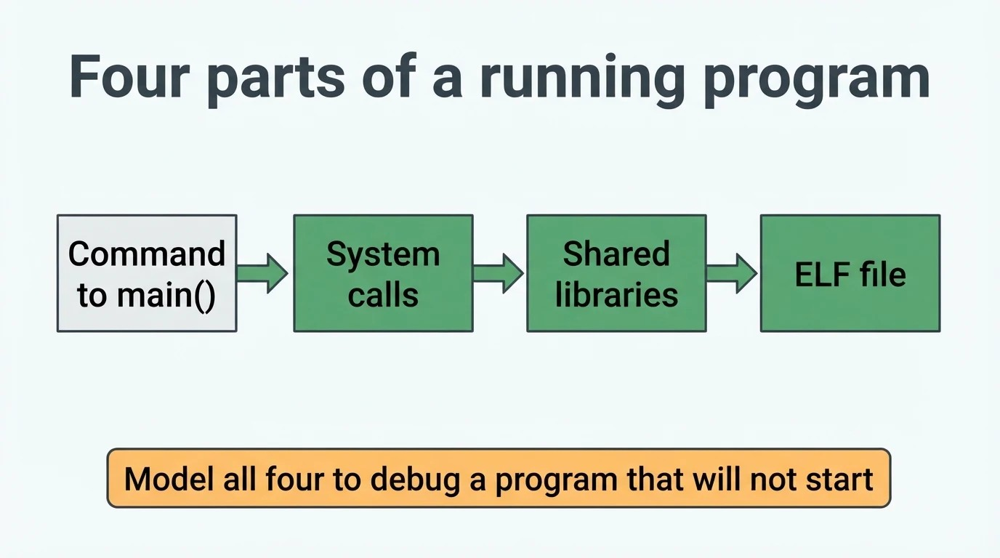
*Figure 1.11.1. You need a model of all four parts to debug failures that stop a program from starting.*


The messages arrive in a handful of shapes. You will see `libcuda.so.1: cannot open shared object file`, `version 'GLIBC_2.34' not found`, `version 'GLIBCXX_3.4.30' not found`, `CUDA error: no kernel image is available`, and `error while loading shared libraries: libnccl.so.2`. A Python import that hangs, or a container that cannot find the NVIDIA driver files, belongs in the same group. So does a binary that "works on the build machine but not here".

The other failures are slow or stuck programs. A training job may spin in `futex`. A data loader may make millions of tiny `read` calls. A process may block in `ioctl` on `/dev/nvidia0`. In every case, the real question is what the program asks the kernel to do.

To debug both kinds, you need a working mental model of four things. The first is what happens between typing a command and the first line of `main()`. The second is how a program talks to the kernel through system calls.

The third is how a program finds and loads code it does not contain, which is the job of shared libraries and the dynamic linker. The fourth is the ELF file, the format that holds the program in the first place. This chapter covers all four. It shows you how to watch them with `ldd`, `readelf`, `nm`, `strace`, `ltrace`, `LD_DEBUG`, and the profilers `perf` and the BPF tools.

The chapter also gives a short introduction to the application-performance method that sits on top of these tools. That covers on-CPU and off-CPU profiling, syscall analysis, thread states and locks. The full performance method, the observability tools and benchmarking come later, in chapters 1.23 to 1.25.

## Prerequisites and outcomes

Before you start, you should be comfortable with processes, signals and the basics of `strace` from chapter 1.8. You should also know the build toolchain and the shared-library search order from chapter 1.7. This chapter builds on that material rather than repeating it. The last piece you need is the kernel and user-space model from chapter 1.1.

By the end of this chapter, you should be able to:

- Narrate what happens from `execve()` to `main()` and on to `exit`. That includes the ELF loader, the dynamic linker, relocation and lazy binding.
- Read an ELF file with `file`, `readelf`, `objdump`, `nm`, `ldd` and `strings`. Say what sections, segments, symbols, the interpreter and the dynamic section are.
- Explain how a system call travels from a library wrapper into the kernel and back. Cover `errno`, the vDSO, and why `strace` shows what it shows.
- Trace a program with `strace` and `ltrace`. Use filters, follow forks, read timings and summaries, and attach to a running process. Interpret the common patterns, and know what tracing costs.
- Diagnose library problems: a missing library, a wrong version, symbol-version errors, the wrong libc, and how `LD_LIBRARY_PATH`, `RPATH` and `LD_PRELOAD` interact. Use `ldd`, `LD_DEBUG`, `readelf -d` and `patchelf`.
- Describe the process address space: text, data, BSS, heap, mmap area and stack. Explain how `malloc`, `brk` and `mmap` relate to it.
- Apply the basic application-performance method: CPU profiling, off-CPU analysis, syscall analysis and thread-state analysis. Read a flame graph.
- Apply all of this to GPU software. Know where `libcuda`, `libcudart`, `libnccl`, Python extension modules and container-injected driver libraries come from.

Check your own skills against this list before you start. If a line is unfamiliar, go back to chapter 1.7 or 1.8 first.

## 1. From keystroke to `main()`

Suppose a program fails before it prints its first log line. None of your own code has run yet, so the fault must sit in the machinery that starts it. To find the broken step, you need the whole sequence in order. It starts when you type `./train` in a shell. The diagram below shows every hand-off, from the shell to the kernel, then to the dynamic linker, and finally to your program.


*Figure 1.11.2. From keystroke to `main()`.*

Read the diagram from top to bottom. Each arrow is one hand-off, and each hand-off is a place where a failure can start. A useful picture is a stage crew. The kernel, the ELF loader and `ld.so` set the stage, and only then does `main` walk on.

1. **The shell forks.** The child process calls **`execve(path, argv, envp)`** (chapter 1.8). On success, `execve` never returns, because the process image has been replaced by the new program.

2. **The kernel checks the file.** It confirms that the file exists and that this user may execute it. It also confirms that the filesystem is not mounted `noexec`. Then it reads the first bytes to pick a format handler. A file that begins with `#!` is run by the interpreter named after those characters, and the script is passed as an argument (chapter 1.9). A file that begins with the ELF magic bytes `\x7fELF` goes to the ELF handler. Other formats can be registered through **`binfmt_misc`**. Examples are ARM binaries run under QEMU emulation, Java `.jar` files, and Windows executables run under Wine. A file that no handler recognises fails with **"Exec format error"**.

3. **The ELF loader maps the file into memory.** It does not read the whole file. It creates memory mappings for each `LOAD` segment. Code is mapped as read and execute, and initialised data is mapped as read and write. A zero-filled **BSS** area holds the uninitialised globals.

   The loader then builds an initial **stack**. The stack holds `argc`, `argv`, `envp` and an **auxiliary vector**. That vector carries system values such as the page size, the location of the vDSO, the entry point, and random bytes for ASLR. Last, the loader picks a starting point for the **heap**.

4. **A dynamically linked program names its interpreter.** Its ELF headers contain a `PT_INTERP` entry. On x86-64 glibc systems, that entry is `/lib64/ld-linux-x86-64.so.2`. The kernel maps the interpreter too, and execution starts **in the dynamic linker**, not in your program. This is the first surprise for most people: your program is not the first code to run.

5. **The dynamic linker (`ld.so`) loads and wires the libraries.** It reads the `DT_NEEDED` list of libraries. It finds each one with the search order from chapter 1.7: `RPATH` or `RUNPATH`, then `LD_LIBRARY_PATH`, then `/etc/ld.so.cache`, then the default directories. It maps each library with `mmap`.

   Next it **relocates** them. Your program and its libraries refer to each other's functions and variables by name. The linker fills in the real addresses for those names.

   Functions usually get **lazy binding**. Calls go through the **PLT**, the procedure linkage table, and the **GOT**, the global offset table. The real address is looked up the first time the function is called. You can set `LD_BIND_NOW=1` or link with `-z now` to resolve everything at start-up. That makes errors appear immediately, and it is a hardening practice known as "full RELRO". Last, the linker runs each library's **constructors**, which are its initialisation functions.

6. **Control moves to `_start`.** The program's entry point `_start` calls the C library's `__libc_start_main`. That function sets up the C runtime and then calls **`main(argc, argv, envp)`**. When `main` returns, the library runs the `atexit` handlers, flushes the stdio buffers, and calls `exit_group(status)`.

7. **The kernel tears the process down.** It closes files, releases memory and signals the parent. It keeps the exit status as a zombie until the parent reaps it (chapter 1.8).

You can watch all of this yourself. The command `strace -f ./train 2>&1 | head -100` shows the `execve`, then the `openat` of `/etc/ld.so.cache` and of each library, the `mmap` calls and `mprotect`, and then the program's own work.

Two kinds of program skip parts of this sequence. A statically linked program skips steps 4 and 5, because all of its library code is inside the executable. It needs no `ld.so` and no `.so` files, so it can run in an empty container image. Position-independent executables (PIE) and shared libraries can load at a random base address on each run. This is ASLR, address-space layout randomisation, and it makes memory-corruption exploits harder. That is why the addresses in `ldd` and `/proc/PID/maps` change between runs.

Before you blame your code for a startup failure, find out which of these seven steps failed. The failing step tells you which tool to reach for next.

## 2. The ELF file format

The first time a binary from a colleague's laptop dies on a Grace node, the message is short: "Exec format error". Nothing in the program's own logic explains it, because the problem sits in the file's headers. Behind those headers sits the file format itself, and the format has a name. It is ELF, which stands for Executable and Linkable Format, and it covers executables, shared libraries, object files and core dumps on Linux and most Unix systems.

Every program you run, and every shared library it loads, is stored in that same format. Windows uses a different format called PE, and macOS uses Mach-O. One file format for so many jobs is a gift to anyone debugging. When a binary misbehaves, its ELF headers are the first place to look, because they answer the questions you would otherwise guess at.

One ELF file can be read in two ways. The first view belongs to the **linker**, and tools such as `objdump` use it. In this view, the file is a set of **sections**. `.text` holds the machine code, and `.rodata` holds constants. `.data` holds initialised variables. `.bss` holds uninitialised variables, and it takes no space in the file. `.symtab` and `.strtab` hold the full symbol table, while `.dynsym` and `.dynstr` hold the dynamic symbols. `.dynamic` holds the dynamic-linking information. `.plt` and `.got` are the lazy-binding tables. `.eh_frame` holds unwinding information, and `.debug_*` holds debug info when it is present.

The second view belongs to the **kernel loader**, which sees the file as a set of **segments**, also called program headers. The `LOAD` segments are the ones mapped into memory. `INTERP` gives the interpreter path. `DYNAMIC` holds the linking data, and `TLS` holds thread-local storage. `GNU_STACK` says whether the stack is executable, and it should not be. `GNU_RELRO` marks memory that becomes read-only after relocation.

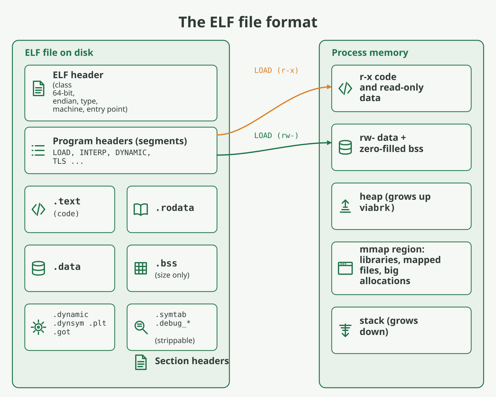

*Figure 1.11.3. The ELF file format.*

### Reading an ELF file

```bash
file /bin/ls                       # "ELF 64-bit LSB pie executable, x86-64, dynamically linked, interpreter /lib64/ld-linux-x86-64.so.2 ... stripped"
readelf -h /bin/ls                 # ELF header: type (DYN for PIE/shared lib, EXEC, REL), machine, entry point
readelf -l /bin/ls                 # program headers (segments), INTERP, flags
readelf -S /bin/ls | head -40      # section headers
readelf -d /bin/ls                 # dynamic section: NEEDED libraries, RPATH/RUNPATH, SONAME, BIND_NOW
readelf --dyn-syms /bin/ls | head  # symbols it imports and exports
nm -D /lib/x86_64-linux-gnu/libc.so.6 | grep -w malloc   # exported dynamic symbols ('T' = defined code, 'U' = undefined/needed)
objdump -d /bin/true | head -40    # disassembly
objdump -T /usr/lib/x86_64-linux-gnu/libz.so.1 | head   # dynamic symbols with versions
ldd /bin/ls                        # resolved libraries (the loader's view; see section 5 caveat)
strings -n 8 /bin/ls | head        # printable strings in the binary (version strings, paths, error messages)
```

These commands pull out the facts that matter for a binary. Check the **architecture** first. Compare `x86-64` with `aarch64`, because a wrong-architecture binary on Grace/ARM nodes fails with "Exec format error". Next, check whether the binary is linked dynamically or statically. Then look at the **interpreter** path, because a binary built against musl or an unusual loader will not start on glibc.

Then look at the **NEEDED** libraries and their **version requirements**, which `readelf -V` shows (section 5). Check the **RPATH** and **RUNPATH** entries too. Finally, see whether the binary is **stripped**, which means it has no symbols and is harder to profile (chapter 1.24). Also check whether it is **PIE**.

### Symbols, stripping and debug info

A **symbol** is a name, for a function or a variable, together with an address. Static symbols in `.symtab` are only for debugging and link-time work, and `strip` can remove them. **Dynamic symbols** in `.dynsym` are what the dynamic linker needs, so they stay in the binary.

**Debug info** maps addresses back to source lines and variables. It is written in the DWARF format when you compile with `-g`. Often it ships separately, in `-dbg` or `-debuginfo` packages, or through `debuginfod`. Profilers and debuggers need symbols to show function names. Without them, you see hexadecimal addresses or `[unknown]` (section 8).

When you build software for production, compile with `-g` and keep the debug info, even if you ship stripped binaries. That keeps a profile readable later, when something goes wrong in the field. A stripped binary and a lost debug package turn a five-minute question into a long afternoon.

## 3. The process address space

Every process sees its own flat virtual address space. A process can report a huge virtual size while using very little RAM, and that gap confuses people until they know the layout. The loader and the allocator organise that space, and you need to know its layout when a process uses too much memory. On x86-64 Linux, the regions run from low addresses to high, as the table shows.

| Region | What lives there | Notes |
|---|---|---|
| Text | Program code (read+execute) | Shared between processes running the same binary |
| Data / BSS | Initialised and zero-filled globals | |
| **Heap** | Memory from `malloc` for small requests; grows up using the **`brk`** system call | One contiguous region that moves its end |
| **mmap area** | Shared libraries, memory-mapped files, large `malloc`s, thread stacks, anonymous mappings | Created with **`mmap`**; the allocator uses it for big requests (default threshold around 128 KiB, dynamic) because freeing a mapping really returns memory to the kernel |
| vDSO / vvar | Kernel-supplied pages for fast calls (`gettimeofday`, `clock_gettime`) | Mapped into every process |
| **Stack** | Function call frames, local variables | Grows down; each thread has its own; size limited by `ulimit -s` (8 MiB default) |
| Kernel | Not accessible from user mode | |

Notice which regions grow and in which direction. The heap moves its end up through `brk`. The stack grows down, and each thread gets its own. The mmap area holds the big allocations, and freeing a mapping returns that memory to the kernel at once.

You can see this layout for any running process, with no special tool. `cat /proc/PID/maps` lists each address range with its permissions, such as `r-xp`, and also its offset, device, inode and path. `pmap -x PID` adds the resident size. `[heap]`, `[stack]`, `[vdso]` and every library appear in the output.

The process tools show two different sizes. Virtual size (VSZ or VIRT) is the sum of all the mappings. Resident size (RSS) is the part that is actually in RAM. The two differ because the kernel allocates memory lazily. Reserving address space costs nothing, and a physical page is assigned only on first touch. This behaviour is **demand paging**, covered in chapter 1.8 section 8 and in chapter 1.17.

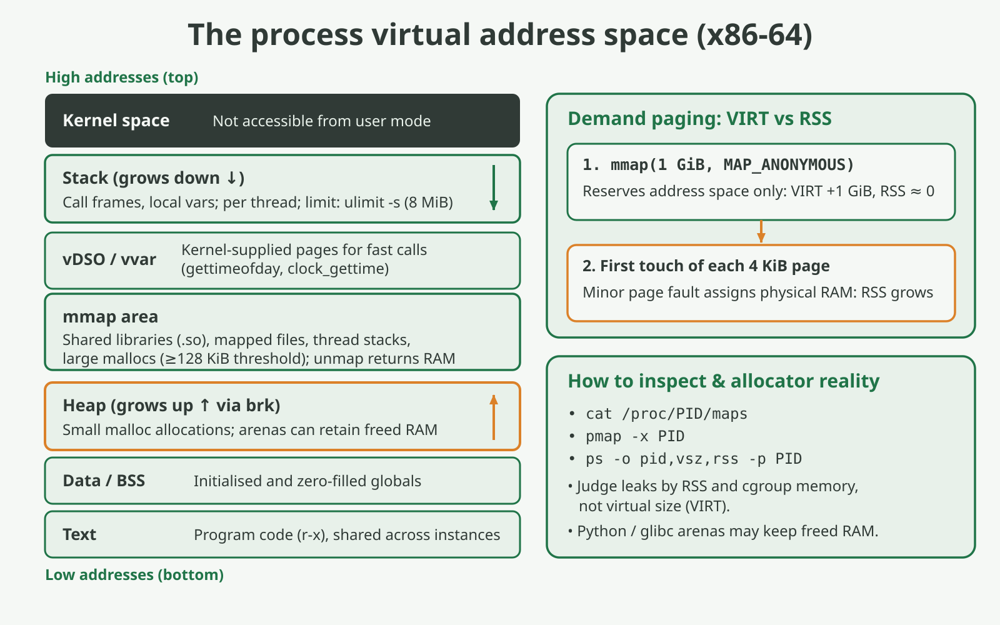

*Figure 1.11.4. The process virtual address space on x86-64 Linux and demand paging (VIRT vs RSS).*

A small experiment makes this concrete. The program below reserves 1 GiB of virtual memory, then touches it one page at a time:

```c
#include <stdio.h>
#include <sys/mman.h>

int main(void) {
    size_t size = 1UL << 30;                         /* 1 GiB */
    void *p = mmap(NULL, size, PROT_READ | PROT_WRITE,
                   MAP_PRIVATE | MAP_ANONYMOUS, -1, 0);   /* anonymous: RAM-backed, no file */
    if (p == MAP_FAILED) { perror("mmap"); return 1; }
    puts("reserved 1 GiB of address space; RSS is still tiny. Press Enter to touch it...");
    getchar();
    for (size_t i = 0; i < size; i += 4096)          /* one byte per 4 KiB page */
        ((char *)p)[i] = 'A';                        /* each first touch is a minor page fault */
    puts("touched every page; RSS is now about 1 GiB. Press Enter to exit...");
    getchar();
    munmap(p, size);
    return 0;
}
```

Compile it with `cc -O0 -o mapdemo mapdemo.c` and run it. In a second terminal, watch `top` or `ps -o pid,vsz,rss -p PID`. `VIRT` jumps by 1 GiB straight away, but `RES` stays near zero until you touch the pages. Then `strace ./mapdemo` shows the `mmap` call, and `/usr/bin/time -v` reports roughly 262,144 minor page faults. That gap between the promise and the delivery is the whole idea of demand paging. It is also why a memory leak is judged by RSS and by cgroup memory accounting, not by virtual size.

`malloc` is a library function, not a system call. Think of the C allocator as a wholesaler. It gets large chunks from the kernel with `brk` or `mmap`, either glibc `malloc` or `jemalloc` and `tcmalloc` when they are preloaded. It then splits those chunks into smaller pieces. Small objects live in the heap, and large ones get their own `mmap`.

Freed memory is often not returned to the operating system right away. Fragmentation and arenas keep it inside the process. So RSS can stay high long after the objects are freed.

Python behaves the same way. Its allocator requests large **arenas** from the OS. One surviving small object in an arena keeps the whole arena from being given back. That is why the memory of a long-running data loader does not drop after you `del` a large list or call `gc.collect()`.

You have several ways to reduce this. You can recycle processes by restarting workers periodically, using `maxtasksperchild`. You can preload `jemalloc` or `tcmalloc` with `LD_PRELOAD`. You can tune `MALLOC_ARENA_MAX` and `MALLOC_TRIM_THRESHOLD_`, or call `malloc_trim`. Memory accounting and the OOM killer are covered in chapter 1.17.

Before you call a process a leak, watch its RSS over time. Virtual size on its own tells you very little.

## 4. System calls

A program that opens a file, sends a packet or asks the GPU to do work crosses the same line every time. That line is the system call boundary. Once you can see it, most questions about what a program is doing become answerable. This section explains the crossing, then shows how to read it in `strace`.

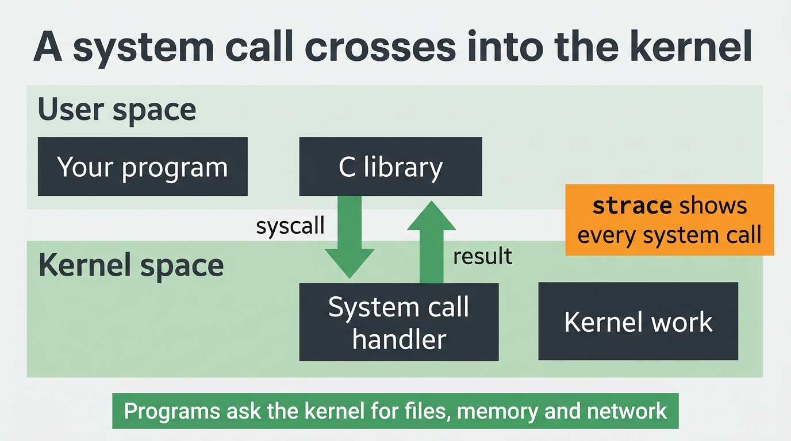

*Figure 1.11.5. Programs ask the kernel for everything through system calls. strace shows them.*

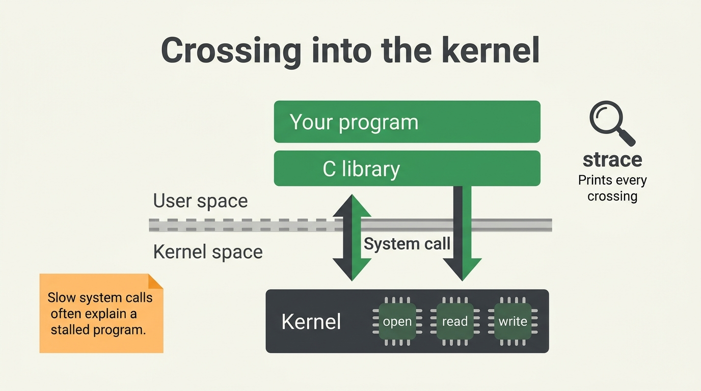

*Figure 1.11.6. A system call is the controlled crossing from user space into the kernel; strace prints each one.*

### The mechanism

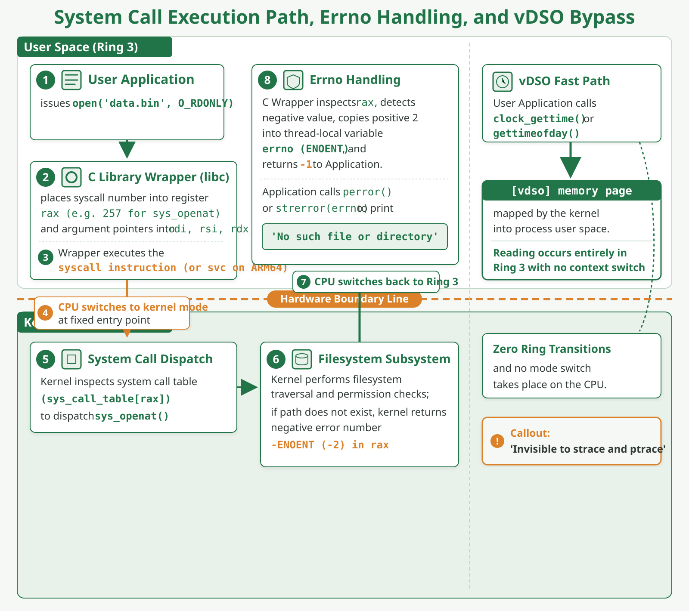

*Figure 1.11.7. A system call transitions from user space to kernel space via CPU registers and the syscall instruction, with libc mapping negative returns to errno; vDSO calls execute entirely in user space.*

Picture a program that wants one byte written to a file. It cannot touch the disk, the network or the GPU directly. It asks the kernel to do the work, and it does so through a system call. A **system call** is the controlled entry into the kernel. The C library offers a **wrapper function** for each one, such as `open()`, `read()`, `write()` or `mmap()`. The wrapper places the call **number** and the arguments in specific CPU registers. Then it runs a special instruction: `syscall` on x86-64, or `svc` on ARM64.

The CPU switches to kernel mode at a fixed entry point. The kernel looks up the call number in its **system call table**, then checks the arguments and the permissions. It does the work, which may block the task for a while. Last, it puts a result in a register and returns to user mode.

Errors follow a fixed pattern. The kernel returns a negative error number, and the C wrapper converts that into **`-1` and sets the variable `errno`**. Common values include `ENOENT`, `EACCES`, `EINTR`, `EAGAIN` and `ENOMEM`. Use `strerror(errno)`, `perror()` or `man errno` to turn the number into plain text. Four rules of thumb help when you read this kind of output.

- **System calls are a stable, documented API.** You will find them in section 2 of the manual, for example `man 2 open`. Linux has roughly 450 to 500 documented calls, and that number grows over time. Early Unix had a few dozen. The kernel maintainers add few calls and build richer interfaces in libraries instead.

- **A library call is not a system call.** `printf`, `malloc`, `fopen`, `strlen` and `qsort` are library functions, documented in manual section 3. Some of them make system calls and some do not. `printf` buffers its output and eventually calls `write`, but `strlen` never enters the kernel. `strace` shows system calls, and `ltrace` shows dynamic library calls.

- **Each call has a cost.** A mode switch takes on the order of a hundred nanoseconds to microseconds, depending on the CPU and the mitigations. Blocking calls also cause a context switch. Millions of calls per second add up. That is why tools batch their work, using large buffers, `readv` and `writev`, `io_uring` and memory mapping. It is also why a data loader that makes 4 KiB reads is slow.

- **The vDSO handles a few hot calls in user space.** It serves `clock_gettime`, `gettimeofday` and `getcpu` entirely in user space, from memory the kernel provides. So those calls appear in no `strace` output.

### Common calls and what they tell you

When you run `strace`, the output is a stream of these calls. The table lists the ones you will meet most often and what each one tells you. Use it as a lookup, not as a list to memorise.

| You see in `strace` | It means |
|---|---|
| `execve`, `brk`, `mmap`, `mprotect`, `openat("/etc/ld.so.cache")`, `openat(".../libc.so.6")` | Start-up and library loading |
| `openat(AT_FDCWD, "path", O_RDONLY) = 3` | Opened a file, descriptor 3 |
| `openat(..., "x") = -1 ENOENT (No such file or directory)` | The program looked for a file that does not exist (the most common cause of mysterious failures) |
| `... = -1 EACCES (Permission denied)` | Permissions, SELinux/AppArmor, or a noexec mount |
| `read(3, "...", 4096) = 4096`, `write(1, "...", n)` | I/O; the size argument shows the I/O size (tiny sizes = inefficiency) |
| `futex(0x..., FUTEX_WAIT_PRIVATE, ...)` | A thread is waiting for a lock or condition variable |
| `epoll_wait`, `poll`, `select`, `ppoll`, `accept`, `recvfrom` | Waiting for network or other events |
| `connect(3, {sa_family=AF_INET, sin_port=htons(443), ...})`, `sendto`, `recvmsg` | Network activity: where, which port |
| `ioctl(3, ...)` | Device control: GPU, terminal, network; for NVIDIA `ioctl` on `/dev/nvidiactl` and `/dev/nvidia0` |
| `clone(...)`/`clone3` | A thread or process is created |
| `wait4(-1, ...)`, `--- SIGCHLD ---` | Waiting for children; a signal arrived |
| `nanosleep`, `clock_nanosleep` | A deliberate sleep |
| `exit_group(0)` | The program exiting |

Start with the failures. A `-1 ENOENT` on an `openat` often explains a mysterious failure, because the program looked for a file that is not there. Then look at the sizes. A `read` with a tiny size argument points to I/O that could be batched. A `futex` line means a thread is waiting for a lock. It does not mean the program is broken.

When a program fails silently, read the last few failing calls in `strace` before you change any code. The trace usually names the missing thing in plain sight.

## 5. Shared libraries in depth

You install a library, and the file sits right there on disk, yet the program still says it cannot open it. That is the kind of puzzle this section prepares you for. A shared library is code that many programs use without each one carrying its own copy. That saving comes with its own management costs and a tangled linking procedure.

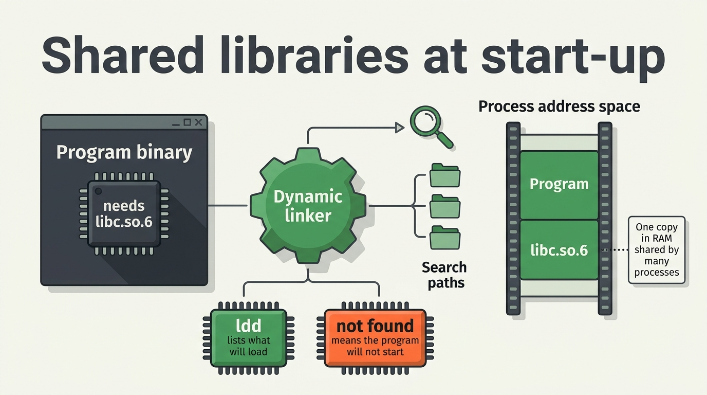

*Figure 1.11.8. The dynamic linker finds each needed library, and ldd shows what will load.*

Chapter 1.7 covered how libraries are built and how `ld.so` searches for them. This section is about keeping them under control, and you can do that if you know four things. The source for this material is *How Linux Works* Section 15.1.3. First, you need to list the shared libraries an executable needs, with `ldd` or `readelf -d`. Second, you need to know how the executable looks for them: `DT_RPATH`, `LD_LIBRARY_PATH`, `DT_RUNPATH`, `/etc/ld.so.cache`, `/lib` and `/usr/lib`. Third, you need to link against a library at compile time, using `-L`, `-l` and `-Wl,-rpath`. Fourth, you need to know the common pitfalls. This section covers what makes a library file name work, how a program says which version it needs, and what goes wrong.

### Names: soname, real name, linker name

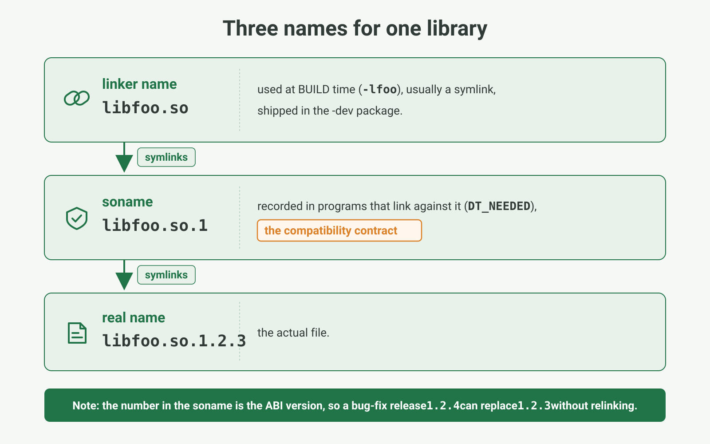

*Figure 1.11.9. Programs record the soname, which is the compatibility contract, while the real name is the actual file.*

A shared library has three names, and symbolic links tie them together.

```text
libfoo.so          linker name        used at BUILD time (-lfoo); usually a symlink, shipped in the -dev package
libfoo.so.1        soname             recorded in programs that link against it (DT_NEEDED); the compatibility contract
libfoo.so.1.2.3    real name          the actual file
```

The number in the soname is the ABI version. ABI stands for application binary interface, and the number changes when the library breaks compatibility. Programs record the **soname**. So a bug-fix release `1.2.4` can replace `1.2.3` without relinking anything. A rewrite becomes `libfoo.so.2` and installs alongside, so old programs keep using `.1`. The `ldconfig` tool creates the soname symlinks and the cache. That is why one machine can hold `libcudnn.so.8` and `libcudnn.so.9` side by side, and `libcudart.so.11.0` and `libcudart.so.12` too.

### Symbol versioning and glibc

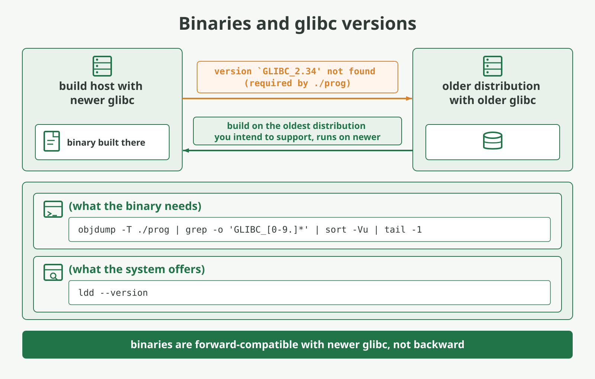

*Figure 1.11.10. Binaries are forward-compatible with newer glibc, not backward, so build on the oldest distribution you support.*

Within one soname, the GNU C library and libstdc++ attach **symbol versions** to their functions. Examples are `memcpy@GLIBC_2.14` and `GLIBCXX_3.4.30`. A newer library can then provide both new and old behaviour. At link time, the binary records the **minimum versions** it needs. You can read them with `readelf -V ./prog` or `objdump -T`. At run time, the loader refuses to start the program if the system library is older than required.

```text
./prog: /lib/x86_64-linux-gnu/libc.so.6: version `GLIBC_2.34' not found (required by ./prog)
```

The consequence is simple. **Binaries are forward-compatible with newer glibc, not backward.** So build on the oldest distribution you intend to support. This idea is the basis of the Python **manylinux** wheel standard, and of the habit of building in an old container.

To check what a binary needs, run `objdump -T ./prog | grep -o 'GLIBC_[0-9.]*' | sort -Vu | tail -1`. To check what the system offers, run `ldd --version`, or `strings /lib/x86_64-linux-gnu/libc.so.6 | grep GLIBC_2 | tail -1`. The same logic applies to `libstdc++`, with its `GLIBCXX_*` and `CXXABI_*` versions. The usual cause of "version `GLIBCXX_3.4.30' not found" is a conda environment that ships an older `libstdc++` and shadows the system one. Another cause is a wheel built with a new compiler and then used on an old OS.

### glibc versus musl, and containers

Alpine Linux uses **musl**, not glibc. That difference produces one of the most confusing errors in this chapter. A glibc-linked binary will not start on Alpine, and the error says "not found", even though the file exists. Nothing is wrong with the file itself. The reason is that the interpreter `/lib64/ld-linux-x86-64.so.2` is missing. Most GPU software, such as the CUDA libraries and PyTorch wheels, is built for glibc. So base images for GPU work are Debian, Ubuntu or UBI based.

Inside a container, the libraries come from the **image**, not from the host. The exception is the driver-side libraries that the NVIDIA runtime injects (section 9).

### Preloading and debugging the loader

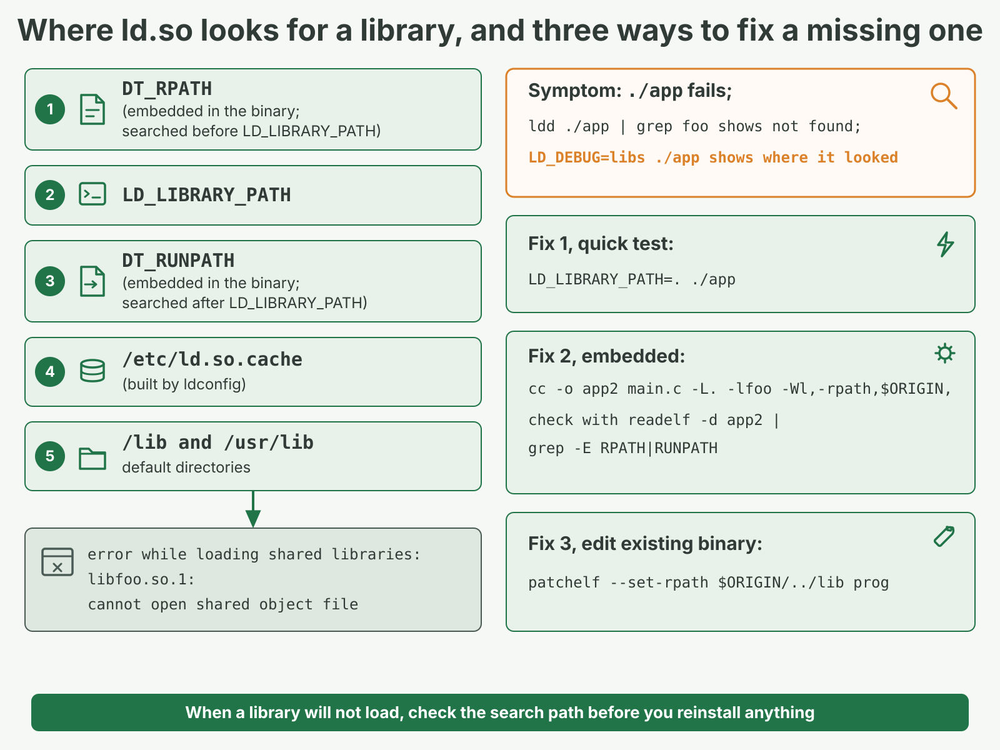

*Figure 1.11.11. The loader tries RPATH, LD_LIBRARY_PATH, RUNPATH, the ldconfig cache and the default directories in that order.*

- **`LD_PRELOAD=/path/lib.so`** forces a library to load first, so its symbols override the normal ones. People use it to replace the allocator, such as `jemalloc` or `tcmalloc`, without recompiling. They also use it to intercept calls for debugging or profiling, which some GPU tools do, or to work around a library bug. The same mechanism is used by malware, and it is ignored for set-uid programs. It can also break programs in subtle ways, so treat it as a sharp tool.

- **`LD_DEBUG`** makes the loader explain itself. `LD_DEBUG=libs ./prog` shows where it looked and what it loaded. `LD_DEBUG=bindings` shows symbol resolution. `LD_DEBUG=files`, `LD_DEBUG=versions` and `LD_DEBUG=statistics` each cover their own topic, and `LD_DEBUG=help` lists them all.

- **`ldconfig -p | grep libname`** shows what is in the cache. **`ldd -v`** prints version requirements, and **`ldd -r`** reports unresolved symbols.

- **`LD_LIBRARY_PATH`** is the usual culprit when the wrong library loads. A stale path left by a module load, a conda activate or a vendor script can cause it. When a job fails, print the variable and compare it with a working run.

- **`RPATH` and `RUNPATH`** are both embedded in the binary, and they interact with `LD_LIBRARY_PATH` in different orders. `RPATH` is searched before `LD_LIBRARY_PATH`, and `RUNPATH` is searched after it. Check `ld.so(8)` on your system to confirm. Many vendor tools set `RUNPATH` with `$ORIGIN`, so the install can move. Edit it with `patchelf --set-rpath '$ORIGIN/../lib' prog`, and inspect it with `readelf -d`.

- **`ldd` caveat.** On some systems, `ldd` actually runs the program, because it sets up the loader in a trace mode. Do not run it on untrusted binaries. Use `readelf -d prog | grep NEEDED` and `objdump -p prog` instead.

### Python and extension modules

Python itself is a dynamically linked program. Every compiled extension, such as `numpy`, `torch` or `cv2`, is a **shared library**. Its file name carries a Python-specific tag, such as `_C.cpython-311-x86_64-linux-gnu.so`. The interpreter loads it with `dlopen()` at import time. That extension then pulls in its own dependencies. For example, `libtorch_cuda.so` needs `libcudart.so.12`, `libcublas.so.12`, `libcudnn.so.9` and `libnccl.so.2`. When an import fails, this chain of libraries is what you are debugging.

**Wheels** bundle many of these libraries inside the package directory. They use `RUNPATH` with `$ORIGIN` to find them. That is why `pip install torch` works without a system CUDA toolkit. The wheel brings its own CUDA user-space libraries. Only the **driver** must come from the host, and that means `libcuda.so.1` and the kernel module.

When an `import` fails, you find the `.so` file and run `ldd` on it. Start with `python -c "import torch; print(torch.__file__)"` to find the package. Then run `ldd` on `libtorch_cuda.so` inside that directory, and filter the output with `grep -E 'not found|cuda|nccl'`. Two more commands help. `python -X importtime -c 'import torch'` shows the time spent on each import. `strace -f -e openat python -c 'import torch' 2>&1 | grep -E 'ENOENT.*\.so'` reveals search misses. Many `ENOENT` results are normal, so focus on the final failure.

When a library will not load, check the search path before you reinstall anything.

## 6. Watching a program: `strace` and `ltrace` in practice

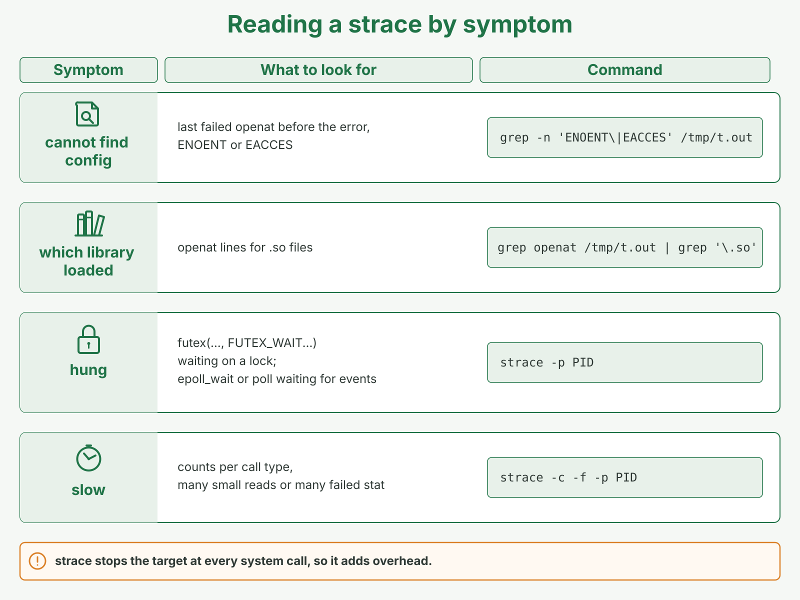

*Figure 1.11.12. Read a trace with one question in mind and use the matching filter or summary flag.*

When a program fails or hangs, and its logs say nothing useful, `strace` is usually the first tool to reach for. You can see the process in `ps`, but you get no error, no stack and no clue why it stopped moving. Chapter 1.8 introduced `strace` in section 3. It prints the system calls the program makes, one line per call, so the kernel boundary where it stopped becomes visible. Start with a broad trace, then narrow it down to the calls that matter. The commands below follow that routine.

```bash
strace -f -o /tmp/t.out -tt -T ./prog args        # follow forks/threads, timestamps, time spent in each call
strace -f -e trace=file ./prog                    # only calls that take file names (open, stat, execve ...)
strace -f -e trace=network ./prog                 # socket, connect, send, recv ...
strace -f -e trace=process ./prog                 # fork, clone, execve, wait, exit
strace -f -e trace=openat,connect,execve ./prog   # a custom set
strace -e 'trace=!futex,clock_nanosleep' -f -p PID   # everything except noisy calls
strace -c -f -p PID                               # summary table; stop with Ctrl-C
strace -s 200 ./prog                              # show up to 200 chars of string arguments (default 32)
strace -yy -e trace=network -p PID                # decode file descriptors to paths / socket addresses
strace -k -e trace=openat ./prog                  # add a user-space stack trace (if strace built with libunwind)
sudo strace -f -p $(pgrep -n python) -e trace=ioctl,futex   # a running training process
```

Each line in that block answers a different question. Filters keep the output small, and the summary and timing flags show where the time goes. Once you have a trace, read it with one question in mind. The examples below cover the questions that come up most often.

- **The program cannot find its config.** Search the trace for failures with `grep -n 'ENOENT\|EACCES' /tmp/t.out | tail`. The last failed `openat` before the error message is almost always the culprit.

- **Which library did it load, and from where?** Run `grep openat /tmp/t.out | grep '\.so'`. The output lists each shared library the program opened, with its path.

- **Where is it hung?** Attach with `strace -p PID` and read the last line. A `futex(..., FUTEX_WAIT...)` means a thread is waiting on a lock. An `epoll_wait(...)` or `poll` means it is waiting for events. A `read(5, ` with no return means it is blocked reading a pipe or socket. An `ioctl(…/dev/nvidia…)` means it is inside the GPU driver. Use `-f` to see every thread, and run `ls -l /proc/PID/fd/N` to learn what descriptor 5 is.

- **Why is it slow?** `strace -c` shows the time spent in each call type. A huge count of `read` calls with a small size argument means unbuffered I/O. Many failed `stat` or `openat` calls mean the program is searching paths. Add `-T` to see which individual call blocked.

- **Short-lived processes and fork storms.** Use `strace -f -e trace=execve` to catch them. For a system-wide view, use `execsnoop` from BCC or bpftrace.

`strace` works through the `ptrace` interface. The kernel stops the target at **every** system call, on entry and on exit, and wakes `strace` each time. That happens even for calls you filtered out of the output. A program that makes millions of calls per second can slow down by one to two orders of magnitude. One measurement found that a `dd` copy of 1 KiB blocks ran about 70 times slower under `strace`. The tracing also changes the timing you are trying to measure. So use `strace` for short periods on production processes, and prefer `-e trace=` filters together with `-c`.

For work where the rate matters, use low-overhead tracers that buffer events in the kernel. They include `perf trace`, `perf stat -e 'syscalls:*'`, Ftrace, and BPF tools such as `syscount`, `opensnoop`, `execsnoop` and `bpftrace` one-liners (chapter 1.24). Other systems have their own equivalents: `truss` on Solaris and AIX, `ktrace` on BSD, and `dtruss` on macOS.

**`ltrace`** traces the calls a program makes into dynamic libraries, such as `malloc`, `printf` or `SSL_read`. For example, `ltrace -f -e 'malloc+free' ./prog` follows `malloc` and `free`, and `ltrace -c ./prog` prints a summary. Library calls far outnumber system calls, so filter aggressively. `ltrace` does not work on statically linked programs, and it can be fragile with modern PIE binaries.

### Other process-inspection tools

Some tools inspect a process without tracing every call. `pstack PID` and `gdb -p PID -batch -ex 'thread apply all bt'` print the native stacks of a hung process, pausing it briefly while they run. `py-spy dump --pid PID` prints the Python stacks and does not stop the process. `lsof -p PID` lists the open files. You can also read `cat /proc/PID/maps`, `/proc/PID/status`, and `/proc/PID/stack`, the kernel stack, which needs root. A core dump plus `gdb` gives you stacks after the fact.

When a process is hung, capture its stacks before you restart it. A restart removes the state you came to examine.

## 7. Application performance: a first method

Everything above is the machinery. This section shows how to use it to answer the question that pays the bills: "why is this program slow?". It is a short version of the application-performance method. The full system-level method is in chapter 1.23, the tools are in chapter 1.24, and benchmarking is in chapter 1.25.

### Know the application first

Suppose a slow service lands on your desk. Before you open a profiler, answer a few questions, because they frame everything that follows. What does the application do, and which operations does it serve? That might be a training step, an inference request or a query.

What is the performance **goal**? It might be **latency**, a consistent response time or a percentile target, such as 99% of requests under 100 ms. It might be **throughput**, measured in operations or bytes per second, or in samples or tokens per second for training. It might be **resource efficiency**, or **cost**.

Then look at the configuration: buffer and cache sizes, the number of threads or workers, and the batch size. You should ask why each one was chosen. Check what the application runs on, including CPUs, NUMA, GPUs, storage and the limits that cgroups set. Find out which metrics and logs it already provides. Note the version, and check whether the release notes or the bug tracker already mention your problem.

Without a goal, you end up on a random fishing expedition. So express goals as numbers, such as "at least 8,000 images/s per node" or "p99 under 50 ms".

Consider two principles that guide everything. The first is to **optimise the common case**. Find the most frequent code path and fix that, not a rare path. The second is that the biggest wins come from **eliminating unnecessary work**. Several short mantras capture this: don't do it, do it once, do it less, do it later, do it when nobody is looking, do it concurrently, and do it cheaper.

Prefer software you can *observe*. A slightly slower tool with rich metrics usually beats an opaque faster one, because visibility lets you remove waste. Consider algorithmic complexity too. An O(n²) step that was fine at 1,000 items becomes the whole runtime at 1,000,000 items. Constant costs dominate only for small n.

### Common techniques applications use

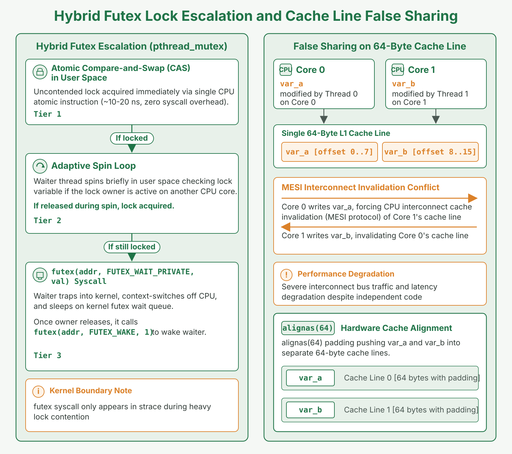

*Figure 1.11.13. Hybrid futex locks escalate from user-space atomic operations to kernel sleeps only under contention, while false sharing degrades multi-threaded performance across shared 64-byte cache lines.*

The table lists techniques that applications use to cut overhead. Each one trades something away, so read the trade-off column as carefully as the idea column.

| Technique | Idea | Trade-off |
|---|---|---|
| **I/O size** | Transfer more per call: per-call overhead (system call, mode switch, driver, metadata) is paid for small and large I/O alike | Larger I/O raises throughput but can waste bandwidth and add latency for random small reads |
| **Caching** | Keep results of expensive operations | Memory use; invalidation; cold-start cost |
| **Buffering** | Coalesce small writes into larger ones, ring buffers between producer and consumer | Added latency before data is flushed; risk of loss on crash |
| **Polling vs events** | Polling loops waste CPU or add latency; use `poll`, `select`, `epoll` (Linux; O(1) per event rather than scanning all descriptors) | More complex code |
| **Concurrency vs parallelism** | Concurrency: many tasks in progress (time-sharing). Parallelism: running at the same instant on several CPUs. Achieved with multiple processes, **threads** (cheaper, share memory), or user-space schemes: fibers, coroutines/goroutines, **event loops** (Node.js uses one event thread, which can become a bottleneck since it uses one core) | Shared memory needs synchronisation; contention |
| **Thread models** | Service thread pool (one thread per connection), CPU thread pool (one per core, for batch jobs), staged event-driven pipelines | Pool sizing; queueing |
| **Non-blocking I/O** | Issue I/O without parking a thread: `O_NONBLOCK`/`epoll`, POSIX `aio`, `sendfile` (kernel copies between descriptors), **`io_uring`** (shared submission/completion rings between user space and kernel; very high I/O rates) | Complexity; fewer tools support it |
| **Processor binding** | Pin threads to CPUs to keep caches and NUMA memory local | Can backfire on shared hosts (two tenants pin to the same cores) and when IRQs are pinned elsewhere; stale bindings after hardware changes |

Two of these deserve a closer look. **I/O size** matters most. Every call pays a fixed cost, whether it moves a little data or a lot. So moving more per call raises throughput, although it can waste bandwidth on random small reads. **Polling** wastes CPU, while event-based calls such as `epoll` wake the program only when something happens. Pick the technique that fits your access pattern, and then measure the result.

Threads that share data need protection, and protection creates waiting. **Mutexes** make waiters sleep, which takes them off the CPU. **Spin locks** make waiters spin on the CPU. They hand off quickly, but they waste CPU while they wait. **Reader/writer locks** and **semaphores** cover other patterns. Linux mutexes are hybrids. A thread first tries a fast atomic compare-and-swap. If the lock is held, it spins briefly while the holder is still running. Only then does it sleep on a **futex**. That is why `futex` dominates the `strace` output of multithreaded programs.

Lock contention limits scalability, because a single global lock serialises the threads. The kernel's **RCU** lets readers proceed without taking a lock. A subtler hardware effect is **false sharing**. Two threads update different variables that happen to share one 64-byte cache line, so the line bounces between cores. The fix is to pad or align hot per-thread data.

### Languages and runtimes

- **Compiled languages**, such as C, C++, Rust and Go, produce machine code in ELF binaries. They are the easiest to profile, because addresses map to function names through the symbol tables. Compiler optimisation levels, from `-O0` to `-O3`, plus `-Os`, `-Og` and `-Ofast`, trade speed, size and debuggability. `-fomit-frame-pointer` frees a register, but it breaks the frame-pointer stack walking that profilers use. So for profiled production builds, use `-fno-omit-frame-pointer` and `-g`, and keep the debug info even if the binaries are stripped. Never debug a performance problem by changing the optimisation level, because that changes the very behaviour you are studying.

- **Interpreted languages**, such as the shell, Python without a JIT, and Perl, run the interpreter on the CPU. A native profile therefore shows interpreter functions, not your program's functions. You need language-aware tools, such as `cProfile`, `py-spy` and `scalene` for Python, or the PyTorch profiler. You can also print timestamps. This matters for AI work. The hot loop usually lives in native extensions, such as cuBLAS kernels, and the Python layer mostly orchestrates them.

- **Language virtual machines**, such as the JVM and Erlang BEAM, and in a sense CUDA's PTX and JIT, run bytecode and compile it just in time. They are the hardest to observe. Use the VM's own tools, and use USDT probes where they exist.

- **Garbage collection** adds memory growth, CPU cost and **latency outliers**, which are stop-the-world pauses. Python combines reference counting with a cyclic collector. The JVM uses generational collectors. Tune the collector, reduce allocations, and find leaked references. GC pauses in a data loader or a serving process show up as periodic latency spikes.

### The analysis methods

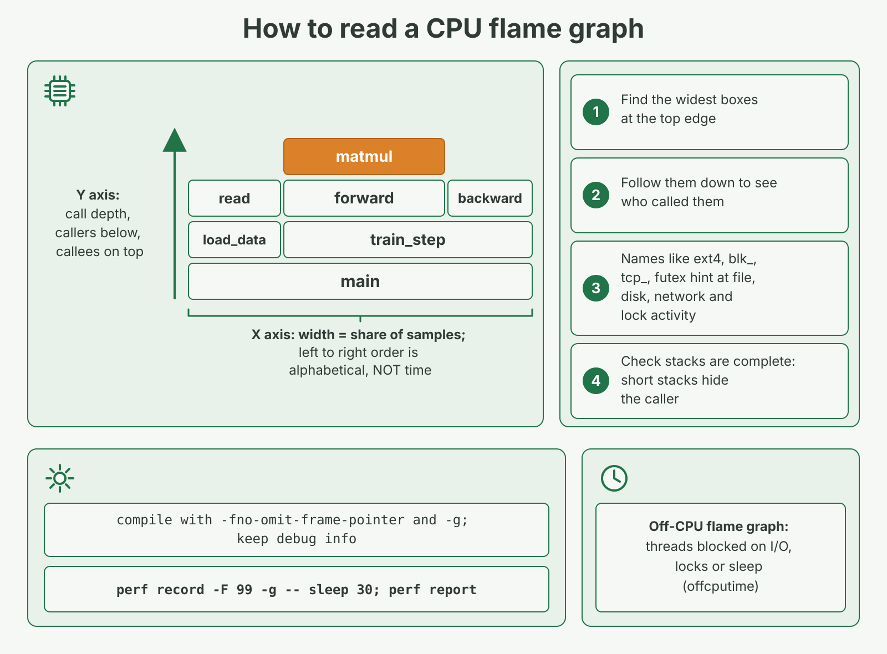

*Figure 1.11.14. In a flame graph the width of a box is its share of samples, the height is call depth, and the order left to right carries no time meaning.*

Each method below answers a different question. Use the first one that fits your symptom.

1. **CPU profiling (on-CPU).** Sample the call stacks of the running code, typically 49 or 99 times per second per CPU. Use `perf record -F 99 -g` or the BCC `profile` tool. Then aggregate the samples and view them as a **flame graph**. Each rectangle is a function, or stack frame. The vertical axis is the call chain, with callees on top. The **width is the proportion of samples**. Left-to-right order has no meaning. Look for wide plateaus, which are the places where CPU time goes.

   You should use kernel-aware profilers before language-level profilers. They see both user and kernel stacks, which is called mixed mode. Language profilers can mis-attribute time when the kernel deschedules the process. Even a CPU profile can hint at **off-CPU** problems. Functions with `ext4`, `blk_`, `tcp_` or `futex` in their names show that file, disk, network and lock activity is happening.

2. **Off-CPU analysis.** Study threads that are *not* running. They may be blocked on disk or network I/O, on locks or in sleeps, or they may be waiting for a CPU. Trace the scheduler events with the BPF `offcputime` tool, and draw an **off-CPU flame graph**. Reading it takes care, because idle threads that wait for work dominate it. Filter to the request-handling code, or to uninterruptible sleeps. The overhead can be significant, so test it before production use.

3. **Syscall analysis.** Count and time the system calls to find where the kernel time goes. Use `strace -c`, `perf trace -s`, `syscount`, and `execsnoop`. The last one shows new processes, such as an accidental fork storm or a forgotten benchmark loop. You can also profile I/O by looking at the distribution of `read` and `write` sizes. Syscall analysis explains most of the system CPU time, though not all of it. Page faults, interrupts and kernel threads make up the rest.

4. **USE method applied to software resources.** For every resource, check **U**tilisation, **S**aturation and **E**rrors. Start with the hardware resources, which are CPU, memory, disk and network. Then move to the software resources. A thread pool has utilisation equal to busy threads divided by pool size. Its saturation is the length of the request queue, and its errors are rejected requests. A file descriptor pool has utilisation equal to open descriptors divided by the limit. Its errors appear as `EMFILE` "Too many open files". Connection pools and GPU memory follow the same pattern.

5. **Thread-state analysis.** Divide each thread's time among its states. The states are **user** on-CPU, **kernel** on-CPU, **runnable** (waiting for a CPU), **swapping** (anonymous page-in), **disk I/O**, **network I/O**, **sleeping**, **lock** and **idle**. Your goal is to reduce time in every state except idle.

   On Linux, rough indicators come from `pidstat`, with its `%usr` and `%system` columns. `vmstat r` shows runnable threads, and the `si/so` columns show swapping. `pidstat -d` shows I/O delay. `/proc/PID/schedstat` shows run-queue wait time, and delay accounting goes further. Deeper answers need tracing. A process that looks asleep, with no activity, needs its stacks read, using `/proc/PID/stack` or `gdb`.

6. **Lock analysis.** You check for contention, meaning threads that are waiting, and for excessive hold times. Spin-lock contention shows up as CPU time in a profile. Mutex contention shows up as off-CPU time in `futex`. This is usually a developer task, because it needs source knowledge.

7. **Static performance tuning.** Audit the configuration rather than the behaviour. Check the versions and dependencies, the build type (debug or release), the compiler flags and the architecture-specific instructions such as SIMD. Then check the memory allocator, huge pages, thread pool sizes, cache sizes, resource limits and cgroup caps. Also check whether the program runs in a degraded mode after an error.

8. **Distributed tracing.** For a request that spans several services, record a request ID, the parent and child relationships, and the timings and errors at each hop. Then combine them with a tool such as OpenTelemetry or Jaeger. Head-based sampling keeps the volume manageable, but it misses rare outliers. Tail-based sampling keeps the interesting ones.

### Tools at a glance

Use this table as a lookup when you need the right command for one of the methods above.

| Tool | Use |
|---|---|
| `perf record -F 99 -a -g -- sleep 30`; `perf report`; `perf script` | CPU sampling and flame-graph input; `perf stat` for counters; `perf trace` for syscalls |
| `profile` (BCC) | Timed CPU sampling, low overhead |
| `offcputime` (BCC) | Off-CPU stacks and time |
| `strace -c / -f` | Syscall summary and trace (high ptrace overhead) |
| `execsnoop`, `opensnoop`, `syscount` | New processes, file opens, syscall counts system-wide, cheap |
| `bpftrace -e '...'` | Custom one-liners: e.g. `bpftrace -e 'tracepoint:syscalls:sys_enter_read { @[comm] = count(); }'`, `bpftrace -e 'tracepoint:syscalls:sys_exit_read /args->ret/ { @bytes = hist(args->ret); }'` |
| `py-spy top/record/dump`, `nsys`, `ncu`, PyTorch profiler | Python and GPU-side profiling (GPU chapters) |

Start with the cheapest tool that can answer your question. The system-wide tools in the table are inexpensive enough to run broadly. Move to the heavier tracers once a cheap one points at a specific process.

### Gotchas: missing symbols and missing stacks

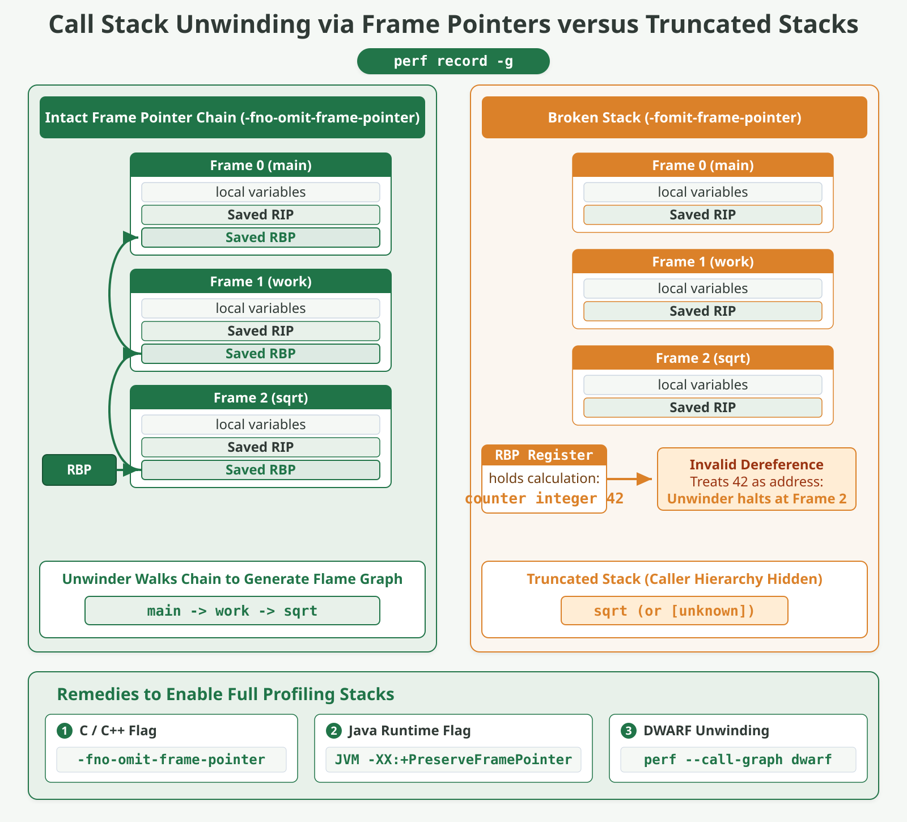

*Figure 1.11.15. Frame pointers maintain a linked chain of Saved RBP addresses on the stack that profilers walk; omitting frame pointers repurposes RBP, truncating profiles into single frames or unknown addresses.*

- **Missing symbols** appear as hex addresses or `[unknown]`. Stripped binaries cause this. The fix is to install the debuginfo packages or to build with symbols. JIT runtimes cause it too, because they generate code while the program runs. Give `perf` a map file at `/tmp/perf-<PID>.map`. The `perf-map-agent` tool produces one for Java, and `--perf-basic-prof` does so for Node.js. If the map is dumped after the code has moved, the symbols churn and stop matching.

- **Broken or short stacks** happen when a profiler walks **frame pointers**, but the program or libc was compiled with `-fomit-frame-pointer`. The register then holds garbage. Recompile with `-fno-omit-frame-pointer`, which typically costs under 1%. For Java, use `-XX:+PreserveFramePointer`. Otherwise, pick another stack-walking method in `perf`, such as DWARF or LBR. Stacks through libc, such as `pthread_cond_wait` or `send`, are often broken for this reason. Python 3.12 and later have perf support through `-X perf`, which gives Python function names to `perf`.

Before you trust a flame graph, check that its stacks are complete. A short stack hides the function that called the slow code.

## 8. AI-infrastructure patterns

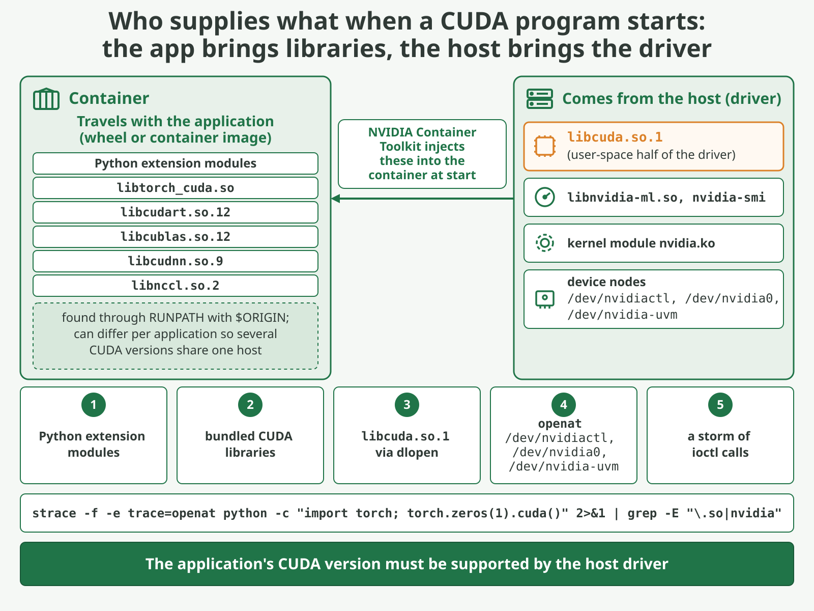

*Figure 1.11.16. CUDA toolkit libraries ship inside the wheel or image, while libcuda.so.1 and the kernel module must come from the host driver.*

Now apply these ideas to the software that matters most on a GPU node. When a CUDA job fails to start, the useful question is concrete: which files does it load, and in what order? The answer tells you which layer owns the piece that is missing.

**What a CUDA program loads.** Run `strace -f -e trace=openat python -c 'import torch; torch.zeros(1).cuda()' 2>&1 | grep -E '\.so|nvidia'` on a GPU node, then read the order. You will see Python's extension modules first. Next come the CUDA libraries that the framework bundles, such as `libcudart`, `libcublas`, `libcudnn`, `libnccl` and `libtorch_cuda`. Then the program opens the **driver library** `libcuda.so.1`, which the CUDA runtime loads with `dlopen`. After that you see `openat("/dev/nvidiactl")`, `/dev/nvidia0` and `/dev/nvidia-uvm`, followed by a storm of `ioctl` calls.

Two things follow from that order. First, **user-space CUDA libraries travel with the application**, inside a wheel or a container image. They can differ from one application to the next on the same node, and that is what makes several CUDA versions on one host possible. Second, **`libcuda.so.1` and the kernel module belong to the driver**, so they must come from the host. The application's CUDA version must be supported by the host driver. The driver is backwards compatible with older CUDA runtimes. For newer CUDA than the driver supports, a compatibility package exists for data-centre GPUs, so check NVIDIA's compatibility documentation.

In containers, the NVIDIA Container Toolkit **injects** `libcuda.so.1`, `libnvidia-ml.so`, `nvidia-smi` and the device nodes from the host into the container when it starts. That is why the same image runs on different driver versions. Chapters 1.10 and 7 cover the details.

**Typical load errors and their causes.** Use the table to match an error to its likely cause. Each row also says what to check first.

| Error | Likely cause and check |
|---|---|
| `libcuda.so.1: cannot open shared object file` | No driver (or not injected into the container): `ldconfig -p \| grep libcuda`, `nvidia-smi`, container runtime configured? |
| `libcudart.so.12: cannot open shared object file` | Application expects a CUDA runtime that is neither bundled nor installed; install the matching toolkit packages or use a CUDA-bundled wheel/image; `LD_LIBRARY_PATH` pointing to a different version |
| `version 'GLIBC_2.xx' not found` | Binary built on a newer distribution than where it runs (section 5); rebuild on an older base or update the OS |
| `version 'GLIBCXX_3.4.xx' not found` | An older `libstdc++` is found first (conda, a vendor `lib` dir in `LD_LIBRARY_PATH`) than the one required; `LD_DEBUG=libs`; preload or remove the old copy |
| `CUDA error: no kernel image is available for execution on the device` | The binary's GPU code (cubin/PTX) lacks your GPU's architecture: rebuild with the right `-gencode`/`TORCH_CUDA_ARCH_LIST`, or use a framework build for that GPU generation |
| `Exec format error` | Wrong CPU architecture (x86-64 binary on aarch64 Grace nodes, or vice versa) or a script without shebang run by `execve` |
| `/lib64/ld-linux-x86-64.so.2: bad ELF interpreter` / "not found" for an existing file | Missing loader: musl/Alpine image or a 32-bit binary on a 64-bit system |
| `error while loading shared libraries: libnccl.so.2` | NCCL library not installed or not on the search path; check `NCCL` packages and `ldconfig -p` |
| Import hangs or is very slow | Lots of tiny file reads from a slow network filesystem (a shared home directory holding a Python environment); `strace -c`, `-T`; move environments to local disk or use a container image |
| `Illegal instruction (core dumped)` (`SIGILL`) | Library built with CPU instructions (AVX-512) the CPU lacks, or a wrong architecture build |
| Random crash inside a native library after update | Mixed library versions (an old `LD_LIBRARY_PATH`/`RPATH` copy and a new one both loaded); `LD_DEBUG=libs`, `/proc/PID/maps` to see which files are mapped |

Start with the row that matches your error message. Move down the table only if its check does not explain the failure.

**Hung training job: process-side view.** A hung job needs several views. Run `py-spy dump --pid PID` for the Python stack. Run `gdb -p PID -batch -ex 'thread apply all bt'` for the native stacks, where NCCL threads show up in `ncclProxy...` and `futex_wait`. Then run `strace -f -p PID -e trace=futex,ioctl,poll,epoll_wait,read` for a few seconds. It tells you whether threads sit in `ioctl` on `/dev/nvidia*`, in `poll` on a socket, or on a `futex`. Finish with `nvidia-smi` and `dmesg` to look for GPU errors. Because `strace` and `gdb` pause the target, run them on one rank of an already-hung job, not on the healthy ones.

**Data-loader efficiency.** A loader that reads many small files issues many small `openat`, `read` and `close` calls. Each one carries the same fixed cost, and the payload is tiny. Run `strace -c -f -p <loader pid>` to measure them. The cures are bigger shards, sequential formats such as WebDataset, Parquet or TFRecord, caching on local NVMe, memory mapping, prefetching and `io_uring`. Each one applies the I/O-size and buffering ideas from section 7.

**Reproducible builds and environments.** To make a binary behave the same everywhere, build it in a pinned container. Link statically whatever must be fixed. Record the `ldd` and `readelf -d` output in your artefact metadata. Bundle libraries with an `$ORIGIN`-relative `RUNPATH`; `auditwheel repair` does this for wheels. Ship the debug info separately. This is how you retire the "works on the build machine" failure for good.

For custom CUDA code, `nvcc` produces a **fat binary**. It contains architecture-specific code, called cubin, and portable PTX. One build then runs on several GPU generations, and newer GPUs can JIT-compile the PTX. Include the architectures you deploy.

**Allocator preloading.** Memory fragmentation in long-running Python or C++ services is often reduced by preloading an allocator. For example, you can set `LD_PRELOAD=/usr/lib/x86_64-linux-gnu/libjemalloc.so.2`, or use `libtcmalloc.so.4`. Verify that it loaded with `grep jemalloc /proc/PID/maps`, and then measure. The change can help or hurt memory behaviour, so measure it both ways.

**Startup cost.** Suppose a job launches thousands of ranks, and each one reads the same Python environment and `.so` files from a shared filesystem. All of them issue `openat` and `mmap` calls at the same moment. That is a **thundering herd** at start-up. You can stage the environments to local disk or to a container image. You can also use a loader cache, or give each node a squashfs or overlay image (see the chapter on containers on Slurm).

Before you blame the framework for a slow or hung job, check which files it loads and from where.

## How it fails

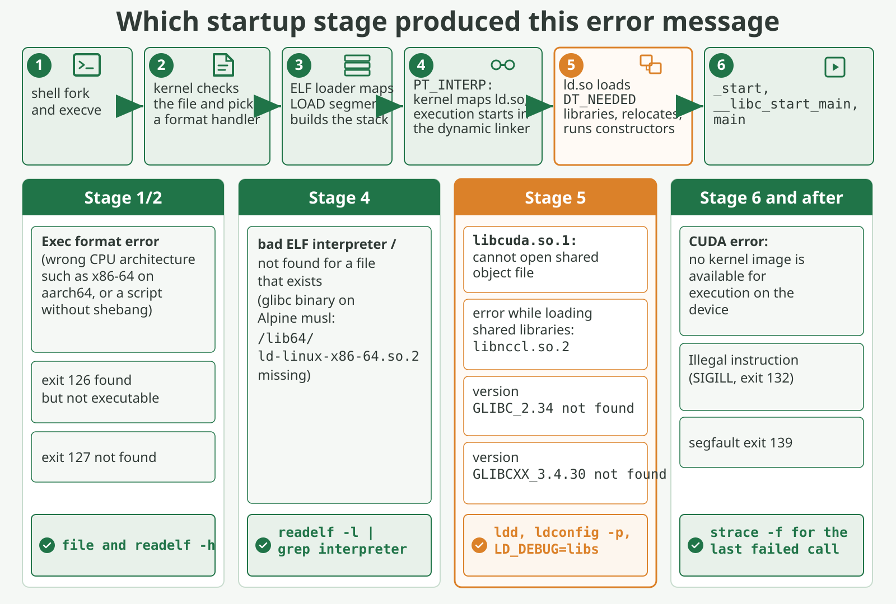

*Figure 1.11.17. Match the error message to the startup stage that produces it, then run the first check for that stage.*

Most of these failures show up with a clear message. The message rarely says which layer is at fault, though, so each item below gives you the cause and then the first thing to check.

1. **"cannot open shared object file".** The library is missing, is not in the cache, is not on the search path, or has the wrong architecture. Check it with `ldd` or `readelf -d`, `ldconfig -p`, and `LD_DEBUG=libs`.

2. **"version `GLIBC_x' not found".** The binary is newer than the OS. Build it on an older base, or upgrade the OS or the container base.

3. **Two copies of a library, and the wrong one loads.** The cause is the precedence of `LD_LIBRARY_PATH` and `RPATH`. Use `LD_DEBUG=libs` and `/proc/PID/maps` to see which copy loaded. Then remove the wrong copy or reorder the paths.

4. **The job works as root but fails as a user, or the reverse.** The environment differs. `sudo` may drop `LD_LIBRARY_PATH`, and the permissions on a library directory may differ too. A `noexec` mount of `/tmp` is another cause, because a library or binary extracted there cannot run. Set `TMPDIR` to a directory that allows execution.

5. **`LD_PRELOAD` breaks everything.** A preloaded library for the wrong architecture, or one with missing symbols, can break every program. Unset the variable first, and then debug.

6. **The process starts and exits at once, with no message.** Run `strace -f` to see the last failed call and the exit status. Then check `echo $?`. Status 127 means not found, and 126 means not executable. Status 139 is 128 + 11, which is `SIGSEGV`. Status 132 means `SIGILL`.

7. **A segfault in a library after an update.** The program and the library share a soname, but their ABIs no longer match. Rebuild the program, or pin the library to the version it expects.

8. **`strace` makes the bug disappear, or makes it appear.** The tracing changes the timing, so you should switch to a lighter tracer.

9. **`strace` hangs the process or the system.** The overhead can land on a hot path, or you can attach to a process in an uninterruptible state. Be careful with `-p`, and detach with Ctrl-C when you are done.

10. **The profile shows `[unknown]` everywhere.** The causes are stripped binaries, JIT code, or missing frame pointers. Get symbols or perf maps, or switch the stack-walking method.

11. **`ldd` says "not a dynamic executable".** That is fine for a statically linked binary. It can also mean the file is a script or another format.

12. **A static binary still tries `dlopen`.** Name-service lookups (NSS) and `iconv` load libraries at run time, even in static glibc builds. In a minimal container, those loads can fail.

13. **Memory looks leaked after you free it.** The allocator keeps the memory, through arenas and fragmentation. Measure RSS against the live objects. Then try `malloc_trim`, `jemalloc`, or recycling the workers.

14. **Many `ENOENT` results in `strace`, and a slow start.** The program searches many directories, such as a long `PATH`, `LD_LIBRARY_PATH` or `PYTHONPATH`, on a slow filesystem. Shorten the search lists.

Pick the failure that matches your symptom, and run its first check before you change anything.

## Hands-on lab: ELF, shared libraries, strace, and VM drills

Start with the self-checking Python lab, and run it on your own machine before you touch a VM. It verifies the 7-stage ELF startup order (`execve` -> `PT_INTERP` `ld.so` -> `_start` -> `main`), shared library naming (`linker_name`, `soname`, `real_name`), `GLIBC_2.xx` forward-only symbol compatibility, `1 GiB` `mmap` demand paging (`262,144` minor page faults), and USE method software resource metrics.

```bash
python3 code/part01/program_execution_elf_lab.py
```

Next, use a scratch directory on a disposable GCP Ubuntu VM. Every interactive command below has not been run on live hardware, so confirm its output before you rely on it. Work through the steps in order.

**A. Trace a program's life.** Start with the smallest program you can write. Compile it, then trace it, so that you see the startup sequence from the earlier sections on a real binary.

```bash
mkdir -p ~/lab/run && cd ~/lab/run
cat > hello.c <<'EOF'
#include <stdio.h>
int main(void) { puts("hello"); return 0; }
EOF
cc -o hello hello.c && strace -f -tt ./hello 2>&1 | head -60
strace -c ./hello 2>&1 | tail -15
ltrace ./hello 2>&1 | head
```

Find these items in the output: the `execve`, the opening of `ld.so.cache` and `libc.so.6`, the `mmap` calls, the `write` of "hello", and `exit_group`. Then answer a question. Why is there no `printf` or `puts` in the `strace` output, while `ltrace` shows one?

**B. Dynamic versus static.** Build the same program twice, once dynamically and once statically. Then compare what each one needs at run time.

```bash
cc -o hello_static -static hello.c 2>/dev/null || echo "install libc6-dev static libs (apt: libc6-dev) if this fails"
ls -l hello hello_static; file hello hello_static; ldd hello hello_static
strace ./hello_static 2>&1 | head
```

Compare the file sizes and the `ldd` output of the two builds. Then look at the first lines of the static binary's `strace`.

**C. Inspect ELF.** Read the ELF headers of the program you just built. Each command answers one question from section 2.

```bash
readelf -h hello | head -15
readelf -l hello | grep -E 'INTERP|LOAD|interpreter'
readelf -d hello | grep -E 'NEEDED|RUNPATH|RPATH'
nm -D hello | head; nm hello | head -5
objdump -d hello --no-show-raw-insn | sed -n '/<main>:/,/ret/p'
strip -o hello_stripped hello; ls -l hello hello_stripped; nm hello_stripped 2>&1 | head -2
```

Match each line of output to a field you learned in section 2: the interpreter, the NEEDED libraries, the symbols, and the stripped copy.

**D. A library problem, on purpose.** Break a library load deliberately. Then find the cause with `LD_DEBUG`, and repair it first with `LD_LIBRARY_PATH` and then with an embedded `RPATH`.

```bash
mkdir -p ~/lab/lib && cd ~/lab/lib
cat > foo.c <<'EOF'
int foo(void) { return 42; }
EOF
cat > main.c <<'EOF'
#include <stdio.h>
int foo(void);
int main(void) { printf("%d\n", foo()); return 0; }
EOF
cc -fPIC -shared -Wl,-soname,libfoo.so.1 -o libfoo.so.1.0.0 foo.c
ln -sf libfoo.so.1.0.0 libfoo.so.1; ln -sf libfoo.so.1 libfoo.so
cc -o app main.c -L. -lfoo
./app                                   # fails: cannot open shared object file
ldd ./app | grep foo
LD_DEBUG=libs ./app 2>&1 | grep -i 'foo\|search' | head
LD_LIBRARY_PATH=. ./app                 # works
cc -o app2 main.c -L. -lfoo -Wl,-rpath,'$ORIGIN'
./app2; readelf -d app2 | grep -E 'RPATH|RUNPATH'
patchelf --print-rpath app2 2>/dev/null || sudo apt install -y patchelf
```

**E. Symbol versions and glibc.** Check which glibc your system offers, and which versions a standard binary needs.

```bash
ldd --version | head -1
objdump -T /bin/ls | grep -o 'GLIBC_[0-9.]*' | sort -Vu | tail -3
readelf -V /bin/ls | head -20
```

**F. `LD_PRELOAD`.** Use `LD_PRELOAD` to replace one function in a program that you did not change. The fake `sleep` in this example skips the wait.

```bash
cat > fake.c <<'EOF'
#include <unistd.h>
#include <stdio.h>
unsigned int sleep(unsigned int s) { fprintf(stderr, "(sleep(%u) skipped)\n", s); return 0; }
EOF
cc -fPIC -shared -o libfake.so fake.c
time sleep 3                            # coreutils sleep uses nanosleep; try a program that calls sleep()
cat > s.c <<'EOF'
#include <unistd.h>
int main(void) { sleep(3); return 0; }
EOF
cc -o s s.c && time ./s && time LD_PRELOAD=./libfake.so ./s
```

**G. Address space and demand paging.** Repeat the `mmap` experiment from section 3, and watch the numbers change as you touch the pages. Start the program in the background, then read its size with `ps` and `pmap`.

```bash
cat > ~/lab/run/mapdemo.c <<'EOF'
#include <stdio.h>
#include <sys/mman.h>
int main(void) {
  size_t n = 1UL << 30;
  char *p = mmap(NULL, n, PROT_READ|PROT_WRITE, MAP_PRIVATE|MAP_ANONYMOUS, -1, 0);
  if (p == MAP_FAILED) { perror("mmap"); return 1; }
  puts("reserved; press Enter"); getchar();
  for (size_t i = 0; i < n; i += 4096) p[i] = 1;
  puts("touched; press Enter"); getchar();
  return 0;
}
EOF
cd ~/lab/run && cc -o mapdemo mapdemo.c
./mapdemo &
sleep 1; ps -o pid,vsz,rss,cmd -p $!; pmap -x $! | tail -5
echo | cat >/proc/$!/fd/0 2>/dev/null; kill $!
/usr/bin/time -v ./mapdemo < <(printf '\n\n') 2>&1 | grep -E 'Maximum resident|Minor'
```

**H. A system-call profile.** Measure the per-call overhead directly. Run the same copy with different block sizes, with and without `strace`.

```bash
strace -c -f dd if=/dev/zero of=/dev/null bs=1k count=200000 2>&1 | tail -12
dd if=/dev/zero of=/dev/null bs=1k count=200000 2>&1 | tail -1
dd if=/dev/zero of=/dev/null bs=1M count=200 2>&1 | tail -1
```

Compare throughput with and without `strace`, and with 1 KiB versus 1 MiB blocks. What do you conclude about per-call overhead?

**I. perf and a flame graph (optional).** This optional step profiles a small CPU-bound program, and then reads the result as a flame graph.

```bash
sudo apt install -y linux-tools-common linux-tools-$(uname -r) 2>/dev/null
cat > spin.c <<'EOF'
#include <math.h>
double work(int n){ double s=0; for(int i=1;i<n;i++) s+=sqrt(i); return s; }
int main(void){ double t=0; for(int k=0;k<2000;k++) t+=work(200000); return t>0?0:1; }
EOF
cc -O2 -fno-omit-frame-pointer -g -o spin spin.c -lm
sudo perf record -F 99 -g -- ./spin && sudo perf report --stdio | head -30
```

**J. (GPU VM, optional) What a CUDA program loads.** On a GPU VM, check the files that a CUDA program loads, as section 8 describes.

```bash
strace -f -e trace=openat,connect python3 -c 'import torch; torch.zeros(1).cuda()' 2>&1 | grep -E '\.so|/dev/nvidia' | grep -v ENOENT | head -40
ldd $(python3 -c 'import torch,os; print(os.path.join(os.path.dirname(torch.__file__),"lib","libtorch_cuda.so"))') | grep -E 'cuda|cudnn|nccl|not found'
ldconfig -p | grep -E 'libcuda\.so|libnvidia-ml'
```

When a step fails, write down the exact error message before you change anything. That message is the clue that the rest of this chapter helps you read.

## Exercises

1. **From `execve()` to `main()` and `PT_INTERP`:** List the 7 ordered stages in `ELF_STARTUP_STAGES` (`code/part01/program_execution_elf.py`) that run between typing `./train` and the parent shell reaping the exit status. Then explain why a glibc-linked binary, run inside an Alpine (musl) container, fails with `No such file or directory` even though `./train` exists and is executable.

2. **Shared Library Naming (`linker_name`, `soname`, `real_name`) and `GLIBC` Symbol Versioning:** (a) For the file `libfoo.so.1.2.3`, state its `linker_name`, `soname` and `real_name`. Say which of the three is recorded inside an executable's `DT_NEEDED` header. (b) If `./prog` requires `GLIBC_2.34`, will it start on a host with `GLIBC_2.31`, and will it start on one with `GLIBC_2.35`? How do you inspect the highest `GLIBC_` version that `./prog` needs?

3. **Demand Paging (`VIRT` vs `RSS`) and `mapdemo.c`:** In `mapdemo.c`, a process calls `mmap()` to reserve 1 GiB, which is 1,073,741,824 bytes, of anonymous memory, using 4,096-byte pages. What are `VIRT`, `RSS` and the cumulative minor page fault count (a) immediately after `mmap()` returns, (b) after touching `131,072` pages, and (c) after touching all `262,144` pages?

4. **`strace` Overhead and Diagnosing Hung Processes:** (a) Why can running `strace` on `dd if=/dev/zero of=/dev/null bs=1k count=200000` slow the run down by about 70 times? Which low-overhead kernel tracing tools avoid stopping the process on every syscall? (b) When you attach `strace -f -p PID` to a hung training rank, what does it mean if threads are blocked in `futex(..., FUTEX_WAIT...)`, `epoll_wait`, or `ioctl` on `/dev/nvidia0`?

5. **USE Method on Software Resources and Reading Flame Graphs (SP Chapter 5):** (a) Using `evaluate_software_use_metrics()`, calculate `utilization_pct`, `saturation_queue` and `errors` for a 16-thread service pool with 16 busy threads, 45 queued requests and 2 rejected requests. (b) In a CPU flame graph generated from `perf record -F 99 -g`, what do the x-axis width and the y-axis height represent?

6. **Fixing `[unknown]` Symbols, Broken Stacks, and Container CUDA Injection:** (a) Give two causes of `[unknown]` frames, and one cause of broken or truncated call stacks in `perf` profiles. For each cause, give the compiler or runtime fix. (b) Explain how you can run two containers with different CUDA toolkit versions (`11.8` and `12.4`) on the same host driver (`libcuda.so.1`).

## Checkpoint questions (20)

<details>
<summary>1. List in order what happens between `execve("./train")` and the first line of `main()`.</summary>

The shell calls `fork()`, and the child calls `execve()`. The kernel verifies permissions and checks the `\x7fELF` header. The ELF loader maps the `LOAD` segments (`.text`, `.data`, `.bss`), then sets up the stack (`argc`, `argv`, `envp`, `auxv`) and the heap. It also maps the dynamic linker named in `PT_INTERP` (`/lib64/ld-linux-x86-64.so.2`). Execution then begins in `ld.so`. That loads the `DT_NEEDED` libraries, performs relocations with PLT/GOT lazy binding, and runs the library constructors. Finally, control jumps to `_start`, which calls `__libc_start_main` to set up `stdio` and `atexit`, and then calls `main()`.
</details>

<details>
<summary>2. What is `PT_INTERP`, and why does running a glibc binary on Alpine Linux (`musl`) print "not found" even when the binary file is right there?</summary>

`PT_INTERP` is the ELF program header that gives the path to the dynamic linker, such as `/lib64/ld-linux-x86-64.so.2`. Alpine uses musl, and it only has `/lib/ld-musl-x86_64.so.1`. So the kernel cannot find the interpreter named in `PT_INTERP` when a glibc binary runs there. The `execve()` call then returns `ENOENT`, which prints "No such file or directory", even though the binary itself is right there.
</details>

<details>
<summary>3. What is `binfmt_misc`, and what causes `Exec format error`?</summary>

`binfmt_misc` is a kernel facility. It registers user-space interpreters or emulators, such as `qemu-user-static` for ARM64 binaries on x86-64, Java `.jar` runners, or Wine. It matches a file by its magic bytes or its extension. `Exec format error`, which is `ENOEXEC`, appears when `execve()` gets a binary for the wrong CPU architecture. For example, an `x86-64` binary on an `aarch64` Grace node triggers it. It also appears for an executable text script that lacks a valid `#!` shebang.
</details>

<details>
<summary>4. What is the difference between ELF sections and ELF segments, and which tools inspect each?</summary>

Sections are the view that the linker and debuggers use. Examples are `.text`, `.rodata`, `.data`, `.bss`, `.symtab`, `.dynsym` and `.dynamic`, and you inspect them with `readelf -S` and `objdump`. Segments are the view that the kernel loader uses. They are the program headers, such as `LOAD`, `INTERP`, `DYNAMIC` and `GNU_RELRO`, and `readelf -l` shows them. Each segment says which byte ranges to `mmap()` into memory, and with which `r-x` or `rw-` permissions.
</details>

<details>
<summary>5. How does lazy binding work via the PLT and GOT, and what does `LD_BIND_NOW=1` (or `-z now`) change?</summary>

With lazy binding, a call to a shared-library function jumps to a stub in the Procedure Linkage Table (`PLT`). The stub reads the target address from the Global Offset Table (`GOT`). On the first call, the `GOT` entry points back into `ld.so`, which resolves the symbol and patches the `GOT`. If you set `LD_BIND_NOW=1`, or link with `-Wl,-z,now` for full `RELRO`, the behaviour changes. The linker then resolves every symbol at startup, before `main()` runs, and it marks the `GOT` read-only.
</details>

<details>
<summary>6. What are the regions of a Linux process's virtual address space, and how does `malloc()` use `brk()` versus `mmap()`?</summary>

From low to high addresses, the regions are: text (`r-x`), data and BSS (`rw-`), the heap, which grows upward through `brk()`, the `mmap` region, `vDSO` and `vvar`, and the main stack. The stack grows downward and is limited by `ulimit -s` `8 MiB`. Kernel space comes last. `malloc()` serves small allocations from heap arenas that come from `brk()`. For large allocations, it uses anonymous `mmap()`, with a default threshold of about `128 KiB`. That lets `munmap()` return large blocks straight to the kernel.
</details>

<details>
<summary>7. Why does `mapdemo.c` show `VIRT = 1 GiB` and `RSS ≈ 0` after `mmap()`, and why does touching every `4 KiB` page cause `262,144` minor page faults?</summary>

`mmap()` reserves virtual address space in the page tables, but it allocates no physical RAM frames. That is **demand paging**. So `VIRT` shows 1 GiB while `RSS` stays near zero. The loop writes one byte every `4,096` bytes across the 1 GiB. If you divide 1,073,741,824 by 4,096, you get 262,144 pages. Each first touch triggers a **minor page fault**, and the kernel then allocates and maps a zeroed physical RAM page.
</details>

<details>
<summary>8. Why does a Python data-loader worker's `RSS` often remain high even after `del` and `gc.collect()`, and how do you mitigate it?</summary>

Python's object allocator and glibc `malloc` both manage memory in large arenas. If even one small object is still alive inside an arena, the allocator cannot return that arena's pages to the OS. You can reduce this in three ways. Recycle the worker processes periodically, using `maxtasksperchild` or `persistent_workers` tuning. Preload `libjemalloc.so.2` or `libtcmalloc.so.4`. Or tune `MALLOC_ARENA_MAX` or `MALLOC_TRIM_THRESHOLD_`.
</details>

<details>
<summary>9. How does a system call transition from a C library wrapper to the kernel and back, and why are `clock_gettime` and `gettimeofday` invisible in `strace`?</summary>

The C wrapper places the syscall number and the arguments in CPU registers, then executes `syscall` on `x86-64` or `svc` on `ARM64`. That traps into ring 0. On failure, the kernel returns `-errno`. The wrapper then sets the thread-local `errno` and returns `-1`. The hot timekeeping calls, `clock_gettime`, `gettimeofday` and `getcpu`, run in user space through the **`vDSO`** page that the kernel maps. They never switch modes, so `ptrace` and `strace` never see them.
</details>

<details>
<summary>10. Distinguish a shared library's linker name, soname, and real name (`libfoo.so`, `libfoo.so.1`, `libfoo.so.1.2.3`).</summary>

`libfoo.so` is the **linker name**. It is a symlink, shipped in the `-dev` or `-devel` package, that `ld` uses when you compile with `-lfoo`. `libfoo.so.1` is the **soname**. It encodes the major ABI version, it is recorded inside the `DT_NEEDED` entries of executables, and `ldconfig` manages it. `libfoo.so.1.2.3` is the **real name**, the actual shared object file on disk.
</details>

<details>
<summary>11. What causes `version 'GLIBC_2.34' not found` and `version 'GLIBCXX_3.4.30' not found`, and how do you prevent each?</summary>

`GLIBC_2.34 not found` means the binary was compiled on a distribution with glibc 2.34 or newer, and it is now running on an older OS. For example, build on the oldest OS you support, such as inside `manylinux` containers, to prevent it. `GLIBCXX_3.4.30 not found` usually happens when a conda environment, or a vendor directory in `LD_LIBRARY_PATH`, supplies an older `libstdc++.so.6`. That older copy shadows the newer `libstdc++.so.6` on the host.
</details>

<details>
<summary>12. How do `RPATH` and `RUNPATH` differ with respect to `LD_LIBRARY_PATH`, and how do `$ORIGIN` and `patchelf` work?</summary>

`DT_RPATH` is searched **before** `LD_LIBRARY_PATH`, while `DT_RUNPATH` is searched **after** it. Both come before `/etc/ld.so.cache` and the `/lib` and `/usr/lib` directories. `$ORIGIN` expands to the directory that holds the executable or the `.so` file itself. You write it as `-Wl,-rpath,'$ORIGIN/../lib'`, and it lets bundles such as Python wheels move around. `patchelf --set-rpath` edits the path inside a compiled ELF file that already exists.
</details>

<details>
<summary>13. What do `LD_PRELOAD` and `LD_DEBUG=libs` do, and why should you never run `ldd` on an untrusted binary?</summary>

`LD_PRELOAD=/path/lib.so` loads that library before all the others, so its symbols override the standard ones. People use it for `jemalloc` or `tcmalloc`, or for profiling. Setuid binaries ignore it. `LD_DEBUG=libs ./prog` prints every directory and file that `ld.so` searches. Some `ldd` implementations run the binary through the dynamic loader. So if you run `ldd` on an untrusted ELF file, it can execute arbitrary code. Use `readelf -d prog | grep NEEDED` or `objdump -p prog` instead.
</details>

<details>
<summary>14. Why can `strace` slow a syscall-heavy process down by `10x` to `70x`, and what are the low-overhead alternatives?</summary>

`strace` uses `ptrace`. That stops the target process and switches context to `strace` twice per system call, once on entry and once on exit. You still pay this cost even when `-e` filters the calls out. For low-overhead production tracing, use buffering in the kernel and aggregation with eBPF. The tools are `perf trace`, `perf stat -e 'syscalls:*'`, `syscount`, `opensnoop`, `execsnoop` and `bpftrace`.
</details>

<details>
<summary>15. What do `strace` flags `-f`, `-ff`, `-c`, `-T`, `-tt`, `-s 200`, and `-yy` do?</summary>

`-f` traces child processes and threads. `-ff -o prefix` writes one file for each PID or TID. `-c` prints a summary table of total time, calls and errors for each syscall. `-T` prints the time spent inside each syscall. `-tt` prints microsecond wall-clock timestamps. `-s 200` raises the printed string length from 32 to 200 bytes. `-yy` decodes file descriptors into paths and socket IP:port endpoints.
</details>

<details>
<summary>16. Contrast mutexes, spin locks, and hybrid `futex` locks, and explain false sharing (`SP` Chapter 5).</summary>

A spin lock burns CPU cycles, polling in user space until it gets the lock. A sleeping mutex blocks the waiting thread, so the thread leaves the CPU. A Linux `pthread_mutex` is a hybrid **futex**, which stands for *fast userspace mutex*. It first tries an atomic compare-and-swap in user space. It spins briefly if the owner is running, and it calls the `futex()` syscall to sleep only under contention. **False sharing** happens when threads on different cores change independent variables that sit in the same `64`-byte CPU cache line. Each change forces cache-coherency invalidation traffic.
</details>

<details>
<summary>17. How do you read a CPU flame graph (`perf record -F 99 -g`), and how does off-CPU analysis (`offcputime`) complement it?</summary>

In a CPU flame graph, you read each box as a stack frame. The y-axis shows call depth, with ancestors below and children above. The x-axis width is proportional to the fraction of on-CPU samples. The boxes are sorted alphabetically, not by time. Wide plateaus at the top edge show where the CPU spends its cycles directly. Off-CPU analysis fills the gap. It traces scheduler context switches to measure where threads spend time blocked on I/O, on locks (`futex`), or in sleeps.
</details>

<details>
<summary>18. List the nine thread states in Gregg's thread-state analysis model and how you apply the USE method to a thread pool and file descriptors.</summary>

The nine thread states are: User on-CPU, Kernel on-CPU, Runnable (waiting on run queue), Anonymous Paging/Swapping, Disk I/O, Network I/O, Sleeping, Lock wait, and Idle. For a **thread pool**, Utilization is busy threads divided by pool size, Saturation is the request queue length, and Errors are rejected tasks. For **file descriptors**, Utilization is open FDs divided by the `nofile` limit. Saturation is the number of threads waiting for an FD. Errors show up as `EMFILE`, "Too many open files".
</details>

<details>
<summary>19. What causes `[unknown]` frames and truncated call stacks in `perf` profiles, and how do you fix both?</summary>

`[unknown]` frames appear in two cases. The first is stripped symbol tables. Fix it by installing the `-dbgsym` or `-debuginfo` packages, or by compiling with `-g`. The second is code that is JIT-compiled at run time. Fix it with `/tmp/perf-<PID>.map`, with `perf-map-agent`, or with Python 3.12 `-X perf`. If you see truncated stacks, they come from compilers that omit the frame-pointer register with `-fomit-frame-pointer`. Compile with `-fno-omit-frame-pointer` to fix them. In Java, use `-XX:+PreserveFramePointer`. Or use `perf record --call-graph dwarf`.
</details>

<details>
<summary>20. Distinguish `libcuda.so.1` from `libcudart.so.12`, and explain what `CUDA error: no kernel image is available for execution on the device` means.</summary>

`libcuda.so.1` is the user-space half of the **NVIDIA driver**. It is installed on the host, and the container runtime injects it into containers along with `/dev/nvidia*`. `libcudart.so.12`, with `libcublas`, `libcudnn` and `libnccl`, is the **CUDA runtime and toolkit**. It ships inside the container image or the Python wheel. The error `no kernel image is available for execution on the device` means the binary's fatbin has no compiled `cubin` or `PTX` code for your GPU's compute capability, such as `sm_80` or `sm_90`. For example, you rebuild with the right `TORCH_CUDA_ARCH_LIST` or `-gencode` flags.
</details>

## Sources and review notes

- **Sources read in full:**
  - `how-linux-works-3rd-edition` — Brian Ward, *How Linux Works*, 3rd ed., **Chapter 8: Process and Resource Utilization** (section 8.3 tracing system calls with `strace` and library calls with `ltrace`) and **Chapter 15: Development Tools** (section 15.1.3 shared libraries: listing dependencies with `ldd`, how `ld.so` finds shared libraries via `DT_RPATH`/`LD_LIBRARY_PATH`/`DT_RUNPATH`/`/etc/ld.so.cache`, linking with `-Wl,-rpath`, and shared library pitfalls; cross-referenced with Chapter 16).
  - `systems-performance-2nd-edition` — Brendan Gregg, *Systems Performance*, 2nd ed., **Chapter 5: Applications** (sections 5.1–5.7: application objectives latency/throughput/price-performance, optimizing the common case, observability, big-O complexity; I/O size, caching, buffering, polling vs `epoll`, concurrency and parallelism, mutexes/spinlocks/futex/RCU/false sharing on 64-byte cache lines, non-blocking I/O and `io_uring`, processor binding, performance mantras; compiled, interpreted, and VM languages and garbage collection; CPU profiling at 49/99 Hz and flame graphs, off-CPU analysis, syscall analysis, USE method for software resources, 9-state thread-state analysis, lock analysis, static performance tuning, distributed tracing; `perf`, `profile`, `offcputime`, `strace` ~70x `dd` slowdown, `execsnoop`, `syscount`, `bpftrace`; and fixing missing symbols `/tmp/perf-PID.map` and omitted frame pointers `-fno-omit-frame-pointer`).
  - `nvidia-devops/volume-01/01-linux-compute-memory-masterclass.md` — migrated the `mapdemo.c` `1 GiB` `mmap` demand-paging example (`262,144` minor page faults), the Python/glibc arena retention explanation, and the `strace` production overhead warning (cross-referenced with Chapters 1.7, 1.8, 1.9, 1.10, 1.15, 1.17, 1.18, 1.22, 1.23, 1.24, 1.25, 1.28, and 2.23, plus items 21–30 in the original study list).
- **Run here:** `python3 code/part01/program_execution_elf_lab.py` (21 passed, 0 failed).
- **Explicitly labelled inferences:** The PyTorch `_C.cpython-*.so` / `libtorch_cuda.so` `RUNPATH` `$ORIGIN` packaging, `nvidia-container-runtime` CDI / `--gpus` injection of `libcuda.so.1`, and `TORCH_CUDA_ARCH_LIST` fatbin diagnostics connect the ELF/loader model to Part 5, Part 7, and Part 10 GPU workloads (and original study items 22, 23, 24, 25, 26, 27, 28, and 29).
- **Not verified on live hardware:** All interactive VM and GPU commands (`readelf`, `objdump`, `nm`, `ldd`, `strace`, `ltrace`, `patchelf`, `perf`, `./mapdemo`) are marked and should be executed on a disposable Linux VM.
