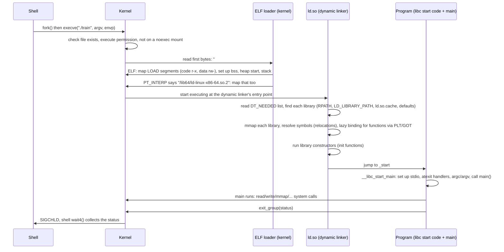
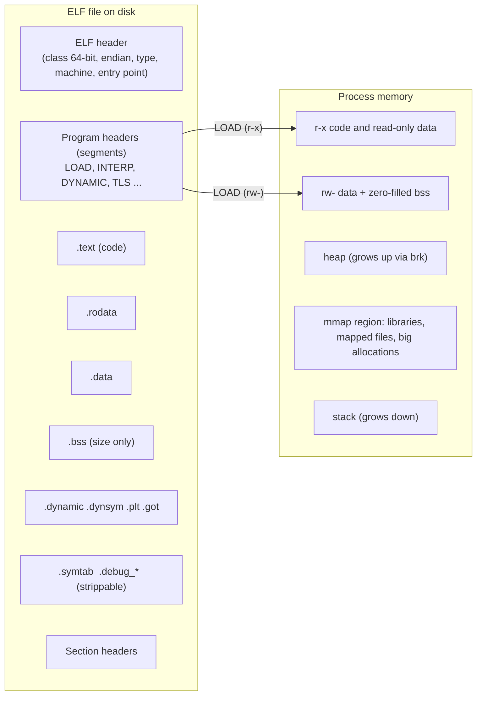

# 1.11 How a program runs: system calls, libraries, ELF, strace and ldd

| | |
|---|---|
| Level | Intermediate |
| Priority tier | 0 |
| Lab venue | GCP / GKE (an Ubuntu VM; a GPU VM is optional) |
| Part | Part 1: Linux, from the command line to the kernel and performance |
| Status | Drafted, labs **untested** |

## Why this matters for AI infrastructure

Half of the failures you will debug on a GPU platform are really "this program could not start or load something": `libcuda.so.1: cannot open shared object file`, `version 'GLIBC_2.34' not found`, `version 'GLIBCXX_3.4.30' not found`, `CUDA error: no kernel image is available`, `error while loading shared libraries: libnccl.so.2`, a Python import that hangs, a container that cannot find the NVIDIA driver files, a binary that "works on the build machine but not here". The other half of the failures are "this program is slow or stuck and I need to see what it asks the kernel": a training job spinning in `futex`, a data loader making millions of tiny `read` calls, a process blocked in `ioctl` on `/dev/nvidia0`.

To debug both you need a mental model of **what happens between typing a command and the first line of `main()`**, how a program **talks to the kernel** (system calls), how it **finds and loads code it does not contain** (shared libraries and the dynamic linker), what an **ELF file** is, and how to **watch all of it** with `ldd`, `readelf`, `nm`, `strace`, `ltrace`, `LD_DEBUG`, and the profilers (`perf`, BPF tools). That is this chapter. It also summarises the application-performance method that sits on top of these tools (profiling on-CPU and off-CPU, syscall analysis, thread states, locks), at an introductory level; the full performance method, observability tools and benchmarking are chapters 1.23 to 1.25.

## Prerequisites and outcomes

You should know processes, signals and `strace` basics (1.8), the build toolchain and shared-library search order from 1.7 (this chapter builds on it rather than repeating it), and the kernel/user-space model from 1.1.

After this chapter you can:

- Narrate what happens from `execve()` to `main()` and to `exit`, including the ELF loader, the dynamic linker, relocation and lazy binding.
- Read an ELF file with `file`, `readelf`, `objdump`, `nm`, `ldd`, `strings` and say what sections, segments, symbols, the interpreter and the dynamic section are.
- Explain how a system call works from library wrapper to the kernel and back, `errno`, the vDSO, and why `strace` shows what it shows.
- Trace a program with `strace` (filters, follow forks, timing, summary, attach) and `ltrace`, interpret the common patterns, and know the overhead.
- Diagnose library problems: missing library, wrong version, symbol-version errors, wrong libc, `LD_LIBRARY_PATH` and `RPATH` interactions, `LD_PRELOAD`, with `ldd`, `LD_DEBUG`, `readelf -d`, `patchelf`.
- Describe the process address-space layout (text, data, BSS, heap, mmap area, stack) and how `malloc`, `brk` and `mmap` relate to it.
- Apply the basic application-performance method: CPU profile, off-CPU analysis, syscall analysis, thread-state analysis, and read a flame graph.
- Apply this to GPU software: where `libcuda`, `libcudart`, `libnccl`, Python extension modules and container-injected driver libraries come from.

## 1. From keystroke to `main()`

Run `./train` in a shell. This is the whole story, in order:



Step by step:

1. **The shell forks**, and the child calls **`execve(path, argv, envp)`** (chapter 1.8). `execve` never returns on success; the current process image is replaced.
2. **The kernel checks** that the file exists and is executable by this user, that its filesystem is not mounted `noexec`, and then reads the first bytes to decide the **format** handler. If the file begins with `#!`, the kernel runs the interpreter named there and passes the script as an argument (1.9). If it begins with the ELF magic bytes `\x7fELF`, the ELF handler takes over. Other formats can be registered through **`binfmt_misc`** (for example, running ARM binaries under QEMU emulation, Java `.jar` files, or Windows executables under Wine). An unrecognised file gives **"Exec format error"**.
3. **The ELF loader maps the file into memory.** It does not read the whole file: it creates **memory mappings** from the file for each `LOAD` segment (code as read+execute; initialised data as read+write; a zero-filled **BSS** area for uninitialised globals), sets up an initial **stack** with `argc`, `argv`, `envp` and an **auxiliary vector** (system-provided values such as page size, the location of the vDSO, the entry point, random bytes for ASLR), and picks a starting point for the **heap**.
4. **A dynamically linked program names an "interpreter"** in its ELF headers (the `PT_INTERP` entry: `/lib64/ld-linux-x86-64.so.2` on x86-64 glibc systems). The kernel maps that too and starts execution **in the dynamic linker**, not in your program.
5. **The dynamic linker (`ld.so`)** reads the list of needed libraries (the `DT_NEEDED` entries), locates each using the search order in chapter 1.7 (`RPATH`/`RUNPATH`, `LD_LIBRARY_PATH`, `/etc/ld.so.cache`, default directories), maps them into the address space with `mmap`, and **relocates** them: the program and its libraries refer to each other's functions and variables by name, and the linker fills in the real addresses. For functions it normally uses **lazy binding**: calls go through the **PLT** (procedure linkage table) and **GOT** (global offset table), and the real address is looked up the first time the function is called (set `LD_BIND_NOW=1` or link with `-z now` to resolve everything at start-up, which also makes errors appear immediately and is a hardening practice, "full RELRO"). It then runs each library's **constructors** (initialisation functions).
6. **Control transfers to the program's entry point `_start`**, which calls the C library's `__libc_start_main`, which sets up the C runtime and finally calls **`main(argc, argv, envp)`**. When `main` returns, the library runs `atexit` handlers, flushes stdio buffers, and calls `exit_group(status)`.
7. **The kernel tears the process down** (closes files, releases memory, signals the parent, holds the exit status as a zombie until reaped; chapter 1.8).

You can watch all of this: `strace -f ./train 2>&1 | head -100` shows the `execve`, then `openat` of `/etc/ld.so.cache` and each library, `mmap` calls, `mprotect`, and then the program's own work.

**Statically linked programs** skip steps 4 and 5: all library code is inside the executable, so they need no `ld.so` and no `.so` files (they run in an empty container image). **Position-independent executables (PIE)** and shared libraries can be loaded at a random base address each run (**ASLR**, address-space layout randomisation), which makes memory-corruption exploits harder; that is why addresses in `ldd` and `/proc/PID/maps` change between runs.

## 2. The ELF file format

**ELF** (Executable and Linkable Format) is the format of executables, shared libraries, object files and core dumps on Linux and most Unix systems. (Windows uses PE; macOS uses Mach-O.) One file can be viewed in two ways:

- By the **linker** (and tools such as `objdump`) as a set of **sections**: `.text` (machine code), `.rodata` (constants), `.data` (initialised variables), `.bss` (uninitialised variables; takes no space in the file), `.symtab`/`.strtab` (symbol table), `.dynsym`/`.dynstr` (dynamic symbols), `.dynamic` (dynamic-linking information), `.plt`/`.got` (lazy-binding tables), `.eh_frame` (unwinding information), `.debug_*` (debug info, if present).
- By the **kernel loader** as a set of **segments** (program headers): `LOAD` segments to map, `INTERP` (the interpreter path), `DYNAMIC`, `TLS` (thread-local storage), `GNU_STACK` (is the stack executable? it should not be), `GNU_RELRO` (read-only after relocation).



### Reading an ELF file

```bash
file /bin/ls                       # "ELF 64-bit LSB pie executable, x86-64, dynamically linked, interpreter /lib64/ld-linux-x86-64.so.2 ... stripped"
readelf -h /bin/ls                 # ELF header: type (DYN for PIE/shared lib, EXEC, REL), machine, entry point
readelf -l /bin/ls                 # program headers (segments), INTERP, flags
readelf -S /bin/ls | head -40      # section headers
readelf -d /bin/ls                 # dynamic section: NEEDED libraries, RPATH/RUNPATH, SONAME, BIND_NOW
readelf --dyn-syms /bin/ls | head  # symbols it imports and exports
nm -D /lib/x86_64-linux-gnu/libc.so.6 | grep -w malloc   # exported dynamic symbols ('T' = defined code, 'U' = undefined/needed)
objdump -d /bin/true | head -40    # disassembly
objdump -T /usr/lib/x86_64-linux-gnu/libz.so.1 | head   # dynamic symbols with versions
ldd /bin/ls                        # resolved libraries (the loader's view; see section 5 caveat)
strings -n 8 /bin/ls | head        # printable strings in the binary (version strings, paths, error messages)
```

Useful facts to extract: **architecture** (`x86-64` vs `aarch64`: a wrong-architecture binary on Grace/ARM nodes gives "Exec format error"), **linking** (dynamic or static), **interpreter** path (a binary built against musl or an unusual loader will not start on glibc), **NEEDED** libraries and their **version requirements** (`readelf -V`, section 5), **RPATH/RUNPATH**, whether the binary is **stripped** (no symbols; harder to profile; chapter 1.24) and **PIE**.

### Symbols, stripping and debug info

A **symbol** is a name (function or variable) with an address. Static symbols (`.symtab`) are only for debugging and link-time work and can be removed with `strip`; **dynamic symbols** (`.dynsym`) are what the dynamic linker needs and remain. **Debug info** (DWARF, `-g`) maps addresses back to source lines and variables and is often shipped separately (`-dbg`/`-debuginfo` packages, `debuginfod`). Profilers and debuggers need symbols to show function names; without them you see hexadecimal addresses or `[unknown]` (section 8). When you build software for production, build with `-g` and keep the debug info available, even if you ship stripped binaries.

## 3. The process address space

Every process sees a flat virtual address space, organised by the loader and the allocator. On x86-64 Linux, from low addresses to high:

| Region | What lives there | Notes |
|---|---|---|
| Text | Program code (read+execute) | Shared between processes running the same binary |
| Data / BSS | Initialised and zero-filled globals | |
| **Heap** | Memory from `malloc` for small requests; grows up using the **`brk`** system call | One contiguous region that moves its end |
| **mmap area** | Shared libraries, memory-mapped files, large `malloc`s, thread stacks, anonymous mappings | Created with **`mmap`**; the allocator uses it for big requests (default threshold around 128 KiB, dynamic) because freeing a mapping really returns memory to the kernel |
| vDSO / vvar | Kernel-supplied pages for fast calls (`gettimeofday`, `clock_gettime`) | Mapped into every process |
| **Stack** | Function call frames, local variables | Grows down; each thread has its own; size limited by `ulimit -s` (8 MiB default) |
| Kernel | Not accessible from user mode | |

See it for any process: `cat /proc/PID/maps` (address range, permissions `r-xp`, offset, device, inode, path) and `pmap -x PID` (with RSS). `[heap]`, `[stack]`, `[vdso]` and every library appear. **Virtual size (VSZ/VIRT) is the sum of mappings; resident size (RSS) is the part actually in RAM.** The two differ because memory is allocated lazily: reserving address space costs nothing, and physical pages are assigned only on first touch (**demand paging**; chapter 1.8 section 8, and 1.17).

A tiny experiment makes this concrete (the program below is the user's own migrated example). It reserves 1 GiB of virtual memory and then touches it page by page:

```c
#include <stdio.h>
#include <sys/mman.h>

int main(void) {
    size_t size = 1UL << 30;                         /* 1 GiB */
    void *p = mmap(NULL, size, PROT_READ | PROT_WRITE,
                   MAP_PRIVATE | MAP_ANONYMOUS, -1, 0);   /* anonymous: RAM-backed, no file */
    if (p == MAP_FAILED) { perror("mmap"); return 1; }
    puts("reserved 1 GiB of address space; RSS is still tiny. Press Enter to touch it...");
    getchar();
    for (size_t i = 0; i < size; i += 4096)          /* one byte per 4 KiB page */
        ((char *)p)[i] = 'A';                        /* each first touch is a minor page fault */
    puts("touched every page; RSS is now about 1 GiB. Press Enter to exit...");
    getchar();
    munmap(p, size);
    return 0;
}
```

Compile with `cc -O0 -o mapdemo mapdemo.c`, run it, and watch `top` or `ps -o pid,vsz,rss -p PID` from another terminal: `VIRT` jumps by 1 GiB immediately, but `RES` stays near zero until you touch the pages. `strace ./mapdemo` shows the `mmap` call, and `/usr/bin/time -v` reports roughly 262,144 minor page faults. This is the entire idea of demand paging, and it is why a "memory leak" is judged by RSS (and by cgroup memory accounting), not virtual size.

**`malloc` is a library function, not a system call.** The C allocator (glibc `malloc`, or `jemalloc`/`tcmalloc` if preloaded) obtains big chunks from the kernel with `brk` or `mmap` and subdivides them. Small objects live in the heap; large ones get their own `mmap`. Freed memory is often *not* returned to the operating system immediately (fragmentation, arenas), so RSS can stay high after objects are freed. The same happens in Python: its allocator requests large **arenas** from the OS, and one surviving small object in an arena prevents the whole arena from being given back, which is why a long-running data loader's memory does not drop after you `del` a large list or call `gc.collect()`. Mitigations: process recycling (restart workers periodically, `maxtasksperchild`), `jemalloc`/`tcmalloc` via `LD_PRELOAD`, `MALLOC_ARENA_MAX`, `MALLOC_TRIM_THRESHOLD_`, or `malloc_trim`. (Memory and the OOM killer are chapter 1.17.)

## 4. System calls

### The mechanism

A **system call** is the controlled entry into the kernel. The C library offers a **wrapper function** for each (`open()`, `read()`, `write()`, `mmap()`, ...) that places the call **number** and arguments in specific CPU registers and executes a special instruction (`syscall` on x86-64, `svc` on ARM64). The CPU switches to kernel mode at a fixed kernel entry point; the kernel looks up the call number in its **system call table**, checks arguments and permissions, does the work (possibly blocking the task), puts a result in a register, and returns to user mode. On error the kernel returns a negative error number; the C wrapper converts that to **`-1` and sets the variable `errno`** (`ENOENT`, `EACCES`, `EINTR`, `EAGAIN`, `ENOMEM`, ...). `strerror(errno)`, `perror()` and `man errno` turn it into text. Rules of thumb:

- **System calls are a stable, documented API** (section 2 of the manual: `man 2 open`). Linux has roughly 450 to 500 documented calls, growing over time, versus a few dozen in early Unix; the kernel maintainers try to add few and build richer interfaces in libraries.
- **A library call is not a system call.** `printf`, `malloc`, `fopen`, `strlen` and `qsort` are library functions (manual section 3); they may or may not end up making system calls (`printf` buffers and eventually calls `write`; `strlen` never enters the kernel). `strace` shows system calls; `ltrace` shows dynamic library calls.
- **Cost.** A mode switch costs on the order of a hundred nanoseconds to microseconds depending on CPU and mitigations; blocking calls also context-switch. High call rates (millions per second) add up, which is why tools batch work (large buffers, `readv`/`writev`, `io_uring`, memory mapping) and why a data loader making 4 KiB reads is slow.
- **The vDSO** serves a few hot read-only calls (`clock_gettime`, `gettimeofday`, `getcpu`) entirely in user space from kernel-provided memory, so they appear in no `strace` output.

### Common calls and what they tell you

| You see in `strace` | It means |
|---|---|
| `execve`, `brk`, `mmap`, `mprotect`, `openat("/etc/ld.so.cache")`, `openat(".../libc.so.6")` | Start-up and library loading |
| `openat(AT_FDCWD, "path", O_RDONLY) = 3` | Opened a file, descriptor 3 |
| `openat(..., "x") = -1 ENOENT (No such file or directory)` | The program looked for a file that does not exist (the most common cause of mysterious failures) |
| `... = -1 EACCES (Permission denied)` | Permissions, SELinux/AppArmor, or a noexec mount |
| `read(3, "...", 4096) = 4096`, `write(1, "...", n)` | I/O; the size argument shows the I/O size (tiny sizes = inefficiency) |
| `futex(0x..., FUTEX_WAIT_PRIVATE, ...)` | A thread is waiting for a lock or condition variable |
| `epoll_wait`, `poll`, `select`, `ppoll`, `accept`, `recvfrom` | Waiting for network or other events |
| `connect(3, {sa_family=AF_INET, sin_port=htons(443), ...})`, `sendto`, `recvmsg` | Network activity: where, which port |
| `ioctl(3, ...)` | Device control: GPU, terminal, network; for NVIDIA `ioctl` on `/dev/nvidiactl` and `/dev/nvidia0` |
| `clone(...)`/`clone3` | A thread or process is created |
| `wait4(-1, ...)`, `--- SIGCHLD ---` | Waiting for children; a signal arrived |
| `nanosleep`, `clock_nanosleep` | A deliberate sleep |
| `exit_group(0)` | The program exiting |

## 5. Shared libraries in depth

Chapter 1.7 covered how libraries are built and how `ld.so` searches for them. This section covers what makes a library file name and a *version* work, how a program says which version it needs, and what goes wrong.

### Names: soname, real name, linker name

A shared library has three names, tied together by symbolic links:

```text
libfoo.so          linker name        used at BUILD time (-lfoo); usually a symlink, shipped in the -dev package
libfoo.so.1        soname             recorded in programs that link against it (DT_NEEDED); the compatibility contract
libfoo.so.1.2.3    real name          the actual file
```

The **soname's number is the ABI (binary interface) version**: it changes when the library breaks compatibility. Programs record the **soname**, so a bug-fix release `1.2.4` can replace `1.2.3` without relinking, but a rewrite becomes `libfoo.so.2` and installs alongside, so old programs keep using `.1`. `ldconfig` creates the soname symlinks and the cache. This is why one machine can hold `libcudnn.so.8` and `libcudnn.so.9`, and `libcudart.so.11.0` and `libcudart.so.12`.

### Symbol versioning and glibc

Within one soname, the GNU C library (and libstdc++) additionally attaches **symbol versions** to functions (`memcpy@GLIBC_2.14`, `GLIBCXX_3.4.30`), so a newer library can provide both new and old behaviours. At link time the binary records the **minimum versions** it needs (`readelf -V ./prog`, or `objdump -T`). At run time the loader refuses to start it if the system library is *older* than required:

```text
./prog: /lib/x86_64-linux-gnu/libc.so.6: version `GLIBC_2.34' not found (required by ./prog)
```

Consequence: **binaries are forward-compatible with newer glibc, not backward.** Build on the *oldest* distribution you intend to support (this is the whole basis of the Python **manylinux** wheel standard and of "build in an old container"). Check what a binary needs: `objdump -T ./prog | grep -o 'GLIBC_[0-9.]*' | sort -Vu | tail -1`. Check what the system offers: `ldd --version`, `strings /lib/x86_64-linux-gnu/libc.so.6 | grep GLIBC_2 | tail -1`. The same logic applies to `libstdc++` (`GLIBCXX_*`, `CXXABI_*`), the usual source of "version `GLIBCXX_3.4.30' not found" when a conda environment ships an older `libstdc++` that shadows the system one, or when a wheel built with a new compiler is used on an old OS.

### glibc versus musl, and containers

Alpine Linux uses **musl**, not glibc. A glibc-linked binary will not start on Alpine ("not found" even though the file exists, because the interpreter `/lib64/ld-linux-x86-64.so.2` is missing). Most GPU software (CUDA libraries, PyTorch wheels) is built for glibc; base images for GPU work are Debian/Ubuntu/UBI-based. Inside a container the libraries come from the **image**, not from the host, except the driver-side libraries injected by the NVIDIA runtime (section 9).

### Preloading and debugging the loader

- **`LD_PRELOAD=/path/lib.so`** forces a library to load first, so its symbols override the normal ones. Legitimate uses: replace the allocator (`jemalloc`, `tcmalloc`) without recompiling, interpose on calls for debugging or profiling (some GPU tools do this), fix a library bug. The same mechanism is used by malware, and is ignored for set-uid programs. It can also break programs subtly.
- **`LD_DEBUG`** makes the loader explain itself: `LD_DEBUG=libs ./prog` (where it looked and what it loaded), `LD_DEBUG=bindings` (symbol resolution), `LD_DEBUG=files`, `LD_DEBUG=versions`, `LD_DEBUG=statistics`, `LD_DEBUG=help` for the list.
- **`ldconfig -p | grep libname`** shows what is in the cache; **`ldd -v`** prints version requirements; **`ldd -r`** reports unresolved symbols.
- **`LD_LIBRARY_PATH`** is the usual culprit when the "wrong" library loads: a stale path from a module load, a conda activate, or a vendor script. Print it in a failing job, and compare with the working one.
- **`RPATH` vs `RUNPATH`** (both embedded in the binary) interact differently with `LD_LIBRARY_PATH`: `RPATH` is searched *before* it, `RUNPATH` *after* it (check `ld.so(8)` for your system). Many vendor tools set `RUNPATH` with `$ORIGIN` for relocatable installs. Edit with `patchelf --set-rpath '$ORIGIN/../lib' prog` and inspect with `readelf -d`.
- **`ldd` caveat:** `ldd` may *run* the program on some systems (it sets up the loader in a trace mode); do not run it on untrusted binaries. Use `readelf -d prog | grep NEEDED` and `objdump -p prog` instead.

### Python and extension modules

Python itself is a dynamically linked program; every compiled extension (`numpy`, `torch`, `cv2`) is a **shared library** (`.so`, with a Python-specific name such as `_C.cpython-311-x86_64-linux-gnu.so`) that the interpreter loads with `dlopen()` at import time, which in turn pulls in its own dependencies (`libtorch_cuda.so` needs `libcudart.so.12`, `libcublas.so.12`, `libcudnn.so.9`, `libnccl.so.2`). **Wheels** bundle many of these libraries inside the package directory and use `RUNPATH` with `$ORIGIN` to find them, which is why `pip install torch` works without a system CUDA toolkit: it brings its own CUDA user-space libraries, and only the **driver** (`libcuda.so.1` and the kernel module) must come from the host. When an `import` fails, find the `.so` and run `ldd` on it: `python -c "import torch; print(torch.__file__)"`, then `ldd $(dirname ...)/lib/libtorch_cuda.so | grep -E 'not found|cuda|nccl'`. `python -X importtime -c 'import torch'` shows time per import; `strace -f -e openat python -c 'import torch' 2>&1 | grep -E 'ENOENT.*\.so'` reveals search misses (many `ENOENT` are normal; the final failure matters).

## 6. Watching a program: `strace` and `ltrace` in practice

`strace` (chapter 1.8, section 3) is the first tool when a program fails or hangs and the logs are silent. A practical routine:

```bash
strace -f -o /tmp/t.out -tt -T ./prog args        # follow forks/threads, timestamps, time spent in each call
strace -f -e trace=file ./prog                    # only calls that take file names (open, stat, execve ...)
strace -f -e trace=network ./prog                 # socket, connect, send, recv ...
strace -f -e trace=process ./prog                 # fork, clone, execve, wait, exit
strace -f -e trace=openat,connect,execve ./prog   # a custom set
strace -e 'trace=!futex,clock_nanosleep' -f -p PID   # everything except noisy calls
strace -c -f -p PID                               # summary table; stop with Ctrl-C
strace -s 200 ./prog                              # show up to 200 chars of string arguments (default 32)
strace -yy -e trace=network -p PID                # decode file descriptors to paths / socket addresses
strace -k -e trace=openat ./prog                  # add a user-space stack trace (if strace built with libunwind)
sudo strace -f -p $(pgrep -n python) -e trace=ioctl,futex   # a running training process
```

How to read results (examples):

- **Program cannot find its config.** `grep -n 'ENOENT\|EACCES' /tmp/t.out | tail`: the last failed `openat` before the error message is almost always the culprit.
- **Which library did it load, from where?** `grep openat /tmp/t.out | grep '\.so'`.
- **Where is it hung?** Attach with `strace -p PID`: if the last line is `futex(..., FUTEX_WAIT...)` the thread waits on a lock; `epoll_wait(...)`/`poll`: waiting for events; `read(5, ` with no return: blocked reading a pipe or socket; `ioctl(…/dev/nvidia…)`: in the GPU driver. Use `-f` to see all threads and `ls -l /proc/PID/fd/N` to see what descriptor 5 is.
- **Why is it slow?** `strace -c` shows time per call type; a huge count of `read` with a small size argument means unbuffered I/O; many `stat`/`openat` failures mean path searching; `-T` shows which individual call blocked.
- **Short-lived processes and `fork` storms:** `strace -f -e trace=execve`, or system-wide `execsnoop` (BCC/bpftrace).

**Overhead.** `strace` works with the `ptrace` interface: the kernel stops the target at **every** system call entry and exit and wakes `strace`, even for calls you filtered out of the output. For a program that makes millions of calls per second the slowdown can be one to two orders of magnitude (a `dd` copy of 1 KiB blocks was measured to run about 70 times slower under `strace`), and it changes timing. So: use it for short periods on production processes, prefer `-e trace=` plus `-c`, and for rate-sensitive investigation use low-overhead tracers that buffer events in the kernel: `perf trace`, `perf stat -e 'syscalls:*'`, Ftrace, and BPF tools such as `syscount`, `opensnoop`, `execsnoop`, `bpftrace` one-liners (chapter 1.24). Other systems have equivalents: `truss` (Solaris/AIX), `ktrace` (BSD), `dtruss` (macOS).

**`ltrace`** traces calls into dynamic libraries: `ltrace -f -e 'malloc+free' ./prog`, `ltrace -c ./prog`. There are many more library calls than system calls, so filter. It does not work for statically linked programs and can be fragile with modern PIE binaries.

### Other process-inspection tools

`pstack PID` / `gdb -p PID -batch -ex 'thread apply all bt'` print native stacks of a hung process (they pause the process briefly); `py-spy dump --pid PID` prints Python stacks without stopping it; `lsof -p PID` lists open files; `cat /proc/PID/maps`, `/proc/PID/status`, `/proc/PID/stack` (kernel stack; root). A core dump plus `gdb` gives post-mortem stacks.

## 7. Application performance: a first method

Everything above is the machinery; this section is the approach for using it to answer "why is this program slow?". It is a short version of the application-performance method (the system-level method is chapter 1.23, the tools chapter 1.24, benchmarking chapter 1.25).

### Know the application first

Before profiling, answer a few questions, because they frame the rest: what does the application do and what operations does it serve (a training step, an inference request, a query)? What is the performance **goal**: **latency** (a consistent response time or a percentile target, e.g. 99% of requests under 100 ms), **throughput** (operations or bytes per second; for training, samples or tokens per second), **resource efficiency**, or **cost**? How is it configured (buffer and cache sizes, number of threads or workers, batch size) and why? What does it run on (CPUs, NUMA, GPU, storage, limits from cgroups)? What metrics and logs does it provide? Which version, and do the release notes or bug tracker already mention this problem? Without a goal, analysis becomes a random fishing expedition. Express goals as numbers ("at least 8,000 images/s per node", "p99 under 50 ms").

Two principles guide everything: **optimise the common case** (find the most frequent code path and fix that, not a rare path), and **the biggest wins come from eliminating unnecessary work** (the "mantras": don't do it; do it once; do it less; do it later; do it when nobody is looking; do it concurrently; do it cheaper). Prefer software you can *observe*: a slightly slower tool with rich metrics usually beats an opaque faster one, because visibility lets you remove waste. Also remember algorithmic complexity: an O(n²) step that was fine at 1,000 items becomes the whole runtime at 1,000,000; constant costs dominate only for small n.

### Common techniques applications use

| Technique | Idea | Trade-off |
|---|---|---|
| **I/O size** | Transfer more per call: per-call overhead (system call, mode switch, driver, metadata) is paid for small and large I/O alike | Larger I/O raises throughput but can waste bandwidth and add latency for random small reads |
| **Caching** | Keep results of expensive operations | Memory use; invalidation; cold-start cost |
| **Buffering** | Coalesce small writes into larger ones, ring buffers between producer and consumer | Added latency before data is flushed; risk of loss on crash |
| **Polling vs events** | Polling loops waste CPU or add latency; use `poll`, `select`, `epoll` (Linux; O(1) per event rather than scanning all descriptors) | More complex code |
| **Concurrency vs parallelism** | Concurrency: many tasks in progress (time-sharing). Parallelism: running at the same instant on several CPUs. Achieved with multiple processes, **threads** (cheaper, share memory), or user-space schemes: fibers, coroutines/goroutines, **event loops** (Node.js uses one event thread, which can become a bottleneck since it uses one core) | Shared memory needs synchronisation; contention |
| **Thread models** | Service thread pool (one thread per connection), CPU thread pool (one per core, for batch jobs), staged event-driven pipelines | Pool sizing; queueing |
| **Non-blocking I/O** | Issue I/O without parking a thread: `O_NONBLOCK`/`epoll`, POSIX `aio`, `sendfile` (kernel copies between descriptors), **`io_uring`** (shared submission/completion rings between user space and kernel; very high I/O rates) | Complexity; fewer tools support it |
| **Processor binding** | Pin threads to CPUs to keep caches and NUMA memory local | Can backfire on shared hosts (two tenants pin to the same cores) and when IRQs are pinned elsewhere; stale bindings after hardware changes |

**Synchronisation primitives** protect shared data and create waiting: **mutexes** (waiters sleep, i.e. block off-CPU), **spin locks** (waiters spin on-CPU, fast hand-off but waste CPU), **reader/writer locks**, **semaphores**. Linux mutexes are hybrids (try a fast atomic compare-and-swap, spin briefly while the holder is running, then sleep on a **futex**), which is why `futex` dominates `strace` of multithreaded programs. Lock contention limits scalability, and a single global lock serialises threads. The kernel's **RCU** lets readers proceed lock-free. A subtle hardware effect is **false sharing**: two threads updating different variables that happen to lie in the same 64-byte cache line force the line to bounce between cores; fix by padding or aligning hot per-thread data.

### Languages and runtimes

- **Compiled** languages (C, C++, Rust, Go): machine code in ELF binaries, most straightforward to profile because addresses map to function names through symbol tables. **Compiler optimisation** levels (`-O0` ... `-O3`, `-Os`, `-Og`, `-Ofast`) trade speed, size and debuggability; `-fomit-frame-pointer` frees a register but breaks frame-pointer stack walking in profilers, so for profiled production builds use `-fno-omit-frame-pointer` and `-g` (keep debuginfo available even if binaries are stripped). Never "debug" a performance problem by changing the optimisation level: it changes the very behaviour you are studying.
- **Interpreted** languages (shell, Python without JIT, Perl): the CPU runs the interpreter, so a native profile shows interpreter functions, not your program's functions. You need language-aware tools (Python: `cProfile`, `py-spy`, `scalene`; PyTorch profiler) or print timestamps. This matters for AI work: the hot loop is usually in native extensions (cuBLAS kernels), and the Python layer is orchestration.
- **Language virtual machines** (JVM, Erlang BEAM, and in a sense CUDA's PTX/JIT): bytecode, JIT compilation, the hardest to observe; use the VM's own tooling and USDT probes.
- **Garbage collection** adds memory growth, CPU cost and **latency outliers** (stop-the-world pauses). Python's reference counting plus cyclic GC, JVM generational collectors: tune the collector, reduce allocations, find leaked references. GC pauses in a data loader or a serving process appear as periodic latency spikes.

### The analysis methods

1. **CPU profiling** (on-CPU): sample the running code's call stacks (typically 49 or 99 times per second per CPU) with `perf record -F 99 -g` or the BCC `profile` tool, then aggregate and view as a **flame graph**: each rectangle is a function (a stack frame), the vertical axis is the call chain (callees on top), **width is proportion of samples**, left-to-right order has no meaning. You look for wide plateaus, the places where CPU time is spent. Kernel-based profilers see both user and kernel stacks ("mixed mode"); use them before language-level profilers, which can mis-attribute time when the kernel deschedules the process. Even a CPU profile hints at **off-CPU** problems (functions with `ext4`, `blk_`, `tcp_`, `futex` in their names show that file, disk, network and lock activity exists).
2. **Off-CPU analysis**: study threads that are *not* running: blocked on disk or network I/O, locks, sleeps, or waiting for a CPU. Done by tracing scheduler events (BPF `offcputime`) and drawing an **off-CPU flame graph**; interpreting it takes care because idle threads waiting for work dominate (filter to request-handling code or to uninterruptible sleeps). Overhead can be significant; test before production use.
3. **Syscall analysis**: count and time system calls to find where the kernel time goes: `strace -c`, `perf trace -s`, `syscount`, `execsnoop` (new processes, e.g. an accidental `fork` storm or a forgotten benchmark loop), and I/O profiling (the distribution of `read`/`write` sizes). Explains most, though not all, system CPU time (page faults, interrupts and kernel threads are the rest).
4. **USE method applied to software resources**: for every resource, check **U**tilisation, **S**aturation and **E**rrors. Hardware resources first (CPU, memory, disk, network), then software ones: a thread pool (utilisation = busy threads / pool size; saturation = length of the request queue; errors = rejected requests), file descriptors (utilisation = open/limit; errors = `EMFILE` "Too many open files"), connection pools, GPU memory.
5. **Thread-state analysis**: divide each thread's time among states: **user** on-CPU, **kernel** on-CPU, **runnable** (waiting for a CPU), **swapping** (anonymous page-in), **disk I/O**, **network I/O**, **sleeping**, **lock**, **idle**. Reduce time in every state except idle. Rough indicators on Linux: `pidstat` (`%usr`, `%system`), `vmstat r` (runnable) and `si/so` (swapping), `pidstat -d` (I/O delay), `/proc/PID/schedstat` (run-queue wait time), delay accounting; deeper with tracing. A process that appears asleep with no activity needs its stacks read (`/proc/PID/stack`, `gdb`).
6. **Lock analysis**: contention (are threads waiting?) and excessive hold times; spin-lock contention shows up as CPU in a profile; mutex contention as off-CPU time in `futex`. Usually a developer task requiring source knowledge.
7. **Static performance tuning**: audit the configuration rather than the behaviour: versions and dependencies, build type (debug or release!), compiler flags and architecture-specific instructions (SIMD), memory allocator, huge pages, thread pool sizes, cache sizes, resource limits and cgroup caps, whether it runs in a degraded mode after an error.
8. **Distributed tracing**: for a request that spans services, log a request ID, parent/child relationships, timings and errors at each hop and combine them (OpenTelemetry, Jaeger); head-based sampling keeps volume manageable at the price of missing rare outliers, tail-based sampling keeps the interesting ones.

### Tools at a glance

| Tool | Use |
|---|---|
| `perf record -F 99 -a -g -- sleep 30`; `perf report`; `perf script` | CPU sampling and flame-graph input; `perf stat` for counters; `perf trace` for syscalls |
| `profile` (BCC) | Timed CPU sampling, low overhead |
| `offcputime` (BCC) | Off-CPU stacks and time |
| `strace -c / -f` | Syscall summary and trace (overhead!) |
| `execsnoop`, `opensnoop`, `syscount` | New processes, file opens, syscall counts system-wide, cheap |
| `bpftrace -e '...'` | Custom one-liners: e.g. `bpftrace -e 'tracepoint:syscalls:sys_enter_read { @[comm] = count(); }'`, `bpftrace -e 'tracepoint:syscalls:sys_exit_read /args->ret/ { @bytes = hist(args->ret); }'` |
| `py-spy top/record/dump`, `nsys`, `ncu`, PyTorch profiler | Python and GPU-side profiling (GPU chapters) |

### Gotchas: missing symbols and missing stacks

- **Missing symbols** (hex addresses or `[unknown]`): stripped binaries (use debuginfo packages or build with symbols), and JIT runtimes whose code is generated at run time (give `perf` a map: `/tmp/perf-<PID>.map`, produced by `perf-map-agent` for Java or `--perf-basic-prof` for Node.js; symbol "churn" if the map is dumped after the code moves).
- **Broken or short stacks**: caused by profilers that walk **frame pointers** when the program (or libc) was compiled with `-fomit-frame-pointer`, so the register holds garbage. Fixes: recompile with `-fno-omit-frame-pointer` (cost typically under 1%), `-XX:+PreserveFramePointer` for Java, or use another stack-walking method in `perf` (DWARF, LBR). Stacks through libc (`pthread_cond_wait`, `send`) are often broken for this reason. Python 3.12 and later have perf support (`-X perf`) that gives Python function names to `perf`.

## 8. AI-infrastructure patterns

**What a CUDA program loads.** Start `strace -f -e trace=openat python -c 'import torch; torch.zeros(1).cuda()' 2>&1 | grep -E '\.so|nvidia'` on a GPU node and read the order. You will see Python's extension modules, the framework's bundled CUDA libraries (`libcudart`, `libcublas`, `libcudnn`, `libnccl`, `libtorch_cuda`), then the **driver library** `libcuda.so.1` (opened by the CUDA runtime with `dlopen`), and then `openat("/dev/nvidiactl")`, `/dev/nvidia0`, `/dev/nvidia-uvm`, and a storm of `ioctl` calls. Two things follow. (1) **User-space CUDA libraries travel with the application** (in wheels or a container image) and can differ per application on the same node, which is what makes multiple CUDA versions on one host possible. (2) **`libcuda.so.1` and the kernel module belong to the driver** and must come from the host; the application's CUDA version must be supported by the host driver (the driver is backwards compatible with older CUDA runtimes; for newer CUDA than the driver supports there is a compatibility package for data-centre GPUs; check NVIDIA's compatibility documentation). In containers the NVIDIA Container Toolkit **injects** `libcuda.so.1`, `libnvidia-ml.so`, `nvidia-smi` and device nodes from the host into the container at start time (chapter 1.10 and 7), which is why the same image runs on different driver versions.

**Typical load errors and their causes.**

| Error | Likely cause and check |
|---|---|
| `libcuda.so.1: cannot open shared object file` | No driver (or not injected into the container): `ldconfig -p \| grep libcuda`, `nvidia-smi`, container runtime configured? |
| `libcudart.so.12: cannot open shared object file` | Application expects a CUDA runtime that is neither bundled nor installed; install the matching toolkit packages or use a CUDA-bundled wheel/image; `LD_LIBRARY_PATH` pointing to a different version |
| `version 'GLIBC_2.xx' not found` | Binary built on a newer distribution than where it runs (section 5); rebuild on an older base or update the OS |
| `version 'GLIBCXX_3.4.xx' not found` | An older `libstdc++` is found first (conda, a vendor `lib` dir in `LD_LIBRARY_PATH`) than the one required; `LD_DEBUG=libs`; preload or remove the old copy |
| `CUDA error: no kernel image is available for execution on the device` | The binary's GPU code (cubin/PTX) lacks your GPU's architecture: rebuild with the right `-gencode`/`TORCH_CUDA_ARCH_LIST`, or use a framework build for that GPU generation |
| `Exec format error` | Wrong CPU architecture (x86-64 binary on aarch64 Grace nodes, or vice versa) or a script without shebang run by `execve` |
| `/lib64/ld-linux-x86-64.so.2: bad ELF interpreter` / "not found" for an existing file | Missing loader: musl/Alpine image or a 32-bit binary on a 64-bit system |
| `error while loading shared libraries: libnccl.so.2` | NCCL library not installed or not on the search path; check `NCCL` packages and `ldconfig -p` |
| Import hangs or is very slow | Lots of tiny file reads from a slow network filesystem (a shared home directory holding a Python environment); `strace -c`, `-T`; move environments to local disk or use a container image |
| `Illegal instruction (core dumped)` (`SIGILL`) | Library built with CPU instructions (AVX-512) the CPU lacks, or a wrong architecture build |
| Random crash inside a native library after update | Mixed library versions (an old `LD_LIBRARY_PATH`/`RPATH` copy and a new one both loaded); `LD_DEBUG=libs`, `/proc/PID/maps` to see which files are mapped |

**Hung training job: process-side view.** `py-spy dump --pid PID` (Python stack), `gdb -p PID -batch -ex 'thread apply all bt'` (native stacks; NCCL threads in `ncclProxy...`, `futex_wait`), `strace -f -p PID -e trace=futex,ioctl,poll,epoll_wait,read` for a few seconds (are threads in `ioctl` on `/dev/nvidia*`, `poll` on a socket, or waiting on a `futex`?), then `nvidia-smi` and `dmesg` for GPU errors. Because `strace` and `gdb` pause the target, do this on one rank of an already-hung job, not on healthy ones.

**Data-loader efficiency.** A loader that reads many small files issues many small `openat`/`read`/`close` calls. `strace -c -f -p <loader pid>` quantifies it; the cures (bigger shards, sequential formats such as WebDataset/Parquet/TFRecord, caching on local NVMe, memory mapping, prefetching, `io_uring`) are applications of section 7's I/O-size and buffering techniques.

**Reproducible builds and environments.** To make a binary behave the same everywhere: build in a pinned container, link what must be fixed statically, record `ldd` and `readelf -d` output in your artefact metadata, bundle libraries with an `$ORIGIN`-relative `RUNPATH` (`auditwheel repair` does this for wheels), and ship debug info separately. For custom CUDA code, `nvcc` produces a **fat binary** containing both architecture-specific code (cubin) and portable PTX, so one build runs on several GPU generations and newer GPUs can JIT-compile the PTX; include the architectures you deploy.

**Allocator preloading.** Memory fragmentation in long-running Python or C++ services is often reduced by `LD_PRELOAD=/usr/lib/x86_64-linux-gnu/libjemalloc.so.2` (or `libtcmalloc.so.4`); verify it loaded with `grep jemalloc /proc/PID/maps`, and measure; it changes memory behaviour in both directions.

**Startup cost.** A job that launches thousands of ranks that all read the same Python environment and `.so` files from a shared filesystem creates a **thundering herd** of `openat`/`mmap` calls at start-up; mitigations are to stage environments to local disk or a container image, use a loader cache, or set a squashfs/overlay image per node (chapter on containers on Slurm).

## How it fails

1. **"cannot open shared object file".** The library is missing, not in the cache (`ldconfig`), not on the search path, or the wrong architecture. `ldd`/`readelf -d`, `ldconfig -p`, `LD_DEBUG=libs`.
2. **"version `GLIBC_x' not found".** Binary newer than the OS. Build on older base or upgrade the OS/container base.
3. **Two copies of a library, wrong one loads.** `LD_LIBRARY_PATH`/`RPATH` precedence. `LD_DEBUG=libs`, `/proc/PID/maps`; remove or reorder.
4. **Works as root, fails as user (or vice versa).** Different environment variables (`LD_LIBRARY_PATH` dropped by `sudo`), permissions on a library directory, `noexec` mount of `/tmp` (a library or binary is extracted to a `noexec` mount; set `TMPDIR`).
5. **`LD_PRELOAD` breaks everything.** A preloaded library for the wrong architecture or missing symbols; unset it first, then debug.
6. **Process starts but immediately exits with no message.** `strace -f` shows the last failed call and exit status; check `echo $?` (127 not found; 126 not executable; 139 = 128 + 11 `SIGSEGV`; 132 = `SIGILL`).
7. **Segfault in a library after updating something.** ABI mismatch between a program and a library with the same soname; rebuild the program or pin the library.
8. **`strace` makes the bug disappear (or appear).** Timing change; use a lighter tracer.
9. **`strace` hangs the process or the system.** Overhead on a hot path or attaching to a process in uninterruptible state; use `-p` carefully, detach with Ctrl-C.
10. **Profile shows `[unknown]` everywhere.** Stripped binaries, JIT code, or no frame pointers. Get symbols, perf maps, or switch the stack-walking method.
11. **`ldd` says "not a dynamic executable".** Statically linked (fine) or a script/other format.
12. **A static binary still tries `dlopen`.** Name-service lookups (NSS) and `iconv` load libraries at run time even in static glibc builds, which can fail in minimal containers.
13. **Memory looks leaked after freeing.** Allocator keeps memory (arenas, fragmentation); measure RSS vs live objects, try `malloc_trim`/`jemalloc`/worker recycling.
14. **Huge number of `ENOENT` in strace and a slow start.** Path searching in many directories (long `PATH`, `LD_LIBRARY_PATH`, `PYTHONPATH`) on a slow filesystem; shorten the search lists.

## Hands-on lab (a GCP Ubuntu VM; untested)

Use a scratch directory. These commands have **not** been run; run them before relying on them.

**A. Trace a program's life.**

```bash
mkdir -p ~/lab/run && cd ~/lab/run
cat > hello.c <<'EOF'
#include <stdio.h>
int main(void) { puts("hello"); return 0; }
EOF
cc -o hello hello.c && strace -f -tt ./hello 2>&1 | head -60
strace -c ./hello 2>&1 | tail -15
ltrace ./hello 2>&1 | head
```

Identify in the output: the `execve`, the opening of `ld.so.cache` and `libc.so.6`, the `mmap` calls, the `write` of "hello", and `exit_group`. Why is there no `printf`/`puts` in the `strace` but one in `ltrace`?

**B. Dynamic versus static.**

```bash
cc -o hello_static -static hello.c 2>/dev/null || echo "install libc6-dev static libs (apt: libc6-dev) if this fails"
ls -l hello hello_static; file hello hello_static; ldd hello hello_static
strace ./hello_static 2>&1 | head
```

**C. Inspect ELF.**

```bash
readelf -h hello | head -15
readelf -l hello | grep -E 'INTERP|LOAD|interpreter'
readelf -d hello | grep -E 'NEEDED|RUNPATH|RPATH'
nm -D hello | head; nm hello | head -5
objdump -d hello --no-show-raw-insn | sed -n '/<main>:/,/ret/p'
strip -o hello_stripped hello; ls -l hello hello_stripped; nm hello_stripped 2>&1 | head -2
```

**D. A library problem, on purpose.**

```bash
mkdir -p ~/lab/lib && cd ~/lab/lib
cat > foo.c <<'EOF'
int foo(void) { return 42; }
EOF
cat > main.c <<'EOF'
#include <stdio.h>
int foo(void);
int main(void) { printf("%d\n", foo()); return 0; }
EOF
cc -fPIC -shared -Wl,-soname,libfoo.so.1 -o libfoo.so.1.0.0 foo.c
ln -sf libfoo.so.1.0.0 libfoo.so.1; ln -sf libfoo.so.1 libfoo.so
cc -o app main.c -L. -lfoo
./app                                   # fails: cannot open shared object file
ldd ./app | grep foo
LD_DEBUG=libs ./app 2>&1 | grep -i 'foo\|search' | head
LD_LIBRARY_PATH=. ./app                  # works
cc -o app2 main.c -L. -lfoo -Wl,-rpath,'$ORIGIN'
./app2; readelf -d app2 | grep -E 'RPATH|RUNPATH'
patchelf --print-rpath app2 2>/dev/null || sudo apt install -y patchelf
```

**E. Symbol versions and glibc.**

```bash
ldd --version | head -1
objdump -T /bin/ls | grep -o 'GLIBC_[0-9.]*' | sort -Vu | tail -3
readelf -V /bin/ls | head -20
```

**F. `LD_PRELOAD`.**

```bash
cat > fake.c <<'EOF'
#include <unistd.h>
#include <stdio.h>
unsigned int sleep(unsigned int s) { fprintf(stderr, "(sleep(%u) skipped)\n", s); return 0; }
EOF
cc -fPIC -shared -o libfake.so fake.c
time sleep 3                      # coreutils sleep uses nanosleep; try a program that calls sleep(): e.g. a tiny C program
cat > s.c <<'EOF'
#include <unistd.h>
int main(void) { sleep(3); return 0; }
EOF
cc -o s s.c && time ./s && time LD_PRELOAD=./libfake.so ./s
```

**G. Address space and demand paging.**

```bash
cat > ~/lab/run/mapdemo.c <<'EOF'
#include <stdio.h>
#include <sys/mman.h>
int main(void) {
  size_t n = 1UL << 30;
  char *p = mmap(NULL, n, PROT_READ|PROT_WRITE, MAP_PRIVATE|MAP_ANONYMOUS, -1, 0);
  if (p == MAP_FAILED) { perror("mmap"); return 1; }
  puts("reserved; press Enter"); getchar();
  for (size_t i = 0; i < n; i += 4096) p[i] = 1;
  puts("touched; press Enter"); getchar();
  return 0;
}
EOF
cd ~/lab/run && cc -o mapdemo mapdemo.c
./mapdemo &       # then in the same terminal: 
sleep 1; ps -o pid,vsz,rss,cmd -p $!; pmap -x $! | tail -5
echo | cat >/proc/$!/fd/0 2>/dev/null; kill $!
/usr/bin/time -v ./mapdemo < <(printf '\n\n') 2>&1 | grep -E 'Maximum resident|Minor'
```

**H. A system-call profile.**

```bash
strace -c -f dd if=/dev/zero of=/dev/null bs=1k count=200000 2>&1 | tail -12
dd if=/dev/zero of=/dev/null bs=1k count=200000 2>&1 | tail -1
dd if=/dev/zero of=/dev/null bs=1M count=200 2>&1 | tail -1
```

Compare throughput with and without `strace`, and with 1 KiB versus 1 MiB blocks. What do you conclude about per-call overhead?

**I. perf and a flame graph (optional).**

```bash
sudo apt install -y linux-tools-common linux-tools-$(uname -r) 2>/dev/null
cat > spin.c <<'EOF'
#include <math.h>
double work(int n){ double s=0; for(int i=1;i<n;i++) s+=sqrt(i); return s; }
int main(void){ double t=0; for(int k=0;k<2000;k++) t+=work(200000); return t>0?0:1; }
EOF
cc -O2 -fno-omit-frame-pointer -g -o spin spin.c -lm
sudo perf record -F 99 -g -- ./spin && sudo perf report --stdio | head -30
```

**J. (GPU VM, optional) What a CUDA program loads.**

```bash
strace -f -e trace=openat,connect python3 -c 'import torch; torch.zeros(1).cuda()' 2>&1 | grep -E '\.so|/dev/nvidia' | grep -v ENOENT | head -40
ldd $(python3 -c 'import torch,os; print(os.path.join(os.path.dirname(torch.__file__),"lib","libtorch_cuda.so"))') | grep -E 'cuda|cudnn|nccl|not found'
ldconfig -p | grep -E 'libcuda\.so|libnvidia-ml'
```

## Checkpoint questions

1. List, in order, what happens between `execve("./prog")` and the first line of `main`.
2. What is `PT_INTERP`, and what happens if it names a file that does not exist?
3. What is `binfmt_misc` for? What does "Exec format error" mean?
4. What is the difference between ELF sections and segments, and who uses each?
5. What is lazy binding? What are PLT and GOT? What does `LD_BIND_NOW` change?
6. What is the vDSO, and why does `gettimeofday` not show in `strace`?
7. What is a system call wrapper? What does it do on error, and where does the error code go?
8. What is the difference between a system call and a library call? Give two examples of each.
9. How does `malloc` get memory from the kernel? Why can RSS stay high after `free`?
10. What do VIRT and RES mean, and why can VIRT be far larger than RAM?
11. Distinguish soname, real name and linker name. Which one is recorded in a binary?
12. What does the error `version 'GLIBC_2.34' not found` mean and how do you prevent it when building?
13. Why do conda environments sometimes cause `GLIBCXX` errors?
14. What is the difference between `RPATH` and `RUNPATH` with respect to `LD_LIBRARY_PATH`?
15. When is it appropriate to use `LD_PRELOAD`? What are two risks?
16. Why is `ldd` unsafe on untrusted binaries and what do you use instead?
17. How do you find the file that a program failed to open, using `strace`?
18. What does a process stuck in `futex(..., FUTEX_WAIT...)` indicate? In `epoll_wait`? In `ioctl` on `/dev/nvidia0`?
19. Why is `strace` slow and how slow can it be? What alternatives exist?
20. What is the difference between `-f`, `-ff`, `-c`, `-T`, `-tt`, `-e trace=file` in `strace`?
21. What does `ltrace` show that `strace` does not? What are its limits?
22. Name five application performance techniques and one downside of each.
23. What is a flame graph and how do you read it? What does a wide plateau mean?
24. What is off-CPU analysis, and why is it expensive and easy to misread?
25. List the nine thread states and say which tools hint at each on Linux.
26. How do you apply the USE method to a thread pool and to file descriptors?
27. What causes "[unknown]" frames and short stacks in profiles, and what are the fixes?
28. A PyTorch job prints "libcuda.so.1: cannot open shared object file" in a container. What are three things to check?
29. Why can one node run containers with different CUDA versions on the same driver?
30. What does "no kernel image is available for execution on the device" mean, and how do you fix it?

### Answers

1. Fork/exec; kernel checks permissions and file format; ELF loader maps LOAD segments, sets up stack/auxv/heap; maps the interpreter named in `PT_INTERP`; kernel jumps to `ld.so`; it finds and maps libraries, relocates (lazily for functions), runs constructors; jumps to `_start`; `__libc_start_main` initialises the C runtime and calls `main`.
2. The program header naming the dynamic linker. If it does not exist, `execve` fails ("No such file or directory" even though the binary exists, or "bad ELF interpreter"): typical for musl/Alpine or 32-bit binaries.
3. It lets the kernel run other binary formats through a registered handler (QEMU user emulation, Java, Wine). "Exec format error": the file is not a format the kernel can run (wrong architecture, corrupted, a script without a valid shebang).
4. Sections (`.text`, `.data`, symbols, debug) are the linker's/debugger's view; segments (program headers: LOAD, INTERP, DYNAMIC) are the loader's view of what to map into memory.
5. Resolving a function's address on its first call instead of at start-up. Calls go through the PLT and look up the address in the GOT. `LD_BIND_NOW=1` resolves everything at start-up (slower start, early errors, hardening).
6. A kernel-supplied shared page mapped into every process that implements a few calls (clock reads) in user space; they never enter the kernel so `strace` cannot see them.
7. A library function that sets up registers and executes the `syscall` instruction. On error it returns -1 and stores the positive error number in `errno`.
8. System call: `read`, `mmap` (manual section 2). Library call: `printf`, `malloc` (section 3). Library calls may or may not use system calls.
9. With `brk` (small requests, extending the heap) or `mmap` (large requests). Freed memory is often retained by the allocator (arenas, fragmentation, a surviving small object), so RSS does not fall.
10. VIRT/VSZ: total mapped address space; RES/RSS: pages currently in RAM. Memory is allocated lazily, so reserving address space costs nothing until pages are touched.
11. Linker name `libfoo.so` (build time), soname `libfoo.so.1` (ABI contract, recorded in binaries), real name `libfoo.so.1.2.3` (the file).
12. The binary requires a newer glibc than the system has. Build on the oldest OS you support (or in an old container/manylinux), not the newest.
13. The env ships its own, older `libstdc++` that is found before the system one (via `RPATH`/`LD_LIBRARY_PATH`) while another library needs a newer one.
14. `RPATH` is searched before `LD_LIBRARY_PATH`; `RUNPATH` after it, so the environment can override `RUNPATH` but not `RPATH` (check `ld.so(8)`).
15. Replacing the allocator, interposing for debugging/profiling, hot-fixing a library without relinking. Risks: ABI/architecture mismatch crashes everything; security and set-uid behaviour; hidden dependencies.
16. Some `ldd` implementations execute the program. Use `readelf -d prog | grep NEEDED` or `objdump -p`.
17. `strace -f -e trace=file ./prog 2>&1 | grep -E 'ENOENT|EACCES' | tail`; the last failure before the error message.
18. A thread waiting on a lock/condition variable; waiting for events (network/file descriptors); inside the NVIDIA driver (GPU work or synchronisation).
19. ptrace stops the process on every system call entry and exit; slowdowns of 10x to 100x for call-heavy programs. Use `strace -c` briefly, `perf trace`, Ftrace, `bpftrace`, `syscount`, `opensnoop`, `execsnoop`.
20. `-f` follow children/threads; `-ff -o x` one output file per process; `-c` summary statistics; `-T` time spent in each call; `-tt` timestamps with microseconds; `-e trace=file` only calls that take file names.
21. Dynamic library function calls (`malloc`, `printf`, `SSL_read`) rather than kernel calls; it does not work on static binaries, has many events, and can be unreliable with PIE/new toolchains.
22. E.g. larger I/O size (wasted bandwidth), caching (memory/invalidation), buffering (latency/loss), epoll vs polling (complexity), threads (contention), `io_uring` (complexity), CPU pinning (conflicts on shared hosts).
23. A visualisation of sampled stacks: each box a function, width proportional to samples, y axis call depth, x ordering meaningless. A wide plateau is where much of the CPU time goes (or where much time is spent, for off-CPU graphs).
24. Examining threads not running (I/O, locks, sleeps, run-queue wait). It requires tracing scheduler events for many threads so overhead is high, and the result is dominated by idle waiting that must be filtered.
25. User, kernel, runnable, swapping, disk I/O, network I/O, sleeping, lock, idle. `pidstat` `%usr`/`%system`, `vmstat r`/`si so`, `pidstat -d`, `/proc/PID/schedstat`, tracing for locks and sleeps.
26. Pool: utilisation = busy threads / total, saturation = queue length, errors = rejected requests. Descriptors: utilisation = open/limit, saturation = blocked waiters, errors = EMFILE.
27. Stripped binaries, JIT code (no symbols), frame pointers omitted. Use debuginfo, perf map files, `-fno-omit-frame-pointer`/`PreserveFramePointer`, or DWARF/LBR stack walking.
28. Driver installed on the host; container runtime/toolkit configured so libraries and devices are injected (CDI/`--gpus`); `ldconfig -p | grep libcuda` inside the container and the `LD_LIBRARY_PATH`.
29. CUDA user-space libraries are inside each image; only the driver (kernel module and `libcuda`) is shared from the host, and a driver supports older CUDA runtimes.
30. The binary lacks code (cubin or PTX) for the GPU's architecture; build with the right architecture list (`-gencode`, `TORCH_CUDA_ARCH_LIST`) or use a framework build that supports that GPU generation.

## Sources and further reading

- Brian Ward, *How Linux Works*, 3rd ed.: ch. 8 (system-call tracing with `strace`, library tracing with `ltrace`; the `lsof` and process-tracking parts are in chapter 1.8), ch. 15 (the C compiler, object files, linking, static and shared libraries, `ldd`, `ld.so` and its search, `rpath`, `LD_LIBRARY_PATH`; header files and the preprocessor; `make`; scripting-language shebangs; covered in 1.7 and used here) and ch. 16 (building from source; covered in 1.7). Section 1 and 2 on program start-up and ELF are written from the kernel and glibc documentation and the book's descriptions of `exec`.
- Brendan Gregg, *Systems Performance*, 2nd ed.: ch. 5 (applications: objectives, optimising the common case, observability, big O; I/O size, caching, buffering, polling, concurrency and parallelism, synchronisation primitives, non-blocking I/O, processor binding, performance mantras; compiled, interpreted and virtual-machine languages and garbage collection; the methodologies of CPU profiling, off-CPU analysis, syscall analysis, USE, thread-state analysis, lock analysis, static tuning and distributed tracing; the tools perf, profile, offcputime, strace, execsnoop, syscount and bpftrace; the missing symbols and missing stacks gotchas). Section 7 summarises this chapter in original words; the tool-by-tool treatment is chapters 1.23 and 1.24. The book's flame-graph figures and numeric example outputs are not reproduced.
- nvidia-devops (the user's earlier notes): `volume-01/01-linux-compute-memory-masterclass.md`, the process and execution-context material, the `mmap` demand-paging example, the Python allocator discussion and the `strace` warning (partial: scheduler, NUMA, THP, OOM and sysctl parts migrate to chapters 1.15, 1.17, 1.18, 1.22, 1.28 and 2.23).
- Manual pages: `execve(2)`, `ld.so(8)`, `ldd(1)`, `ldconfig(8)`, `elf(5)`, `readelf(1)`, `objdump(1)`, `nm(1)`, `strace(1)`, `ltrace(1)`, `syscalls(2)`, `errno(3)`, `vdso(7)`, `mmap(2)`, `brk(2)`, `malloc(3)`, `mallopt(3)`, `binfmt_misc` (kernel docs), `perf(1)`, `patchelf(1)`.
- Related chapters: 1.7 (building, libraries, search order), 1.8 (processes, signals, `strace` introduction), 1.9 (shebang scripts), 1.10 (`/dev` and `ioctl` devices), 1.17 (memory), 1.22 (kernel modules, drivers), 1.23 to 1.25 (performance method, tools, benchmarking), 7 (containers and GPU library injection), NCCL and PyTorch chapters.

*Notes for review:* the glibc-version, `RPATH`/`RUNPATH` ordering, `strace` option behaviour (`-k`, `-yy`), `perf` options and Python 3.12 `perf` support should be verified against the versions on your systems. The statements about CUDA driver/runtime compatibility, forward-compatibility packages, `TORCH_CUDA_ARCH_LIST` and what the NVIDIA Container Toolkit injects must be confirmed in NVIDIA's current documentation. The 70x `strace` slowdown is an order-of-magnitude illustration from the source's `dd` example and varies widely. All lab commands are **untested**; run them in a scratch directory on a disposable VM before this chapter moves to `reviewed`.
