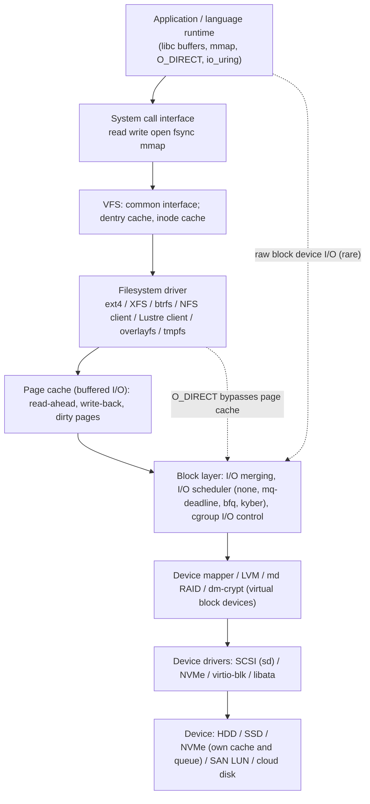
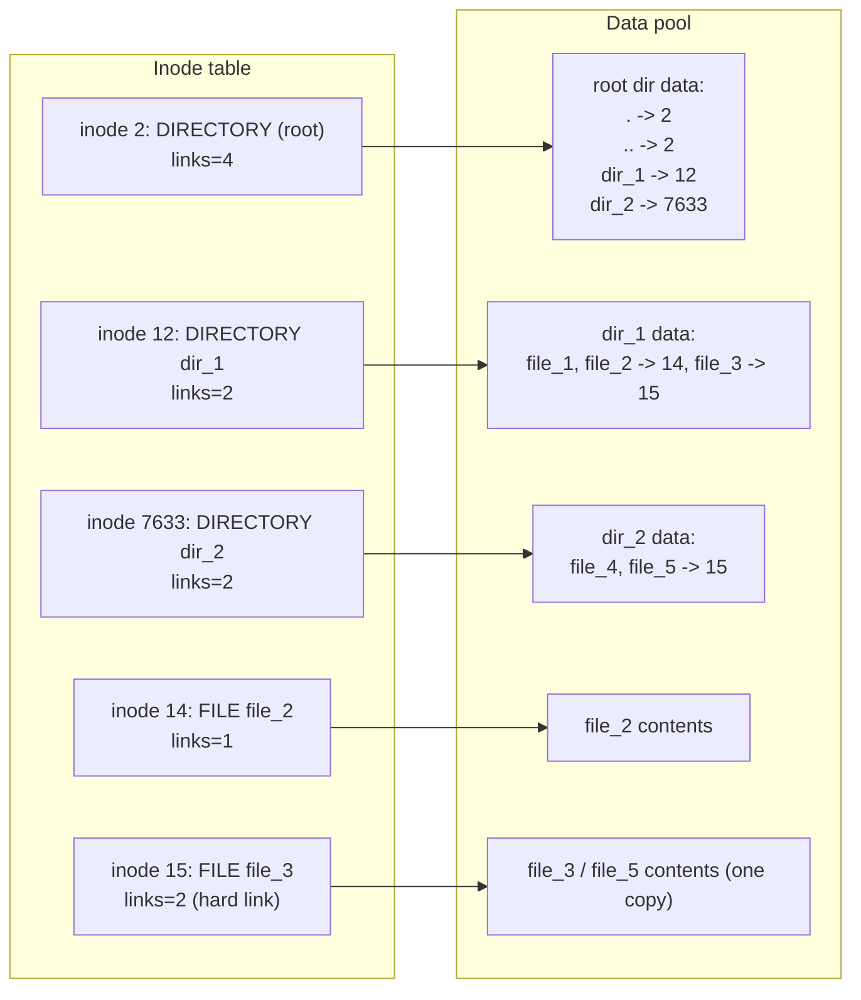
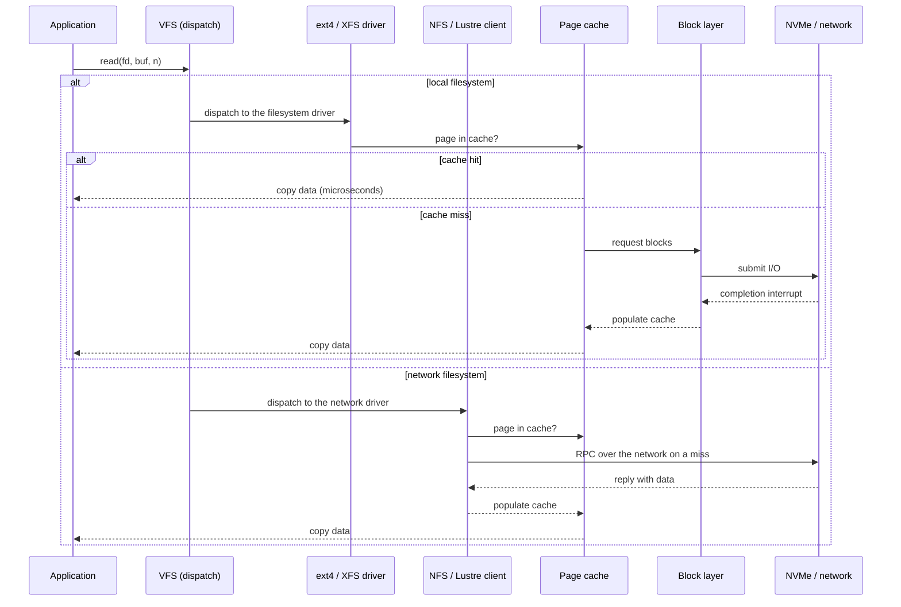
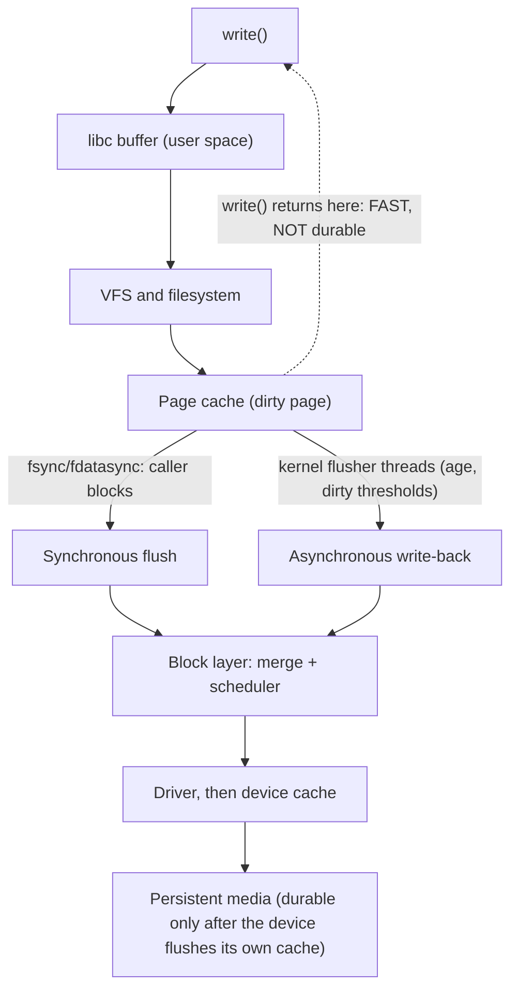
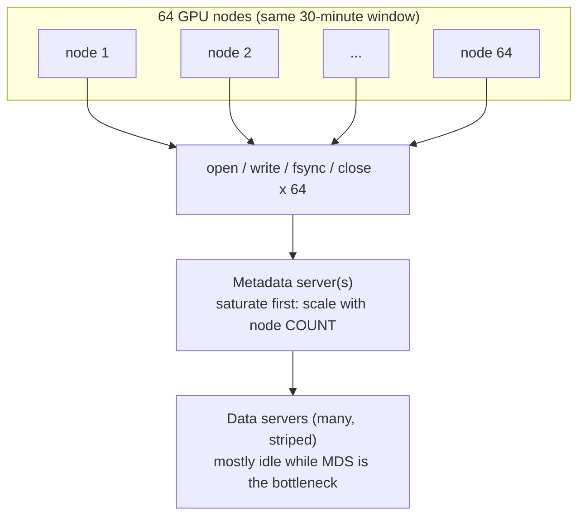
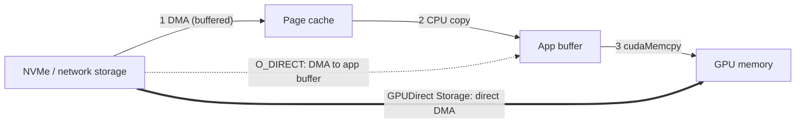

# 1.12 Disks, partitions and filesystems

| | |
|---|---|
| Level | Intermediate |
| Priority tier | 0 |
| Lab venue | GCP / GKE (an Ubuntu VM with an extra persistent disk or loop devices) |
| Part | Part 1: Linux, from the command line to the kernel and performance |
| Status | Drafted, labs **untested** |

## Why this matters for AI infrastructure

In AI infrastructure, storage is not only about keeping data safe. It is about **feeding GPUs at their maximum ingestion rate** and **checkpointing very large model states without stalling training**. When a cluster of thousands of GPUs stalls, the root cause is frequently a storage bottleneck disguised as a compute failure. The daily questions are all storage questions:

- "Which disk is this, what type is it, how is it partitioned, and how will I mount it so it survives a reboot?"
- "The job says 'No space left on device' but `df` shows free space." (inodes, quotas, reserved blocks, a read-only remount, a deleted-but-open file)
- "Reading the dataset is slow. Is it the filesystem, the page cache, the disk, or the network?"
- "Checkpoint time grew from 45 seconds to 8 minutes as we scaled." (shared-filesystem metadata contention)
- "Why did `fsck` run for an hour at boot, or why did the node come up with `/data` missing?" (fstab, `nofail`, journals)
- "Should this NVMe scratch be ext4 or XFS, and what mount options?"

This chapter builds the stack from the bottom: what disks are and how they behave, how a disk is divided (partitions, MBR and GPT), what a filesystem is and how it works inside (inodes, directories, journals, extents), how to create, mount, tune, check and repair one, the special filesystems the kernel provides, the **performance concepts** that explain why identical code can be fast or slow (caching, write-back, synchronous and direct I/O, read-ahead, logical versus physical I/O), the methodology and tools to measure it, and the AI-specific patterns (local NVMe scratch, inode exhaustion, `O_DIRECT`, GPUDirect Storage, checkpoint storms). Logical volumes, RAID and NVMe operations continue in chapter 1.13; boot and the initramfs in 1.14; shared and parallel filesystems (NFS, Lustre, GPFS, WekaFS) in Part 6 and the storage part; the performance method in 1.23 to 1.25.

## Prerequisites and outcomes

You should know the directory hierarchy, links and inodes at an introductory level (1.3), users and permissions (1.6), device files and `/sys` (1.10), and processes and `/proc` (1.8).

After this chapter you can:

- Describe the Linux storage stack from application to device and say where each cache and queue sits.
- Compare rotational disks, SSDs, NVMe and persistent memory, and the SCSI, SATA, SAS, FC and NVMe interfaces, with their latency scales.
- Read and create partition tables (MBR and GPT) with `parted`, `fdisk` and `sgdisk`; check alignment; make the kernel re-read tables.
- Create, label and mount filesystems; write correct `/etc/fstab` entries (UUID, options, `nofail`, `_netdev`); test them safely; use `findmnt`, `lsblk`, `blkid`.
- Explain inodes, directory entries, link counts, block allocation, journaling, extents, copy-on-write and why each matters.
- Choose between ext4, XFS, btrfs and ZFS for a purpose, and know the mkfs and mount options that matter.
- Check and repair filesystems safely (`fsck`, `e2fsck`, `xfs_repair`), recover with a backup superblock, and know the worst-case options.
- Diagnose "disk full" in its five different forms (blocks, inodes, read-only, quota, wrong mount) and the deleted-but-open file.
- Explain buffered, synchronous, direct and memory-mapped I/O, `fsync` semantics, read-ahead, write-back thresholds, and the difference between logical and physical I/O.
- Measure with `df`, `du`, `iostat`, `vmstat`, `pidstat`, `fio`, `cachestat`, `/proc/pressure/io` and read the results correctly (including the NVMe `%util` trap).
- Apply storage patterns for GPU training and inference nodes.

## 1. The storage stack in one picture

An application's `read()` or `write()` passes through many layers. Each layer can cache, reorder, merge, delay or fail the request, which is why "the disk is fine" and "the application is slow" can both be true.



Three principles to carry through the chapter:

1. **Filesystem latency is what applications feel.** The application waits for the filesystem, which uses caching and buffering to hide the disk. Statistics collected at the disk device alone can be misleading: background flushing looks like bursts of slow disk I/O although no application is waiting, and a cache hit never reaches the disk at all.
2. **Every layer changes the I/O.** The disk sees *physical* I/O; the application issued *logical* I/O. They differ in size, count and timing (section 9).
3. **The bottleneck is rarely visible from the system call.** `read()` taking 400 ms tells you nothing about whether the cause is an overloaded NVMe drive, a hung NFS server or a cold cache. You must look underneath the VFS.

## 2. Disks and their behaviour

### Disk types

| Type | How it works | Strengths | Weaknesses and notes |
|---|---|---|---|
| **Magnetic rotational (HDD)** | Platters spin; a head on a moving arm reads tracks divided into sectors | Cheap per terabyte; fine for large sequential data, archives, backups | Mechanical: seek and rotation take milliseconds, so random I/O is slow (a 7,200 rpm disk does roughly 100 to 200 random IOPS). Sensitive to vibration. **SMR** (shingled) drives add density but degrade sustained and random writes, so they are poor in RAID and write-heavy roles. "Sloth disks" occasionally return I/O after seconds without reporting an error |
| **SSD (SATA/SAS flash)** | NAND flash cells, no moving parts, behind a controller with a **flash translation layer (FTL)** | Low, consistent latency; random I/O almost as fast as sequential; no seek | Writes need erased blocks, so the controller does garbage collection; **write amplification**, limited **program/erase cycles** (SLC about 50k to 100k, MLC 3k to 10k, TLC about 3k, QLC about 1k), wear leveling and overprovisioning to extend life. Performance can degrade when full or fragmented. Uses **TRIM/discard** to know which blocks are free |
| **NVMe SSD** | Flash attached directly to **PCIe**, with the NVMe protocol (many hardware queues) | Tens of microseconds latency, hundreds of thousands to millions of IOPS, many GB/s | Needs parallel I/O to reach its numbers (a single-threaded synchronous reader uses a fraction). Bandwidth bounded by the PCIe link (Gen4 x4 about 7 GB/s, Gen5 x4 about 14 GB/s per direction) |
| **Persistent memory / battery-backed DRAM** | Byte-addressable non-volatile memory (3D XPoint, battery or supercapacitor-backed DRAM) | Close to memory speed | Expensive; niche (controller write caches, specialised stores) |
| **Virtual / network block devices** | Cloud persistent disks (GCP PD, EBS), SAN LUNs, iSCSI, NVMe-over-Fabrics | Elastic, survives host loss | Latency and throughput depend on provisioned size, type and network; per-VM caps |

**Latency scale** (orders of magnitude; consult vendor documentation and measure): on-disk cache hit below 100 µs; NVMe flash 10 to 100 µs; SATA flash 100 µs to 1 ms; rotational sequential about 1 ms per request; rotational random read about 8 ms (7,200 rpm), more with a queue; worst-case virtual disk under RAID-5 and random I/O can exceed one second. Because a disk returns a mixture of cache hits (microseconds) and misses (milliseconds), an **average latency can be misleading**, since the real distribution has two modes; histograms show the truth.

### Sectors and block sizes

Disks present **logical blocks (sectors)**: traditionally 512 bytes, today often 4 KiB physical sectors ("Advanced Format"). Many drives emulate 512-byte logical sectors on 4 KiB physical sectors (**512e**), which causes a **read-modify-write** if a write is smaller than or not aligned to 4 KiB. Hence the importance of **alignment** (section 3). Check what a drive reports: `lsblk -t` (columns `LOG-SEC`, `PHY-SEC`, `MIN-IO`, `OPT-IO`, `ROTA`), `cat /sys/block/sda/queue/{logical_block_size,physical_block_size,rotational}`, `fdisk -l`, `smartctl -a`, `nvme id-ns`.

### Rotational disk mechanics (why old advice exists)

A head reads a **track**; the same track on every platter is a **cylinder**; a track is divided into **sectors**. Older tools addressed locations by cylinder-head-sector (**CHS**). On modern disks the reported CHS values are fiction: disks use **logical block addressing (LBA)**, a simple block number, and the firmware maps it onto the physical layout (**sector zoning**: outer tracks hold more sectors and so deliver higher throughput; **short-stroking** uses only outer tracks to cut seek times). Therefore, the old rule that partitions must start on cylinder boundaries is obsolete. Mechanical disks reorder queued requests to reduce head travel (**elevator seeking**, via Tagged Command Queueing on SCSI and Native Command Queueing on SATA), which can starve a distant request unless the scheduler enforces deadlines. Disks store an error-correcting code per sector and retry reads that fail; repeated retries are a common cause of mysteriously slow I/O, and rising soft-error rates (visible in SMART data) warn of failure.

### Interfaces

| Interface | Notes |
|---|---|
| **SCSI** (parallel) | Historic shared bus; replaced by serial variants. The **SCSI command set** is still everywhere (USB storage, SATA via libata, SAS, iSCSI, FC) |
| **SAS** (Serial Attached SCSI) | Point-to-point, 3/6/12/22.5 Gbit/s generations, dual-ported, multipath, hot swap; the enterprise HDD/SSD interface; also accepts SATA drives |
| **SATA** | Consumer and entry server; 1.5/3/6 Gbit/s; about 550 MB/s usable at 6 Gbit/s; 32-command queue |
| **FC** (Fibre Channel) | SAN fabrics; switches and zoning; very high speeds; used with storage arrays |
| **NVMe** | A protocol over PCIe: up to 64 thousand queues, each up to 64 thousand commands, per-CPU queues without shared locks, lower CPU cost per I/O; supports SR-IOV; **NVMe-oF** carries it over RDMA or TCP (chapter 1.13 and storage chapters) |

### How storage is attached

- **Disk devices (JBOD)**: the operating system sees each disk; easiest to observe.
- **RAID**: a controller or software groups disks into one larger or more reliable virtual disk (details and levels in chapter 1.13). A hardware RAID volume appears as one disk and hides the physical disks from the OS, which makes monitoring harder. Hardware RAID's write-back cache is protected by a battery or capacitor; if it fails, controllers fall back to write-through mode and write performance suddenly drops.
- **Storage arrays and SANs**: many disks behind controllers with large caches, attached by FC, SAS or iSCSI and often through two paths (multipath).
- **NAS** (network-attached storage): NFS, SMB/CIFS, or iSCSI from an appliance; the network becomes part of the I/O path; analysed as a separate system.
- **Local NVMe in GPU servers**: the usual place for scratch data, caches and fast checkpoints, but it belongs to that one machine (an instance restart can lose it on the cloud). **Shared/parallel filesystems** (Lustre, GPFS/Storage Scale, Weka, BeeGFS, CephFS) provide the same data to all nodes; their trade-off is network dependency and metadata scaling (Part 6 and the storage chapters).

## 3. Partitioning

A **partition** is a contiguous range of blocks on a disk, recorded in a **partition table** (also called a *disk label*) at a known place on the disk. The kernel presents each partition as its own block device (`/dev/sda1`, `/dev/nvme0n1p2`). Partitions came from old PC boot restrictions and from the wish to reserve space for separate purposes (operating system, swap, data, so a full data area cannot stop the system). Today you often use **one partition per disk** or none at all (a whole-disk filesystem, or the whole disk as an LVM physical volume or RAID member). What you must have is a clear picture of what holds what.

### MBR and GPT

| | **MBR** ("msdos" label) | **GPT** (GUID Partition Table) |
|---|---|---|
| Location | First 512-byte sector (with the boot code) | A protective MBR, then a header and an entry array at the start, with a **backup copy at the end** of the disk |
| Max disk size | 2 TiB (32-bit sector counts) | Practically unlimited (zettabytes) |
| Partition count | 4 primary; or 3 primary plus 1 **extended** containing **logical** partitions | 128 by default |
| Names/IDs | Numeric type codes only (83 Linux, 82 swap, 8e LVM, ee GPT protective, 0c FAT32) | Partition **names**, unique **GUIDs** (PARTUUID), type GUIDs |
| Boot | BIOS | UEFI (requires an **EFI System Partition**, a FAT filesystem); BIOS can boot GPT too with a small **BIOS boot partition** |
| Resilience | None | CRC checksums, two copies |

For anything new, use **GPT**. Keep MBR knowledge for old systems, USB sticks and some cloud images.

### Tools

| Tool | Notes |
|---|---|
| `lsblk`, `lsblk -f`, `blkid`, `parted -l`, `fdisk -l`, `sfdisk -d` | Look (read-only) |
| `fdisk` | Interactive; recent versions support MBR and GPT; **changes nothing until you write with `w`**, so you can design the table and quit with `q` if wrong |
| `parted` | Scriptable; supports MBR and GPT; **applies each command immediately** (no review step) |
| `gdisk` / `sgdisk` | GPT-focused (fdisk-like interactive and scriptable) |
| `partprobe`, `blockdev --rereadpt`, `partx` | Make the kernel re-read a changed table |
| `wipefs`, `sgdisk --zap-all`, `dd` | Erase signatures and tables (careful) |

Partitioning happens entirely in user space: the tools rewrite the table on the block device, then the kernel is asked to re-read it. `fdisk` makes one system call (an `ioctl`, `BLKRRPART`) that re-reads the whole table and prints `sdd: sdd1 sdd2` in the kernel log; `parted` informs the kernel partition by partition. If the disk is in use the re-read can fail ("device or resource busy"); use `partprobe` or reboot, and see what changed with `udevadm monitor --kernel`, `cat /proc/partitions`, and `ls /sys/block/sdd`.

### A worked example (a spare disk, GPT)

```bash
lsblk -o NAME,SIZE,TYPE,FSTYPE,MOUNTPOINT,MODEL         # find the right disk; ensure it is unused
sudo parted /dev/sdb --script mklabel gpt \
     mkpart data ext4 1MiB 100% \
     print                                                # one partition from 1 MiB (aligned) to the end
# or interactively with fdisk
sudo fdisk /dev/sdb
#   g        create a new GPT
#   n        new partition (accept defaults: number 1, first sector 2048, last sector end)
#   t        change type (e.g. 19 = Linux filesystem; 20 = Linux RAID; 31 = LVM, with fdisk's type list 'L')
#   p        print and CHECK before writing
#   w        write and exit   (q to abort without changes)
sudo partprobe /dev/sdb && lsblk /dev/sdb
```

Always: **verify the device name twice** (`lsblk -o NAME,SIZE,MODEL,SERIAL`), unmount anything on it, make a backup of the old table (`sfdisk -d /dev/sdb > sdb.table`, `sgdisk --backup=sdb.gpt /dev/sdb`), and remember that deleting a partition makes the data on it very hard to recover.

### Alignment

Flash drives read and write in **pages** (commonly 4 KiB or 8 KiB) and erase in much larger blocks. If a partition starts at an offset that is not a multiple of the page size, a single logical read can span two physical pages. Modern partitioning tools align partitions on **1 MiB boundaries** (sector 2048 for 512-byte sectors), which is a multiple of every common page size, so you rarely have to think about it. To check, divide the partition start by 8 (for 4 KiB pages with 512-byte units): `cat /sys/block/sdf/sdf2/start` should be divisible by 8; `parted /dev/sdb align-check optimal 1` prints "1 aligned". For RAID, LVM and XFS also check the stripe unit and width (chapter 1.13).

### Partition types you will meet

On a typical GPU server: an **EFI System Partition** (about 512 MiB, FAT32, mounted at `/boot/efi`), a `/boot` partition (ext4, optional), the **root** filesystem (or an LVM physical volume), perhaps **swap** (often none or small on GPU nodes), and data devices as whole disks. Cloud images use a tiny BIOS-boot or EFI partition plus one root partition, and **grow the root partition and filesystem at first boot** (`cloud-init growpart`), which is why the same image fits any disk size.

## 4. Creating filesystems

A **filesystem** turns a block device into named files and directories. Where a partition table only draws boundaries, a filesystem is a **database**: it tracks which blocks belong to which file, who owns it, permissions and times, and keeps this map consistent through crashes. Therefore partitioning and filesystem creation are separate tools and steps.

### Filesystem types

| Type | Origin and character | Notes for AI infrastructure |
|---|---|---|
| **ext4** | The Linux default for years; descendant of ext2/ext3 (journal added in ext3; extents, delayed allocation, large files in ext4). Mount ext2/3 as ext4, not the reverse | Reliable general purpose; fine for root and moderate data; inode count fixed at creation; online grow, offline shrink |
| **XFS** | From SGI; **allocation groups** allow parallel allocation; scales to large files, large directories, many threads; online grow, **cannot shrink** | Default on RHEL-family; excellent for big files and parallel I/O (datasets, checkpoints, scratch on NVMe); inodes allocated dynamically (no inode exhaustion in the ext4 sense) |
| **btrfs** | Copy-on-write B-tree filesystem with subvolumes, snapshots, compression, checksums, built-in multi-device | Default for some distributions (SUSE, Fedora desktop); use with care for databases and heavy random write |
| **ZFS** (OpenZFS) | Combined volume manager and filesystem; pooled storage, checksums, snapshots, compression, ARC cache | Excellent integrity; out-of-tree on Linux (licence), memory-hungry ARC competes with GPU hosts' RAM |
| **vfat / exfat / ntfs** | Microsoft formats | USB sticks, EFI partition; no Unix permissions |
| **iso9660, udf** | Optical media and images | Installer ISOs |
| **squashfs** | Compressed read-only filesystem | Container/snap images, Enroot/Apptainer SIF |
| **overlayfs** | Union of layers (lower read-only, upper writable) | Container root filesystems (chapter 1.19, 1.20, 7) |
| **tmpfs** | In-memory (and swap) filesystem | `/run`, `/dev/shm`, `/tmp` on some systems; size-limited |
| **NFS, CIFS/SMB, Lustre, GPFS, BeeGFS, CephFS, WekaFS** | Network and parallel filesystems | Shared datasets and checkpoints (Part 6) |
| **FUSE filesystems** | User-space filesystems via `/dev/fuse` | SSHFS, s3fs/goofys/mountpoint-s3, rclone mount, gcsfuse (convenient, slower, metadata-bound) |

The kernel's **VFS** layer lets all of these coexist under one directory tree and one set of system calls, regardless of the implementation; it is also the common point for measuring any filesystem.

### Making one

```bash
sudo mkfs.ext4 -L scratch /dev/nvme1n1p1           # or:  mkfs -t ext4 ...
sudo mkfs.xfs  -L scratch /dev/nvme1n1p1
sudo mkfs.xfs -f -d su=256k,sw=4 /dev/md0          # align to a RAID stripe (stripe unit 256 KiB x 4 data disks)
sudo mkfs.ext4 -m 0 -i 65536 /dev/nvme1n1p1        # no root-reserved blocks; one inode per 64 KiB (fewer inodes for big files)
sudo mkfs.ext4 -T small /dev/sdc1                  # many small files: more inodes (see mke2fs.conf types)
```

**`mkfs` is a front end**: `mkfs -t ext4` runs `mkfs.ext4`, which on most systems is a link to `mke2fs`; each filesystem has its own tools and manual page (`mke2fs(8)`, `mkfs.xfs(8)`). Defaults are sensible; change them only with a reason. **Creating a filesystem destroys the previous contents** (the old data's map is gone): do it once per new device. Record the **superblock backup locations** printed at creation (ext4), or find them later with `mkfs.ext4 -n /dev/...` (the `-n` option only simulates).

Parameters that matter:

- **ext4 inode count** is fixed at creation (`-i bytes-per-inode`, `-N count`); a dataset of hundreds of millions of tiny files can exhaust inodes while bytes remain free (`df -i`). Lower `-i` for small-file workloads; XFS does not have this problem.
- **Reserved blocks**: ext4 reserves 5% for root by default so a runaway user process cannot fill the disk completely and starve system daemons. On a large data disk, set 0 or 1% (`mkfs.ext4 -m 0`, or `tune2fs -m 1`).
- **XFS geometry** (`su`/`sw`, log size, `-i maxpct`): align with RAID stripe settings; the defaults are usually right for NVMe.
- **Labels and UUIDs**: set a `-L` label for human reference; the UUID is generated automatically.
- Lazy initialisation (`lazy_itable_init`, `lazy_journal_init`) makes `mkfs` on huge ext4 volumes return quickly and finish background work after the first mount; for benchmarking disable it (`-E lazy_itable_init=0`) so the initial background write does not disturb results.

## 5. Mounting

**Mounting** attaches a filesystem to a directory (the **mount point**) in the global tree; walking into the directory then reaches that filesystem. To mount you need: the **source** (device, UUID, label, remote path, or a pseudo name for special filesystems), the **type**, and the **mount point** (an existing directory, any location). `/mnt` is a conventional temporary mount point; permanent filesystems get their own directories (`/data`, `/scratch`).

```bash
mount                                  # everything mounted, with options (long; special filesystems included)
findmnt                                # the same as a tree; best tool
findmnt /data; findmnt -T /data/file   # which filesystem holds this path? (answers "is this local or network?")
findmnt -o TARGET,SOURCE,FSTYPE,OPTIONS,SIZE,USE%
sudo mount /dev/nvme1n1p1 /data        # type is auto-detected
sudo mount -t xfs -o noatime /dev/nvme1n1p1 /data
sudo mount UUID=b600fe63-d2e9-461c-a5cd-d3b373a5e1d2 /data
sudo mount -o ro,uid=1000 -t vfat /dev/sde1 /dos
sudo umount /data                      # by mount point (or device)
sudo umount -l /data                   # lazy: detach now, clean up when no longer busy (last resort)
```

`umount` fails with "target is busy" while any process has a file open or a current directory inside. Find who: `lsof +f -- /data` or `fuser -vm /data`; end or move them; do not reach for `umount -f` or `-l` as a habit (a lazy unmount leaves processes using a detached filesystem). On a **stuck network filesystem** a forced or lazy unmount may be the only practical way out (chapter 1.8 on `D` state).

Because the kernel **buffers writes**, a filesystem can have unwritten changes in memory. `umount` flushes them. `sync` forces a flush of all filesystems; use it before cutting power to a machine that cannot be shut down cleanly (but properly shutting down is better).

### Identifying filesystems: UUID and labels

Device names depend on probe order (chapter 1.10), so identify filesystems by **UUID** (assigned by `mkfs`) or **label**:

```bash
lsblk -f                                  # NAME FSTYPE LABEL UUID MOUNTPOINT
sudo blkid                                # /dev/sdb1: UUID="..." TYPE="ext4" PARTUUID="..."
sudo blkid -s UUID -o value /dev/sdb1     # just the UUID
sudo tune2fs -U random /dev/sdb1          # change an ext filesystem's UUID (e.g. after cloning a disk)
sudo xfs_admin -U generate /dev/sdb1      # XFS equivalent (unmounted)
```

UUIDs are the preferred key in `/etc/fstab` for plain partitions. FAT filesystems have a short volume serial instead (`4859-EFEA`). Removable media is mounted by desktop services at `/media/<user>/<uuid or label>`. Cloned disks have **identical UUIDs**: mounting both causes confusion, and XFS refuses to mount a second filesystem with the same UUID unless you pass `-o nouuid`.

### Mount options

Options are comma-separated after `-o` (and in `/etc/fstab`). The ones that matter in practice:

| Option | Meaning |
|---|---|
| `ro` / `rw` | Read-only / read-write (`-r` is `-o ro`) |
| `noexec` / `exec` | Forbid / allow running programs from this filesystem (hardening for `/tmp`, `/home`, data disks; but breaks scripts that execute from `/tmp`) |
| `nosuid` | Ignore setuid/setgid bits |
| `nodev` | Ignore device files on it |
| `noatime` / `relatime` / `strictatime` | Access-time updates: reads would otherwise cause writes. **`relatime`** (default) updates atime only if older than the modify time or more than a day old; **`noatime`** never updates (best for data disks, avoid for software that needs atime such as some mail readers and tmp cleaners); **`nodiratime`** for directories |
| `discard` / (no discard) | Issue TRIM on every delete (continuous); often worse than periodic **`fstrim`** (the `fstrim.timer` systemd unit trims weekly); on some cloud and NVMe devices continuous discard hurts latency |
| `data=ordered` / `writeback` / `journal` (ext3/4) | Journaling mode: metadata only after data (default), metadata only without ordering, or full data journaling (slower) |
| `errors=continue` / `remount-ro` / `panic` (ext) | What the kernel does on an error: continue, remount read-only, or halt. `remount-ro` is a common safe choice; **a filesystem that has remounted itself read-only is a classic cause of "No space left" and "Read-only file system" errors** |
| `commit=N` | Journal commit interval in seconds (ext4; default 5) |
| `barrier` / `nobarrier` | Honour or skip write barriers (flush commands). Skipping risks corruption on power loss; do not use unless the device has a safe write cache |
| `user` / `users` / `noauto` / `auto` | `fstab` conveniences: allow ordinary users to mount (implies `nosuid,noexec,nodev`), skip at `mount -a` and boot |
| `nofail` | Do not fail the boot if this device is absent (essential for removable or optional data disks; otherwise systemd drops to emergency mode) |
| `x-systemd.device-timeout=`, `x-systemd.automount`, `_netdev` | systemd integration: wait time for the device; mount on first access; mark as network-dependent so it waits for the network |
| `size=`, `nr_inodes=`, `mode=` | tmpfs limits and permissions |
| `uid=`, `gid=`, `umask=` | Ownership for filesystems without Unix permissions (FAT, NTFS, exFAT) |
| `usrquota,grpquota,prjquota` | Enable quotas (section 6) |

The filesystem-specific options are documented in `mount(8)` and per-filesystem pages (`ext4(5)`, `xfs(5)`, `nfs(5)`, `tmpfs` in `mount(8)`). **Remount** to change options on a mounted filesystem without unmounting:

```bash
sudo mount -o remount,rw /           # make the root filesystem writable again after a rescue boot
sudo mount -o remount,noatime /data
sudo mount -n -o remount,rw /        # -n: do not write /etc/mtab (needed when / is still read-only)
```

### `/etc/fstab`: mounts at boot

`/etc/fstab` lists filesystems to mount at boot (and the shortcuts for `mount /data`). One line per filesystem, **six fields**:

```text
# <source>                                   <mount point>  <type>  <options>              <dump> <fsck>
UUID=70ccd6e7-6ae6-44f6-812c-51aab8036d29    /              ext4    errors=remount-ro      0      1
UUID=592dcfd1-58da-4769-9ea8-5f412a896980    none           swap    sw                     0      0
UUID=3f2a...                                 /scratch       xfs     defaults,noatime,nofail 0     2
10.0.0.1:/export/home                        /home          nfs     rw,hard,_netdev,vers=4.2 0    0
/dev/sr0                                     /cdrom         iso9660 ro,user,noauto         0      0
```

1. **Source**: UUID (or `LABEL=`, `PARTUUID=`, or a `/dev/mapper/...` LVM name, or `server:/path`).
2. **Mount point**.
3. **Type** (`swap` for swap).
4. **Options** (`defaults` = `rw,suid,dev,exec,auto,nouser,async`).
5. **dump** flag: for the long-obsolete `dump` backup tool; always `0`.
6. **fsck pass**: `1` for the root filesystem, `2` for other local filesystems on disks (checked after root), `0` to skip (network filesystems, swap, `/proc`, XFS, and anything you do not want checked at boot). Modern systemd checks `ext4` filesystems with `systemd-fsck` according to this field; XFS and btrfs do their own recovery.

Safe-editing routine (a bad `fstab` can stop a machine from booting):

```bash
sudo cp /etc/fstab /etc/fstab.bak
sudoedit /etc/fstab
sudo findmnt --verify --verbose          # syntax and source checks (recent util-linux)
sudo mount -a                            # mounts everything not noauto: errors appear NOW, not at 3 a.m.
sudo systemctl daemon-reload             # systemd regenerates mount units from fstab
```

Alternatives: files in `/etc/fstab.d` on some systems, and **systemd mount units** (`data.mount`, `data.automount` with `Where=/data`, `What=UUID=...`); systemd generates units from `fstab` automatically at boot (`systemd-fstab-generator`). Mount-ordering and "device not found" boot hangs are chapter 1.14 and 1.15 topics.

### Capacity: `df`, `du`, inodes, reserved blocks

```bash
df -hT                                   # size/used/avail/use%, type, per mounted filesystem
df -h /data                              # only the filesystem holding /data
df -ih /data                             # INODE usage: separate resource from bytes
du -sh /data/*                           # directory totals (slow on big trees)
du -xhd1 /data | sort -h                 # one level deep, stay on this filesystem
ncdu -x /data                            # interactive disk-usage browser (install ncdu)
sudo lsof +L1                            # deleted files still held open (they still use space)
```

The numbers surprise people: `Used + Available` is less than `Size` because **reserved blocks** (5% on ext4 by default) are hidden from ordinary users; `df` shows blocks of 1 KiB (`-k`) unless you ask for `-h`/`-H` (powers of 1024 or 1000); `du` counts allocated blocks of files it can see, so it **cannot see** files already deleted but still open, deleted files, mount points hidden under other mounts, or space used by filesystem metadata and journals. A filesystem near 100% also gets slower, since finding free space takes more CPU and I/O and free extents become small and scattered (fragmentation, worse with copy-on-write filesystems).

**"The disk is full" has at least five meanings**, each needing a separate check. A single `ENOSPC` ("No space left on device") proves only that a write failed.

| Cause | Check | Typical fix |
|---|---|---|
| Data blocks exhausted | `df -h` | Delete or move data; grow the filesystem |
| **Inodes exhausted** (ext4; millions of small files) | `df -i` | Delete files; recreate the filesystem with more inodes; prefer XFS or bundled shards |
| Filesystem mounted **read-only** (error remount, dying disk) | `mount \| grep ' ro,'`, `dmesg` | Find the I/O error cause; repair; remount |
| **Quota** reached though the device has space | `quota -u`, `xfs_quota`, `repquota` | Raise the quota or clean up |
| Wrong place: the mount is **not mounted** and you wrote into a small directory on the root filesystem | `findmnt -T /path`; `df /path` | Mount it properly; move the stray data (do not mount over a directory that holds data you need) |
| Deleted files still open | `lsof +L1` | Restart the holder, or truncate through `/proc/PID/fd/N` |
| Reserved blocks for root (user sees full, root can still write) | `tune2fs -l \| grep Reserved` | Lower the reservation on data disks |

(The classic production instance: a log rotation deleted a huge file while a process still held it open, so `df` shows 100% while `du` finds nothing; `lsof +L1` finds it, and `ls -l /proc/PID/fd` shows the `(deleted)` marker.)

### Swap, in brief

Swap is disk (or file) space the kernel uses to hold less-used memory pages; the chapter on memory (1.17) covers when and how. To add some: `mkswap /dev/sdb2 && swapon /dev/sdb2`, or a file (`fallocate -l 8G /swapfile; chmod 600 /swapfile; mkswap /swapfile; swapon /swapfile`; avoid sparse files and note that some filesystems (btrfs, some XFS cases) need special handling), plus an `fstab` line with type `swap`. Remove with `swapoff`. `swapon --show`, `free -h`, `cat /proc/swaps` show state. Never size swap by an outdated "twice the RAM" rule: on GPU nodes keep swap small or absent and set `vm.swappiness` low (chapters 1.17, 1.22, 1.28), but remember that with **no** swap, memory exhaustion goes straight to the OOM killer.

## 6. Inside a traditional filesystem

Understanding the structure explains `df -i`, hard links, `fsck`, and many failure modes.

A Unix-style filesystem has two parts: a **pool of data blocks** and a **database** that manages them, centred on the **inode**. An **inode** is a record (identified by a number in an inode table) describing one filesystem object: its **type** (regular file, directory, symlink, device, socket, FIFO), **permissions and owner**, **size**, **timestamps** (modify, change, access; ext4 adds creation), **link count**, and **where its data blocks are**. It does *not* contain the file's name. Names live in **directories**, which are themselves files whose data is a list of `(name, inode number)` entries, including `.` (itself) and `..` (its parent).



To open `dir_1/file_2` the kernel starts at the **root inode** (inode 2 on ext filesystems; the superblock says where it is), reads its directory data to find `dir_1` → inode 12, confirms 12 is a directory, reads its data to find `file_2` → inode 14, reads inode 14 (a file) and now knows where its data blocks are. The dentry and inode caches (section 9) make this nearly free for hot paths.

**Link counts.** The inode's link count is the number of directory entries (across the filesystem) that point at it. A **hard link** (`ln file newname`) is simply a second name for the same inode; both names are equal and the data exists once. `rm` is "unlink": it removes one directory entry and decrements the count; **when the count reaches zero and no process still has the file open, the inode and its blocks are freed**. This is why an open-but-deleted file still uses space. A directory's count is 2 plus the number of subdirectories (its entry in the parent, its own `.`, and each child's `..`). Hard links cannot cross filesystems (inode numbers are per filesystem) and cannot point to directories; **symbolic links** are small files containing a path, and may cross filesystems and dangle. (`ls -i` shows inode numbers, `stat file` the whole inode, `find / -xdev -samefile f` all names for a file.)

**Block allocation.** The filesystem must know which blocks are free. A simple scheme is a **bitmap** (one bit per block); modern designs use **extents** (a start block and a length, so a large contiguous file needs a few pointers instead of millions), allocated by **delayed allocation** (choose blocks at flush time so writes can be grouped into contiguous runs). The filesystem is divided into **block groups** (ext4) or **allocation groups** (XFS), each with its own bitmaps and inode area, so related data stays close and, for XFS, allocation happens in parallel.

**The superblock** is the top-level record: filesystem type and geometry (block size, counts of blocks and inodes, where the inode tables are, feature flags, state). It is so important that ext filesystems keep **backup copies** in other block groups. `dumpe2fs -h /dev/sdb1` and `tune2fs -l` (ext), `xfs_info /data` (XFS) display it.

**Journaling.** A **journal** (log) records intended changes before they are applied, so after a crash the filesystem can **replay or discard** the incomplete transaction in seconds instead of scanning everything (which took hours on terabyte-scale filesystems). ext3/ext4 journal metadata by default (`data=ordered` also forces data blocks out before the metadata that references them); `data=journal` logs data too (slower, writes twice). XFS journals metadata. The journal may live on a separate device to avoid contention. Journaling protects **consistency**, not necessarily **your last few seconds of data**: data in the page cache that was never `fsync`ed can still be lost. **Copy-on-write** filesystems (btrfs, ZFS) never overwrite live blocks: they write new blocks, then update references atomically, which gives consistency, cheap snapshots and sequential writes (at the cost of fragmentation as they fill).

**Scrubbing and checksums**: btrfs and ZFS checksum data and can **scrub** (read everything and verify), finding silent corruption early while redundancy can still repair it. ext4 and XFS checksum metadata (and ext4 the journal) but not file data; end-to-end data integrity on those needs application checksums or a device layer such as `dm-integrity`.

### Special-purpose filesystems

Not every filesystem represents storage. The file interface is used to expose kernel objects:

| Type | Mounted at | Purpose |
|---|---|---|
| `proc` | `/proc` | Processes and kernel information (chapter 1.8, 1.10) |
| `sysfs` | `/sys` | Device model and kernel attributes |
| `devtmpfs`, `devpts` | `/dev`, `/dev/pts` | Device nodes; pseudoterminals |
| `tmpfs` | `/run`, `/dev/shm`, sometimes `/tmp` | RAM-backed (and swap-backed) temporary files; limit with `size=`, otherwise it can consume up to half the RAM and crash a node when over-used |
| `cgroup2` | `/sys/fs/cgroup` | Control groups (chapter 1.8, 1.18) |
| `securityfs`, `debugfs`, `tracefs`, `bpf`, `configfs`, `fusectl` | various | Kernel debugging, tracing, BPF objects |
| `squashfs`, `overlay` | container and snap mounts | Compressed read-only layers; union of layers |
| `fuse` | user-chosen | User-space filesystems |

`grep nodev /proc/filesystems` lists the types that do not use a block device.

## 7. Checking and repairing filesystems

The kernel trusts a mounted filesystem to be consistent and trusts the hardware to store data reliably. Errors come from hardware faults and from **unclean shutdowns** (power loss, crashes) where the in-memory cache did not match the disk. Journaling makes corruption rare; checks are still needed occasionally.

The checker is **`fsck`**, a front end that runs the right tool per type (`e2fsck` for ext2/3/4, `xfs_repair` for XFS, `btrfs check`, `fsck.vfat`). The rules:

- **Never run a repairing `fsck` on a mounted filesystem.** The kernel is changing the same structures; the result is corruption. (Exception: the root filesystem mounted read-only in rescue mode.)
- **Backup first** if the data matters and the device may be failing; consider imaging it (`ddrescue`) and repairing the copy.
- Start with a **read-only check**: `fsck -n /dev/sdb1`, `e2fsck -fn`, `xfs_repair -n`.

```bash
sudo umount /data
sudo e2fsck -f /dev/sdb1             # interactive, forced check (ext)
sudo e2fsck -p /dev/sdb1             # "preen": fix ordinary problems automatically, stop on serious ones (what boot does)
sudo e2fsck -fy /dev/sdb1            # answer yes to everything (last resort; may do harm on severe damage)
sudo e2fsck -b 32768 /dev/sdb1       # use a BACKUP superblock when the primary is corrupt
sudo mke2fs -n /dev/sdb1             # DRY RUN: print where backup superblocks are, changes nothing (the -n matters!)
sudo xfs_repair /dev/sdb1            # XFS; xfs_repair -n is a dry run; -L zeroes the log (data-loss risk, last resort)
sudo xfs_metadump / xfs_db           # XFS inspection tools
sudo debugfs /dev/sdb1               # ext inspector (read-only by default); can copy files out: dump, rdump
```

`e2fsck` makes five passes: (1) inodes, blocks and sizes; (2) directory structure; (3) directory connectivity; (4) reference (link) counts; (5) group summary information. Questions it asks concern inodes with no name: it **reconnects them in `lost+found`** under numeric names (the original names are usually gone; you recover content by inspection). Many questions in manual mode suggest serious trouble; stop and consider a read-only mount, a dry run, or imaging.

**Journals and unclean shutdowns**: after a crash on ext4/XFS the kernel replays the journal at mount; a full `fsck` is rarely required. If the journal cannot be replayed the mount fails ("structure needs cleaning" on XFS, "recovery required" on ext4) and you run the repair tool. XFS: mount once to replay the log; only if that fails use `xfs_repair` (and `-L` as the last resort).

**Worst cases**, in order: (1) `ddrescue` the failing device to a same-size disk and repair the copy; (2) patch the filesystem as far as possible, mount **read-only**, and salvage what you can; (3) use `debugfs` (ext) or `xfs_db` to copy out files; (4) professional recovery. Because of this, **backups and replication are the real protection**, and monitoring (SMART, kernel I/O errors, filesystem error counters) is the early warning.

**Periodic health**: `smartctl -H -A /dev/sda` and `nvme smart-log /dev/nvme0` for drive health (media errors, wear percentage, temperature); `dmesg | grep -iE 'i/o error|ext4-fs error|xfs|nvme'`; `cat /sys/fs/ext4/*/errors_count`; `systemctl status fstrim.timer`; scheduled scrubs for btrfs/ZFS.

### Quotas

Quotas limit space (blocks) and file count (inodes) per user, group or **project** (directory tree). **ext4**: mount with `usrquota,grpquota` and manage with `quota`, `edquota`, `repquota`, `quotacheck`, `quotaon` (or the journaled quota feature). **XFS**: mount with `uquota,gquota,pquota`; manage with `xfs_quota -x -c 'limit bsoft=100g bhard=120g user' /data`; **project quotas** (`pquota`) cap a directory tree and are the right tool to limit a team's dataset directory. Quotas have a **soft limit** (exceedable for a grace period, with warnings) and a **hard limit** (blocked). Cluster filesystems have their own quota systems (Lustre, GPFS, BeeGFS). Per-process limits (`ulimit -f`) and cgroup I/O limits are different mechanisms (chapter 1.8).

#### Step-by-step Linux filesystem quota commands (from *Supercomputers for Linux SysAdmins*, Ch 12)

To enable and manage standard Linux disk quotas (requires installing the `quota` package), follow the book's six-step workflow (`(untested here)`):

1. **Edit `/etc/fstab` to add `usrquota` and/or `grpquota`** (or `quota`) to the filesystem mount options (in the book's example, `/dev/sda6` mounted on `/export`):

   ```text
   # (untested here) — /etc/fstab example
   /dev/sda6 /export ext3 acl,user_xattr,usrquota 1 2
   ```

2. **Set the filesystem to read-only or unmount it** so active user writes do not corrupt the initial usage scan (you can also use `quotacheck -M` to remount read-only during the check, or isolate to single-user rescue mode with `systemctl isolate rescue`):

   ```bash
   # (untested here)
   mount -o remount,ro /dev/sda6
   # or: umount /export
   ```

3. **Create the quota accounting database** with `quotacheck` (`quotacheck /path/to/fs`, `quotacheck -a`, or `-vugc` for verbose user/group creation):

   ```bash
   # (untested here)
   quotacheck -vugc /dev/sda6
   ```

4. **Remount the filesystem with the new options**:

   ```bash
   # (untested here)
   umount /dev/sda6
   mount /dev/sda6
   ```

5. **Enable quota enforcement** (with `quotaon`; `quotaoff` turns it off):

   ```bash
   # (untested here)
   quotaon -va
   ```

6. **Configure and inspect user or group limits** using `edquota`, `setquota`, and `repquota`:

   ```bash
   # (untested here) — open an editor ($EDITOR) to edit a user's quotas
   edquota username

   # (untested here) — set quotas directly on the command line (blocks, not kilobytes; 0 means no limit; -u user default, -g group, -b reads batch lines from stdin)
   setquota username block-soft block-hard inode-soft inode-hard filesystems

   # (untested here) — copy quotas from reference user 'foo' to user 'bar' across all quota-enabled filesystems (-a)
   setquota -p foo -u bar -a

   # (untested here) — set the global soft-quota grace period (-t, in seconds or 'unset') or per-user/group grace period (-T)
   setquota -t [-u | -g] block-grace inode-grace -a | filesystems
   setquota -T [-u | g] name block-grace inode-grace -a | filesystems

   # (untested here) — report quota usage across all filesystems (-a) or in human-readable units (-s / -m)
   repquota -a
   repquota -m /
   ```

   **Quotas over NFS**: when exporting a quota-enabled partition over NFS, install the `quota` package on the NFS server, enable quotas on the exported partition, and restart the NFS service; if `repquota` on the network client still does not work, ensure the **`rpc.rquotad`** service is running on the NFS server.

## 8. Files, file descriptors and the read path

A process reaches files, sockets, pipes and many kernel objects through integer **file descriptors**. The VFS offers one interface; each filesystem implements the semantics underneath. "Too many open files" is therefore a **resource-limit or descriptor-leak** problem (chapter 1.8), not a disk-capacity problem. Inspect it with:

```bash
ls -l /proc/PID/fd | head            # each descriptor and what it points to; "(deleted)" marks the classic leak
lsof -p PID | head
grep -i 'open files' /proc/PID/limits   # soft limit (enforced now) and hard limit (the ceiling it may raise to)
```



Because `read()` hides everything below the VFS, a profiler that traces the application shows only "this call took 400 ms". Whether the cause is an overloaded NVMe drive, an overloaded NFS server or a cold cache cannot be told from the call itself; you must look at the block layer or the network RPC layer.

## 9. Filesystem performance: the concepts

### Latency, caching and the page cache

**Filesystem latency**, the time from a logical request to its completion, is the primary performance metric, because application threads usually block on it. Cases where applications do not wait (non-blocking I/O, prefetch, background flush threads) can hide it. Operating systems historically exposed **disk** statistics rather than filesystem latency, so tools such as `iostat` can mislead (background write-back shows as bursts of disk I/O that no application is waiting for).

Linux caches aggressively: **free memory is wasted memory**. The **page cache** holds file data (and, since Linux 2.4, the block-device buffer cache lives inside it); the **dentry cache** remembers name-to-inode lookups (and remembers failed lookups, which speeds up library searches); the **inode cache** holds file metadata. The cache grows until memory is needed, then shrinks (`free -h`: `available` includes reclaimable cache). On the cloud and for GPU hosts this alarming-looking behaviour is normal; trouble starts only when the cache is evicted while still needed or when dirty pages pile up.

```bash
free -h; grep -E 'Cached|Buffers|Dirty|Writeback' /proc/meminfo
sudo slabtop -o | head -15                 # kernel slab caches: dentry, inode caches (ext4_inode_cache, xfs_inode)
vmtouch -v /data/dataset.bin               # how much of a file is in the cache (install vmtouch)
fincore /data/dataset.bin                  # same idea, util-linux
sync; echo 3 | sudo tee /proc/sys/vm/drop_caches   # drop clean caches (TESTING ONLY, to get a cold cache; hurts production)
```

A **second-level cache** extends the in-memory cache with a faster-than-disk medium, typically flash: ZFS's L2ARC caches clean, randomly read data on SSD; Linux has `bcache`, `dm-cache` and `dm-writecache` (device-mapper and block-layer caches that put an SSD or NVMe in front of slower disks). They help random-read workloads whose working set exceeds RAM, and they need warm-up time and monitoring of hit ratios.

### Access patterns and read-ahead

An I/O series is **sequential** if each starts where the previous ended, otherwise **random**. Filesystems try to place data contiguously so sequential logical I/O stays sequential physically; **fragmentation** is what happens when it does not. On rotational disks random I/O is catastrophically slower; on flash it matters much less (but small random writes still suffer read-modify-write). **Prefetch / read-ahead** detects sequential reads and fetches ahead of the application so reads hit the cache; when detection works, sequential reads stream; when it fails it wastes bandwidth and pollutes the cache. Per-device read-ahead is `blockdev --getra /dev/nvme0n1` / `--setra 4096` (in 512-byte sectors) or `/sys/block/DEV/queue/read_ahead_kb`; applications can hint with `posix_fadvise(POSIX_FADV_SEQUENTIAL|RANDOM|WILLNEED|DONTNEED)` and `madvise` for mappings; `readahead(2)` warms the cache explicitly.

### Write-back caching and durability

A normal `write()` copies data into the page cache and returns: it is **not durable yet**. Kernel **flusher threads** write dirty pages later when: dirty data is older than about 30 seconds (`vm.dirty_expire_centisecs`), the dirty amount exceeds a threshold (`vm.dirty_background_ratio` starts background flushing; `vm.dirty_ratio` makes the **writer itself** block until it drops), memory is short, or the application calls `sync`, `fsync`, `fdatasync` or `msync`. The trade-off is reliability: power loss loses the unflushed data, and a partial write can corrupt the on-disk state of anything without a journal or copy-on-write.



**Synchronous writes** complete only when the data (and the metadata needed to find it) is on persistent storage: individually (`O_SYNC`/`O_DSYNC` flags, or mounting with `sync`) or by **committing a group of earlier writes** with `fsync(fd)`, which is the efficient way (databases and checkpointers batch, then `fsync` once). Closing a file does *not* guarantee durability; a long pause when unpacking an archive of many files over NFS is the cost of those implicit commits. The standard careful pattern for replacing a file atomically: write a temporary file in the same directory, `fsync` it, `rename()` it over the target, then `fsync` the directory. Even then, a **device write cache** without power-loss protection can lie; enterprise drives with capacitors honour flush commands safely.

Tuning knobs (set with `sysctl`, chapter 1.10; values illustrative): `vm.dirty_background_ratio=5`, `vm.dirty_ratio=10` (or the `_bytes` forms on large-RAM machines, where a percentage of terabytes is far too much dirty data and produces long stalls at flush time), `vm.dirty_expire_centisecs`, `vm.dirty_writeback_centisecs`. Large dirty-cache limits make checkpoint writes look instantaneous and then stall the next operation when the kernel finally has to flush.

### Direct, raw, non-blocking and memory-mapped I/O

- **Raw I/O** reads and writes block device offsets, bypassing the filesystem (databases once used it). Hard to administer.
- **Direct I/O** (`O_DIRECT`): uses the filesystem but **bypasses the page cache**; the device transfers data straight to or from the application's buffer. It avoids a double copy and cache pollution for data read or written exactly once, such as streaming dataset shards or flushing a checkpoint. It has strict rules: the **buffer address, file offset and length must be aligned** to the device's logical block size (usually 512 B, often 4096 B). Misalignment returns `EINVAL`, the commonest `O_DIRECT` bug. In C, allocate with `posix_memalign(&p, 4096, size)`; in Python use `mmap` or an aligned buffer. Direct I/O disables caching and sometimes read-ahead, so it is not a free speed-up. (`dd iflag=direct oflag=direct` and `fio --direct=1` use it to measure the device rather than the cache.)
- **Non-blocking and asynchronous I/O**: `O_NONBLOCK` returns `EAGAIN` instead of waiting; POSIX AIO and Linux `libaio`; **`io_uring`** (Linux 5.1+) submits and completes I/O through shared ring buffers with low overhead. Needed to build high queue depth from a single thread.
- **Memory-mapped files** (`mmap`): map a file into the address space; access is by load/store, page faults read the data (**implicit I/O** that never shows as `read()` calls). Avoids system-call and copy overhead, but if the problem is device latency it changes little, and many CPUs updating mappings incur TLB-shootdown costs. Mapped files still go through the page cache.

### Metadata, and logical versus physical I/O

**Logical metadata** is what applications read and write: `stat`, `create`, `unlink`, `mkdir`, `chmod`, timestamp updates. A **metadata-heavy** workload (millions of tiny files, `open`/`stat`/`close` storms, `ls` on huge directories) can saturate a filesystem or a parallel filesystem's metadata servers while data bandwidth is idle. **Physical metadata** (superblocks, inode tables, bitmaps, indirect blocks, journal) is the bookkeeping the filesystem must write.

**Logical I/O** (what the application asked) rarely equals **physical I/O** (what reached the disk):

| Effect | Cause |
|---|---|
| **Unrelated** | Other tenants, RAID rebuilds, backups, kernel checksum or scrub tasks |
| **Indirect** | Prefetch and write-back buffering (large, infrequent write bursts that no application waits on) |
| **Implicit** | Memory-mapped loads and stores that trigger I/O |
| **Deflated** (less than requested) | Cache hits, write cancellation (same bytes rewritten before flush), compression, coalescing neighbours, in-memory filesystems |
| **Inflated** (more than requested) | Metadata updates, **record/block size rounding** (a 1-byte write may read and rewrite a whole 128 KiB record on large-record filesystems), **journaling** (data or metadata written twice), RAID parity read-modify-write, mirroring |

**Operations are not equal**: "500 operations per second" says nothing without the type (cached read, cold read, async write, sync write, `stat`), size, randomness and CPU cost. Always characterise a workload by operation mix, I/O sizes, read/write ratio, synchronous-write fraction, random versus sequential share, and working-set size.

### Capacity and timestamps

When a filesystem fills, performance degrades (free blocks are scarce and scattered, allocation costs more; copy-on-write filesystems fragment badly near full). Keep headroom (many sites alert at 80 to 85% and plan growth). **Access timestamps** turn every read into a metadata write; **`relatime`** (default) and **`noatime`** reduce that.

## 10. Choosing and tuning filesystems

| Feature | Meaning | Where |
|---|---|---|
| **Block vs extent allocation** | Block-based filesystems keep per-block pointers (many for big files, scattered placement); **extent-based** ones record contiguous runs (fewer pointers, better streaming and random locality) | ext4, XFS, btrfs use extents |
| **Journaling** | Atomic replay of metadata (and optionally data) after a crash | ext3/4, XFS |
| **Copy-on-write** | Never overwrite live data; atomic updates; snapshots; sequential writes; fragmentation when full | btrfs, ZFS |
| **Delayed allocation** | Choose blocks at flush time for contiguous placement | ext4, XFS |
| **Preallocation** (`fallocate`) | Reserve contiguous space up front (fast large writes, no ENOSPC mid-write) | ext4, XFS, others |
| **Allocation groups** | Parallel allocation and metadata per region | XFS (ext4 has block groups) |
| **Snapshots, compression, deduplication, checksums, scrub** | Data-management features with CPU and memory cost | btrfs, ZFS |
| **Online grow / shrink** | ext4: grow online, shrink offline; XFS: grow only | |
| **Quota** | User, group, project limits | ext4, XFS, others |

History in a sentence: the original Unix filesystem had one inode table and 512-byte blocks and fragmented its free list, falling to a few percent of disk bandwidth; BSD's **Fast File System** added **cylinder groups** (inodes and data placed together), larger blocks and fragments, which most later designs inherit; ext2, ext3 (journal), ext4 (extents, delayed allocation, large files and volumes, journal checksums, faster fsck), XFS (SGI: allocation groups, extents, scalability), ZFS and btrfs (pooled storage, copy-on-write, checksums, snapshots).

**Practical guidance for GPU and HPC hosts**:

- **Root and system**: ext4 or XFS, as the distribution defaults.
- **Local NVMe scratch** (datasets, caches, container image storage, fast checkpoints): XFS (or ext4) on a single NVMe or on an `md` RAID 0 of several; mount `noatime,nodiratime`; do not use `discard` continuously, run `fstrim.timer`; consider `nofail` for optional devices.
- **Container image and layer storage** (`/var/lib/containerd`, `/var/lib/docker`): XFS with `ftype=1` is required for overlayfs on XFS (default in current `mkfs.xfs`); give it its own filesystem so a full image store does not take down the root; watch **inodes** there.
- **Many tiny files**: avoid on any filesystem. Bundle into shards (tar, WebDataset, TFRecord, Parquet, LMDB) at preparation time; a million-file dataset on a shared filesystem makes metadata the bottleneck.
- **Databases** (Postgres, etc.): ext4 or XFS with the application vendor's mount-option advice; avoid copy-on-write filesystems for write-heavy loads unless tuned.
- **Shared datasets and checkpoints**: parallel or network filesystem, with node-local NVMe as the first hop for checkpoints.

**Tuning knobs** (apply only to measured problems): ext4 `tune2fs -l`, `-m` reserved percentage, `-O` features, `-E` stride/stripe-width; sysfs `/sys/fs/ext4/<dev>/` tunables (for example `inode_readahead_blks`); `e2fsck -D` re-indexes directories; XFS `xfs_info`, `xfs_growfs`, `xfs_fsr` (defragment), mount options `logbsize`, `allocsize` for streaming writes (`allocsize=1g` can help large sequential writers); ZFS dataset properties (`recordsize` matched to I/O size, `compression=lz4`, `atime=off`, `primarycache`, `logbias`, `sync`). Application-level: `posix_fadvise`, `madvise`, larger I/O sizes, `fsync` grouping, `O_DIRECT` with aligned buffers, `fallocate`.

## 11. Methodology and tools

**Start with latency analysis.** Measure the time of file operations at the layer you can: the application's own metrics, system calls (`strace -T`, `perf trace`), VFS or filesystem-level tracing. Prefer **distributions** (histograms) over averages, since cache hits dominate averages and hide outliers. **Transaction cost** quantifies the benefit: if an operation takes 200 ms and 180 ms of it is blocked in file I/O, the filesystem is 90% of the time and removing the latency could give up to 10x; if only 2 ms is spent there, the filesystem is irrelevant and you should look elsewhere.

Then: **performance monitoring** (operation rate and latency over time), **workload characterisation** (operation mix, sizes, read/write ratio, sync ratio, random/sequential, files involved, cache hit ratio, who and why), **static performance tuning** (how many filesystems, record size, atime, options, caches, devices, RAID, versions, resource controls), **cache tuning**, **workload separation** (separate filesystems or devices for logs and data, "separate spindles"), and **micro-benchmarking** with the cache state under control.

**Benchmarking pitfall: working-set size.** With 128 GB of RAM, a "random read" test on a 10 GB file is 100% cache hits and measures memory; the same test with `O_DIRECT` measures the device; on 1 TB it mostly measures the device. A benchmark that does not state its working set and cache state is meaningless. Run twice (cold, then warm), flush caches between runs (`echo 3 > /proc/sys/vm/drop_caches` after `sync`), use direct I/O when you want the device, and see chapter 1.25.

| Tool | Use |
|---|---|
| `df -hT`, `df -ih`, `du`, `ncdu`, `lsof +L1`, `findmnt`, `lsblk -o NAME,ROTA,SIZE,FSTYPE,MOUNTPOINTS`, `mount` | Capacity, inodes, which filesystem, rotational or not, mount flags |
| `free -h`, `vmstat 1`, `sar -B/-b/-d`, `/proc/meminfo`, `slabtop` | Cache size, paging, dirty pages, kernel caches |
| `iostat -xz 1` | Per-device IOPS, throughput, `await` (queue plus service time), `aqu-sz` (average queue length), `%util` |
| `pidstat -d 1`, `iotop -oPa` | Which process does the I/O |
| `cat /proc/pressure/io` | **PSI**: share of time tasks stall on I/O (`some`, `full`) |
| `strace -c / -T -e trace=file`, `perf trace` | Per-call counts and latency |
| `fatrace`, `opensnoop`, `filetop`, `ext4slower`, `xfsslower`, `ext4dist`, `cachestat`, `biolatency`, `biosnoop`, `biotop`, `bpftrace` | BPF/BCC tools: files opened, top files by I/O, slow operations, latency histograms, page-cache hit ratio (chapter 1.24) |
| `nfsiostat`, `nfsstat`, `/proc/self/mountstats` | NFS operation latency and RPC counts per mount |
| `fio`, `ioping`, `dd oflag=direct`, `bonnie++`, `iozone`, `mdtest`/`IOR` (parallel filesystems) | Benchmarks |
| `smartctl -a`, `nvme smart-log`, `dmesg`, `/sys/fs/*/errors_count` | Health |

**Reading `iostat -xz 1`**:

```text
Device   r/s   w/s   rkB/s   wkB/s  await  aqu-sz  %util
nvme0n1  42.0  980.0 5376.0  62720   8.20    4.10   97.5
```

`%util` is the fraction of time the device had at least one request outstanding. On a single rotational disk 100% means saturated. **On NVMe and arrays that execute many requests in parallel it is misleading:** one synchronous thread can show 100% while using a few percent of the drive's real capacity. Pair it with `aqu-sz`, bandwidth and IOPS. A device at 100% util with `aqu-sz` below about 4 and bandwidth far below the specification means **the application's I/O pattern is the limit** (synchronous, single-threaded), not the drive: build queue depth with more threads or `io_uring`. High `await` with moderate util points to queueing or backend latency (noisy neighbour on a shared disk, a congested network storage path). `await` is wait time plus service time, the latency you care about.

Three symptoms, three different problems:

| Symptom | Likely pattern | Direction |
|---|---|---|
| High IOPS, low MB/s per operation | tiny random I/O | Batch, larger blocks, fewer larger objects, cache |
| High MB/s, unremarkable IOPS | large sequential | Usually fine; check the NIC or bus instead of the disk |
| Latency spikes with normal averages | queueing and tail latency | Noisy neighbour, shared filesystem or backend queueing, write-back flush stalls |

**`fio` quick checks** (always point at a safe test file, never a device holding data):

```bash
fio --name=randread --filename=/data/fio.test --size=4G --rw=randread --bs=4k --iodepth=32 --numjobs=4 \
    --direct=1 --ioengine=io_uring --runtime=30 --time_based --group_reporting
fio --name=seqwrite --filename=/data/fio.test --size=10G --rw=write --bs=1M --iodepth=16 --direct=1 \
    --runtime=30 --time_based --end_fsync=1
```

Read IOPS, bandwidth and the **latency percentiles** (p99, p99.9), not just the average.

## 12. AI-infrastructure patterns

**Where data lives.** *Local* storage is fast to reach but belongs to one machine (lost when an instance is reassigned); *shared/network* storage survives any single machine and gives every node the same dataset at the cost of a network and server dependency. Reaching a path successfully proves nothing about which it is, so check: `findmnt -T /data`, `lsblk -o NAME,ROTA,FSTYPE,MOUNTPOINTS` (`ROTA=0` flash), `df -hT`. A training job usually wants the dataset from shared storage and the **checkpoints written to node-local NVMe first**, then uploaded asynchronously to shared or object storage.

**Checkpoint storms.** 64 nodes writing checkpoints to one shared parallel filesystem every 30 minutes see write time rise from 45 seconds to 8 minutes while each node's local `iostat` looks idle. This is **shared-resource contention**, not a per-node storage problem: simultaneous `open`/`write`/`fsync`/`close` from many nodes multiplies **metadata** operations on the metadata servers, which saturate first and scale with node count, not data volume. Fixes, each with a trade-off: stagger writes across nodes; write to local NVMe then copy asynchronously (risk: lose the last checkpoint if the node dies before upload); shard checkpoints to fewer, larger files or use the framework's distributed checkpoint format; tune stripe count and size on the parallel filesystem; keep checkpoint frequency proportional to failure rate and cost of lost work.



**Data-loader storms.** The same fan-in occurs at start-up when thousands of processes open the same files: a **metadata storm**. Symptoms: high `await` on compute nodes although raw storage bandwidth is idle; remedies: shard the dataset, cache it on local NVMe (copy once per node), stage with a parallel copy (`mpifileutils dcp`), use client-side caches, and stagger start-up. `iostat` covers only local block devices; for NFS use `nfsiostat` or `mountstats`.

**Page cache versus GPU data path.** Buffered I/O copies storage → page cache → application buffer → (via `cudaMemcpy`) GPU memory, with the page cache growing with data that is read once. Streaming loaders use `O_DIRECT` (aligned buffers; often with `io_uring` or a thread pool) to skip the cache; **GPUDirect Storage (GDS)** extends the bypass to a direct DMA path from NVMe (or NIC for network storage) into GPU memory over PCIe, skipping the CPU bounce buffer. GDS needs a supported filesystem and driver stack; when the direct path is unavailable the cuFile library falls back to a **compatibility mode** that uses ordinary POSIX I/O through host memory and loses the benefit, so confirm which path is active (`gdscheck`, cuFile logs). Memory-mapped loading still uses the page cache.



**Inode exhaustion.** An ext4 volume at 40% bytes but 100% inodes returns `ENOSPC` on the next `open()` or `create`. `df -h` and `df -i` on the same filesystem tell different stories; prevent it by creating the filesystem with enough inodes (or using XFS) and by avoiding million-file datasets on one volume. The container image store and package caches are the other usual victims.

**Local NVMe on GPU servers.** Typical build: one NVMe per use, or several NVMe in `md` RAID 0 for a fast scratch (chapter 1.13); format with XFS; mount `/scratch` with `noatime,nofail`; create at first boot by cloud-init or provisioning (not by hand); label and use UUIDs; set the I/O scheduler to `none` for NVMe (most current kernels default to it; persist through a udev rule, chapter 1.10; benefit is usually small and workload-dependent); trim weekly. On clouds, local SSD is **ephemeral**: it disappears on stop/terminate or maintenance events, so it holds only re-creatable data.

**Container and Kubernetes angles.** Container root filesystems are **overlayfs** on top of image layers; heavy writes inside a container land on the overlay upper layer (slower, filling the node disk, with the "ephemeral storage" eviction behaviour in Kubernetes); put datasets and checkpoints on **volumes** (hostPath/local PV, CSI-backed network PVs, `emptyDir` on a fast disk, or `emptyDir.medium: Memory` which is tmpfs and counts against memory limits). A node whose `/var/lib/containerd` fills up fails pods with `DiskPressure`. Image garbage collection thresholds and a separate image filesystem are standard mitigations.

**Hung storage and `D` state.** A dead NFS or Lustre server leaves processes in uninterruptible sleep (chapter 1.8); mount options such as `hard`/`soft`, `timeo`, `retrans`, `nconnect`, `vers=` and `_netdev` (chapter 1.30, storage chapters) decide whether clients wait forever or return errors. Monitor mount health separately from device health.

## How it fails

1. **Device names changed after reboot, wrong disk mounted.** `sdX` names are enumeration order. Use UUID/label/`by-id`.
2. **Boot drops to emergency mode after editing `fstab`** (typo, missing device, wrong UUID). Test with `mount -a` and `findmnt --verify` before rebooting; add `nofail` for optional devices.
3. **"No space left on device" with free bytes.** Inodes (`df -i`), read-only remount, quota, wrong/absent mount, reserved blocks, deleted-but-open files.
4. **Filesystem went read-only.** I/O error or journal abort (`errors=remount-ro`). `dmesg`, SMART; unmount, `fsck`, replace the disk; do not simply `mount -o remount,rw` and carry on.
5. **`fsck` on a mounted filesystem** corrupts it. Only on unmounted (or read-only root in rescue).
6. **Data lost on power cut despite journal.** Buffered data never `fsync`ed, a device cache without power-loss protection, or `nobarrier`.
7. **`dd`/`mkfs` on the wrong device.** Verify with `lsblk -o NAME,SIZE,MODEL,SERIAL,MOUNTPOINT`; prefer `/dev/disk/by-id` paths in scripts.
8. **Misaligned partitions or wrong stripe geometry.** Use 1 MiB alignment; set `su`/`sw` and stride/stripe-width to match RAID.
9. **Cloned disks with the same UUID.** Duplicate UUIDs confuse `fstab` and XFS refuses the second mount; change the UUID.
10. **Performance collapses near 100% full.** Free space fragmentation and allocation cost; keep headroom, `fstrim`, defragment (XFS `xfs_fsr`), or add capacity.
11. **`O_DIRECT` fails with `EINVAL`.** Unaligned buffer, offset or length.
12. **Large dirty cache causes periodic multi-second stalls.** Percentage-based `dirty_ratio` on a huge-RAM host; use `vm.dirty_bytes`/`vm.dirty_background_bytes`.
13. **Checkpoint time grows with cluster size.** Metadata or stripe contention on the shared filesystem; stagger, shard, node-local first.
14. **Benchmark numbers are fantasy.** Working set fits in cache, wrong block size, direct I/O off, single job; state and control cache, size, queue depth, `fsync`.
15. **Continuous `discard` causes latency spikes**; use `fstrim.timer`.
16. **tmpfs fills RAM.** `/dev/shm` or `/tmp` as tmpfs without a size limit, or Kubernetes memory `emptyDir`; set `size=` and monitor.
17. **A full `/var/lib/containerd` or `/var/log`** takes down a node: separate filesystems and quotas, log rotation, image GC.

## Hands-on lab (a GCP Ubuntu VM with an extra empty disk, or loop devices; untested)

Use **loop devices** if you have no spare disk; never run these against a disk with data. These commands have **not** been run; run them before relying on them.

**A. A loop-device "disk".**

```bash
sudo dd if=/dev/zero of=/tmp/disk1.img bs=1M count=512 status=none
LOOP=$(sudo losetup --find --show /tmp/disk1.img); echo $LOOP
lsblk $LOOP; sudo fdisk -l $LOOP | head -5
```

**B. Partition (GPT) and examine.**

```bash
sudo parted -s $LOOP mklabel gpt mkpart data 1MiB 300MiB mkpart rest 300MiB 100%
sudo partprobe $LOOP; lsblk $LOOP; sudo parted $LOOP print; sudo parted $LOOP align-check optimal 1
sudo sgdisk -p $LOOP
```

(If the partition devices do not appear for a loop device, re-attach it with `sudo losetup -d $LOOP; LOOP=$(sudo losetup --find --show -P /tmp/disk1.img)`.)

**C. Filesystems, mounting, UUIDs.**

```bash
sudo mkfs.ext4 -L lab-ext4 ${LOOP}p1; sudo mkfs.xfs -L lab-xfs ${LOOP}p2
sudo blkid ${LOOP}p1 ${LOOP}p2; lsblk -f $LOOP
sudo mkdir -p /mnt/e /mnt/x; sudo mount ${LOOP}p1 /mnt/e; sudo mount -o noatime ${LOOP}p2 /mnt/x
findmnt -o TARGET,SOURCE,FSTYPE,OPTIONS /mnt/e /mnt/x
df -hT /mnt/e /mnt/x; df -i /mnt/e /mnt/x
sudo tune2fs -l ${LOOP}p1 | grep -E 'Inode count|Block size|Reserved block|Filesystem UUID'
xfs_info /mnt/x
```

**D. Inodes and links.**

```bash
cd /mnt/e && sudo chown $USER . && mkdir dir_1 dir_2
echo a > dir_1/file_1; echo c > dir_1/file_3; ln dir_1/file_3 dir_2/file_5
ls -li dir_1 dir_2; stat dir_1/file_3 | grep -E 'Inode|Links'
rm dir_1/file_3; stat dir_2/file_5 | grep -E 'Inode|Links'; cat dir_2/file_5
```

**E. Inode exhaustion.**

```bash
sudo mkfs.ext4 -N 1000 -F -q ${LOOP}p1 && sudo mount ${LOOP}p1 /mnt/e && sudo chown $USER /mnt/e
cd /mnt/e && for i in $(seq 1 2000); do : > f$i || { echo "stopped at $i"; break; }; done 2>&1 | tail -2
df -h /mnt/e; df -i /mnt/e
```

**F. Deleted-but-open file.**

```bash
dd if=/dev/zero of=/mnt/x/big bs=1M count=100 status=none
sudo chown $USER /mnt/x; tail -f /mnt/x/big >/dev/null & sleep 1
rm /mnt/x/big; df -h /mnt/x | tail -1; sudo lsof +L1 | grep big
kill %1; sleep 1; df -h /mnt/x | tail -1
```

**G. `fstab` safely (using the loop device labels).**

```bash
echo 'LABEL=lab-xfs /mnt/x xfs defaults,noatime,nofail 0 2' | sudo tee -a /etc/fstab
sudo umount /mnt/x; sudo findmnt --verify | tail -3; sudo mount -a; findmnt /mnt/x
sudo sed -i '/lab-xfs/d' /etc/fstab        # clean up
```

**H. Remount, `umount` busy.**

```bash
sudo mount -o remount,ro /mnt/e; touch /mnt/e/x 2>&1; sudo mount -o remount,rw /mnt/e
cd /mnt/e; sudo umount /mnt/e 2>&1; fuser -vm /mnt/e; cd /; sudo umount /mnt/e
```

**I. Check and repair (ext4).**

```bash
sudo e2fsck -fn ${LOOP}p1; sudo mke2fs -n ${LOOP}p1 | tail -4      # -n: dry run, shows backup superblocks
sudo e2fsck -f -b 32768 ${LOOP}p1 2>&1 | tail -3                   # (block number depends on the block size)
sudo xfs_repair -n ${LOOP}p2
```

**J. Write-back and `fsync`.**

```bash
sudo mount ${LOOP}p2 /mnt/x 2>/dev/null; sudo chown $USER /mnt/x
cd /mnt/x; grep -E 'Dirty|Writeback:' /proc/meminfo
dd if=/dev/zero of=big bs=1M count=200 status=none; grep -E 'Dirty|Writeback:' /proc/meminfo   # data still dirty in cache
time sync; grep Dirty /proc/meminfo
time dd if=/dev/zero of=big2 bs=1M count=200 conv=fsync status=none        # includes the flush
time dd if=/dev/zero of=big3 bs=1M count=200 oflag=direct status=none      # bypasses cache
sysctl vm.dirty_ratio vm.dirty_background_ratio vm.dirty_expire_centisecs
```

**K. Cold versus warm cache, and direct I/O.**

```bash
dd if=/dev/zero of=data bs=1M count=500 status=none; sync
echo 3 | sudo tee /proc/sys/vm/drop_caches >/dev/null
time cat data > /dev/null      # cold (device)
time cat data > /dev/null      # warm (page cache)
fio --name=r --filename=data --rw=randread --bs=4k --iodepth=16 --direct=1 --runtime=10 --time_based --ioengine=io_uring 2>&1 | grep -E 'IOPS|lat \('
iostat -xz 1 3
cat /proc/pressure/io
```

**L. Clean up.**

```bash
cd /; sudo umount /mnt/e /mnt/x 2>/dev/null; sudo losetup -d $LOOP; rm -f /tmp/disk1.img
```

## Checkpoint questions

1. Trace a `read()` from an application to the disk and back, naming each layer where data may be cached.
2. What is the difference between logical and physical I/O? Give two reasons physical I/O may be larger and two reasons it may be smaller.
3. Why do HDDs perform badly on random I/O and SSDs do not? What is write amplification and what does TRIM do?
4. Compare MBR and GPT on size limit, partition count, resilience and boot.
5. How do `fdisk` and `parted` differ in when changes are applied? How do you make the kernel re-read a partition table?
6. Why is partition alignment important on flash, and how do you check it?
7. What are the differences between ext4 and XFS regarding inodes, resizing and typical use?
8. What does `mkfs` actually run? What information should you keep when you create an ext4 filesystem?
9. What are reserved blocks, and why do `Used` plus `Available` not equal `Size` in `df`?
10. Explain the six fields of an `/etc/fstab` line. What does `nofail` do? What does the last field mean?
11. How do you test an `fstab` change without rebooting? What can go wrong at boot if the file is wrong?
12. Name five causes of "No space left on device" and the command that diagnoses each.
13. What is an inode? What does it contain and not contain? Where is the file name?
14. What is a hard link, how does the link count change, and why does an open deleted file still occupy space?
15. What does a journal protect, and what does it not protect?
16. What is copy-on-write and what are its benefits and costs?
17. When can you run `fsck`? Describe `e2fsck -n`, `-p`, `-b` and what `lost+found` contains.
18. What does `mke2fs -n` do, and why is the `-n` crucial?
19. Describe the page cache and why free memory being low is normal. Which value of `free` shows usable memory?
20. What happens on `write()` with default buffered I/O? When is data actually durable? What does `fsync` guarantee?
21. When do `vm.dirty_ratio` and `vm.dirty_background_ratio` matter, and why are percentages problematic on a 2 TB RAM host?
22. What is `O_DIRECT`, what alignment does it need, and what error appears if you violate it?
23. How does GPUDirect Storage differ from `O_DIRECT`? What is the compatibility-mode trap?
24. Why can `iostat %util` be 100% on NVMe while the drive is barely used? Which other columns do you read with it?
25. A benchmark of random reads on a 10 GB file with 128 GB RAM reports millions of IOPS. Why?
26. What is a metadata storm and which part of a shared filesystem saturates first?
27. A job's checkpoint time grows from 45 s to 8 min as nodes go from 16 to 64, yet per-node `iostat` is idle. Diagnose and give three mitigations.
28. Which mount options would you use for a local NVMe scratch filesystem, and why avoid continuous `discard`?
29. How do you identify which process holds a file on a filesystem you cannot unmount?
30. List the step-by-step commands to initialize and enable Linux disk quotas on `/dev/sda6`, set a user's block/inode limits and grace period with `setquota`, and state which daemon must run on an NFS server for quotas to work over NFS.

### Answers

1. App → libc → system call → VFS (dentry/inode caches) → filesystem driver → page cache (read-ahead, dirty pages) → block layer (merge, scheduler) → device mapper (LVM/RAID/crypt) → driver → device (on-device cache). The result returns up the same path, populating the page cache.
2. Logical = what the application asked; physical = what reached the disk. Larger: metadata, journaling, record/block rounding, RAID parity/mirrors. Smaller: cache hits, write cancellation, compression, coalescing, in-memory filesystems.
3. HDD random I/O pays seek and rotational delay (milliseconds); flash has no moving parts, so location matters little. Write amplification: flash erases large blocks, so small writes cause extra copying; TRIM tells the SSD which blocks are free so it can manage free blocks and reduce amplification.
4. MBR: 2 TiB limit, 4 primary partitions (or extended/logical), no names, no redundancy, BIOS. GPT: huge disks, 128 partitions by default, names and GUIDs, CRC and a backup table, UEFI (BIOS with a BIOS boot partition).
5. `fdisk` holds changes until you write with `w` (quit with `q`); `parted` applies each command immediately. Re-read with `partprobe`, `blockdev --rereadpt`, or `partx`.
6. Flash reads/writes in pages (4 or 8 KiB); an unaligned partition makes one logical read span two pages. Align on 1 MiB; check `cat /sys/block/dev/dev1/start` divisible by 8 (or `parted align-check`).
7. ext4: fixed inode count at creation, grow online, shrink offline, general purpose. XFS: dynamic inodes, allocation groups for parallelism, grow only, strong with large files and parallel I/O.
8. `mkfs -t ext4` runs `mkfs.ext4`, a link to `mke2fs`. Record the superblock backup locations (or recover them later with `mke2fs -n`), the UUID and the label.
9. Space reserved for root (5% default on ext4) so system services survive a full disk; hidden from ordinary users' `Available`. Tune with `tune2fs -m` or `mkfs.ext4 -m`.
10. source, mount point, type, options, dump flag (0), fsck pass (1 root, 2 others, 0 skip). `nofail` prevents boot failure if the device is missing.
11. `findmnt --verify`, `mount -a`, `systemctl daemon-reload`, and test with a spare console. A wrong entry for a required filesystem leads to emergency mode or a hung boot waiting for the device.
12. Blocks (`df -h`), inodes (`df -i`), read-only remount (`mount | grep ro`, `dmesg`), quota (`quota`, `xfs_quota`), wrong mount (`findmnt -T`), deleted open files (`lsof +L1`), reserved blocks (`tune2fs -l`).
13. A record with type, permissions, owner, size, times, link count, and data-block locations; not the name. Names are entries in directories (name to inode number).
14. A second directory entry for an existing inode. Creating increments, `rm` decrements; the inode and data are freed only when the count is 0 **and** no process has it open, so an open deleted file still holds space.
15. It protects filesystem metadata consistency (fast replay after a crash); it does not guarantee that unsynced application data survives.
16. New blocks are written and references updated atomically, never overwriting live data. Benefits: consistency, cheap snapshots, sequential writes. Costs: fragmentation near full, write amplification, metadata overhead.
17. Only on an unmounted filesystem (or read-only root in rescue). `-n` read-only check; `-p` auto-fix ordinary problems; `-b N` use a backup superblock; `lost+found` holds recovered nameless inodes under numeric names.
18. Prints (simulates creating) the filesystem including backup superblock locations. Without `-n` it **creates** a new filesystem and destroys data.
19. File data is cached in RAM until the memory is needed, so low "free" is normal. Look at `available` in `free`.
20. Data is copied to the page cache and `write()` returns; it is not durable. Durable after `fsync`/`fdatasync` (and the device flushing its cache) or `O_SYNC`. `fsync` forces that file's data and needed metadata to stable storage.
21. They set when background flushing starts and when writers block. On a huge-RAM host a percentage allows tens of GB of dirty data and long stalls; use `vm.dirty_bytes`/`dirty_background_bytes`.
22. A flag that bypasses the page cache; buffer address, file offset and length must be aligned to the logical block size (512 or 4096). Violation gives `EINVAL`.
23. GDS DMA-transfers directly between storage and GPU memory, skipping the CPU bounce buffer; `O_DIRECT` only skips the page cache (data lands in host memory). If unsupported, cuFile falls back to POSIX I/O through host memory, losing the benefit.
24. `%util` means "at least one request in flight", and NVMe handles many in parallel. Read `aqu-sz`, bandwidth, IOPS and `await` too; low queue depth with 100% util means the application is the limiter.
25. The 10 GB working set fits in the page cache, so it measures memory, not the disk. Use direct I/O or a working set much larger than RAM and control cache state.
26. Mass `open`/`stat`/`create` operations from many clients; the **metadata servers** saturate first and scale with the number of nodes/files, not bytes.
27. Shared-resource contention on the metadata/data servers. Stagger writes, write to local NVMe first then upload, shard to fewer larger files, tune striping and checkpoint frequency.
28. XFS or ext4 on NVMe, `noatime,nodiratime,nofail`, a weekly `fstrim.timer`; continuous discard adds latency per delete.
29. `lsof +f -- /mountpoint` or `fuser -vm /mountpoint`.
30. Add `usrquota` (and/or `grpquota`) to `/etc/fstab`, run `mount -o remount,ro /dev/sda6`, build the quota database with `quotacheck -vugc /dev/sda6`, remount (`umount /dev/sda6 && mount /dev/sda6`), and enable quotas with `quotaon -va`. Set limits with `setquota username block-soft block-hard inode-soft inode-hard filesystems` (or `edquota username`), set grace periods with `setquota -t` (global) or `setquota -T` (per user/group), view reports with `repquota -a`, and ensure `rpc.rquotad` is started on the NFS server for NFS quotas.

## Sources and review notes

- Step-by-step Linux filesystem quota workflow (`usrquota,grpquota`, `quotacheck -vugc`, `quotaon -va`, `setquota -u/-t/-T/-p`, `edquota`, `repquota -a`, and `rpc.rquotad` for NFS) (read in full: `supercomputers-for-linux-sysadmins-managing-modern-hpc-clusters-and-supercomputers-from-software-to`, "12. Users – Quotas and Access Rights").
- Brian Ward, *How Linux Works*, 3rd ed.: ch. 4 (partitioning: viewing tables, MBR basics, modifying and creating tables with `fdisk`, forcing a reload, disk geometry and alignment, SSD reads; filesystems: types and evolution, creating with `mkfs`, mounting, UUIDs, buffering and caching, mount options, remounting, `/etc/fstab` and alternatives, capacity with `df`/`du`, checking and repairing with `fsck`, special-purpose filesystems; swap space; the LVM material is in chapter 1.13; "inside a traditional filesystem": inodes, link counts, block allocation, user-space view). Sections 3 to 7 follow this chapter; explanations, tables, worked examples, the AI-infrastructure material and the labs are original.
- Brendan Gregg, *Systems Performance*, 2nd ed.: ch. 8 (file system terminology and models; latency, caching, random/sequential, prefetch and read-ahead, write-back, synchronous writes, raw and direct I/O, non-blocking I/O, memory-mapped files, metadata, logical versus physical I/O, special filesystems, timestamps, capacity; the I/O stack, VFS, caches, features, FFS/ext3/ext4/XFS/ZFS/btrfs, volumes and pools; methodology, tools, experimentation and tuning) and ch. 9 (disk terminology, models, time measurement and scales, caching, random/sequential, I/O size, IOPS, utilisation, saturation, I/O wait, synchronous versus asynchronous, disk types, interfaces, RAID and storage types, the Linux block I/O stack with merging and schedulers). Sections 1, 2, 9, 10 and 11 condense these chapters in original wording; the disk-methodology, observability-tool and tuning sections of chapter 9 and RAID levels are completed in chapter 1.13 and the benchmarking chapter 1.25. The book's figures, tables of example latencies and sample outputs are not reproduced.
- nvidia-devops (the user's earlier notes): `volume-01/02-linux-storage-io-masterclass.md`: block device, filesystem and mount primers; local versus shared storage; the five meanings of "disk full"; file descriptors and the VFS read path; the deleted-but-open leak; `O_DIRECT`, alignment and GPUDirect Storage; the capacity-versus-latency evidence table; `iostat` reading and the NVMe `%util` caveat; inode exhaustion; the write path and durability; the checkpoint storm and metadata-storm scenarios; I/O scheduler guidance. Migrated with edits, partial (RAID/NVMe operations and tooling move to chapter 1.13 and the storage part).
- Manual pages: `parted(8)`, `fdisk(8)`, `sgdisk(8)`, `mkfs(8)`, `mke2fs(8)`, `mkfs.xfs(8)`, `mount(8)`, `fstab(5)`, `findmnt(8)`, `lsblk(8)`, `blkid(8)`, `tune2fs(8)`, `e2fsck(8)`, `xfs_repair(8)`, `xfs_info(8)`, `debugfs(8)`, `fstrim(8)`, `df(1)`, `du(1)`, `lsof(8)`, `iostat(1)`, `fio(1)`, `ext4(5)`, `xfs(5)`, `open(2)` (O_DIRECT, O_SYNC), `fsync(2)`, `mmap(2)`, `quota(1)`, `xfs_quota(8)`, `proc(5)`.
- Related chapters: 1.3 (paths, links, inodes), 1.6 (permissions, quotas intro), 1.8 (descriptors, limits, `D` state, I/O monitoring), 1.10 (devices, sysfs, udev, sysctl), 1.13 (LVM, RAID, NVMe), 1.14 (boot, initramfs, fstab at boot), 1.15 (systemd mount units, fstrim timer), 1.17 (memory, dirty pages, swap), 1.19 and 1.20 (overlayfs), 1.23 to 1.25 (performance method, tools, benchmarking), 1.30 (NFS clients), Part 6 and the storage part (Lustre, GPFS, Weka, BeeGFS, object storage), containers and Kubernetes chapters (volumes, ephemeral storage).
- Run here: none.
- Not verified on live hardware: the thresholds and defaults quoted (ext4 5% reserved blocks, `relatime` default, 30-second flush age, `vm.dirty_*` defaults, fstab pass numbers, MBR/GPT limits, PCIe bandwidth, P/E cycle ranges, I/O scheduler defaults) vary with kernel, distribution and hardware and must be confirmed on your systems. The `mkfs.xfs` `ftype=1` and overlayfs requirement, `allocsize`, GDS compatibility-mode behaviour (`gdscheck`, cuFile), `io_uring` support in `fio`, and all quota/lab commands are **untested**; run them on a disposable VM with loop devices before this chapter moves to `reviewed`, and never against a disk holding data.
