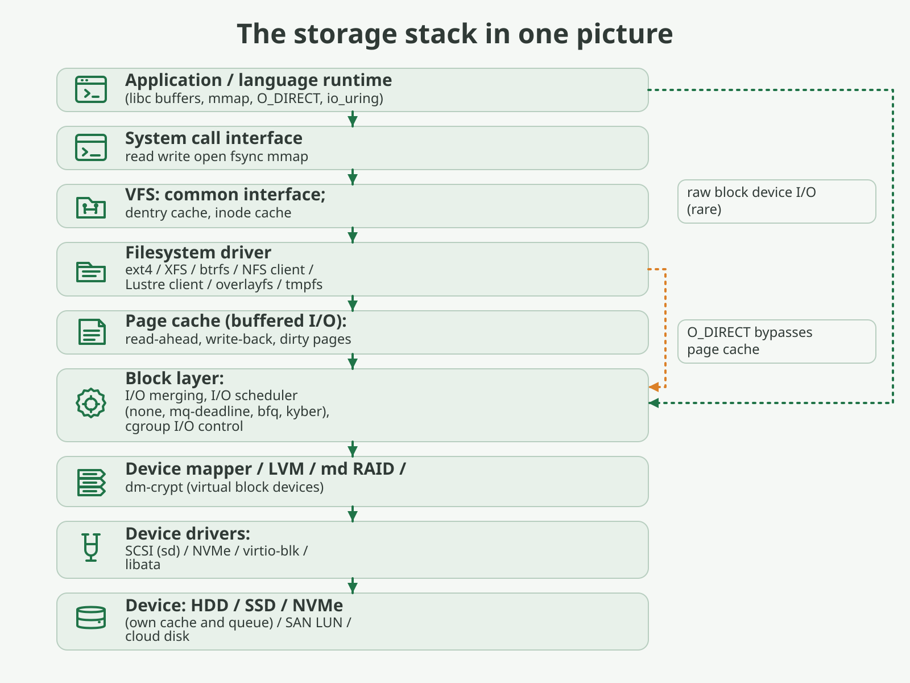
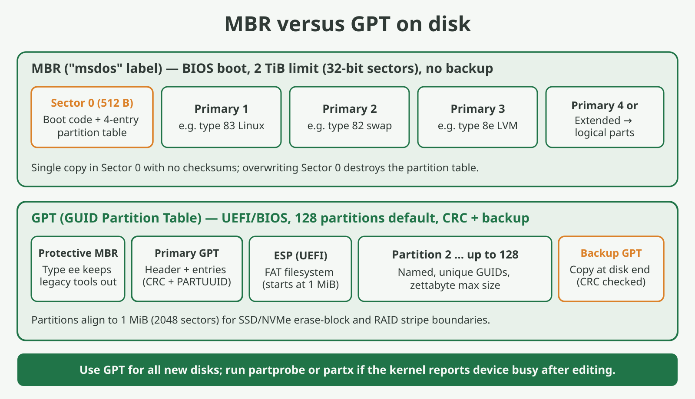
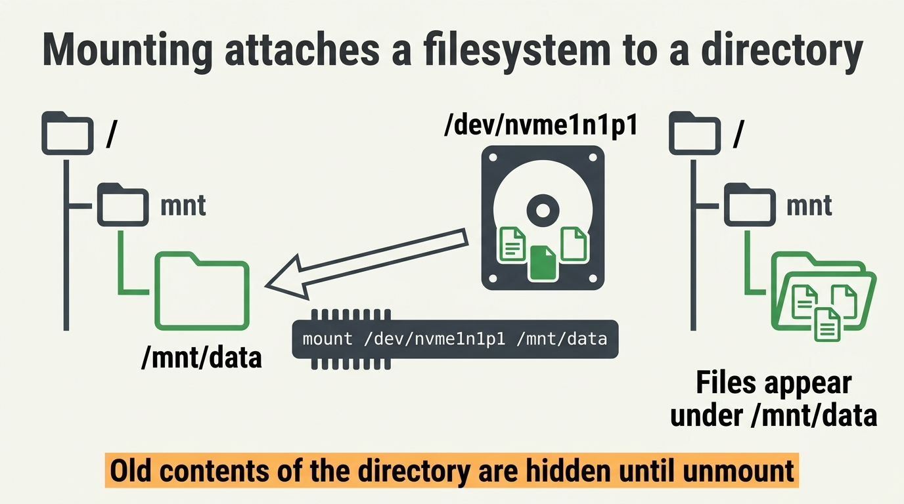
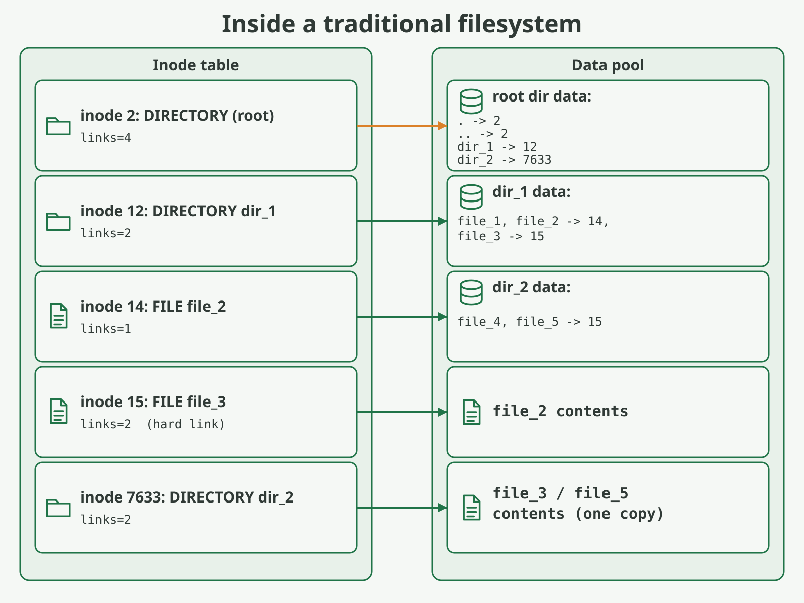
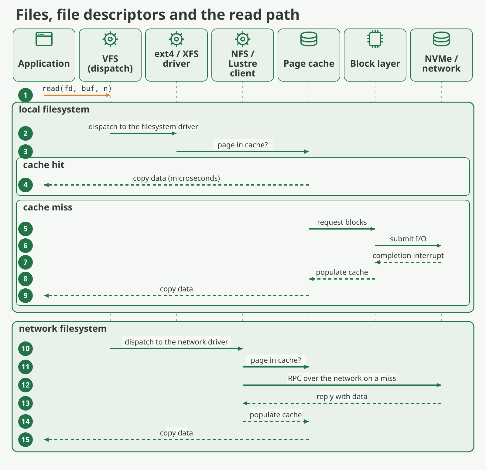
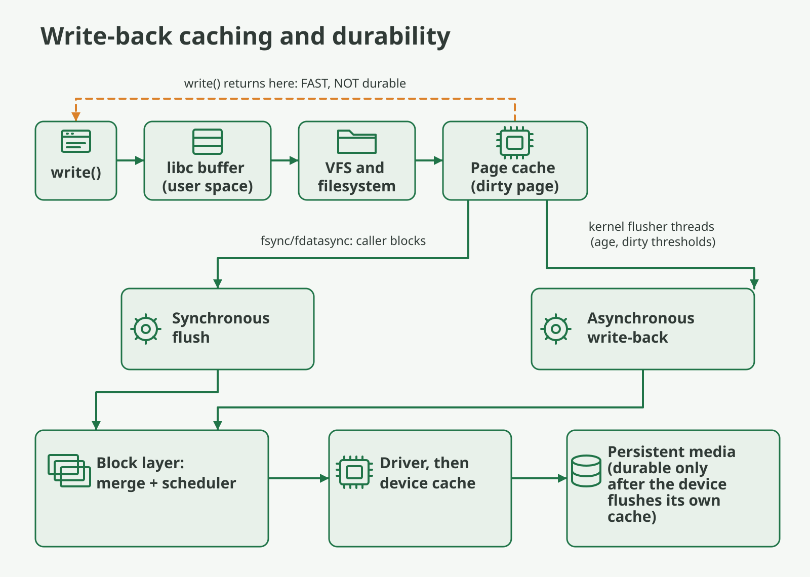
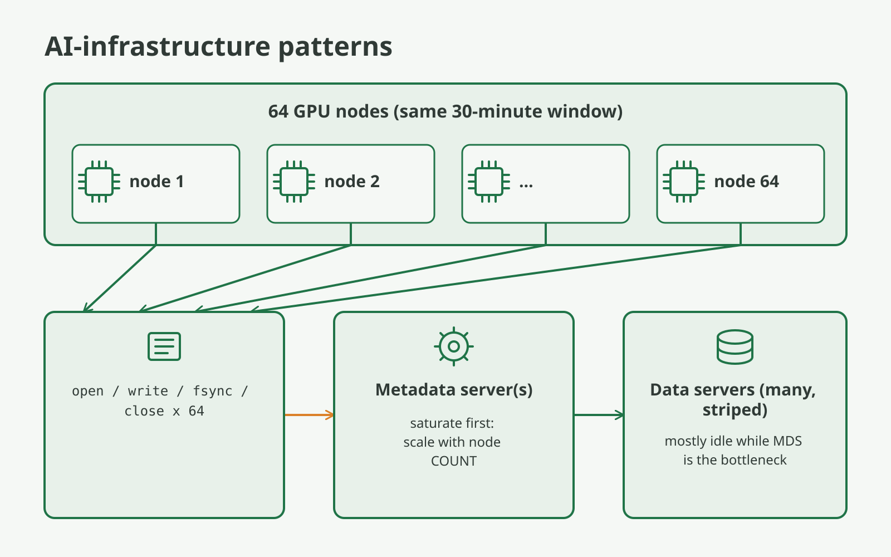
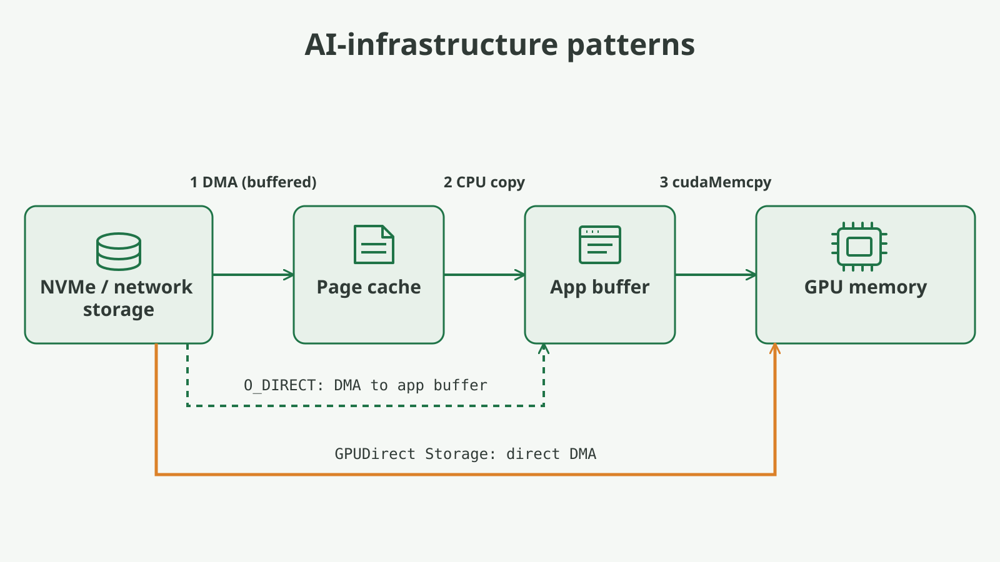

# 1.12 Disks, partitions and filesystems

| | |
|---|---|
| Level | Intermediate |
| Priority tier | 0 |
| Lab venue | GCP / GKE (an Ubuntu VM with an extra persistent disk or loop devices) |
| Part | Part 1: Linux, from the command line to the kernel and performance |
| Status | Drafted, labs **untested** |

## Why this matters for AI infrastructure

Picture a cluster of thousands of GPUs that suddenly stalls. The dashboards point at compute, but the real cause is often storage. Storage in AI infrastructure has two jobs, and both are demanding. It must feed GPUs at their maximum ingestion rate. It must also checkpoint very large model states without stalling training. The questions you will ask every day are all storage questions:

- "Which disk is this, what type is it, how is it partitioned, and how will I mount it so it survives a reboot?"
- "The job says 'No space left on device' but `df` shows free space." (inodes, quotas, reserved blocks, a read-only remount, a deleted-but-open file)
- "Reading the dataset is slow. Is it the filesystem, the page cache, the disk, or the network?"
- "Checkpoint time grew from 45 seconds to 8 minutes as we scaled." (shared-filesystem metadata contention)
- "Why did `fsck` run for an hour at boot, or why did the node come up with `/data` missing?" (fstab, `nofail`, journals)
- "Should this NVMe scratch be ext4 or XFS, and what mount options?"

This chapter builds the stack from the bottom. You will start with what disks are and how they behave. Then you will see how a disk is divided into partitions, using MBR and GPT. Next comes the filesystem, which you will look at from the inside: inodes, directories, journals and extents. After that you will create, mount, tune, check and repair one. The chapter also covers the special filesystems the kernel provides.

The later sections cover the performance concepts that explain why identical code can be fast or slow. These include caching, write-back, synchronous and direct I/O, read-ahead, and logical versus physical I/O. Then come the methods and tools for measuring all of this. The chapter ends with AI-specific patterns: local NVMe scratch, inode exhaustion, `O_DIRECT`, GPUDirect Storage, and checkpoint storms.

Logical volumes, RAID and NVMe operations continue in chapter 1.13. Boot and the initramfs come in 1.14. Shared and parallel filesystems (NFS, Lustre, GPFS, WekaFS) are in Part 6 and the storage part. The performance method is in 1.23 to 1.25.

## Prerequisites and outcomes

You should know the directory hierarchy, links and inodes at an introductory level (1.3). You also need users and permissions (1.6), device files and `/sys` (1.10), and processes and `/proc` (1.8). If any of those feel shaky, revisit them before you start.

After this chapter you can:

- Describe the Linux storage stack from application to device, and say where each cache and queue sits.
- Compare rotational disks, SSDs, NVMe and persistent memory, and the SCSI, SATA, SAS, FC and NVMe interfaces, with their latency scales.
- Read and create partition tables (MBR and GPT) with `parted`, `fdisk` and `sgdisk`, check alignment, and make the kernel re-read tables.
- Create, label and mount filesystems, write correct `/etc/fstab` entries (UUID, options, `nofail`, `_netdev`), test them safely, and use `findmnt`, `lsblk`, `blkid`.
- Explain inodes, directory entries, link counts, block allocation, journaling, extents, copy-on-write, and why each matters.
- Choose between ext4, XFS, btrfs and ZFS for a purpose, and know the mkfs and mount options that matter.
- Check and repair filesystems safely (`fsck`, `e2fsck`, `xfs_repair`), recover with a backup superblock, and know the worst-case options.
- Diagnose "disk full" in its five different forms (blocks, inodes, read-only, quota, wrong mount) and the deleted-but-open file.
- Explain buffered, synchronous, direct and memory-mapped I/O, `fsync` semantics, read-ahead, write-back thresholds, and the difference between logical and physical I/O.
- Measure with `df`, `du`, `iostat`, `vmstat`, `pidstat`, `fio`, `cachestat`, `/proc/pressure/io` and read the results correctly (including the NVMe `%util` trap).
- Apply storage patterns for GPU training and inference nodes.

## 1. The storage stack in one picture

Suppose a training job reads its dataset slowly, while the same read on another node flies. No error message points anywhere. The place to start is the path between the application and the disk. Every `read()` or `write()` call passes through many layers. Each layer can cache, reorder, merge, delay or fail the request. That is why "the disk is fine" and "the application is slow" can both be true.



*Figure 1.12.1. The storage stack in one picture.*

Three principles carry through the rest of the chapter.

1. **Filesystem latency is what applications feel.** The application waits for the filesystem, which uses caching and buffering to hide the disk. Statistics collected at the disk alone can mislead you. Background flushing looks like bursts of slow disk I/O, even though no application is waiting. A cache hit never reaches the disk at all.
2. **Every layer changes the I/O.** The disk sees *physical* I/O, while the application issued *logical* I/O. The two differ in size, count and timing (section 9).
3. **The bottleneck is rarely visible from the system call.** A `read()` that takes 400 ms tells you nothing about the cause. It could be an overloaded NVMe drive, a hung NFS server or a cold cache. You must look underneath the VFS.

Before you blame the disk, decide which layer your measurements can actually see.

## 2. Disks and their behaviour

Before you plan anything, look at what kind of disk you have, because the disk type decides how your data behaves under load. An archive you append to once a week and a dataset many jobs read at once ask very different things of storage. Each type has its own strengths and weaknesses, so read both columns of the table below.

### Disk types

| Type | How it works | Strengths | Weaknesses and notes |
|---|---|---|---|
| **Magnetic rotational (HDD)** | Platters spin; a head on a moving arm reads tracks divided into sectors | Cheap per terabyte; fine for large sequential data, archives, backups | Mechanical: seek and rotation take milliseconds, so random I/O is slow (a 7,200 rpm disk does roughly 100 to 200 random IOPS). Sensitive to vibration. **SMR** (shingled) drives add density but degrade sustained and random writes, so they are poor in RAID and write-heavy roles. "Sloth disks" occasionally return I/O after seconds without reporting an error |
| **SSD (SATA/SAS flash)** | NAND flash cells, no moving parts, behind a controller with a **flash translation layer (FTL)** | Low, consistent latency; random I/O almost as fast as sequential; no seek | Writes need erased blocks, so the controller does garbage collection; **write amplification**, limited **program/erase cycles** (SLC about 50k to 100k, MLC 3k to 10k, TLC about 3k, QLC about 1k), wear leveling and overprovisioning to extend life. Performance can degrade when full or fragmented. Uses **TRIM/discard** to know which blocks are free |
| **NVMe SSD** | Flash attached directly to **PCIe**, with the NVMe protocol (many hardware queues) | Tens of microseconds latency, hundreds of thousands to millions of IOPS, many GB/s | Needs parallel I/O to reach its numbers (a single-threaded synchronous reader uses a fraction). Bandwidth bounded by the PCIe link (Gen4 x4 about 7 GB/s, Gen5 x4 about 14 GB/s per direction) |
| **Persistent memory / battery-backed DRAM** | Byte-addressable non-volatile memory (3D XPoint, battery or supercapacitor-backed DRAM) | Close to memory speed | Expensive; niche (controller write caches, specialised stores) |
| **Virtual / network block devices** | Cloud persistent disks (GCP PD, EBS), SAN LUNs, iSCSI, NVMe-over-Fabrics | Elastic, survives host loss | Latency and throughput depend on provisioned size, type and network; per-VM caps |

You will rarely pick a disk for speed alone, so notice that each faster medium comes with its own catch. Flash must hide erase cycles from you, and NVMe needs parallel I/O before it shows its speed.

**Latency** is the time one request takes to finish. The figures below are orders of magnitude only, so consult vendor documentation and measure. An on-disk cache hit takes below 100 µs. NVMe flash takes 10 to 100 µs, and SATA flash takes 100 µs to 1 ms. A rotational sequential request takes about 1 ms. A rotational random read takes about 8 ms on a 7,200 rpm disk, and more when a queue builds. A worst-case virtual disk under RAID-5 with random I/O can exceed one second.

Watch out for the average. A disk returns a mix of cache hits in microseconds and misses in milliseconds, so an **average latency can be misleading**. The real distribution has two modes. Histograms show the truth.

### Sectors and block sizes

Start with the smallest unit, because it decides where writes land. Disks present **logical blocks**, also called sectors. Traditionally a sector is 512 bytes. Today it is often 4 KiB, the "Advanced Format" size. Many drives emulate 512-byte logical sectors on top of 4 KiB physical sectors (**512e**). That emulation causes a **read-modify-write** whenever a write is smaller than, or not aligned to, 4 KiB. This is why alignment matters (section 3). To see what a drive reports, run `lsblk -t` (columns `LOG-SEC`, `PHY-SEC`, `MIN-IO`, `OPT-IO`, `ROTA`), `cat /sys/block/sda/queue/{logical_block_size,physical_block_size,rotational}`, `fdisk -l`, `smartctl -a`, or `nvme id-ns`.

### Rotational disk mechanics (why old advice exists)

Some of the oldest storage advice still floats around, and it helps to know where it came from. To see which rules survive, you need three words about how a spinning disk is arranged.

A head reads a **track**. The same track on every platter forms a **cylinder**, and a track is divided into **sectors**. Older tools addressed locations by cylinder-head-sector (**CHS**). On modern disks the reported CHS values are fiction. Disks use **logical block addressing (LBA)**, a simple block number, and the firmware maps it onto the physical layout. Sector zoning is part of that mapping: outer tracks hold more sectors and deliver higher throughput. **Short-stroking** uses only the outer tracks to cut seek times. So the old rule that partitions must start on cylinder boundaries is obsolete.

Mechanical disks reorder queued requests to reduce head travel. This is **elevator seeking**, done through Tagged Command Queueing on SCSI and Native Command Queueing on SATA. That reordering can starve a distant request unless the scheduler enforces deadlines. Disks also store an error-correcting code per sector and retry reads that fail. Repeated retries are a common cause of mysteriously slow I/O. Rising soft-error rates, visible in SMART data, warn of failure.

### Interfaces

An **interface** is the set of rules a disk uses to talk to the rest of the machine. It is the first clue when a disk behaves oddly, and it decides how fast the disk can go. As you read the table, keep it in mind. Notice that the SCSI command set is still used on many of these interfaces, including USB storage, SATA via libata, SAS, iSCSI and FC.

| Interface | Notes |
|---|---|
| **SCSI** (parallel) | Historic shared bus; replaced by serial variants. The **SCSI command set** is still everywhere (USB storage, SATA via libata, SAS, iSCSI, FC) |
| **SAS** (Serial Attached SCSI) | Point-to-point, 3/6/12/22.5 Gbit/s generations, dual-ported, multipath, hot swap; the enterprise HDD/SSD interface; also accepts SATA drives |
| **SATA** | Consumer and entry server; 1.5/3/6 Gbit/s; about 550 MB/s usable at 6 Gbit/s; 32-command queue |
| **FC** (Fibre Channel) | SAN fabrics; switches and zoning; very high speeds; used with storage arrays |
| **NVMe** | A protocol over PCIe: up to 64 thousand queues, each up to 64 thousand commands, per-CPU queues without shared locks, lower CPU cost per I/O; supports SR-IOV; **NVMe-oF** carries it over RDMA or TCP (chapter 1.13 and storage chapters) |

### How storage is attached

The same disk can reach your system by several different paths. How it is attached decides what you can see and what you can control. Each option has its own failure modes.

- **Disk devices (JBOD)**: the operating system sees each disk, which makes them the easiest to observe.
- **RAID**: a controller or software groups disks into one larger or more reliable virtual disk (details and levels in chapter 1.13). A hardware RAID volume appears as one disk and hides the physical disks from the OS, which makes monitoring harder. Its write-back cache is protected by a battery or capacitor. If that protection fails, controllers fall back to write-through mode, and write performance drops suddenly.
- **Storage arrays and SANs**: many disks sit behind controllers with large caches. They attach by FC, SAS or iSCSI, and often use two paths (multipath).
- **NAS** (network-attached storage): NFS, SMB/CIFS, or iSCSI from an appliance. The network becomes part of the I/O path, so analyse it as a separate system.
- **Local NVMe in GPU servers**: the usual place for scratch data, caches and fast checkpoints. It belongs to that one machine, and on the cloud an instance restart can lose it. **Shared or parallel filesystems** (Lustre, GPFS/Storage Scale, Weka, BeeGFS, CephFS) give the same data to all nodes. Their trade-off is network dependency and metadata scaling (Part 6 and the storage chapters).

Decide early whether a dataset should stay local or be shared, because the answer changes how you monitor it.

## 3. Partitioning

You slot a brand-new NVMe drive into a node, and it does not appear where you expected. Before the machine can use the drive, someone must draw boundaries on it. Those boundaries live on the disk itself, not in the kernel's imagination.

A **partition** is a contiguous range of blocks on a disk. Its location is recorded in a **partition table**, also called a *disk label*, at a known place on the disk. The kernel shows each partition as its own block device, such as `/dev/sda1` or `/dev/nvme0n1p2`.

Partitions began with old PC boot restrictions. People also use them to reserve space for separate purposes. The operating system, swap and data can each have a partition, so a full data area cannot stop the system.

Today you often use one partition per disk, or none at all. You can put a whole-disk filesystem on a disk, or use the whole disk as an LVM physical volume or a RAID member. What you must have is a clear picture of what holds what.

### MBR and GPT

The two partition table formats differ in size limits, resilience and boot method, so compare them before you choose.

| | **MBR** ("msdos" label) | **GPT** (GUID Partition Table) |
|---|---|---|
| Location | First 512-byte sector (with the boot code) | A protective MBR, then a header and an entry array at the start, with a **backup copy at the end** of the disk |
| Max disk size | 2 TiB (32-bit sector counts) | Practically unlimited (zettabytes) |
| Partition count | 4 primary; or 3 primary plus 1 **extended** containing **logical** partitions | 128 by default |
| Names/IDs | Numeric type codes only (83 Linux, 82 swap, 8e LVM, ee GPT protective, 0c FAT32) | Partition **names**, unique **GUIDs** (PARTUUID), type GUIDs |
| Boot | BIOS | UEFI (requires an **EFI System Partition**, a FAT filesystem); BIOS can boot GPT too with a small **BIOS boot partition** |
| Resilience | None | CRC checksums, two copies |

For anything new, use **GPT**. Keep MBR knowledge for old systems, USB sticks and some cloud images.



*Figure 1.12.2. MBR versus GPT on-disk partition layout.*

### Tools

Several tools read and change the table. Some only look, and others change the disk, so check which kind you are running.

| Tool | Notes |
|---|---|
| `lsblk`, `lsblk -f`, `blkid`, `parted -l`, `fdisk -l`, `sfdisk -d` | Look (read-only) |
| `fdisk` | Interactive; recent versions support MBR and GPT; **changes nothing until you write with `w`**, so you can design the table and quit with `q` if wrong |
| `parted` | Scriptable; supports MBR and GPT; **applies each command immediately** (no review step) |
| `gdisk` / `sgdisk` | GPT-focused (fdisk-like interactive and scriptable) |
| `partprobe`, `blockdev --rereadpt`, `partx` | Make the kernel re-read a changed table |
| `wipefs`, `sgdisk --zap-all`, `dd` | Erase signatures and tables (careful) |

Surprisingly, partitioning happens entirely in user space. The tools rewrite the table on the block device, then ask the kernel to re-read it. `fdisk` makes one system call (an `ioctl`, `BLKRRPART`) that re-reads the whole table, and it prints `sdd: sdd1 sdd2` in the kernel log. `parted` informs the kernel partition by partition. If the disk is in use, the re-read can fail with "device or resource busy". In that case use `partprobe` or reboot. To see what changed, use `udevadm monitor --kernel`, `cat /proc/partitions`, and `ls /sys/block/sdd`.

### Reading a partition table with `parted -l`

Before you change a disk, read its table. The `parted -l` command prints the table for every disk it can find, so one command gives you the full picture. This sample comes from a machine with two disks, and each disk uses a different table type.

```
# parted -l
Model: ATA KINGSTON SM2280S (scsi)
Disk /dev/sda: 240GB
Sector size (logical/physical): 512B/512B
Partition Table: msdos
Disk Flags:
Number Start End Size Type File system Flags
1 1049kB 223GB 223GB primary ext4 boot
2 223GB 240GB 17.0GB extended
5 223GB 240GB 17.0GB logical linux-swap(v1)
Model: Generic Flash Disk (scsi)
Disk /dev/sdf: 4284MB
Sector size (logical/physical): 512B/512B
Partition Table: gpt
Disk Flags:
Number Start End Size File system Name Flags
1 1049kB 1050MB 1049MB myfirst
2 1050MB 4284MB 3235MB mysecond
```

The disk `/dev/sda` uses the old MBR layout, which `parted` calls `msdos`. The disk `/dev/sdf` holds a GPT. The two table types store different details. The MBR table has no `Name` column, because MBR has no place for partition names. The GPT names in this example were picked at random for the demonstration.

An MBR table holds primary, extended and logical partitions. A primary partition is a normal slice of the disk. Plain MBR allows only four primary partitions. If you need more, one of them becomes an extended partition, and the extended partition holds logical partitions. Here, partition 2 is extended and contains logical partition 5.

The filesystem type that `parted` shows is not the same as the MBR system ID. The ID is a bare number, such as 83 for Linux or 82 for Linux swap. `parted` tries to work out the filesystem itself. When you need the raw ID, run `fdisk -l` instead.

Read the units with care. `parted` rounds sizes to whatever it considers easy to read. `fdisk -l` shows exact counts, usually in 512-byte sectors, which can make sizes look doubled. Check the sector size line before you do any math.

### Partition tables on an LVM system

If the Flags column shows `lvm`, or devices under `/dev/mapper` appear as disks, the system uses LVM. The example below is a fresh Ubuntu install with LVM chosen during setup. The partition table looks normal, except for the `lvm` flag.

```
Model: ATA VBOX HARDDISK (scsi)
Disk /dev/sda: 10.7GB
Sector size (logical/physical): 512B/512B
Partition Table: msdos
Disk Flags:
Number Start End Size Type File system Flags
1 1049kB 10.7GB 10.7GB primary boot, lvm
```

The LVM devices then look like partitions, but the system lists them as disks. The partitions have been separated from the partition table. Section 1.13 explains how this works, so for now just recognise the pattern.

### An MBR example with fdisk

Picture a small, unused USB flash drive that you want to split into two Linux partitions. You can follow along with any spare device. Find its name with `lsblk` first, and make sure nothing on it is mounted. Then start `fdisk` with the device name.

```
# fdisk /dev/sdd
Command (m for help):
```

Start by printing the current table with `p`. `fdisk` commands are short, so expect terse output:

```
Command (m for help): p
Disk /dev/sdd: 4 GiB, 4284481536 bytes, 8368128 sectors
Units: sectors of 1 * 512 = 512 bytes
Sector size (logical/physical): 512 bytes / 512 bytes
I/O size (minimum/optimal): 512 bytes / 512 bytes
Disklabel type: dos
Disk identifier: 0x88f290cc
Device Boot Start End Sectors Size Id Type
/dev/sdd1 2048 8368127 8366080 4G c W95 FAT32 (LBA)
```

Most devices already contain one FAT-style partition, like the one shown here. Since you want Linux partitions, delete the existing one:

```
Command (m for help): d
Selected partition 1
Partition 1 has been deleted.
```

`fdisk` does not write anything until you explicitly save the table. If you make a mistake you cannot recover from, use `q` to quit without saving. Next, create the first partition with `n`. Accept the defaults for the partition type and number. Set the size with a plus sign and a unit:

```
Command (m for help): n
Partition type
p primary (0 primary, 0 extended, 4 free)
e extended (container for logical partitions)
Select (default p): p
Partition number (1-4, default 1): 1
First sector (2048-8368127, default 2048): 2048
Last sector, +sectors or +size{K,M,G,T,P} (2048-8368127, default 8368127): +200M
Created a new partition 1 of type 'Linux' and of size 200 MiB.
```

Create the second partition the same way, using all the default values. Then print the table again to review it:

```
Command (m for help): p
[--snip--]
Device Boot Start End Sectors Size Id Type
/dev/sdd1 2048 411647 409600 200M 83 Linux
/dev/sdd2 411648 8368127 7956480 3.8G 83 Linux
```

When the layout looks right, write it with `w`. `fdisk` does not ask for confirmation. It writes the table and exits:

```
Command (m for help): w
The partition table has been altered.
Calling ioctl() to re-read partition table.
Syncing disks.
```

If you want the kernel's diagnostic messages, run `journalctl -k`. You only get them when you use `fdisk`.

### How the kernel learns about a new table

The kernel must read the partition table before it can show partitions as devices. `fdisk` writes the table, then makes one system call that asks the kernel to reread the whole table. The kernel logs a short message, such as `sdf: sdf1 sdf2` for two new partitions.

`parted` works differently. It tells the kernel about each partition as it changes, so no whole-disk message appears. Neither tool needs kernel support to rewrite the table, because user space can access the whole block device.

To watch the changes, use `udevadm monitor --kernel`, which shows partitions being removed and added. You can also check `/proc/partitions`, or the `/sys/block` and `/dev` trees. If you must confirm a reload, force it with `blockdev`:

```
# blockdev --rereadpt /dev/sdf
```

This is the older system call that `fdisk` makes.

### Alignment examples with `parted`

Newer partitioning tools place new partitions at good offsets. They align partitions on 1 MiB boundaries, which is sector 2048 with 512-byte sectors. Existing partitions are not realigned, so check them yourself. Here is `parted` output for two disks, one of which holds an LVM partition:

```
# parted /dev/sdb print
Model: ATA VBOX HARDDISK (scsi)
Disk /dev/sdb: 5616MB
Sector size (logical/physical): 512B/512B
Partition Table: msdos
Disk Flags:
Number Start End Size Type File system Flags
1 1049kB 5616MB 5615MB primary lvm
# parted /dev/sdc print
Model: ATA VBOX HARDDISK (scsi)
Disk /dev/sdc: 16.0GB
Sector size (logical/physical): 512B/512B
Partition Table: msdos
Disk Flags:
Number Start End Size Type File system Flags
1 1049kB 16.0GB 16.0GB primary lvm
```

Both partitions start at 1049kB, which is the 1 MiB boundary the tools use.

### A worked example (a spare disk, GPT)

The commands below create one GPT partition on a spare disk. The first command finds the disk and confirms it is unused. The `parted` line creates the table and one partition from 1 MiB to the end of the disk. The `fdisk` steps do the same job interactively, and `p` lets you check before `w` writes anything.

```bash
lsblk -o NAME,SIZE,TYPE,FSTYPE,MOUNTPOINT,MODEL         # find the right disk; ensure it is unused
sudo parted /dev/sdb --script mklabel gpt \
     mkpart data ext4 1MiB 100% \
     print                                                # one partition from 1 MiB (aligned) to the end
# or interactively with fdisk
sudo fdisk /dev/sdb
#   g        create a new GPT
#   n        new partition (accept defaults: number 1, first sector 2048, last sector end)
#   t        change type (e.g. 19 = Linux filesystem; 20 = Linux RAID; 31 = LVM, with fdisk's type list 'L')
#   p        print and CHECK before writing
#   w        write and exit   (q to abort without changes)
sudo partprobe /dev/sdb && lsblk /dev/sdb
```

Always verify the device name twice (`lsblk -o NAME,SIZE,MODEL,SERIAL`), and unmount anything on it. Back up the old table first (`sfdisk -d /dev/sdb > sdb.table`, `sgdisk --backup=sdb.gpt /dev/sdb`). Deleting a partition makes its data very hard to recover, so slow down for that step. If a device name looks unfamiliar, stop and check it before you run anything destructive.

### Alignment (*How Linux Works* Section 4.1.6)

Flash drives, meaning SSDs and NVMe, read and write data in **pages**. A page is commonly 4 KiB (4,096 bytes) or 8 KiB. Flash erases in much larger blocks. If a partition does not begin on a multiple of the flash page size, a single 4 KiB read or write can straddle two physical pages on the drive. That cuts throughput.

Newer partitioning tools place new partitions at proper offsets. `1 MiB` is sector `2048` for 512-byte sectors, which is a multiple of every common flash page size. The tools do not inspect or realign *existing* partitions, though. To check an existing partition, read its `start` file in `/sys/block`. That file reports the starting offset in 512-byte units.

Here is a worked example from *How Linux Works* Section 4.1.6. `cat /sys/block/sdf/sdf2/start` prints `1953126`. Divide that by `8`, because eight 512-byte sectors make one 4,096-byte page. The result is `244140.75`, which is not a whole number, with a remainder of `6`. That proves `/dev/sdf2` is **not** aligned on a 4,096-byte boundary.

To check with a tool instead, run `parted /dev/sdb align-check optimal 1`. A good result prints `1 aligned`. For RAID, LVM and XFS, also check the stripe unit and width (chapter 1.13).

### Partition types you will meet

A typical GPU server has several partitions, and each has a job. An **EFI System Partition** (about 512 MiB, FAT32, mounted at `/boot/efi`) comes first. An optional `/boot` partition (ext4) follows. Then comes the **root** filesystem, or an LVM physical volume. Some servers also have **swap**, which is often none or small on GPU nodes. Data devices are usually whole disks.

Cloud images differ. They use a tiny BIOS-boot or EFI partition plus one root partition. They also **grow the root partition and filesystem at first boot** (`cloud-init growpart`). That is why the same image fits any disk size.

Before you repartition anything in production, save the current table and check the device name twice.

## 4. Creating filesystems

Picture the moment after someone ran `mkfs` against the wrong device. The old data's map is gone, and with it the previous contents. That is the step in this chapter you must never rush.

A **filesystem** turns a block device into named files and directories. A partition table only draws boundaries. A filesystem is a **database**. It tracks which blocks belong to which file, who owns the file, its permissions and times. It also keeps this map consistent through crashes. That is why partitioning and filesystem creation are separate tools and separate steps.

### Filesystem types

Pick the filesystem for the job. The table lists the common types and what each means for AI work.

| Type | Origin and character | Notes for AI infrastructure |
|---|---|---|
| **ext4** | The Linux default for years; descendant of ext2/ext3 (journal added in ext3; extents, delayed allocation, large files in ext4). Mount ext2/3 as ext4, not the reverse | Reliable general purpose; fine for root and moderate data; inode count fixed at creation; online grow, offline shrink |
| **XFS** | From SGI; **allocation groups** allow parallel allocation; scales to large files, large directories, many threads; online grow, **cannot shrink** | Default on RHEL-family; excellent for big files and parallel I/O (datasets, checkpoints, scratch on NVMe); inodes allocated dynamically (no inode exhaustion in the ext4 sense) |
| **btrfs** | Copy-on-write B-tree filesystem with subvolumes, snapshots, compression, checksums, built-in multi-device | Default for some distributions (SUSE, Fedora desktop); use with care for databases and heavy random write |
| **ZFS** (OpenZFS) | Combined volume manager and filesystem; pooled storage, checksums, snapshots, compression, ARC cache | Excellent integrity; out-of-tree on Linux (licence), memory-hungry ARC competes with GPU hosts' RAM |
| **vfat / exfat / ntfs / hfsplus** | Microsoft (`vfat`/`msdos`, `ntfs`) and Apple Macintosh (`hfsplus` / HFS+) formats | USB sticks, EFI System Partition; `vfat` lacks Unix permissions and cannot support `ln` hard links because its directory structure was designed for Windows rather than Unix inodes |
| **iso9660, udf** | Optical media and images | Installer ISOs |
| **squashfs** | Compressed read-only filesystem | Container/snap images, Enroot/Apptainer SIF |
| **overlayfs** | Union of layers (lower read-only, upper writable) | Container root filesystems (chapter 1.19, 1.20, 7) |
| **tmpfs** | In-memory (and swap) filesystem | `/run`, `/dev/shm`, `/tmp` on some systems; size-limited |
| **NFS, CIFS/SMB, Lustre, GPFS, BeeGFS, CephFS, WekaFS** | Network and parallel filesystems | Shared datasets and checkpoints (Part 6) |
| **FUSE filesystems** | User-space filesystems via `/dev/fuse` | SSHFS, s3fs/goofys/mountpoint-s3, rclone mount, gcsfuse (convenient, slower, metadata-bound) |

The kernel's **VFS** layer is what lets all of these coexist. It is a single common interface for every filesystem. It places them under one directory tree and one set of system calls, whatever the implementation. It is also the common point for measuring any filesystem.

### Making one

Creating a filesystem is a one-time step on a new device. You will see it on every new disk you bring into service. The commands below show the usual choices, and you can start from the defaults and change only what you can justify.

```bash
sudo mkfs.ext4 -L scratch /dev/nvme1n1p1           # or:  mkfs -t ext4 ...
sudo mkfs.xfs  -L scratch /dev/nvme1n1p1
sudo mkfs.xfs -f -d su=256k,sw=4 /dev/md0          # align to a RAID stripe (stripe unit 256 KiB x 4 data disks)
sudo mkfs.ext4 -m 0 -i 65536 /dev/nvme1n1p1        # no root-reserved blocks; one inode per 64 KiB (fewer inodes for big files)
sudo mkfs.ext4 -T small /dev/sdc1                  # many small files: more inodes (see mke2fs.conf types)
```

**`mkfs` is a front end (*How Linux Works* Section 4.2.2).** `mkfs` is only a wrapper for a family of filesystem creation programs named `mkfs.fs`. So when you run `mkfs -t ext4`, `mkfs` runs `mkfs.ext4`. If you inspect `/sbin/mkfs.ext4` with `ls -l /sbin/mkfs*`, you will see it is a symbolic link (or hard link) to `mke2fs`. Each filesystem has its own tools and manual page (`mke2fs(8)`, `mkfs.xfs(8)`). Defaults are sensible, so change them only with a reason.

**Creating a filesystem destroys the previous contents.** The old data's map is gone, so do it once per new device. Record the **superblock backup locations** printed at creation (ext4), or find them later with `mkfs.ext4 -n /dev/...`. The `-n` option only simulates, so never omit `-n`.

These parameters matter:

- **ext4 inode count** is fixed at creation (`-i bytes-per-inode`, `-N count`). An inode is the filesystem's record for one file, and it is a separate resource from the bytes the file occupies. A dataset of hundreds of millions of tiny files can exhaust inodes while bytes remain free (`df -i`). Lower `-i` for small-file workloads. XFS does not have this problem.
- **Reserved blocks**: ext4 reserves 5% for root by default. That stops a runaway user process from filling the disk completely and starving system daemons. On a large data disk, set 0 or 1% (`mkfs.ext4 -m 0`, or `tune2fs -m 1`).
- **XFS geometry** (`su`/`sw`, log size, `-i maxpct`): align these with RAID stripe settings. The defaults are usually right for NVMe.
- **Labels and UUIDs**: set a `-L` label for human reference. The UUID is generated automatically.
- **Lazy initialisation** (`lazy_itable_init`, `lazy_journal_init`) makes `mkfs` on huge ext4 volumes return quickly. The background work finishes after the first mount. For benchmarking, disable it (`-E lazy_itable_init=0`), so the initial background write does not disturb your results.

### Filesystem families and their history

Linux supports native filesystems, foreign ones such as the Windows FAT family, and universal formats such as ISO 9660. Knowing where a type came from tells you what it does well. The Extended series is the longest-running native family. The second Extended filesystem, `ext2`, was modelled on traditional Unix filesystems such as UFS and FFS.

Its successor, `ext3`, added a journal, which is a small cache outside the normal data structures. The journal improves data integrity and speeds up boot checks. `ext4` is an incremental improvement. It supports larger files than `ext2` or `ext3`, and it allows more subdirectories.

The series stays backward compatible in one direction. You can mount `ext2` and `ext3` filesystems as each other, and you can mount either as `ext4`. You cannot mount `ext4` as `ext2` or `ext3`. Btrfs, the B-tree filesystem, is newer and native to Linux. It was designed to scale beyond what `ext4` can do.

The FAT types, `msdos`, `vfat` and `exfat`, come from Microsoft systems. The simple `msdos` type covers the primitive single-case names of MS-DOS. Most removable flash media, such as SD cards and USB drives, use `vfat` up to 4GB and `exfat` above that. Windows can also use NTFS, the more advanced NT File System.

XFS is a high-performance filesystem. Some distributions, such as Red Hat Enterprise Linux 7.0 and later, use it by default. `hfsplus` is the Apple standard used on most Macintosh systems. `iso9660` is the CD-ROM standard, and most CD-ROMs use some version of it.

Linux developers tend to replace any component that no longer meets current needs. The Extended series was upgraded each time it fell short, which explains why it stayed the default so long. Some advances, mostly for very large numbers of files and very large files, need changes that `ext4` cannot make without breaking compatibility. At the time of writing, Btrfs was the default for one major distribution. If that works out, Btrfs could replace the Extended series.

### What `mkfs` runs behind the scenes

`mkfs` is a front end for a family of programs named `mkfs.` plus a type. Inspect the programs behind the commands, and you will see this:

```
$ ls -l /sbin/mkfs.*
-rwxr-xr-x 1 root root 17896 Mar 29 21:49 /sbin/mkfs.bfs
-rwxr-xr-x 1 root root 30280 Mar 29 21:49 /sbin/mkfs.cramfs
lrwxrwxrwx 1 root root 6 Mar 30 13:25 /sbin/mkfs.ext2 -> mke2fs
lrwxrwxrwx 1 root root 6 Mar 30 13:25 /sbin/mkfs.ext3 -> mke2fs
lrwxrwxrwx 1 root root 6 Mar 30 13:25 /sbin/mkfs.ext4 -> mke2fs
lrwxrwxrwx 1 root root 6 Mar 30 13:25 /sbin/mkfs.ext4dev -> mke2fs
-rwxr-xr-x 1 root root 26200 Mar 29 21:49 /sbin/mkfs.minix
lrwxrwxrwx 1 root root 7 Dec 19 2011 /sbin/mkfs.msdos -> mkdosfs
lrwxrwxrwx 1 root root 6 Mar 5 2012 /sbin/mkfs.ntfs -> mkntfs
lrwxrwxrwx 1 root root 7 Dec 19 2011 /sbin/mkfs.vfat -> mkdosfs
```

`mkfs.ext4` is just a symbolic link to `mke2fs`. This matters on a system that lacks a specific `mkfs` command, and when you look up documentation for one filesystem. Each creation tool has its own manual page, such as `mke2fs(8)`. Opening the page for `mkfs.ext4` usually redirects you to `mke2fs`.

Before you format anything, be certain of the device first.

## 5. Mounting

Picture a node that comes back from a reboot with `/data` missing. The boot log points at a mount, and you need to know how mounts work before you can fix it. **Mounting** attaches a filesystem to a directory, called the **mount point**, in the global tree. Walk into that directory and you reach the filesystem. To mount, you need three things: the **source** (a device, UUID, label, remote path, or a pseudo name for special filesystems), the **type**, and the **mount point**, which must be an existing directory. `/mnt` is a conventional place for temporary mounts. Permanent filesystems get their own directories, such as `/data` or `/scratch`.



*Figure 1.12.3. Mounting makes a filesystem's files appear under a directory; what was there before is hidden until unmount.*

Start with `findmnt`. It shows the mount tree and answers the question you will ask most often: which filesystem holds this path?

```bash
mount                                  # everything mounted, with options (long; special filesystems included)
findmnt                                # the same as a tree; best tool
findmnt /data; findmnt -T /data/file   # which filesystem holds this path? (answers "is this local or network?")
findmnt -o TARGET,SOURCE,FSTYPE,OPTIONS,SIZE,USE%
sudo mount /dev/nvme1n1p1 /data        # type is auto-detected
sudo mount -t xfs -o noatime /dev/nvme1n1p1 /data
sudo mount UUID=b600fe63-d2e9-461c-a5cd-d3b373a5e1d2 /data
sudo mount -o ro,uid=1000 -t vfat /dev/sde1 /dos
sudo umount /data                      # by mount point (or device)
sudo umount -l /data                   # lazy: detach now, clean up when no longer busy (last resort)
```

`umount` fails with "target is busy" while any process has a file open, or has a current directory inside the mount. To find out who, run `lsof +f -- /data` or `fuser -vm /data`. Then end those processes or move them. Do not reach for `umount -f` or `-l` as a habit, because a lazy unmount leaves processes using a detached filesystem. A **stuck network filesystem** is the exception. There, a forced or lazy unmount may be the only practical way out (chapter 1.8 covers `D` state).

The kernel buffers writes, so a filesystem can have unwritten changes in memory. `umount` flushes them. `sync` forces a flush of all filesystems. Use it before cutting power to a machine that cannot be shut down cleanly, although a proper shutdown is better.

### Identifying filesystems: UUID and labels

Device names depend on probe order (chapter 1.10), so identify filesystems by **UUID** or **label**. A UUID is a long identifier that stays with the filesystem wherever the device is attached, and a label is a name you set at creation.

```bash
lsblk -f                                  # NAME FSTYPE LABEL UUID MOUNTPOINT
sudo blkid                                # /dev/sdb1: UUID="..." TYPE="ext4" PARTUUID="..."
sudo blkid -s UUID -o value /dev/sdb1     # just the UUID
sudo tune2fs -U random /dev/sdb1          # change an ext filesystem's UUID (e.g. after cloning a disk)
sudo xfs_admin -U generate /dev/sdb1      # XFS equivalent (unmounted)
```

UUIDs are the preferred key in `/etc/fstab` for plain partitions. FAT filesystems have a short volume serial instead (`4859-EFEA`). Desktop services mount removable media at `/media/<user>/<uuid or label>`. Cloned disks have **identical UUIDs**, and mounting both causes confusion. XFS refuses to mount a second filesystem with the same UUID unless you pass `-o nouuid`.

### Mount options

Options follow `-o`, separated by commas, and they also go in `/etc/fstab`. These are the ones you will use most. Some trade safety for speed, and others change how the boot behaves.

| Option | Meaning |
|---|---|
| `ro` / `rw` | Read-only / read-write (`-r` is `-o ro`) |
| `noexec` / `exec` | Forbid / allow running programs from this filesystem (hardening for `/tmp`, `/home`, data disks; but breaks scripts that execute from `/tmp`) |
| `nosuid` | Ignore setuid/setgid bits |
| `nodev` | Ignore device files on it |
| `noatime` / `relatime` / `strictatime` | Access-time updates: reads would otherwise cause writes. **`relatime`** (default) updates atime only if older than the modify time or more than a day old; **`noatime`** never updates (best for data disks, avoid for software that needs atime such as some mail readers and tmp cleaners); **`nodiratime`** for directories |
| `discard` / (no discard) | Issue TRIM on every delete (continuous); often worse than periodic **`fstrim`** (the `fstrim.timer` systemd unit trims weekly); on some cloud and NVMe devices continuous discard hurts latency |
| `data=ordered` / `writeback` / `journal` (ext3/4) | Journaling mode: metadata only after data (default), metadata only without ordering, or full data journaling (slower) |
| `errors=continue` / `remount-ro` / `panic` (ext) | What the kernel does on an error: continue, remount read-only, or halt. `remount-ro` is a common safe choice; **a filesystem that has remounted itself read-only is a classic cause of "No space left" and "Read-only file system" errors** |
| `commit=N` | Journal commit interval in seconds (ext4; default 5) |
| `barrier` / `nobarrier` | Honour or skip write barriers (flush commands). Skipping risks corruption on power loss; do not use unless the device has a safe write cache |
| `user` / `users` / `noauto` / `auto` | `fstab` conveniences: allow ordinary users to mount (implies `nosuid,noexec,nodev`), skip at `mount -a` and boot |
| `nofail` | Do not fail the boot if this device is absent (essential for removable or optional data disks; otherwise systemd drops to emergency mode) |
| `x-systemd.device-timeout=`, `x-systemd.automount`, `_netdev` | systemd integration: wait time for the device; mount on first access; mark as network-dependent so it waits for the network |
| `size=`, `nr_inodes=`, `mode=` | tmpfs limits and permissions |
| `uid=`, `gid=`, `umask=` | Ownership for filesystems without Unix permissions (FAT, NTFS, exFAT) |
| `usrquota,grpquota,prjquota` | Enable quotas (section 6) |

The filesystem-specific options are documented in `mount(8)` and in per-filesystem pages (`ext4(5)`, `xfs(5)`, `nfs(5)`, `tmpfs` in `mount(8)`). **Remount** changes options on a mounted filesystem without unmounting it:

```bash
sudo mount -o remount,rw /           # make the root filesystem writable again after a rescue boot
sudo mount -o remount,noatime /data
sudo mount -n -o remount,rw /        # -n: do not write /etc/mtab (needed when / is still read-only)
```

### Short and long mount options

Many `mount` options have a short letter, and many have a long keyword. Short letters cover common jobs, such as `-r` for read-only and `-t` for the filesystem type. Long options cover everything else. They follow `-o`, separated by commas.

```
# mount -t vfat /dev/sde1 /dos -o ro,uid=1000
```

Here `ro` means read-only, the same as `-r`. The `uid=1000` option tells the kernel to treat every file on the filesystem as owned by user ID 1000. The `exec` and `noexec` options allow or forbid running programs from the filesystem. The `suid` and `nosuid` options allow or ignore setuid bits. The `rw` option mounts read-write.

The `-n` option stops `mount` from writing `/etc/mtab`, the runtime mount database. Without it, the mount fails when that file cannot be written. That happens at boot, while the root filesystem is still read-only. The option also helps in single-user mode, when the database may not be available.

Unix and DOS text files end lines differently. Unix uses a single linefeed, and DOS uses a carriage return followed by a linefeed. Automatic conversion at the filesystem level causes trouble, so keep the style uniform. Editors such as vim detect the style and maintain it.

### Remounting a filesystem in place

The most common reason to remount is crash recovery. The root filesystem may start read-only, and you need it writable. Remounting attaches the same filesystem again at the same mount point, with new options.

```
# mount -n -o remount /
```

The `-n` option matters here, because the root is still read-only and cannot update `/etc/mtab`. This works only if `/etc/fstab` lists the right device for `/`. If it does not, add the device name to the command.

### Removable media and `noauto`

Some entries should not mount at boot. A removable flash device is one example. The `noauto` option makes `mount -a` skip the entry. The `user` option lets an ordinary user mount it. Because a user could place a setuid program on such a device, `user` also implies `nosuid`, `noexec` and `nodev`.

Most desktops mount inserted media automatically now. The `user` option is most useful for granting access to specific directories.

### `/etc/fstab`: mounts at boot

`/etc/fstab` lists the filesystems to mount at boot. It also holds the shortcuts for commands such as `mount /data`. Each line describes one filesystem and has **six fields**.

```text
# <source>                                   <mount point>  <type>  <options>              <dump> <fsck>
UUID=70ccd6e7-6ae6-44f6-812c-51aab8036d29    /              ext4    errors=remount-ro      0      1
UUID=592dcfd1-58da-4769-9ea8-5f412a896980    none           swap    sw                     0      0
UUID=3f2a...                                 /scratch       xfs     defaults,noatime,nofail 0     2
10.0.0.1:/export/home                        /home          nfs     rw,hard,_netdev,vers=4.2 0    0
/dev/sr0                                     /cdrom         iso9660 ro,user,noauto         0      0
```

1. **Source**: UUID (or `LABEL=`, `PARTUUID=`, or a `/dev/mapper/...` LVM name, or `server:/path`).
2. **Mount point**.
3. **Type** (`swap` for swap).
4. **Options** (`defaults` = `rw,suid,dev,exec,auto,nouser,async`).
5. **dump** flag: for the long-obsolete `dump` backup tool; always `0`.
6. **fsck pass**: `1` for the root filesystem, `2` for other local filesystems on disks (checked after root), `0` to skip (network filesystems, swap, `/proc`, XFS, and anything you do not want checked at boot). Modern systemd checks `ext4` filesystems with `systemd-fsck` according to this field; XFS and btrfs do their own recovery.

A bad `fstab` can stop a machine from booting, so edit it with a safety net. Back it up, edit it, then verify before you reboot:

```bash
sudo cp /etc/fstab /etc/fstab.bak
sudoedit /etc/fstab
sudo findmnt --verify --verbose          # syntax and source checks (recent util-linux)
sudo mount -a                            # mounts everything not noauto: errors appear NOW, not at 3 a.m.
sudo systemctl daemon-reload             # systemd regenerates mount units from fstab
```

Alternatives exist. Some systems keep files in `/etc/fstab.d`. You can also write **systemd mount units** (`data.mount`, `data.automount` with `Where=/data`, `What=UUID=...`). systemd generates units from `fstab` automatically at boot (`systemd-fstab-generator`). Mount ordering and "device not found" boot hangs are chapter 1.14 and 1.15 topics.

### Capacity: `df`, `du`, inodes, reserved blocks

Capacity has more than one dimension. Bytes and inodes are separate resources, and each can run out. Check both, along with the directory totals.

```bash
df -hT                                   # size/used/avail/use%, type, per mounted filesystem
df -h /data                              # only the filesystem holding /data
df -ih /data                             # INODE usage: separate resource from bytes
du -sh /data/*                           # directory totals (slow on big trees)
du -xhd1 /data | sort -h                 # one level deep, stay on this filesystem
ncdu -x /data                            # interactive disk-usage browser (install ncdu)
sudo lsof +L1                            # deleted files still held open (they still use space)
```

The numbers in `df` surprise people. The columns are `Filesystem`, `1024-blocks`, `Used`, `Available`, `Capacity` and `Mounted on` (*How Linux Works* Section 4.2.10). `Used + Available` is always less than `1024-blocks` (`Size`). That is because **5 percent of the total capacity is hidden in reserved blocks** on ext4 by default. Only root can allocate those blocks when the filesystem starts to fill up. This keeps system daemons such as `syslogd`, `sshd` and `journald` running. They can still write logs in `/var` and `/tmp` even when an ordinary user fills the disk to 100%.

`df` reports 1 KiB (`1024-byte`) blocks by default. Use `df -k`, or the POSIX layout with `-P`, or ask for `-h` or `-H` (powers of 1024 or 1000). `du` works differently. It walks the directory tree and sums the blocks of files it can see. So it **cannot see** files that were deleted but are still held open. It also misses mount points hidden under other mounts, and the space used by filesystem metadata and journals. A filesystem near 100% also gets slower. Finding free space takes more CPU and I/O, and free extents, the contiguous runs that modern filesystems allocate, become small and scattered. That fragmentation is worse on copy-on-write filesystems.

**"The disk is full" can mean at least five things.** Each needs its own check. A single `ENOSPC` ("No space left on device") only proves that one write failed.

| Cause | Check | Typical fix |
|---|---|---|
| Data blocks exhausted | `df -h` | Delete or move data; grow the filesystem |
| **Inodes exhausted** (ext4; millions of small files) | `df -i` | Delete files; recreate the filesystem with more inodes; prefer XFS or bundled shards |
| Filesystem mounted **read-only** (error remount, dying disk) | `mount \| grep ' ro,'`, `dmesg` | Find the I/O error cause; repair; remount |
| **Quota** reached though the device has space | `quota -u`, `xfs_quota`, `repquota` | Raise the quota or clean up |
| Wrong place: the mount is **not mounted** and you wrote into a small directory on the root filesystem | `findmnt -T /path`; `df /path` | Mount it properly; move the stray data (do not mount over a directory that holds data you need) |
| Deleted files still open | `lsof +L1` | Restart the holder, or truncate through `/proc/PID/fd/N` |
| Reserved blocks for root (user sees full, root can still write) | `tune2fs -l \| grep Reserved` | Lower the reservation on data disks |

The classic production case goes like this. A log rotation deleted a huge file while a process still held it open. So `df` showed 100% while `du` found nothing. `lsof +L1` finds the file, and `ls -l /proc/PID/fd` shows the `(deleted)` marker.

### Reading the `df` output

`df` reports how full each mounted filesystem is. Its output grows on a busy machine, but the lines you care about look like this:

```
$ df
Filesystem 1K-blocks Used Available Use% Mounted on
/dev/sda1 214234312 127989560 75339204 63% /
/dev/sdd2 3043836 4632 2864872 1% /media/user/uuid
```

The columns show the device, the total size in blocks of 1,024 bytes, the blocks used, the blocks free, the percentage in use, and the mount point. If you cannot find the right line, pass a directory to `df`. Running `df .` limits the output to the filesystem that holds the current directory.

The totals look odd at first. `Used` plus `Available` is less than the total. About 5 percent is missing from the sum. That space sits in reserved blocks, and only root can allocate them once the filesystem fills. System servers keep running even when ordinary users have filled the disk.

By default, `df` counts 1 KiB blocks. Use `-k` to say so explicitly, `-m` for 1 MiB blocks, or `-h` to let the tool pick readable units. The POSIX standard defines 512-byte blocks. Set the `POSIXLY_CORRECT` environment variable to get them. The same size options work with `du`.

### Finding space hogs with `du`

When a disk fills, `du` shows where the space went. With no arguments, it prints the usage of every directory below the current one. That list can be very long. The `-s` option prints only a grand total.

To judge everything in one directory, change into it and run `du -s *`. That pattern skips dot directories, so check those separately.

### Swap, in brief

Swap is disk or file space that the kernel uses to hold less-used memory pages. The chapter on memory (1.17) covers when and how the kernel uses it. To add swap, run `mkswap /dev/sdb2 && swapon /dev/sdb2`. A swap file also works. Create it with `fallocate -l 8G /swapfile; chmod 600 /swapfile; mkswap /swapfile; swapon /swapfile`. Avoid sparse files, and note that some filesystems (btrfs, and some XFS cases) need special handling. Then add an `fstab` line with type `swap`. Use `swapoff` to remove swap. Check the state with `swapon --show`, `free -h`, or `cat /proc/swaps`.

Never size swap by the outdated "twice the RAM" rule. On GPU nodes, keep swap small or absent and set `vm.swappiness` low (chapters 1.17, 1.22, 1.28). Remember that with **no** swap, memory exhaustion goes straight to the OOM killer.

### Swap partitions in detail

Swap can occupy a whole partition. The partition must be empty first. Run `mkswap` on it to write a swap signature, which marks the space as swap rather than a filesystem. Then run `swapon` to register the space with the kernel.

To use the swap at every boot, add an `/etc/fstab` line:

```
/dev/sda5 none swap sw 0 0
```

Swap signatures have UUIDs too, so many systems refer to swap by UUID rather than by device name.

### Swap files in detail

A regular file works as swap when you cannot spare a partition. Create the file, format it as swap, and add it to the pool:

```
# dd if=/dev/zero of=swap_file bs=1024k count=num_mb
# mkswap swap_file
# swapon swap_file
```

Here `swap_file` is the file name, and `num_mb` is the size in megabytes. To remove swap, run `swapoff`. The system needs enough free memory, real and swap combined, to hold any pages still in use in the space you remove.

### How much swap you need

The old rule said to reserve at least twice your real memory as swap. That rule started on multi-user machines, where many people were logged in but few were active. The kernel could move idle users' memory out of the way for the active one. A single-user machine still benefits from swapping out inactive processes.

Trouble starts when many active processes want memory at once. Disk I/O is far slower than memory, even on an SSD, so the whole system slows down. The fixes are more memory or fewer processes. Some administrators run with no swap at all, so the kernel never trades memory for disk cache. Busy servers that must avoid disk access often do this.

Running with no swap on a general-purpose machine is risky. When memory and swap both run out, the kernel's out-of-memory (OOM) killer ends a process to free memory. Servers with monitoring and load balancing are built to stay away from that point. Chapter 1.17 covers how the kernel uses memory.

## 6. Inside a traditional filesystem

Open any directory on a Linux machine and you see file names. Underneath sits a structure that explains `df -i`, hard links, `fsck`, and many failure modes. It is worth knowing, because it turns up again in every storage incident. A Unix-style filesystem has two parts. The first is a **pool of data blocks**. The second is a **database** that manages those blocks, and it centres on the **inode**.

An **inode** is a record, found by a number in an inode table, that describes one filesystem object. It stores the object's **type** (regular file, directory, symlink, device, socket, FIFO), its **permissions and owner**, its **size**, and its **timestamps** (modify, change, access; ext4 adds creation). It also stores its **link count** and **where its data blocks are**. An inode does *not* contain the file's name. Names live in **directories**. A directory is itself a file, and its data is a list of `(name, inode number)` entries, including `.` (itself) and `..` (its parent).



*Figure 1.12.4. Inside a traditional filesystem.*

Here is how the kernel opens `dir_1/file_2`. As you follow the steps, notice that the name never sits in the inode itself. You will need that fact when you read `ls -i`. It starts at the **root inode** (inode 2 on ext filesystems; the superblock says where it is). It reads that directory's data to find `dir_1`, which is inode 12. It confirms that inode 12 is a directory. Then it reads that directory's data to find `file_2`, which is inode 14. Finally it reads inode 14, a file, and learns where the data blocks are. The dentry and inode caches (section 9) make this nearly free for hot paths.

**Link counts.** You will meet this when you run `ls -i`. The link count is the number of directory entries that point at an inode, across the whole filesystem. A **hard link** (`ln file newname`) is a second name for the same inode. Both names are equal, and the data exists once. `rm` is really "unlink". It removes one directory entry and decrements the count. **When the count reaches zero and no process still has the file open, the inode and its blocks are freed.** That is why an open-but-deleted file still uses space. A directory's count is 2 plus the number of its subdirectories. That covers its entry in the parent, its own `.`, and each child's `..`. Hard links cannot cross filesystems, because inode numbers are per filesystem. They also cannot point to directories. **Symbolic links** are small files that contain a path. They may cross filesystems, and they may dangle. Use `ls -i` to see inode numbers, `stat file` for the whole inode, and `find / -xdev -samefile f` to list all names for a file.

**Block allocation.** The filesystem must know which blocks are free. A simple scheme is a **bitmap**, with one bit per block. Modern designs use **extents**. An extent is a start block and a length, so a large contiguous file needs a few pointers instead of millions. Extents are chosen by **delayed allocation**, which picks blocks at flush time so writes can be grouped into contiguous runs. The filesystem is divided into **block groups** (ext4) or **allocation groups** (XFS). Each has its own bitmaps and inode area. That keeps related data close together, and on XFS it lets allocation happen in parallel.

**The superblock** is the top-level record. It holds the filesystem type and geometry: block size, counts of blocks and inodes, where the inode tables are, feature flags and state. It matters so much that ext filesystems keep **backup copies** in other block groups. `dumpe2fs -h /dev/sdb1` and `tune2fs -l` show it on ext filesystems, and `xfs_info /data` shows it on XFS.

**Journaling.** A **journal** (a log) records intended changes before they are applied. After a crash, the filesystem can replay or discard the incomplete transaction in seconds. Without a journal it had to scan everything, which took hours on terabyte-scale filesystems. ext3 and ext4 journal metadata by default. `data=ordered` also forces data blocks out before the metadata that references them. `data=journal` logs data too, which is slower because it writes twice. XFS journals metadata. The journal may live on a separate device to avoid contention. A journal protects **consistency**, not your last few seconds of data. Data in the page cache that was never `fsync`ed can still be lost.

**Copy-on-write** filesystems (btrfs, ZFS) never overwrite live blocks. They write new blocks, then update the references atomically. That gives consistency, cheap snapshots and sequential writes, at the cost of fragmentation as they fill.

**Scrubbing and checksums**: btrfs and ZFS checksum data and can **scrub** it, which means reading everything and verifying it. That finds silent corruption early, while redundancy can still repair it. ext4 and XFS checksum metadata (and ext4 the journal), but not file data. For end-to-end integrity on those, you need application checksums or a device layer such as `dm-integrity`.

### Special-purpose filesystems

Not every filesystem stores data. Some expose kernel objects through the file interface.

| Type | Mounted at | Purpose |
|---|---|---|
| `proc` | `/proc` | Processes and kernel information (chapter 1.8, 1.10) |
| `sysfs` | `/sys` | Device model and kernel attributes |
| `devtmpfs`, `devpts` | `/dev`, `/dev/pts` | Device nodes; pseudoterminals |
| `tmpfs` | `/run`, `/dev/shm`, sometimes `/tmp` | RAM-backed (and swap-backed) temporary files; limit with `size=`, otherwise it can consume up to half the RAM and crash a node when over-used |
| `cgroup2` | `/sys/fs/cgroup` | Control groups (chapter 1.8, 1.18) |
| `securityfs`, `debugfs`, `tracefs`, `bpf`, `configfs`, `fusectl` | various | Kernel debugging, tracing, BPF objects |
| `squashfs`, `overlay` | container and snap mounts | Compressed read-only layers; union of layers |
| `fuse` | user-chosen | User-space filesystems |

`grep nodev /proc/filesystems` lists the types that do not use a block device.

### Special filesystem details

Some filesystems present system information rather than store data. The idea goes back to `/dev`, where device nodes are files used for I/O. The `/proc` idea came from eighth edition research Unix, and the Plan 9 research system pushed filesystem abstraction much further.

- `proc` is mounted on `/proc`. The name stands for process. Each numbered directory is a process ID, and `/proc/self` is the current process. `/proc/cpuinfo` holds CPU details. Kernel guidelines move non-process information to `/sys`, so `/proc` may be less current than `/sys`.
- `sysfs` is mounted on `/sys`, and it exposes device and kernel attributes.
- `tmpfs` is mounted on `/run` and other places. It uses memory and swap as temporary storage. Limit it with the `size` or `nr_blocks` options. Do not keep pouring data into a `tmpfs` location, because memory eventually runs out and programs start to crash.
- `squashfs` is a read-only filesystem that stores content compressed and extracts it on demand through a loopback device. The snap package system mounts its packages under `/snap`.
- `overlay` merges directories into one composite view. Containers often use overlay filesystems, as covered in chapters 1.19 and 1.20.

Before you fill any of these paths, ask what backing store sits behind them.

## 7. Checking and repairing filesystems

A power cut in the middle of a write leaves a filesystem in a state nobody planned. The kernel trusts a mounted filesystem to be consistent, and it trusts the hardware to store data reliably. Errors come from hardware faults and from **unclean shutdowns**, the term for power loss and crashes. A crash can leave the in-memory cache out of step with the disk. Journaling makes corruption rare, but you still need checks now and then.

The checker is **`fsck`**. It is a front end that runs the right tool for each type: `e2fsck` for ext2, ext3 and ext4, `xfs_repair` for XFS, `btrfs check`, and `fsck.vfat`. Follow three rules.

- Never run a repairing `fsck` on a mounted filesystem. The kernel is changing the same structures, and the result is corruption. The exception is the root filesystem mounted read-only in rescue mode.
- Back up first if the data matters and the device may be failing. Consider imaging it with `ddrescue` and repairing the copy.
- Start with a **read-only check**: `fsck -n /dev/sdb1`, `e2fsck -fn`, or `xfs_repair -n`.

```bash
sudo umount /data
sudo e2fsck -f /dev/sdb1             # interactive, forced check (ext)
sudo e2fsck -p /dev/sdb1             # "preen": fix ordinary problems automatically, stop on serious ones (what boot does)
sudo e2fsck -fy /dev/sdb1            # answer yes to everything (last resort; may do harm on severe damage)
sudo e2fsck -b 32768 /dev/sdb1       # use a BACKUP superblock when the primary is corrupt
sudo mke2fs -n /dev/sdb1             # DRY RUN: print where backup superblocks are, changes nothing (the -n matters!)
sudo xfs_repair /dev/sdb1            # XFS; xfs_repair -n is a dry run; -L zeroes the log (data-loss risk, last resort)
sudo xfs_metadump / xfs_db           # XFS inspection tools
sudo debugfs /dev/sdb1               # ext inspector (read-only by default); can copy files out: dump, rdump
```

`e2fsck` makes five passes. Pass 1 checks inodes, blocks and sizes. Pass 2 checks directory structure, and pass 3 checks directory connectivity. Pass 4 checks reference (link) counts, and pass 5 checks the group summary information. Its questions often concern inodes with no name. It **reconnects them in `lost+found`** under numeric names. The original names are usually gone, so you recover content by inspection. If manual mode asks many questions, take that as a sign of serious trouble. Stop, and consider a read-only mount, a dry run, or imaging.

**Journals and unclean shutdowns**: after a crash on ext4 or XFS, the kernel replays the journal at mount, so a full `fsck` is rarely needed. If the journal cannot be replayed, the mount fails. XFS reports "structure needs cleaning" and ext4 reports "recovery required". Then you run the repair tool. On XFS, mount once to replay the log. Only if that fails should you use `xfs_repair`, and use `-L` as the last resort.

**Worst cases**, in order: (1) `ddrescue` the failing device to a same-size disk and repair the copy; (2) patch the filesystem as far as possible, mount it **read-only**, and salvage what you can; (3) use `debugfs` (ext) or `xfs_db` to copy files out; (4) call professional recovery. Because of this, **backups and replication are the real protection**. Monitoring is the early warning. SMART data, kernel I/O errors and filesystem error counters all help.

**Periodic health**: check drive health with `smartctl -H -A /dev/sda` and `nvme smart-log /dev/nvme0`. These show media errors, wear percentage and temperature. Search the kernel log with `dmesg | grep -iE 'i/o error|ext4-fs error|xfs|nvme'`. Read `cat /sys/fs/ext4/*/errors_count`, check `systemctl status fstrim.timer`, and schedule scrubs for btrfs or ZFS.

### Running `fsck` by hand

Give `fsck` a device or a mount point from `/etc/fstab`. It picks the checker that matches the filesystem type. Unmount the filesystem first. A repairing check on a mounted filesystem can crash the system, because the kernel keeps changing the same structures. The one exception is the root filesystem mounted read-only in single-user mode.

```
# fsck /dev/sdb1
```

In manual mode, `fsck` prints a status report for each pass. With no problems, the output looks like this:

```
Pass 1: Checking inodes, blocks, and sizes
Pass 2: Checking directory structure
Pass 3: Checking directory connectivity
Pass 4: Checking reference counts
Pass 5: Checking group summary information
/dev/sdb1: 11/1976 files (0.0% non-contiguous), 265/7891 blocks
```

When `fsck` finds a problem in manual mode, it stops and asks how to fix it. Many questions concern the internal structure, such as reconnecting an inode or clearing blocks. A reconnection question means it found a file with no name. The file goes into `lost+found` under a number. You usually have to guess the original name from the contents.

After a simple unclean shutdown, a full manual repair is rarely needed. `e2fsck -p` fixes ordinary problems on its own, and it quits when a problem is serious. Distributions run a version of `fsck -p` at boot. You may also see `fsck -a`, which does the same job.

If you suspect a major problem, slow down. A hardware failure or a wrong device layout can make `fsck` do real damage. Many questions in manual mode are a warning sign. Run `fsck -n` first, because it checks without changing anything. Fix any cabling or partition-table problem before the real repair.

If only the superblock is damaged, a backup can help. `fsck -b` followed by a block number replaces the superblock with the copy at that block. To find the backup locations, run `mkfs -n` on the device. It lists them without touching the data. Always include `-n` there, because a mistake without it destroys the filesystem.

### Checking ext3 and ext4 after a crash

You rarely need to check `ext3` or `ext4` by hand. The journal keeps the filesystem consistent. After an unclean shutdown, the journal often holds some pending data. To flush it into the filesystem, run:

```
# e2fsck -fy /dev/disk_device
```

The kernel refuses to mount an `ext3` or `ext4` filesystem with a non-empty journal. If you must reach the data anyway, you can mount it in `ext2` mode.

### The worst case

Severe disk damage leaves few choices. You can copy the whole filesystem image with `dd` onto a partition of another disk of the same size. You can patch the filesystem as far as possible, mount it read-only, and salvage what you can. You can also use `debugfs`.

The first two options still need a repair before the filesystem is mounted, unless you want to pick through raw data by hand. Answering `y` to every question with `fsck -y` is a last resort. Some problems need manual handling.

`debugfs` opens filesystems read-only by default. It lets you look through files and copy them elsewhere without changing the original. If the disk has failed and no backup exists, a professional recovery service is the last option.

### Quotas

Quotas limit space (blocks) and file count (inodes) per user, group or **project**, which is a directory tree. For ext4, mount with `usrquota,grpquota` and manage with `quota`, `edquota`, `repquota`, `quotacheck`, `quotaon` (or the journaled quota feature). For XFS, mount with `uquota,gquota,pquota` and manage with `xfs_quota -x -c 'limit bsoft=100g bhard=120g user' /data`. **Project quotas** (`pquota`) cap a directory tree, and they are the right tool to limit a team's dataset directory.

You will meet quotas on most shared systems, and they fail in confusing ways. Quotas have a **soft limit** and a **hard limit**. A soft limit can be exceeded for a grace period, with warnings. A hard limit blocks the write. Cluster filesystems have their own quota systems (Lustre, GPFS, BeeGFS). Per-process limits (`ulimit -f`) and cgroup I/O limits are different mechanisms (chapter 1.8).

#### Step-by-step Linux filesystem quota commands (from *Supercomputers for Linux SysAdmins*, Ch 12)

To enable and manage standard Linux disk quotas, install the `quota` package and follow this six-step workflow (``). The steps come from the book's Chapter 12.

1. **Edit `/etc/fstab` to add `usrquota` and/or `grpquota`** (or `quota`) to the filesystem mount options. In the book's example, `/dev/sda6` is mounted on `/export`:

   ```text
   # — /etc/fstab example
   /dev/sda6 /export ext3 acl,user_xattr,usrquota 1 2
   ```

2. **Set the filesystem to read-only or unmount it.** Otherwise active user writes can corrupt the initial usage scan. You can also use `quotacheck -M` to remount read-only during the check, or isolate to single-user rescue mode with `systemctl isolate rescue`:

   ```bash
   # 
   mount -o remount,ro /dev/sda6
   # or: umount /export
   ```

3. **Create the quota accounting database** with `quotacheck` (`quotacheck /path/to/fs`, `quotacheck -a`, or `-vugc` for verbose user/group creation):

   ```bash
   # 
   quotacheck -vugc /dev/sda6
   ```

4. **Remount the filesystem with the new options**:

   ```bash
   # 
   umount /dev/sda6
   mount /dev/sda6
   ```

5. **Enable quota enforcement** (with `quotaon`; `quotaoff` turns it off):

   ```bash
   # 
   quotaon -va
   ```

6. **Configure and inspect user or group limits** using `edquota`, `setquota`, and `repquota`:

   ```bash
   # — open an editor ($EDITOR) to edit a user's quotas
   edquota username

   # — set quotas directly on the command line (blocks, not kilobytes; 0 means no limit; -u user default, -g group, -b reads batch lines from stdin)
   setquota username block-soft block-hard inode-soft inode-hard filesystems

   # — copy quotas from reference user 'foo' to user 'bar' across all quota-enabled filesystems (-a)
   setquota -p foo -u bar -a

   # — set the global soft-quota grace period (-t, in seconds or 'unset') or per-user/group grace period (-T)
   setquota -t [-u | -g] block-grace inode-grace -a | filesystems
   setquota -T [-u | g] name block-grace inode-grace -a | filesystems

   # — report quota usage across all filesystems (-a) or in human-readable units (-s / -m)
   repquota -a
   repquota -m /
   ```

   **Quotas over NFS**: when you export a quota-enabled partition over NFS, install the `quota` package on the NFS server, enable quotas on the exported partition, and restart the NFS service. If `repquota` on the network client still fails, make sure the **`rpc.rquotad`** service is running on the NFS server.

When a filesystem misbehaves, reach for the read-only check before any repair.

## 8. Files, file descriptors and the read path

When you see "Too many open files", do not reach for `df` first. A process reaches files, sockets, pipes and many kernel objects through integer **file descriptors**. The VFS offers one interface, and each filesystem implements the semantics underneath. So "Too many open files" is a **resource-limit or descriptor-leak** problem (chapter 1.8), not a disk-capacity problem. Inspect it with these commands:

```bash
ls -l /proc/PID/fd | head            # each descriptor and what it points to; "(deleted)" marks the classic leak
lsof -p PID | head
grep -i 'open files' /proc/PID/limits   # soft limit (enforced now) and hard limit (the ceiling it may raise to)
```

The diagram below shows what happens when an application calls `read()`. The path differs for a local filesystem and a network one.



*Figure 1.12.5. Files, file descriptors and the read path.*

`read()` hides everything below the VFS. A profiler that traces only the application shows "this call took 400 ms", and nothing more. The call alone cannot tell you whether the cause is an overloaded NVMe drive, an overloaded NFS server or a cold cache. To find out, look at the block layer or the network RPC layer.

## 9. Filesystem performance: the concepts

### Latency, caching and the page cache

A job runs slowly, yet the storage numbers look fine. The first place to look is how long the application spends waiting on its files. Your application usually waits on **filesystem latency**, the time from a logical request to its completion. That is the main metric, because application threads block on it. Some work does not wait, though. Non-blocking I/O, prefetch and background flush threads can hide latency. Older operating systems exposed **disk** statistics rather than filesystem latency, so tools such as `iostat` can mislead you. Background write-back looks like bursts of disk I/O that no application is waiting for.

You will see this on every busy host, so do not panic when it happens. Linux caches aggressively, because **free memory is wasted memory**. The **page cache** holds file data. Since Linux 2.4, the block-device buffer cache lives inside it. The **dentry cache** remembers name-to-inode lookups, including failed ones, which speeds up library searches. The **inode cache** holds file metadata. The cache grows until memory is needed, then it shrinks. In `free -h`, `available` includes reclaimable cache. On cloud and GPU hosts this can look alarming, but it is normal. Trouble starts only when the cache is evicted while still needed, or when dirty pages pile up.

```bash
free -h; grep -E 'Cached|Buffers|Dirty|Writeback' /proc/meminfo
sudo slabtop -o | head -15                 # kernel slab caches: dentry, inode caches (ext4_inode_cache, xfs_inode)
vmtouch -v /data/dataset.bin               # how much of a file is in the cache (install vmtouch)
fincore /data/dataset.bin                  # same idea, util-linux
sync; echo 3 | sudo tee /proc/sys/vm/drop_caches   # drop clean caches (TESTING ONLY, to get a cold cache; hurts production)
```

A **second-level cache** extends the in-memory cache with a faster-than-disk medium, usually flash. ZFS's L2ARC caches clean, randomly read data on SSD. Linux offers `bcache`, `dm-cache` and `dm-writecache`. These are device-mapper and block-layer caches that put an SSD or NVMe in front of slower disks. They help random-read workloads whose working set is larger than RAM. They need warm-up time, and you should monitor their hit ratios.

### Access patterns and read-ahead

An I/O series is **sequential** if each request starts where the previous one ended. Otherwise it is **random**. Filesystems try to place data contiguously, so sequential logical I/O stays sequential on disk. **Fragmentation** is what happens when it does not. On rotational disks, random I/O is far slower. On flash it matters much less, though small random writes still suffer read-modify-write.

**Prefetch**, or **read-ahead**, detects sequential reads and fetches data before the application asks for it, so reads hit the cache. When detection works, sequential reads stream. When it fails, it wastes bandwidth and pollutes the cache. The per-device read-ahead is counted in 512-byte sectors. Read it with `blockdev --getra /dev/nvme0n1`, and set it with `--setra 4096`. The sysfs file `/sys/block/DEV/queue/read_ahead_kb` is the other place to look. Applications can give hints with `posix_fadvise(POSIX_FADV_SEQUENTIAL|RANDOM|WILLNEED|DONTNEED)`, and with `madvise` for mappings. `readahead(2)` warms the cache explicitly.

### Write-back caching and durability

A normal `write()` copies data into the page cache and returns. That data is **not durable yet**. Kernel **flusher threads** write dirty pages later. They do so when dirty data is older than about 30 seconds (`vm.dirty_expire_centisecs`). They also do so when the dirty amount passes a threshold. `vm.dirty_background_ratio` starts background flushing, and `vm.dirty_ratio` makes the **writer itself** block until the amount drops. Flushing also happens when memory is short, or when the application calls `sync`, `fsync`, `fdatasync` or `msync`.

The trade-off is reliability. Power loss loses unflushed data. A partial write can corrupt anything that has no journal or copy-on-write behind it.



*Figure 1.12.6. Write-back caching and durability.*

**Synchronous writes** complete only when the data, and the metadata needed to find it, is on persistent storage. You can request this for each write with the `O_SYNC` or `O_DSYNC` flags, or by mounting with `sync`. The efficient way is to **commit a group of earlier writes** with `fsync(fd)`. Databases and checkpointers batch their writes, then call `fsync` once. Closing a file does *not* guarantee durability. A long pause when unpacking an archive of many files over NFS is the cost of those implicit commits.

The standard careful pattern for replacing a file atomically has four steps. Write a temporary file in the same directory, `fsync` it, `rename()` it over the target, then `fsync` the directory. Even then, a **device write cache** without power-loss protection can lie. Enterprise drives with capacitors honour flush commands safely.

Tuning knobs live in `sysctl` (chapter 1.10). The values below are illustrative: `vm.dirty_background_ratio=5` and `vm.dirty_ratio=10`. On machines with large RAM, use the `_bytes` forms instead. A percentage of terabytes is far too much dirty data, and it produces long stalls at flush time. Also see `vm.dirty_expire_centisecs` and `vm.dirty_writeback_centisecs`. Large dirty-cache limits make checkpoint writes look instant, and then they stall the next operation when the kernel finally has to flush.

### Direct, raw, non-blocking and memory-mapped I/O

Some applications skip the cache, or skip waiting. The list below shows the main choices.

- **Raw I/O** reads and writes block device offsets, bypassing the filesystem. Databases once used it. It is hard to administer.
- **Direct I/O** (`O_DIRECT`) uses the filesystem but **bypasses the page cache**. The device transfers data straight to or from the application's buffer. That avoids a double copy and cache pollution, for data read or written exactly once. Streaming dataset shards or flushing a checkpoint are examples. Direct I/O has strict rules. The **buffer address, file offset and length must be aligned** to the device's logical block size, usually 512 B and often 4096 B. Misalignment returns `EINVAL`, the most common `O_DIRECT` bug. In C, allocate with `posix_memalign(&p, 4096, size)`. In Python, use `mmap` or an aligned buffer. Direct I/O also disables caching and sometimes read-ahead, so it is not a free speed-up. `dd iflag=direct oflag=direct` and `fio --direct=1` use it to measure the device rather than the cache.
- **Non-blocking and asynchronous I/O**: `O_NONBLOCK` returns `EAGAIN` instead of waiting. POSIX AIO and Linux `libaio` also exist. **`io_uring`** (Linux 5.1+) submits and completes I/O through shared ring buffers with low overhead. It is what you need to build a high queue depth from a single thread.
- **Memory-mapped files** (`mmap`) map a file into the address space. Access is by load and store. Page faults read the data, which is **implicit I/O** that never shows as `read()` calls. Mapping avoids system-call and copy overhead. But if the problem is device latency, it changes little. Many CPUs updating mappings also pay TLB-shootdown costs. Mapped files still go through the page cache.

### Metadata, and logical versus physical I/O

**Logical metadata** is what applications read and write, such as `stat`, `create`, `unlink`, `mkdir`, `chmod` and timestamp updates. A **metadata-heavy** workload can saturate a filesystem, or the metadata servers of a parallel filesystem, while data bandwidth sits idle. Examples are millions of tiny files, storms of `open`, `stat` and `close` calls, and `ls` on huge directories. **Physical metadata** is the bookkeeping the filesystem must write itself: superblocks, inode tables, bitmaps, indirect blocks and the journal.

**Logical I/O**, what the application asked for, rarely equals **physical I/O**, what reaches the disk. The table shows why.

| Effect | Cause |
|---|---|
| **Unrelated** | Other tenants, RAID rebuilds, backups, kernel checksum or scrub tasks |
| **Indirect** | Prefetch and write-back buffering (large, infrequent write bursts that no application waits on) |
| **Implicit** | Memory-mapped loads and stores that trigger I/O |
| **Deflated** (less than requested) | Cache hits, write cancellation (same bytes rewritten before flush), compression, coalescing neighbours, in-memory filesystems |
| **Inflated** (more than requested) | Metadata updates, **record/block size rounding** (a 1-byte write may read and rewrite a whole 128 KiB record on large-record filesystems), **journaling** (data or metadata written twice), RAID parity read-modify-write, mirroring |

**Operations are not equal.** "500 operations per second" says nothing without the type of operation. A cached read, a cold read, an async write, a sync write and a `stat` each cost something different. Size, randomness and CPU cost matter too. So always describe a workload by its operation mix, I/O sizes, read/write ratio, synchronous-write fraction, random versus sequential share, and working-set size.

### Capacity and timestamps

When a filesystem fills, it slows down. Free blocks become scarce and scattered, so allocation costs more. Copy-on-write filesystems fragment badly near full. Keep headroom. Many sites alert at 80 to 85% and plan growth before then. **Access timestamps** turn every read into a metadata write. **`relatime`** (the default) and **`noatime`** reduce that cost.

## 10. Choosing and tuning filesystems

Every feature below was invented to solve a real problem. Filesystems differ in their features, and each feature has a cost. The table lists the main ones and which filesystems offer them.

| Feature | Meaning | Where |
|---|---|---|
| **Block vs extent allocation** | Block-based filesystems keep per-block pointers (many for big files, scattered placement); **extent-based** ones record contiguous runs (fewer pointers, better streaming and random locality) | ext4, XFS, btrfs use extents |
| **Journaling** | Atomic replay of metadata (and optionally data) after a crash | ext3/4, XFS |
| **Copy-on-write** | Never overwrite live data; atomic updates; snapshots; sequential writes; fragmentation when full | btrfs, ZFS |
| **Delayed allocation** | Choose blocks at flush time for contiguous placement | ext4, XFS |
| **Preallocation** (`fallocate`) | Reserve contiguous space up front (fast large writes, no ENOSPC mid-write) | ext4, XFS, others |
| **Allocation groups** | Parallel allocation and metadata per region | XFS (ext4 has block groups) |
| **Snapshots, compression, deduplication, checksums, scrub** | Data-management features with CPU and memory cost | btrfs, ZFS |
| **Online grow / shrink** | ext4: grow online, shrink offline; XFS: grow only | |
| **Quota** | User, group, project limits | ext4, XFS, others |

A short history explains many of these choices. The original Unix filesystem had one inode table and 512-byte blocks, and it fragmented its free list. It fell to a few percent of disk bandwidth. BSD's **Fast File System** added **cylinder groups**, which place inodes and data together. It also added larger blocks and fragments, and most later designs inherit them. ext2 came next, then ext3 with its journal. ext4 added extents, delayed allocation, large files and volumes, journal checksums and a faster fsck. XFS, from SGI, brought allocation groups, extents and scalability. ZFS and btrfs added pooled storage, copy-on-write, checksums and snapshots.

**Practical guidance for GPU and HPC hosts**:

- **Root and system**: ext4 or XFS, as the distribution defaults.
- **Local NVMe scratch** (datasets, caches, container image storage, fast checkpoints): XFS (or ext4) on a single NVMe, or on an `md` RAID 0 of several. Mount with `noatime,nodiratime`. Do not use `discard` continuously. Run `fstrim.timer` instead. Consider `nofail` for optional devices.
- **Container image and layer storage** (`/var/lib/containerd`, `/var/lib/docker`): XFS with `ftype=1` is required for overlayfs on XFS (the default in current `mkfs.xfs`). Give it its own filesystem, so a full image store cannot take down the root. Watch **inodes** there.
- **Many tiny files**: avoid them on any filesystem. Bundle them into shards (tar, WebDataset, TFRecord, Parquet, LMDB) at preparation time. A million-file dataset on a shared filesystem makes metadata the bottleneck.
- **Databases** (Postgres, etc.): ext4 or XFS, following the application vendor's mount-option advice. Avoid copy-on-write filesystems for write-heavy loads unless they are tuned.
- **Shared datasets and checkpoints**: a parallel or network filesystem, with node-local NVMe as the first hop for checkpoints.

Choose the filesystem by its workload, and keep the distribution default unless you have a measured reason to change it. If you are setting up a new node, check this list against your own workload before you format anything.

**Tuning knobs** apply only to measured problems. For ext4, you can read and change `tune2fs -l`, `-m` (reserved percentage), `-O` (features), and `-E` (stride and stripe-width). Sysfs tunables live under `/sys/fs/ext4/<dev>/`, such as `inode_readahead_blks`. `e2fsck -D` re-indexes directories. For XFS, use `xfs_info`, `xfs_growfs`, and `xfs_fsr` (defragment). The mount options `logbsize` and `allocsize` help streaming writes, and `allocsize=1g` can help large sequential writers. ZFS dataset properties include `recordsize` (match it to the I/O size), `compression=lz4`, `atime=off`, `primarycache`, `logbias` and `sync`. At the application level, use `posix_fadvise`, `madvise`, larger I/O sizes, `fsync` grouping, `O_DIRECT` with aligned buffers, and `fallocate`.

Change one knob at a time, so you know which one helped.

## 11. Methodology and tools

If you can measure only one thing, measure how long your application spends in file operations. **Start with latency analysis.** Measure the time of file operations at the layer you can reach. That can be the application's own metrics, system calls (`strace -T`, `perf trace`), or VFS and filesystem-level tracing. Prefer **distributions** (histograms) to averages, since cache hits dominate averages and hide outliers. **Transaction cost** shows the benefit. Suppose an operation takes 200 ms, and 180 ms of that is blocked in file I/O. Then the filesystem is 90% of the time, and removing its latency could give up to a 10x speedup. If only 2 ms is spent there, the filesystem is irrelevant, and you should look elsewhere.

Then work through the rest of the method. Use **performance monitoring** to watch operation rate and latency over time. Use **workload characterisation** to record the operation mix, sizes, read/write ratio, sync ratio, random versus sequential share, files involved, cache hit ratio, and who is doing the I/O and why. **Static performance tuning** covers how many filesystems you have, record size, atime, options, caches, devices, RAID, versions and resource controls. Next, tune the caches. Separate workloads onto their own filesystems or devices, the "separate spindles" idea for logs and data. Finally, run **micro-benchmarking** with the cache state under control.

**Benchmarking pitfall: working-set size.** Suppose you have 128 GB of RAM. A "random read" test on a 10 GB file is 100% cache hits, so it measures memory. The same test with `O_DIRECT` measures the device. On a 1 TB file, it mostly measures the device. A benchmark that does not state its working set and cache state is meaningless. Run it twice, cold and then warm. Flush caches between runs (`echo 3 > /proc/sys/vm/drop_caches` after `sync`). Use direct I/O when you want the device. Chapter 1.25 covers the details.

| Tool | Use |
|---|---|
| `df -hT`, `df -ih`, `du`, `ncdu`, `lsof +L1`, `findmnt`, `lsblk -o NAME,ROTA,SIZE,FSTYPE,MOUNTPOINTS`, `mount` | Capacity, inodes, which filesystem, rotational or not, mount flags |
| `free -h`, `vmstat 1`, `sar -B/-b/-d`, `/proc/meminfo`, `slabtop` | Cache size, paging, dirty pages, kernel caches |
| `iostat -xz 1` | Per-device IOPS, throughput, `await` (queue plus service time), `aqu-sz` (average queue length), `%util` |
| `pidstat -d 1`, `iotop -oPa` | Which process does the I/O |
| `cat /proc/pressure/io` | **PSI**: share of time tasks stall on I/O (`some`, `full`) |
| `strace -c / -T -e trace=file`, `perf trace` | Per-call counts and latency |
| `fatrace`, `opensnoop`, `filetop`, `ext4slower`, `xfsslower`, `ext4dist`, `cachestat`, `biolatency`, `biosnoop`, `biotop`, `bpftrace` | BPF/BCC tools: files opened, top files by I/O, slow operations, latency histograms, page-cache hit ratio (chapter 1.24) |
| `nfsiostat`, `nfsstat`, `/proc/self/mountstats` | NFS operation latency and RPC counts per mount |
| `fio`, `ioping`, `dd oflag=direct`, `bonnie++`, `iozone`, `mdtest`/`IOR` (parallel filesystems) | Benchmarks |
| `smartctl -a`, `nvme smart-log`, `dmesg`, `/sys/fs/*/errors_count` | Health |

Read `iostat -xz 1` as a set of columns.

```text
Device   r/s   w/s   rkB/s   wkB/s  await  aqu-sz  %util
nvme0n1  42.0  980.0 5376.0  62720   8.20    4.10   97.5
```

`%util` is the fraction of time the device had at least one request outstanding. On a single rotational disk, 100% means saturated. **On NVMe and arrays that run many requests in parallel, it is misleading.** One synchronous thread can show 100% while using a few percent of the drive's real capacity. So pair `%util` with `aqu-sz`, bandwidth and IOPS. A device at 100% util, with `aqu-sz` below about 4 and bandwidth far below the specification, means **the application's I/O pattern is the limit**. The cause is synchronous, single-threaded I/O, not the drive. Build queue depth with more threads or with `io_uring`. High `await` with moderate util points to queueing or backend latency, such as a noisy neighbour on a shared disk or a congested network storage path. `await` is wait time plus service time, which is the latency you care about.

Three symptoms point to three different problems.

| Symptom | Likely pattern | Direction |
|---|---|---|
| High IOPS, low MB/s per operation | tiny random I/O | Batch, larger blocks, fewer larger objects, cache |
| High MB/s, unremarkable IOPS | large sequential | Usually fine; check the NIC or bus instead of the disk |
| Latency spikes with normal averages | queueing and tail latency | Noisy neighbour, shared filesystem or backend queueing, write-back flush stalls |

Run `fio` for a quick check. Always point it at a safe test file, never at a device that holds data.

```bash
fio --name=randread --filename=/data/fio.test --size=4G --rw=randread --bs=4k --iodepth=32 --numjobs=4 \
    --direct=1 --ioengine=io_uring --runtime=30 --time_based --group_reporting
fio --name=seqwrite --filename=/data/fio.test --size=10G --rw=write --bs=1M --iodepth=16 --direct=1 \
    --runtime=30 --time_based --end_fsync=1
```

Read IOPS, bandwidth and the **latency percentiles** (p99, p99.9), not just the average. If you read only the average, you will miss the slow requests your users feel.

## 12. AI-infrastructure patterns

Picture your first production decision on a new training node. Somebody asks where the dataset will live, where checkpoints land, and what the container images will fill. The paragraphs below walk through those decisions.

**Where data lives.** *Local* storage is fast to reach, but it belongs to one machine. If an instance is reassigned, its data is lost. *Shared or network* storage survives any single machine and gives every node the same dataset. The cost is a network and server dependency. Reaching a path successfully proves nothing about which kind it is, so check it. Run `findmnt -T /data`, `lsblk -o NAME,ROTA,FSTYPE,MOUNTPOINTS` (`ROTA=0` means flash), and `df -hT`. A training job usually reads its dataset from shared storage. It writes **checkpoints to node-local NVMe first**, then uploads them asynchronously to shared or object storage.

**Checkpoint storms.** Picture 64 nodes writing checkpoints to one shared parallel filesystem every 30 minutes. Write time rises from 45 seconds to 8 minutes, while each node's local `iostat` looks idle. This is **shared-resource contention**, not a per-node storage problem. Simultaneous `open`, `write`, `fsync` and `close` calls from many nodes multiply **metadata** operations on the metadata servers. Those servers saturate first, and their load scales with node count, not data volume.

Each fix has a trade-off. You can stagger writes across nodes. You can write to local NVMe and copy asynchronously, but then you risk losing the last checkpoint if the node dies before the upload. You can shard checkpoints into fewer, larger files, or use the framework's distributed checkpoint format. You can tune stripe count and size on the parallel filesystem. Finally, keep checkpoint frequency in proportion to the failure rate and the cost of lost work.



*Figure 1.12.7. AI-infrastructure patterns.*

**Data-loader storms.** You may see this on your first large run. The same fan-in happens at start-up, when thousands of processes open the same files. That is a **metadata storm**. You will see high `await` on compute nodes, even though raw storage bandwidth is idle. The remedies are to shard the dataset, cache it on local NVMe (copy once per node), stage it with a parallel copy (`mpifileutils dcp`), use client-side caches, and stagger start-up. `iostat` covers only local block devices. For NFS, use `nfsiostat` or `mountstats`.

**Page cache versus GPU data path.** Buffered I/O copies data from storage into the page cache, then into the application buffer, and then into GPU memory with `cudaMemcpy`. The page cache keeps growing with data that is read only once. Streaming loaders use `O_DIRECT`, with aligned buffers, often through `io_uring` or a thread pool, to skip the cache. **GPUDirect Storage (GDS)** goes further. It uses a direct DMA path from NVMe, or from the NIC for network storage, into GPU memory over PCIe. That skips the CPU bounce buffer. GDS needs a supported filesystem and driver stack. When the direct path is unavailable, the cuFile library falls back to a **compatibility mode**. That mode uses ordinary POSIX I/O through host memory and loses the benefit. So confirm which path is active with `gdscheck` or the cuFile logs. Memory-mapped loading still uses the page cache.



*Figure 1.12.8. AI-infrastructure patterns.*

**Inode exhaustion.** An ext4 volume at 40% bytes but 100% inodes returns `ENOSPC` on the next `open()` or `create`. `df -h` and `df -i` on the same filesystem tell different stories. Prevent this by creating the filesystem with enough inodes, or by using XFS. Avoid million-file datasets on one volume. The container image store and package caches are the other usual victims.

**Local NVMe on GPU servers.** A typical build uses one NVMe per use, or several NVMe drives in `md` RAID 0 for fast scratch (chapter 1.13). Format it with XFS, and mount `/scratch` with `noatime,nofail`. Create it at first boot, through cloud-init or provisioning, not by hand. Label it and use UUIDs. Set the I/O scheduler to `none` for NVMe. Most current kernels already default to it. Persist the setting through a udev rule (chapter 1.10). The benefit is usually small and depends on the workload. Trim weekly. On clouds, local SSD is **ephemeral**. It disappears on stop, terminate or maintenance events, so keep only re-creatable data there.

**Container and Kubernetes angles.** Container root filesystems are **overlayfs** on top of image layers. Heavy writes inside a container land on the overlay upper layer. That is slower, it fills the node disk, and it triggers Kubernetes' "ephemeral storage" eviction behaviour. Put datasets and checkpoints on **volumes** instead. The options are hostPath or local PVs, CSI-backed network PVs, `emptyDir` on a fast disk, or `emptyDir.medium: Memory`. That last one is tmpfs, and it counts against memory limits. A node whose `/var/lib/containerd` fills up fails pods with `DiskPressure`. Image garbage collection thresholds and a separate image filesystem are the standard mitigations.

**Hung storage and `D` state.** A dead NFS or Lustre server leaves processes in uninterruptible sleep (chapter 1.8). Mount options decide whether clients wait forever or receive errors. Those options are `hard` and `soft`, `timeo`, `retrans`, `nconnect`, `vers=` and `_netdev`. Chapter 1.30 and the storage chapters cover them. Monitor mount health separately from device health.

Before you start a training job, decide which data is local, which is shared, and where the checkpoints land first.

## How it fails

Storage failures repeat. If you see one of these symptoms on your node, start at the matching item. The list names the ones you will meet most, with the cause and the first fix for each.

1. **Device names changed after reboot, so the wrong disk was mounted.** `sdX` names come from enumeration order. Use UUID, label or `by-id` instead.
2. **Boot drops to emergency mode after an `fstab` edit.** The cause is usually a typo, a missing device or a wrong UUID. Test with `mount -a` and `findmnt --verify` before you reboot, and add `nofail` for optional devices.
3. **"No space left on device" with free bytes.** Check inodes (`df -i`), a read-only remount, a quota, a wrong or absent mount, reserved blocks and deleted-but-open files.
4. **Filesystem went read-only.** The cause is an I/O error or a journal abort (`errors=remount-ro`). Check `dmesg` and SMART, unmount, run `fsck`, and replace the disk. Do not simply run `mount -o remount,rw` and carry on.
5. **`fsck` on a mounted filesystem** corrupts it. Run it only on an unmounted filesystem, or on a read-only root in rescue mode.
6. **Data lost on power cut despite the journal.** The likely causes are buffered data that was never `fsync`ed, a device cache without power-loss protection, or `nobarrier`.
7. **`dd` or `mkfs` on the wrong device.** Verify with `lsblk -o NAME,SIZE,MODEL,SERIAL,MOUNTPOINT`, and prefer `/dev/disk/by-id` paths in scripts.
8. **Misaligned partitions or wrong stripe geometry.** Use 1 MiB alignment, and set `su`/`sw` and stride/stripe-width to match RAID.
9. **Cloned disks with the same UUID.** Duplicate UUIDs confuse `fstab`, and XFS refuses the second mount. Change the UUID.
10. **Performance collapses near 100% full.** Free space fragments and allocation gets costly. Keep headroom, run `fstrim`, defragment (XFS `xfs_fsr`), or add capacity.
11. **`O_DIRECT` fails with `EINVAL`.** The buffer, offset or length is unaligned.
12. **A large dirty cache causes periodic multi-second stalls.** A percentage-based `dirty_ratio` on a huge-RAM host is the usual cause. Use `vm.dirty_bytes` and `vm.dirty_background_bytes` instead.
13. **Checkpoint time grows with cluster size.** Metadata or stripe contention on the shared filesystem is the cause. Stagger the writes, shard them, and write node-local first.
14. **Benchmark numbers are fantasy.** The working set fits in cache, the block size is wrong, direct I/O is off, or there is only a single job. State and control the cache, size, queue depth and `fsync`.
15. **Continuous `discard` causes latency spikes.** Use `fstrim.timer`.
16. **tmpfs fills RAM.** `/dev/shm` or `/tmp` runs as tmpfs with no size limit, or Kubernetes uses a memory `emptyDir`. Set `size=` and monitor it.
17. **A full `/var/lib/containerd` or `/var/log`** takes down a node. Use separate filesystems and quotas, log rotation, and image garbage collection.

When a storage symptom appears, match it to one of these causes before you change anything.

## Hands-on lab: disks, partitions, filesystems, and VM drills

Start with the self-checking Python lab (`code/part01/disks_filesystems_lab.py`), and run it on your own machine first. You will see it check four things you have just read about. It verifies 4 KiB flash partition alignment (`2048` aligned vs `1953126` misaligned). It confirms that `ext4` keeps 5% in reserved blocks, so `Used + Available < Size`. It checks `O_DIRECT` alignment (`EINVAL`), and it diagnoses NVMe `%util` against `aqu-sz` with `iostat -xz`. It also works out the filesystem transaction cost as Amdahl speedups.

```bash
python3 code/part01/disks_filesystems_lab.py
```

Next, move to a disposable GCP Ubuntu VM and use loop devices. Every interactive VM command below has not been run on live hardware. Never run these against a disk that holds data. Work through the steps in order, because later steps rely on the devices that earlier steps create:

**A. A loop-device "disk".**

```bash
sudo dd if=/dev/zero of=/tmp/disk1.img bs=1M count=512 status=none
LOOP=$(sudo losetup --find --show /tmp/disk1.img); echo $LOOP
lsblk $LOOP; sudo fdisk -l $LOOP | head -5
```

**B. Partition (GPT) and examine.**

```bash
sudo parted -s $LOOP mklabel gpt mkpart data 1MiB 300MiB mkpart rest 300MiB 100%
sudo partprobe $LOOP; lsblk $LOOP; sudo parted $LOOP print; sudo parted $LOOP align-check optimal 1
sudo sgdisk -p $LOOP
```

If the partition devices do not appear, the loop device needs attaching again with partition scanning. Detach it and run `sudo losetup -d $LOOP; LOOP=$(sudo losetup --find --show -P /tmp/disk1.img)`.

**C. Filesystems, mounting, UUIDs.**

```bash
sudo mkfs.ext4 -L lab-ext4 ${LOOP}p1; sudo mkfs.xfs -L lab-xfs ${LOOP}p2
sudo blkid ${LOOP}p1 ${LOOP}p2; lsblk -f $LOOP
sudo mkdir -p /mnt/e /mnt/x; sudo mount ${LOOP}p1 /mnt/e; sudo mount -o noatime ${LOOP}p2 /mnt/x
findmnt -o TARGET,SOURCE,FSTYPE,OPTIONS /mnt/e /mnt/x
df -hT /mnt/e /mnt/x; df -i /mnt/e /mnt/x
sudo tune2fs -l ${LOOP}p1 | grep -E 'Inode count|Block size|Reserved block|Filesystem UUID'
xfs_info /mnt/x
```

**D. Inodes and links.**

```bash
cd /mnt/e && sudo chown $USER . && mkdir dir_1 dir_2
echo a > dir_1/file_1; echo c > dir_1/file_3; ln dir_1/file_3 dir_2/file_5
ls -li dir_1 dir_2; stat dir_1/file_3 | grep -E 'Inode|Links'
rm dir_1/file_3; stat dir_2/file_5 | grep -E 'Inode|Links'; cat dir_2/file_5
```

**E. Inode exhaustion.**

```bash
sudo mkfs.ext4 -N 1000 -F -q ${LOOP}p1 && sudo mount ${LOOP}p1 /mnt/e && sudo chown $USER /mnt/e
cd /mnt/e && for i in $(seq 1 2000); do : > f$i || { echo "stopped at $i"; break; }; done 2>&1 | tail -2
df -h /mnt/e; df -i /mnt/e
```

**F. Deleted-but-open file.**

```bash
dd if=/dev/zero of=/mnt/x/big bs=1M count=100 status=none
sudo chown $USER /mnt/x; tail -f /mnt/x/big >/dev/null & sleep 1
rm /mnt/x/big; df -h /mnt/x | tail -1; sudo lsof +L1 | grep big
kill %1; sleep 1; df -h /mnt/x | tail -1
```

**G. `fstab` safely (using the loop device labels).**

```bash
echo 'LABEL=lab-xfs /mnt/x xfs defaults,noatime,nofail 0 2' | sudo tee -a /etc/fstab
sudo umount /mnt/x; sudo findmnt --verify | tail -3; sudo mount -a; findmnt /mnt/x
sudo sed -i '/lab-xfs/d' /etc/fstab     # clean up
```

**H. Remount, `umount` busy.**

```bash
sudo mount -o remount,ro /mnt/e; touch /mnt/e/x 2>&1; sudo mount -o remount,rw /mnt/e
cd /mnt/e; sudo umount /mnt/e 2>&1; fuser -vm /mnt/e; cd /; sudo umount /mnt/e
```

**I. Check and repair (ext4).**

```bash
sudo e2fsck -fn ${LOOP}p1; sudo mke2fs -n ${LOOP}p1 | tail -4 # -n: dry run, shows backup superblocks
sudo e2fsck -f -b 32768 ${LOOP}p1 2>&1 | tail -3 # (block number depends on the block size)
sudo xfs_repair -n ${LOOP}p2
```

**J. Write-back and `fsync`.**

```bash
sudo mount ${LOOP}p2 /mnt/x 2>/dev/null; sudo chown $USER /mnt/x
cd /mnt/x; grep -E 'Dirty|Writeback:' /proc/meminfo
dd if=/dev/zero of=big bs=1M count=200 status=none; grep -E 'Dirty|Writeback:' /proc/meminfo
time sync; grep Dirty /proc/meminfo
time dd if=/dev/zero of=big2 bs=1M count=200 conv=fsync status=none
time dd if=/dev/zero of=big3 bs=1M count=200 oflag=direct status=none
sysctl vm.dirty_ratio vm.dirty_background_ratio vm.dirty_expire_centisecs
```

**K. Cold versus warm cache, and direct I/O.**

```bash
dd if=/dev/zero of=data bs=1M count=500 status=none; sync
echo 3 | sudo tee /proc/sys/vm/drop_caches >/dev/null
time cat data > /dev/null               # cold (device)
time cat data > /dev/null               # warm (page cache)
fio --name=r --filename=data --rw=randread --bs=4k --iodepth=16 --direct=1 --runtime=10 --time_based --ioengine=io_uring 2>&1 | grep -E 'IOPS|lat \('
iostat -xz 1 3
cat /proc/pressure/io
```

**L. Clean up.**

```bash
cd /; sudo umount /mnt/e /mnt/x 2>/dev/null; sudo losetup -d $LOOP; rm -f /tmp/disk1.img
```

## Exercises

Work these after the lab. Each one asks you to apply a single idea from the chapter.

1. **Flash partition alignment (`2048` vs `1953126`):** Take an SSD with `4,096`-byte physical pages and `512`-byte logical sectors, so each page spans `8` sectors. Decide whether a partition starting at sector `2048` (`1 MiB`) is aligned. Decide the same for a partition starting at sector `1953126` (`/sys/block/sdf/sdf2/start` in *How Linux Works* Section 4.1.6). What happens to a single 4 KiB read when a partition is misaligned? Verify your answer with `check_partition_page_alignment()` in `code/part01/disks_filesystems.py`.
2. **`ext4` reserved blocks and the five meanings of `ENOSPC`:** (a) On a `100,000`-block `ext4` filesystem with `40,000` blocks used and the default `5%` root reservation, how many blocks are reported as `Available` to non-root users? How do you lower the reservation to `0%` on a dedicated data drive? (b) List five distinct causes of `No space left on device` (`ENOSPC`), with the exact command that diagnoses each.
3. **`O_DIRECT` alignment (`EINVAL`) and GPUDirect Storage (`GDS`) versus the page cache:** (a) State the three alignment conditions for `open(..., O_DIRECT)` on a 4 KiB logical-block NVMe drive. What `errno` comes back when `buf_addr = 0x7fff0010` or `file_offset = 512`? (b) Trace the DMA and CPU copy hops for buffered I/O, `O_DIRECT`, and GPUDirect Storage (`cuFile`). Then explain the GDS compatibility-mode trap.
4. **Reading `iostat -xz` on NVMe SSDs (`%util` vs `aqu-sz`):** An NVMe SSD rated at `7,000 MB/s` shows `%util = 99.0%`, `aqu-sz = 1.0`, `await = 0.2 ms` and `250 MB/s` throughput. Explain why the drive is *not* saturated despite `%util = 99.0%`. Then contrast that with a reading of `aqu-sz = 64.0`, `await = 8.2 ms` and `6,500 MB/s`.
5. **Filesystem transaction cost and 64-node checkpoint storms:** (a) A request takes `200 ms` in total and spends `180 ms` blocked in filesystem I/O (`90%`). What is the maximum speedup from eliminating filesystem latency? Compare that with a case where only `2 ms` (`1%`) is spent in filesystem I/O. (b) Checkpoint time grows from `45 s` to `8 min` as a training job scales from 16 to 64 nodes, while per-node `iostat` stays nearly idle. Why does that happen, and what are three mitigations?
6. **6-step Linux quota setup (*Supercomputers for Linux Sysadmins* Chapter 12) and `e2fsck` backup superblocks:** (a) Write the 6-step sequence that enables quotas on `/dev/sda6`: `fstab` `usrquota`, remount `ro`, `quotacheck -vugc`, remount `rw`, `quotaon -va`, and `setquota` / `repquota -a`. Then name the daemon an NFS server needs for remote quota queries. (b) How do you locate backup superblocks on an `ext4` volume without destroying data (`mke2fs -n`), and how do you pass one to `e2fsck`?

## Checkpoint questions (20)

<details>
<summary>1. Trace a `read()` call from an application to the storage device and back, naming every cache along the path.</summary>

The request passes through these layers, in order. The C library's `stdio` buffer comes first, then the `read` system call. Next is the VFS, with its dentry cache and inode cache, then the filesystem driver (`ext4`, `XFS`, or the NFS or Lustre client). The **page cache** comes after that, and an optional second-level SSD cache such as `bcache` or L2ARC can sit beside it. The block layer merges requests and runs the I/O scheduler. Device mapper (`LVM`, `md`, `dm-crypt`) comes next, then the host adapter driver (`nvme`, `sd`). At the bottom is the physical device, with its own on-drive DRAM or SLC cache and its media.
</details>

<details>
<summary>2. What is the difference between logical I/O and physical I/O? Give two reasons physical I/O is smaller (deflated) and two reasons it is larger (inflated).</summary>

Logical I/O is what the application requests through system calls. Physical I/O is what actually reaches the block device. Page-cache hits make physical I/O smaller, or **deflated**. So do write cancellation and coalescing, and compression. Filesystem metadata and journaling writes make it larger, or **inflated**. Record and block-size rounding, which forces read-modify-write, does too. RAID parity and mirroring add to it as well.
</details>

<details>
<summary>3. Why do rotational HDDs perform poorly on random I/O while SSDs and NVMe drives excel, and what are write amplification and TRIM?</summary>

A rotational HDD must move a head and wait for the platter to turn. A random read takes about 8 ms, which gives 100 to 200 IOPS. NAND flash has no moving parts, and NVMe answers in 10 to 100 µs. Flash can only overwrite a page after erasing a much larger erase block. So the Flash Translation Layer (FTL) copies valid pages during garbage collection. That copying is **write amplification**. `TRIM`, issued through `fstrim`, tells the FTL which blocks are unmapped, so it can skip copying dead data.
</details>

<details>
<summary>4. Compare MBR (`msdos`) and GPT partition tables across disk size limit, partition count, resilience, and boot support.</summary>

MBR lives in the first 512-byte sector. It handles disks up to `2 TiB`, because it uses 32-bit sector numbers. It allows `4` primary partitions, or `3` primary plus `1` extended. It has no checksums and no backup table, and it boots through legacy BIOS. GPT supports disks in the multi-zettabyte range, with `128` partitions by default. It gives every partition a unique `PARTUUID` and a name. It keeps a CRC-protected header at the start of the disk and a backup table at the end. It boots through UEFI, or through BIOS with a `BIOS boot` partition.
</details>

<details>
<summary>5. How do `fdisk` and `parted` differ in when they write changes to disk, and how do you force the kernel to re-read a modified partition table?</summary>

`fdisk` edits an in-memory copy of the table and writes nothing until you enter `w`. Entering `q` aborts safely. `parted` applies every command to disk immediately. To make the kernel re-read the table, run `sudo partprobe /dev/sdX`, `sudo blockdev --rereadpt /dev/sdX`, or `partx`.
</details>

<details>
<summary>6. Why must partitions be aligned on `1 MiB` boundaries (`sector 2048`) on SSDs and `512e` disks, and how do you check `/sys/block/sdf/sdf2/start`?</summary>

Modern SSDs and `512e` drives use `4 KiB` physical pages, which is `8` times `512` bytes. Some use `8 KiB` pages instead. If a partition starts at a sector not divisible by `8`, a single 4 KiB read or write spans two physical pages. `1953126` in *How Linux Works* Ch. 4 is one example, since `1953126 / 8 = 244140.75`. Aligning at `1 MiB` (`sector 2048`) divides evenly into all power-of-two page and stripe sizes. To verify, read the `start` file in `/sys/block`, which reports the offset in 512-byte units. You can also run `parted /dev/sdX align-check optimal 1`.
</details>

<details>
<summary>7. Compare `ext4` and `XFS` on inode allocation, online/offline resizing, and large-file parallel I/O.</summary>

`ext4` allocates a fixed number of inodes at `mkfs` time, set with `-i` or `-N`. It can grow online and shrink offline, and it is a strong general-purpose filesystem. `XFS` allocates inodes on demand. It uses several **allocation groups** for highly parallel I/O on huge files and directories. It can grow online with `xfs_growfs`, but it **cannot** be shrunk.
</details>

<details>
<summary>8. What does `mkfs -t ext4` actually execute, and why does `Used + Available` in `df` not equal `Size`?</summary>

`mkfs -t ext4` is a front end that calls `mkfs.ext4`, which is a link to `mke2fs`. By default, `ext4` reserves `5%` of blocks for `root`, so system daemons can still log when a user fills the disk. You can change that with `tune2fs -m 1`, or with `-m 0` on data disks. `df` hides those reserved blocks from non-root `Available`. That is why `Used + Available` is smaller than `Size`.
</details>

<details>
<summary>9. Explain the six fields of `/etc/fstab`, the options `noatime`, `nofail`, and `_netdev`, and the safe validation routine before rebooting.</summary>

The six fields are: (1) source, such as `UUID=...`, `LABEL=...`, or `server:/path`; (2) mount point; (3) filesystem type; (4) mount options; (5) the `dump` flag, which is `0`; and (6) the `fsck` pass order, where `1` is root, `2` is other local ext4 disks, and `0` skips the check. `noatime` stops reads from writing access times. `nofail` stops systemd from dropping into emergency mode if an optional disk is missing. `_netdev` makes the mount wait for networking. Test your edits with `sudo findmnt --verify --verbose`, `sudo mount -a`, and `sudo systemctl daemon-reload`.
</details>

<details>
<summary>10. List the five distinct causes of `No space left on device` (`ENOSPC`) and the command that proves each.</summary>

Five causes produce `No space left on device` (`ENOSPC`), and each has a command that proves it. (1) Data blocks are full: run `df -h`. (2) Inodes are 100% used: run `df -i`. (3) The filesystem was remounted read-only after an I/O error: run `mount | grep ' ro,'` and `dmesg`. (4) A user, group or project quota is exceeded: run `repquota -a` or `xfs_quota`. (5) Deleted files are still held open: run `sudo lsof +L1`. The fifth cause can also mean you wrote into an unmounted directory on the small root filesystem. Check that with `findmnt -T /path`.
</details>

<details>
<summary>11. How do inodes, directories, and link counts work inside a traditional Unix filesystem (*How Linux Works* Section 4.5)?</summary>

An inode stores the file's metadata: type, permissions, UID and GID, size, timestamps, link count, and block or extent pointers. It does **not** store the filename. A directory is a file that maps `(filename -> inode_number)` pairs, and the walk starts from the root, `inode 2` on `ext4`. The link count tracks how many directory entries point at the inode. The data blocks and the inode are freed only when the link count is zero **and** no process holds the file open.
</details>

<details>
<summary>12. What does filesystem journaling (`data=ordered`) protect, what does it NOT protect, and how does Copy-on-Write (`btrfs`, `ZFS`) differ?</summary>

Journaling writes metadata transactions to a circular journal before it changes the in-place structures. After a crash, recovery takes seconds instead of hours of `fsck`. It does **not** protect dirty application data sitting in the page cache that was never `fsync()`ed. Copy-on-Write filesystems, such as `btrfs` and `ZFS`, never overwrite live blocks. They write new blocks and then swing the parent pointers atomically. That gives cheap snapshots and data checksums. The cost is fragmentation when the filesystem is nearly full.
</details>

<details>
<summary>13. What are the rules for running `fsck` (`e2fsck` / `xfs_repair`), what do the five `e2fsck` passes check, and why is the `-n` flag in `mke2fs -n` critical?</summary>

Never run a repairing `fsck` on a read-write mounted filesystem. The five `e2fsck` passes check, in order: (1) inodes, blocks and sizes; (2) directory structure; (3) directory connectivity; (4) link reference counts, putting orphaned inodes in `lost+found`; and (5) block and inode summary bitmaps. `sudo mke2fs -n /dev/sdb1` simulates the creation and prints the backup superblock numbers, such as `-b 32768`. Without `-n`, `mke2fs` overwrites the filesystem and destroys your data.
</details>

<details>
<summary>14. Summarize the 6-step workflow for enabling Linux disk quotas (*Supercomputers for Linux Sysadmins* Chapter 12) and how NFS quotas work.</summary>

Follow six steps. (1) Add `usrquota` or `grpquota` to `/etc/fstab`. (2) Remount read-only with `mount -o remount,ro /dev/sda6`. (3) Build the accounting database with `quotacheck -vugc /dev/sda6`. (4) Unmount and mount again with the new options. (5) Enable enforcement with `quotaon -va`. (6) Set soft and hard block and inode limits, plus grace periods, with `edquota` or `setquota` (`-u`, `-t`, `-T`, `-p`). Inspect the result with `repquota -a`. On an NFS server, run `rpc.rquotad` so clients can query quotas.
</details>

<details>
<summary>15. How does write-back caching work in the Linux page cache, and why should large-RAM GPU servers use `vm.dirty_bytes` instead of `vm.dirty_ratio`?</summary>

A normal `write()` copies bytes into dirty pages in the page cache and returns at once. Flusher threads write those pages out later. That happens when the data is older than `vm.dirty_expire_centisecs` (about `30 s`), when `vm.dirty_background_ratio` is crossed, or when `fsync()` is called. Writers block once `vm.dirty_ratio` is reached. On a `1`–`2 TB` RAM GPU server, `10%` of RAM is `100`–`200 GB` of dirty data. Flushing that much causes multi-second I/O stalls. Setting `vm.dirty_background_bytes` and `vm.dirty_bytes` to a few hundred MiB or a few GiB keeps those stalls short.
</details>

<details>
<summary>16. What is the safe 4-step pattern for atomically replacing a critical configuration or checkpoint metadata file on disk?</summary>

Write the new contents to a temporary file in the **same directory**, which means the same filesystem and inode table. Call `fsync()` on that file so its data reaches stable media. Call `rename()` (or `mv`) to swap the directory entry over the target name atomically. Finally, call `fsync()` on the parent directory.
</details>

<details>
<summary>17. What does `O_DIRECT` do, what three alignment rules does it enforce, and how does GPUDirect Storage (`GDS`) go one step further?</summary>

`O_DIRECT` bypasses the kernel page cache. Data moves directly between the storage device and the application's user-space buffer. The buffer address, the file offset and the transfer length must each be multiples of the device's logical block size, which is `512` or `4,096` bytes. Otherwise the call returns `EINVAL`. GPUDirect Storage (`GDS`, through `cuFile`) also removes the host-memory bounce buffer. It moves data by DMA directly between NVMe, or an RDMA NIC, and GPU `HBM` over PCIe.
</details>

<details>
<summary>18. Why is `iostat` `%util = 100%` misleading on NVMe SSDs and RAID arrays, and which columns reveal the truth?</summary>

`%util` shows only the share of time that at least *one* request was in flight. An NVMe SSD handles dozens of requests in parallel across its hardware queues. So a single thread that issues one synchronous `4 KiB` read at a time can drive `%util` to `100%`. In that case `aqu-sz` is `1.0`, and the drive sits below `5%` of its rated IOPS and bandwidth. Read `%util` together with `aqu-sz` (queue depth), `await` (total latency), `r/s` and `w/s`, and `rkB/s` and `wkB/s`.
</details>

<details>
<summary>19. Why is a random-read benchmark on a `10 GB` file meaningless on a server with `128 GB` of RAM, and how do you run an honest `fio` test?</summary>

A `10 GB` file fits entirely inside `128 GB` of RAM. After warm-up, the benchmark measures DRAM copy speed, not storage. To measure the device honestly, do one of three things. Pass `--direct=1` to use `O_DIRECT`. Make the working set much larger than RAM. Or drop caches before a cold-cache test with `sync; echo 3 > /proc/sys/vm/drop_caches`.
</details>

<details>
<summary>20. Why does a 64-node training job's checkpoint time jump from `45 seconds` to `8 minutes` on a shared parallel filesystem while local `iostat` is idle, and how do you fix it?</summary>

All 64 nodes issue `open`, `create`, `write`, `fsync` and `close` calls at the same time against the shared filesystem. That creates a **metadata storm**, which saturates the shared Metadata Server (`MDS`). The MDS load scales with node and file count, not with byte bandwidth. Fix it in one of three ways. Write checkpoints to fast node-local NVMe scratch (`/scratch`) first, then stage them asynchronously to shared or object storage. Use sharded or distributed checkpoint formats with fewer files. Or stagger the checkpoint intervals.
</details>

## Sources and review notes

- **Sources read in full:**
  - `how-linux-works-3rd-edition` — Brian Ward, *How Linux Works*, 3rd ed., **Chapter 4: Disks and Filesystems** (sections 4.1–4.5: partitioning with `parted -l` and `fdisk`, MBR vs GPT, `BLKRRPART`, disk geometry and SSD `4,096`-byte page alignment `/sys/block/sdf/sdf2/start` = `1953126` / `8` = `244140.75`, filesystem types `ext4`/`XFS`/`btrfs`/`vfat`/`hfsplus`/`iso9660`, `mkfs` -> `mkfs.ext4` -> `mke2fs` indirection, mounting and `blkid` UUIDs, write buffering and `sync`, mount options, `/etc/fstab` 6 fields, `df` 5% reserved blocks for root daemons and `du`, `fsck`/`e2fsck` 5 passes and `-b 32768` backup superblock with `mke2fs -n`, special-purpose filesystems `proc`/`sysfs`/`tmpfs`, swap, and traditional filesystem internals: root `inode 2`, directory `(name, inode)` tables, link counts, and why VFAT lacks hard links; LVM in section 4.4 is covered in Chapter 1.13).
  - `systems-performance-2nd-edition` — Brendan Gregg, *Systems Performance*, 2nd ed., **Chapter 8: File Systems** (filesystem latency, VFS, dentry/inode/page caches, second-level caches, random vs sequential I/O, prefetch/read-ahead, write-back caching and `fsync` durability, `O_DIRECT`, `io_uring`, `mmap`, logical vs physical metadata and I/O inflation/deflation, FFS cylinder groups, `ext4`/`XFS`/`ZFS`/`btrfs`, transaction cost formula, and working-set cache pitfalls) and **Chapter 9: Disks** (HDD/SSD/NVMe/PMEM latency scales, P/E cycles, FTL write amplification and TRIM, `512e` read-modify-write, CHS vs LBA sector zoning and elevator seeking, SCSI/SAS/SATA/FC/NVMe interfaces, and `iostat` `%util` vs `aqu-sz` and `await`).
  - `supercomputers-for-linux-sysadmins-managing-modern-hpc-clusters-and-supercomputers-from-software-to` — Sergey Zhumatiy, *Supercomputers for Linux SysAdmins*, **Chapter 12: Users – Quotas and Access Rights** (the 6-step Linux filesystem quota setup workflow: `/etc/fstab` `usrquota`, `mount -o remount,ro`, `quotacheck -vugc`, `quotaon -va`, `edquota`/`setquota -u/-t/-T/-p`/`repquota -a`, and `rpc.rquotad` for NFS).
  - `nvidia-devops/volume-01/02-linux-storage-io-masterclass.md` — migrated the storage-stack primers, local vs shared storage checks, the five meanings of "disk full", the VFS read/write path, `O_DIRECT` alignment (`EINVAL`) and GPUDirect Storage (`cuFile` compatibility-mode caveat), the `iostat` NVMe `%util` trap, and the 64-node checkpoint and data-loader metadata storm architecture (cross-referenced with study items 22, 23, 24, 25, 26, 27, and 28, and Chapters 1.13, 1.14, 1.15, 1.17, 1.19, 1.20, 1.22, 1.23, 1.24, 1.25, 1.28, and 1.30).
- **Run here:** `python3 code/part01/disks_filesystems_lab.py` (21 passed, 0 failed).
- **Explicitly labelled inferences:** GPUDirect Storage (`GDS` / `cuFile`), `mkfs.xfs` `ftype=1` for container `overlayfs`, and Kubernetes `DiskPressure` / `emptyDir` volume patterns connect Linux filesystem internals to Part 5, Part 6, and Part 11 AI storage operations.
- **Not verified on live hardware:** All interactive VM and loop-device commands (`losetup`, `parted`, `fdisk`, `mkfs.ext4`, `mkfs.xfs`, `mount`, `e2fsck`, `xfs_repair`, `quotacheck`, `setquota`, `fio`) are marked and must be run on disposable loop devices or test VMs, never against a disk holding production data.
