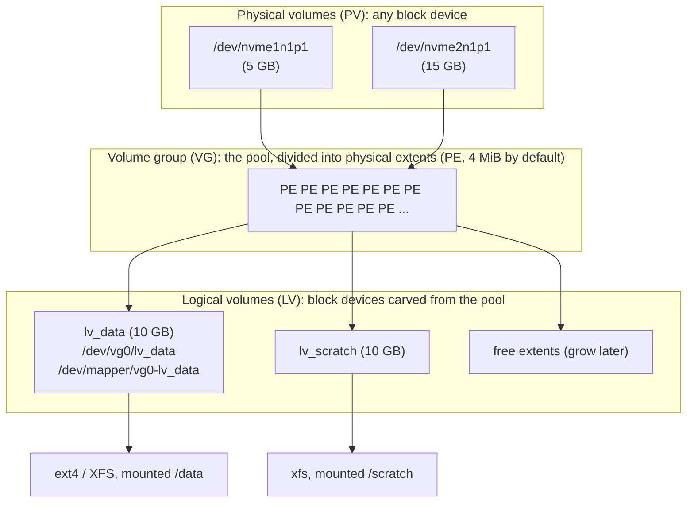
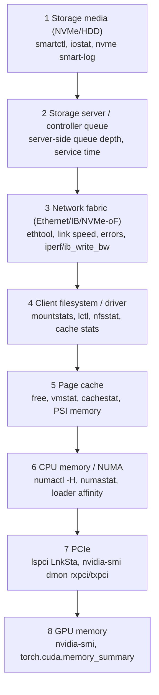
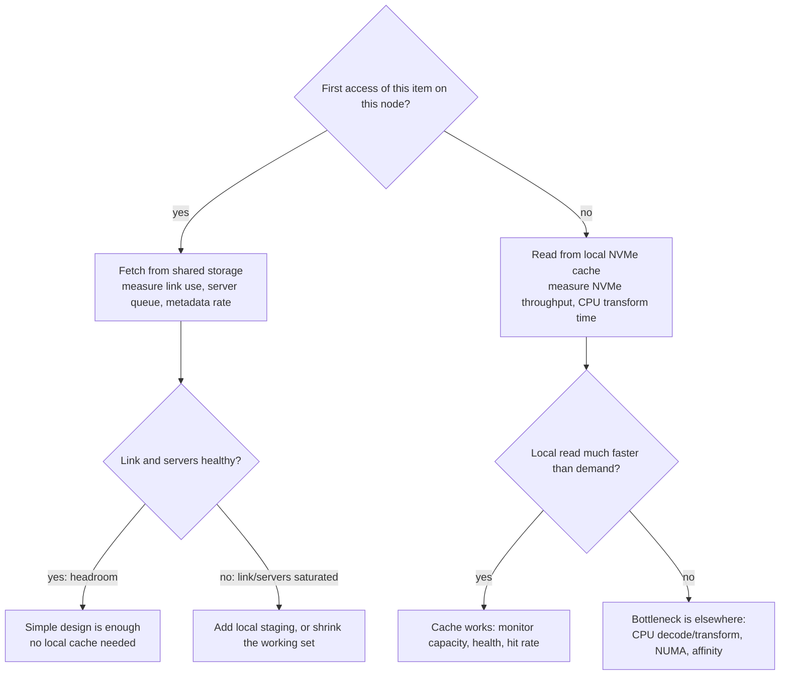

# 1.13 LVM, RAID and NVMe

| | |
|---|---|
| Level | Intermediate |
| Priority tier | 0 |
| Lab venue | GCP / GKE (an Ubuntu VM with loop devices or extra disks; an NVMe VM or GPU server for the NVMe commands) |
| Part | Part 1: Linux, from the command line to the kernel and performance |
| Status | Drafted, labs **untested** |

## Why this matters for AI infrastructure

Suppose a GPU node runs fine for a week, then slows down in the middle of a training run. Storage is one of the first places to look. A GPU server is full of fast local flash. M.2 drives hold the operating system, and a bank of U.2 or E1.S NVMe drives holds datasets, caches and checkpoints. Cloud GPU instances add local SSDs and network-attached volumes that you can resize while the machine runs. How you present those drives to the operating system decides whether the node is fast, resilient and easy to operate.

- A single NVMe drive is fast, but it is a single point of failure. Put several in a **RAID 0** array and you get one very fast scratch volume. The cost is that losing one drive loses everything in the array. A **RAID 1** pair protects the operating system.
- **LVM** lets you grow a volume while it is mounted, move data off a failing disk, and take a snapshot before a risky change. It can also split one large disk into several volumes without repartitioning. Cloud disks get resized all the time. LVM turns "the disk got bigger" into "the filesystem got bigger" with a few commands.
- **Multipath** and **NVMe-over-Fabrics** present the same remote storage over several paths. If you get them wrong, you see duplicate devices, stalled I/O or silent corruption.
- **NVMe health** covers wear, media errors, temperature and PCIe link state. It is an early warning. It tells you when a drive is about to fail or throttle in the middle of a training run.
- Disk performance has its own method. Misreading `iostat` is the most common storage misdiagnosis.

This chapter covers four areas. It starts with logical volumes and the device mapper. Then it moves to software RAID with `md`, and to the other device-mapper layers: encryption, multipath and caching. Next it goes deep on NVMe, including architecture, `nvme-cli`, SMART and NVMe-oF. The last areas are disk performance and the AI-specific storage patterns, such as local NVMe staging and the data path from storage to GPU. The chapter builds on chapter 1.12, which covers partitions, filesystems and caches. Shared and parallel filesystems come later, in Part 6.

## Prerequisites and outcomes

Before you start, you should know how block devices, partitions and filesystems work (chapter 1.12). You also need device files and sysfs (chapter 1.10), and the basics of processes and monitoring (chapter 1.8).

When you finish this chapter, you should be able to do the following:

- Explain physical volumes, volume groups, logical volumes and extents. Create, extend, shrink (carefully), move, snapshot and remove them. Grow a cloud disk online.
- Describe how LVM works inside, with user-space metadata on top of the kernel device mapper. Read the output of `dmsetup table`.
- Build, monitor, repair and rebuild `md` RAID arrays. Choose a RAID level for a purpose, and explain the cost of parity (read-modify-write) and of rebuilds.
- Describe the dm-crypt/LUKS, multipath and caching layers, and say when each one is used.
- Explain NVMe architecture, including controllers, namespaces and queues. Use `nvme-cli`, read SMART data, check PCIe link and thermal state, and describe NVMe-oF.
- Apply the disk-performance method: USE for devices and controllers, workload characterisation, latency analysis, micro-benchmarking, and scaling to a target utilisation.
- Use `iostat`, `sar`, PSI, `pidstat`, `biolatency`, `biosnoop`, `blktrace`, `smartctl` and the controller tools. Use `fio` and `ioping` correctly.
- Design local NVMe staging for datasets and checkpoints, and trace the full storage-to-GPU path one layer at a time.

## 1. Logical Volume Manager (LVM)

### The problem LVM solves

Picture a disk that is nearly full, with a filesystem tied to one fixed place on it. With direct partitioning, every change is expensive. To upgrade a disk, you install it, partition it, create filesystems, copy the data, edit the configuration and reboot. To add capacity, you pick a new mount point and split the data by hand.

LVM adds a layer between the physical block devices and the filesystems. You pool physical storage into a **volume group**, then carve **logical volumes** out of that pool. A logical volume is an ordinary block device that holds a filesystem or swap. You can grow, shrink (carefully), move, snapshot and remove logical volumes while the system runs. Usually you do not need to unmount anything.



The terms below appear in almost every LVM command, so learn them first.

| Term | Meaning |
|---|---|
| **PV** (physical volume) | A block device (partition, whole disk, RAID device, LUKS device, loop device) initialised for LVM. Carries a **header with metadata** describing its volume group, so the structure is self-describing |
| **VG** (volume group) | One or more PVs forming a storage pool. Identified by name and UUID |
| **PE** (physical extent) | The allocation unit of a VG (default 4 MiB). PVs are divided into PEs |
| **LV** (logical volume) | A block device allocated from the VG's extents; contains a filesystem or swap |
| **LE** (logical extent) | The LV's corresponding unit mapping onto PEs |
| **Segments / types** | How an LV's extents map to PEs: **linear** (the default), **striped** (RAID-0-like across PVs), **mirror/raid1/raid5/raid6/raid10** (LVM RAID), **thin** (thin-provisioned from a pool), **snapshot**, **cache** |

LVM2, the current implementation, is a set of **user-space tools**. PVs are plain block devices that user space can read at random. So the work of discovering the structure needs no kernel support. The kernel's part is the **device mapper**, a generic layer that maps ranges of a virtual block device onto other devices (section 2).

### Looking at an LVM system

These commands show the layout of a running system. Start with the concise listings, and drill down when something looks wrong.

```bash
sudo pvs; sudo vgs; sudo lvs            # concise listings
sudo pvdisplay; sudo vgdisplay; sudo lvdisplay    # detailed
sudo lvs -o +devices,segtype,lv_size    # show which PVs back each LV and the segment type
sudo lsblk -f                           # tree: disk > partition > LVM > filesystem and mountpoint
sudo vgs -o +pv_count,lv_count,vg_free_count
```

In `vgs`, the `#PV`, `#LV` and `#SN` columns count physical volumes, logical volumes and snapshots. `VSize` and `VFree` give the size and the free space. The `Attr` column is a short code. For example, `wz--n-` means writable, resizable, with normal allocation.

In `lvs`, the `Attr` column packs several facts into a string such as `-wi-ao----`. That means writable, inherited allocation, active and open. The first character gives the type: `V` is a thin volume, `t` a thin pool, `s` a snapshot and `r` a RAID volume. The last characters show health and state. The other columns are `LV`, `VG`, `LSize`, `Pool`, `Origin`, `Data%` (how full a thin pool or snapshot is) and `Meta%`.

Once LVM finishes its setup on your system (*How Linux Works* Section 4.4.1), logical volumes appear as block devices named `/dev/dm-0`, `/dev/dm-1`, and so on. The kernel can assign these `/dev/dm-N` numbers in any order from one boot to the next. For that reason, `udev` and LVM create two sets of symbolic links that use the volume group and logical volume names. The first set is `/dev/VG/LV`, for example `/dev/myvg/mylv1`. The second is `/dev/mapper/VG-LV`, for example `/dev/mapper/myvg-mylv1`. Any hyphen inside a VG or LV name is **doubled** in the second form. So `ubuntu-vg` and `root` become `/dev/mapper/ubuntu--vg-root`. Always use the stable `/dev/VG/LV` or `/dev/mapper/VG-LV` names in `/etc/fstab`, systemd units and bootloader configurations.

The LVM tools run in user space, but the kernel does the routing. Each read or write aimed at a logical volume, such as `/dev/dm-0`, must reach the matching sector on a real disk, such as `/dev/sdb1`. The kernel driver for this job is the **device mapper**, sometimes shortened to `devmapper`. It is a generic block-translation layer. It sits between the filesystem layer and the disk drivers.

### How LVM finds its volumes

Before LVM does anything, it must scan the block devices for physical volumes. Its user-space tools take roughly these steps:

1. Find all the PVs on the system.
2. Group the PVs into volume groups by UUID, which each PV records.
3. Check that every PV a group needs is present.
4. Find the logical volumes in each group.
5. Work out how data maps from the PVs to the logical volumes.

Every PV starts with a header. The header names its volume group and the logical volumes inside it. If every required PV is present, LVM passes the layout to the kernel. You can look at the header yourself, although the output is rough:

```bash
# dd if=/dev/sdb1 count=1000 | strings | less
```

Any LVM command that works with PVs, such as `pvscan`, `lvs` or `vgcreate`, performs this scan. LVM then asks the kernel's device mapper to build the virtual devices. It does that through `ioctl` calls on `/dev/mapper/control`. Udev creates the friendly `/dev/mapper` names as the new devices appear.

### Physical volumes in detail

A physical volume is more than a labeled slice of a disk. Its header also records the volume group and the logical volumes. The `pvs` command gives a short view:

```
# pvs
PV VG Fmt Attr PSize PFree
/dev/sda1 ubuntu-vg lvm2 a-- <10.00g 36.00m
```

The `pvdisplay` command shows more of the same PV:

```
# pvdisplay
--- Physical volume ---
PV Name /dev/sda1
VG Name ubuntu-vg
PV Size <10.00 GiB / not usable 2.00 MiB
Allocatable yes
PE Size 4.00 MiB
Total PE 2559
Free PE 9
Allocated PE 2550
PV UUID v2Qb1A-XC2e-2G4l-NdgJ-lnan-rjm5-47eMe5
```

A PV has no name beyond its block device. Logical volume names live at the group level and above. The PV does carry a UUID, because a volume group is built from PVs by that UUID. The "not usable" part is a sliver too small to hold a full extent.

The `a` in the `Attr` column means allocatable, so LVM may place new logical volumes on this PV. Nine free extents, about 36 MB, leave little room for new volumes. Here the PE counts match the group's usage, since this is the only PV.

### Volume groups and logical volumes in detail

`vgdisplay` expands on the short `vgs` listing:

```
# vgdisplay
--- Volume group ---
VG Name ubuntu-vg
System ID
Format lvm2
Metadata Areas 1
Metadata Sequence No 3
VG Access read/write
VG Status resizable
MAX LV 0
Cur LV 2
Open LV 2
Max PV 0
Cur PV 1
Act PV 1
VG Size <10.00 GiB
PE Size 4.00 MiB
Total PE 2559
Alloc PE / Size 2550 / 9.96 GiB
Free PE / Size 9 / 36.00 MiB
VG UUID 0zs0TV-wnT5-laOy-vJ0h-rUae-YPdv-pPwaAs
```

`Open LV` counts the logical volumes in use. `Cur PV` counts the physical volumes in the group. The `VG UUID` identifies one group when two groups share a name. Most LVM tools, including `vgrename`, accept the UUID in place of the name.

A physical extent (PE) is a chunk of a PV, like a block on a larger scale. The PE size here is 4 MiB. Most extents being in use is not a warning. It shows the space given to logical volumes, not how full the filesystem is.

The `lvs` command lists logical volumes:

```
# lvs
LV VG Attr LSize Pool Origin Data% Meta% Move Log Cpy%Sync Convert
root ubuntu-vg -wi-ao---- <9.01g
swap_1 ubuntu-vg -wi-ao---- 976.00m
```

The `Attr` value `-wi-ao----` means writable, inherited allocation, active and open. `lvdisplay` adds the device path, the major and minor numbers, and the read-ahead setting. The `LV Path` is `/dev/ubuntu-vg/root`, which is a symbolic link to a `/dev/dm-N` device. The kernel uses the `dm-N` device, not the link.

### Building: the standard sequence

Building a volume takes five steps: prepare the partition, create the group, add the logical volumes, make a filesystem and mount it. The commands follow the order you would use on a new disk.

```bash
# 1. Prepare partitions (optional; a whole disk can be a PV). Use type "Linux LVM" (8e on MBR, 31 on fdisk's GPT list) so tools recognise it.
sudo parted -s /dev/sdb mklabel gpt mkpart lvm 1MiB 100% set 1 lvm on
# 2. Create the VG (creates the PV if needed)
sudo vgcreate myvg /dev/sdb1
# 3. Add another device later
sudo vgextend myvg /dev/sdc1
# 4. Create logical volumes (size by bytes with -L or extents with -l; percentages with -l 50%VG or +100%FREE)
sudo lvcreate -L 10G -n mylv1 myvg
sudo lvcreate -l 100%FREE -n mylv2 myvg
# 5. Filesystem and mount like any block device
sudo mkfs.xfs /dev/myvg/mylv1
sudo mkdir -p /data && sudo mount /dev/myvg/mylv1 /data
echo '/dev/mapper/myvg-mylv1 /data xfs defaults,nofail 0 2' | sudo tee -a /etc/fstab
```

You do not need `pvcreate`, because `vgcreate` initialises a PV when none exists. If a new VG does not appear, run `pvscan` or `vgscan` to read the devices again.

### Resizing: the two-step operation and its order

Growing a volume takes two steps, and the order matters. The logical volume and the filesystem inside it have separate sizes. If you grow only the LV, the filesystem still reports its old size. Add `-r` (`--resizefs`) to do both in one command. That calls `fsadm`, which in turn calls `resize2fs` for ext filesystems or `xfs_growfs` for XFS.

```bash
sudo lvextend -r -L +20G /dev/myvg/mylv1      # grow by 20 GiB, online, filesystem included
sudo lvextend -r -l +100%FREE /dev/myvg/mylv1 # use all remaining space
sudo lvresize -r -L 50G /dev/myvg/mylv1       # set an absolute size
```

If you prefer two separate commands, run `lvextend -L +20G ...` and then `xfs_growfs /data` or `resize2fs /dev/myvg/mylv1`. Growing is safe online for ext4 and XFS. Shrinking is a different story. ext4 must be unmounted, checked and shrunk *before* the LV is reduced. You can run `umount; e2fsck -f; resize2fs fs 40G; lvreduce -L 40G` by hand, or use `lvreduce -r`, which does the steps in the right order. XFS cannot be shrunk at all, so you must back up, recreate and restore. If you reduce the LV first, you destroy the tail of the filesystem. Always back up before you shrink.

### A worked two-disk example

Here is a complete example. Two disks, one of 5 GB and one of 15 GB, become one volume group. The group is then split into two logical volumes of 10 GB each. That would be hard to do with partitions alone. The example uses VirtualBox disks, which are small by modern standards, but the steps are the same on real hardware.

First, make one partition on each disk and mark it for LVM with type `8e`:

```
# parted /dev/sdb print
Model: ATA VBOX HARDDISK (scsi)
Disk /dev/sdb: 5616MB
Sector size (logical/physical): 512B/512B
Partition Table: msdos
Disk Flags:
Number Start End Size Type File system Flags
1 1049kB 5616MB 5615MB primary lvm
# parted /dev/sdc print
Model: ATA VBOX HARDDISK (scsi)
Disk /dev/sdc: 16.0GB
Sector size (logical/physical): 512B/512B
Partition Table: msdos
Disk Flags:
Number Start End Size Type File system Flags
1 1049kB 16.0GB 16.0GB primary lvm
```

A PV can be any block device, even a whole disk. Partitioning still helps, because it allows booting from the disk and marks the device as LVM for other tools. Next, create the volume group with the first partition as its initial PV:

```
# vgcreate myvg /dev/sdb1
Physical volume "/dev/sdb1" successfully created.
Volume group "myvg" successfully created
# vgs
VG #PV #LV #SN Attr VSize VFree
myvg 1 0 0 wz--n- <5.23g <5.23g
```

If the new group does not show up, run `pvscan` to reread the devices. Add the second PV with `vgextend`, then check the combined size:

```
# vgextend myvg /dev/sdc1
Physical volume "/dev/sdc1" successfully created.
Volume group "myvg" successfully extended
# vgs
VG #PV #LV #SN Attr VSize VFree
myvg 2 0 0 wz--n- <20.16g <20.16g
```

Now create two logical volumes of 10 GB each. The `--type linear` option is the default, so it is optional here. Linear is the simplest mapping, with no redundancy or special features:

```
# lvcreate --size 10g --type linear -n mylv1 myvg
Logical volume "mylv1" created.
# lvcreate --size 10g --type linear -n mylv2 myvg
Logical volume "mylv2" created.
# vgdisplay myvg
--- Volume group ---
VG Name myvg
System ID
Format lvm2
Metadata Areas 2
Metadata Sequence No 4
VG Access read/write
VG Status resizable
MAX LV 0
Cur LV 2
Open LV 0
Max PV 0
Cur PV 2
Act PV 2
VG Size 20.16 GiB
PE Size 4.00 MiB
Total PE 5162
Alloc PE / Size 5120 / 20.00 GiB
Free PE / Size 42 / 168.00 MiB
VG UUID 1pHrOe-e5zy-TUtK-5gnN-SpDY-shM8-Cbokf3
```

The group has 42 free extents, because the chosen sizes did not use every extent. Put a filesystem on a logical volume and mount it like any partition. The device appears under `/dev/mapper`, and the volume group also gets a directory:

```
# mkfs -t ext4 /dev/mapper/myvg-mylv1
mke2fs 1.44.1 (24-Mar-2018)
Creating filesystem with 2621440 4k blocks and 655360 inodes
Filesystem UUID: 83cc4119-625c-49d1-88c4-e2359a15a887
Superblock backups stored on blocks:
32768, 98304, 163840, 229376, 294912, 819200, 884736, 1605632
Allocating group tables: done
Writing inode tables: done
Creating journal (16384 blocks): done
Writing superblocks and filesystem accounting information: done
# mount /dev/mapper/myvg-mylv1 /mnt
# df /mnt
Filesystem 1K-blocks Used Available Use% Mounted on
/dev/mapper/myvg-mylv1 10255636 36888 9678076 1% /mnt
```

### Moving, removing and renaming

Moving data off a disk, removing a volume and renaming are all short operations. One of them can destroy more than you meant, so read the warning before you type it.

```bash
sudo pvmove /dev/sdb1                         # migrate all extents off this PV onto other PVs in the VG (online)
sudo pvmove -n mylv1 /dev/sdb1 /dev/sdc1      # move only one LV
sudo vgreduce myvg /dev/sdb1 && sudo pvremove /dev/sdb1    # then retire the old disk
sudo lvremove myvg/mylv2          # NOTE the slash: VG/LV
sudo lvrename myvg mylv1 data; sudo vgrename myvg datavg
```

Be careful with `lvremove`. Its argument is `VG/LV`, with a slash. If you type a space instead, as in `lvremove myvg mylv2`, LVM reads `myvg` as a volume group and removes **all** of its logical volumes. It treats `mylv2` as one more volume to remove. LVM prompts you for each volume, but do not answer `y` on autopilot.

`pvmove` makes disk replacement an online operation. You add the new disk to the VG, `pvmove` the data off the old one, and then `vgreduce` the old disk out. This is why many fleets use LVM even on a single disk.

### Cloud pattern: the disk grew, grow everything above it

A cloud disk can be resized in the console, but the machine does not notice until you tell it. Work up the stack one layer at a time: the disk, then the partition, then the PV, then the LV and the filesystem.

```bash
# 1. The cloud disk (GCP PD, EBS) was resized in the console/API. Make the kernel see the new size:
echo 1 | sudo tee /sys/class/block/sdb/device/rescan          # SCSI/virtio; NVMe devices notice by themselves or: sudo nvme ns-rescan /dev/nvme1
# 2. Grow the partition (if partitioned)
sudo growpart /dev/sdb 1                                       # from cloud-guest-utils
# 3. Let LVM see the larger PV
sudo pvresize /dev/sdb1
# 4. Grow the LV and filesystem
sudo lvextend -r -l +100%FREE /dev/myvg/mylv1
```

### Snapshots and thin provisioning

A **snapshot** is a point-in-time view of a logical volume. A classic LVM snapshot uses **copy-on-write**. When the origin changes, LVM copies the old blocks into the snapshot area first. You estimate the snapshot's size up front, with `lvcreate -s -L 5G -n snap /dev/vg/lv`. If the snapshot area fills up, the snapshot becomes invalid. Snapshots also slow down writes to the origin while they exist, so keep them short-lived. Two common uses are backups and undo points before an upgrade. For a backup, mount the snapshot read-only, copy from it, and remove it. For an undo point, `lvconvert --merge` rolls the origin back to the snapshot.

**Thin provisioning** works differently. It allocates from a **thin pool**, so you can create many virtual volumes whose total size is larger than the pool. This is over-provisioning. Space is used only as data is written:

```bash
sudo lvcreate -L 500G --thinpool tp myvg
sudo lvcreate -V 200G --thin -n vol1 myvg/tp
sudo lvcreate -s --name vol1snap myvg/vol1          # thin snapshots are cheap and need no size
sudo lvs -a -o +data_percent,metadata_percent       # WATCH Data% and Meta%
```

Be warned: **a thin pool that reaches 100% data or metadata corrupts or blocks the volumes in it.** Monitor the pool and alert early. Set `thin_pool_autoextend_threshold` in `lvm.conf`, and keep monitoring turned on. Do not over-provision beyond what you can add. Container runtimes once used LVM thin pools through devicemapper. Overlayfs on XFS has replaced that.

Other LV types are worth knowing. **Striped** volumes spread data across several PVs for throughput, like RAID 0. For example, `lvcreate -i 4 -I 256k -L 1T -n scratch vg` stripes across 4 PVs. **RAID** types (raid1, raid5, raid6 and raid10) use LVM's wrapper over the `md` RAID code, as in `lvcreate --type raid1 -m1 ...`. A **cache** type puts a fast NVMe in front of a slow volume, using `dm-cache`, with `lvconvert --type cache ...`.

### Implementation: how it fits together

When the LVM tools run, they work through five steps in order. First, they find all PVs by scanning block devices. The scan is guided by `devices/filter` or by the devices file in `lvm.conf`. Second, they read each PV's header, which holds a label and a text **metadata area**. Third, they group PVs into VGs by UUID and check that every required PV is present. Fourth, they find the LVs. Fifth, they compute the **mapping scheme**.

LVM saves its metadata under `/etc/lvm/backup` and `/etc/lvm/archive`. If the metadata is damaged, `vgcfgrestore` can restore a VG's layout. To see the header text yourself, run `dd if=/dev/sdb1 count=1000 | strings | less`.

Next, LVM asks the kernel's **device mapper** to create the virtual block devices, with their mapping tables. It makes that request through `ioctl` calls on `/dev/mapper/control`. udev notices the new `dm-N` devices and creates the symlinks (chapter 1.10). At boot, the initramfs must activate the VG that holds the root filesystem. The settings are `rd.lvm.vg=` and the `lvm2-activation` units (chapter 1.14).

Several `lvm.conf` settings are worth knowing. `filter` and `global_filter` decide which devices get scanned. Exclude multipath component paths and any GPU or NVMe devices you do not want scanned, and avoid scanning inside VM images. Newer LVM uses `use_devicesfile` to restrict scanning to a list of known devices in `/etc/lvm/devices/system.devices`. Other settings include `issue_discards`, `thin_pool_autoextend_*` and `activation { monitoring }`.

Before you put a system disk under LVM, confirm that the initramfs activates the root VG and that `lvm.conf` filters out the devices you do not want.

## 2. The device mapper

Suppose you want one logical volume to span two disks, and you want the kernel to route each request to the right disk. That job belongs to the **device mapper** (`dm`). It is a kernel framework that builds virtual block devices out of **tables of targets**. Each line of a table maps a range of sectors on the virtual device onto a range of an underlying device. The line also names a **target type** that says how to do the mapping. LVM, encryption, multipath, thin provisioning, snapshots, caching, integrity checking and many container storage drivers are all built on it. You can think of it as virtual memory's translation, applied to storage.

```bash
sudo dmsetup ls --tree             # tree of mapped devices and what they sit on
sudo dmsetup info myvg-mylv1       # state, major:minor, open count, UUID
sudo dmsetup table                 # mapping tables: START LENGTH TARGET args
sudo dmsetup status                # runtime status (thin pools, multipath, cache stats)
```

Here is the mapping table for a linear LV spread over two disks. Sector numbers are in 512-byte units. The values `8:17` and `8:33` are the major:minor numbers of the underlying devices.

```text
myvg-mylv2: 0 10960896 linear 8:17 2048
myvg-mylv2: 10960896 10010624 linear 8:33 20973568
myvg-mylv1: 0 20971520 linear 8:33 2048
```

Each field has a job. The first is the start offset in the mapped device. Then comes the length of the segment, the target type (`linear` here), the source device as major:minor, and the offset on that device. LVM places the first LV in one contiguous run where it can. The second LV needs two segments, one on each PV. When `mylv2` is removed and `mylv1` is extended, the table gains the second segment. The kernel only follows the map. Deciding the layout is the job of LVM in user space.

The table can use these target types: `linear`, `striped`, `mirror`/`raid`, `snapshot`/`snapshot-origin`, `thin`/`thin-pool`, `crypt` (dm-crypt/LUKS), `multipath`, `cache`/`writecache`, `integrity`, `verity` (read-only integrity for images), `zero`, and `error` (to inject failures for testing).

### Device mapper inventory with `dmsetup`

The device mapper keeps an inventory of the devices it serves. `dmsetup info` lists them:

```
# dmsetup info
Name: myvg-mylv1
State: ACTIVE
Read Ahead: 256
Tables present: LIVE
Open count: 0
Event number: 0
Major, minor: 253, 1
Number of targets: 2
UUID: LVM-1pHrOee5zyTUtK5gnNSpDYshM8Cbokf3OfwX4T0w2XncjGrwct7nwGhpp7l7J5aQ
```

The major number 253 identifies the device mapper. Minor number 1 means the device file is `/dev/dm-1`. The kernel gives each mapped device its own name and UUID. That kernel UUID is simply the group UUID joined with the logical volume UUID.

Udev creates the `/dev/mapper` links from these devices. You can view the table that LVM handed to the kernel with `dmsetup table`. For two 10 GB volumes spread across a 5 GB PV and a 15 GB PV, it looks like this:

```
# dmsetup table
myvg-mylv2: 0 10960896 linear 8:17 2048
myvg-mylv2: 10960896 10010624 linear 8:33 20973568
myvg-mylv1: 0 20971520 linear 8:33 2048
```

Each line is one segment of a mapped device. The fields after the name are the start offset, the segment length, the mapping type, the source device, and the start offset on that source. The offsets use 512-byte sectors. Here `linear` is the simple one-to-one mapping. The source `8:17` is `/dev/sdb1`, and `8:33` is `/dev/sdc1`.

LVM placed `mylv1` in one contiguous run on `/dev/sdc1`. It had to split `mylv2` across both PVs. After `mylv2` was removed and `mylv1` grew, the table changed:

```
# dmsetup table
myvg-mylv1: 0 31326208 linear 8:33 2048
myvg-mylv1: 31326208 10960896 linear 8:17 2048
```

The original start stayed on `/dev/sdc1`. The new segment added the rest of `/dev/sdb1`. Software RAID and encrypted disks are also built on the device mapper, so this table is a useful thing to learn to read.

### Encryption: dm-crypt and LUKS

**LUKS** (Linux Unified Key Setup) is the on-disk format that goes with dm-crypt. The commands below set it up. The first one destroys the data on the device, so run it only on a device you can afford to wipe.

```bash
sudo cryptsetup luksFormat /dev/nvme1n1p1           # DESTROYS data; sets a passphrase / key slot
sudo cryptsetup open /dev/nvme1n1p1 securedata      # creates /dev/mapper/securedata
sudo mkfs.xfs /dev/mapper/securedata && sudo mount /dev/mapper/securedata /secure
sudo cryptsetup luksDump /dev/nvme1n1p1; sudo cryptsetup luksAddKey ...
# persistent: /etc/crypttab  (name  device  keyfile-or-none  options),  then /etc/fstab refers to /dev/mapper/name
```

Encryption costs CPU time for AES. Hardware AES-NI keeps that cost small. On very fast NVMe, though, the dm-crypt work queues can become the bottleneck. You can check with `perf top` and look for `aes`. Kernel options such as `no_read_workqueue,no_write_workqueue` are one way to change that. Data-centre drives often use self-encrypting (SED) hardware instead, or they encrypt at the application or object-store layer. GPU clusters that handle regulated data may need encryption at rest. Plan your key management early, using a TPM or network-bound unlock with Clevis/Tang, before you need it.

### Multipath

A SAN, or an NVMe/SCSI target, can be reachable over several physical paths: two HBAs, two switches or two controllers. The operating system then sees one LUN as several block devices, such as `sdb`, `sdc`, `sdd` and `sde`. **`multipathd`** with `dm-multipath` recognises that they share a WWID. It creates **one** device, `/dev/mapper/mpathX` or an alias. It spreads I/O across the active paths, using round-robin or queue length, and fails over when a path dies.

```bash
sudo multipath -ll                  # topology: each mpath device, its paths and states (active/ready, failed/faulty)
sudo multipath -v2                  # (re)build maps
/etc/multipath.conf                 # defaults, blacklist (never multipath local disks), multipaths { wwid ... alias ... }
sudo systemctl status multipathd
```

Follow three rules. Always build filesystems and LVM on the multipath device, never on a component path, and exclude the paths in the LVM filter. Blacklist local disks and virtio disks. Set `no_path_retry` on purpose, choosing between queueing forever and failing fast. NVMe-oF is different. The kernel has **native NVMe multipath**, visible at `/sys/module/nvme_core/parameters/multipath`, so the tool to use there is `nvme list-subsys`, not `multipath -ll`.

### Caching layers

`dm-cache` with LVM cache, `dm-writecache` and `bcache` all put a fast SSD or NVMe in front of a slower device, inside the block layer. They suit a large HDD or network volume with a hot subset of data. They also add complexity and new failure modes. If the write cache dies, data can be lost, so use mirrored cache devices for write caching. For AI workloads, the simpler pattern is usually to **stage the working set explicitly onto local NVMe** (section 8).

Before you add a caching layer, check whether a hot subset really exists. If there is none, the extra layer buys you nothing.

## 3. Software RAID with `md`

**RAID** (redundant array of independent disks) combines drives into one virtual device. The goal is capacity, speed or fault tolerance. **Hardware RAID** runs on a controller card, which often has its own cache backed by a battery or capacitor. **Software RAID** runs in the operating system, through Linux `md`, LVM RAID or ZFS and btrfs. Modern CPUs make the parity calculation cheap. Software RAID also gives the operating system full sight of each drive, and it survives a dead controller. Most GPU servers use **software RAID (`md`)**. Some storage servers still use hardware RAID, which hides the physical disks, so you need the controller tools to see them (section 6).

### RAID levels

| Level | Layout | Capacity | Fault tolerance | Performance character |
|---|---|---|---|---|
| **linear / concat** | Drives filled one after another | Sum | None (any loss damages the array) | No striping; mostly for capacity |
| **RAID 0** | Data **striped** across all drives | Sum | **None**: one drive lost = all data lost | Best sequential and random throughput; scales with drive count |
| **RAID 1** | **Mirror** (usually two copies) | One drive | Survives all but one drive | Reads from any copy (good read scaling); writes at the speed of the slowest copy |
| **RAID 10** | Stripe across mirrored pairs | Half | One drive per pair (more with luck) | Good reads and writes; the usual choice for databases and mixed loads |
| **RAID 5** | Stripe with **one** parity block rotating across drives | N-1 | One drive | Good reads; **small writes are expensive** (read-modify-write) |
| **RAID 6** | Stripe with **two** parity blocks | N-2 | Two drives | Like RAID 5 but slower writes; preferred for large HDD arrays because rebuilds are long |

The table gives the trade-offs at a glance. Read it as a choice between capacity, safety and speed.

A few terms need explaining first. A **stripe** is data written across drives in **chunks**, also called the stripe unit. Chunks are often 64 to 512 KiB, and with `md` you set the size with `--chunk`. A **full-stripe write** writes every chunk plus parity at once, which is efficient. A **partial write** to a parity RAID is expensive. It needs **read-modify-write**: read the old data and parity, compute the new parity by XOR, then write both. That turns one small write into several I/Os. To get good performance, match the array's stripe size to the I/O size of your workload, and align the filesystem to the stripe. The command `mkfs.xfs -d su=...,sw=...` does this, and the tools usually detect the geometry from `md`.

A write-back cache with battery or capacitor backup hides the read-modify-write cost on hardware RAID. The catch is that if the battery fails, the controller falls back to write-through, and write performance drops suddenly. The **write hole** is a crash between the data write and the parity write, which leaves the stripe inconsistent. You can mitigate it with a write-intent bitmap, a journal device (`--write-journal`), or a copy-on-write RAID such as ZFS or btrfs.

**Rebuilds.** When you replace a drive, the array **rebuilds**, which means it resyncs or "resilvers". It reads all the surviving drives and writes the new one. A rebuild can take hours or days. It uses I/O that your workload also needs, so foreground performance suffers. Drives are growing larger faster than they are getting quicker. So the chance of a second failure, or an unrecoverable read error, during a rebuild keeps rising. That is why big spinning-disk arrays use RAID 6 or RAID 10 instead of RAID 5. It is also why rebuild speed limits exist (`dev.raid.speed_limit_min/max`). If you start a rebuild on a busy node, you will feel it as slow I/O for your jobs. Last, **RAID is not a backup**. It does not protect you from deletion, corruption, ransomware, fire or an application that writes garbage.

### `mdadm`

```bash
# Create
sudo mdadm --create /dev/md0 --level=0 --raid-devices=4 --chunk=256K /dev/nvme[1-4]n1     # RAID 0 scratch of four NVMe
sudo mdadm --create /dev/md1 --level=1 --raid-devices=2 --metadata=1.2 /dev/sda2 /dev/sdb2 # mirror
sudo mdadm --create /dev/md2 --level=6 --raid-devices=8 --bitmap=internal /dev/sd[b-i]1     # RAID 6 with a write-intent bitmap
# Inspect
cat /proc/mdstat                         # live state; [UU] all up, [U_] degraded; recovery progress
sudo mdadm --detail /dev/md0             # level, state, devices, UUID, chunk size
sudo mdadm --examine /dev/nvme1n1        # the md superblock on a member
# Persist
sudo mdadm --detail --scan | sudo tee -a /etc/mdadm/mdadm.conf     # (RHEL: /etc/mdadm.conf)
sudo update-initramfs -u                  # (Debian/Ubuntu)   |   sudo dracut -f   (RHEL)
# Use
sudo mkfs.xfs /dev/md0 && sudo mkdir -p /scratch && sudo mount -o noatime /dev/md0 /scratch   # fstab by UUID
# Fail/replace
sudo mdadm /dev/md1 --fail /dev/sdb2 --remove /dev/sdb2
sudo mdadm /dev/md1 --add /dev/sdc2       # rebuild starts automatically
# Stop/assemble
sudo mdadm --stop /dev/md0; sudo mdadm --assemble --scan
# Monitoring
sudo mdadm --monitor --scan --mail=root --daemonise    # or the distribution's mdmonitor service
echo check | sudo tee /sys/block/md1/md/sync_action     # scrub: read all, verify mirrors/parity (monthly via cron/timer)
cat /sys/block/md1/md/mismatch_cnt
sudo sysctl dev.raid.speed_limit_min dev.raid.speed_limit_max
```

Some habits make an `md` array much easier to live with. Refer to the array by its UUID, shown by `--detail`, and not by member names, because member names change. Set up email or metrics alerts for degraded arrays. A degraded RAID 1 keeps running perfectly, and then it can lose its last copy without anyone noticing. Scrub the array periodically. Test the rebuild procedure before you need it. Store `/etc/mdadm/mdadm.conf` and rebuild the initramfs after every change, so the array assembles at boot. Otherwise it may appear as `md127`. Metadata versions matter too. Version `1.2` is the default, with its superblock at 4 KiB from the start. Version `1.0` sits at the end, so a mirror member still looks like a plain filesystem to a bootloader, which is why it is used for `/boot/efi` mirrors. Version `0.90` is legacy.

### Which RAID for what (GPU nodes)

| Purpose | Typical choice | Reason |
|---|---|---|
| Operating system | RAID 1 across two small drives (or the cloud's single root volume) | Survive one drive failure; DGX-class systems ship with a mirrored OS pair *(verify on your model)* |
| Local scratch, dataset cache, container image store, fast checkpoint staging | **RAID 0** across NVMe (or no RAID, separate mounts) | Maximum throughput, data is reproducible or copied elsewhere; losing one drive loses the array, so treat the volume as a **cache**, with the source of truth on shared storage |
| Valuable local data on a storage server | RAID 6 / 10, or distributed erasure coding (Lustre/Ceph/GPFS) | Fault tolerance without a single controller as a point of failure |
| Cloud | None (the provider replicates the disk); RAID 0 of several local SSDs for speed | Local SSD is ephemeral; persistent disks are already redundant |

Use the table to match a RAID level to the job the volume does. For scratch space, RAID 0 is fine when the data can be rebuilt. For anything you cannot lose, choose a redundant level and keep a separate backup.

## 4. NVMe in depth

**NVMe** (Non-Volatile Memory Express) is a host-controller interface built for flash. A drive connects straight to **PCIe**. It can come as a U.2 drive, an M.2 stick, an E1.S or E3.S module, or an add-in card. It speaks the NVMe command set directly, instead of going through the SCSI and SATA layers that older drives needed.

### Architecture

Here is how an NVMe drive is organised. Each controller shows up as `/dev/nvme0`, a character device, with one controller per drive or per fabric connection. The controller manages one or more **namespaces**, such as `/dev/nvme0n1` and `nvme0n2`. These are block devices, and their partitions are named like `nvme0n1p1`. A namespace is a slice of storage with its own LBA format, either 512 B or 4 KiB blocks. Most drives expose one namespace, but **namespace management** can create several.

The data moves through **queues in host memory**. There is one **admin** queue pair, plus many **I/O submission and completion queue pairs**. The limits are up to 64 thousand queues, each up to 64 thousand entries deep. Linux creates **one queue pair per CPU** through blk-mq. So the CPU that issues an I/O also receives its completion interrupt (MSI-X). Nothing is shared, so there is no lock to wait on. This design is why NVMe scales to millions of IOPS with latency in the tens of microseconds. For comparison, the older SATA queue is 32 deep, and SAS is 256.

Completion usually comes by interrupt. For the lowest latency, you can poll instead, using `io_poll` or `io_uring` with `IORING_SETUP_IOPOLL`.

Bandwidth is limited by the **PCIe link**. A Gen3 x4 link gives about 3.5 GB/s. Gen4 x4 gives about 7 GB/s, and Gen5 x4 gives about 14 GB/s, each per direction. A drive running at x2, or at a lower generation, will be slow. Check the link state with `lspci -vv`, or read `/sys/class/nvme/nvme0/device/current_link_speed` and `max_link_width`.

For the I/O scheduler, `none` is the right choice for fast NVMe, because the drive and the multiqueue block layer do the work. `mq-deadline`, `kyber` and `bfq` can add latency without any gain.

NVMe has several features you will run into. **TRIM** (also called deallocate, through Dataset Management) tells the drive which blocks are free. **Namespaces** and **power states** come next. **APST** (autonomous power-state transitions) moves the drive into low-power states on its own. Aggressive low-power states can add latency, and some drives behave badly with them. The kernel parameter `nvme_core.default_ps_max_latency_us=0` disables the deep states. Other features are **end-to-end protection**, **Zoned Namespaces** (ZNS), **Key Per I/O**, **SR-IOV** virtual functions for cloud and virtualisation, and **namespace sharing** across hosts in fabrics.

### `nvme-cli`

```bash
sudo apt install nvme-cli           # RHEL: sudo dnf install nvme-cli
sudo nvme list                       # all NVMe namespaces: node, model, serial, firmware, usage, size
sudo nvme list-subsys                # subsystems and paths (multipath view)
sudo nvme id-ctrl /dev/nvme0 | head -40    # controller: model, serial, firmware, max queues, namespace count, features
sudo nvme id-ns /dev/nvme0n1         # namespace: size, LBA formats (lbaf), current format, nuse
sudo nvme smart-log /dev/nvme0       # health (see below)
sudo nvme error-log /dev/nvme0       # recent errors
sudo nvme fw-log /dev/nvme0          # firmware slots
sudo nvme format /dev/nvme0n1 --lbaf=1    # LOW-LEVEL FORMAT: DESTROYS ALL DATA; changes block size (e.g. to 4 KiB)
sudo nvme sanitize ...               # crypto-erase / block-erase (destructive)
sudo nvme create-ns / attach-ns / delete-ns   # namespace management (drive must support it; destructive)
sudo nvme get-feature /dev/nvme0 -f 0x0c    # e.g. autonomous power state transition
sudo nvme telemetry-log ...
```

Read the commands above as two groups. The first group only reads information, such as `list`, `id-ctrl` and `smart-log`, so it is safe on a live node. The second group changes the drive. `format`, `sanitize` and the namespace commands destroy data or alter the drive, so keep them away from a production node.

**Reading `smart-log`.** Field names vary a little between versions. The most important field is `critical_warning`. Any value other than 0 needs action, since it can mean the spare capacity is low, the drive is too hot, reliability is reduced, the drive has gone read-only, or the volatile memory backup has failed. The `temperature` field, along with the warning and critical temperature time, tells you how long the drive spent hot. Compare `available_spare` with `available_spare_threshold`. Then watch **`percentage_used`**. It estimates how much of the drive's life you have used, against its endurance rating, so plan the replacement before it reaches 100. The `data_units_read/written` fields count units of 512,000 bytes. Multiply them to get totals, and compare the writes with the drive's endurance, given as **TBW/DWPD**. If you see a `media_errors` count that keeps rising, or a non-zero `num_err_log_entries`, the media is failing. `unsafe_shutdowns` counts power losses without a clean shutdown, and `power_on_hours` counts the hours the drive has run. You should collect these values from every node you run. Fleet monitoring does the collecting for you. You can use `nvme-cli`, `smartctl -a /dev/nvme0`, Prometheus `node_exporter`'s textfile collector, or DCGM-adjacent tooling. Alert on `critical_warning`, `media_errors`, `percentage_used`, rising temperature and unsafe shutdowns.

**Thermal throttling.** NVMe drives slow themselves down when they get hot. If one drive is 30% slower than identical neighbours, the cause is often heat or airflow, or different firmware. Compare the `smart-log` temperatures and the "time above warning" across nodes.

**Firmware.** Two drives of the same model can run different firmware, and then they behave differently with no clear reason. Inventory the firmware with `nvme list` and `id-ctrl`. Update it through the vendor tools during a maintenance window, using `nvme fw-download` and `fw-commit`, or the distribution's `fwupd`.

### NVMe over Fabrics (NVMe-oF)

NVMe-oF carries the NVMe protocol across a network. A remote drive then looks like a local `/dev/nvmeXnY`, with little added latency. There are three transports. **RDMA** (InfiniBand, RoCE or iWARP) gives the lowest latency. **TCP** works on any Ethernet network, but it uses more CPU. **Fibre Channel** is the third option. A **target** exports **subsystems**, and each subsystem has an **NQN** (NVMe qualified name). A **host** identifies itself with its own host NQN, stored in `/etc/nvme/hostnqn`. Then the host **discovers** the subsystems and **connects** to one:

```bash
sudo modprobe nvme-rdma    # or nvme-tcp
sudo nvme discover -t rdma -a 10.0.0.5 -s 4420
sudo nvme connect  -t rdma -n nqn.2024-01.com.example:subsys1 -a 10.0.0.5 -s 4420
sudo nvme list-subsys; sudo nvme disconnect -n nqn.2024-01.com.example:subsys1
# target side (Linux): nvmet configuration via configfs (/sys/kernel/config/nvmet), or nvmetcli
```

If you check the link state early, you can catch a slow drive before it reaches a training job. Use NVMe-oF to split storage away from compute, for example in shared flash pools. It also serves as the backend of parallel filesystems, and it supports GPUDirect Storage over RDMA. When several paths exist, native NVMe multipath uses ANA (asymmetric namespace access) states to choose among them. Two settings tune the behaviour under failure: `ctrl_loss_tmo` and `reconnect_delay`. If the fabric is lost, processes can get stuck in `D` state (chapter 1.8).

### NVMe naming and containers

The `nvme0n1` names depend on the order in which the kernel probes the devices. With native multipath, the `nvme0c0n1` devices are hidden path devices, and `nvme0n1` is the aggregated one. Use `/dev/disk/by-id/nvme-<model>_<serial>`, `by-path`, or filesystem UUIDs in your configuration, instead of the probe-order names (chapter 1.10). In Kubernetes, local NVMe reaches the pods in one of two ways. The first is the **local static provisioner**, which creates one PV per mount. The second is an **LVM-based CSI driver** such as TopoLVM or OpenEBS LVM-LocalPV. These carve logical volumes from a VG on each node, and they support capacity-aware scheduling and resizing.

## 5. Disk performance: the method

(Chapter 1.12 section 9 covers the filesystem layer. This section covers the block device and everything below it. The time scales and concepts are in 1.12 section 2.)

### Concepts you need

When a disk looks slow, you need to know where the time goes. Start with the parts of I/O time. A request has *wait time*, the time it spends queued in the OS or on the device. It also has *service time*, the time the device spends working. Together they make *request time*, which is what you feel, and what `iostat` reports as `await`. Modern devices queue work internally and handle many requests at once. So a "service time" derived from utilisation (`util / IOPS`) is only a rough single-queue estimate.

IOPS are not all equal. 5,000 sequential IOPS on a rotational disk can be far faster than 1,000 random ones. Flash IOPS depend on the I/O size and the direction. You should never compare IOPS numbers without knowing the I/O size, the mix of random and sequential, the read/write ratio, the queue depth and whether the test was buffered.

Non-data commands, such as a cache flush or a TRIM/UNMAP, occupy the device and affect latency. Keep them in mind when a device looks slow for no clear reason.

Two words get mixed up here. **Utilisation** is the fraction of an interval the device was busy. **Saturation** is the work queued beyond what the device can service, measured as the average wait-queue length. A device can sit at 100% busy with no queue, and then it is busy but not saturated. A device can also saturate while its utilisation is below 100%, when the average over an interval hides bursts. Virtual disks make this harder. A RAID controller, a SAN or a cloud volume shows the OS only the virtual device's utilisation, not what the physical disks are doing. A "100% busy" volume built from many disks may still accept more work. A write-back cache hides how busy the device is. A hardware RAID rebuild is invisible to the OS.

**I/O wait** (`wa` in `top` or `vmstat`) is the idle CPU time spent while threads wait on disk I/O. It is easy to misread. Add a CPU-hungry process and `wa` falls, even though the disk problem is still there. A more reliable metric is the time that application threads spend blocked on disk I/O. Use `wa` as a hint, meaning "the disks are busy and the CPUs are idle". Do not treat it as a measurement.

Disk latency does not hurt an application when the I/O is **asynchronous**, such as write-back, read-ahead, or a background thread. It hurts when the application waits for each I/O before it continues.

### Methods, in a sensible order

Work through these methods in order. Each one builds on the last.

1. **USE method** (utilisation, saturation, errors) for **each device** and each **controller or transport**. Check **errors first**, in SMART data, the kernel logs and the controller logs. A redundant array keeps working while it is degraded, so errors can go unnoticed for a long time. Controller and bus limits are often overlooked. These include throughput in MB/s, operations per second, PCIe link width and speed, and SAS or NVMe lane counts. If total throughput or IOPS always levels off at the same value under different workloads, suspect a controller or transport limit.
2. **Performance monitoring** over time. Track per-disk utilisation and response time, and IOPS and throughput for capacity planning. Look for imbalance across the disks. Utilisation above about 60% may already cause queueing delays. Sustained 100% is very likely a problem, but remember the NVMe caveat from 1.12.
3. **Workload characterisation**. Record the I/O rate, throughput, I/O size, read/write ratio, random versus sequential pattern, which applications and files are involved, how the load balances across disks, the arrival-time distribution, how synchronous the application is, the errors, and the non-data commands. Record maxima and distributions, not only averages. For example, a light random-read workload might average 350 IOPS with 8 KiB reads. It might also show short sequential write bursts of 2 to 5 seconds, reaching 4,800 IOPS and 560 MB/s. The average hides the bursts, and the bursts are what cause trouble.
4. **Latency analysis**. Measure at several layers: the application, the filesystem, the block layer, the driver and the device. If an outlier has the same latency at every layer, the device or the driver is the cause. If the latency is large at the filesystem but small below it, look at filesystem locking, queueing or related metadata I/O. Use histograms rather than averages, and trace individual I/Os when you need to explain an outlier. If you only read averages, you will miss the outlier that hurts your job.
5. **Static performance tuning**. Check how many disks there are, what types they are (SMR or TLC?), their firmware versions, the controllers and the slots they sit in (is the HBA in an x8 slot?), the RAID layout and stripe width, multipath, driver and firmware bugs, cache sizes, battery status and I/O resource controls. A common real-world cause of poor array performance is a configuration choice, such as a very wide parity stripe. It is not a fault.
6. **Cache tuning**, **resource controls**, **micro-benchmarking** (to find the device's limits), **scaling** (below), and **event tracing**. Use event tracing as a last resort. It has overhead, and writing the trace to the disk you are tracing creates a feedback loop.

**Scaling.** To size a system, start from the target throughput and IOPS. Then compute the number of devices at a target utilisation of about 50%, not at their maximum. Driving disks to 100% queues requests and wrecks latency. Factor in the RAID write penalties. Then check the controllers, the transports and the CPU cycles per I/O. The old advice was "add more spindles". The new advice is "add more flash".

### Micro-benchmarking the device

To test the **disk** itself, rather than the filesystem, use the device path, or direct I/O to a file on a fresh filesystem. Control these settings: the direction, random or sequential, the offset range, the I/O size, the concurrency (queue depth or threads), and the number of devices. Three standard probes cover most needs. The first measures maximum throughput with 1 MiB sequential reads. The second measures maximum IOPS with small reads. The third profiles random-read latency at different sizes. Only run destructive write tests on devices that hold nothing you need. Keep `iostat -xz 1` running in another terminal, so you can confirm what the benchmark actually did.

```bash
# Raw-device read tests (non-destructive): bypass the cache with direct I/O
sudo fio --name=seqread --filename=/dev/nvme1n1 --rw=read --bs=1M --iodepth=32 --direct=1 --ioengine=io_uring --runtime=30 --time_based --readonly
sudo fio --name=randread4k --filename=/dev/nvme1n1 --rw=randread --bs=4k --iodepth=64 --numjobs=4 --direct=1 --ioengine=io_uring --runtime=30 --time_based --group_reporting --readonly
sudo ioping -c 10 /dev/nvme1n1          # 4 KiB latency, one per second: a gentle probe usable in production
sudo hdparm -Tt /dev/nvme1n1            # crude: -T cached reads, -t device reads
# A latency profile: queue depth 1 shows the unloaded latency of the device
sudo fio --name=lat --filename=/dev/nvme1n1 --rw=randread --bs=4k --iodepth=1 --direct=1 --runtime=20 --time_based --readonly --lat_percentiles=1
```

Read the results as **latency percentiles** (p50, p99 and p99.9) and as IOPS **at a stated queue depth**. An NVMe drive may deliver 1 million IOPS at queue depth 128 across 8 jobs. At queue depth 1 it may deliver only 80,000. The second number is the one that a single synchronous reader gets. `ioping` is useful because it barely loads the device, at about 0.4% utilisation. That lets you probe latency on a busy production disk. A replayed I/O trace, made with `blktrace` and `blkreplay`, can reproduce problems that are hard to recreate. But the replay misleads you if the target system differs from the original.

## 6. Tools for the block layer

When a disk misbehaves, you need the right tool for the question. The table below lists the main tools, with what each one shows. Start with the cheap ones, and move to the heavier tracers only when they are needed.

| Tool | Shows | Notes |
|---|---|---|
| **`iostat -xz 1`** | Per-device `r/s w/s rkB/s wkB/s rrqm/s wrqm/s` (merged requests), `r_await w_await await`, `areq-sz`, `aqu-sz`, `%util` | Cheap (kernel keeps the counters by default), the first command to run; `-p ALL` per partition; `-s` short form; the figures are interval averages; `%util` caveat above |
| **`sar -d -p 1`** | Same counters, and history if `sysstat` is collecting | "What was the disk doing at 03:10?" |
| **`/proc/diskstats`, `/sys/block/DEV/stat`** | Raw counters | What `iostat` reads |
| **PSI**: `cat /proc/pressure/io` | `some`/`full` share of time tasks were stalled on I/O (10/60/300 s averages) | Good health signal: `full` close to `some` means I/O pressure stalls *all* runnable tasks |
| **`pidstat -d 1`**, **`iotop -oPa`** | Which process does the I/O (kB read/written, `iodelay`) | `iotop` shows threads |
| **`perf trace`, `perf record -e block:*`** | Block tracepoints | `perf script` to read |
| **`biolatency`** (BCC/bpftrace) | Histogram of block I/O latency; `-D` per disk, `-F` by flags | Shows multimodal distributions (cache hits vs misses) and outliers; far better than averages |
| **`biosnoop`** | One line per I/O: time, process, PID, disk, R/W, sector, bytes, latency | Event tracing; overhead at high rates |
| **`biotop`** | `top` of block I/O by process | |
| **`biostacks`** | Latency with the stack that initiated the I/O | Why was this I/O issued? |
| **`blktrace` / `blkparse` / `btt`** | Full block-layer event tracing: queue, merge, issue, complete | Heavy; for deep dives and replay |
| **`bpftrace`** | Custom one-liners, e.g. `bpftrace -e 'tracepoint:block:block_rq_issue { @[args->rwbs] = hist(args->bytes); }'` | I/O size distributions per type |
| **`smartctl -a /dev/sdX`**, **`nvme smart-log`** | Drive health: reallocated/pending sectors, CRC errors, wear, media errors, temperature, hours | The first-error early warning; `-d megaraid,N` and similar query disks behind RAID controllers |
| **`storcli`/`perccli`/`MegaCli`/`arcconf`** | Hardware RAID controller state: virtual drives, patrol reads, consistency checks, battery/capacitor, event logs, rebuild rate | Vendor-specific; check what the controller did at 03:00 (a "patrol read" is a background read of all blocks that can affect performance) |
| **SCSI logging**: `echo 03333333333 > /proc/sys/dev/scsi/logging_level` (or `scsi_logging_level -s --all 3`) | Kernel logs SCSI commands and results | Floods the log; for debugging timeouts and errors |
| **`/sys/block/DEV/queue/*`**, **`lsblk -t`** | Queue depth, scheduler, rotational, sizes, read-ahead | |
| **Visualisations** | Latency heat maps, offset heat maps, line graphs | A latency heat map (time on x, latency on y, colour = count) reveals bimodality and drifting outliers that a line graph averages away |

**Reading `iostat -x`.** The `rrqm/s` and `wrqm/s` fields count merged requests per second. Those are adjacent I/Os that the block layer combined, which cuts the cost per I/O. The `r/s` and `w/s` fields count completed requests, and `rkB/s` and `wkB/s` give throughput. The `areq-sz` field is the average request size. Small values with high IOPS point to small random I/O. `aqu-sz` is the average queue length, which is your saturation signal. `r_await` and `w_await` give the milliseconds spent in the queue plus service time. Finally, `%util` gives the busy fraction. Newer versions have dropped the old `svctm` field, because it was unreliable.

If you are unsure where to begin, look at `r_await` and `w_await` first, and compare them with what you expect. Use a few rules of thumb, and apply them to your own numbers. For a single HDD, `%util` near 100%, a growing `aqu-sz` and an `await` of tens of milliseconds mean the disk is saturated. For flash, watch `await` and the percentiles from `biolatency`. For arrays, look at the individual members too, since the virtual device can hide a single bad drive.

### Tuning knobs

- **I/O priority.** `ionice -c 3 -p PID` puts a process in the idle class, which suits backups that must not disturb production. `-c 2 -n 0..7` is best-effort. `-c 1` is real-time, and it can starve other processes. These settings work only with schedulers that implement priorities.
- **cgroup I/O control.** cgroup v2 offers `io.max` and `io.weight`. systemd exposes them as `IOWeight=`, `IOReadBandwidthMax=` and `IOWriteIOPSMax=`. They limit a group of processes with fixed IOPS or bandwidth caps per device, or with proportional weights. This is how multi-tenant nodes stop one job from taking all of the local disk, for example with `echo "259:0 rbps=200M wbps=100M" > io.max`. A disk bottleneck can turn out to be a limit that someone imposed, not the device itself.
- **Queue parameters** in `/sys/block/DEV/queue/`. These include `scheduler` (`none`, `mq-deadline`, `kyber`, `bfq`), `nr_requests`, `read_ahead_kb`, `max_sectors_kb`, `rq_affinity`, `nomerges` and `add_random`. The defaults are generally right for NVMe. Test before and after with the same benchmark.
- **Device settings.** `hdparm` controls the write cache (`-W`) and power management (`-B` and `-S`). Several of its options are marked DANGEROUS in its manual, so do not experiment on data disks. Controllers have their own settings, such as rebuild rate, patrol-read rate, cache flush interval, and write-back versus write-through policy.

Save whatever you choose with udev rules or `tuned` profiles, not with `echo` typed into a shell. Chapter 1.10 covers udev.

## 7. AI-infrastructure patterns

### The full data path, layer by layer

Training data travels a long way. It crosses storage media, storage servers, the network and the client filesystem. Then it passes through the page cache, CPU memory and PCIe, before it reaches GPU memory. A slow GPU is not always caused by a slow disk. Like a bucket brigade, the slowest hand-off sets the pace, and any hand-off can be the limit. So measure every hand-off.



The procedure has three steps. First, establish the demand: samples per second, multiplied by the bytes per sample, for each GPU. Second, measure the supply at each layer. Use a tool that bypasses the layers above it. Start with a raw device read using `fio --direct=1`, then test the filesystem, then the network path with the storage client, then the application loader. Third, the first layer whose measured capacity falls below the demand is the bottleneck. Also check for hidden copies. An extra decode or format conversion on the CPU can cost more than the disk does.

Some findings come up again and again. A data loader with too few workers, or running on the wrong NUMA node, is one. A PCIe x8 link where x16 was expected is another. Page cache thrashing happens when the dataset is slightly larger than RAM. A shared filesystem can have its metadata server saturate on small files. And JPEG decoding on the CPU can be the real limit.

### Local NVMe as cache and staging area

Enterprise advice says local disks are a bad idea, because they are stateless and unprotected. AI workloads reverse that logic. Training reads the same data hundreds of times, once per epoch. Picture a thousand GPUs fetching the same ten thousand images from the shared array on every epoch. The network would melt. A better design uses the local disk as a cache:

- **Epoch 1**: read from shared storage and keep a copy on node-local NVMe. This is slow, but it happens only once.
- **Epochs 2 to N**: read from local NVMe. Network traffic drops to nearly zero, and the GPUs are fed at local speed.

Use local NVMe staging when the shared link or filesystem is the measured bottleneck. It also makes sense when the dataset fits in local capacity and is read repeatedly, through many epochs or fine-tuning iterations. If your run stalls at every checkpoint, you have a good case for staging. Checkpoint writes that block training can be staged asynchronously. And if preprocessing is expensive, staging its output for reuse pays off. Skip it in the opposite cases. Skip it when the shared storage has headroom, meaning the link is well below saturation and the metadata is healthy. Skip it when the dataset is too big to fit and must stream anyway, because you add complexity for no benefit. Skip it when the GPUs already run near full utilisation. And skip it when the run covers only one or two epochs, since the cold first epoch dominates. Skip it too when nodes fail often enough that re-staging eats up the gain.



**Cache design points.** Verify every cached file with a checksum or a version key, so a run never trains on stale data after the source changes. Log the hit rate for each epoch. In a healthy setup it is about 0% in epoch 1 and above 95% from epoch 2, if the dataset fits. A drop in later epochs shows eviction pressure, which tends to appear once the NVMe is above about 85% full. Choose an eviction policy. Pre-stage the data in parallel before the job starts, instead of fetching lazily on first read. Keep the staging deterministic and idempotent, and treat the volume as disposable. Watch out for file naming. Two different names for the same data defeat the hit rate.

**Checkpoint staging.** Writing a very large checkpoint synchronously to shared storage stalls the whole job until the write finishes. For example, a 500 GB checkpoint at about 1 GB/s takes minutes. A better pattern writes the checkpoint to local NVMe at several GB/s, which keeps the stall short. Then a background task copies it to durable shared or object storage while training continues. Once the copy is verified, the local copy can be deleted. The trade-offs are real, though. The checkpoint is not durable until the copy finishes, so a node failure in between loses it. Keep at least one older durable checkpoint, and verify every copy. Background copies also compete with training for NIC and filesystem bandwidth. Local capacity must hold at least one full checkpoint plus the dataset cache. If you build your own, you carry the durability gap yourself. Some frameworks support asynchronous distributed checkpointing and build this pattern in for you. Check what yours does before you build your own.

**What to expect from NVMe benchmarks.** A drive that shows several GB/s in `fio` may deliver far less to a training job. The application sees only a fraction, because of filesystem overhead, small reads, Python decoding, NUMA placement and the threading of the data loader. If `fio` is fast and the job is slow, the problem sits above the device. Profile the CPU with `perf` or flame graphs. Pin the loader processes to the NVMe's NUMA node. Move decoding into a preprocessing step, or onto the GPU with DALI or nvJPEG. And increase the loader workers and the prefetch depth. The same model of drive can differ by tens of percent between two nodes, because of firmware, thermal throttling or background garbage collection. Compare `nvme smart-log` and `id-ctrl` across nodes to find the difference.

### DGX-style layout and build

Reference GPU servers usually have a small **mirrored pair** for the operating system, built with RAID 1 on M.2 or similar. They also have a bank of large NVMe drives, presented as a **RAID 0 data volume** for scratch and cache. The exact count, size and mount point differ between generations, so confirm them against your model's documentation. For your own builds, create the RAID 0 with `mdadm`, using a 256 KiB or 512 KiB chunk. Format it as XFS, which detects the stripe geometry. Mount it with `noatime`, give it a label, and add it to `fstab` with `nofail`. Provision it from the image or from cloud-init. Monitor each member's SMART data. Automate the replace-and-resync-the-cache procedure too. When one drive in a RAID 0 fails, the whole volume is lost. That is acceptable only because the contents are a cache.

### Kubernetes and local volumes

Local NVMe reaches pods in three ways. Local PersistentVolumes can be discovered by the static provisioner from mounts. `emptyDir` lives on the node's disk. LVM-backed CSI drivers, such as TopoLVM or OpenEBS LVM-LocalPV, provide capacity-aware scheduling, thin provisioning, snapshots and online resize. Watch out for three things. A node loss leaves its PV stuck to that node. Ephemeral-storage eviction thresholds can evict pods unexpectedly. And noisy neighbours can slow each other down, so use `io.max` or cgroup limits where the runtime supports them.

### Hardware RAID versus software

GPU and AI platform teams generally avoid hardware RAID on compute nodes. The controller hides the drives, so SMART access needs `-d megaraid,N`. It has its own failure modes and firmware, it caps NVMe performance, and it complicates GPUDirect Storage. Storage servers are a different case. Vendors may still ship RAID controllers there, or they may move to NVMe with software erasure coding in the filesystem. Examples include Lustre OSS with ZFS or ldiskfs on md RAID, Ceph, Weka and GPFS. Part 6 covers those designs.

If you run a compute node, you can follow one rule:  use software RAID, keep the drives visible, and treat scratch volumes as caches.

## How it fails

Most storage incidents follow a pattern you can learn. Each item below names the symptom, the cause and the fix.

1. **The LV was extended, but the filesystem was not grown.** You run `df` and the size has not changed. Use `lvextend -r`, or run `xfs_growfs` or `resize2fs` yourself.
2. **Shrinking in the wrong order corrupts the filesystem.** Shrink the filesystem first, then the LV. XFS cannot shrink at all.
3. **`lvremove vg lv` with a space removes more than you intended.** Type `VG/LV` with a slash, and read each prompt.
4. **A thin pool filled to 100%, in data or metadata.** The volumes go read-only or become corrupt. Monitor `Data%` and `Meta%`, enable autoextend, and do not over-provision beyond what you can add.
5. **A snapshot filled up and became invalid.** Size snapshots carefully, monitor them, and remove them promptly.
6. **A cloned VM or disk copy has duplicate PV and VG UUIDs and names.** LVM refuses to activate it, or activates the wrong one. Fix it with `vgimportclone`, rename the VG, or filter the devices.
7. **The boot fails because the root VG was not activated.** The initramfs may lack the LVM modules or the `rd.lvm.vg` setting, a filter may exclude the PV, or a disk may be missing. From the emergency shell, run `lvm vgchange -ay`, then rebuild the initramfs.
8. **An `md` array assembles as `/dev/md127`, or not at all, after a reboot.** The `mdadm.conf` entry is missing, or the initramfs is stale. Run `mdadm --detail --scan` and update the initramfs.
9. **A RAID array stays degraded without anyone noticing.** No monitoring is in place, so a second failure then loses the data. Alert on `[U_]`, set up `mdadm --monitor`, and run scrubs.
10. **A RAID 0 volume is lost when one NVMe fails.** This is by design. Keep the source data elsewhere, and automate the rebuild.
11. **A RAID 5 or RAID 6 rebuild takes days and fails on a second error.** Prefer RAID 6 or RAID 10 for large spinning disks. Replace disks early when SMART warns, and test your restores.
12. **An NVMe drive runs at reduced PCIe width or speed.** Reseat the drive, check the BIOS lanes and the cabling, and compare `LnkSta` to `LnkCap`.
13. **An NVMe drive throttles or errors silently.** Check `nvme smart-log` for `critical_warning`, temperature and `media_errors`. Then check the airflow and the firmware.
14. **Multipath shows duplicate devices, or LVM or the filesystem sits on a single path.** Fix the blacklist and the filter, and build on `/dev/mapper/mpathX`.
15. **dm-crypt limits NVMe throughput.** The crypto work queue is CPU-bound. Use the hardware features, adjust the queue flags, or encrypt in the application or the hardware.
16. **An NVMe-oF connection loss leaves hung processes behind.** Tune `ctrl_loss_tmo`, monitor the paths, and expect processes in `D` state.
17. **`%util` reads 100% on NVMe, so you conclude the disk is saturated.** Check the queue depth and the bandwidth before you decide (chapter 1.12).
18. **A benchmark destroys data.** A write test points at a raw device that holds data. Use files on a fresh filesystem, or the `--readonly` option.
19. **The cache hit rate is 0% in every epoch.** The file names do not match, the cache directory does not persist across restarts, or evictions outpace insertions.
20. **A checkpoint copy failed silently after the local copy was deleted.** Verify checksums before you delete anything, and keep an older durable checkpoint.

Pick the item that matches your symptom, and check its first step before you change anything else.

## Hands-on lab: LVM, RAID, NVMe, and VM drills

Reading about LVM and RAID only goes so far. You learn them when you run the commands and check each result against what you expect. Run these drills on a disposable VM or on loop devices, so that a mistake costs you nothing. Start with the self-checking Python lab, which runs locally. It verifies `dmsetup table` linear sector translation, `/dev/mapper/VG-LV` hyphen doubling, RAID 0/1/5/6/10 usable capacity and small-write parity I/O penalties, `nvme smart-log` health alerts, and 50%-target-utilization disk sizing.

```bash
python3 code/part01/lvm_raid_nvme_lab.py
```

Next, on a disposable GCP Ubuntu VM that uses loop devices, work through these steps. Every interactive VM command below is `untested here`.

**A. Create four loop "disks".**

```bash
for i in 1 2 3 4; do sudo truncate -s 512M /tmp/d$i.img; done # (untested here)
sudo losetup -f --show /tmp/d1.img; sudo losetup -f --show /tmp/d2.img; sudo losetup -f --show /tmp/d3.img; sudo losetup -f --show /tmp/d4.img # (untested here)
losetup -a                              # (untested here) note the /dev/loopN names; below L1..L4 stand for them
```

**B. LVM: create, use, extend, move, snapshot.**

```bash
sudo apt install -y lvm2 mdadm xfsprogs # (untested here)
sudo vgcreate labvg L1 L2               # (untested here)
sudo lvcreate -L 300M -n lv1 labvg; sudo lvcreate -L 300M -n lv2 labvg # (untested here)
sudo pvs; sudo vgs; sudo lvs -o +devices # (untested here)
sudo mkfs.ext4 /dev/labvg/lv1; sudo mkdir -p /mnt/lv1; sudo mount /dev/labvg/lv1 /mnt/lv1 # (untested here)
echo hello | sudo tee /mnt/lv1/f.txt    # (untested here)
sudo vgextend labvg L3; sudo lvextend -r -L +400M /dev/labvg/lv1; df -h /mnt/lv1 # (untested here)
sudo dmsetup ls --tree; sudo dmsetup table | head # (untested here)
sudo pvmove L1 && sudo pvs              # (untested here) empty the first PV online
sudo vgreduce labvg L1 && sudo pvremove L1 # (untested here)
sudo lvcreate -s -L 100M -n lv1snap /dev/labvg/lv1; sudo lvs # (untested here)
echo changed | sudo tee /mnt/lv1/f.txt  # (untested here)
sudo mkdir -p /mnt/snap && sudo mount -o ro /dev/labvg/lv1snap /mnt/snap && cat /mnt/snap/f.txt # (untested here)
sudo umount /mnt/snap /mnt/lv1; sudo lvremove -y labvg/lv1snap # (untested here)
sudo lvs -a; sudo vgdisplay labvg | head -20 # (untested here)
```

**C. Thin pool (watch `Data%`).**

```bash
sudo lvcreate -L 200M --thinpool tp labvg # (untested here)
sudo lvcreate -V 1G --thin -n thin1 labvg/tp # (untested here) 1 GiB virtual on a 200 MiB pool: over-provisioned
sudo lvs -a -o +data_percent,metadata_percent # (untested here)
```

**D. md RAID: build, break, repair.**

```bash
sudo mdadm --create /dev/md0 --level=1 --raid-devices=2 L3 L4 --run # (untested here)
cat /proc/mdstat; sudo mdadm --detail /dev/md0 | head -20 # (untested here)
sudo mkfs.ext4 /dev/md0; sudo mount /dev/md0 /mnt/lv1; echo data | sudo tee /mnt/lv1/x # (untested here)
sudo mdadm /dev/md0 --fail L4 --remove L4; cat /proc/mdstat # (untested here) [U_] degraded, still working
sudo mdadm /dev/md0 --add L4; watch -n1 cat /proc/mdstat # (untested here) rebuild
echo check | sudo tee /sys/block/md0/md/sync_action; cat /sys/block/md0/md/mismatch_cnt # (untested here)
sudo umount /mnt/lv1; sudo mdadm --stop /dev/md0 # (untested here)
```

L3 was used by the VG above. Free it first with `vgreduce` and `pvremove`, or use fresh loop devices for this step.

**E. RAID 0 and a stripe-aware XFS.**

```bash
sudo mdadm --create /dev/md1 --level=0 --raid-devices=2 --chunk=256K LA LB --run # (untested here)
sudo mkfs.xfs -f /dev/md1; sudo xfs_info /dev/md1 | grep -E 'sunit|swidth' # (untested here)
sudo mdadm --detail --scan              # (untested here)
```

**F. LUKS (encrypted volume).**

```bash
sudo cryptsetup luksFormat -q /dev/labvg/lv2 # (untested here) type YES / passphrase when asked (use a throwaway one)
sudo cryptsetup open /dev/labvg/lv2 secret; sudo mkfs.ext4 /dev/mapper/secret # (untested here)
sudo mount /dev/mapper/secret /mnt/lv1; sudo umount /mnt/lv1; sudo cryptsetup close secret # (untested here)
sudo cryptsetup luksDump /dev/labvg/lv2 | head -20 # (untested here)
```

**G. NVMe commands (read-only; on a node with NVMe).**

```bash
sudo nvme list; sudo nvme id-ctrl /dev/nvme0 | head -25; sudo nvme id-ns /dev/nvme0n1 | head -20 # (untested here)
sudo nvme smart-log /dev/nvme0          # (untested here)
cat /sys/class/nvme/nvme0/device/{current_link_speed,current_link_width,max_link_speed,max_link_width} # (untested here)
cat /sys/block/nvme0n1/queue/{scheduler,nr_requests,rotational,logical_block_size} # (untested here)
ls /sys/block/nvme0n1/mq | head         # (untested here) one directory per hardware queue
```

**H. Disk performance method on a spare device or file.**

```bash
iostat -xz 1 5 &                        # (untested here)
sudo fio --name=lat --filename=/tmp/fio.dat --size=1G --rw=randread --bs=4k --iodepth=1 --direct=1 --runtime=15 --time_based --lat_percentiles=1 # (untested here)
sudo fio --name=qd --filename=/tmp/fio.dat --size=1G --rw=randread --bs=4k --iodepth=64 --numjobs=4 --direct=1 --runtime=15 --time_based --group_reporting # (untested here)
sudo ioping -c 5 /tmp                   # (untested here)
cat /proc/pressure/io                   # (untested here)
sudo biolatency 10 1 2>/dev/null || echo "install bpfcc-tools / bcc" # (untested here)
```

Compare the IOPS and the latency percentiles at queue depth 1 with those at depth 64 across 4 jobs. Which of the two would a single synchronous reader experience? What does `%util` show in each case?

**I. cgroup I/O limit (cgroup v2).**

```bash
sudo systemd-run --scope -p IOReadBandwidthMax="/tmp 10M" dd if=/tmp/fio.dat of=/dev/null bs=1M iflag=direct # (untested here)
```

**J. Clean up.**

```bash
sudo vgremove -f labvg 2>/dev/null; for d in /dev/loop*; do sudo losetup -d $d 2>/dev/null; done; sudo rm -f /tmp/d?.img /tmp/fio.dat # (untested here)
```

Finish by removing the test devices, as in step J, so that nothing is left behind.

## Exercises

1. **Device-Mapper Linear Table Translation and `/dev/mapper` Hyphen Doubling:** Given the `dmsetup table` lines `myvg-mylv2: 0 10960896 linear 8:17 2048` and `myvg-mylv2: 10960896 10010624 linear 8:33 20973568`: (a) which underlying `major:minor` device and physical 512-byte sector serve logical sector `0` and logical sector `10,960,996` (`10960896 + 100`)? (b) Why is VG `ubuntu-vg`, LV `root` named `/dev/mapper/ubuntu--vg-root`? Verify with `translate_dm_linear_sector()` and `format_lvm_mapper_name()` in `code/part01/lvm_raid_nvme.py`.
2. **Online Cloud Disk Resize vs. Offline `ext4` Shrink:** (a) A cloud volume `/dev/sdb` is enlarged from `100 GB` to `200 GB` in the cloud console; write the 4-command sequence (`rescan`, `growpart`, `pvresize`, `lvextend -r`) to expand `/data` online without unmounting. (b) Why must you unmount and run `resize2fs` *before* `lvreduce` when shrinking an `ext4` LV, and why can an `XFS` LV never be shrunk?
3. **RAID Geometry (`0`, `1`, `5`, `6`, `10`) and Parity Read-Modify-Write Penalty:** Given `8` drives of `4.0 TB` each, calculate usable capacity (`TB`), drive fault tolerance, and the number of physical disk I/O operations required for a single small random write under `RAID 0`, `RAID 10`, `RAID 5`, and `RAID 6`.
4. **NVMe Architecture, `nvme smart-log` Alerts, and NVMe-oF:** (a) Compare NVMe's queue architecture (`64,000` queues x `64,000` commands, `blk-mq` per-CPU MSI-X queues) against SATA (`32` commands) and SAS (`256`); (b) evaluate `evaluate_nvme_smart_health(critical_warning=4, media_errors=3, percentage_used=95, available_spare_pct=5, spare_threshold_pct=10)` and explain each of the 4 alert conditions.
5. **Disk Capacity Scaling at `50%` Target Utilization and `qd=1` vs `qd=64`:** (a) A workload requires `200,000` random read IOPS, and each drive is rated at `100,000` maximum IOPS; how many drives does `size_disks_for_target_utilization(..., target_utilization=0.5)` require, and why do we not size drives at `100%` utilization? (b) Why does an NVMe drive deliver `~80,000` IOPS at `fio --iodepth=1` versus `~1,000,000` IOPS at `--iodepth=64 --numjobs=4`?
6. **The 8-Layer Storage-to-GPU Data Path and Local NVMe Epoch Staging:** (a) Name the 8 layers from storage media to GPU `HBM` in Section 7 and explain how you isolate which layer is bottlenecking a training job that gets `150 MB/s` when `fio` on the raw NVMe gets `3.5 GB/s`; (b) when does node-local NVMe epoch caching (`~0%` hit rate in Epoch 1, `> 95%` in Epochs `2..N`) help, and when is it unnecessary?

## Checkpoint questions (20)

<details>
<summary>1. Define PV, VG, PE, and LV, and explain how LVM's user-space tools and the kernel's device mapper (`devmapper`) divide the work.</summary>

A Physical Volume (`PV`) is a disk or partition with an LVM metadata header. A Volume Group (`VG`) pools one or more PVs and cuts them into Physical Extents (`PE`s, default `4 MiB`). A Logical Volume (`LV`) is a virtual block device carved out of the VG's extents. LVM's user-space tools scan the PVs, read the metadata and work out the extent mappings. Then they program the kernel's **device mapper** (`/dev/mapper/control`) to route sector requests from `/dev/dm-N` to the physical disks.
</details>

<details>
<summary>2. Why does LVM create `/dev/VG/LV` and `/dev/mapper/VG-LV` symlinks instead of having you mount `/dev/dm-0`, and why are internal dashes doubled?</summary>

The kernel numbers `/dev/dm-0`, `/dev/dm-1` and so on in activation order, so the numbers can change across reboots. `udev` creates stable symlinks from the VG and LV names. In `/dev/mapper/VG-LV`, any hyphen inside the VG or LV name is doubled, as in `ubuntu--vg-root`. That way, the single hyphen can only mean the boundary between the VG and the LV.
</details>

<details>
<summary>3. What is the difference between `lvextend -L +20G` and `lvextend -r -L +20G`, and why is shrinking an LV dangerous?</summary>

`lvextend -L +20G` grows only the block device, so the filesystem keeps its old size and `df` does not change. Adding `-r` (`--resizefs`) also calls `fsadm`, which runs `resize2fs` or `xfs_growfs` to grow the filesystem online. Shrinking is dangerous because if you reduce the LV before the filesystem, you slice off live filesystem blocks. XFS cannot be shrunk at all.
</details>

<details>
<summary>4. How do you replace a failing disk in a Volume Group online without downtime, and why must `lvremove` use `VG/LV` with a slash?</summary>

Add the new disk to the VG with `sudo vgextend myvg /dev/sdc1`. Move every allocated extent off the old disk, online, with `sudo pvmove /dev/sdb1`. Take the old PV out of the VG with `sudo vgreduce myvg /dev/sdb1`, then wipe its PV label with `sudo pvremove /dev/sdb1`. In `lvremove myvg/mylv2`, the slash marks the LV. If you type a space, as in `lvremove myvg mylv2`, LVM deletes *every* LV in `myvg`.
</details>

<details>
<summary>5. How do classic copy-on-write LVM snapshots and LVM thin pools (`--thinpool`) work, and what happens if either reaches 100% full?</summary>

A classic copy-on-write snapshot copies the original blocks into a fixed-size snapshot area each time the origin LV is written. If that area reaches 100%, the snapshot is permanently invalidated and dropped. A thin pool hands out blocks on demand to over-provisioned thin volumes, and its snapshots are cheap. If the pool's `Data%` or `Meta%` reaches 100% without auto-extension, writes hang or the volumes become corrupt.
</details>

<details>
<summary>6. Read the `dmsetup table` line `myvg-mylv1: 0 20971520 linear 8:33 2048` and name five other device-mapper target types.</summary>

The line maps logical sectors `0` through `20,971,519` of `/dev/mapper/myvg-mylv1` in a straight line onto the block device `8:33`, starting at sector `2048`. Those sectors add up to `10 GiB` in 512-byte units. Other device-mapper targets include `striped`, `raid`, `thin`/`thin-pool`, `crypt` (`dm-crypt`/LUKS), `multipath`, `cache`/`writecache`, `verity` and `error`.
</details>

<details>
<summary>7. How do `dm-crypt` / LUKS and `dm-multipath` (`multipathd`) fit into the storage stack, and what is the golden rule for multipath + LVM?</summary>

`cryptsetup open` creates an encrypted `/dev/mapper/<name>` device through `dm-crypt`. `multipathd` takes several physical paths, such as `sdb` and `sdc`, that share one storage `WWID`, and combines them into a single `/dev/mapper/mpathX` device. The golden rule is to create filesystems and LVM PVs on `/dev/mapper/mpathX`, and never on the component paths `sdb` or `sdc`. Filter the component paths out in `lvm.conf`.
</details>

<details>
<summary>8. Compare RAID 0, RAID 1, RAID 5, RAID 6, and RAID 10 across capacity, fault tolerance, and small-write I/O penalty.</summary>

RAID 0 gives you `N` drives of capacity, `0` drives of fault tolerance, and `1` I/O per write. RAID 1 gives one drive of capacity, `N-1` drives of tolerance, and `2` I/Os per write for a two-way mirror. RAID 5 gives `N-1` capacity, tolerates `1` drive, and needs `4` I/Os per small write: read the old data, read the old parity, write the new data, write the new parity. RAID 6 gives `N-2` capacity, tolerates `2` drives, and needs `6` I/Os per small write. RAID 10 gives `N/2` capacity, tolerates one drive per mirror pair, and needs `2` I/Os per write.
</details>

<details>
<summary>9. What is the RAID "write hole", why are RAID 5 rebuilds risky on large disks, and why is RAID not a backup?</summary>

The write hole happens when power is lost between the data write and the parity write, which leaves the stripe inconsistent. You can mitigate it with `--bitmap=internal`, a journal device, or a copy-on-write RAID. On multi-terabyte drives, a degraded RAID 5 rebuild reads every sector of every surviving drive. That can take hours or days, and it risks a second drive failure or an unrecoverable read error (`URE`). RAID only protects you from drive hardware failure. It copies `rm -rf`, filesystem corruption and ransomware to every disk at once.
</details>

<details>
<summary>10. Write the `mdadm` commands to create a 4-NVMe RAID 0 scratch array, persist it across reboots, and trigger a monthly parity/mirror scrub.</summary>

To create the array, run `sudo mdadm --create /dev/md0 --level=0 --raid-devices=4 --chunk=256K /dev/nvme[1-4]n1`. To persist it, append the output of `sudo mdadm --detail --scan` to `/etc/mdadm/mdadm.conf` with `tee -a`, then run `sudo update-initramfs -u` (or `sudo dracut -f`). That stops the array from coming back as `/dev/md127`. To scrub a redundant array, such as `md1`, run `echo check | sudo tee /sys/block/md1/md/sync_action`, then read `/sys/block/md1/md/mismatch_cnt` to see the result.
</details>

<details>
<summary>11. How do NVMe controllers, namespaces, and per-CPU queues work, and why is the `none` I/O scheduler used for NVMe?</summary>

An NVMe controller, such as `/dev/nvme0`, manages one or more namespaces, such as `/dev/nvme0n1`. It talks over PCIe through up to `64,000` queue pairs, each `64,000` commands deep. Linux's `blk-mq` layer gives each CPU core its own submission and completion queue pair, with dedicated MSI-X interrupts and no shared lock. The drive hardware already arbitrates those deep parallel queues, so the `none` scheduler skips the software reordering and its overhead.
</details>

<details>
<summary>12. Which fields in `sudo nvme smart-log /dev/nvme0` must be monitored across a GPU fleet?</summary>

Watch `critical_warning`, which must stay at `0`. `media_errors` and `num_err_log_entries` must stay at `0`, or at least must not keep rising. `percentage_used` shows the wear against the rated TBW or DWPD. Compare `available_spare` with `available_spare_threshold`. Track `temperature` and the time spent at warning and critical temperatures, since that reveals thermal throttling. Finally, watch `unsafe_shutdowns`.
</details>

<details>
<summary>13. How does NVMe over Fabrics (`NVMe-oF`) work over RDMA or TCP?</summary>

An NVMe-oF target exports storage subsystems, each identified by an `NQN` (*NVMe Qualified Name*). The Linux host loads `nvme-rdma` or `nvme-tcp`, then discovers the subsystems with `sudo nvme discover -t rdma -a 10.0.0.5 -s 4420`. It attaches the remote namespaces as local `/dev/nvmeXnY` block devices with `sudo nvme connect -t rdma -n <NQN> -a 10.0.0.5 -s 4420`. Redundant fabric paths are handled by native NVMe multipath. If you want to see the paths, run `nvme list-subsys`, which shows you what the host is connected to.
</details>

<details>
<summary>14. In Gregg's disk performance methodology (`SP` Chapter 9), what is the difference between utilization and saturation, and why is `wa` (I/O wait) misleading?</summary>

Utilization (`%util`) is the fraction of time that at least one request was on the device. Saturation (`aqu-sz`) is the work queued beyond what the device can service right away. `wa` (CPU I/O wait) measures idle CPU time while at least one thread is blocked on disk I/O. It is misleading because starting an unrelated CPU-bound process makes `wa` drop, even though the disk bottleneck has not changed.
</details>

<details>
<summary>15. Why should disk capacity be scaled to a target utilization of `~50%` rather than `100%`, and why check controller/bus limits in the USE method?</summary>

Above about `60%` average disk utilization, bursty arrivals create queueing delays. The `await` figure spikes non-linearly as utilization approaches `100%`. In the USE method, checking the controller's IOPS and throughput ceilings, and the PCIe lane widths, catches a case where each drive is fine but the HBA or PCIe switch is saturated. For reference, an x4 Gen4 link gives about `7 GB/s`, and an x4 Gen5 link about `14 GB/s`.
</details>

<details>
<summary>16. Contrast `fio` at `--iodepth=1` versus `--iodepth=64 --numjobs=4`, and explain why `ioping` is safe on live production disks.</summary>

`fio --iodepth=1` measures the latency of one unloaded request, and the IOPS a single synchronous reader gets, about `~80,000`. `--iodepth=64 --numjobs=4` fills the parallel hardware queues, so it measures peak throughput, about `~1,000,000` IOPS. `ioping -c 10` sends just one `4 KiB` probe per second, which costs about `~0.4%` utilization. That measures live latency without disturbing production jobs.
</details>

<details>
<summary>17. How do `biolatency`, `biosnoop`, `biostacks`, and `blktrace` complement `iostat -xz`?</summary>

`iostat -xz` gives per-second averages, such as `r_await`, `w_await` and `aqu-sz`. Averages hide bimodal distributions, where cache hits and misses look very different. `biolatency` draws a histogram of block I/O latency for each device. `biosnoop` logs every block I/O with its process PID, sector and latency. `biostacks` records the kernel and user call stack that issued the slow I/Os. `blktrace` traces queueing, merging and completion inside the block layer.
</details>

<details>
<summary>18. How do you throttle a noisy container's or cgroup's disk bandwidth and IOPS under `cgroup v2`?</summary>

Write per-device major:minor limits to `io.max`. For example, `echo "259:0 rbps=200M wbps=100M riops=10000 wiops=5000" > /sys/fs/cgroup/job/io.max` sets read and write bandwidth and IOPS caps. Alternatively, set `IOReadBandwidthMax=`, `IOWriteBandwidthMax=` and `IOWeight=` on the systemd unit or scope.
</details>

<details>
<summary>19. Trace the 8 layers of the AI storage-to-GPU data path and explain how to find why a training job gets `150 MB/s` on a `3.5 GB/s` NVMe.</summary>

The eight layers are: (1) storage media, (2) controller queue, (3) network fabric, (4) client filesystem, (5) page cache, (6) CPU memory and NUMA, (7) PCIe bus, and (8) GPU `HBM`. Test from the bottom up. Run `fio --direct=1` on the raw NVMe, then on a file, then through the data loader. If `fio` reaches `3.5 GB/s` but the job gets `150 MB/s`, the bottleneck is above the disk. The usual suspects are small random file reads, too few `DataLoader` workers, a wrong NUMA node binding, or CPU-bound JPEG or tokenization decoding.
</details>

<details>
<summary>20. When should you stage datasets and checkpoints onto node-local NVMe RAID 0, and what are the cache-correctness and durability rules?</summary>

Stage datasets on local NVMe when shared storage bandwidth or metadata is the bottleneck, and the dataset fits on local flash across several epochs. You should see about `~0%` hit rate in Epoch 1, and above `> 95%` in Epochs `2..N`. Stage checkpoints locally to cut the synchronous stall from minutes to seconds, then copy them asynchronously to shared or object storage. Always verify checksums before you delete the local copy, because you cannot get it back afterwards. Keep at least one older durable checkpoint, in case the node dies before the upload finishes.
</details>

## Sources and review notes

- **Sources read in full:**
  - `how-linux-works-3rd-edition` — Brian Ward, *How Linux Works*, 3rd ed., **Chapter 4: Disks and Filesystems** (section 4.4 "Logical Volume Manager": working with LVM, `/dev/dm-*` and `/dev/mapper/VG-LV` doubled hyphens, volume groups, logical volumes, physical volumes, `4 MiB` physical extents, `vgcreate`/`lvcreate`/`lvextend`/`pvmove`/`vgreduce`/`lvremove`, `/etc/lvm/backup`, and the kernel device mapper `dmsetup ls --tree` and `dmsetup table` linear sector mapping).
  - `systems-performance-2nd-edition` — Brendan Gregg, *Systems Performance*, 2nd ed., **Chapter 9: Disks** (sections 9.1–9.10: disk terminology and models, wait time + service time = `await`, utilization vs saturation, `wa` I/O wait caveat, RAID `0`/`1`/`5`/`6`/`10` read-modify-write penalty and write hole, NVMe `64k` queues vs SATA `32` / SAS `256`, USE method for disks and controllers, workload characterization `350` IOPS / `4,800` IOPS burst example, `50%` target utilization scaling rule, `iostat -x`, `sar -d`, PSI `/proc/pressure/io`, `pidstat -d`, `biolatency`, `biosnoop`, `biotop`, `biostacks`, `blktrace`, `bpftrace`, `smartctl`, `MegaCli`/`storcli` patrol reads, SCSI logging `03333333333`, `ioping` `0.4%` load, `fio` `qd=1` vs `qd=64`, latency heat maps, and `cgroup v2` `io.max`).
  - `nvidia-devops/volume-01/02-linux-storage-io-masterclass.md` and `nvidia-zero-to-hero/volume-15/` (`index.md`, `chapter-01-why-ai-storage-is-different.md`, `chapter-02-the-ai-data-path-from-storage-to-gpu.md`, `chapter-03-local-nvme-and-data-staging.md`, and cross-references to `chapter-04-gpudirect-storage-architecture.md`, `chapter-05-lustre-for-ai-and-hpc.md`, `chapter-06-beegfs-for-gpu-clusters.md`, `chapter-07-object-storage-and-dataset-pipelines.md`, `chapter-08-checkpoint-architecture-and-recovery.md`, `chapter-09-metadata-small-files-and-data-loading.md`, `chapter-10-capacity-performance-and-cost-planning.md`, `chapter-11-production-troubleshooting.md`, `chapter-12-volume-15-summary.md`, and `labs/lab-01-baseline-an-ai-storage-path.md`, `labs/lab-02-benchmark-local-nvme-and-shared-storage.md`, `labs/lab-03-validate-a-gpudirect-storage-design.md`, `labs/lab-04-troubleshoot-checkpoint-and-data-loading-bottlenecks.md`, plus original study items 21–30).
- **Run here:** `python3 code/part01/lvm_raid_nvme_lab.py` (21 passed, 0 failed).
- **Explicitly labelled inferences:** DGX OS RAID 1 + NVMe RAID 0 scratch layouts, `current_link_speed/width` sysfs link checks, TopoLVM / OpenEBS LVM-LocalPV Kubernetes CSI drivers, and NVMe-oF RDMA port `4420` connect Linux LVM/RAID/NVMe management to Chapters 1.18, 1.22, 1.23, 1.25, 6.19, 6.21, and Parts 5, 6, and 11 AI storage architectures (plus original study items 22, 23, 24, 26, 27, 28, and 29).
- **Not verified on live hardware:** All interactive VM, loop-device, RAID, LUKS, and NVMe commands (`vgcreate`, `lvcreate`, `pvmove`, `dmsetup`, `mdadm`, `cryptsetup`, `multipath`, `nvme`, `fio`, `ioping`, `biolatency`) are marked (untested here) and must be executed only on disposable loop devices or test VMs.
