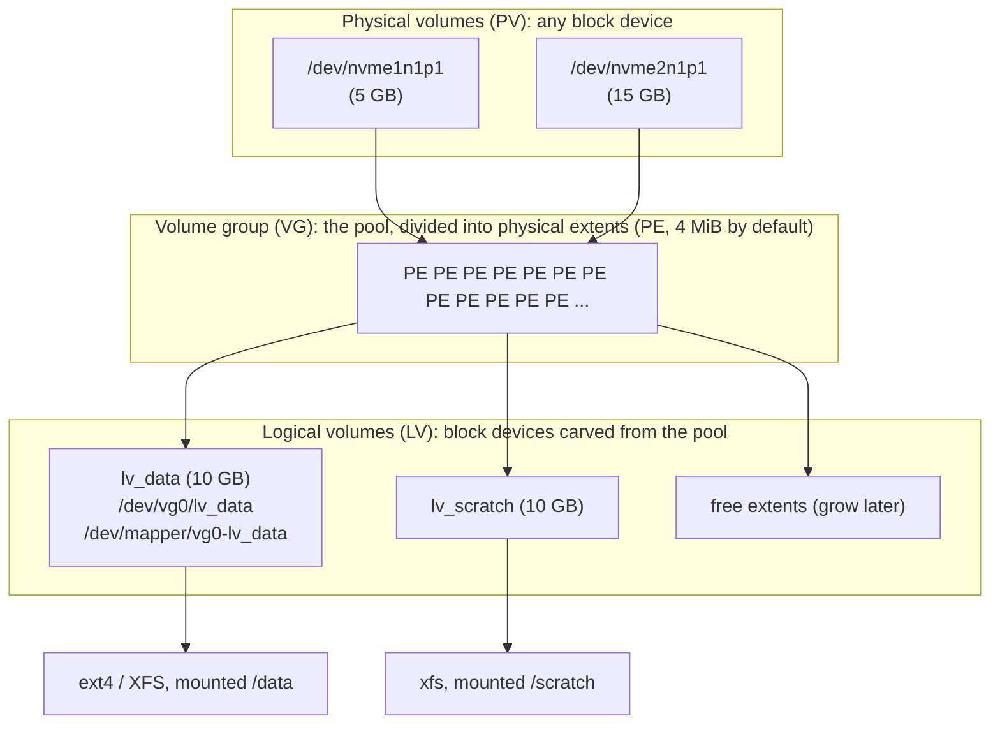
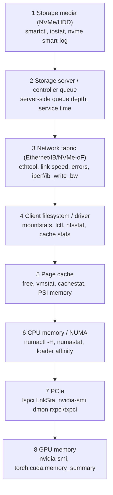
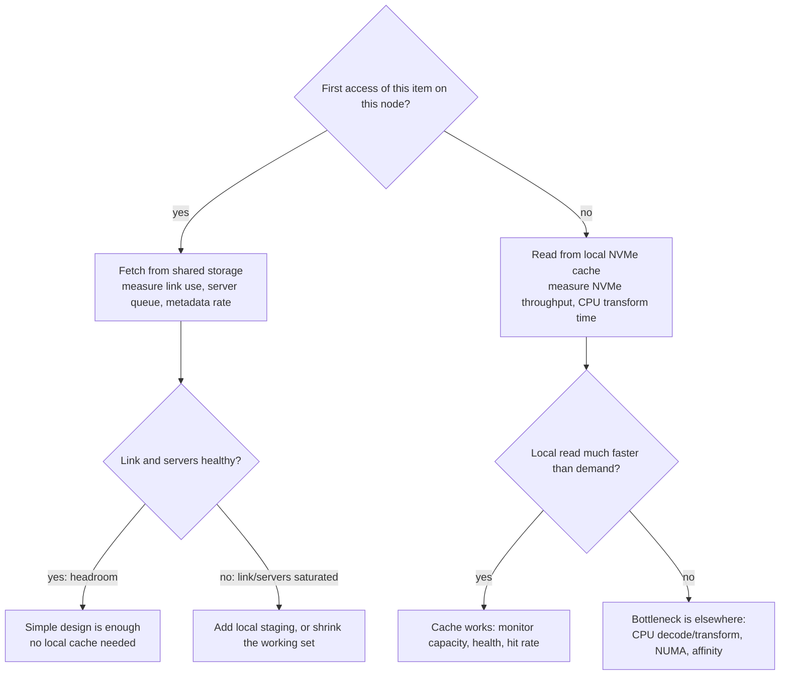

# 1.13 LVM, RAID and NVMe

| | |
|---|---|
| Level | Intermediate |
| Priority tier | 0 |
| Lab venue | GCP / GKE (an Ubuntu VM with loop devices or extra disks; an NVMe VM or GPU server for the NVMe commands) |
| Part | Part 1: Linux, from the command line to the kernel and performance |
| Status | Drafted, labs **untested** |

## Why this matters for AI infrastructure

A GPU server is full of fast, local flash: M.2 drives for the operating system, a bank of U.2 or E1.S NVMe drives for datasets, caches and checkpoints. Cloud GPU instances add local SSD and network-attached volumes that you resize while the machine runs. How you present those drives to the operating system decides whether a node is fast, resilient and easy to operate:

- A single NVMe is fast but a single point of failure; **several NVMe in a RAID 0 array** make one very fast scratch volume (and lose everything if one drive dies), while a **RAID 1 pair** protects the operating system.
- **LVM** lets you grow a volume while it is mounted, move data off a failing disk, take a snapshot before a risky change, and carve one large disk into several volumes without repartitioning. Cloud disks are routinely resized, and LVM turns "the disk got bigger" into "the filesystem got bigger" with a few commands.
- **Multipath** and **NVMe-over-Fabrics** present the same remote storage over several paths; getting them wrong yields duplicate devices, stalled I/O or silent corruption.
- **NVMe health** (wear, media errors, temperature, PCIe link state) is an early warning that a drive will fail or throttle in the middle of a training run.
- Disk performance has its own method: the wrong reading of `iostat` is the most common storage misdiagnosis.

This chapter covers logical volumes and the device mapper, software RAID with `md`, the other device-mapper layers (encryption, multipath, caching), NVMe in depth (architecture, `nvme-cli`, SMART, namespaces, NVMe-oF), the disk-performance method and tools (the USE method for disks, latency analysis, `iostat`, BPF tools, `blktrace`, controller and SMART tools, micro-benchmarks, scaling and tuning), and the AI-specific storage patterns (local NVMe staging and the data path from storage to GPU). It builds on chapter 1.12 (partitions, filesystems, caches); shared and parallel filesystems are Part 6.

## Prerequisites and outcomes

You should know block devices, partitions and filesystems (1.12), device files and sysfs (1.10), and processes and monitoring basics (1.8).

After this chapter you can:

- Explain physical volumes, volume groups, logical volumes and extents; create, extend, shrink (carefully), move, snapshot and remove them; grow a cloud disk online.
- Describe how LVM works internally (user-space metadata and the kernel device mapper) and read `dmsetup table`.
- Build, monitor, repair and rebuild `md` RAID arrays; choose RAID levels for a purpose and explain the performance cost of parity (read-modify-write) and rebuilds.
- Describe dm-crypt/LUKS, device-mapper multipath and caching layers, and when each is used.
- Explain NVMe architecture (controllers, namespaces, queues), use `nvme-cli`, interpret SMART data, check PCIe link state and thermal state, and describe NVMe-oF.
- Apply the disk-performance method: USE for devices and controllers, workload characterisation, latency analysis, micro-benchmarking, and scaling to a target utilisation.
- Use `iostat`, `sar`, PSI, `pidstat`, `biolatency`, `biosnoop`, `blktrace`, `smartctl` and controller tools, and `fio`/`ioping` correctly.
- Design local NVMe staging for datasets and checkpoints and trace the full storage-to-GPU path layer by layer.

## 1. Logical Volume Manager (LVM)

### The problem LVM solves

Direct partitioning ties a filesystem to a fixed place on one disk. Upgrading a disk means installing the new disk, partitioning it, creating filesystems, copying data, editing configuration and rebooting; adding capacity means choosing a new mount point and splitting data by hand. LVM inserts a **layer between physical block devices and filesystems**. You pool physical storage into a **volume group** and carve **logical volumes** out of the pool. The logical volumes are ordinary block devices that hold filesystems or swap, and you can grow, shrink (carefully), move, snapshot and remove them while the system runs, usually without unmounting.



Vocabulary:

| Term | Meaning |
|---|---|
| **PV** (physical volume) | A block device (partition, whole disk, RAID device, LUKS device, loop device) initialised for LVM. Carries a **header with metadata** describing its volume group, so the structure is self-describing |
| **VG** (volume group) | One or more PVs forming a storage pool. Identified by name and UUID |
| **PE** (physical extent) | The allocation unit of a VG (default 4 MiB). PVs are divided into PEs |
| **LV** (logical volume) | A block device allocated from the VG's extents; contains a filesystem or swap |
| **LE** (logical extent) | The LV's corresponding unit mapping onto PEs |
| **Segments / types** | How an LV's extents map to PEs: **linear** (the default), **striped** (RAID-0-like across PVs), **mirror/raid1/raid5/raid6/raid10** (LVM RAID), **thin** (thin-provisioned from a pool), **snapshot**, **cache** |

LVM2 (the current implementation) is a suite of **user-space tools**; PVs are just block devices that user space can read at random, so the work of discovering structure needs no kernel support. The kernel part is the **device mapper**, a generic layer that maps ranges of a virtual block device onto other devices (section 2).

### Looking at an LVM system

```bash
sudo pvs; sudo vgs; sudo lvs            # concise listings
sudo pvdisplay; sudo vgdisplay; sudo lvdisplay    # detailed
sudo lvs -o +devices,segtype,lv_size    # show which PVs back each LV and the segment type
sudo lsblk -f                           # tree: disk > partition > LVM > filesystem and mountpoint
sudo vgs -o +pv_count,lv_count,vg_free_count
```

Column meaning in `vgs`: `#PV`, `#LV`, `#SN` (snapshots), `Attr` (for example `wz--n-`: writable, resizable, normal allocation), `VSize`, `VFree`. In `lvs`: `LV`, `VG`, `Attr` (`-wi-ao----`: writable, inherited allocation, active, open; the first character is the type, `V` thin volume, `t` thin pool, `s` snapshot, `r` RAID; the last characters show health and state), `LSize`, `Pool`, `Origin`, `Data%` (thin pool or snapshot fill), `Meta%`. Once LVM has done its setup work on your system (`HLW` Section 4.4.1), logical volume block devices are created at `/dev/dm-0`, `/dev/dm-1`, and so on, which may be assigned in any order across boots. Because those `/dev/dm-N` names are unpredictable, `udev` and LVM create two sets of symbolic links that combine the volume group and logical volume names: `/dev/VG/LV` (`/dev/myvg/mylv1`) and `/dev/mapper/VG-LV` (`/dev/mapper/myvg-mylv1`, with any hyphen inside a VG or LV name **doubled** so `ubuntu-vg` and `root` become `/dev/mapper/ubuntu--vg-root`). Always use the stable `/dev/VG/LV` or `/dev/mapper/VG-LV` names in `/etc/fstab`, systemd units, and bootloader configurations.

While LVM2's volume discovery and administration tools run in user space, the kernel handles the work of routing each read or write request for a location on a logical volume's block device (`/dev/dm-0`) to the true sector location on an actual physical disk (`/dev/sdb1`). The kernel driver for this is the **device mapper** (sometimes shortened to `devmapper`), a generic block-translation layer sandwiched between the filesystem/block layer and the underlying disk drivers.

### Building: the standard sequence

```bash
# 1. Prepare partitions (optional; a whole disk can be a PV). Use type "Linux LVM" (8e on MBR, 31 on fdisk's GPT list) so tools recognise it.
sudo parted -s /dev/sdb mklabel gpt mkpart lvm 1MiB 100% set 1 lvm on
# 2. Create the VG (creates the PV if needed)
sudo vgcreate myvg /dev/sdb1
# 3. Add another device later
sudo vgextend myvg /dev/sdc1
# 4. Create logical volumes (size by bytes with -L or extents with -l; percentages with -l 50%VG or +100%FREE)
sudo lvcreate -L 10G -n mylv1 myvg
sudo lvcreate -l 100%FREE -n mylv2 myvg
# 5. Filesystem and mount like any block device
sudo mkfs.xfs /dev/myvg/mylv1
sudo mkdir -p /data && sudo mount /dev/myvg/mylv1 /data
echo '/dev/mapper/myvg-mylv1 /data xfs defaults,nofail 0 2' | sudo tee -a /etc/fstab
```

`pvcreate` is optional because `vgcreate` initialises a PV if there is none; if a new VG is not visible, `pvscan`/`vgscan` re-reads the devices.

### Resizing: the two-step operation and its order

An LV and the filesystem inside it have **separate sizes**; to use more space you grow the LV **and** the filesystem. `lvresize`/`lvextend` with **`-r`** (`--resizefs`) does both in one command, calling `fsadm`, which calls `resize2fs` (ext) or `xfs_growfs` (XFS):

```bash
sudo lvextend -r -L +20G /dev/myvg/mylv1      # grow by 20 GiB, online, filesystem included
sudo lvextend -r -l +100%FREE /dev/myvg/mylv1 # use all remaining space
sudo lvresize -r -L 50G /dev/myvg/mylv1       # set an absolute size
```

Manual equivalent: `lvextend -L +20G ...` then `xfs_growfs /data` or `resize2fs /dev/myvg/mylv1`. **Growing is safe online for ext4 and XFS. Shrinking is not**: ext4 must be unmounted, checked and shrunk *before* the LV is reduced (`umount; e2fsck -f; resize2fs fs 40G; lvreduce -L 40G`, or `lvreduce -r` which does it in the right order), and **XFS cannot be shrunk at all** (back up, recreate, restore). Reducing the LV first destroys the filesystem's tail. Always back up before shrinking.

### Moving, removing and renaming

```bash
sudo pvmove /dev/sdb1                         # migrate all extents off this PV onto other PVs in the VG (online)
sudo pvmove -n mylv1 /dev/sdb1 /dev/sdc1      # move only one LV
sudo vgreduce myvg /dev/sdb1 && sudo pvremove /dev/sdb1    # then retire the old disk
sudo lvremove myvg/mylv2          # NOTE the slash: VG/LV
sudo lvrename myvg mylv1 data; sudo vgrename myvg datavg
```

**Careful with `lvremove`**: its argument is `VG/LV`. If you type a space instead of the slash (`lvremove myvg mylv2`), LVM treats `myvg` as a volume group (remove **all** its LVs) and `mylv2` as another. It does prompt for each volume, but do not answer `y` automatically.

`pvmove` makes disk replacement an online operation: add the new disk to the VG, `pvmove` the old one, `vgreduce` it out. It is the reason many fleets use LVM even on a single disk.

### Cloud pattern: the disk grew, grow everything above it

```bash
# 1. The cloud disk (GCP PD, EBS) was resized in the console/API. Make the kernel see the new size:
echo 1 | sudo tee /sys/class/block/sdb/device/rescan          # SCSI/virtio; NVMe devices notice by themselves or: sudo nvme ns-rescan /dev/nvme1
# 2. Grow the partition (if partitioned)
sudo growpart /dev/sdb 1                                       # from cloud-guest-utils
# 3. Let LVM see the larger PV
sudo pvresize /dev/sdb1
# 4. Grow the LV and filesystem
sudo lvextend -r -l +100%FREE /dev/myvg/mylv1
```

### Snapshots and thin provisioning

A **snapshot** is a point-in-time view of an LV. A classic LVM snapshot uses **copy-on-write**: when the origin changes, the old blocks are copied to the snapshot area first. It needs a size estimate (`lvcreate -s -L 5G -n snap /dev/vg/lv`), and **if the snapshot area fills up, the snapshot becomes invalid**. Snapshots slow writes to the origin while they exist, so keep them short-lived: backups (mount the snapshot read-only, copy, remove) and "undo points" before upgrades (`lvconvert --merge` rolls the origin back to the snapshot).

**Thin provisioning** allocates from a **thin pool** and lets you create many virtual volumes whose total size exceeds the pool (over-provisioning), using space only as data is written:

```bash
sudo lvcreate -L 500G --thinpool tp myvg
sudo lvcreate -V 200G --thin -n vol1 myvg/tp
sudo lvcreate -s --name vol1snap myvg/vol1          # thin snapshots are cheap and need no size
sudo lvs -a -o +data_percent,metadata_percent       # WATCH Data% and Meta%
```

Danger: **a thin pool that reaches 100% data or metadata corrupts or blocks the volumes in it.** Monitor, alert early (and configure `thin_pool_autoextend_threshold` in `lvm.conf` with monitoring on), and do not over-provision beyond what you can add. (Container runtimes once used LVM thin pools via devicemapper; overlayfs on XFS has replaced that.)

Other LV types: **striped** (`lvcreate -i 4 -I 256k -L 1T -n scratch vg` stripes across 4 PVs for throughput, like RAID 0), **raid1/raid5/raid6/raid10** (`lvcreate --type raid1 -m1 ...`, LVM's wrapper over the `md` RAID code), **cache** (put a fast NVMe in front of a slow volume: `lvconvert --type cache ...`, using `dm-cache`).

### Implementation: how it fits together

When LVM tools run they must (1) find all PVs by scanning block devices (guided by `devices/filter` or the devices file in `lvm.conf`), (2) read each PV's header (a label plus a text **metadata area**), (3) group PVs into VGs by UUID and verify that all required PVs are present, (4) find the LVs and (5) compute the **mapping scheme**. Metadata is also saved under `/etc/lvm/backup` and `/etc/lvm/archive` (`vgcfgrestore` can restore a VG's layout if metadata is damaged). `dd if=/dev/sdb1 count=1000 | strings | less` shows the header text. Then LVM tells the kernel's **device mapper** (through `ioctl` on `/dev/mapper/control`) to create the virtual block devices with their mapping tables; udev notices the new `dm-N` devices and creates the symlinks (chapter 1.10). At boot the initramfs must activate the VG that holds the root filesystem (`rd.lvm.vg=`, `lvm2-activation` units; chapter 1.14).

`lvm.conf` settings worth knowing: `filter`/`global_filter` (which devices to scan; exclude multipath component paths and GPU/NVMe devices you do not want scanned, avoid scanning inside VM images), `use_devicesfile` (newer LVM restricts scanning to a list of known devices in `/etc/lvm/devices/system.devices`), `issue_discards`, `thin_pool_autoextend_*`, `activation { monitoring }`.

## 2. The device mapper

The **device mapper** (`dm`) is a kernel framework that builds virtual block devices out of **tables of targets**. Each table line maps a range of sectors of the virtual device onto a range of some underlying device with a **target type**. LVM, encryption, multipath, thin provisioning, snapshots, caching, integrity checking and many container-storage drivers are all built on it. It is, in effect, a form of virtualisation for storage, similar in spirit to virtual memory's translation.

```bash
sudo dmsetup ls --tree             # tree of mapped devices and what they sit on
sudo dmsetup info myvg-mylv1       # state, major:minor, open count, UUID
sudo dmsetup table                 # mapping tables: START LENGTH TARGET args
sudo dmsetup status                # runtime status (thin pools, multipath, cache stats)
```

A linear LV spread over two disks has a table like this (sector numbers in 512-byte units, `8:17` and `8:33` are the major:minor of the underlying devices):

```text
myvg-mylv2: 0 10960896 linear 8:17 2048
myvg-mylv2: 10960896 10010624 linear 8:33 20973568
myvg-mylv1: 0 20971520 linear 8:33 2048
```

Fields: start offset in the mapped device, length of the segment, target type (`linear` here), source device (major:minor), offset on that device. LVM places the first LV contiguously where it can; the second needs two segments across both PVs; after removing `mylv2` and extending `mylv1`, the table gains the second segment. The kernel only follows the map; deciding the layout is LVM's (user space) job.

Common targets: `linear`, `striped`, `mirror`/`raid`, `snapshot`/`snapshot-origin`, `thin`/`thin-pool`, `crypt` (dm-crypt/LUKS), `multipath`, `cache`/`writecache`, `integrity`, `verity` (read-only integrity for images), `zero`, `error` (inject failures for testing).

### Encryption: dm-crypt and LUKS

**LUKS** (Linux Unified Key Setup) is the on-disk format used with dm-crypt:

```bash
sudo cryptsetup luksFormat /dev/nvme1n1p1           # DESTROYS data; sets a passphrase / key slot
sudo cryptsetup open /dev/nvme1n1p1 securedata      # creates /dev/mapper/securedata
sudo mkfs.xfs /dev/mapper/securedata && sudo mount /dev/mapper/securedata /secure
sudo cryptsetup luksDump /dev/nvme1n1p1; sudo cryptsetup luksAddKey ...
# persistent: /etc/crypttab  (name  device  keyfile-or-none  options),  then /etc/fstab refers to /dev/mapper/name
```

Cost: CPU for AES (hardware AES-NI makes it small), but on very fast NVMe the dm-crypt work queues can become the bottleneck (check `perf top` for `aes`, and kernel options such as `no_read_workqueue,no_write_workqueue`). Data-centre drives often use self-encrypting (SED) hardware or encrypt at the application/object-store layer instead. GPU clusters handling regulated data may require encryption at rest; plan the key management (TPM, network-bound unlock with Clevis/Tang) before you need it.

### Multipath

A SAN or NVMe/SCSI target reachable over several physical paths (two HBAs, two switches, two controllers) appears to the operating system as **several block devices** (`sdb`, `sdc`, `sdd`, `sde`) for the *same* LUN. **`multipathd`** with `dm-multipath` recognises that they share a WWID and creates **one** device `/dev/mapper/mpathX` (or an alias), distributing I/O (round-robin or queue-length) across active paths and failing over when one dies:

```bash
sudo multipath -ll                  # topology: each mpath device, its paths and states (active/ready, failed/faulty)
sudo multipath -v2                  # (re)build maps
/etc/multipath.conf                 # defaults, blacklist (never multipath local disks), multipaths { wwid ... alias ... }
sudo systemctl status multipathd
```

Rules: always build filesystems and LVM on the multipath device, **never on a component path** (exclude paths in the LVM filter); blacklist local disks and virtio disks; set `no_path_retry` deliberately (queue forever versus fail fast). For NVMe-oF, the kernel has **native NVMe multipath** (`/sys/module/nvme_core/parameters/multipath`), which makes `nvme list-subsys` the tool, not `multipath -ll`.

### Caching layers

`dm-cache` and LVM cache, `dm-writecache`, and `bcache` use a fast SSD/NVMe as a cache in front of a slower device (in the block layer). They are useful for a large HDD or network volume with a hot subset; they add complexity and failure modes (if the write cache dies, data may be lost: use mirrored cache devices for write caching). For AI workloads the simpler pattern is usually to **stage the working set explicitly onto local NVMe** (section 8).

## 3. Software RAID with `md`

**RAID** (redundant array of independent disks) combines drives into one virtual device for capacity, speed or fault tolerance. **Hardware RAID** is done by a controller card (with its own cache, often battery- or capacitor-backed); **software RAID** by the operating system (Linux `md`, LVM RAID, ZFS, btrfs). Modern CPUs make parity calculation cheap, and software RAID gives the operating system full visibility of each drive and survives a dead controller. Most GPU servers use **software RAID (`md`)**; some storage servers still use hardware RAID, which hides the physical disks (so you query the controller tools, section 6).

### RAID levels

| Level | Layout | Capacity | Fault tolerance | Performance character |
|---|---|---|---|---|
| **linear / concat** | Drives filled one after another | Sum | None (any loss damages the array) | No striping; mostly for capacity |
| **RAID 0** | Data **striped** across all drives | Sum | **None**: one drive lost = all data lost | Best sequential and random throughput; scales with drive count |
| **RAID 1** | **Mirror** (usually two copies) | One drive | Survives all but one drive | Reads from any copy (good read scaling); writes at the speed of the slowest copy |
| **RAID 10** | Stripe across mirrored pairs | Half | One drive per pair (more with luck) | Good reads and writes; the usual choice for databases and mixed loads |
| **RAID 5** | Stripe with **one** parity block rotating across drives | N-1 | One drive | Good reads; **small writes are expensive** (read-modify-write) |
| **RAID 6** | Stripe with **two** parity blocks | N-2 | Two drives | Like RAID 5 but slower writes; preferred for large HDD arrays because rebuilds are long |

Terms: a **stripe** is data written across drives in **chunks** (the chunk or stripe unit, often 64 to 512 KiB; with `md` the `--chunk` size); a **full-stripe write** writes all chunks plus parity at once and is efficient, while a **partial write** to a parity RAID requires **read-modify-write** (read the old data and parity, compute the new parity by XOR, write both), turning one small write into several I/Os. Performance depends on matching the array's stripe size to the I/O size of the workload and aligning the filesystem to it (`mkfs.xfs -d su=...,sw=...`, which the tools usually detect from `md`). A write-back cache with battery or capacitor backup (hardware RAID) hides the read-modify-write cost; if its battery fails, controllers fall back to write-through and write performance drops suddenly. The **write hole** (a crash between data and parity writes leaves a stripe inconsistent) is mitigated with a write-intent bitmap, a journal device (`--write-journal`), or a copy-on-write RAID (ZFS, btrfs).

**Rebuilds.** When a drive is replaced, the array **rebuilds** (resyncs, "resilvers"): it reads all surviving drives and writes the new one. This consumes I/O for hours or days, hurts foreground performance, and as drives get larger faster than they get quicker, the chance of a second failure or an unrecoverable read error during rebuild rises. That is why RAID 6 or RAID 10 is chosen over RAID 5 for big spinning-disk arrays, why rebuild speed limits exist (`dev.raid.speed_limit_min/max`), and why **RAID is not a backup** (it does not protect against deletion, corruption, ransomware, fire, or an application writing garbage).

### `mdadm`

```bash
# Create
sudo mdadm --create /dev/md0 --level=0 --raid-devices=4 --chunk=256K /dev/nvme[1-4]n1     # RAID 0 scratch of four NVMe
sudo mdadm --create /dev/md1 --level=1 --raid-devices=2 --metadata=1.2 /dev/sda2 /dev/sdb2 # mirror
sudo mdadm --create /dev/md2 --level=6 --raid-devices=8 --bitmap=internal /dev/sd[b-i]1     # RAID 6 with a write-intent bitmap
# Inspect
cat /proc/mdstat                         # live state; [UU] all up, [U_] degraded; recovery progress
sudo mdadm --detail /dev/md0             # level, state, devices, UUID, chunk size
sudo mdadm --examine /dev/nvme1n1        # the md superblock on a member
# Persist
sudo mdadm --detail --scan | sudo tee -a /etc/mdadm/mdadm.conf     # (RHEL: /etc/mdadm.conf)
sudo update-initramfs -u                  # (Debian/Ubuntu)   |   sudo dracut -f   (RHEL)
# Use
sudo mkfs.xfs /dev/md0 && sudo mkdir -p /scratch && sudo mount -o noatime /dev/md0 /scratch   # fstab by UUID
# Fail/replace
sudo mdadm /dev/md1 --fail /dev/sdb2 --remove /dev/sdb2
sudo mdadm /dev/md1 --add /dev/sdc2       # rebuild starts automatically
# Stop/assemble
sudo mdadm --stop /dev/md0; sudo mdadm --assemble --scan
# Monitoring
sudo mdadm --monitor --scan --mail=root --daemonise    # or the distribution's mdmonitor service
echo check | sudo tee /sys/block/md1/md/sync_action     # scrub: read all, verify mirrors/parity (monthly via cron/timer)
cat /sys/block/md1/md/mismatch_cnt
sudo sysctl dev.raid.speed_limit_min dev.raid.speed_limit_max
```

Habits: use **UUIDs** (the array's `--detail` UUID, not member names, which change); set up **email or metrics alerts** for degraded arrays (a degraded RAID 1 runs perfectly and loses its last copy silently); scrub periodically; **test the rebuild procedure** before you need it; store `/etc/mdadm/mdadm.conf` and rebuild the initramfs after changes so the array assembles at boot (otherwise arrays appear as `md127`). Metadata versions: `1.2` (default, at 4 KiB from the start), `1.0` (at the end, so a mirror member still looks like a plain filesystem to a bootloader: used for `/boot/efi` mirrors), `0.90` legacy.

### Which RAID for what (GPU nodes)

| Purpose | Typical choice | Reason |
|---|---|---|
| Operating system | RAID 1 across two small drives (or the cloud's single root volume) | Survive one drive failure; DGX-class systems ship with a mirrored OS pair *(verify on your model)* |
| Local scratch, dataset cache, container image store, fast checkpoint staging | **RAID 0** across NVMe (or no RAID, separate mounts) | Maximum throughput, data is reproducible or copied elsewhere; losing one drive loses the array, so treat the volume as a **cache**, with the source of truth on shared storage |
| Valuable local data on a storage server | RAID 6 / 10, or distributed erasure coding (Lustre/Ceph/GPFS) | Fault tolerance without a single controller as a point of failure |
| Cloud | None (the provider replicates the disk); RAID 0 of several local SSDs for speed | Local SSD is ephemeral; persistent disks are already redundant |

## 4. NVMe in depth

**NVMe** (Non-Volatile Memory Express) is a host-controller interface designed for flash. A drive connects directly to **PCIe** (U.2, M.2, E1.S/E3.S, add-in card) and speaks the NVMe command set rather than being translated through SCSI/SATA layers.

### Architecture

- A **controller** (`/dev/nvme0`, a character device; one per drive or fabric connection) manages one or more **namespaces** (`/dev/nvme0n1`, `nvme0n2`: block devices; partitions `nvme0n1p1`). A namespace is a slice of storage with its own LBA format (block size 512 B or 4 KiB). Most drives expose one namespace; **namespace management** can create several.
- Communication is through **queues in host memory**: one **admin** queue pair and many **I/O submission/completion queue pairs**, up to 64 thousand queues each up to 64 thousand entries deep. Linux creates **one queue pair per CPU** (blk-mq), so the CPU that issues an I/O also gets its completion interrupt (MSI-X), with no shared lock, which is why NVMe scales to millions of IOPS and low latency (tens of microseconds). The older SATA queue is 32 deep; SAS 256.
- **Completion** is by interrupt, or **polling** for the lowest latency (`io_poll`, `io_uring` with `IORING_SETUP_IOPOLL`).
- Bandwidth is bounded by the **PCIe link**: Gen3 x4 about 3.5 GB/s, Gen4 x4 about 7 GB/s, Gen5 x4 about 14 GB/s per direction. A drive running at x2 or at a lower generation is slow; check the link state (`lspci -vv`, `/sys/class/nvme/nvme0/device/current_link_speed`, `max_link_width`).
- **I/O scheduler**: `none` is the right choice for fast NVMe (the drive and the multiqueue block layer do the work); `mq-deadline`/`kyber`/`bfq` can add latency without benefit.
- **Features** you will meet: **TRIM/deallocate** (Dataset Management), **namespaces**, **power states** and **APST** (autonomous power-state transitions; aggressive low-power states can add latency, and some drives misbehave: the kernel parameter `nvme_core.default_ps_max_latency_us=0` disables deep states), **end-to-end protection**, **Zoned Namespaces** (ZNS), **Key Per I/O**, **SR-IOV** virtual functions (cloud and virtualisation), **namespace sharing** across hosts in fabrics.

### `nvme-cli`

```bash
sudo apt install nvme-cli           # RHEL: sudo dnf install nvme-cli
sudo nvme list                       # all NVMe namespaces: node, model, serial, firmware, usage, size
sudo nvme list-subsys                # subsystems and paths (multipath view)
sudo nvme id-ctrl /dev/nvme0 | head -40    # controller: model, serial, firmware, max queues, namespace count, features
sudo nvme id-ns /dev/nvme0n1         # namespace: size, LBA formats (lbaf), current format, nuse
sudo nvme smart-log /dev/nvme0       # health (see below)
sudo nvme error-log /dev/nvme0       # recent errors
sudo nvme fw-log /dev/nvme0          # firmware slots
sudo nvme format /dev/nvme0n1 --lbaf=1    # LOW-LEVEL FORMAT: DESTROYS ALL DATA; changes block size (e.g. to 4 KiB)
sudo nvme sanitize ...               # crypto-erase / block-erase (destructive)
sudo nvme create-ns / attach-ns / delete-ns   # namespace management (drive must support it; destructive)
sudo nvme get-feature /dev/nvme0 -f 0x0c    # e.g. autonomous power state transition
sudo nvme telemetry-log ...
```

**Reading `smart-log`** (field names vary slightly by version): `critical_warning` (non-zero: spare below threshold, over temperature, reliability degraded, read-only mode, volatile memory backup failed; **any value other than 0 needs action**); `temperature` and `warning/critical composite temperature time` (time spent hot); `available_spare` versus `available_spare_threshold`; **`percentage_used`** (an estimate of the life consumed against the endurance rating; plan replacement before 100); `data_units_read/written` (units of 512,000 bytes: multiply for totals, and compare writes with the drive's endurance, **TBW/DWPD**); `media_errors` and `num_err_log_entries` (non-zero and rising = failing media); `unsafe_shutdowns` (power loss without a clean shutdown); `power_on_hours`. Fleet monitoring should collect these from every node (via `nvme-cli`, `smartctl -a /dev/nvme0`, Prometheus `node_exporter`'s textfile collector, or DCGM-adjacent tooling) and alert on `critical_warning`, `media_errors`, `percentage_used`, rising temperature and unsafe shutdowns.

**Thermal throttling.** NVMe drives slow themselves down when hot; a node whose NVMe is 30% slower than its identical neighbours often has a heat or airflow problem, or different firmware. Compare `smart-log` temperatures and "time above warning" across nodes.

**Firmware.** Different firmware versions on "identical" drives cause unexplained differences; inventory with `nvme list`/`id-ctrl` and update through the vendor tooling in maintenance windows (`nvme fw-download`/`fw-commit`, or distribution `fwupd`).

### NVMe over Fabrics (NVMe-oF)

NVMe-oF carries the NVMe protocol across a network so a remote drive looks like a local `/dev/nvmeXnY` with low added latency. Transports: **RDMA** (InfiniBand, RoCE, iWARP; lowest latency), **TCP** (works on any Ethernet; higher CPU), **Fibre Channel**. Concepts: a **target** exports **subsystems** identified by an **NQN** (NVMe qualified name); a **host** identifies itself with a host NQN (`/etc/nvme/hostnqn`) and **discovers** then **connects**:

```bash
sudo modprobe nvme-rdma    # or nvme-tcp
sudo nvme discover -t rdma -a 10.0.0.5 -s 4420
sudo nvme connect  -t rdma -n nqn.2024-01.com.example:subsys1 -a 10.0.0.5 -s 4420
sudo nvme list-subsys; sudo nvme disconnect -n nqn.2024-01.com.example:subsys1
# target side (Linux): nvmet configuration via configfs (/sys/kernel/config/nvmet), or nvmetcli
```

Use NVMe-oF to disaggregate storage (shared flash pools), as the backend of parallel filesystems, and for GPUDirect Storage over RDMA. Multiple paths use native NVMe multipath with ANA (asymmetric namespace access) states. Tune with `ctrl_loss_tmo`, `reconnect_delay`; a lost fabric leaves processes in `D` state (chapter 1.8).

### NVMe naming and containers

`nvme0n1` names depend on probe order; with native multipath `nvme0c0n1` are hidden path devices and `nvme0n1` the aggregated one. Use `/dev/disk/by-id/nvme-<model>_<serial>` or `by-path` or filesystem UUIDs in configuration (chapter 1.10). In Kubernetes, local NVMe is exposed through the **local static provisioner** (a PV per mount) or **LVM-based CSI drivers** (TopoLVM, OpenEBS LVM-LocalPV, which carve LVs from a VG per node and support capacity-aware scheduling and resizing).

## 5. Disk performance: the method

(Chapter 1.12 section 9 covers the filesystem layer; this section is about the block device and below. Time scales and concepts are in 1.12 section 2.)

### Concepts you need

- **I/O time** has parts: *wait time* (queued in the OS or on the device) plus *service time* (the device working) equals *request time* (what you feel and `iostat` reports as `await`). Modern devices queue internally and process many requests at once, so "service time" derived from utilisation (`util / IOPS`) is only a rough single-queue approximation.
- **IOPS are not equal.** 5,000 sequential IOPS on a rotational disk may be far faster than 1,000 random ones; flash IOPS depend on size and direction. Never compare IOPS without the I/O size, random/sequential mix, read/write ratio, queue depth and whether the test was buffered.
- **Non-data commands** (cache flush, TRIM/UNMAP) occupy a device and affect latency.
- **Utilisation** is the fraction of an interval the device was busy; **saturation** is work queued beyond what it can service (average wait-queue length). 100% busy with no queue is not saturated; a device can have saturation at utilisation below 100% when averaged over an interval that hides bursts. For virtual disks (RAID controller, SAN, cloud volume) the OS sees only the virtual device's utilisation, not what the physical disks are doing (a "100% busy" volume built from many disks may still accept more work; a write-back cache hides busyness; a hardware RAID rebuild is invisible to the OS).
- **I/O wait** (`wa` in `top`/`vmstat`) is idle CPU time while threads are blocked on disk I/O. It is confusing: add a CPU-hungry process and `wa` falls although the disk problem persists. A more reliable metric is the **time application threads spend blocked on disk I/O**. Use `wa` as a hint ("disks busy, CPUs idle") not as a measurement.
- **Synchronous versus asynchronous.** Disk latency does not hurt the application if the I/O is asynchronous (write-back, read-ahead, a background thread).

### Methods, in a sensible order

1. **USE method** (utilisation, saturation, errors) for **each device** and each **controller/transport**. Check **errors first** (SMART, kernel logs, controller logs): redundant arrays keep working while degraded and errors go unnoticed. Controller and bus limits (throughput in MB/s and operations per second, PCIe link width/speed, SAS/NVMe lane counts) are often overlooked; if total throughput or IOPS always levels off at the same value under different workloads, suspect a controller or transport limit.
2. **Performance monitoring** over time: per-disk utilisation and response time (and IOPS/throughput for capacity planning), looking for imbalance across disks. Utilisation above about 60% may already cause queueing delays; sustained 100% is very likely a problem (but remember the NVMe caveat in 1.12).
3. **Workload characterisation**: I/O rate, throughput, size, read/write ratio, random versus sequential, which applications and files, balance across disks, arrival-time distribution, how synchronous the application is, errors, non-data commands. Record maxima and distributions, not only averages; e.g. "a light random-read workload averaging 350 IOPS (8 KiB reads) with short sequential write bursts of 2 to 5 seconds reaching 4,800 IOPS and 560 MB/s."
4. **Latency analysis**: measure at several layers (application, filesystem, block layer, driver, device). If the latency of an outlier is the same at every layer, the device (or driver) is the cause; if latency is large at the filesystem but small below, the cause is filesystem locking/queueing, or related metadata I/O. Use histograms, not only averages, and per-I/O traces for outliers.
5. **Static performance tuning**: how many disks, types (SMR? TLC?), firmware versions, controllers and their slots (is the HBA in a x8 slot?), RAID layout and stripe width, multipath, driver and firmware bugs, cache sizes, battery status, I/O resource controls. (A common real-world cause of poor array performance is a configuration choice, such as a very wide parity stripe, not a fault.)
6. **Cache tuning**, **resource controls**, **micro-benchmarking** (to find the device's limits), **scaling** (below), and **event tracing** as a last resort (it has overhead, and writing the trace to the traced disk creates a feedback loop).

**Scaling.** To size a system: determine the target throughput and IOPS; compute the number of devices **at a target utilisation of about 50%**, not at their maximum (driving disks to 100% queues requests and wrecks latency); factor in RAID write penalties; then check controllers, transports and CPU cycles per I/O. "Add more spindles" has become "add more flash."

### Micro-benchmarking the device

To test the **disk** rather than the filesystem, use the device path (or direct I/O to a file on a fresh filesystem), control: direction, random/sequential, offset range, I/O size, concurrency (queue depth/threads), number of devices. Standard probes: maximum throughput (1 MiB sequential reads), maximum IOPS (small reads), random-read latency profile at different sizes. **Only use destructive write tests on devices that hold nothing you need.** Keep `iostat -xz 1` running in another terminal to confirm what the benchmark actually did.

```bash
# Raw-device read tests (non-destructive): bypass the cache with direct I/O
sudo fio --name=seqread --filename=/dev/nvme1n1 --rw=read --bs=1M --iodepth=32 --direct=1 --ioengine=io_uring --runtime=30 --time_based --readonly
sudo fio --name=randread4k --filename=/dev/nvme1n1 --rw=randread --bs=4k --iodepth=64 --numjobs=4 --direct=1 --ioengine=io_uring --runtime=30 --time_based --group_reporting --readonly
sudo ioping -c 10 /dev/nvme1n1          # 4 KiB latency, one per second: a gentle probe usable in production
sudo hdparm -Tt /dev/nvme1n1            # crude: -T cached reads, -t device reads
# A latency profile: queue depth 1 shows the unloaded latency of the device
sudo fio --name=lat --filename=/dev/nvme1n1 --rw=randread --bs=4k --iodepth=1 --direct=1 --runtime=20 --time_based --readonly --lat_percentiles=1
```

Read **latency percentiles** (p50, p99, p99.9) and IOPS **at stated queue depth**. An NVMe may do 1 million IOPS at queue depth 128 across 8 jobs and 80,000 at queue depth 1; the second number is the one a single synchronous reader gets. `ioping` is notable because it barely loads the device (about 0.4% utilisation), so it can probe latency on a busy production disk. A replayed I/O trace (`blktrace` + `blkreplay`) can reproduce hard-to-recreate issues, but is misleading if the target system differs.

## 6. Tools for the block layer

| Tool | Shows | Notes |
|---|---|---|
| **`iostat -xz 1`** | Per-device `r/s w/s rkB/s wkB/s rrqm/s wrqm/s` (merged requests), `r_await w_await await`, `areq-sz`, `aqu-sz`, `%util` | Cheap (kernel keeps the counters by default), the first command to run; `-p ALL` per partition; `-s` short form; the figures are interval averages; `%util` caveat above |
| **`sar -d -p 1`** | Same counters, and history if `sysstat` is collecting | "What was the disk doing at 03:10?" |
| **`/proc/diskstats`, `/sys/block/DEV/stat`** | Raw counters | What `iostat` reads |
| **PSI**: `cat /proc/pressure/io` | `some`/`full` share of time tasks were stalled on I/O (10/60/300 s averages) | Good health signal: `full` close to `some` means I/O pressure stalls *all* runnable tasks |
| **`pidstat -d 1`**, **`iotop -oPa`** | Which process does the I/O (kB read/written, `iodelay`) | `iotop` shows threads |
| **`perf trace`, `perf record -e block:*`** | Block tracepoints | `perf script` to read |
| **`biolatency`** (BCC/bpftrace) | Histogram of block I/O latency; `-D` per disk, `-F` by flags | Shows multimodal distributions (cache hits vs misses) and outliers; far better than averages |
| **`biosnoop`** | One line per I/O: time, process, PID, disk, R/W, sector, bytes, latency | Event tracing; overhead at high rates |
| **`biotop`** | `top` of block I/O by process | |
| **`biostacks`** | Latency with the stack that initiated the I/O | Why was this I/O issued? |
| **`blktrace` / `blkparse` / `btt`** | Full block-layer event tracing: queue, merge, issue, complete | Heavy; for deep dives and replay |
| **`bpftrace`** | Custom one-liners, e.g. `bpftrace -e 'tracepoint:block:block_rq_issue { @[args->rwbs] = hist(args->bytes); }'` | I/O size distributions per type |
| **`smartctl -a /dev/sdX`**, **`nvme smart-log`** | Drive health: reallocated/pending sectors, CRC errors, wear, media errors, temperature, hours | The first-error early warning; `-d megaraid,N` and similar query disks behind RAID controllers |
| **`storcli`/`perccli`/`MegaCli`/`arcconf`** | Hardware RAID controller state: virtual drives, patrol reads, consistency checks, battery/capacitor, event logs, rebuild rate | Vendor-specific; check what the controller did at 03:00 (a "patrol read" is a background read of all blocks that can affect performance) |
| **SCSI logging**: `echo 03333333333 > /proc/sys/dev/scsi/logging_level` (or `scsi_logging_level -s --all 3`) | Kernel logs SCSI commands and results | Floods the log; for debugging timeouts and errors |
| **`/sys/block/DEV/queue/*`**, **`lsblk -t`** | Queue depth, scheduler, rotational, sizes, read-ahead | |
| **Visualisations** | Latency heat maps, offset heat maps, line graphs | A latency heat map (time on x, latency on y, colour = count) reveals bimodality and drifting outliers that a line graph averages away |

**Reading `iostat -x`** fields: `rrqm/s`, `wrqm/s` merged requests per second (adjacent I/Os coalesced by the block layer, reducing per-I/O cost); `r/s`, `w/s` completed requests; `rkB/s`, `wkB/s` throughput; `areq-sz` average request size (small values with high IOPS indicate small random I/O); `aqu-sz` average queue length (saturation indicator); `r_await`, `w_await` (milliseconds in queue plus service); `%util`. Newer versions drop the old `svctm` because it is unreliable. Rules of thumb: for a single HDD, `%util` near 100% with a growing `aqu-sz` and `await` of tens of milliseconds means saturated; for flash, watch `await` and the percentiles from `biolatency`; for arrays, look at the individual members too.

### Tuning knobs

- **I/O priority**: `ionice -c 3 -p PID` (idle class) for backups so they don't disturb production; `-c 2 -n 0..7` best-effort; `-c 1` real-time (can starve others). Works with schedulers that implement priorities.
- **cgroup I/O control** (cgroup v2 `io.max` and `io.weight`; systemd `IOWeight=`, `IOReadBandwidthMax=`, `IOWriteIOPSMax=`): limits per group of processes: fixed IOPS/bandwidth caps per device or proportional weights. This is how multi-tenant nodes keep one job from monopolising local disk (`echo "259:0 rbps=200M wbps=100M" > io.max`). A "disk bottleneck" can be an imposed limit rather than the device.
- **Queue parameters** in `/sys/block/DEV/queue/`: `scheduler` (`none`, `mq-deadline`, `kyber`, `bfq`), `nr_requests`, `read_ahead_kb`, `max_sectors_kb`, `rq_affinity`, `nomerges`, `add_random`. Defaults are generally right for NVMe; test before and after with the same benchmark.
- **Device settings**: `hdparm` (write cache `-W`, power management `-B`/`-S`; several options are marked DANGEROUS in its manual; do not experiment on data disks); controller settings (rebuild rate, patrol-read rate, cache flush interval, write-back versus write-through policy).
- Persist what you choose with udev rules or `tuned` profiles, not with `echo` in a shell (chapter 1.10).

## 7. AI-infrastructure patterns

### The full data path, layer by layer

Training data crosses storage media, storage servers, the network, the client filesystem, the page cache, CPU memory, PCIe and finally GPU memory. **A slow GPU is not necessarily a slow disk**: the worker at any hand-off can be the limit (like a bucket brigade, the slowest person sets the pace), so measure every hand-off.



Procedure: (1) establish the demand: samples per second times bytes per sample per GPU; (2) measure supply at each layer with a tool that bypasses the layers above (raw device read with `fio --direct=1`, then filesystem, then the network path with the storage client, then the application loader); (3) the first layer whose measured capacity is below the demand is the bottleneck; (4) check the *hidden copies* (an extra CPU-side decode or format conversion can cost more than the disk). Typical findings: a data loader with too few workers or running on the wrong NUMA node; a PCIe x8 link where x16 was expected; page cache thrashing because the dataset is slightly larger than RAM; a shared filesystem whose metadata server saturates on small files; JPEG decoding on the CPU being the real limit.

### Local NVMe as cache and staging area

Enterprise advice says local disk is bad because it is stateless and unprotected. In AI the logic flips because **training reads the same data hundreds of times** (epochs). If a thousand GPUs fetch the same ten thousand images from the shared array on every epoch, the network melts. Instead:

- **Epoch 1**: read from shared storage and keep a copy on node-local NVMe. Slow, once.
- **Epochs 2 to N**: read from local NVMe. Network traffic drops to nearly zero and the GPUs are fed at local speed.

Use local NVMe staging when: the shared link or filesystem is the measured bottleneck; the dataset fits in local capacity and is read repeatedly (many epochs or fine-tuning iterations); checkpoint writes block training and can be staged asynchronously; preprocessing is expensive and its output is reused. **Do not** bother when: the shared storage has headroom (link utilisation well below saturation, metadata healthy); the dataset is too big to fit and must stream anyway (you add complexity for no benefit); the GPUs are already near full utilisation; the run is only one or two epochs (the cold first epoch dominates); or nodes fail often enough that the cost of re-staging offsets the gain.



**Cache design points.** Verify cached files (a checksum or version key per item) so a run never trains on stale data when the source changes; log the hit rate by epoch (about 0% in epoch 1, above 95% from epoch 2 if the dataset fits; a drop in later epochs shows eviction pressure as the NVMe fills, often above about 85% full); choose an eviction policy; pre-stage in parallel before the job starts instead of lazily on first read; keep staging deterministic and idempotent; treat the volume as disposable. Wrong file-naming (different names for the same data) defeats hit-rate.

**Checkpoint staging.** Writing a very large checkpoint synchronously to shared storage stalls the whole job for the duration (for example a 500 GB checkpoint at about 1 GB/s is minutes). Write it to local NVMe at several GB/s (a short stall), then let a background task copy it to durable shared or object storage while training continues, and delete the local copy after the copy is verified. Trade-offs: the checkpoint is not durable until the copy finishes (a node failure in between loses it, so keep at least one older durable checkpoint and verify copies); background copies compete for NIC and filesystem bandwidth; local capacity must hold at least one full checkpoint plus the dataset cache. Frameworks that support asynchronous distributed checkpointing implement this pattern for you; check what yours does before building your own.

**What to expect from NVMe benchmarks.** A drive that shows several GB/s in `fio` may deliver far less to a training job: the application sees a fraction because of filesystem overhead, small reads, Python decoding, NUMA placement and the data-loader's threading. If `fio` is fast and the job is slow, the problem is above the device: profile the CPU (`perf`, flame graphs), pin loader processes to the NVMe's NUMA node, move decoding to a preprocessing step or to the GPU (DALI/nvJPEG), and increase loader workers and prefetch depth. The *same model of drive* in two nodes can differ by tens of percent because of firmware, thermal throttling or background garbage collection: compare `nvme smart-log` and `id-ctrl` across nodes.

### DGX-style layout and build

Reference GPU servers typically provide a small **mirrored pair** for the OS (RAID 1 on M.2 or similar) and a bank of large NVMe drives presented as a **RAID 0 data volume** for scratch and cache *(confirm against your model's documentation; the exact count, size and mount point differ between generations)*. For your own builds: create the RAID 0 with `mdadm` (chunk 256 KiB or 512 KiB), format XFS (stripe geometry is detected), mount with `noatime`, label for identification, put it in `fstab` with `nofail`, provision it from the image or cloud-init, **monitor each member's SMART data**, and automate the replace-and-resync-the-cache procedure: when one drive in a RAID 0 fails, the whole volume is lost, which is acceptable only because the contents are a cache.

### Kubernetes and local volumes

Local NVMe reaches pods through local PersistentVolumes (static provisioner discovers mounts), `emptyDir` on the node's disk, or LVM-backed CSI drivers (TopoLVM, OpenEBS LVM-LocalPV) which give capacity-aware scheduling, thin provisioning, snapshots and online resize. Mind node loss (the PV is stuck to a node), ephemeral-storage eviction thresholds, and noisy neighbours (use `io.max`/cgroup limits where the runtime supports them).

### Hardware RAID versus software

GPU/AI platform teams generally avoid hardware RAID on compute nodes: the controller hides drives (SMART access needs `-d megaraid,N`), has its own failure modes and firmware, caps NVMe performance, and complicates GPUDirect Storage. For storage servers, vendors may still ship RAID controllers or move to NVMe with software erasure coding in the filesystem (Lustre OSS with ZFS or ldiskfs on md RAID, Ceph, Weka, GPFS). Chapters in Part 6 cover those designs.

## How it fails

1. **LV extended but the filesystem not grown** ("I extended it but `df` is the same"). Use `lvextend -r`, or `xfs_growfs`/`resize2fs`.
2. **Shrinking in the wrong order** corrupts the filesystem. Filesystem first, then LV; XFS cannot shrink at all.
3. **`lvremove vg lv` with a space** removes more than intended. Use `VG/LV`, read each prompt.
4. **Thin pool filled to 100%** (data or metadata). Volumes go read-only or corrupt. Monitor `Data%`/`Meta%`, autoextend, do not over-provision beyond reach.
5. **Snapshot filled and became invalid.** Size snapshots, monitor, remove promptly.
6. **Cloned VM or disk copy has duplicate PV/VG UUIDs and names.** LVM refuses or activates the wrong one; `vgimportclone`, rename the VG, filter devices.
7. **Boot fails: root VG not activated.** Missing LVM modules or `rd.lvm.vg` in the initramfs, a filter excluding the PV, a missing disk; `lvm vgchange -ay` from the emergency shell, rebuild the initramfs.
8. **`md` array assembles as `/dev/md127` or not at all after reboot.** No `mdadm.conf` entry or stale initramfs: `mdadm --detail --scan`, update the initramfs.
9. **Silent degraded RAID.** No monitoring; a second failure then loses data. Alert on `[U_]`, `mdadm --monitor`, scrubs.
10. **RAID 0 volume lost when one NVMe fails.** By design; keep the source data elsewhere and automate rebuild.
11. **RAID 5/6 rebuild takes days and fails on a second error.** Prefer RAID 6/10 for big spinning disks; replace disks proactively on SMART warnings; test restores.
12. **NVMe at reduced PCIe width or speed.** Reseat, check BIOS lanes and cabling, compare `LnkSta` to `LnkCap`.
13. **NVMe throttles or errors silently.** Check `nvme smart-log` (`critical_warning`, temperature, `media_errors`), airflow, firmware.
14. **Multipath shows duplicate devices; LVM or filesystem built on a single path.** Blacklist and filter correctly, build on `/dev/mapper/mpathX`.
15. **dm-crypt limits NVMe throughput.** CPU-bound crypto work queue; use hardware features, adjust queue flags, or encrypt in the application/hardware.
16. **NVMe-oF connection loss leaves hung processes.** Tune `ctrl_loss_tmo`, monitor paths, expect `D` state.
17. **`%util` 100% and a conclusion that the disk is saturated** on NVMe. Check queue depth and bandwidth (chapter 1.12).
18. **Benchmark destroys data.** A write test pointed at a raw device with data. Use files on a fresh filesystem or `--readonly`.
19. **Cache hit rate 0% in all epochs.** File-naming mismatch, cache directory not persistent across restarts, or evictions exceeding insertion rate.
20. **Checkpoint copy failed silently after the local copy was deleted.** Verify checksums before deleting; keep an older durable checkpoint.

## Hands-on lab: LVM, RAID, NVMe, and VM drills

First, run the self-checking Python lab (`code/part01/lvm_raid_nvme_lab.py`) locally. It verifies `dmsetup table` linear sector translation, `/dev/mapper/VG-LV` hyphen doubling, RAID 0/1/5/6/10 usable capacity and small-write parity I/O penalties, `nvme smart-log` health alerts, and 50%-target-utilization disk sizing.

```bash
python3 code/part01/lvm_raid_nvme_lab.py
```

Next, on a disposable GCP Ubuntu VM using loop devices (all interactive VM commands below are `untested here`), work through these steps:

**A. Create four loop "disks".**

```bash
for i in 1 2 3 4; do sudo truncate -s 512M /tmp/d$i.img; done # (untested here)
sudo losetup -f --show /tmp/d1.img; sudo losetup -f --show /tmp/d2.img; sudo losetup -f --show /tmp/d3.img; sudo losetup -f --show /tmp/d4.img # (untested here)
losetup -a                              # (untested here) note the /dev/loopN names; below L1..L4 stand for them
```

**B. LVM: create, use, extend, move, snapshot.**

```bash
sudo apt install -y lvm2 mdadm xfsprogs # (untested here)
sudo vgcreate labvg L1 L2               # (untested here)
sudo lvcreate -L 300M -n lv1 labvg; sudo lvcreate -L 300M -n lv2 labvg # (untested here)
sudo pvs; sudo vgs; sudo lvs -o +devices # (untested here)
sudo mkfs.ext4 /dev/labvg/lv1; sudo mkdir -p /mnt/lv1; sudo mount /dev/labvg/lv1 /mnt/lv1 # (untested here)
echo hello | sudo tee /mnt/lv1/f.txt    # (untested here)
sudo vgextend labvg L3; sudo lvextend -r -L +400M /dev/labvg/lv1; df -h /mnt/lv1 # (untested here)
sudo dmsetup ls --tree; sudo dmsetup table | head # (untested here)
sudo pvmove L1 && sudo pvs              # (untested here) empty the first PV online
sudo vgreduce labvg L1 && sudo pvremove L1 # (untested here)
sudo lvcreate -s -L 100M -n lv1snap /dev/labvg/lv1; sudo lvs # (untested here)
echo changed | sudo tee /mnt/lv1/f.txt  # (untested here)
sudo mkdir -p /mnt/snap && sudo mount -o ro /dev/labvg/lv1snap /mnt/snap && cat /mnt/snap/f.txt # (untested here)
sudo umount /mnt/snap /mnt/lv1; sudo lvremove -y labvg/lv1snap # (untested here)
sudo lvs -a; sudo vgdisplay labvg | head -20 # (untested here)
```

**C. Thin pool (watch `Data%`).**

```bash
sudo lvcreate -L 200M --thinpool tp labvg # (untested here)
sudo lvcreate -V 1G --thin -n thin1 labvg/tp # (untested here) 1 GiB virtual on a 200 MiB pool: over-provisioned
sudo lvs -a -o +data_percent,metadata_percent # (untested here)
```

**D. md RAID: build, break, repair.**

```bash
sudo mdadm --create /dev/md0 --level=1 --raid-devices=2 L3 L4 --run # (untested here)
cat /proc/mdstat; sudo mdadm --detail /dev/md0 | head -20 # (untested here)
sudo mkfs.ext4 /dev/md0; sudo mount /dev/md0 /mnt/lv1; echo data | sudo tee /mnt/lv1/x # (untested here)
sudo mdadm /dev/md0 --fail L4 --remove L4; cat /proc/mdstat # (untested here) [U_] degraded, still working
sudo mdadm /dev/md0 --add L4; watch -n1 cat /proc/mdstat # (untested here) rebuild
echo check | sudo tee /sys/block/md0/md/sync_action; cat /sys/block/md0/md/mismatch_cnt # (untested here)
sudo umount /mnt/lv1; sudo mdadm --stop /dev/md0 # (untested here)
```

(L3 was used above by the VG; free it first with `vgreduce`/`pvremove`, or use fresh loop devices for this step.)

**E. RAID 0 and a stripe-aware XFS.**

```bash
sudo mdadm --create /dev/md1 --level=0 --raid-devices=2 --chunk=256K LA LB --run # (untested here)
sudo mkfs.xfs -f /dev/md1; sudo xfs_info /dev/md1 | grep -E 'sunit|swidth' # (untested here)
sudo mdadm --detail --scan              # (untested here)
```

**F. LUKS (encrypted volume).**

```bash
sudo cryptsetup luksFormat -q /dev/labvg/lv2 # (untested here) type YES / passphrase when asked (use a throwaway one)
sudo cryptsetup open /dev/labvg/lv2 secret; sudo mkfs.ext4 /dev/mapper/secret # (untested here)
sudo mount /dev/mapper/secret /mnt/lv1; sudo umount /mnt/lv1; sudo cryptsetup close secret # (untested here)
sudo cryptsetup luksDump /dev/labvg/lv2 | head -20 # (untested here)
```

**G. NVMe commands (read-only; on a node with NVMe).**

```bash
sudo nvme list; sudo nvme id-ctrl /dev/nvme0 | head -25; sudo nvme id-ns /dev/nvme0n1 | head -20 # (untested here)
sudo nvme smart-log /dev/nvme0          # (untested here)
cat /sys/class/nvme/nvme0/device/{current_link_speed,current_link_width,max_link_speed,max_link_width} # (untested here)
cat /sys/block/nvme0n1/queue/{scheduler,nr_requests,rotational,logical_block_size} # (untested here)
ls /sys/block/nvme0n1/mq | head         # (untested here) one directory per hardware queue
```

**H. Disk performance method on a spare device or file.**

```bash
iostat -xz 1 5 &                        # (untested here)
sudo fio --name=lat --filename=/tmp/fio.dat --size=1G --rw=randread --bs=4k --iodepth=1 --direct=1 --runtime=15 --time_based --lat_percentiles=1 # (untested here)
sudo fio --name=qd --filename=/tmp/fio.dat --size=1G --rw=randread --bs=4k --iodepth=64 --numjobs=4 --direct=1 --runtime=15 --time_based --group_reporting # (untested here)
sudo ioping -c 5 /tmp                   # (untested here)
cat /proc/pressure/io                   # (untested here)
sudo biolatency 10 1 2>/dev/null || echo "install bpfcc-tools / bcc" # (untested here)
```

Compare the IOPS and latency percentiles at queue depth 1 and at depth 64 x 4 jobs. Which would a single synchronous reader experience? What does `%util` show in each case?

**I. cgroup I/O limit (cgroup v2).**

```bash
sudo systemd-run --scope -p IOReadBandwidthMax="/tmp 10M" dd if=/tmp/fio.dat of=/dev/null bs=1M iflag=direct # (untested here)
```

**J. Clean up.**

```bash
sudo vgremove -f labvg 2>/dev/null; for d in /dev/loop*; do sudo losetup -d $d 2>/dev/null; done; sudo rm -f /tmp/d?.img /tmp/fio.dat # (untested here)
```

## Exercises

1. **Device-Mapper Linear Table Translation and `/dev/mapper` Hyphen Doubling:** Given the `dmsetup table` lines `myvg-mylv2: 0 10960896 linear 8:17 2048` and `myvg-mylv2: 10960896 10010624 linear 8:33 20973568`: (a) which underlying `major:minor` device and physical 512-byte sector serve logical sector `0` and logical sector `10,960,996` (`10960896 + 100`)? (b) Why is VG `ubuntu-vg`, LV `root` named `/dev/mapper/ubuntu--vg-root`? Verify with `translate_dm_linear_sector()` and `format_lvm_mapper_name()` in `code/part01/lvm_raid_nvme.py`.
2. **Online Cloud Disk Resize vs. Offline `ext4` Shrink:** (a) A cloud volume `/dev/sdb` is enlarged from `100 GB` to `200 GB` in the cloud console; write the 4-command sequence (`rescan`, `growpart`, `pvresize`, `lvextend -r`) to expand `/data` online without unmounting. (b) Why must you unmount and run `resize2fs` *before* `lvreduce` when shrinking an `ext4` LV, and why can an `XFS` LV never be shrunk?
3. **RAID Geometry (`0`, `1`, `5`, `6`, `10`) and Parity Read-Modify-Write Penalty:** Given `8` drives of `4.0 TB` each, calculate usable capacity (`TB`), drive fault tolerance, and the number of physical disk I/O operations required for a single small random write under `RAID 0`, `RAID 10`, `RAID 5`, and `RAID 6`.
4. **NVMe Architecture, `nvme smart-log` Alerts, and NVMe-oF:** (a) Compare NVMe's queue architecture (`64,000` queues x `64,000` commands, `blk-mq` per-CPU MSI-X queues) against SATA (`32` commands) and SAS (`256`); (b) evaluate `evaluate_nvme_smart_health(critical_warning=4, media_errors=3, percentage_used=95, available_spare_pct=5, spare_threshold_pct=10)` and explain each of the 4 alert conditions.
5. **Disk Capacity Scaling at `50%` Target Utilization and `qd=1` vs `qd=64`:** (a) A workload requires `200,000` random read IOPS, and each drive is rated at `100,000` maximum IOPS; how many drives does `size_disks_for_target_utilization(..., target_utilization=0.5)` require, and why do we not size drives at `100%` utilization? (b) Why does an NVMe drive deliver `~80,000` IOPS at `fio --iodepth=1` versus `~1,000,000` IOPS at `--iodepth=64 --numjobs=4`?
6. **The 8-Layer Storage-to-GPU Data Path and Local NVMe Epoch Staging:** (a) Name the 8 layers from storage media to GPU `HBM` in Section 7 and explain how you isolate which layer is bottlenecking a training job that gets `150 MB/s` when `fio` on the raw NVMe gets `3.5 GB/s`; (b) when does node-local NVMe epoch caching (`~0%` hit rate in Epoch 1, `> 95%` in Epochs `2..N`) help, and when is it unnecessary?

## Checkpoint questions (20)

<details>
<summary>1. Define PV, VG, PE, and LV, and explain how LVM's user-space tools and the kernel's device mapper (`devmapper`) divide the work.</summary>
A Physical Volume (`PV`) is a disk or partition initialized with an LVM metadata header; a Volume Group (`VG`) pools one or more PVs and slices them into Physical Extents (`PE`s, default `4 MiB`); and a Logical Volume (`LV`) is a virtual block device carved from the VG's extents. LVM's user-space tools scan PVs, read metadata, and compute extent mappings, then program the kernel's **device mapper** (`/dev/mapper/control`) to route sector requests from `/dev/dm-N` to the physical disks.
</details>

<details>
<summary>2. Why does LVM create `/dev/VG/LV` and `/dev/mapper/VG-LV` symlinks instead of having you mount `/dev/dm-0`, and why are internal dashes doubled?</summary>
Kernel `/dev/dm-0`, `/dev/dm-1` numbers are assigned in activation order and can change across reboots. `udev` creates persistent symlinks using the VG and LV names; in `/dev/mapper/VG-LV`, any hyphen inside the VG or LV name is doubled (`ubuntu--vg-root`) so the single hyphen unambiguously separates the VG from the LV.
</details>

<details>
<summary>3. What is the difference between `lvextend -L +20G` and `lvextend -r -L +20G`, and why is shrinking an LV dangerous?</summary>
`lvextend -L +20G` grows only the block device (LV) while leaving the filesystem at its old size (`df` unchanged); adding `-r` (`--resizefs`) also invokes `fsadm` (`resize2fs` or `xfs_growfs`) to grow the filesystem online. Shrinking is dangerous because reducing the LV before shrinking the filesystem slices off live filesystem blocks (and `XFS` cannot be shrunk at all).
</details>

<details>
<summary>4. How do you replace a failing disk in a Volume Group online without downtime, and why must `lvremove` use `VG/LV` with a slash?</summary>
Add the replacement disk to the VG (`sudo vgextend myvg /dev/sdc1`), migrate all allocated extents off the old disk online (`sudo pvmove /dev/sdb1`), remove the old PV from the VG (`sudo vgreduce myvg /dev/sdb1`), and wipe its PV label (`sudo pvremove /dev/sdb1`). In `lvremove myvg/mylv2`, typing a space (`lvremove myvg mylv2`) tells LVM to delete *every* LV in `myvg`.
</details>

<details>
<summary>5. How do classic copy-on-write LVM snapshots and LVM thin pools (`--thinpool`) work, and what happens if either reaches 100% full?</summary>
A classic CoW snapshot copies original blocks into a fixed-size snapshot area whenever the origin LV is written; if the snapshot area hits 100%, the snapshot is permanently invalidated and dropped. A thin pool allocates blocks on demand across over-provisioned thin volumes and cheap snapshots; if the pool's `Data%` or `Meta%` reaches 100% without auto-extension, writes hang or corrupt the volumes.
</details>

<details>
<summary>6. Read the `dmsetup table` line `myvg-mylv1: 0 20971520 linear 8:33 2048` and name five other device-mapper target types.</summary>
It maps logical sectors `0` through `20,971,519` (`10 GiB` in 512-byte sectors) of `/dev/mapper/myvg-mylv1` linearly onto underlying block device `8:33` starting at sector `2048`. Other `dm` targets include `striped`, `raid`, `thin`/`thin-pool`, `crypt` (`dm-crypt`/LUKS), `multipath`, `cache`/`writecache`, `verity`, and `error`.
</details>

<details>
<summary>7. How do `dm-crypt` / LUKS and `dm-multipath` (`multipathd`) fit into the storage stack, and what is the golden rule for multipath + LVM?</summary>
`cryptsetup open` creates an encrypted `/dev/mapper/<name>` block device via `dm-crypt`. `multipathd` groups multiple physical HBA/switch paths (`sdb`, `sdc`) sharing the same storage `WWID` into a single `/dev/mapper/mpathX` device. Always create filesystems and LVM PVs on `/dev/mapper/mpathX` (never on component paths `sdb`/`sdc`), and filter component paths out in `lvm.conf`.
</details>

<details>
<summary>8. Compare RAID 0, RAID 1, RAID 5, RAID 6, and RAID 10 across capacity, fault tolerance, and small-write I/O penalty.</summary>
`RAID 0`: `N` drives capacity, `0` fault tolerance, `1` I/O per write. `RAID 1`: `1` drive capacity, `N-1` fault tolerance, `2` I/Os per write (for a 2-way mirror). `RAID 5`: `N-1` capacity, `1` drive tolerance, `4` I/Os per small write (read old data + read old parity + write new data + write new parity). `RAID 6`: `N-2` capacity, `2` drive tolerance, `6` I/Os per small write. `RAID 10`: `N/2` capacity, `1` drive per mirror pair, `2` I/Os per write.
</details>

<details>
<summary>9. What is the RAID "write hole", why are RAID 5 rebuilds risky on large disks, and why is RAID not a backup?</summary>
The write hole is a power loss between updating a data block and updating its parity block, leaving the stripe inconsistent (mitigated by `--bitmap=internal`, a journal device, or CoW RAID). On multi-terabyte drives, rebuilding a degraded RAID 5 array reads every sector of all surviving drives for hours or days, risking a second drive failure or unrecoverable read error (`URE`). RAID only tolerates drive hardware failure; it replicates `rm -rf`, filesystem corruption, and ransomware instantly.
</details>

<details>
<summary>10. Write the `mdadm` commands to create a 4-NVMe RAID 0 scratch array, persist it across reboots, and trigger a monthly parity/mirror scrub.</summary>
Create: `sudo mdadm --create /dev/md0 --level=0 --raid-devices=4 --chunk=256K /dev/nvme[1-4]n1`. Persist: `sudo mdadm --detail --scan | sudo tee -a /etc/mdadm/mdadm.conf` followed by `sudo update-initramfs -u` (or `sudo dracut -f`) so it does not reassemble as `/dev/md127`. Scrub a redundant array (`md1`) with `echo check | sudo tee /sys/block/md1/md/sync_action` and check `/sys/block/md1/md/mismatch_cnt`.
</details>

<details>
<summary>11. How do NVMe controllers, namespaces, and per-CPU queues work, and why is the `none` I/O scheduler used for NVMe?</summary>
An NVMe controller (`/dev/nvme0`) manages one or more storage namespaces (`/dev/nvme0n1`) over PCIe using up to `64,000` queue pairs (`64,000` commands deep). Linux's `blk-mq` layer binds one submission/completion queue pair per CPU core with dedicated MSI-X interrupts and no shared lock. Because the drive hardware arbitrates deep parallel queues directly, the `none` scheduler avoids software reordering overhead.
</details>

<details>
<summary>12. Which fields in `sudo nvme smart-log /dev/nvme0` must be monitored across a GPU fleet?</summary>
Monitor `critical_warning` (must be `0`), `media_errors` and `num_err_log_entries` (must be `0` or non-rising), `percentage_used` (endurance wear against rated TBW/DWPD), `available_spare` vs `available_spare_threshold`, `temperature` and warning/critical temperature time (thermal throttling), and `unsafe_shutdowns`.
</details>

<details>
<summary>13. How does NVMe over Fabrics (`NVMe-oF`) work over RDMA or TCP?</summary>
An NVMe-oF target exports storage subsystems identified by an `NQN` (*NVMe Qualified Name*). A Linux host loads `nvme-rdma` (or `nvme-tcp`), discovers subsystems via `sudo nvme discover -t rdma -a 10.0.0.5 -s 4420`, and attaches remote namespaces as local `/dev/nvmeXnY` block devices via `sudo nvme connect -t rdma -n <NQN> -a 10.0.0.5 -s 4420`, using native NVMe multipath (`nvme list-subsys`) across redundant fabric paths.
</details>

<details>
<summary>14. In Gregg's disk performance methodology (`SP` Chapter 9), what is the difference between utilization and saturation, and why is `wa` (I/O wait) misleading?</summary>
**Utilization** (`%util`) is the fraction of time at least one request was on the device; **saturation** (`aqu-sz`) is work queued beyond what the device can service immediately. `wa` (CPU I/O wait) measures idle CPU time while at least one thread is blocked on disk I/O—starting an unrelated CPU-bound process makes `wa` drop even though the disk bottleneck has not changed.
</details>

<details>
<summary>15. Why should disk capacity be scaled to a target utilization of `~50%` rather than `100%`, and why check controller/bus limits in the USE method?</summary>
Above `~60%` average disk utilization, bursty arrivals create queueing delays (`await` spikes nonlinearly as utilization approaches `100%`). In the USE method, checking controller IOPS/throughput ceilings and PCIe lane widths (`x4` Gen4 `~7 GB/s`, Gen5 `~14 GB/s`) catches cases where individual drives are fine but the HBA or PCIe switch is saturated.
</details>

<details>
<summary>16. Contrast `fio` at `--iodepth=1` versus `--iodepth=64 --numjobs=4`, and explain why `ioping` is safe on live production disks.</summary>
`fio --iodepth=1` measures unloaded single-request latency and the IOPS a single synchronous reader achieves (`~80,000` IOPS), whereas `--iodepth=64 --numjobs=4` drives parallel hardware queues to measure peak device throughput (`~1,000,000` IOPS). `ioping -c 10` issues only one `4 KiB` probe per second (`~0.4%` utilization), measuring live device latency without disturbing production jobs.
</details>

<details>
<summary>17. How do `biolatency`, `biosnoop`, `biostacks`, and `blktrace` complement `iostat -xz`?</summary>
`iostat -xz` gives per-second averages (`r_await`, `w_await`, `aqu-sz`), which hide bimodal cache-hit vs miss distributions. `biolatency` plots a block-I/O latency histogram per device; `biosnoop` logs every individual block I/O with process PID, sector, and latency; `biostacks` records the kernel/user call stack that issued slow I/Os; and `blktrace` traces queueing, merging, and completion inside the block layer.
</details>

<details>
<summary>18. How do you throttle a noisy container's or cgroup's disk bandwidth and IOPS under `cgroup v2`?</summary>
Write device major:minor limits to `io.max` (for example `echo "259:0 rbps=200M wbps=100M riops=10000 wiops=5000" > /sys/fs/cgroup/job/io.max`), or set `IOReadBandwidthMax=`, `IOWriteBandwidthMax=`, and `IOWeight=` on the `systemd` unit/scope.
</details>

<details>
<summary>19. Trace the 8 layers of the AI storage-to-GPU data path and explain how to find why a training job gets `150 MB/s` on a `3.5 GB/s` NVMe.</summary>
The 8 layers are: (1) storage media, (2) controller queue, (3) network fabric, (4) client filesystem, (5) page cache, (6) CPU memory/NUMA, (7) PCIe bus, and (8) GPU `HBM`. Test from the bottom up (`fio --direct=1` on the raw NVMe, then on a file, then through the data loader): if `fio` gets `3.5 GB/s` and the job gets `150 MB/s`, the bottleneck is above the disk—typically small random file reads, too few `DataLoader` workers, wrong NUMA node binding, or CPU-bound JPEG/tokenization decoding.
</details>

<details>
<summary>20. When should you stage datasets and checkpoints onto node-local NVMe RAID 0, and what are the cache-correctness and durability rules?</summary>
Stage datasets on local NVMe when shared storage bandwidth or metadata is the bottleneck and the dataset fits on local flash across multiple epochs (`~0%` hit rate in Epoch 1, `> 95%` in Epochs `2..N`). Stage checkpoints locally to shrink synchronous training stalls from minutes to seconds, then copy asynchronously to shared/object storage—always verifying checksums before deleting the local copy and keeping at least one older durable checkpoint in case the node dies before upload finishes.
</details>

## Sources and review notes

- **Sources read in full:**
  - `how-linux-works-3rd-edition` — Brian Ward, *How Linux Works*, 3rd ed., **Chapter 4: Disks and Filesystems** (section 4.4 "Logical Volume Manager": working with LVM, `/dev/dm-*` and `/dev/mapper/VG-LV` doubled hyphens, volume groups, logical volumes, physical volumes, `4 MiB` physical extents, `vgcreate`/`lvcreate`/`lvextend`/`pvmove`/`vgreduce`/`lvremove`, `/etc/lvm/backup`, and the kernel device mapper `dmsetup ls --tree` and `dmsetup table` linear sector mapping).
  - `systems-performance-2nd-edition` — Brendan Gregg, *Systems Performance*, 2nd ed., **Chapter 9: Disks** (sections 9.1–9.10: disk terminology and models, wait time + service time = `await`, utilization vs saturation, `wa` I/O wait caveat, RAID `0`/`1`/`5`/`6`/`10` read-modify-write penalty and write hole, NVMe `64k` queues vs SATA `32` / SAS `256`, USE method for disks and controllers, workload characterization `350` IOPS / `4,800` IOPS burst example, `50%` target utilization scaling rule, `iostat -x`, `sar -d`, PSI `/proc/pressure/io`, `pidstat -d`, `biolatency`, `biosnoop`, `biotop`, `biostacks`, `blktrace`, `bpftrace`, `smartctl`, `MegaCli`/`storcli` patrol reads, SCSI logging `03333333333`, `ioping` `0.4%` load, `fio` `qd=1` vs `qd=64`, latency heat maps, and `cgroup v2` `io.max`).
  - `nvidia-devops/volume-01/02-linux-storage-io-masterclass.md` and `nvidia-zero-to-hero/volume-15/` (`index.md`, `chapter-01-why-ai-storage-is-different.md`, `chapter-02-the-ai-data-path-from-storage-to-gpu.md`, `chapter-03-local-nvme-and-data-staging.md`, and cross-references to `chapter-04-gpudirect-storage-architecture.md`, `chapter-05-lustre-for-ai-and-hpc.md`, `chapter-06-beegfs-for-gpu-clusters.md`, `chapter-07-object-storage-and-dataset-pipelines.md`, `chapter-08-checkpoint-architecture-and-recovery.md`, `chapter-09-metadata-small-files-and-data-loading.md`, `chapter-10-capacity-performance-and-cost-planning.md`, `chapter-11-production-troubleshooting.md`, `chapter-12-volume-15-summary.md`, and `labs/lab-01-baseline-an-ai-storage-path.md`, `labs/lab-02-benchmark-local-nvme-and-shared-storage.md`, `labs/lab-03-validate-a-gpudirect-storage-design.md`, `labs/lab-04-troubleshoot-checkpoint-and-data-loading-bottlenecks.md`, plus original study items 21–30).
- **Run here:** `python3 code/part01/lvm_raid_nvme_lab.py` (21 passed, 0 failed).
- **Explicitly labelled inferences:** DGX OS RAID 1 + NVMe RAID 0 scratch layouts, `current_link_speed/width` sysfs link checks, TopoLVM / OpenEBS LVM-LocalPV Kubernetes CSI drivers, and NVMe-oF RDMA port `4420` connect Linux LVM/RAID/NVMe management to Chapters 1.18, 1.22, 1.23, 1.25, 6.19, 6.21, and Parts 5, 6, and 11 AI storage architectures (plus original study items 22, 23, 24, 26, 27, 28, and 29).
- **Not verified on live hardware:** All interactive VM, loop-device, RAID, LUKS, and NVMe commands (`vgcreate`, `lvcreate`, `pvmove`, `dmsetup`, `mdadm`, `cryptsetup`, `multipath`, `nvme`, `fio`, `ioping`, `biolatency`) are marked (untested here) and must be executed only on disposable loop devices or test VMs.
