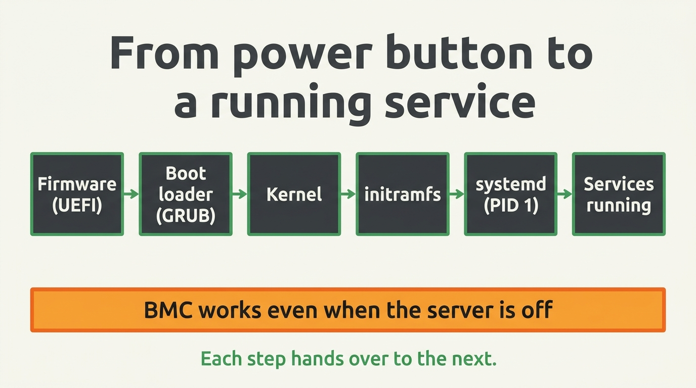
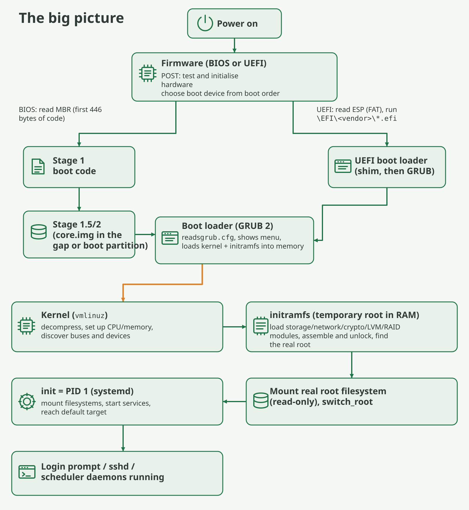
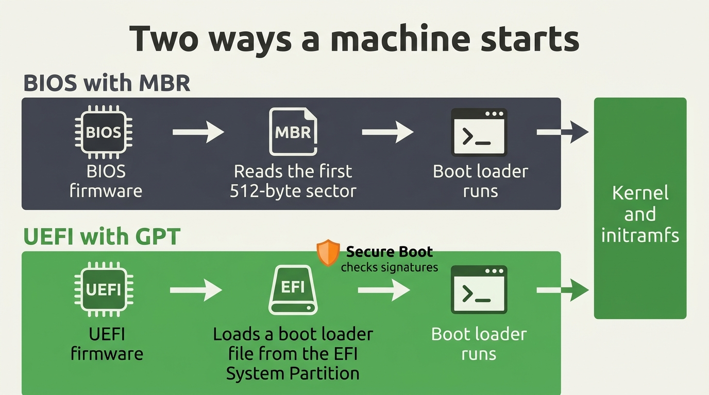
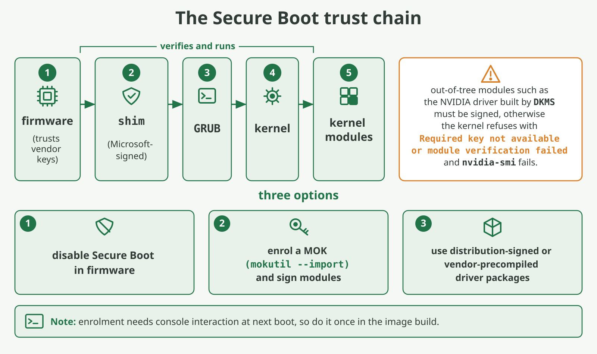
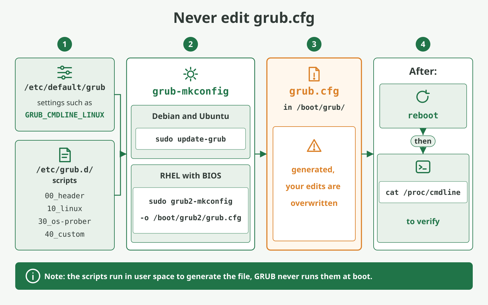
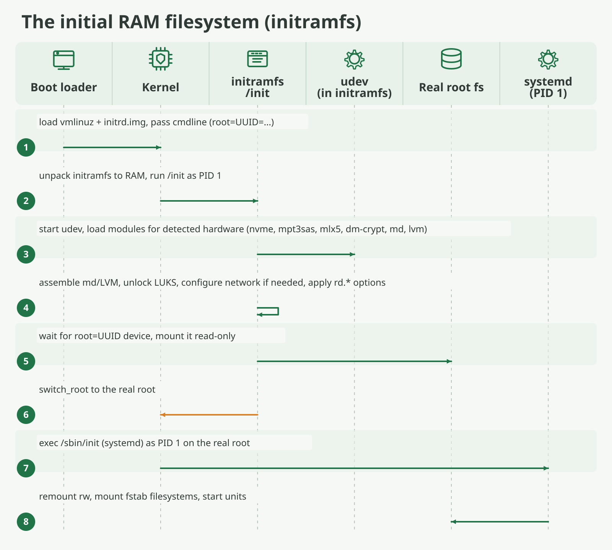
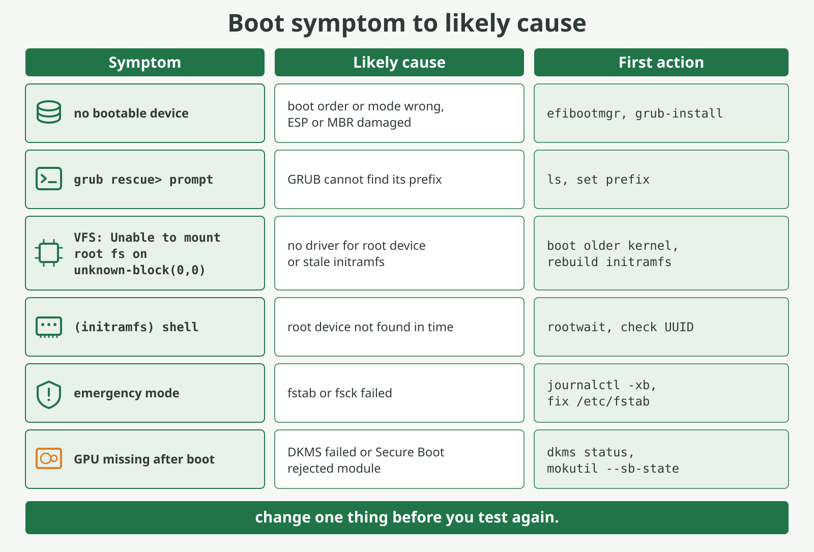
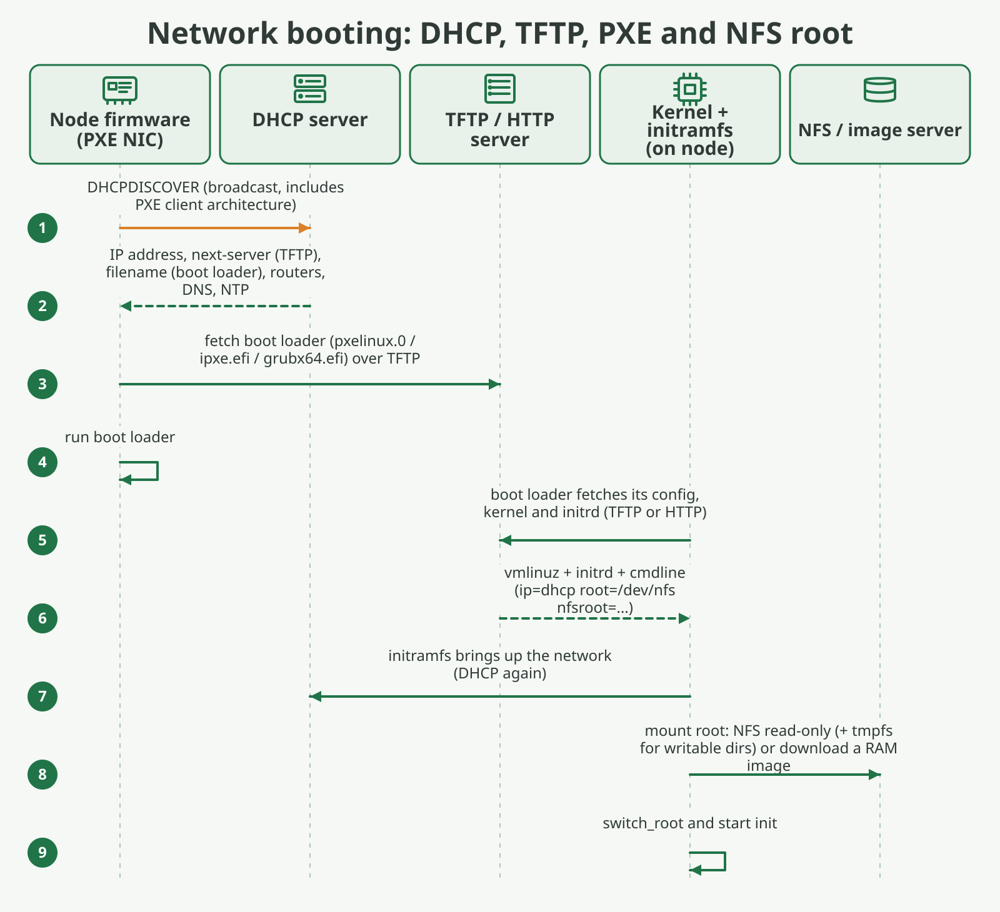

# 1.14 Boot: firmware, GRUB, kernel, initramfs

| | |
|---|---|
| Level | Intermediate |
| Priority tier | 0 |
| Lab venue | GCP / GKE (an Ubuntu VM with serial console access; a local VM such as QEMU/KVM is better for breaking boot safely) |
| Part | Part 1: Linux, from the command line to the kernel and performance |
| Status | Drafted, labs **untested** |

## Why this matters for AI infrastructure

Picture a node in a GPU fleet at three in the morning. The fans are loud, the power light is on, and the screen stays black. Nobody can log in, and nothing is training on it. A node that does not boot is a node that does not train, and many of the nastiest problems on a GPU fleet begin at boot.

Some of those problems are small and some are not. A kernel update may come up without the NVIDIA module. A Secure Boot setting may quietly refuse an unsigned driver. A firmware setting decides whether GPUs and NICs work as designed, and the list includes IOMMU, Above-4G decoding, SR-IOV and NUMA mode. An `fstab` entry can hang the boot while it waits for an unplugged drive. A cloned image may not find its disks. An `initramfs` without the storage or network driver cannot reach the root filesystem. And when hundreds of diskless nodes PXE-boot at once, they can flatten the DHCP and TFTP servers.

Many production procedures also start at boot. That is where you set kernel parameters for hugepages, IOMMU, isolated CPUs and console redirection. It is where you provision stateless nodes from images. It is also how you recover a node out of band, over a serial console or a BMC.

This chapter explains the whole sequence from power-on to the first user-space process. It covers firmware, the built-in software that runs before any operating system, including BIOS, UEFI and Secure Boot. It covers the boot loader, with GRUB 2 in depth, then the kernel and its parameters. It explains the initial RAM filesystem, the `initramfs`, and the hand-off to `init`. It ends with **network boot**, meaning DHCP, TFTP, PXE and NFS root, as clusters use it.

Along the way you will learn to read the boot messages, repair a system that will not boot, and change boot configuration without breaking it. The service-manager half of boot, which covers systemd units, targets and journald, is chapter 1.15. Provisioning images at scale belongs to the Part 6 chapter on PXE and image management, and to the BCM material.

Start with the stage where the failure happens, because that tells you which part of this chapter to read.

## Prerequisites and outcomes

Before you start, you should be comfortable with partitions, with GPT and MBR, and with the EFI System Partition. Chapter 1.12 covers all three. You also need the kernel modules and device basics from 1.10, and the idea of PID 1 from 1.8. The `fstab` file is covered in 1.12 as well.

By the end of this chapter, you should be able to do the following:

- Narrate the boot sequence from start to finish: firmware and its POST, the boot loader, kernel decompression and initialisation, the initramfs, the root mount, `init` or systemd, and finally login.
- Tell BIOS/MBR boot apart from UEFI/GPT boot. Find the EFI System Partition, the boot entries (`efibootmgr`) and the boot loaders on disk, and explain Secure Boot, `shim` and MOK.
- Read, edit and regenerate GRUB configuration safely, using `/etc/default/grub`, `/etc/grub.d`, `grub-mkconfig` and `update-grub`, `grub2-mkconfig` and `grubby`. Use the GRUB menu, editor and command line, chainload, and reinstall GRUB.
- Read and set kernel parameters (`/proc/cmdline`, `root=`, `ro`, `quiet`, `console=`, `rd.*`, IOMMU, hugepages, `isolcpus`, driver blacklists), both temporarily and permanently.
- Explain what the `initramfs` is for, inspect and rebuild it with `lsinitramfs` or `lsinitrd`, `update-initramfs` and `dracut`, and recover from an initramfs shell.
- Understand SysV `init` well enough to read legacy systems, which means runlevels, `/etc/inittab` and `rc.d`, and see how it relates to systemd targets.
- Diagnose and repair common boot failures, such as a missing root device, a bad `fstab`, broken GRUB, missing initramfs modules, a kernel panic, a lost root password, or a full `/boot`.
- Configure DHCP, TFTP/PXE and NFS root for diskless nodes. Understand UEFI versus BIOS PXE, cloning pitfalls, and the boot-storm problem.
- Apply all of this to GPU nodes: firmware settings, Secure Boot and the NVIDIA driver, kernel parameters, serial console, and fleet kernel updates.

## 1. The big picture

Something has gone wrong at boot, and you have a console open. Before you type anything, it helps to know how many stages the machine has to pass through, and what each one hands to the next. Here is that journey, drawn once from above.



*Figure 1.14.1. From power button to a running service, in order. The BMC works even before the OS exists.*



*Figure 1.14.2. The big picture.*

There are seven stages in the simple form, and each stage is one hand-off. Stage 1 is the firmware, which loads and runs a boot loader. Stage 2 is the boot loader, which finds the kernel image on disk, loads it into memory with its parameters, and starts it. Stage 3 is the kernel, which initialises devices and drivers. Stage 4 is the root filesystem, which the kernel mounts, using the initramfs when it is needed. Stage 5 is the point where the kernel starts `init` as PID 1. Stage 6 is `init` starting the rest of the system. Stage 7 is the moment a login service becomes available.

Knowing which stage failed is the most useful boot-debugging skill you can build, and the way to get there is to start from the symptom. A node stuck before the GRUB menu points at firmware or the boot loader. A GRUB menu that appears but never loads the kernel points at the boot loader or the kernel image. A kernel that boots but cannot find root points at the initramfs or the kernel parameters. A system that reaches systemd and then hangs on a mount points at `fstab`, storage or the network. A boot where the GPU is missing points at the driver, Secure Boot or firmware.

Distributions often hide the early stages behind graphical splash screens, which is what `quiet splash` gives you, so you see little until the system is up. You can still read all of it afterwards: use `journalctl -k` for the kernel messages of this boot, and `journalctl -k -b -1` for the previous boot, which needs a persistent journal. You can also use `dmesg`. On systems without systemd, look in `/var/log/kern.log` or `/var/log/dmesg`.

When a node fails to boot, first decide which stage it reached, because that choice tells you where to look next.

## 2. Firmware: BIOS, UEFI and the hardware settings that matter

The first stage of boot happens before Linux exists. Long before any kernel code runs, the machine's firmware has already tested the memory, woken the devices and decided what to start. When a node will not boot at all, this is where the story begins.



*Figure 1.14.3. The two firmware boot paths that lead to the kernel and initramfs.*

### BIOS (legacy) boot

You press the power button, and the first thing the CPU runs is the firmware. The firmware performs the **Power-On Self-Test (POST)**, which tests and initialises memory and enumerates the devices. It also gives option ROMs, such as RAID and network cards, a chance to run. After that, it looks for boot code on the devices in the configured **boot order**.

With a BIOS and an **MBR**-partitioned disk (*How Linux Works* Section 5.8.1), the firmware reads the **Master Boot Record**. That is the first 512-byte sector of the disk. It holds **446 bytes of boot code**, which is `441` bytes of executable code before the 4-byte disk signature. After that come a **64-byte partition table** of four 16-byte entries, and the 2-byte magic signature `0x55AA`.

That is far too little space for almost any boot loader, so BIOS boot loaders work in stages. The tiny MBR code loads more code, called `core.img`, from the unused gap between the MBR and the first partition. The traditional 1 MiB offset leaves room for it. This second piece understands filesystems, and it loads the rest.

On a BIOS system with a **GPT** disk, that gap holds the GPT entry array instead. GPT supports `128` partitions and disks larger than `18` exabytes. GRUB therefore needs a small **BIOS boot partition**, with type GUID `21686148-6449-6E6F-744E-656564454649`, to store its core. The firmware reads the disk through BIOS calls with simple **LBA** addressing. That is slow, but a boot loader needs it only briefly.

### UEFI boot

**UEFI** stands for *Unified Extensible Firmware Interface*, and it works in a very different way. For the most part it is easier to understand (*How Linux Works* Section 5.8.2).

The old way put executable boot code in raw sectors, outside any filesystem. UEFI replaces that with ordinary files. Every boot loader gets its own folder under `EFI`, such as `EFI/ubuntu`, `EFI/grub` or `EFI/microsoft`, and its file ends in `.efi`. You may find `grubx64.efi`, the UEFI version of GRUB, and `shimx64.efi` in those folders. An old BIOS-style loader cannot simply be copied into this partition, because it was written for the BIOS interface. You must install the UEFI build of GRUB, not the BIOS build.

- UEFI never looks at raw sectors. It reads the GPT partition table, and then it reads a VFAT (FAT32) filesystem called the **EFI System Partition (ESP)**. The ESP has partition type `EF00` and GUID `C12A7328-F81F-11D2-BA4B-00A0C93EC93B`, and it is normally mounted at **`/boot/efi`**. Boot loaders are ordinary `.efi` files inside `EFI/<vendor>/` on the ESP, such as `EFI/ubuntu/shimx64.efi`, `grubx64.efi` and `EFI/redhat/`. The file `EFI/BOOT/BOOTX64.EFI` is the standard fallback path for removable media.
- Boot entries live in **NVRAM** variables, and you manage them with **`efibootmgr`**. Each entry has a number such as `Boot0003`, a label, and the path of an `.efi` file. `BootOrder` lists the sequence. A loader must be **registered** with the firmware, and the installer (`grub-install`) does that for you. This is why a disk copied to another machine can stay unbootable until its entries are recreated, and the fallback path `EFI/BOOT/BOOTX64.EFI` can help in that case.
- The firmware also has a built-in shell and a boot menu. You usually reach the menu with F11 or F12, or with Esc, F2 or Del, at power-up. BMC consoles give you remote access to it.
- The firmware can network-boot with **PXE/HTTP boot** through its UEFI network drivers.
- **Secure Boot**, which the next section covers.

The ESP is not the same as a BIOS boot partition, and it has a different UUID. You should not find a system that has both. Once you know that the ESP is the place where UEFI looks, the rest of the boot chain is easier to follow.

```bash
[ -d /sys/firmware/efi ] && echo "UEFI boot" || echo "legacy BIOS boot"
efibootmgr -v                       # boot entries, order, paths; add -t/-n/-o to change timeout/next-boot/order
sudo efibootmgr -n 0003             # boot entry 3 only on the next reboot (handy for one-time PXE or rescue)
lsblk -f | grep -i vfat; findmnt /boot/efi; ls /boot/efi/EFI
sudo mokutil --sb-state             # is Secure Boot enabled?
bootctl status 2>/dev/null          # systemd-boot view (if used)
```

These commands tell you which mode a machine booted in, and what it will try next. Run them before you change anything in the boot order.

### Secure Boot



*Figure 1.14.4. A signed chain from firmware to kernel modules means an unsigned GPU driver module will not load.*

With **Secure Boot**, the firmware runs only boot code that is cryptographically **signed** by a key it trusts. A signature here works like a wax seal: the code carries a stamp the firmware can check before it runs a single instruction. Hardware vendors ship with Microsoft's keys. Distributions therefore use a small Microsoft-signed **`shim`**, which verifies and runs **GRUB**. GRUB verifies the **kernel**, and when the kernel is locked down, the kernel verifies **kernel modules**. The distribution's own key is built into shim. You can enrol more keys as **Machine Owner Keys (MOK)** with `mokutil`.

Microsoft requires hardware vendors that ship Windows 8 and later to use Secure Boot. An unsigned boot loader is therefore rejected, and the operating system never starts. Major Linux distributions avoid this by shipping signed boot loaders, usually a UEFI build of GRUB behind a signed `shim`. The firmware runs the shim, and the shim runs GRUB. Some distributions go further on machines that must meet a strict security rule, and they require the whole boot sequence, including the kernel, to be signed.

Secure Boot also makes experiments harder. If you build your own boot loader, you can turn Secure Boot off in the UEFI settings. That shortcut works poorly on a dual-boot machine, because Windows will not run without Secure Boot enabled.

This chain matters a great deal on GPU nodes. **Out-of-tree kernel modules, such as the NVIDIA driver built by DKMS, must be signed** with a key enrolled in the firmware or MOK database. If they are not, the kernel refuses to load them. You will see messages such as "Required key not available" or "module verification failed". The GPU then goes missing, and `nvidia-smi` fails.

You have three ways to handle this. The first is to disable Secure Boot in firmware on trusted data-centre servers, which is common. The second is to enrol a MOK and sign the modules. DKMS can sign them automatically after you import the key with `mokutil --import`. Enrolment needs a console interaction at the next boot, which is awkward on remote servers, so do it once in the image build. The third is to use distribution-signed or vendor-precompiled driver packages. Secure Boot is also a compliance requirement in some environments. Decide per fleet, and document the decision. Chapter 1.22 covers DKMS signing in detail.

### Hardware/firmware settings that matter on GPU servers

These settings live in the BIOS or UEFI setup, or in the vendor's tooling. In clusters they are often scripted over Redfish or the BMC, which Part 8 covers. Names and menus differ by vendor and generation. Read the table below as a checklist of topics to confirm in your platform guide, not as exact menu names.

| Setting | Why it matters |
|---|---|
| **Virtualisation (VT-x/AMD-V) and IOMMU (VT-d / AMD-Vi)** | Needed for KVM, VFIO device passthrough, SR-IOV and safe DMA; set the matching kernel parameters (`intel_iommu=on iommu=pt`, `amd_iommu=on iommu=pt`) |
| **Above-4G decoding / large BARs / Resizable BAR (ReBAR)** | GPUs expose big memory apertures; many GPU boxes will not initialise all devices without this |
| **SR-IOV** | NICs/GPUs/NVMe virtual functions (virtualisation, vGPU, MIG-adjacent setups) |
| **NUMA presentation** (sub-NUMA clustering, NPS modes) | Changes the number of NUMA nodes the OS sees and thus pinning policies (1.17, 1.28) |
| **Hyper-Threading / SMT** | Per-core predictability versus throughput; some HPC sites turn it off |
| **Power and performance profile** (C-states, P-states, "Performance" mode), **turbo** | Latency jitter and clocks; AI sites commonly choose a performance profile |
| **PCIe settings** (link speed, ASPM off, bifurcation) | Link training; ASPM can add latency or instability |
| **Boot mode and order, PXE/HTTP boot on the right NIC, Secure Boot** | Provisioning and driver loading |
| **Serial console redirection** (BIOS and OS) | Out-of-band troubleshooting (section 9) |
| **Firmware versions** (BIOS, BMC, NIC, GPU VBIOS) | Many "mystery" fleet differences are firmware drift (chapter on firmware management) |

Confirm each of these settings in the platform guide before you rely on the node.

## 3. The boot loader

Picture the moment when the firmware hands over. The kernel file is sitting on a disk, and nothing on the machine can read that disk yet. The kernel's device drivers and filesystem code are not available, because the kernel is the very thing that has not started. So a boot loader carries its own small disk and filesystem drivers, which use the firmware's disk services. It finds the files it needs by reading the filesystem itself.

The boot loader's job sounds simple: it loads the kernel with its parameters. The work is subtle, because the loader has to do it with only the tools it brought along. The boot loader must do four things. It must find and load the kernel image and the initramfs. It must pass **kernel parameters**. It must let you choose among kernels or edit the parameters. And it can optionally boot other operating systems.

Several boot loaders are in common use (*How Linux Works* Section 5.3.2). **GRUB 2** is the near-universal Linux default, and it supports both BIOS and UEFI. **systemd-boot**, formerly `gummiboot`, is a simple UEFI boot manager that some distributions use. **SYSLINUX**, **EXTLINUX**, **ISOLINUX** and **PXELINUX** are modular boot loaders for FAT, ext, ISO optical media and PXE network boot. **LILO**, the Linux Loader, is historical. **coreboot**, formerly `LinuxBIOS`, is a high-performance open-source replacement for the PC BIOS, and it can include a Linux kernel payload directly.

Three more names deserve a line each. **Linux Kernel EFISTUB** is a kernel build option that lets UEFI firmware load the kernel straight from the ESP, with no separate boot loader. **efilinux** is a reference UEFI boot loader that served as a model for other UEFI loaders. **iPXE** is a scriptable network boot loader, covered in section 10.

This chapter concentrates on GRUB 2. The older "GRUB Legacy", which uses `menu.lst`, is obsolete.

### GRUB 2 in use

You reach the menu by holding **Shift** at power-up on BIOS systems, or by tapping **Esc** on UEFI systems. On cloud and virtual machines the menu is often hidden. It may be reachable only through the serial console, and it may need `GRUB_TIMEOUT_STYLE=menu` set. This menu is your main repair tool on a machine that will not boot, so it pays to know it well. Inside the menu, four keys and options matter:

- **Enter** boots the highlighted entry.
- **`e`** lets you edit that entry's commands for this boot only. This is the most convenient way to repair a bad boot temporarily. Ctrl-X or F10 boots the edited entry, and Esc returns you to the menu.
- **`c`** opens the GRUB **command line**.
- The advanced options submenu lists older kernels and recovery mode.

For example, after you press `e`, an entry looks like this:

```text
menuentry 'Ubuntu' --class ubuntu --class gnu-linux --class gnu --class os $menuentry_id_option 'gnulinux-simple-8b92610e-...' {
    recordfail
    load_video
    insmod gzio
    insmod part_gpt
    insmod ext2
    set root='hd0,gpt2'
    search --no-floppy --fs-uuid --set=root 8b92610e-1db7-4ba3-ac2f-30ee24b39ed0
    linux   /boot/vmlinuz-5.15.0-91-generic root=UUID=8b92610e-... ro quiet splash $vt_handoff
    initrd  /boot/initrd.img-5.15.0-91-generic
}
```

**GRUB has its own world.** Everything in that entry is GRUB's internal language, and it is not the Linux you know. `insmod` loads *GRUB* modules, which are unrelated to Linux kernel modules. `ls` lists *GRUB's* devices and files. Seeing the configuration for the first time can feel like a double take, and that reaction is normal. GRUB borrows words from many sources, so its commands look familiar while meaning something else. It has its own "kernel", and it has its own `insmod` command. Many of its commands look like Unix shell commands. A GRUB module for LVM is needed to boot a system whose kernel sits on a logical volume, so you may see that module on your system too.

The most confusing part is that **"root" has two meanings**, and both of them appear in the same entry. In `set root=` and `search ... --set=root`, it is the **GRUB root**, the filesystem where GRUB looks for the kernel and initrd files. In `linux ... root=UUID=...`, it is a **kernel parameter** that names the Linux root filesystem.

GRUB device names look like `(hd0)`, `(hd0,gpt2)` and `(hd0,msdos1)`. Each name gives the disk number, the partition table type and the partition number, in that order. The numbering can change, so entries use `search` by UUID instead. `linux` loads the kernel image and takes the parameters. `initrd` loads the initial RAM filesystem, and `boot` starts it.

The **GRUB command line** is invaluable, and it is what saves you when the menu itself has failed. You open it with `c` at the menu. It helps you explore devices, partitions and files (*How Linux Works* Section 5.4.2). It also lets you boot by hand when `grub.cfg` is damaged. Here is a short session:

```text
grub> ls                              # devices and partitions: (hd0) (hd0,gpt1) (hd0,gpt2)
grub> ls -l                           # with filesystem type and UUID
grub> echo $root; set                 # GRUB variables; $prefix = where GRUB finds its config and modules
grub> ls (hd0,gpt2)/                  # file listing of a partition (note the trailing slash)
grub> ls ($root)/boot
grub> set root=(hd0,gpt2)
grub> linux /boot/vmlinuz-5.15.0-91-generic root=/dev/sda2 ro single
grub> initrd /boot/initrd.img-5.15.0-91-generic
grub> boot
```

`Esc` returns you to the menu. If you land at the minimal `grub rescue>` prompt, GRUB could not find its modules or config. Then set `prefix` and `root` by hand, and run `insmod normal` and `normal`.

### GRUB configuration: do not edit `grub.cfg`



*Figure 1.14.5. grub.cfg is generated, so change /etc/default/grub or /etc/grub.d and regenerate.*

GRUB reads `grub.cfg`, which lives in `/boot/grub/` or `/boot/grub2/`. On EFI systems there is also a small stub on the ESP. **The file is generated, so your edits will be overwritten.** That surprises almost everyone once: you edit the file, boot works, and the next kernel update quietly throws your work away. Make your changes in the right place, and then regenerate the file. The workflow has four steps.

1. Put settings in **`/etc/default/grub`**. The variables include `GRUB_DEFAULT`, `GRUB_TIMEOUT`, `GRUB_TIMEOUT_STYLE`, `GRUB_CMDLINE_LINUX`, `GRUB_CMDLINE_LINUX_DEFAULT`, `GRUB_TERMINAL`, `GRUB_SERIAL_COMMAND`, `GRUB_DISABLE_OS_PROBER`, `GRUB_GFXMODE` and `GRUB_DISABLE_RECOVERY`. `GRUB_CMDLINE_LINUX` sets kernel parameters for **every** entry, including recovery. `GRUB_CMDLINE_LINUX_DEFAULT` applies to normal entries only.
2. Put custom menu entries in `/etc/grub.d/40_custom`. That file is a script, and it is easy to lose during upgrades. A more robust choice is a file named `custom.cfg`, which `41_custom` or `grub.cfg` reads at boot. That file does not need regenerating.
3. Regenerate the file. On Debian and Ubuntu, run `sudo update-grub`, which is a wrapper for `grub-mkconfig -o /boot/grub/grub.cfg`. On the RHEL family with BIOS, run `sudo grub2-mkconfig -o /boot/grub2/grub.cfg`. The UEFI path is `/boot/grub2/grub.cfg` on current releases, and `/boot/efi/EFI/redhat/grub.cfg` on older ones. Verify that per release. On the RHEL family you can also set kernel arguments for each kernel with `grubby`, for example `sudo grubby --update-kernel=ALL --args="intel_iommu=on iommu=pt"`.
4. Verify the result. Run `grep -n 'iommu' /boot/grub/grub.cfg`, reboot, and then run `cat /proc/cmdline`.

`grub-mkconfig` is a shell script, and that one fact explains most of its behaviour. It runs every executable in **`/etc/grub.d/`** in numeric order: `00_header`, `10_linux`, `20_linux_xen`, `30_os-prober`, `40_custom` and `41_custom`. It then concatenates their output into one file.

The result is a file of GRUB commands, such as `menuentry`, `submenu` for older kernels, conditionals, and `load_env`/`save_env` for remembered defaults. GRUB never runs these scripts at boot. They run in user space, to generate the file. Running `grub-mkconfig` without `-o` just prints the result, which is a safe way to see what would be generated.

The commands `grub-set-default`, `grub-reboot` and `grub-editenv list` manage the environment block. `grub-reboot` boots a given entry once. Back up `/boot/grub` and the ESP before you experiment.

### GRUB installation

Distribution installers handle this for you. You only have to do it yourself for a few jobs: cloning a disk, repairing a system or building images. Then use these commands.

```bash
# BIOS/MBR (or BIOS with GPT + BIOS boot partition): write the boot code into the disk
sudo grub-install /dev/sda
sudo grub-install --boot-directory=/mnt/boot /dev/sdc      # install onto another disk whose /boot is mounted at /mnt/boot
# UEFI: copy the loader to the ESP and register it with the firmware (uses efibootmgr)
sudo grub-install --target=x86_64-efi --efi-directory=/boot/efi --bootloader-id=ubuntu
sudo grub-install --target=x86_64-efi --efi-directory=/mnt/boot/efi --removable   # fallback path EFI/BOOT/BOOTX64.EFI for portable/cloud images
sudo update-grub
```

A wrong installation breaks boot, so keep a rescue plan before you start. Keep a live USB, or a serial or BMC console. Also keep a backup of the MBR, made with `dd if=/dev/sda of=mbr.bin bs=512 count=1`, and a backup of the ESP. To repair from a live environment, mount the root, `/boot` and `/boot/efi`. Then bind `/dev`, `/proc` and `/sys`, run `chroot`, and run `grub-install` and `update-grub`, as section 8 shows.

### How GRUB boots (for BIOS)

1. The firmware loads the first 440/446 bytes from the MBR, in `boot.img`. This piece only knows where to find the next piece.
2. It loads the **core image**, `core.img`, from the gap after the MBR or from the BIOS boot partition. `core.img` is a compact GRUB. It has a few built-in modules, such as the filesystem and partition-table modules, and optionally the LVM, RAID or crypto modules needed to read `/boot`. Historic GRUB used a "stage 1.5" for filesystem support. GRUB 2 folds that into `core.img`.
3. The core initialises, and it can now read disks and filesystems. It identifies its **boot partition**, called `prefix`, and loads **`grub.cfg`** and more modules from `/boot/grub`.
4. GRUB shows the menu. After a timeout, or after you choose an entry, it runs that entry. The entry loads the kernel and the initrd, and then runs `boot`.

On **UEFI**, the core image is simply a file on the ESP, `grubx64.efi`. The firmware starts it, or `shimx64.efi` starts it under Secure Boot. That makes things easier, because the firmware can read the ESP itself. If GRUB needs LVM, RAID or encryption support to read `/boot`, those modules are included in the core image. A separate small `/boot` partition on plain ext4 avoids this whole class of problems.

### Chainloading

GRUB can hand over to another boot loader instead of loading a kernel. You might do this for dual boot, or to reach a vendor recovery partition. `chainloader +1` loads the first sector of a partition. On UEFI, `chainloader /EFI/Microsoft/Boot/bootmgfw.efi` does the job.

```text
menuentry "Windows" {
    insmod chain
    insmod ntfs
    set root=(hd0,3)
    chainloader +1
}
```

UEFI makes multi-boot easy, because several loaders can live side by side in the ESP. You choose among them from the firmware menu, though on servers this is rare. The same machinery boots installers and rescue systems. When you change the boot loader, edit its settings and regenerate, and keep a rescue path ready.

## 4. The kernel starts

The boot loader finishes its work by putting two files into memory: the kernel and the initramfs. The **kernel image** comes from `/boot/vmlinuz-<version>`, and it is a compressed image called `bzImage`. Its first part is a small program that sets up a minimal hardware state and decompresses the rest into memory. The boot loader also loads the **initramfs** from `/boot/initrd.img-<version>` or `initramfs-<version>.img`. It passes the **command line** along with both.

Several files in `/boot` are worth recognising, and `ls /boot` shows them all. `vmlinuz-*` is the kernel. `initrd.img-*` and `initramfs-*.img` hold the initial RAM filesystem. `config-*` holds the kernel build configuration, and you can check it with `grep CONFIG_PREEMPT /boot/config-$(uname -r)`. `System.map-*` holds the symbol addresses. `grub/` and `efi/` complete the list. Loadable modules for each kernel sit in `/lib/modules/<version>/`.

Several kernel versions normally coexist, so you can boot an older one when a new one fails. A full `/boot` is a classic cause of failed kernel installs. When you run short of space, prune the old kernels with `sudo apt autoremove --purge` or `dnf remove --oldinstallonly`.

The kernel then works through its start-up in rough order, and each step explains a family of log lines you will meet later. It inspects the **CPUs** and the **memory**. It discovers **buses** and **devices**. It binds the drivers that are built in, and the other drivers are modules. It sets up auxiliary subsystems such as networking and security. Then it **mounts the root filesystem** and starts the first user-space process. The kernel writes its messages to the kernel ring buffer, and these are the lines to look for:

```bash
journalctl -k | head -50                  # or dmesg
dmesg --level=err,warn                    # problems only
dmesg | grep -iE 'Command line|iommu|nvidia|firmware|secure|ACPI|NUMA|hugepage|nvme|mlx'
journalctl -k | grep -E 'Run /init|Freeing unused|mounted filesystem|systemd\[1\]'    # key milestones
```

Sample milestones from `journalctl -k` (*How Linux Works* Section 5.1) include `microcode: microcode updated early to revision 0xd6` and `Linux version 4.15.0-112-generic ...`. You will also see `Command line: BOOT_IMAGE=/boot/vmlinuz-4.15.0-43-generic root=UUID=17f12d53-c3d7-4ab3-943e-a0a72366c9fa ro quiet splash vt.handoff=1`.

Next come the CPU and memory detection lines (`NUMA`, `e820`), the PCI enumeration, and `sd 0:0:0:0: [sda] Attached SCSI disk`. Then `Freeing unused kernel memory: 2408K` and `Write protecting the kernel read-only data: 20480k` appear. Two more `Freeing unused kernel memory` lines follow, with `2008K` and `1892K`. Those lines show the kernel cleaning up initialisation memory and write-protecting its own read-only data pages.

`Run /init as init process` marks the start of the initramfs. After that come `EXT4-fs (sda1): mounted filesystem with ordered data mode` and `systemd[1]: ... Detected architecture x86-64`. When you see systemd's first message, user space has started.

### Reading the boot log

Startup scripts send their messages to the console, and the console erases them when boot finishes. systemd keeps those messages for you in the journal, so you can read them later. The kernel's own lines come first. Here is a sample from `journalctl -k`, where lines marked `--snip--` are trimmed for space.

```
microcode: microcode updated early to revision 0xd6, date = 2019-10-03
Linux version 4.15.0-112-generic (buildd@lcy01-amd64-027) (gcc version 7.5.0 (Ubuntu 7.5.0-3ubuntu1~18.04)) #113-Ubuntu SMP Thu Jul 9 23:41:39 UTC 2020 (Ubuntu 4.15.0-112.113-generic 4.15.18)
Command line: BOOT_IMAGE=/boot/vmlinuz-4.15.0-112-generic root=UUID=17f12d53-c3d7-4ab3-943e-a0a72366c9fa ro quiet splash vt.handoff=1
KERNEL supported cpus:
--snip--
scsi 2:0:0:0: Direct-Access ATA KINGSTON SM2280S 01.R PQ: 0 ANSI: 5
sd 2:0:0:0: Attached scsi generic sg0 type 0
sd 2:0:0:0: [sda] 468862128 512-byte logical blocks: (240 GB/224 GiB)
sd 2:0:0:0: [sda] Write Protect is off
sd 2:0:0:0: [sda] Mode Sense: 00 3a 00 00
sd 2:0:0:0: [sda] Write cache: enabled, read cache: enabled, doesn't support DPO or FUA
sda: sda1 sda2 < sda5 >
sd 2:0:0:0: [sda] Attached SCSI disk
--snip--
```

Read the lines from top to bottom. The `Command line:` line repeats the parameters the boot loader handed to the kernel. The `sd` lines show the kernel finding one disk, reading its size, and attaching it. The `sda:` line lists the partitions it found on that disk. These lines are your first evidence that a disk is visible, before any filesystem is mounted.

### Kernel parameters

The kernel receives a text **command line** made of words and `key=value` pairs. You can read it at any time in `/proc/cmdline`. A few parameters are essential, and many more tune behaviour. The kernel's reference is `Documentation/admin-guide/kernel-parameters.txt`, and `man bootparam` covers them too. The kernel passes any parameter it does not recognise on to `init`. Examples are `single`, `-s` and `systemd.unit=rescue.target`. Options for a module use the form `modulename.param=value`.

The table lists the parameters you will meet most often in boot repairs and tuning. Read it as a lookup, not as a list to memorise.

| Parameter | Meaning |
|---|---|
| `root=` | The root filesystem: `/dev/sda2`, `/dev/mapper/vg-root`, **`UUID=...`** (preferred), `LABEL=`, `/dev/nfs`. Without it the kernel cannot do the user-space start. Names that do not depend on device order are safer |
| `ro` / `rw` | Mount the root read-only at first (normal: the `fsck` can run safely, then it is remounted read-write) / read-write |
| `rootfstype=`, `rootflags=`, `rootwait` | Filesystem type, options, wait for the root device to appear (slow USB/network storage) |
| `init=/path` | Run this instead of `/sbin/init`; `init=/bin/bash` is the classic emergency shell |
| `quiet`, `splash`, `loglevel=N`, `earlyprintk`, `debug` | Verbosity of boot output |
| `console=tty0 console=ttyS0,115200n8` | Where the kernel console writes. **Several `console=` options are allowed and the last one is the primary** (`/dev/console`). Essential for servers managed over a serial port, BMC Serial-over-LAN or cloud serial console |
| `single`, `1`, `systemd.unit=rescue.target` / `emergency.target`, `systemd.unit=multi-user.target` | Boot to single-user/rescue/emergency mode or a different target |
| `nomodeset` | Do not set graphics mode in the kernel (fix black screens with certain GPUs; useful when an NVIDIA driver misbehaves at boot) |
| `modprobe.blacklist=nouveau`, `rd.driver.blacklist=nouveau` | Keep a module from loading (the open `nouveau` driver must not take the GPU before the NVIDIA driver) |
| `intel_iommu=on iommu=pt`, `amd_iommu=on iommu=pt` | Enable the IOMMU (passthrough mode for host devices: needed for VFIO/SR-IOV and lower overhead) |
| `default_hugepagesz=1G hugepagesz=1G hugepages=N`, `transparent_hugepage=madvise\|never\|always` | Reserve hugepages at boot (reliable only at boot), control THP |
| `isolcpus=`, `nohz_full=`, `rcu_nocbs=`, `irqaffinity=` | Isolate cores from the scheduler and tick for latency-critical work (chapters 1.18, 1.28) |
| `numa_balancing=disable`, `mitigations=off`, `processor.max_cstate=`, `intel_idle.max_cstate=`, `pcie_aspm=off` | Performance/latency tuning with trade-offs (note security mitigations) |
| `net.ifnames=0 biosdevname=0` | Use the old `eth0` names instead of predictable names |
| `ip=dhcp`, `nfsroot=server:/path,opts`, `BOOTIF=` | Network boot configuration (section 10) |
| `rd.break`, `rd.shell`, `rd.lvm.vg=`, `rd.luks.uuid=`, `rd.md.uuid=` (dracut) / `break=premount` (initramfs-tools) | Initramfs behaviour and debugging (section 5) |
| `crashkernel=` | Reserve memory for `kdump` (crash dumps) |
| `audit=0`, `selinux=0`, `enforcing=0`, `apparmor=0` | Security module toggles (troubleshooting only) |
| `nvidia-drm.modeset=1`, `nvidia.NVreg_*=` | NVIDIA driver module options (module parameters can also live in `/etc/modprobe.d`) |

Several rows involve a trade-off. The performance rows buy lower latency or higher throughput, and the table notes that security mitigations are part of the picture. The security toggles are for troubleshooting only.

To **change parameters for one boot**, press `e` at the GRUB menu, append your words to the `linux` line, and press Ctrl-X. That change disappears at the next reboot, which is exactly what you want while you are still diagnosing.

To **make a change permanent**, edit `GRUB_CMDLINE_LINUX` in `/etc/default/grub`, run `update-grub` or `grub2-mkconfig`, reboot, and verify with `cat /proc/cmdline`. On the RHEL family, use `grubby --update-kernel=ALL --args="..."`, and `--remove-args` to take them out. Some cloud images manage boot configuration with `/etc/default/grub.d/*.cfg` files that override yours, so check which file wins. Under UEFI with a Unified Kernel Image, the parameters are embedded in the image, and you rebuild it with `ukify` or `dracut`.

Try a parameter on one boot first, and make it permanent only after the node comes up correctly.

## 5. The initial RAM filesystem (initramfs)

The kernel now faces a chicken-and-egg problem, and this whole section exists because of it. To mount the real root filesystem, the kernel needs a driver for your disk controller. The driver is usually a module, and modules are files that live on the filesystem the kernel has not mounted yet.

**The problem.** Mounting the real root filesystem takes several things at once. The kernel needs a driver for the disk controller, which might be NVMe, RAID or a fibre-channel HBA. It needs the module for the filesystem. It may need to assemble RAID or LVM, unlock LUKS, bring up the network for iSCSI or NFS, or load firmware. Compiling all of that into the kernel would make it huge.

So distributions ship a **generic kernel with most drivers as modules**, and they use an **initramfs** to bridge the gap. The initramfs is a small compressed **cpio archive**. The boot loader loads it into memory, and the kernel unpacks it as a **temporary root filesystem in RAM**, a tmpfs or rootfs.

The kernel then runs `/init` from it. The programs and modules inside do exactly what is needed to find, assemble, unlock and mount the real root. Then **`switch_root`** replaces the temporary root with the real one, and execs the real `init`. The older "initrd" was a block-device image. The name `initrd` survives in file names and commands, but today it is an initramfs.

Read the diagram from top to bottom. Each arrow is one hand-off, from the boot loader to the kernel, then to the initramfs, and finally to systemd.



*Figure 1.14.6. The initial RAM filesystem (initramfs).*

The two families of distributions use different tools. Debian and Ubuntu use `initramfs-tools`, while RHEL, Fedora and SUSE use `dracut`. The table compares the commands for each.

| | Debian/Ubuntu: `initramfs-tools` | RHEL/Fedora/SUSE: `dracut` |
|---|---|---|
| Rebuild current | `sudo update-initramfs -u` | `sudo dracut -f` |
| Rebuild all/for a kernel | `update-initramfs -u -k all`, `-k 5.15.0-91-generic` | `dracut -f --regenerate-all`, `dracut -f /boot/initramfs-X.img X` |
| List contents | `lsinitramfs /boot/initrd.img-$(uname -r) \| less` | `lsinitrd /boot/initramfs-$(uname -r).img \| less` |
| Config | `/etc/initramfs-tools/{initramfs.conf,modules,hooks/,scripts/}` | `/etc/dracut.conf.d/*.conf` (`add_drivers+=" nvme "`, `omit_dracutmodules+=" plymouth "`) |
| Debug shell | `break=premount` (or `break=mount`, `break=bottom`) on the cmdline | `rd.break`, `rd.break=pre-mount`, `rd.shell`, `rd.debug`, `rd.break=cmdline` |

You must **rebuild the initramfs whenever something it needs changes**. Rebuild after you add a kernel module that boot needs, such as a storage driver or a NIC for netboot. Rebuild after you change `mdadm.conf`, `crypttab` or LVM settings. Rebuild after you install or update the NVIDIA driver on systems that load it early, although DKMS hooks do this for you. Rebuild after you move the root to a new disk.

Missing a rebuild causes familiar symptoms. The system boots on the old kernel but not the new one, the RAID array arrives as `md127`, or the boot drops you to an `(initramfs)` prompt.

**A quick check:** `lsinitramfs /boot/initrd.img-$(uname -r) | grep -E 'nvme|raid|dm_|mlx|nfs'` shows whether the image holds the modules you expect, and you do not need to reboot to run it.

Host-only and generic images matter for a golden image. `dracut` builds a small **host-only** image by default, which contains only the drivers of the machine that built it. That is the wrong choice for a golden image that must boot on different hardware. Use `dracut --no-hostonly`, or set `hostonly="no"` in `dracut.conf.d`. In `initramfs-tools`, set `MODULES=most` to build a **generic** image.

**Dropped to an initramfs shell.** You know you are there when the prompt reads `(initramfs)` or `dracut:/#`. This is the smallest environment the machine can give you, and it is not a broken system but a system waiting for one missing piece. The message on screen says which device was not found, so read it before you type anything. The usual causes are a missing root device, such as a wrong `root=` UUID or a changed disk. A missing storage, RAID or LVM module causes it too. So does a LUKS passphrase that was never given, or a slow USB or network disk that needs `rootwait`.

From the shell, run `cat /proc/cmdline`, `ls /dev/disk/by-uuid`, `blkid`, `lsmod`, `dmesg | tail`, `modprobe nvme`, `mdadm --assemble --scan`, `lvm vgchange -ay` and `mount /dev/... /root`. Then type `exit` to continue the boot. Fix the cause, such as the parameter or the missing module, and rebuild the image.

When the boot stops at the initramfs prompt, read the message first, because it names the device that is missing.

### Skipping the initramfs

One basic feature of the initial RAM filesystem has not changed since it was introduced: you can skip it. If your kernel already has every driver it needs to mount the root filesystem, you can leave the initramfs out of the boot loader configuration. A boot without it starts a little faster.

You can test this at boot time. In the GRUB menu editor, remove the `initrd` line for one boot. Do not test by editing the GRUB configuration file, because a mistake there can be hard to repair. Skipping the initramfs is harder than it used to be, because features such as mount-by-UUID may be missing from generic distribution kernels.

## 6. `init`: the first user-space process

The kernel has one job left, and it is the smallest and most important one. It starts a single program, `/sbin/init`, or the program named by `init=`. If that fails, the kernel tries several standard locations. It panics if none of them works.

**`init` always has PID 1, and it is the only process the kernel watches. If it dies, the kernel panics.** That sentence explains a whole family of boot failures, so it is worth reading twice. The duties of `init` are to set up the system, mount filesystems, start services, and **adopt and reap orphaned processes**, which chapter 1.8 covers.

Today `/sbin/init` is almost always a link to **systemd**, which chapter 1.15 covers in full. systemd replaced the older **SysV init**. You can check which one you have: run `ps -p 1 -o comm=`, which prints `systemd` or `init`, and `readlink -f /sbin/init`.

### SysV init, briefly (still seen in appliances, containers' ancestors, and some old HPC images)

SysV `init` reads **`/etc/inittab`**. Each line has the form `id:runlevels:action:process`, and the whole system works with **runlevels**. The table lists them.

| Runlevel | Meaning |
|---|---|
| 0 | Halt/power off |
| 1 (`S`) | Single-user mode |
| 2 | Multi-user without network (distribution-dependent) |
| 3 | Multi-user with network (typical server) |
| 4 | Unused/custom |
| 5 | Multi-user with network and graphical login |
| 6 | Reboot |

The default is set by `id:3:initdefault:`. `init 6` reboots the machine, `init 0` halts it, and `telinit q` re-reads inittab. Actions include `respawn`, which restarts a process if it exits. That is how `getty` login prompts persist. The remaining actions are `once`, `wait`, `sysinit`, `boot`, `bootwait`, `initdefault` and `ctrlaltdel`. `powerwait` shuts the machine down on a UPS power failure.

When `init` enters a runlevel, it runs the scripts in **`/etc/rc<N>.d/`**. Those are links named `S<NN><name>`, which start a service with `start`, and `K<NN><name>`, which stop it with `stop`. They run in numeric order, and they point at the real scripts in **`/etc/init.d/`**. You can run `/etc/init.d/sshd restart` at any time. To enable a service at boot, use `chkconfig sshd on` on RHEL or `update-rc.d sshd enable` on Debian.

Script headers help tools work out the order. A header begins with `### BEGIN INIT INFO` and ends with `### END INIT INFO`. Inside it you list `Provides: skeleton`, `Required-Start: $remote_fs $syslog`, `Required-Stop: $remote_fs $syslog`, `Default-Start: 2 3 4 5`, `Default-Stop: 0 1 6`, `Short-Description` and `Description`. The file `rc.local` ran last. Using it is discouraged, although systemd keeps it working for compatibility.

Historically, Unix had two main styles of `init` configuration: SystemV-style and BSD-style. Slackware used the BSD style. Standard SysV `init` scripts are written in shell. They are slow and hard to parse, and they start services strictly one after another. Attempts to bolt parallelism onto SysV `init` through special header comments failed. That failure is why **Lennart Poettering** and **Kay Sievers** created **`systemd`** (*Supercomputers for Linux Sysadmins* Chapter 23). It gives you dependency-aware parallel startup, cgroup process tracking, and on-demand socket and device activation.

### The `rc*.d` link farm and `init.d`

You can run the System V startup commands by hand. Normally, though, you use the scripts in the `init.d` directory instead of the `rc*.d` directories. The entries in the `rc*.d` directories are symbolic links to files in `init.d`. If you want to change services in `rc*.d`, you need to understand those links. A long listing of `rc5.d` looks like this:

```
lrwxrwxrwx . . . S10sysklogd -> ../init.d/sysklogd
lrwxrwxrwx . . . S12kerneld -> ../init.d/kerneld
lrwxrwxrwx . . . S15netstd_init -> ../init.d/netstd_init
lrwxrwxrwx . . . S18netbase -> ../init.d/netbase
...
lrwxrwxrwx . . . S99httpd -> ../init.d/httpd
```

A large set of symbolic links across several subdirectories is called a link farm. Distributions use one so that every runlevel can share the same startup scripts. This is a convention, not a requirement, but it keeps the system organized.

To start or stop a service by hand, run its `init.d` script with `start` or `stop`. For example, `/etc/init.d/httpd start` starts the web server. To change the boot sequence, the usual method is to rename a link in the link farm. Renaming `S99httpd` to `_S99httpd` with `mv` stops `rc` from running it. The underscore keeps the name readable, so you still know what the service is.

### systemd, in one screen

systemd treats everything as a **unit**. Units include services, sockets, mounts, devices, timers, paths, slices, scopes and **targets**. A **target** groups units and replaces a runlevel, but several targets can be active at once, which is one real difference from SysV. Run `systemctl get-default` to see the default. On servers it is typically `multi-user.target`, which is like runlevel 3, or `graphical.target`, which is like runlevel 5.

Dependencies such as `Requires=`, `Wants=`, `After=`, `Before=` and `Conflicts=` let systemd start units **in parallel**. Each service runs in its own **cgroup**, so every one of its processes is tracked and can be killed reliably.

The commands you will use most are `systemctl status|start|stop|restart|enable|disable NAME`, `systemctl list-units`, `systemctl isolate rescue.target`, `systemctl get-default / set-default`, `journalctl -u NAME`, `systemd-analyze` and `systemd-cgls`. Unit files live in three places. `/etc/systemd/system` is yours, and it overrides the others. `/usr/lib/systemd/system` holds the package files, and `/run/systemd/system` holds runtime units. Chapter 1.15 is the full course.

You can set per-user resource limits on `user-.slice`, using `CPUQuota=`, `MemoryMax=`, `TasksMax=` and `IOReadBandwidthMax=`. Leave `KillUserProcesses=no` in `logind.conf`. The setting `KillUserProcesses=yes` would kill `tmux` sessions at logout.

Before you change a unit file, check which location it lives in, because a copy in `/etc` overrides the package version.

## 7. Diagnosing and repairing boot problems



*Figure 1.14.7. Identify the failing boot stage first, then change only one thing before testing again.*

The moment a node will not boot, it is tempting to start changing things. Resist that, because every change you make without a note hides the cause a little further. Follow the same routine every time, because it stops you changing too much at once.

Step 1 is to identify the stage that fails, as section 1 explains. Step 2 is to get a console, such as a serial console, a BMC or KVM, a hypervisor console, or cloud serial output. You can read cloud serial output with `gcloud compute instances get-serial-port-output`. Step 3 is to read the messages. Remove `quiet splash` and add `console=`, so that you can see the output. Step 4 is to boot an older kernel or a rescue medium. Step 5 is to change one thing at a time.

Find the symptom in the left column. Then check the likely cause and the first actions you should take.

| Symptom | Likely cause | First actions |
|---|---|---|
| Firmware screen, "no bootable device" | Boot order/mode wrong (UEFI vs legacy), ESP or MBR damaged, disk not detected | Check firmware boot menu, `efibootmgr`, re-run `grub-install`, boot a live image |
| `grub rescue>` prompt | GRUB cannot find its `prefix` (disk renumbered, partition moved/deleted, filesystem changed) | `ls`, find the partition with `/boot/grub`, `set prefix=(hd0,gpt2)/boot/grub`, `set root=...`, `insmod normal`, `normal`; then reinstall GRUB from the running system |
| GRUB menu but "file not found", "invalid magic" | Kernel/initrd path wrong, a removed kernel | Edit the entry (`e`), pick an existing file (`ls ($root)/boot/`), regenerate `grub.cfg` |
| Kernel panic: "VFS: Unable to mount root fs on unknown-block(0,0)" | No driver for the root device in the kernel/initramfs, wrong `root=`, stale initramfs | Boot an older kernel; rebuild the initramfs with the right modules; check `root=` UUID |
| `(initramfs)` shell, "ALERT: /dev/disk/by-uuid/... does not exist" | Root device not found in time | Section 5; `rootwait`, missing module, changed UUID after cloning |
| Hangs "A start job is running for dev-disk-by-uuid-..." 1m30s then emergency mode | `fstab` entry for a missing device | Add `nofail,x-systemd.device-timeout=5s`, fix the UUID |
| "You are in emergency mode" | A mount (`fstab`) or `fsck` failed; read-only root | `journalctl -xb`; fix `/etc/fstab` (remount rw: `mount -o remount,rw /`), run `fsck` on the unmounted problem filesystem |
| Boots, but GPU missing / no network | Driver not built for this kernel (DKMS failed), Secure Boot rejected the module, firmware setting | `dkms status`, `journalctl -b -p err`, `mokutil --sb-state`, rebuild/sign, reboot into the previous kernel |
| Boot takes minutes | Waiting on DHCP, a hung NFS mount, a slow `fsck`, entropy/clock, device timeouts | `systemd-analyze blame`, `systemd-analyze critical-chain`, `journalctl -b` |
| Random reboot/hang right after loading | Panic, watchdog, hardware fault, thermal; capture with `crashkernel`/kdump and BMC logs | Serial console log, `last -x reboot`, `journalctl -b -1 -e`, BMC SEL |

Most of these symptoms point to a single layer. Start with the layer the table names, and change only one thing before you test again, so you know which change helped.

**Rescue and emergency modes** belong to systemd. Add `systemd.unit=rescue.target` to the kernel line for single-user mode, where filesystems are mounted and basic services run. Add `systemd.unit=emergency.target` for the most minimal mode, which gives you only the root filesystem, read-only. Set a root password if the system requires one, using `sulogin`.

**Reset a lost root password** only when you have physical or console access. That requirement is exactly why consoles must be controlled. On RHEL, add `rd.break`, which drops you to an initramfs shell before the switch to the real root. Then run `mount -o remount,rw /sysroot; chroot /sysroot; passwd root; touch /.autorelabel`, and finish with `exit; exit`. The `touch` line triggers the SELinux relabel.

On Debian and Ubuntu, add `init=/bin/bash` or `systemd.unit=rescue.target`. Then run `mount -o remount,rw /` and `passwd`. Protect the boot loader with a GRUB password, and protect the firmware with a setup password, on systems where console access is not otherwise secure. Encrypting the disk with LUKS makes the rescue-password route useless to an attacker.

**Repairing from a live or rescue image** is the universal fix for GRUB and `fstab` damage.

```bash
sudo mount /dev/nvme0n1p2 /mnt                       # the root filesystem (or activate LVM/md first)
sudo mount /dev/nvme0n1p1 /mnt/boot/efi              # ESP (and /boot if separate)
for d in dev dev/pts proc sys run sys/firmware/efi/efivars; do sudo mount --bind /$d /mnt/$d; done 2>/dev/null
sudo chroot /mnt /bin/bash
  grub-install /dev/nvme0n1   # or:  grub-install --target=x86_64-efi --efi-directory=/boot/efi --bootloader-id=ubuntu
  update-grub                 # or grub2-mkconfig -o /boot/grub2/grub.cfg
  update-initramfs -u -k all  # or dracut -f --regenerate-all
  exit
sudo umount -R /mnt; sudo reboot
```

This sequence mounts the root and the ESP, binds the system directories, and enters a chroot. From there it reinstalls GRUB, regenerates the config and rebuilds the initramfs. Then it unmounts everything and reboots.

**Crash dumps (`kdump`).** Reserve memory with `crashkernel=`, for example `crashkernel=512M`, and enable `kdump` or `kexec-tools`. After a panic, a second small kernel boots from the reserved memory. It saves a vmcore under `/var/crash`, and then the machine reboots. Combine this with serial console logging and BMC logs to diagnose spontaneous reboots on GPU servers.

**Boot time** can be analysed with `systemd-analyze`, which separates kernel time from user-space time. You can use it to see where your boot time goes. Run `systemd-analyze blame`, `systemd-analyze critical-chain`, and `systemd-analyze plot > boot.svg`. Large GPU servers spend minutes in firmware, doing memory training and option ROM scanning, before Linux starts at all. So measure boot end to end, from BMC power-on to SSH, so that the firmware time is counted too.

## 8. Cloning images: a cluster pitfall

You install one node carefully, get it working, and then clone its disk across the rack. Half the clones refuse to boot or mount their filesystems. The reason is that the installer wrote disk-specific identifiers into the boot loader and the mount configuration. An example is `root=/dev/disk/by-id/ata-WDC...` in `grub.cfg` and `/etc/fstab`. Those names are wrong on a different disk.

Before you clone a prototype, make a few changes. Use **UUIDs only for filesystems you recreate yourself**, or use portable names such as labels, LVM names and `/dev/mapper`. Remove the `by-id` serial references from `grub.cfg` and `fstab`. Remove persistent network rules that bind to MAC addresses. Those live in `/etc/udev/rules.d/70-persistent-net.rules` and in `systemd .link` files with a MAC match.

Then give each host its own identity at first boot. Regenerate `/etc/machine-id`, the SSH host keys and the hostname, using cloud-init or a first-boot unit. A cloned filesystem carries the **same UUID** as its source. If clones will attach to the same host, give them new UUIDs with `tune2fs -U` or `xfs_admin -U`. For fleets, prefer image-based provisioning, which section 10 covers, over disk cloning.

## 9. Consoles for servers

Servers have no screen, so you reach the boot process another way. You can use the **BMC** with **Serial-over-LAN (SOL)** over IPMI or Redfish, or an HTML5 or Java KVM. You can use a physical **serial port**, or a hypervisor or cloud **serial console**. To open SOL, run `ipmitool -I lanplus -H bmc -U user sol activate`.

Set up serial output end to end, from firmware to login. Set firmware console redirection to the serial port, with the same baud rate as the kernel. Configure GRUB with `GRUB_TERMINAL="console serial"` and `GRUB_SERIAL_COMMAND="serial --speed=115200 --unit=0 --word=8 --parity=no --stop=1"`. Set the kernel with `console=tty0 console=ttyS0,115200n8`. Finally, run a login prompt on the serial line with `systemctl enable --now serial-getty@ttyS0.service`.

Once this is configured, you can watch POST, the GRUB menu, the kernel messages, the emergency shell and the login prompt without any network. Test it before an outage, because some cloud images ship with it enabled and others do not. Chapters 1.29 and 8.x cover IPMI and Redfish.

Test the serial path on a spare node now, so that it works when a production node goes silent.

## 10. Network booting: DHCP, TFTP, PXE and NFS root

Picture a whole rack of new GPU nodes with no operating system on any of them. You power them on, and each one receives a kernel, a root filesystem and a hostname, without a single local install. That is network boot, and it is how most large clusters are built.

Supercomputer and AI-cluster nodes are often **diskless**. Others have disks but **no local copy of the operating system**. Either way, they boot an image from the network each time. Every node is identical, and a reboot returns it to a known state. The mechanism is **PXE**, the Preboot eXecution Environment. It is built into the NIC firmware and into UEFI or BIOS.

The diagram traces a network boot from the first DHCP request to the hand-off to `init`.



*Figure 1.14.8. Network booting: DHCP, TFTP, PXE and NFS root.*

### Components

The chain has five parts, and you can check each one in turn.

1. **Node firmware** must try network boot first in its boot order, and that network boot is PXE. Select UEFI or legacy mode **deliberately**, because the two modes need different boot loaders.
2. **DHCP server**, commonly ISC `dhcpd`, `dnsmasq` or Kea, gives each node an IP address. DHCP is the service that hands out addresses on a network. It also tells the node where to boot from, using `next-server` and `filename`. In a cluster, give each node a **fixed address by MAC**, so that diagnostics stay sane.
3. **TFTP server**, such as `tftpd-hpa` or `dnsmasq`, serves the boot loader and the files from a directory, `/srv/tftp`. TFTP is a very small file transfer service, and it is UDP, unauthenticated and slow. Modern setups chainload **iPXE** and fetch the kernel and image over **HTTP(S)**, which is faster and more robust.
4. **The boot loader for PXE** can be **PXELINUX**, which is SYSLINUX with `pxelinux.0` and its config in `pxelinux.cfg/default` or in per-MAC or per-IP files. It can be **iPXE**, which is scriptable and uses HTTP, with `ipxe.efi` or `undionly.kpxe`. It can also be **GRUB network boot**, with `grubnetx64.efi`.
5. **The root filesystem source** can be **NFS root**, a read-only export with one copy for all nodes. NFS is the only network root that Linux supports natively. It can be a **RAM-based root**, where the initramfs contains or downloads a squashfs or rootfs image into memory and then overlays writable tmpfs. It can also be a **network install**, where PXE boots an installer, such as kickstart or autoinstall, once, and the installer writes to the local disk.

### DHCP server configuration (ISC `dhcpd`)

The example below is for ISC `dhcpd`. Read the `class` lines first, because they choose the boot loader by client architecture. UEFI and legacy BIOS need different files.

```text
# /etc/dhcp/dhcpd.conf
default-lease-time 600;
max-lease-time 1200;
ddns-update-style none;
allow bootp;
allow unknown-clients;

subnet 192.168.123.0 netmask 255.255.255.0 {
    range 192.168.123.150 192.168.123.200;      # for unknown clients only
    option routers 192.168.123.222;
    option domain-name-servers 192.168.123.222;
    option ntp-servers 192.168.123.222;
    next-server 192.168.123.222;                # the TFTP server

    # pick the boot loader by client architecture (RFC 4578): UEFI and legacy BIOS need different files
    class "pxe-uefi-x64" { match if substring(option vendor-class-identifier, 0, 20) = "PXEClient:Arch:00007"; filename "grubnetx64.efi"; }
    class "pxe-uefi-x64b" { match if substring(option vendor-class-identifier, 0, 20) = "PXEClient:Arch:00009"; filename "ipxe.efi"; }
    class "pxe-bios"      { match if substring(option vendor-class-identifier, 0, 20) = "PXEClient:Arch:00000"; filename "pxelinux.0"; }
}
host node-10 { hardware ethernet 01:02:03:04:05:06; fixed-address 192.168.123.10; option host-name "node-10"; }
```

The subnet block sets the lease range, the router, the DNS and NTP addresses, and the TFTP server. The `range` applies to unknown clients only, while the `host` line gives node-10 its fixed address.

The interface the server listens on is set separately. Use `INTERFACESv4=` in `/etc/default/isc-dhcp-server`, or `DHCPDARGS=` in `/etc/sysconfig/dhcpd`, and restrict it to the cluster-facing interface, never the external one. After editing, run the syntax check with `dhcpd -t -cf /etc/dhcp/dhcpd.conf`, and then restart the service. Confirm on the actual hardware which architecture codes your firmware sends, and whether the options use `option architecture-type`.

**Collecting MAC addresses** (*Supercomputers for Linux Sysadmins* Chapter 23) matters because a fixed address needs each node's MAC. You can read the label, or query the BMC with `ipmitool lan print` or Redfish. You can also query the switch's bridge forwarding table by port with `snmpwalk`:

```bash
# 1. List MAC addresses learned by the switch (dot1dTpFdbEntry.1)
snmpwalk -c public -v2c swaddr iso.org.dod.internet.mgmt.mib-2.dot1dBridge.dot1dTp.dot1dTpFdbTable.dot1dTpFdbEntry.1
# 2. List the corresponding switch port numbers for those entries (dot1dTpFdbEntry.2)
snmpwalk -c public -v2c swaddr iso.org.dod.internet.mgmt.mib-2.dot1dBridge.dot1dTp.dot1dTpFdbTable.dot1dTpFdbEntry.2
```

Or use the DHCP server itself. Start it with a plain dynamic range, and power on the nodes **one at a time, 5 to 10 seconds apart**. Then extract the `DHCPDISCOVER` MACs from the log, in order, with `grep DHCPDISCOVER /var/log/syslog | awk '{print $8}' > macs.txt`. Generate the `host node-$n0 { fixed-address 192.168.123.$n; hardware ethernet $mac; option host-name "node-$n0"; }` blocks with a short loop, `n=10; for mac in $(cat macs.txt); do n0=$(printf "%02d" "$n"); ...; n=$((n+1)); done`. Verify that the count matches the number of nodes. Tools such as xCAT, Warewulf and BCM automate this discovery, which chapters 6.22 and 6.23 cover.

### PXELINUX configuration and NFS root

The PXELINUX config below tells each node which kernel to load and which NFS root to mount. It has two labels, one for a normal boot and one for a single-user boot.

```text
# /srv/tftp/pxelinux.cfg/default
default linux
timeout 30
label linux
    kernel vmlinuz
    append initrd=initrd.img ip=dhcp root=/dev/nfs nfsroot=192.168.123.1:/noderoot,ro,vers=3,rsize=1048576,wsize=1048576,hard,nolock
label single
    kernel vmlinuz
    append initrd=initrd.img single ip=dhcp root=/dev/nfs nfsroot=192.168.123.1:/noderoot,ro
```

Each `append` is one line. `ip=dhcp` makes the kernel and initramfs configure the NIC. `root=/dev/nfs` selects an NFS root. The options after the path are NFS mount options. Hard mounts avoid I/O errors when the server blips, but they can cause hangs, so test your choice. The boot loader shows the menu for 3 seconds. The `timeout` value is in tenths of a second, so `timeout 30` gives 3 seconds. Then it loads the default entry.

**NFS-root practicalities.** Consider the root export. It should be **read-only**, and all nodes share it. Build it from a prototype node's filesystem, or with the distribution's tooling, such as `dracut-network` on RHEL or the NFS support in `nfs-root` and `initramfs-tools` on Debian. A plain copy of a local-disk filesystem does not work. The initramfs must contain the NIC and NFS drivers, and it must know to mount the network root.

Directories that must be writable need their own mounts. These are `/tmp`, `/var/run`, `/var/lock`, `/var/cache`, `/var/tmp`, and parts of `/var` and `/etc`. Give them **tmpfs** mounts with `size=` limits, because tmpfs uses RAM. Or use per-node overlays, the "stateless" or "statelite" setups. Send logs to a **remote syslog** server rather than to node-local `/var/log`. Do not put node-specific names in the image, and take them from DHCP instead.

When you update software, `chroot` into the image on the server. The export is temporarily writable for this, and you re-export it read-only afterwards. Kernel-module-dependent software, such as OFED or NVIDIA drivers, must match the node kernel. Finally, set up passwordless root SSH in the image at the start, so that you can still get in if the network home directories are missing.

### Image-based provisioning today

Production clusters use image managers to automate this chain. Examples are BCM (Base Command Manager), xCAT, Warewulf, MAAS, Foreman, and cloud-init with PXE or HTTP boot. They automate DHCP, TFTP or HTTP, image versioning, node identity, firmware and BMC discovery, and rollout. Part 6 and the BCM part cover them. Understand the manual chain in this section, because those tools generate exactly this chain, and you will need it when they fail. You will also debug it yourself when a node "will not PXE".

### Boot storms and other cluster-boot hazards

- **Power surge**: Starting hundreds of nodes at once causes a large inrush current, which can trip breakers. Stagger the power-on with PDU sequencing or BMC power policies.
- **DHCP/TFTP overload**: On one broadcast domain with a single server, five to ten nodes booting at once can already overload UDP-based services. TFTP has no flow control, so lost packets make nodes fail to boot or boot slowly. Stagger the boots by **one to two seconds minimum**, and better still by tens of seconds per rack. You can also use HTTP boot or iPXE, multiple servers or relays, and keep images small.
- **Image distribution**: An NFS root that serves hundreds of nodes from one server needs bandwidth and a cache. Use read-only mounts, a caching tier, or RAM-based images.
- **Clock and identity**: First-boot clock skew breaks TLS and Kerberos, so provide NTP early. Duplicate MACs or IPs, stale DHCP leases and a wrong boot order cause the classic "PXE-E53: No boot filename received" error, which means DHCP gave no `filename`. They also cause the "PXE-E51/E55" errors.
- **Debugging a node that will not PXE**: Watch the DHCP log with `journalctl -u isc-dhcp-server -f`, or run `tcpdump -ni eth1 port 67 or port 68 or port 69`. Confirm that the DISCOVER arrives and the OFFER leaves. Confirm that the TFTP RRQ is received, in the `in.tftpd` logs. Check that the file path is correct and readable by the TFTP user, and that the right boot loader was chosen for the firmware mode.

Stagger the boots, and watch the DHCP and TFTP logs, before you blame the image.

## 11. AI-infrastructure patterns

A boot decision made once can affect a whole fleet. These patterns show how teams keep boot predictable across many GPU nodes.

- **Golden image and fleet kernel policy.** Pin the kernel, the driver and the initramfs together. Chapter 1.7 covers holds, and chapter 1.22 covers DKMS. Test each kernel and driver combination on a canary node first. After a kernel update, confirm that `dkms status` shows the module built and loaded for the *new* kernel. Do this *before* you reboot production nodes. Keep the previous kernel installed as a fallback in GRUB. Automate a health check after each reboot that covers the kernel version, the module, the GPU count and the link state. Chapter 1.9 has the script pattern.
- **Secure Boot and the NVIDIA driver.** If Secure Boot is on, the module must be signed. Enrol the MOK in the image or fleet-wide. Otherwise the node boots, and the GPUs are silently absent.
- **Kernel command line for GPU nodes.** Typical entries turn on the IOMMU in passthrough mode for VFIO, SR-IOV or vGPU hosts. They blacklist `nouveau`, and they set the hugepages and the `transparent_hugepage` policy. They include `isolcpus` and `nohz_full` only for sites that need them. They also carry `console=tty0 console=ttyS0,115200n8` and `crashkernel=`, and they set the `numa_balancing` policy. Add `pci=realloc` or `pcie_aspm=off` only when a platform guide demands them. Every added parameter is a fleet-wide deviation. Put it in the image, in `/etc/default/grub.d/`, or in the provisioning tool's per-category kernel parameter setting. Then verify it with `cat /proc/cmdline` in the health check.
- **Firmware as code.** BIOS settings, BMC configuration and firmware versions are part of a node's identity. Export the BIOS profiles and compare them across nodes, using vendor tools or Redfish `Bios` attributes. Fail a node that deviates. Many "bad node" tickets trace back to an unnoticed firmware reset or version drift. Part 8 covers Redfish.
- **Recovery without hands.** A serial console, BMC SOL, remote KVM, power control and virtual-media boot let you repair a node in another city. Verify them during acceptance testing, not during the outage. Log serial output centrally if you can.
- **Diskless GPU nodes.** Stateless boot reduces drift, but it needs several things. The image needs drivers matched to the kernel. Scratch NVMe must be prepared at first boot, which chapter 1.13 covers. Container image caches go on local disk. Writable overlays must be sized correctly. You also need a policy for logs and core dumps.
- **Cloud.** The provider looks after boot up to the kernel. You control the image, `cloud-init`, the kernel parameters in `/etc/default/grub.d/`, the serial console and the metadata. Use the serial console output to debug boot failures. Settings that hide the GRUB menu are common. Grow the root filesystem at first boot with `cloud-init`.

Pick the patterns that match your fleet, and write the checks down before you roll out a change.

## How it fails

Each item below is a failure you can meet on a real node. The item names the symptom and the usual cause, then the commands that confirm it.

1. **The machine boots into the old kernel after an update.** The default entry may be `GRUB_DEFAULT=saved`, or the update did not regenerate the config. Run `update-grub`, check `grub-editenv list`, and compare `/proc/cmdline` with `uname -r`.
2. **The new kernel has no GPU.** The DKMS build may have failed because headers were missing or the driver was too old. Secure Boot may reject the module. Or the initramfs lacks `blacklist` handling, so `nouveau` grabbed the device. Check with `dkms status`, `dmesg | grep -i nvidia` and `mokutil --sb-state`.
3. **`/boot` is full, the kernel install is half-done, or the initramfs is missing.** Remove old kernels, reinstall, and run `update-initramfs -u -k all`.
4. **A `fstab` typo, or a removed disk, makes the boot hang for 90 seconds and land in emergency mode.** Use UUIDs and `nofail`, and test with `mount -a`.
5. **The root UUID changed** after you re-created the filesystem or cloned it. The GRUB entry and `fstab` need updates, and the initramfs holds `root=` information too.
6. **The RAID or LVM root is not assembled**, because the initramfs has no `mdadm.conf` or LVM support. Rebuild the initramfs, and add `rd.lvm.vg=` and `rd.md.uuid=`.
7. **The ESP is missing or unmounted** after a reinstall. Kernel updates then cannot update GRUB there. Mount `/boot/efi`, and reinstall.
8. **The UEFI entry is lost** after you replace a disk, or after a motherboard or BMC reset. Recreate it with `efibootmgr --create`, or rely on the fallback `EFI/BOOT/BOOTX64.EFI`.
9. **The firmware mode is wrong**, legacy or UEFI, after you change a setting. The installed system then does not match. Switch the setting back, or reinstall the boot loader for the other mode.
10. **The serial console does not work**, because the baud rates differ or `console=` puts it second. Make firmware, GRUB and the kernel agree.
11. **A PXE node gets an IP but no file**, and shows "No boot filename received". Either `filename` or `next-server` is missing for that client class, or the class match is wrong for UEFI versus BIOS.
12. **TFTP times out or aborts** with big images or many nodes. Switch to HTTP or iPXE, reduce the number of simultaneous boots, or increase the block size.
13. **An NFS-root node hangs at "Waiting for root device"**, or it mounts read-only and its services fail. The usual causes are an initramfs missing the NIC or NFS driver, wrong export options, or no tmpfs for writable directories.
14. **Cloned nodes show duplicate hostnames, IPs or SSH host keys.** Regenerate the identity at first boot.
15. **You lose the root password or get locked out.** Use the console recovery procedure. Protect the console physically, and protect the BMC credentials.
16. **A reboot "works" but takes 20 minutes** on a large server. The time goes to memory training or the option-ROM scan in firmware. Measure it with BMC logs, then update the firmware and disable unneeded option ROMs.

When a node fails, find the first item that matches your symptom. Confirm it with the command the item names before you change anything.

## Hands-on lab: boot sequence, GRUB, initramfs, and VM drills

Reading about boot is not enough. You need to watch each stage happen for yourself, and the lab gives you that in two parts. Start with a self-checking Python script, which runs on your own machine.

First, run the self-checking Python lab at `code/part01/boot_grub_initramfs_lab.py`, which checks four things. It verifies the 512-byte MBR layout (`446 + 4*16 + 2`, `0x55AA`). It checks `/proc/cmdline` parsing and the primary `console=` selection. It checks RFC 4578 PXE architecture matching, where `00000` means BIOS and `00007` or `00009` mean UEFI. Last, it checks how the 7-stage boot failure localization works.

```bash
python3 code/part01/boot_grub_initramfs_lab.py
```

Next, use a disposable local VM, such as QEMU/KVM, VirtualBox or UTM, or a throwaway GCP VM with serial console access. Every interactive VM command below has not been run on live hardware, so treat each one as a step to confirm. Work through these steps in order.

**A. Observe the boot.**

```bash
cat /proc/cmdline; uname -r; ls -l /boot; ls /lib/modules
[ -d /sys/firmware/efi ] && echo UEFI || echo BIOS; efibootmgr -v 2>/dev/null | head
journalctl -k | grep -E 'Command line|Run /init|mounted filesystem|systemd\[1\]' | head
journalctl -b -1 -k | head -3           # previous boot (persistent journal needed)
systemd-analyze; systemd-analyze blame | head; systemd-analyze critical-chain | head
```

**B. GRUB configuration.**

```bash
sudo cp /etc/default/grub /etc/default/grub.bak
grep -E '^GRUB_' /etc/default/grub; ls /etc/grub.d; sudo grub-mkconfig 2>/dev/null | head -60
sudo sed -i 's/^GRUB_TIMEOUT=.*/GRUB_TIMEOUT=10/; s/^GRUB_TIMEOUT_STYLE=.*/GRUB_TIMEOUT_STYLE=menu/' /etc/default/grub
sudo update-grub && grep -n 'timeout' /boot/grub/grub.cfg | head
```

Reboot, press `e` on the entry, and add `systemd.unit=rescue.target`. Do not save that change. Press Ctrl-X. In the rescue shell, run `systemctl default` or `exit` to continue. Then, at the menu, press `c`, and run `ls`, `ls (hd0,gpt1)/`, `echo $prefix` and `set`. Finish with `Esc`.

**C. A kernel parameter, temporarily and permanently.**

```bash
sudo sed -i 's/^GRUB_CMDLINE_LINUX_DEFAULT="\(.*\)"/GRUB_CMDLINE_LINUX_DEFAULT="\1 console=tty0 console=ttyS0,115200n8 loglevel=7"/' /etc/default/grub
sudo update-grub; sudo reboot
cat /proc/cmdline                       # verify; then undo from /etc/default/grub.bak and update-grub
```

**D. Look inside the initramfs, then rebuild it.**

```bash
lsinitramfs /boot/initrd.img-$(uname -r) | head -30 # RHEL: lsinitrd
lsinitramfs /boot/initrd.img-$(uname -r) | grep -E 'nvme|virtio|dm-|raid' | head
sudo update-initramfs -u -k "$(uname -r)" # RHEL: sudo dracut -f
ls -l /boot/initrd.img-$(uname -r)
```

**E. Break and repair `fstab` (VM only).**

```bash
echo 'UUID=00000000-0000-0000-0000-000000000000 /mnt/ghost ext4 defaults 0 2' | sudo tee -a /etc/fstab
sudo findmnt --verify | tail -3
sudo reboot                             # observe the wait and the emergency shell on the console; fix the file
sudo sed -i '$ s/defaults 0 2/defaults,nofail,x-systemd.device-timeout=5s 0 2/' /etc/fstab
```

**F. Rescue a broken GRUB from a live ISO (VM).**

Boot a live ISO, and mount the VM's root and ESP. Bind-mount `/dev /proc /sys /run`, and run `chroot`. Then run `grub-install` and `update-grub`, and reboot. The commands are in section 7, which has not been run on live hardware.

**G. Lost root password drill (VM).**

At the GRUB menu, add `rd.break` on RHEL, or `init=/bin/bash` on Ubuntu. Then run `mount -o remount,rw /sysroot` or `/`, `chroot /sysroot`, and `passwd`. On SELinux systems, also run `touch /.autorelabel`. Reboot. Note how a LUKS-encrypted root would stop this drill.

**H. PXE in a virtual lab (optional, two VMs on a private network).**

Install `isc-dhcp-server` and `tftpd-hpa`, or `dnsmasq`, on VM1. Copy `pxelinux.0`, `ldlinux.c32`, a kernel and an initrd into `/srv/tftp`. Write `pxelinux.cfg/default`, and configure `dhcpd.conf` with `next-server` and `filename`. Boot VM2 with PXE first. Watch the traffic with `tcpdump -ni <if> port 67 or 68 or 69`. Then add an NFS root export and try `root=/dev/nfs`. Record what you see at each step.

**I. Serial console.**

```bash
sudo systemctl enable --now serial-getty@ttyS0.service
sudo sed -i 's/^#\?GRUB_TERMINAL=.*/GRUB_TERMINAL="console serial"/' /etc/default/grub
echo 'GRUB_SERIAL_COMMAND="serial --speed=115200 --unit=0 --word=8 --parity=no --stop=1"' | sudo tee -a /etc/default/grub
sudo update-grub                        # on GCP: gcloud compute instances get-serial-port-output NAME
```

Run the Python lab first, then work through the VM steps, and write down each result before you move on.

## Exercises

Use these exercises to check that the chapter has sunk in. Each one names the facts to use.

1. **MBR 512-byte layout vs. UEFI ESP and Secure Boot (*How Linux Works* Chapter 5).** Part (a) asks you to state the byte sizes of the three parts of a 512-byte Master Boot Record, `446` + `64` + `2`, with magic `0x55AA`. Then explain why BIOS boot loaders must use a multi-stage design, from `boot.img` to `core.img` in the post-MBR gap or a `BIOS boot` partition. Part (b) asks how UEFI boots from the `EFI System Partition (ESP)` at `/boot/efi`. It also asks why an unsigned DKMS `nvidia.ko` fails to load under UEFI Secure Boot unless it is signed with an enrolled `MOK`. Verify your answer with `validate_mbr_sector_layout()` in `code/part01/boot_grub_initramfs.py`.
2. **GRUB `root` vs. kernel `root=`, and primary `console=` selection.** Take a GRUB entry with `set root='hd0,gpt2'` and `linux /boot/vmlinuz-5.15.0-91-generic root=UUID=8b92610e-1db7-4ba3-ac2f-30ee24b39ed0 ro quiet splash console=tty0 console=ttyS0,115200n8 intel_iommu=on iommu=pt`. Part (a) asks you to tell apart `set root='hd0,gpt2'` and `root=UUID=...`. Part (b) asks why the root filesystem is mounted `ro` at first, and which of `tty0` or `ttyS0,115200n8` becomes `/dev/console`, the primary.
3. **initramfs lifecycle, host-only vs. generic, and rebuilds.** Part (a) asks you to trace what `/init` inside the initramfs does, from the kernel unpacking the cpio archive to `switch_root` execing `/sbin/init` (systemd). Part (b) asks why a golden image for heterogeneous cluster nodes must be built with `dracut --no-hostonly` (or `MODULES=most`). It also asks which commands list and rebuild the initramfs on Ubuntu, and which ones do the same on RHEL.
4. **Localizing boot failures across the 7 stages.** Map each symptom to its exact boot stage (`diagnose_boot_failure_stage()`), and state the recovery action for each one. The symptoms are (a) `PXE-E53: No boot filename received`, (b) `error: unknown filesystem. grub rescue>`, (c) `Kernel panic - VFS: Unable to mount root fs` or an `(initramfs)` shell, and (d) `A start job is running for dev-disk-by-uuid-... (1min 30s)` followed by emergency mode.
5. **PXE network boot, RFC 4578 architecture classes, and switch MAC discovery (*Supercomputers for Linux Sysadmins* Chapter 23).** Part (a) asks which boot loader filename the DHCP server in section 10 returns for `PXEClient:Arch:00000`, `00007` and `00009`. The choices are `pxelinux.0`, `grubnetx64.efi` and `ipxe.efi`. Part (b) asks for the two `snmpwalk` OIDs on `dot1dTpFdbEntry` that map switch ports to node MAC addresses. That way you do not have to power nodes on one at a time.
6. **NFS-root writable overlays and cluster boot storms.** Part (a) asks how `/tmp`, `/var/run`, `/var/lock`, `/var/cache` and `/var/log` are handled when 100 diskless compute nodes share one read-only NFS root, `192.168.123.1:/noderoot,ro`. Part (b) asks for two physical or network reasons why you must stagger cluster node power-on by at least `1 to 2 seconds`.

Write your answers in your own words, and check each one against the section it names.

## Checkpoint questions (20)

<details>
<summary>1. List the seven stages of the Linux boot process from power-on to login prompt.</summary>

Step 1 is the firmware (`BIOS` or `UEFI`), which runs `POST`, initializes the hardware, and selects a boot device. In step 2, the boot loader (`GRUB 2`, `systemd-boot`, or `iPXE`) loads `vmlinuz` and `initramfs` into RAM with the kernel parameters. In step 3, the kernel decompresses itself and initializes the CPUs, the memory, and the built-in buses and drivers. In step 4, the kernel unpacks `initramfs` and runs `/init`, which loads the storage and network modules and mounts the real root filesystem read-only. In step 5, `switch_root` pivots to the real root and starts `/sbin/init` (`systemd`) as `PID 1`. In step 6, `systemd` mounts the filesystems in `/etc/fstab` and starts services in parallel toward the default target. In step 7, `getty` and `sshd` accept logins.
</details>

<details>
<summary>2. What is inside the 512-byte Master Boot Record (MBR), why must BIOS boot loaders be multi-stage, and what is a BIOS boot partition?</summary>

The 512-byte MBR holds `446` bytes of boot code, which is `440` or `441` bytes before the 4-byte disk signature. It also holds `64` bytes for four 16-byte primary partition entries, and the 2-byte `0x55AA` magic signature. Those `446` bytes cannot hold a filesystem-aware loader, so BIOS boot loaders work in stages. Stage 1, `boot.img`, loads `core.img` from the sector gap after the MBR. On a GPT disk booted in legacy BIOS mode, the GPT occupies that gap. GRUB therefore stores `core.img` in a dedicated 1–2 MiB `BIOS boot` partition, with GUID `21686148-6449-6E6F-744E-656564454649`.
</details>

<details>
<summary>3. How does UEFI boot differ from legacy BIOS boot, where is the ESP mounted, and how do you inspect or change UEFI boot order from Linux?</summary>

UEFI firmware reads GPT partition tables and FAT32 filesystems natively, and it runs `.efi` binaries. Those binaries sit on the **EFI System Partition (ESP)**, which is mounted at `/boot/efi`. For example, they include `EFI/ubuntu/shimx64.efi`, `grubx64.efi`, or the fallback `EFI/BOOT/BOOTX64.EFI`. Boot entries live in the motherboard NVRAM. You inspect them with `efibootmgr -v`, reorder them with `sudo efibootmgr -o ...`, and set a one-time next boot with `sudo efibootmgr -n 0003`.
</details>

<details>
<summary>4. How do you check whether a running Linux node booted in UEFI mode or legacy BIOS mode, and whether Secure Boot is enabled?</summary>

Run `[ -d /sys/firmware/efi ]`. That directory exists only when the machine booted through UEFI. To check Secure Boot, run `sudo mokutil --sb-state`, or `efibootmgr -v`.
</details>

<details>
<summary>5. Explain the UEFI Secure Boot chain (`shim` -> `GRUB` -> kernel -> modules) and why an unsigned NVIDIA driver (`nvidia.ko`) fails under Secure Boot.</summary>

Under Secure Boot, the firmware verifies the Microsoft-signed `shimx64.efi`. Shim then verifies `grubx64.efi` and the kernel (`vmlinuz`), against the distribution's key or an enrolled Machine Owner Key (`MOK`). When Secure Boot lockdown is active, the kernel refuses to load unsigned out-of-tree DKMS modules, such as `nvidia.ko`, and reports `Required key not available`. You have three fixes. You can sign the modules with a MOK enrolled through `mokutil --import`. You can use vendor-signed precompiled driver packages. Or you can disable Secure Boot in firmware.
</details>

<details>
<summary>6. Name six BIOS/UEFI firmware settings that must be verified on a production GPU server.</summary>

Six settings deserve a check on a production GPU server. Virtualization (`VT-x`/`AMD-V`) and IOMMU (`VT-d`/`AMD-Vi`) come first. Above-4G Decoding and Large or Resizable BAR (`ReBAR`) give the GPUs large memory apertures. `SR-IOV` serves NIC and GPU virtual functions. NUMA or Sub-NUMA Clustering (`NPS`) mode sets how the OS sees the memory. A High-Performance power profile comes next, with `C-states`, `P-states` and PCIe `ASPM` disabled. Last, you check serial console redirection (`115200 8N1`) and the PXE or UEFI boot order.
</details>

<details>
<summary>7. What are the two different meanings of `root` inside a GRUB 2 `menuentry`?</summary>

In `set root='hd0,gpt2'`, or in `search --fs-uuid --set=root ...`, `root` is GRUB's own working filesystem. GRUB looks there for `/boot/vmlinuz-*` and `/boot/initrd.img-*`. In `linux /boot/vmlinuz-... root=UUID=...`, `root=` is a Linux kernel command-line parameter. It tells the kernel and the initramfs which filesystem to mount as the Linux `/` directory.
</details>

<details>
<summary>8. Why must you never edit `/boot/grub/grub.cfg` directly, and what is the safe workflow on Ubuntu/Debian versus RHEL/Rocky?</summary>

Never edit `grub.cfg` directly, because a kernel package install or update overwrites it. Edit `/etc/default/grub`, for example `GRUB_CMDLINE_LINUX` or `GRUB_TIMEOUT`, and the files in `/etc/grub.d/`. Then regenerate `grub.cfg`. On Ubuntu and Debian, run `sudo update-grub`, which calls `grub-mkconfig -o /boot/grub/grub.cfg`. On RHEL or Rocky, run `sudo grub2-mkconfig -o /boot/grub2/grub.cfg`, or set kernel arguments with `sudo grubby --update-kernel=ALL --args="..."`.
</details>

<details>
<summary>9. How do you recover from a `grub rescue>` prompt, and how do you reinstall GRUB from a live rescue ISO?</summary>

At the `grub rescue>` prompt, run `ls` to find the partition that holds `/boot/grub`. Then run `set root=(hd0,gpt2)` and `set prefix=(hd0,gpt2)/boot/grub`. Run `insmod normal`, and then `normal`, to reach the menu. For a permanent repair from a live ISO, mount the root partition at `/mnt`, plus `/mnt/boot` and `/mnt/boot/efi`. Bind-mount `/dev`, `/proc`, `/sys` and `/run` into `/mnt`, and then run `chroot /mnt`. Finish by running `grub-install` and `update-grub`.
</details>

<details>
<summary>10. Why does the kernel command line include `ro`, and how does `console=tty0 console=ttyS0,115200n8` decide which console is `/dev/console`?</summary>

`ro` mounts the root filesystem read-only at first. That lets `fsck` check it safely before `systemd` remounts it read-write. When you give several `console=` options, the kernel prints boot messages to all of them. The last one listed, `ttyS0,115200n8` here, becomes `/dev/console`. That is the primary console, which receives the output of `/sbin/init` and the emergency shells.
</details>

<details>
<summary>11. What is the `initramfs`, how do you inspect and rebuild it on Ubuntu vs RHEL, and when is a rebuild mandatory?</summary>

The `initramfs` is a compressed `cpio` archive. The kernel unpacks it into a temporary RAM rootfs at boot. `/init` then loads the storage, RAID, LVM, LUKS and network drivers, mounts the real root filesystem, and calls `switch_root`. Inspect it with `lsinitramfs` on Ubuntu, or with `lsinitrd` on RHEL. Rebuild it with `sudo update-initramfs -u` or `sudo dracut -f`. A rebuild is mandatory after you change `mdadm.conf`, `crypttab`, the LVM root layout, driver blacklists such as `nouveau`, or any boot-critical storage or network module.
</details>

<details>
<summary>12. What is the difference between a host-only `initramfs` and a generic `initramfs`, and which one is required for cluster golden images?</summary>

A host-only `initramfs` is the `dracut` default. It bundles only the kernel modules that the machine which built it needs. For example, if you boot it on a node with a different NVMe or RAID controller, it fails with `Unable to mount root fs`. A generic `initramfs`, built with `dracut --no-hostonly` or with `MODULES=most` in `initramfs-tools`, includes all the standard storage and network drivers. Cluster golden images require the generic kind.
</details>

<details>
<summary>13. Summarize SysV `init` runlevels (`0`–`6`), `/etc/inittab`, and `/etc/rc<N>.d/` `S`/`K` symlinks, and why `systemd` replaced them.</summary>

SysV runlevels run from `0` to `6`. Runlevel `0` halts, `1` is single-user, `2` and `3` are multi-user, `5` is graphical, and `6` reboots. `/etc/inittab` holds the default, such as `id:3:initdefault:`. Sequential shell scripts in `/etc/init.d/` do the work. Each one is linked inside `/etc/rc<N>.d/` as `S<NN>name` to start, or as `K<NN>name` to kill. `systemd` replaced SysV `init` to provide dependency-driven parallel startup, `cgroup` process tracking, and unified `.service`, `.target` and `.mount` units.
</details>

<details>
<summary>14. Why does a node hang for 90 seconds (`1min 30s`) at boot and drop into emergency mode after a disk change, and how do you fix and prevent it?</summary>

An entry in `/etc/fstab` points to a `UUID` or device that does not exist. `systemd` waits for the default 90-second device timeout, which shows up as `A start job is running for dev-disk-by-uuid-...`. Then it fails the local filesystem target and enters emergency mode. To fix it, remount `/` read-write with `mount -o remount,rw /`, and then fix or comment out the bad `/etc/fstab` line. To prevent it, add `nofail,x-systemd.device-timeout=5s` to optional data mounts.
</details>

<details>
<summary>15. How do you reset a lost root password from the GRUB menu on Ubuntu and RHEL, and how do you secure a server against unauthorized console resets?</summary>

On Ubuntu, append `init=/bin/bash` or `systemd.unit=rescue.target` at the GRUB menu. Then run `mount -o remount,rw /`, followed by `passwd root`. On RHEL, append `rd.break` to stop in the `initramfs` before `switch_root`. Run `mount -o remount,rw /sysroot && chroot /sysroot`, then `passwd root`. Create `touch /.autorelabel` so that SELinux relabels `/etc/shadow`, and then type `exit` twice. To guard against unauthorized resets, secure the BMC and physical console access. Set a GRUB password and a UEFI setup password, and use LUKS disk encryption.
</details>

<details>
<summary>16. Trace the PXE network boot sequence across DHCP, TFTP/HTTP, and NFS-root.</summary>

The NIC's PXE firmware broadcasts `DHCPDISCOVER` with its client architecture tag. The DHCP server replies with an IP address, the `next-server` (the TFTP server IP), and a `filename`, such as `pxelinux.0`, `grubnetx64.efi` or `ipxe.efi`. The firmware downloads the boot loader over TFTP on UDP port `69`, and runs it. The boot loader then fetches its config, `vmlinuz`, and `initrd.img` over TFTP or HTTP, and boots the kernel with `ip=dhcp root=/dev/nfs nfsroot=...`. Last, the `initramfs` configures the NIC through DHCP, mounts the NFS root read-only, overlays `tmpfs` on the writable paths, and calls `switch_root`.
</details>

<details>
<summary>17. How does an ISC `dhcpd` server distinguish legacy BIOS PXE clients from UEFI PXE clients (RFC 4578)?</summary>

The PXE client sends option 60, `vendor-class-identifier`, and it starts with `PXEClient:Arch:XXXXX`. The code `00000` means legacy x86 BIOS, and for those clients the server returns `filename "pxelinux.0"`. The codes `00007` and `00009` mean x86_64 UEFI, and for those the server returns `filename "grubnetx64.efi"` or `"ipxe.efi"`.
</details>

<details>
<summary>18. What are three ways to collect the MAC addresses of 100 new cluster nodes without opening the server cases?</summary>

You can collect the MAC addresses in three ways. First, query each node's BMC over IPMI or Redfish, with `ipmitool lan print`. Second, query the top-of-rack switch's bridge forwarding table by port, using `snmpwalk` on `dot1dTpFdbEntry.1` for the MACs and `dot1dTpFdbEntry.2` for the port numbers. Third, power on the nodes one at a time, `5 to 10 seconds` apart, while you tail the `DHCPDISCOVER` lines in the DHCP server log.
</details>

<details>
<summary>19. Why must cluster node boots be staggered by at least `1 to 2 seconds`, and how should a shared NFS-root image handle writable directories and logs?</summary>

Simultaneous power-on causes an electrical inrush surge that can trip rack PDUs and breakers. Simultaneous PXE boots also flood the UDP-based DHCP and TFTP servers. Those services lack flow control, so packets are lost, and you see `PXE-E53` or TFTP timeouts. On a shared read-only NFS-root image, mount size-limited `tmpfs` filesystems on `/tmp`, `/var/run`, `/var/lock`, `/var/cache` and `/var/tmp`. Forward logs to a central syslog or journal server, and assign hostnames dynamically from DHCP.
</details>

<details>
<summary>20. Before rebooting a GPU node after a kernel upgrade, what five checks verify that the node and its GPUs will come back online cleanly?</summary>

Run five checks before you reboot a GPU node after a kernel upgrade. First, confirm that `/boot` has free space, and that `vmlinuz-<new>` and `initrd.img-<new>` both exist and are non-empty. Second, confirm that `dkms status`, or `/lib/modules/<new>/`, shows `nvidia.ko` and `mlx5_core.ko` built for `<new>`. Third, if Secure Boot is on (check with `mokutil --sb-state`), confirm that the new `.ko` modules are signed, using `modinfo -F signer`. Fourth, confirm that `/etc/default/grub` and the generated `grub.cfg` keep the required parameters, such as `iommu`, the `nouveau` blacklist and `console=ttyS0`, and keep the previous kernel as a fallback. Fifth, confirm that `sudo findmnt --verify` passes on `/etc/fstab`.
</details>

## Sources and review notes

- **Sources read in full:**
  - `how-linux-works-3rd-edition` — Brian Ward, *How Linux Works*, 3rd ed., **Chapter 5: How the Linux Kernel Boots** (sections 5.1–5.8: startup messages `journalctl -k` `Freeing unused kernel memory: 2408K` / `Write protecting the kernel read-only data: 20480k`, kernel initialization and boot options, `/proc/cmdline` `root=` and `ro`, boot loaders GRUB 2, LILO, SYSLINUX/EXTLINUX/ISOLINUX/PXELINUX, `systemd-boot`/`gummiboot`, `coreboot`/LinuxBIOS, `EFISTUB`, `efilinux`, GRUB devices `(hd0,gpt2)` and GRUB `root` vs Linux `root=`, `/etc/default/grub` and `/etc/grub.d` + `grub-mkconfig`, `grub-install` `--boot-directory` and `--efi-directory`/`--removable`, UEFI Secure Boot `shim`/MOK problems, chainloading, and MBR `441`/`446`-byte boot code vs UEFI ESP; cross-referenced with Chapter 6). It also draws on `how-linux-works-3rd-edition`, **Chapter 6: How User Space Starts** (sections 6.1, 6.5 and 6.7: init families, the `rc*.d` link farm and the initramfs bypass).
  - `supercomputers-for-linux-sysadmins-managing-modern-hpc-clusters-and-supercomputers-from-software-to` — Sergey Zhumatiy, *Supercomputers for Linux SysAdmins*, **Chapter 23: Booting and Init** (BIOS/MBR vs UEFI/GPT `128` partitions & `> 18` exabytes, GRUB stages, `initrd`/`initramfs`, SystemV vs BSD `init`, `/etc/inittab` and runlevels `0`–`6`, LSB `### BEGIN INIT INFO` `skeleton` headers, Lennart Poettering and Kay Sievers `systemd` design, cloning `/dev/disk/by-id` pitfalls, and PXE network booting: ISC `dhcpd.conf`, `snmpwalk` `dot1dTpFdbEntry.1`/`.2` switch MAC discovery and `macs.txt` generator script, `tftpd`, `pxelinux.cfg/default`, NFS-root with `tmpfs` writable overlays, and `1`–`2` s staggered boot-storm prevention; cross-referenced with Chapters 21, 22, 24, 25, 26, 27, 28, 29, and 30).
- **Run here:** `python3 code/part01/boot_grub_initramfs_lab.py` (23 passed, 0 failed).
- **Explicitly labelled inferences:** GPU server BIOS/UEFI settings (Above-4G Decoding, `ReBAR`, `SR-IOV`, `IOMMU`, `NPS` modes), `mokutil` MOK signing for DKMS `nvidia.ko` (Chapters 1.21 and 1.22), and `kdump` `crashkernel=` configurations connect the Linux boot pipeline to Part 6, Part 7, Part 8, and Part 10 GPU cluster operations.
- **Not verified on live hardware:** All interactive VM, GRUB, `initramfs`, `chroot`, and PXE/DHCP/TFTP commands (`efibootmgr`, `mokutil`, `update-grub`, `grub-install`, `update-initramfs`, `dracut`, `snmpwalk`, `dhcpd`) are marked and must be tested on a disposable VM with console access.
