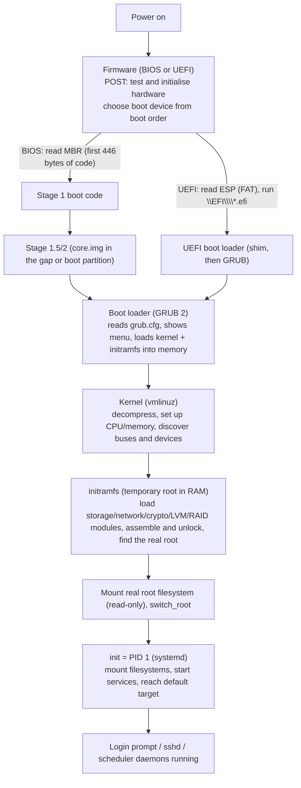
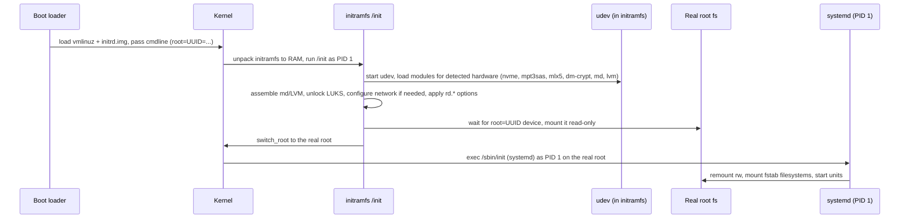
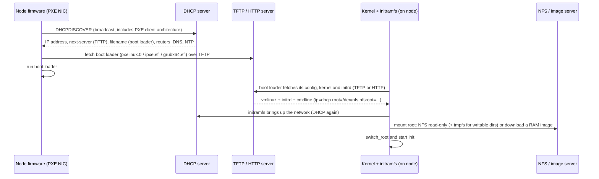

# 1.14 Boot: firmware, GRUB, kernel, initramfs

| | |
|---|---|
| Level | Intermediate |
| Priority tier | 0 |
| Lab venue | GCP / GKE (an Ubuntu VM with serial console access; a local VM such as QEMU/KVM is better for breaking boot safely) |
| Part | Part 1: Linux, from the command line to the kernel and performance |
| Status | Drafted, labs **untested** |

## Why this matters for AI infrastructure

A node that does not boot is a node that does not train. On GPU fleets, boot is where several of the nastiest problems originate: a kernel update that boots without the NVIDIA module, a Secure Boot setting that silently refuses an unsigned driver, a firmware setting (IOMMU, Above-4G decoding, SR-IOV, NUMA mode) that decides whether GPUs and NICs work as designed, an `fstab` entry that hangs the boot waiting for an unplugged drive, a cloned image that cannot find its disks, an `initramfs` without the storage or network driver needed for the root filesystem, or hundreds of diskless nodes that all PXE-boot at once and flatten the DHCP/TFTP servers. Many production procedures also begin at boot: kernel parameters for hugepages, IOMMU, isolated CPUs and console redirection; image-based provisioning of stateless nodes; out-of-band recovery over a serial console or BMC.

This chapter explains the whole sequence from power-on to the first user-space process: firmware (BIOS and UEFI, Secure Boot), the boot loader (GRUB 2 in depth), the kernel and its parameters, the initial RAM filesystem (`initramfs`), the hand-off to `init`, and **network boot** (DHCP, TFTP, PXE, NFS root) as used by clusters. It teaches how to read the boot messages, how to repair a system that will not boot, and how to make boot configuration changes safely. The service-manager half of boot (systemd units, targets, journald) is chapter 1.15; provisioning images at scale is the Part 6 chapter on PXE and image management and the BCM material.

## Prerequisites and outcomes

You should know partitions, GPT/MBR and the EFI System Partition (1.12), kernel modules and device basics (1.10), and the idea of PID 1 (1.8). `fstab` is in 1.12.

After this chapter you can:

- Narrate the boot sequence: firmware (POST), boot loader, kernel decompression and initialisation, initramfs, root mount, `init`/systemd, login.
- Distinguish BIOS/MBR from UEFI/GPT boot; find the EFI System Partition, boot entries (`efibootmgr`) and boot loaders on disk; explain Secure Boot, `shim` and MOK.
- Read, edit and regenerate GRUB configuration safely (`/etc/default/grub`, `/etc/grub.d`, `grub-mkconfig`/`update-grub`, `grub2-mkconfig`, `grubby`); use the GRUB menu, editor and command line; chainload; reinstall GRUB.
- Read and set kernel parameters (`/proc/cmdline`, `root=`, `ro`, `quiet`, `console=`, `rd.*`, IOMMU, hugepages, `isolcpus`, driver blacklists), temporarily and permanently.
- Explain what the `initramfs` is for, inspect and rebuild it (`lsinitramfs`/`lsinitrd`, `update-initramfs`, `dracut`), and recover from an initramfs shell.
- Understand SysV `init` (runlevels, `/etc/inittab`, `rc.d`) well enough to read legacy systems, and how it relates to systemd targets.
- Diagnose and repair common boot failures: missing root device, bad `fstab`, broken GRUB, missing initramfs modules, kernel panic, lost root password, full `/boot`.
- Configure DHCP, TFTP/PXE and NFS-root for diskless nodes, understand UEFI versus BIOS PXE, cloning pitfalls, and the boot-storm problem.
- Apply this to GPU nodes: firmware settings, Secure Boot and the NVIDIA driver, kernel parameters, serial console, and fleet kernel updates.

## 1. The big picture



Seven stages in the simple form: (1) firmware loads and runs a boot loader; (2) the boot loader finds the kernel image on disk, loads it into memory with its parameters and starts it; (3) the kernel initialises devices and drivers; (4) the kernel mounts the root filesystem (via the initramfs when needed); (5) the kernel starts `init` as PID 1; (6) `init` starts the rest of the system; (7) a login service becomes available. Being able to name the stage where a failure occurs is the single most useful boot-debugging skill: "stuck before the GRUB menu" (firmware or boot loader), "GRUB menu appears but kernel does not load" (boot loader or kernel image), "kernel boots but cannot find root" (initramfs or kernel parameters), "reaches systemd but hangs on a mount" (`fstab`, storage, network), "boots but the GPU is missing" (driver, Secure Boot, firmware).

Distributions often hide the early stages with graphical splash screens (`quiet splash`), so you see little until the system is up. You can still read all of it afterwards: `journalctl -k` (kernel messages of this boot), `journalctl -k -b -1` (previous boot, needs persistent journal), `dmesg`, and on systems without systemd `/var/log/kern.log` or `/var/log/dmesg`.

## 2. Firmware: BIOS, UEFI and the hardware settings that matter

### BIOS (legacy) boot

On power-up the CPU runs the firmware, which performs the **Power-On Self-Test (POST)**: tests and initialises memory, enumerates and initialises devices, and gives option ROMs (RAID cards, network cards) a chance to run. It then looks for boot code on devices in the configured **boot order**. With a BIOS and an **MBR**-partitioned disk, it reads the **Master Boot Record**, the first 512-byte sector: **446 bytes of boot code**, a **64-byte partition table** (four 16-byte entries) and the 2-byte signature `0x55AA`. 446 bytes is too little for a boot loader, so boot loaders are **multi-stage**: the MBR code only loads more code from the unused gap between the MBR and the first partition (traditionally 1 MiB offset leaves room), which understands filesystems and loads the rest. (On a BIOS system with a **GPT** disk, the gap holds the GPT, so GRUB needs a small **BIOS boot partition** (type GUID `21686148-6449-6E6F-744E-656564454649`) to store its core.) Firmware reads the disk using BIOS calls with simple **LBA** addressing, which is slow, but boot loaders need it only briefly.

### UEFI boot

**UEFI** (Unified Extensible Firmware Interface) replaced the BIOS on essentially all modern servers. Differences that matter:

- It understands partition tables (GPT) and a filesystem: the **EFI System Partition (ESP)**, a FAT32 partition (type `EF00`; GUID `C12A7328-F81F-11D2-BA4B-00A0C93EC93B`), normally mounted at **`/boot/efi`**. Boot loaders are ordinary files ending in `.efi` in `EFI/<vendor>/` on the ESP (`EFI/ubuntu/shimx64.efi`, `grubx64.efi`, `EFI/redhat/`, `EFI/BOOT/BOOTX64.EFI` as the fallback path for removable media).
- Boot entries are stored in **NVRAM** variables and managed with **`efibootmgr`**. Each entry has a number (`Boot0003`), a label and the path of an `.efi` file; `BootOrder` lists the sequence. A loader must be **registered** ("announced") with the firmware; the installer (`grub-install`) does this, which is why copying a disk to another machine can leave it unbootable until entries are recreated (the fallback `EFI/BOOT/BOOTX64.EFI` helps).
- A built-in shell and a boot menu (often F11/F12 or Esc/F2/Del at power-up; BMC consoles give remote access to it).
- Networking in firmware: **PXE/HTTP boot** via UEFI network drivers.
- **Secure Boot** (next section).

```bash
[ -d /sys/firmware/efi ] && echo "UEFI boot" || echo "legacy BIOS boot"
efibootmgr -v                       # boot entries, order, paths; add -t/-n/-o to change timeout/next-boot/order
sudo efibootmgr -n 0003             # boot entry 3 only on the next reboot (handy for one-time PXE or rescue)
lsblk -f | grep -i vfat; findmnt /boot/efi; ls /boot/efi/EFI
sudo mokutil --sb-state             # is Secure Boot enabled?
bootctl status 2>/dev/null          # systemd-boot view (if used)
```

### Secure Boot

With **Secure Boot** the firmware only runs boot code that is cryptographically **signed** by a key it trusts. Hardware vendors ship with Microsoft's keys, so distributions use a small Microsoft-signed **`shim`** that in turn verifies and runs **GRUB**, which verifies the **kernel**, which (when the kernel is locked down) verifies **kernel modules**. The distribution's own key is built into shim; additional keys are enrolled as **Machine Owner Keys (MOK)** with `mokutil`. The consequence for GPU nodes is critical: **out-of-tree kernel modules such as the NVIDIA driver (built by DKMS) must be signed** with a key enrolled in the firmware/MOK database, or the kernel refuses to load them ("Required key not available", "module verification failed", the GPU is missing, `nvidia-smi` fails). Options: (a) disable Secure Boot in firmware on trusted data-centre servers (common), (b) enrol a MOK and sign the modules (DKMS can sign automatically with `mokutil --import` after the key is generated; the enrolment requires a console interaction at the next boot, awkward on remote servers, so do it once in the image build), (c) use distribution-signed or vendor-precompiled driver packages. Secure Boot is also a compliance requirement in some environments. Decide per fleet and document it. (Chapter 1.22 covers DKMS signing in detail.)

### Hardware/firmware settings that matter on GPU servers

These are set in the BIOS/UEFI setup or by the vendor's tooling (and in clusters, scripted over Redfish/BMC; Part 8). They differ by vendor and generation, so treat this list as a checklist of topics to confirm in your platform guide rather than exact menu names:

| Setting | Why it matters |
|---|---|
| **Virtualisation (VT-x/AMD-V) and IOMMU (VT-d / AMD-Vi)** | Needed for KVM, VFIO device passthrough, SR-IOV and safe DMA; set the matching kernel parameters (`intel_iommu=on iommu=pt`, `amd_iommu=on iommu=pt`) |
| **Above-4G decoding / large BARs / Resizable BAR (ReBAR)** | GPUs expose big memory apertures; many GPU boxes will not initialise all devices without this |
| **SR-IOV** | NICs/GPUs/NVMe virtual functions (virtualisation, vGPU, MIG-adjacent setups) |
| **NUMA presentation** (sub-NUMA clustering, NPS modes) | Changes the number of NUMA nodes the OS sees and thus pinning policies (1.17, 1.28) |
| **Hyper-Threading / SMT** | Per-core predictability versus throughput; some HPC sites turn it off |
| **Power and performance profile** (C-states, P-states, "Performance" mode), **turbo** | Latency jitter and clocks; AI sites commonly choose a performance profile |
| **PCIe settings** (link speed, ASPM off, bifurcation) | Link training; ASPM can add latency or instability |
| **Boot mode and order, PXE/HTTP boot on the right NIC, Secure Boot** | Provisioning and driver loading |
| **Serial console redirection** (BIOS and OS) | Out-of-band troubleshooting (section 9) |
| **Firmware versions** (BIOS, BMC, NIC, GPU VBIOS) | Many "mystery" fleet differences are firmware drift (chapter on firmware management) |

## 3. The boot loader

The boot loader's job sounds simple (load the kernel with its parameters) but is subtle because at that point the kernel is not running, so it cannot use the kernel's device drivers or filesystem code. A boot loader therefore contains its own small disk and filesystem drivers (using the firmware's disk services) and finds the files it needs by **reading the filesystem itself**. It must: find and load the kernel image (and initramfs), pass **kernel parameters**, let the user select among kernels or edit parameters, and optionally boot other operating systems.

Common loaders: **GRUB 2** (the near-universal Linux default, both BIOS and UEFI), **systemd-boot** (simple UEFI manager, some distributions), **LILO/SYSLINUX/EXTLINUX/ISOLINUX** (older or special purpose, SYSLINUX family used for PXE and installers), **EFISTUB** (the kernel itself as an EFI executable, started directly by the firmware, no separate loader), **iPXE** (network boot loader, section 10), and Windows/macOS loaders for dual-boot. This chapter concentrates on GRUB 2; "GRUB Legacy" (`menu.lst`) is obsolete.

### GRUB 2 in use

Reaching the menu: hold **Shift** at power-up (BIOS) or tap **Esc** (UEFI); on cloud and virtual machines the menu is often hidden or reachable only through the serial console and may need `GRUB_TIMEOUT_STYLE=menu` set. In the menu:

- **Enter**: boot the highlighted entry.
- **`e`**: edit that entry's commands for this boot only (the most convenient way to repair a bad boot temporarily; Ctrl-X or F10 boots, Esc returns).
- **`c`**: the GRUB **command line**.
- Advanced options submenu: older kernels and recovery mode.

An entry looks like this (after `e`):

```text
menuentry 'Ubuntu' --class ubuntu --class gnu-linux --class gnu --class os $menuentry_id_option 'gnulinux-simple-8b92610e-...' {
    recordfail
    load_video
    insmod gzio
    insmod part_gpt
    insmod ext2
    set root='hd0,gpt2'
    search --no-floppy --fs-uuid --set=root 8b92610e-1db7-4ba3-ac2f-30ee24b39ed0
    linux   /boot/vmlinuz-5.15.0-91-generic root=UUID=8b92610e-... ro quiet splash $vt_handoff
    initrd  /boot/initrd.img-5.15.0-91-generic
}
```

**GRUB has its own world.** Everything here is GRUB's internal language: `insmod` loads *GRUB* modules (unrelated to Linux kernel modules), `ls` lists *GRUB's* devices and files, and, most confusingly, **"root" appears in two meanings**: in `set root=` / `search ... --set=root` it is the **GRUB root**, the filesystem where GRUB looks for the kernel and initrd files; in `linux ... root=UUID=...` it is a **kernel parameter** naming the Linux root filesystem. GRUB devices are named `(hd0)`, `(hd0,gpt2)`, `(hd0,msdos1)` (disk number, partition table type, partition number); the numbering can change, so entries use `search` by UUID. `linux` loads the kernel image (and gives the parameters), `initrd` loads the initial RAM filesystem, `boot` starts it.

The **GRUB command line** (`c` at the menu) is invaluable for exploring and for booting by hand when `grub.cfg` is damaged:

```text
grub> ls                              # devices and partitions: (hd0) (hd0,gpt1) (hd0,gpt2)
grub> ls -l                           # with filesystem type and UUID
grub> echo $root; set                 # GRUB variables; $prefix = where GRUB finds its config and modules
grub> ls (hd0,gpt2)/                  # file listing of a partition (note the trailing slash)
grub> ls ($root)/boot
grub> set root=(hd0,gpt2)
grub> linux /boot/vmlinuz-5.15.0-91-generic root=/dev/sda2 ro single
grub> initrd /boot/initrd.img-5.15.0-91-generic
grub> boot
```

(`Esc` returns to the menu. If you land at the minimal `grub rescue>` prompt, GRUB could not find its modules or config: set `prefix` and `root` by hand, then `insmod normal`, `normal`.)

### GRUB configuration: do not edit `grub.cfg`

The file the loader reads is `grub.cfg` (in `/boot/grub/` or `/boot/grub2/`, on EFI systems also a small stub in the ESP). **It is generated; your edits will be overwritten.** The correct workflow:

1. Settings go in **`/etc/default/grub`**: `GRUB_DEFAULT`, `GRUB_TIMEOUT`, `GRUB_TIMEOUT_STYLE`, `GRUB_CMDLINE_LINUX` (kernel parameters for **every** entry including recovery), `GRUB_CMDLINE_LINUX_DEFAULT` (for normal entries only), `GRUB_TERMINAL`, `GRUB_SERIAL_COMMAND`, `GRUB_DISABLE_OS_PROBER`, `GRUB_GFXMODE`, `GRUB_DISABLE_RECOVERY`.
2. Custom menu entries go in `/etc/grub.d/40_custom` (a script, easy to lose in upgrades) or, more robustly, a file `custom.cfg` read by `41_custom`/`grub.cfg` at boot (it does not require regenerating).
3. **Regenerate**: `sudo update-grub` (Debian/Ubuntu; a wrapper for `grub-mkconfig -o /boot/grub/grub.cfg`), `sudo grub2-mkconfig -o /boot/grub2/grub.cfg` (RHEL-family BIOS; UEFI path is `/boot/grub2/grub.cfg` on current releases, `/boot/efi/EFI/redhat/grub.cfg` on older ones: *verify per release*), `grubby` on RHEL-family for kernel arguments per kernel (`sudo grubby --update-kernel=ALL --args="intel_iommu=on iommu=pt"`).
4. Verify: `grep -n 'iommu' /boot/grub/grub.cfg`; reboot; `cat /proc/cmdline`.

`grub-mkconfig` is just a shell script that runs every executable in **`/etc/grub.d/`** in numeric order (`00_header`, `10_linux`, `20_linux_xen`, `30_os-prober`, `40_custom`, `41_custom`) and concatenates their output; the resulting file consists of GRUB commands (`menuentry`, `submenu` for older kernels, conditionals, `load_env`/`save_env` for remembered defaults). GRUB itself never runs these scripts at boot; they run in user space to generate the file. `grub-mkconfig` with no `-o` just prints the result, which is a safe way to see what would be generated. `grub-set-default`, `grub-reboot` (boot a given entry once) and `grub-editenv list` manage the environment block. Back up `/boot/grub` and the ESP before experiments.

### GRUB installation

Distribution installers handle this. When you must do it yourself (cloning a disk, repairing, building images):

```bash
# BIOS/MBR (or BIOS with GPT + BIOS boot partition): write the boot code into the disk
sudo grub-install /dev/sda
sudo grub-install --boot-directory=/mnt/boot /dev/sdc      # install onto another disk whose /boot is mounted at /mnt/boot
# UEFI: copy the loader to the ESP and register it with the firmware (uses efibootmgr)
sudo grub-install --target=x86_64-efi --efi-directory=/boot/efi --bootloader-id=ubuntu
sudo grub-install --target=x86_64-efi --efi-directory=/mnt/boot/efi --removable   # fallback path EFI/BOOT/BOOTX64.EFI for portable/cloud images
sudo update-grub
```

Wrong installation breaks boot, so have a rescue plan (a live USB or a serial/BMC console, a backup of the MBR with `dd if=/dev/sda of=mbr.bin bs=512 count=1` and of the ESP). To repair from a live environment: mount the root (and `/boot`, `/boot/efi`), bind `/dev`, `/proc`, `/sys`, `chroot`, then `grub-install` and `update-grub` (section 8).

### How GRUB boots (for BIOS)

1. Firmware loads the first 440/446 bytes (`boot.img`) from the MBR; this only knows where to find the next piece.
2. It loads the **core image** (`core.img`: a compact GRUB with a few built-in modules, such as the module for the filesystem and the partition table, and optionally LVM/RAID/crypto modules needed to read `/boot`) from the gap after the MBR (or the BIOS boot partition). Historic GRUB used a "stage 1.5" for filesystem support; GRUB 2 folds that into `core.img`.
3. The core initialises, can now read disks and filesystems, identifies its **boot partition** (`prefix`) and loads **`grub.cfg`** and further modules from `/boot/grub`.
4. It shows the menu; after a timeout or user action it executes the chosen entry, which loads the kernel and initrd and runs `boot`.

On **UEFI** the core image is simply a file in the ESP (`grubx64.efi`), started by the firmware (or by `shimx64.efi` under Secure Boot), which makes everything easier, as the firmware can read the ESP itself. Where GRUB needs LVM, RAID or encryption support to read `/boot`, those modules are included in the core image; a separate small `/boot` partition on plain ext4 avoids the whole class of problems.

### Chainloading

GRUB can hand over to another boot loader instead of loading a kernel (dual-boot, or booting a vendor recovery partition): `chainloader +1` loads the first sector of a partition; `chainloader /EFI/Microsoft/Boot/bootmgfw.efi` on UEFI:

```text
menuentry "Windows" {
    insmod chain
    insmod ntfs
    set root=(hd0,3)
    chainloader +1
}
```

UEFI makes multi-boot easy because several loaders can live side by side in the ESP and be chosen from the firmware menu. On servers this is rare; the same machinery boots installers and rescue systems.

## 4. The kernel starts

The boot loader loads the **kernel image** (`/boot/vmlinuz-<version>`; a compressed image, `bzImage`, whose first part is a small program that sets up minimal hardware state and decompresses the rest into memory), the **initramfs** (`/boot/initrd.img-<version>` or `initramfs-<version>.img`) and passes the **command line**. Files in `/boot` you should recognise: `vmlinuz-*` (kernel), `initrd.img-*`/`initramfs-*.img` (initial RAM filesystem), `config-*` (the kernel build configuration: `grep CONFIG_PREEMPT /boot/config-$(uname -r)`), `System.map-*` (symbol addresses), `grub/` and `efi/`. Loadable modules for each kernel are in `/lib/modules/<version>/`. Several kernel versions normally coexist, so you can boot an older one if a new one fails; **a full `/boot` is a classic cause of failed kernel installs**, so prune old kernels (`sudo apt autoremove --purge`, `dnf remove --oldinstallonly`).

The kernel then, in rough order: inspects the **CPUs**, inspects **memory**, discovers **buses** and **devices** (binding built-in drivers; others are modules), sets up auxiliary subsystems (networking, security), **mounts the root filesystem**, and starts the first user-space process. The messages are in the kernel ring buffer; the points to look for:

```bash
journalctl -k | head -50                  # or dmesg
dmesg --level=err,warn                    # problems only
dmesg | grep -iE 'Command line|iommu|nvidia|firmware|secure|ACPI|NUMA|hugepage|nvme|mlx'
journalctl -k | grep -E 'Run /init|Freeing unused|mounted filesystem|systemd\[1\]'    # key milestones
```

Sample milestones: `Linux version ...`, `Command line: BOOT_IMAGE=... root=UUID=... ro quiet splash`, detection of CPUs and memory (`NUMA`, `e820`), PCI enumeration, `sd 0:0:0:0: [sda] Attached SCSI disk`, `Freeing unused kernel memory`, `Write protecting the kernel read-only data`, `Run /init as init process` (the initramfs), then `EXT4-fs (sda1): mounted filesystem` and `systemd[1]: ... Detected architecture x86-64`. Seeing systemd's first message means user space has started.

### Kernel parameters

The kernel receives a text **command line** (shown in `/proc/cmdline`) of words and `key=value` pairs. A few are essential; many tune behaviour. The kernel's reference is `Documentation/admin-guide/kernel-parameters.txt` and `man bootparam`. Unrecognised parameters are **passed on to `init`** (for example `single`, `-s`, `systemd.unit=rescue.target`), and options for modules are `modulename.param=value`.

| Parameter | Meaning |
|---|---|
| `root=` | The root filesystem: `/dev/sda2`, `/dev/mapper/vg-root`, **`UUID=...`** (preferred), `LABEL=`, `/dev/nfs`. Without it the kernel cannot do the user-space start. Names that do not depend on device order are safer |
| `ro` / `rw` | Mount the root read-only at first (normal: the `fsck` can run safely, then it is remounted read-write) / read-write |
| `rootfstype=`, `rootflags=`, `rootwait` | Filesystem type, options, wait for the root device to appear (slow USB/network storage) |
| `init=/path` | Run this instead of `/sbin/init`; `init=/bin/bash` is the classic emergency shell |
| `quiet`, `splash`, `loglevel=N`, `earlyprintk`, `debug` | Verbosity of boot output |
| `console=tty0 console=ttyS0,115200n8` | Where the kernel console writes. **Several `console=` options are allowed and the last one is the primary** (`/dev/console`). Essential for servers managed over a serial port, BMC Serial-over-LAN or cloud serial console |
| `single`, `1`, `systemd.unit=rescue.target` / `emergency.target`, `systemd.unit=multi-user.target` | Boot to single-user/rescue/emergency mode or a different target |
| `nomodeset` | Do not set graphics mode in the kernel (fix black screens with certain GPUs; useful when an NVIDIA driver misbehaves at boot) |
| `modprobe.blacklist=nouveau`, `rd.driver.blacklist=nouveau` | Keep a module from loading (the open `nouveau` driver must not take the GPU before the NVIDIA driver) |
| `intel_iommu=on iommu=pt`, `amd_iommu=on iommu=pt` | Enable the IOMMU (passthrough mode for host devices: needed for VFIO/SR-IOV and lower overhead) |
| `default_hugepagesz=1G hugepagesz=1G hugepages=N`, `transparent_hugepage=madvise\|never\|always` | Reserve hugepages at boot (reliable only at boot), control THP |
| `isolcpus=`, `nohz_full=`, `rcu_nocbs=`, `irqaffinity=` | Isolate cores from the scheduler and tick for latency-critical work (chapters 1.18, 1.28) |
| `numa_balancing=disable`, `mitigations=off`, `processor.max_cstate=`, `intel_idle.max_cstate=`, `pcie_aspm=off` | Performance/latency tuning with trade-offs (security mitigations!) |
| `net.ifnames=0 biosdevname=0` | Use the old `eth0` names instead of predictable names |
| `ip=dhcp`, `nfsroot=server:/path,opts`, `BOOTIF=` | Network boot configuration (section 10) |
| `rd.break`, `rd.shell`, `rd.lvm.vg=`, `rd.luks.uuid=`, `rd.md.uuid=` (dracut) / `break=premount` (initramfs-tools) | Initramfs behaviour and debugging (section 5) |
| `crashkernel=` | Reserve memory for `kdump` (crash dumps) |
| `audit=0`, `selinux=0`, `enforcing=0`, `apparmor=0` | Security module toggles (troubleshooting only) |
| `nvidia-drm.modeset=1`, `nvidia.NVreg_*=` | NVIDIA driver module options (module parameters can also live in `/etc/modprobe.d`) |

To **change parameters for one boot**: at the GRUB menu press `e`, append to the `linux` line, Ctrl-X. To **make permanent**: edit `GRUB_CMDLINE_LINUX` in `/etc/default/grub`, run `update-grub` or `grub2-mkconfig`, reboot, verify with `cat /proc/cmdline`; on RHEL-family `grubby --update-kernel=ALL --args="..."` (and `--remove-args`). In clouds that manage boot configuration (some images use `/etc/default/grub.d/*.cfg` files that override yours), check which file wins. Under UEFI with a Unified Kernel Image, parameters are embedded in the image (rebuild with `ukify`/`dracut`).

## 5. The initial RAM filesystem (initramfs)

**The problem.** To mount the real root filesystem the kernel needs the driver for the disk controller (maybe NVMe, RAID, or a fibre-channel HBA), the module for the filesystem, perhaps to assemble RAID/LVM, unlock LUKS, bring up the network for iSCSI or NFS, or load firmware. If all of those were compiled into the kernel, it would be huge. Distributions instead ship a **generic kernel with most drivers as modules** and use an **initramfs**: a small compressed **cpio archive** loaded by the boot loader into memory, which the kernel unpacks as a **temporary root filesystem in RAM** (a tmpfs/rootfs) and runs `/init` from it. The programs and modules inside do exactly what is needed to find, assemble, unlock and mount the real root, then **`switch_root`** replaces the temporary root with the real one and execs the real `init`. (The older "initrd" was a block-device image; the name `initrd` persists in file names and commands, but nowadays it is an initramfs.)



Tools (the two families):

| | Debian/Ubuntu: `initramfs-tools` | RHEL/Fedora/SUSE: `dracut` |
|---|---|---|
| Rebuild current | `sudo update-initramfs -u` | `sudo dracut -f` |
| Rebuild all/for a kernel | `update-initramfs -u -k all`, `-k 5.15.0-91-generic` | `dracut -f --regenerate-all`, `dracut -f /boot/initramfs-X.img X` |
| List contents | `lsinitramfs /boot/initrd.img-$(uname -r) \| less` | `lsinitrd /boot/initramfs-$(uname -r).img \| less` |
| Config | `/etc/initramfs-tools/{initramfs.conf,modules,hooks/,scripts/}` | `/etc/dracut.conf.d/*.conf` (`add_drivers+=" nvme "`, `omit_dracutmodules+=" plymouth "`) |
| Debug shell | `break=premount` (or `break=mount`, `break=bottom`) on the cmdline | `rd.break`, `rd.break=pre-mount`, `rd.shell`, `rd.debug`, `rd.break=cmdline` |

You must **rebuild the initramfs whenever something it needs changes**: after adding a kernel module needed at boot (storage, NIC for netboot), after `mdadm.conf` or `crypttab` or LVM changes, after installing/updating the NVIDIA driver on systems that load it early (DKMS hooks do this), after moving the root to a new disk. Missing a rebuild is the cause of "boots on the old kernel but not the new", "RAID arrives as `md127`", and "dropped to `(initramfs)` prompt".

**A module-free quick check:** `lsinitramfs /boot/initrd.img-$(uname -r) | grep -E 'nvme|raid|dm_|mlx|nfs'`. Hostonly versus generic initramfs: `dracut` builds a small **host-only** image by default (only the drivers of the machine that built it), which is the wrong choice for a golden image that must boot on different hardware: use `dracut --no-hostonly` (or `hostonly="no"` in `dracut.conf.d`), and in `initramfs-tools` `MODULES=most`, to build a **generic** image.

**Dropped to an initramfs shell** (prompt `(initramfs)` or `dracut:/#`; the message says which device was not found): root device missing (wrong `root=` UUID, a changed disk, a missing storage or RAID/LVM module, a LUKS passphrase not given, slow USB/network disk needing `rootwait`). From the shell: `cat /proc/cmdline`, `ls /dev/disk/by-uuid`, `blkid`, `lsmod`, `dmesg | tail`, `modprobe nvme`, `mdadm --assemble --scan`, `lvm vgchange -ay`, `mount /dev/... /root`, then `exit` (initramfs-tools) or `exit` to continue boot. Fix the cause (parameter, missing module) and rebuild.

## 6. `init`: the first user-space process

The kernel starts `/sbin/init` (or the program named by `init=`; if that fails it tries several standard locations and panics if none works). **`init` always has PID 1; it is the only process the kernel watches: if it dies the kernel panics.** Its duties: set up the system, mount filesystems, start services, and **adopt and reap orphaned processes** (chapter 1.8). Today `/sbin/init` is almost always a link to **systemd** (chapter 1.15), which replaced the older **SysV init**. You can tell which one you have: `ps -p 1 -o comm=` (`systemd` or `init`), `readlink -f /sbin/init`.

### SysV init, briefly (still seen in appliances, containers' ancestors, and some old HPC images)

SysV `init` reads **`/etc/inittab`** with lines `id:runlevels:action:process` and works with **runlevels**:

| Runlevel | Meaning |
|---|---|
| 0 | Halt/power off |
| 1 (`S`) | Single-user mode |
| 2 | Multi-user without network (distribution-dependent) |
| 3 | Multi-user with network (typical server) |
| 4 | Unused/custom |
| 5 | Multi-user with network and graphical login |
| 6 | Reboot |

The default is set by `id:3:initdefault:`; `init 6` reboots, `init 0` halts, `telinit q` re-reads inittab. Actions include `respawn` (restart if it exits, how `getty` login prompts persist), `once`, `wait`, `sysinit`, `boot`, `bootwait`, `initdefault`, `powerwait` (shut down on UPS power failure), `ctrlaltdel`. On entering a runlevel `init` runs the scripts in **`/etc/rc<N>.d/`**: links named `S<NN><name>` (Start, with `start`) and `K<NN><name>` (Kill, with `stop`), executed in numeric order, pointing at the real scripts in **`/etc/init.d/`**; `/etc/init.d/sshd restart` works at any time. Enable at boot with `chkconfig sshd on` (RHEL) or `update-rc.d sshd enable` (Debian). Script headers (`### BEGIN INIT INFO` with `Provides`, `Required-Start`, `Default-Start`...) let tools compute ordering. `rc.local` ran last (using it is discouraged; systemd keeps compatibility). Weaknesses that led to systemd: strictly sequential start-up (slow), shell scripts as the unit of service management (fragile, hard to track processes), no dependency-based parallelism, poor process supervision and resource control.

### systemd, in one screen

systemd treats everything as a **unit** (service, socket, mount, device, timer, path, slice, scope, **target**). A **target** groups units and replaces a runlevel, but several can be active at once; the default (`systemctl get-default`) is typically `multi-user.target` on servers (like runlevel 3) or `graphical.target` (5). Dependencies (`Requires=`, `Wants=`, `After=`, `Before=`, `Conflicts=`) let it start units **in parallel**; each service runs in its own **cgroup**, so all its processes are tracked and can be killed reliably. Basic commands: `systemctl status|start|stop|restart|enable|disable NAME`, `systemctl list-units`, `systemctl isolate rescue.target`, `systemctl get-default / set-default`, `journalctl -u NAME`, `systemd-analyze`, `systemd-cgls`. Unit file locations: `/etc/systemd/system` (yours; overrides), `/usr/lib/systemd/system` (packages), `/run/systemd/system`. Chapter 1.15 is the full course. Per-user resource limits can be set on `user-.slice` (`CPUQuota=`, `MemoryMax=`, `TasksMax=`, `IOReadBandwidthMax=`), and `KillUserProcesses=yes` in `logind.conf` would kill `tmux` sessions at logout (leave it `no`).

## 7. Diagnosing and repairing boot problems

**Systematic approach:** (1) identify the stage that fails (section 1); (2) get a console: serial console, BMC/KVM, hypervisor console, cloud serial output (`gcloud compute instances get-serial-port-output`); (3) read the messages (stop the splash: remove `quiet splash`, add `console=`); (4) boot an older kernel or a rescue medium; (5) change one thing at a time.

| Symptom | Likely cause | First actions |
|---|---|---|
| Firmware screen, "no bootable device" | Boot order/mode wrong (UEFI vs legacy), ESP or MBR damaged, disk not detected | Check firmware boot menu, `efibootmgr`, re-run `grub-install`, boot a live image |
| `grub rescue>` prompt | GRUB cannot find its `prefix` (disk renumbered, partition moved/deleted, filesystem changed) | `ls`, find the partition with `/boot/grub`, `set prefix=(hd0,gpt2)/boot/grub`, `set root=...`, `insmod normal`, `normal`; then reinstall GRUB from the running system |
| GRUB menu but "file not found", "invalid magic" | Kernel/initrd path wrong, a removed kernel | Edit the entry (`e`), pick an existing file (`ls ($root)/boot/`), regenerate `grub.cfg` |
| Kernel panic: "VFS: Unable to mount root fs on unknown-block(0,0)" | No driver for the root device in the kernel/initramfs, wrong `root=`, stale initramfs | Boot an older kernel; rebuild the initramfs with the right modules; check `root=` UUID |
| `(initramfs)` shell, "ALERT! /dev/disk/by-uuid/... does not exist" | Root device not found in time | Section 5; `rootwait`, missing module, changed UUID after cloning |
| Hangs "A start job is running for dev-disk-by-uuid-..." 1m30s then emergency mode | `fstab` entry for a missing device | Add `nofail,x-systemd.device-timeout=5s`, fix the UUID |
| "You are in emergency mode" | A mount (`fstab`) or `fsck` failed; read-only root | `journalctl -xb`; fix `/etc/fstab` (remount rw: `mount -o remount,rw /`), run `fsck` on the unmounted problem filesystem |
| Boots, but GPU missing / no network | Driver not built for this kernel (DKMS failed), Secure Boot rejected the module, firmware setting | `dkms status`, `journalctl -b -p err`, `mokutil --sb-state`, rebuild/sign, reboot into the previous kernel |
| Boot takes minutes | Waiting on DHCP, a hung NFS mount, a slow `fsck`, entropy/clock, device timeouts | `systemd-analyze blame`, `systemd-analyze critical-chain`, `journalctl -b` |
| Random reboot/hang right after loading | Panic, watchdog, hardware fault, thermal; capture with `crashkernel`/kdump and BMC logs | Serial console log, `last -x reboot`, `journalctl -b -1 -e`, BMC SEL |

**Rescue and emergency modes** (systemd): add `systemd.unit=rescue.target` (single-user: filesystems mounted, basic services) or `systemd.unit=emergency.target` (only the root filesystem, read-only, minimal) to the kernel line; set a root password if the system requires one (`sulogin`). **Reset a lost root password** (physical/console access required; this is why consoles must be controlled): add `rd.break` (RHEL: drops to an initramfs shell before switching root), `mount -o remount,rw /sysroot; chroot /sysroot; passwd root; touch /.autorelabel` (SELinux relabel) `; exit; exit`; on Debian/Ubuntu add `init=/bin/bash` or `systemd.unit=rescue.target`, then `mount -o remount,rw /`, `passwd`. Protect the boot loader with a GRUB password and the firmware with a setup password on systems where console access is not otherwise secure; encrypting the disk (LUKS) makes the rescue-password route useless to an attacker.

**Repairing from a live/rescue image** (the universal fix for GRUB and `fstab` damage):

```bash
sudo mount /dev/nvme0n1p2 /mnt                       # the root filesystem (or activate LVM/md first)
sudo mount /dev/nvme0n1p1 /mnt/boot/efi              # ESP (and /boot if separate)
for d in dev dev/pts proc sys run sys/firmware/efi/efivars; do sudo mount --bind /$d /mnt/$d; done 2>/dev/null
sudo chroot /mnt /bin/bash
  grub-install /dev/nvme0n1   # or:  grub-install --target=x86_64-efi --efi-directory=/boot/efi --bootloader-id=ubuntu
  update-grub                 # or grub2-mkconfig -o /boot/grub2/grub.cfg
  update-initramfs -u -k all  # or dracut -f --regenerate-all
  exit
sudo umount -R /mnt; sudo reboot
```

**Crash dumps (`kdump`).** Reserve memory with `crashkernel=` (for example `crashkernel=512M`), enable `kdump`/`kexec-tools`; after a panic a second small kernel boots from the reserved memory, saves a vmcore under `/var/crash`, and reboots. Combine with serial console logging and BMC logs to diagnose spontaneous reboots on GPU servers.

**Boot time** can be analysed with `systemd-analyze` (kernel versus user space), `systemd-analyze blame`, `systemd-analyze critical-chain`, and `systemd-analyze plot > boot.svg`; large GPU servers spend minutes in firmware (memory training, option ROM scanning) before Linux starts, so measure end to end (BMC power-on to SSH).

## 8. Cloning images: a cluster pitfall

A system installed on one disk and then cloned to others often refuses to boot or mount filesystems. The installer wrote disk-specific identifiers into the boot loader and mount configuration (for example `root=/dev/disk/by-id/ata-WDC...` in `grub.cfg` and `/etc/fstab`), which are wrong on a different disk. Before cloning a prototype: use **UUIDs only for filesystems you recreate yourself** or portable names (labels, LVM names, `/dev/mapper`), remove `by-id` serial references from `grub.cfg` and `fstab`, remove persistent network rules bound to MAC addresses (`/etc/udev/rules.d/70-persistent-net.rules`, `systemd .link` files with MAC match), and regenerate unique host identity at first boot (`/etc/machine-id`, SSH host keys, hostname) with cloud-init or a first-boot unit. A cloned filesystem has the **same UUID** as its source, so give clones new UUIDs (`tune2fs -U`, `xfs_admin -U`) if they will be attached to the same host. Prefer image-based provisioning (section 10) over disk cloning for fleets.

## 9. Consoles for servers

Servers have no screen. You reach the boot process through: the **BMC** (IPMI/Redfish) with **Serial-over-LAN (SOL)** (`ipmitool -I lanplus -H bmc -U user sol activate`) or HTML5/Java KVM; a **serial port**; a hypervisor or cloud **serial console**. Enable it end to end: firmware console redirection to the serial port (same baud rate as the kernel), GRUB (`GRUB_TERMINAL="console serial"`, `GRUB_SERIAL_COMMAND="serial --speed=115200 --unit=0 --word=8 --parity=no --stop=1"`), the kernel (`console=tty0 console=ttyS0,115200n8`) and a login prompt on the serial line (`systemctl enable --now serial-getty@ttyS0.service`). Once configured, you can watch POST, the GRUB menu, kernel messages, the emergency shell and the login prompt without any network. Test it before an outage, and mind that some cloud images ship it enabled, others not. (Chapters 1.29, 8.x for IPMI and Redfish.)

## 10. Network booting: DHCP, TFTP, PXE and NFS root

Supercomputer and AI-cluster nodes are often **diskless** or have disks but **no local copy of the operating system**: they boot an image from the network each time, so every node is identical and a reboot returns it to a known state. The mechanism is **PXE** (Preboot eXecution Environment) built into the NIC firmware and UEFI/BIOS.



### Components

1. **Node firmware**: set network (PXE) boot first in the boot order; select UEFI or legacy mode **deliberately** (they need different boot loaders).
2. **DHCP server** (commonly ISC `dhcpd`, or `dnsmasq`, Kea): gives each node an IP address and tells it where to boot from (`next-server`, `filename`). For a cluster, give each node a **fixed address by MAC** so diagnostics are sane.
3. **TFTP server** (`tftpd-hpa`, `dnsmasq`): serves the boot loader and files from a directory (`/srv/tftp`); TFTP is simple, UDP, unauthenticated, and slow. Modern setups chainload **iPXE** and fetch the kernel and image over **HTTP(S)**, which is faster and more robust.
4. **Boot loader for PXE**: **PXELINUX** (SYSLINUX, `pxelinux.0`, config in `pxelinux.cfg/default` or per-MAC/IP files), **iPXE** (scriptable, HTTP, `ipxe.efi`/`undionly.kpxe`), **GRUB network boot** (`grubnetx64.efi`).
5. **Root filesystem source**: **NFS root** (read-only export, one copy for all nodes; the only network root Linux supports natively), a **RAM-based root** (the initramfs contains or downloads a squashfs/rootfs image into memory, then overlays writable tmpfs), or **network install** (use PXE to boot an installer such as kickstart/autoinstall once and install to local disk).

### DHCP server configuration (ISC `dhcpd`)

```text
# /etc/dhcp/dhcpd.conf
default-lease-time 600;
max-lease-time 1200;
ddns-update-style none;
allow bootp;
allow unknown-clients;

subnet 192.168.123.0 netmask 255.255.255.0 {
    range 192.168.123.150 192.168.123.200;      # for unknown clients only
    option routers 192.168.123.222;
    option domain-name-servers 192.168.123.222;
    option ntp-servers 192.168.123.222;
    next-server 192.168.123.222;                # the TFTP server

    # pick the boot loader by client architecture (RFC 4578): UEFI and legacy BIOS need different files
    class "pxe-uefi-x64" { match if substring(option vendor-class-identifier, 0, 20) = "PXEClient:Arch:00007"; filename "grubnetx64.efi"; }
    class "pxe-uefi-x64b" { match if substring(option vendor-class-identifier, 0, 20) = "PXEClient:Arch:00009"; filename "ipxe.efi"; }
    class "pxe-bios"      { match if substring(option vendor-class-identifier, 0, 20) = "PXEClient:Arch:00000"; filename "pxelinux.0"; }
}
host node-10 { hardware ethernet 01:02:03:04:05:06; fixed-address 192.168.123.10; option host-name "node-10"; }
```

The interface the server listens on is set separately (`INTERFACESv4=` in `/etc/default/isc-dhcp-server`, `DHCPDARGS=` in `/etc/sysconfig/dhcpd`): restrict it to the cluster-facing interface, never the external one. After editing run the syntax check (`dhcpd -t -cf /etc/dhcp/dhcpd.conf`) and restart. (Which architecture codes your firmware sends, and whether the options use `option architecture-type`, should be confirmed on the actual hardware.)

**Collecting MAC addresses.** Fixed addresses need each node's MAC. Options: read the label or the BMC (`ipmitool lan print`, Redfish), query the switch's forwarding table by port (`snmpwalk` on the bridge MIB `dot1dTpFdbTable`, mapping MAC to port number), or use the DHCP server itself: start it with a plain range, power on the nodes **one at a time, 5 to 10 seconds apart**, then extract the `DHCPDISCOVER` MACs from the log in order (`grep DHCPDISCOVER /var/log/syslog | awk '{print $8}'`), and generate the `host` blocks with a short script (node name and address from the sequence). Verify the count matches the number of nodes. Tools like xCAT, Warewulf and BCM automate this discovery (chapter 6.22, 6.23).

### PXELINUX configuration and NFS root

```text
# /srv/tftp/pxelinux.cfg/default
default linux
timeout 30
label linux
    kernel vmlinuz
    append initrd=initrd.img ip=dhcp root=/dev/nfs nfsroot=192.168.123.1:/noderoot,ro,vers=3,rsize=1048576,wsize=1048576,hard,nolock
label single
    kernel vmlinuz
    append initrd=initrd.img single ip=dhcp root=/dev/nfs nfsroot=192.168.123.1:/noderoot,ro
```

(Each `append` is one line. `ip=dhcp` makes the kernel/initramfs configure the NIC; `root=/dev/nfs` selects an NFS root; the options after the path are NFS mount options. Hard mounts avoid I/O errors when the server blips at the cost of hangs; test your choice.) The boot loader runs, shows the menu for 3 seconds (timeout is in tenths of a second), then loads the default entry.

**NFS-root practicalities.** The root export should be **read-only**, shared by all nodes, and built from a prototype node's filesystem or with the distribution's tooling (`dracut-network` on RHEL, `nfs-root`/`initramfs-tools` NFS support on Debian), because a plain copy of a local-disk filesystem does not work: the initramfs must contain the NIC and NFS drivers and know to mount the network root. Directories that must be writable (`/tmp`, `/var/run`, `/var/lock`, `/var/cache`, `/var/tmp`, parts of `/var` and `/etc`) are given **tmpfs** mounts (with `size=` limits, because tmpfs uses RAM) or per-node overlays ("stateless" or "statelite" setups). Send logs to a **remote syslog** server rather than node-local `/var/log`. Do not put node-specific names in the image; take them from DHCP. When updating software, `chroot` into the image on the server (the export being temporarily writable), then re-export read-only; kernel-module-dependent software such as OFED or NVIDIA drivers must match the node kernel. Set up passwordless root SSH in the image at the start so you can still get in if the network home directories are missing.

### Image-based provisioning today

Production clusters use image managers (BCM/Base Command Manager, xCAT, Warewulf, MAAS, Foreman, cloud-init with PXE/HTTP boot) that automate DHCP, TFTP/HTTP, image versioning, node identity, firmware and BMC discovery, and rollout (Part 6 and the BCM part). Understand the manual chain in this section because it is exactly what those tools generate, and because it is what you debug when a node "will not PXE".

### Boot storms and other cluster-boot hazards

- **Power surge**: starting hundreds of nodes simultaneously causes large inrush current and can trip breakers; stagger power-on (PDU sequencing, BMC power policies).
- **DHCP/TFTP overload**: with one broadcast domain and a single server, five to ten nodes booting at once can already overload UDP-based services; TFTP uses no flow control, and lost packets make nodes fail to boot or boot slowly. Stagger by **one to two seconds minimum** (better, tens of seconds per rack), use HTTP boot/iPXE, multiple servers or relays, and keep images small.
- **Image distribution**: an NFS root serving hundreds of nodes from one server needs bandwidth and cache; use read-only mounts, a caching tier, or RAM-based images.
- **Clock and identity**: first-boot clock skew breaks TLS and Kerberos; provide NTP early. Duplicate MACs/IPs, stale DHCP leases and wrong boot order cause the classic "PXE-E53: No boot filename received" (DHCP gave no `filename`) and "PXE-E51/E55" errors.
- **Debugging a node that will not PXE**: watch the DHCP log (`journalctl -u isc-dhcp-server -f` / `tcpdump -ni eth1 port 67 or port 68 or port 69`), confirm the DISCOVER arrives, OFFER leaves, TFTP RRQ is received (`in.tftpd` logs), the file path is correct and readable by the TFTP user, and the right boot loader was chosen for the firmware mode.

## 11. AI-infrastructure patterns

- **Golden image + fleet kernel policy.** Pin kernel, driver and initramfs together (chapter 1.7 holds, 1.22 DKMS). Test a kernel/driver combination on a canary node; after a kernel update confirm `dkms status` shows the module built and loaded for the *new* kernel *before* rebooting production nodes; keep the previous kernel installed as a fallback in GRUB. Automate the check "after reboot: kernel version, module loaded, GPU count, link state" as a node health gate (chapter 1.9 script pattern).
- **Secure Boot and the NVIDIA driver.** If Secure Boot is on, the module must be signed (MOK enrolled in the image or fleet-wide), otherwise the node boots and the GPUs are silently absent.
- **Kernel command line for GPU nodes.** Typical entries: IOMMU on and in passthrough mode for VFIO/SR-IOV or vGPU hosts; `nouveau` blacklisted; hugepages and `transparent_hugepage` policy; `isolcpus`/`nohz_full` only for sites that need them; `console=tty0 console=ttyS0,115200n8`; `crashkernel=`; `numa_balancing` policy; `pci=realloc` or `pcie_aspm=off` when a platform guide demands. Every added parameter is a fleet-wide deviation: put them in the image (`/etc/default/grub.d/`) or in the provisioning tool's per-category kernel parameter setting, and verify with `cat /proc/cmdline` in the health check.
- **Firmware as code.** BIOS settings, BMC configuration and firmware versions are part of the node's identity. Export and compare BIOS profiles across nodes (vendor tools or Redfish `Bios` attributes) and fail a node that deviates; many "bad node" tickets are an unnoticed firmware reset or version drift (Part 8 on Redfish).
- **Recovery without hands.** Serial console, BMC SOL, remote KVM, power control and virtual-media boot let you repair a node in another city. Verify them in acceptance testing, not during the outage; log serial output centrally if you can.
- **Diskless GPU nodes.** Stateless boot reduces drift but needs: drivers in the image matched to the kernel, scratch NVMe prepared at first boot (chapter 1.13), container image caches on local disk, writable overlays sized correctly, and a policy for logs and core dumps.
- **Cloud.** Boot is the provider's concern up to the kernel: you control the image, `cloud-init`, kernel parameters (`/etc/default/grub.d/`), the serial console and metadata. Use the serial console output to debug boot failures; nested "GRUB menu is hidden" settings are common; grow the root filesystem at first boot (`cloud-init`).

## How it fails

1. **Machine boots into the old kernel after an update** (default entry, `GRUB_DEFAULT=saved`, update did not regenerate config). `update-grub`; check `grub-editenv list`; `/proc/cmdline` and `uname -r`.
2. **New kernel has no GPU.** DKMS build failed (missing headers, driver too old), Secure Boot rejects the module, or the initramfs lacks `blacklist` handling and `nouveau` grabbed the device. `dkms status`, `dmesg | grep -i nvidia`, `mokutil --sb-state`.
3. **`/boot` full**, kernel install half-done, initramfs missing. Remove old kernels, reinstall, `update-initramfs -u -k all`.
4. **`fstab` typo** or removed disk makes boot hang 90 seconds and land in emergency mode. Use UUIDs, `nofail`, test with `mount -a`.
5. **Root UUID changed** after re-creating the filesystem or cloning. GRUB entry and `fstab` need updates; the initramfs holds `root=` info.
6. **RAID/LVM root not assembled** because the initramfs has no `mdadm.conf`/LVM support. Rebuild the initramfs; add `rd.lvm.vg=`, `rd.md.uuid=`.
7. **ESP missing or unmounted** after reinstall: kernel updates cannot update GRUB there. Mount `/boot/efi`, reinstall.
8. **UEFI entry lost after replacing a disk or motherboard/BMC reset.** Recreate with `efibootmgr --create`, or rely on the fallback `EFI/BOOT/BOOTX64.EFI`.
9. **Wrong firmware mode** (legacy vs UEFI) after changing a setting: the installed system does not match; switch back or reinstall the boot loader for the other mode.
10. **Serial console not working** because baud rates differ or `console=` order puts it as secondary. Make firmware, GRUB and kernel agree.
11. **PXE node gets IP but no file** ("No boot filename received"): `filename`/`next-server` missing for that client class, or wrong class match for UEFI vs BIOS.
12. **TFTP timeout/abort** with big images or many nodes: switch to HTTP/iPXE, reduce simultaneous boots, increase block size.
13. **NFS-root node hangs at "Waiting for root device"** or mounts read-only and services fail: missing NIC/NFS driver in the initramfs, wrong export options, no tmpfs for writable directories.
14. **Cloned nodes show duplicate hostnames, IPs or SSH host keys.** Regenerate identity at first boot.
15. **Lost root password / locked out**: use the console recovery procedure; protect the console physically and via BMC credentials.
16. **A reboot "works" but takes 20 minutes** on a large server: memory training/option-ROM scan in firmware; measure with BMC logs; update firmware, disable unneeded option ROMs.

## Hands-on lab (a local VM or cloud VM with console access; untested)

Prefer a **local VM** (QEMU/KVM, VirtualBox, UTM) that you can break; on GCP use a throwaway instance and the serial console. These commands have **not** been run; run them before relying on them.

**A. Observe the boot.**

```bash
cat /proc/cmdline; uname -r; ls -l /boot; ls /lib/modules
[ -d /sys/firmware/efi ] && echo UEFI || echo BIOS; efibootmgr -v 2>/dev/null | head
journalctl -k | grep -E 'Command line|Run /init|mounted filesystem|systemd\[1\]' | head
journalctl -b -1 -k | head -3        # previous boot (persistent journal needed)
systemd-analyze; systemd-analyze blame | head; systemd-analyze critical-chain | head
```

**B. GRUB configuration.**

```bash
sudo cp /etc/default/grub /etc/default/grub.bak
grep -E '^GRUB_' /etc/default/grub; ls /etc/grub.d; sudo grub-mkconfig 2>/dev/null | head -60     # only prints, no change
sudo sed -i 's/^GRUB_TIMEOUT=.*/GRUB_TIMEOUT=10/; s/^GRUB_TIMEOUT_STYLE=.*/GRUB_TIMEOUT_STYLE=menu/' /etc/default/grub
sudo update-grub && grep -n 'timeout' /boot/grub/grub.cfg | head
```

Reboot, press `e` on the entry, add `systemd.unit=rescue.target` (do not save), Ctrl-X. In the rescue shell: `systemctl default` or `exit` to continue. Then at the menu press `c`, run `ls`, `ls (hd0,gpt1)/`, `echo $prefix`, `set`, and `Esc`.

**C. A kernel parameter, temporarily and permanently.**

```bash
sudo sed -i 's/^GRUB_CMDLINE_LINUX_DEFAULT="\(.*\)"/GRUB_CMDLINE_LINUX_DEFAULT="\1 console=tty0 console=ttyS0,115200n8 loglevel=7"/' /etc/default/grub
sudo update-grub; sudo reboot
cat /proc/cmdline                    # verify; then undo from /etc/default/grub.bak and update-grub
```

**D. Look inside the initramfs; rebuild it.**

```bash
lsinitramfs /boot/initrd.img-$(uname -r) | head -30           # RHEL: lsinitrd
lsinitramfs /boot/initrd.img-$(uname -r) | grep -E 'nvme|virtio|dm-|raid' | head
sudo update-initramfs -u -k "$(uname -r)"                      # RHEL: sudo dracut -f
ls -l /boot/initrd.img-$(uname -r)
```

**E. Break and repair `fstab` (VM only).**

```bash
echo 'UUID=00000000-0000-0000-0000-000000000000 /mnt/ghost ext4 defaults 0 2' | sudo tee -a /etc/fstab
sudo findmnt --verify | tail -3
sudo reboot       # observe the wait and the emergency shell on the console; fix the file; 'systemctl default'
# prevention variant
sudo sed -i '$ s/defaults 0 2/defaults,nofail,x-systemd.device-timeout=5s 0 2/' /etc/fstab
```

**F. Rescue a broken GRUB from a live ISO (VM).**

Boot a live ISO, mount the VM's root and ESP, bind-mount `/dev /proc /sys /run`, `chroot`, run `grub-install` and `update-grub`, reboot (commands in section 7).

**G. Lost root password drill (VM).**

At the GRUB menu add `rd.break` (RHEL) or `init=/bin/bash` (Ubuntu), `mount -o remount,rw /sysroot` / `/`, `chroot /sysroot`, `passwd`, `touch /.autorelabel` (SELinux systems), reboot. Note how a LUKS-encrypted root would stop this.

**H. PXE in a virtual lab (optional, two VMs on a private network).**

Install `isc-dhcp-server` and `tftpd-hpa` (or `dnsmasq`) on VM1; copy `pxelinux.0`, `ldlinux.c32`, a kernel and an initrd into `/srv/tftp`; write `pxelinux.cfg/default`; configure `dhcpd.conf` with `next-server` and `filename`; boot VM2 with PXE first. Watch `tcpdump -ni <if> port 67 or 68 or 69`. Then add an NFS root export and try `root=/dev/nfs`. Record what you see at each step.

**I. Serial console.**

```bash
sudo systemctl enable --now serial-getty@ttyS0.service
sudo sed -i 's/^#\?GRUB_TERMINAL=.*/GRUB_TERMINAL="console serial"/' /etc/default/grub
echo 'GRUB_SERIAL_COMMAND="serial --speed=115200 --unit=0 --word=8 --parity=no --stop=1"' | sudo tee -a /etc/default/grub
sudo update-grub    # on GCP: gcloud compute instances get-serial-port-output NAME
```

## Checkpoint questions

1. List the stages from power-on to a login prompt and name what runs in each.
2. What is the MBR layout? Why must boot loaders be multi-stage on BIOS? What is the BIOS boot partition for?
3. What is the ESP? Where is it mounted? How does UEFI know which loader to run, and what command manages entries?
4. How do you tell whether a running system booted via UEFI or BIOS?
5. What is Secure Boot? What are `shim` and MOK? Why does it matter for the NVIDIA driver?
6. Name five BIOS/UEFI settings important on a GPU server and why.
7. What are the two meanings of "root" in a GRUB entry?
8. Why not edit `grub.cfg`? What is the correct workflow to add `intel_iommu=on` permanently on Ubuntu and on RHEL?
9. How do you boot once with different kernel parameters? How do you get an emergency shell?
10. What is `grub rescue>` and how do you recover from it?
11. What does `grub-install` do on BIOS and on UEFI? What can go wrong when moving a disk to another machine?
12. What does `root=UUID=...` buy over `root=/dev/sda2`? What does `ro` do?
13. Explain `console=tty0 console=ttyS0,115200n8` and which is primary.
14. What is the initramfs and why does it exist? What happens at `switch_root`?
15. How do you list what is in an initramfs and rebuild it on Debian and on RHEL? Name three situations that require a rebuild.
16. A server drops to an `(initramfs)` prompt saying the root device does not exist. List diagnostic steps.
17. What is the difference between a host-only and a generic initramfs, and which belongs in a golden image?
18. What are SysV runlevels 0, 1, 3, 5, 6? What are `S` and `K` links?
19. How does a systemd target differ from a runlevel? How do you boot to rescue or emergency mode?
20. A node hangs for 90 seconds at boot then enters emergency mode. What is the likely cause and the permanent fix?
21. Outline recovering GRUB from a live ISO.
22. How do you reset a lost root password, and how do you prevent that attack?
23. What is `kdump` and what do you need to configure?
24. Explain the PXE boot sequence in order, naming the protocols involved.
25. Why do UEFI and BIOS clients need different `filename` values in DHCP? How does the server tell them apart?
26. What are the tasks for an NFS-root node image: writable directories, logs, node identity?
27. Why stagger boot of cluster nodes? Name two distinct reasons.
28. How do you collect MAC addresses of 100 nodes without opening each box?
29. Why does cloning a disk often produce an unbootable system? List four items to fix first.
30. After a kernel update, how do you verify a GPU node will come up correctly *before* rebooting it?

### Answers

1. Firmware POST and device init; firmware picks boot device and runs the boot loader; boot loader (GRUB) loads kernel and initramfs; kernel initialises hardware and drivers; initramfs finds/assembles/unlocks and mounts the real root; `switch_root` and `init`/systemd starts services; login service ready.
2. 446 bytes of code, 64 bytes partition table, 2-byte signature (`0x55AA`). 446 bytes cannot hold a loader, so the MBR code loads further stages from the gap after the MBR. On BIOS with GPT the gap is taken, so a BIOS boot partition stores GRUB's core.
3. The EFI System Partition: FAT32 with `.efi` loaders in `EFI/<vendor>/`, usually `/boot/efi`. Firmware reads NVRAM boot entries (and the fallback `EFI/BOOT/BOOTX64.EFI`); manage with `efibootmgr`.
4. `[ -d /sys/firmware/efi ]` exists, or `efibootmgr` lists entries.
5. Firmware only runs signed boot code. `shim` is a Microsoft-signed first stage that verifies GRUB and kernel with the distribution key; MOK is the owner-enrolled key list. Out-of-tree modules like NVIDIA's must be signed with an enrolled key, or they will not load.
6. IOMMU/VT-d (VFIO, SR-IOV, DMA safety), Above-4G decoding/Resizable BAR (GPU apertures), SR-IOV, NUMA/SNC mode (topology and pinning), power/performance profile (jitter), PCIe ASPM/link settings, Secure Boot, boot order/PXE, serial redirection, SMT.
7. GRUB root (the filesystem where GRUB finds kernel and initrd files, set by `set root`/`search`) and the kernel parameter `root=` (the Linux root filesystem).
8. `grub.cfg` is generated and overwritten. Edit `GRUB_CMDLINE_LINUX` in `/etc/default/grub` and run `update-grub` (Ubuntu), or `grubby --update-kernel=ALL --args="intel_iommu=on iommu=pt"` / `grub2-mkconfig` (RHEL); verify with `/proc/cmdline`.
9. Press `e` at the GRUB menu, edit the `linux` line, Ctrl-X. Emergency shell: add `systemd.unit=emergency.target` (or `rescue.target`, `init=/bin/bash`, `rd.break`).
10. The minimal prompt shown when GRUB cannot find its prefix/modules. Use `ls` to find the partition with `/boot/grub`, `set prefix=` and `set root=`, `insmod normal`, `normal`; then reinstall from the booted system.
11. BIOS: writes boot code to the MBR/gap and core image. UEFI: copies the `.efi` loader to the ESP and registers it with `efibootmgr`. Another machine's firmware does not have the NVRAM entry; use `--removable` fallback or recreate entries.
12. UUID does not depend on device enumeration order. `ro` mounts the root read-only at first so `fsck` can run before the system remounts it read-write.
13. Kernel messages go to both the VGA/tty0 and serial ttyS0 at 115200 8N1; the last `console=` listed (ttyS0) is the primary console (`/dev/console`).
14. A small RAM filesystem with the tools/drivers needed to find, assemble, unlock and mount the real root (storage, RAID, LVM, LUKS, network). At `switch_root` the real root replaces the temporary root and the real init starts.
15. `lsinitramfs` / `lsinitrd`; rebuild with `update-initramfs -u` / `dracut -f`. Rebuild after adding boot-critical drivers, changing RAID/LVM/crypttab config, changing root device, or installing a driver needed early.
16. Read the message; `cat /proc/cmdline`; check `ls /dev/disk/by-uuid`, `blkid`, `lsmod`, `dmesg`; load missing modules; assemble md/LVM; unlock LUKS; verify the UUID; mount manually and continue; rebuild the initramfs and fix GRUB/`fstab`.
17. Host-only contains only drivers of the build machine (small, but fails on other hardware); generic includes many drivers. Use generic for golden images that boot on varied hardware.
18. 0 halt, 1 single-user, 3 multi-user with network (text), 5 multi-user graphical, 6 reboot. `S<NN>name` links start a service at runlevel entry, `K<NN>name` kill/stop it, ordered by number, pointing to scripts in `/etc/init.d`.
19. A target groups units by dependency, several can be active, and units start in parallel; a runlevel is a single global state with sequential scripts. Boot to `systemd.unit=rescue.target` or `emergency.target`.
20. An `fstab` entry for a device that does not exist (waiting for the device timeout). Fix: correct UUID, add `nofail` and `x-systemd.device-timeout=`.
21. Boot live ISO; mount root, `/boot`, ESP; bind `/dev /proc /sys /run`; `chroot`; `grub-install`, `update-grub` (and rebuild the initramfs); exit, unmount, reboot.
22. Add `rd.break` or `init=/bin/bash`, remount rw, `passwd`, relabel for SELinux, reboot. Prevent by controlling console access, GRUB and firmware passwords, and full-disk encryption.
23. A crash-dump mechanism: reserve memory with `crashkernel=`, enable kdump so a second kernel saves a vmcore after a panic for analysis.
24. NIC firmware sends DHCPDISCOVER; DHCP replies with IP, `next-server`, `filename`; firmware fetches the boot loader via TFTP and runs it; the loader fetches kernel/initrd (TFTP or HTTP); kernel/initramfs brings up the network and mounts the NFS or RAM root; `switch_root`; init.
25. They need different boot loader builds; the client sends its architecture in the PXE vendor-class option (`PXEClient:Arch:00000` for BIOS, `00007`/`00009` for UEFI), which the DHCP server matches in classes.
26. Read-only shared root; tmpfs (size-limited) for `/tmp`, `/var/run`, `/var/lock`, `/var/cache`; remote logging; no node names in the image (from DHCP); matching NIC/NFS drivers in the initramfs; kernel-matched software.
27. Power inrush (breaker trips) and broadcast/UDP load on DHCP/TFTP servers (lost packets, failed boots), also image-server bandwidth.
28. Read BMC/Redfish inventory, query switch MAC tables by port via SNMP, or boot nodes one at a time and extract MACs from DHCP logs; or use a provisioning tool's discovery.
29. The clone has disk-specific identifiers (`by-id` in `grub.cfg`/`fstab`), same filesystem UUIDs, MAC-bound network rules, same machine-id/SSH keys/hostname. Fix identifiers, rebuild initramfs/GRUB config, regenerate identity at first boot.
30. Check that the new kernel's modules built (`dkms status`, `ls /lib/modules/<new>/updates/dkms`), that the initramfs was regenerated, Secure Boot signing, the GRUB default entry and a fallback kernel entry exist; test on a canary; after reboot gate on kernel version, module loaded, GPU count and link state.

## Sources and further reading

- Brian Ward, *How Linux Works*, 3rd ed.: ch. 5 (startup messages; kernel initialisation and boot options; kernel parameters; boot loaders: tasks and overview; GRUB: exploring devices and partitions, file navigation, configuration, `grub-mkconfig` and `/etc/grub.d`, installation including MBR on external storage and UEFI; UEFI Secure Boot problems; chainloading; boot loader details: MBR boot, UEFI boot, how GRUB works). Sections 1 to 4 follow this chapter; the explanations, tables, the firmware and Secure Boot material, recovery procedures, the AI-infrastructure content and labs are original. The initramfs material anticipates chapter 6 of the book.
- Sergey Zhumatiy, *Supercomputers for Linux SysAdmins*: ch. 23 (booting from hard disk; BIOS/MBR versus UEFI/GPT; GRUB stages; initrd; SysV init, `/etc/inittab`, runlevels, `rc` links and init-script headers; cloning problems with disk identifiers; systemd units and targets, `systemctl`, user slices and limits; network booting: DHCP configuration with fixed addresses and MAC collection, UEFI versus BIOS DHCP classes, TFTP/PXE/PXELINUX and NFS root, boot-storm warnings and tmpfs for writable directories). Sections 6, 8 and 10 draw on it. The provisioning-at-scale material is chapter 6.22.
- Manual pages and documents: `boot(7)`, `bootparam(7)`, `kernel-command-line(7)`, `grub-mkconfig(8)`, `grub-install(8)`, `grub(8)`, the GNU GRUB manual, `efibootmgr(8)`, `mokutil(1)`, `dracut(8)`, `initramfs-tools(8)`, `lsinitramfs(8)`, `systemd-analyze(1)`, `systemd.special(7)`, `dhcpd.conf(5)`, `tftpd(8)`, the SYSLINUX/PXELINUX documentation, RFC 4578 (PXE client architecture) and the kernel's `Documentation/admin-guide/kernel-parameters.txt`.
- Related chapters: 1.7 (packages and kernel/driver pinning), 1.10 (devices, udev, modprobe), 1.12 (partitions, ESP, `fstab`), 1.13 (LVM, md, NVMe: initramfs assembly), 1.15 (systemd), 1.17 and 1.28 (hugepages, isolation parameters), 1.21 (hardening, Secure Boot), 1.22 (kernel modules, DKMS, signing), 1.29 (IPMI, serial consoles), 6.22 and 6.23 (PXE, image management, xCAT, BCM), Part 8 (Redfish, firmware).

*Notes for review:* GRUB file locations (`/boot/grub` versus `/boot/grub2`, RHEL UEFI paths), command names (`update-grub`, `grub2-mkconfig`, `grubby`), `dracut` and `initramfs-tools` options (`rd.break`, `break=premount`), DHCP architecture codes, `efibootmgr` options and BIOS setting names vary by distribution release and vendor, and must be verified on your platforms. The Secure Boot/MOK/DKMS procedure and the BIOS settings for GPU servers should be confirmed against NVIDIA and server-vendor documentation. All lab commands are **untested**; run them on a disposable VM with console access before this chapter moves to `reviewed`.
