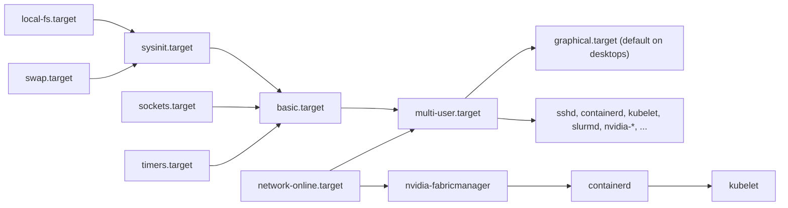
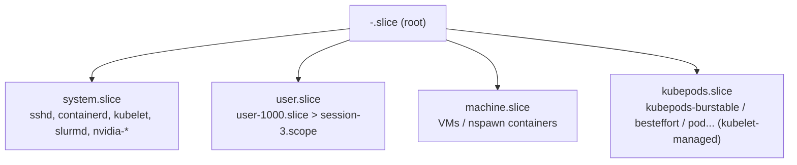

# 1.15 systemd: units, targets, timers, journald

| | |
|---|---|
| Level | Intermediate |
| Priority tier | 0 |
| Lab venue | GCP / GKE (an Ubuntu VM; a second RHEL-family VM is useful) |
| Part | Part 1: Linux, from the command line to the kernel and performance |
| Status | Drafted, labs **untested** |

## Why this matters for AI infrastructure

Picture a GPU node that comes back from a reboot but never runs jobs. On a node like this, almost everything that matters is a systemd unit. That list includes `nvidia-persistenced`, `nvidia-fabricmanager` (NVLink/NVSwitch), DCGM, `containerd` or CRI-O, `kubelet`, `slurmd`, `munge`, `sshd`, the node exporter, the mount units for NVMe scratch and network storage, and the timers that trim disks and rotate logs. The ordering between these units, their restart behaviour and their resource isolation decide whether the node comes up working. They also decide whether one runaway job can take the whole node down.

The failures are concrete. If `kubelet` or `containerd` starts before the Fabric Manager has initialised NVLink on an HGX system, the scheduler may hand out GPUs that cannot talk to each other over the fast fabric. Distributed jobs then fall back to PCIe silently, or they hang.

A training job that exhausts memory can also make the node unreachable. That happens when the host's critical daemons (`sshd`, `journald`, `kubelet`) share a cgroup pressure domain with the job. Instead of losing one pod, you lose the node.

A unit with no `Restart=` setting is another trap. When `slurmd` crashes, the node silently drops out of the cluster. Finally, a "cron job you cannot find" is often a systemd timer.

This chapter teaches systemd from the unit file up. It covers unit types, the dependency and ordering model, service types and life cycle, drop-in overrides, targets, templates, socket and path activation, timers, resource control and sandboxing, `journald` and `journalctl`, and `systemd-analyze` for debugging. It ends with the AI-node patterns: ordering GPU services, protecting the host, graceful shutdown and health-gated start. Boot up to the start of systemd is chapter 1.14. Logging policy, time synchronisation and cron are chapter 1.16. Cgroup internals are chapter 1.18, and namespaces are chapter 1.19. Hardening with systemd sandboxing is touched on here and expanded in chapter 1.21.

Before you size a GPU node, list the units that must start in order. That list is the node's startup contract.

## Prerequisites and outcomes

Suppose a service you wrote runs fine when you start it by hand, but it fails at boot. The skills in this chapter are the ones that let you find out why. Before you start, you should already know processes and signals (1.8), shell scripting (1.9), the boot flow (1.14), and cgroups at an introductory level (1.8, section 9).

After this chapter you can:

- Explain what systemd is, what a unit is, and list the unit types and their roles.
- Read and write service unit files. Choose the right `Type=`, and set `Restart=`, timeouts, users, environment, working directory, limits and standard output.
- Model dependencies correctly. That covers `Wants`, `Requires`, `Requisite`, `BindsTo`, `PartOf` and `Conflicts`, against `Before` and `After`, plus default and implicit dependencies, `[Install]`, and what `enable` does.
- Override vendor units safely with drop-ins and `systemctl edit`. Mask units, and reload and reset them properly.
- Use targets, set the default target, isolate, and enter rescue and emergency modes. Interpret `list-dependencies`.
- Write template units (`name@.service`) and use specifiers. Build socket-activated and path-activated services.
- Write timers (`OnCalendar`, monotonic timers, `Persistent`), validate calendar expressions, and replace cron jobs.
- Apply resource control (CPU, memory, tasks, I/O, IP), slices and accounting. Protect the host from workloads, and set per-user limits.
- Use sandboxing options (`ProtectSystem`, `PrivateTmp`, `NoNewPrivileges`, capabilities, `DeviceAllow`) for services.
- Use `journalctl` fluently, configure the journal (persistent storage, size limits, rate limits), and forward logs.
- Debug with `systemctl status/show/cat/list-dependencies` and `systemd-analyze verify/blame/critical-chain/calendar/security`.
- Read a SysV init script and the compatibility layer when you meet one.

## 1. What systemd is

If you have ever wondered what starts your server, this is the place to begin.

Every server has to start a long list of daemons in the right order, and keep each one alive after a crash. On almost every mainstream distribution (RHEL and clones, Fedora, Debian, Ubuntu, SUSE, Arch), **systemd** does that job. It is the init system and service manager, and it runs as PID 1 (chapter 1.14). It does much more than start daemons. It tracks every process of every service in a **cgroup**. It also mounts filesystems, activates services on demand, runs timers, and manages user sessions (`logind`). On top of that, it collects logs (`journald`), handles device events (`udevd` is part of it), resolves names (`resolved`), synchronises time (`timesyncd`) and configures networks (`networkd`).

Its design goals are **parallel start-up driven by dependencies**, **reliable process supervision** with no PID files to guess at, **on-demand activation**, and **uniform declarative configuration**. Instead of running a fixed sequence of scripts, systemd starts units in parallel wherever their dependencies allow.

The older System V (`SysV`) `init` started a fixed sequence of shell scripts, one at a time. That made boot slow. It relied on PID files and `ps` to find daemons, repeated the same boilerplate in every script, and had no notion of on-demand services. Tools such as **Upstart** (used in older Ubuntu releases) improved on event-driven startup. Lightweight or embedded platforms sometimes use **runit**, **Android's custom `init`**, or **BSD-style `init`** (`HLW` Section 6.1). On all current releases of major Linux distributions, the standard implementation is **`systemd`**.

To find out what your machine runs, check `ps -p 1 -o comm=` or `readlink -f /sbin/init`. You can also look for `/usr/lib/systemd` and `/etc/systemd`. If neither exists, check `/etc/init` for Upstart or `/etc/inittab` for System V `init`. Section 15 covers those.

systemd is **goal-oriented**. You define goals, called units, and each goal depends on other units. To reach a goal, systemd starts its dependencies first, then the unit itself, and it activates whatever is ready in parallel. After boot, it keeps reacting to events. A device appears (through udev), a socket receives a connection, a timer fires, or a file changes, and systemd activates more units in response.

When a service seems stuck, first ask which goal, or unit, it is waiting for.

## 2. Units

Everything systemd manages is a **unit**. Each unit is described by a **unit file** in an INI-like syntax, derived from the XDG desktop-entry format. Sections are marked in `[Brackets]`, settings are `Key=value` lines, and `#` or `;` starts a comment. Once you know the unit types below, most of the rest of this chapter becomes easier to follow. You will meet these names in almost every unit file you write.

| Unit type | Suffix | Purpose |
|---|---|---|
| Service | `.service` | A daemon or one-off command: the most common type |
| Target | `.target` | A named group/synchronisation point of units (replaces runlevels) |
| Socket | `.socket` | A listening socket or FIFO that triggers a service on first connection |
| Mount / Automount | `.mount` / `.automount` | A filesystem mount (generated from `/etc/fstab`) / mount on first access |
| Swap | `.swap` | A swap device or file |
| Device | `.device` | A udev-tagged device node as a dependency |
| Path | `.path` | Watches a file or directory and activates a service on change |
| Timer | `.timer` | Time-based activation of a service (cron replacement) |
| Slice | `.slice` | A node in the cgroup hierarchy for resource control (`system.slice`, `user.slice`) |
| Scope | `.scope` | A group of externally created processes (login sessions, containers) |
| Snapshot/others | | Obsolete or rarely used |

The full list and options are in `systemd.unit(5)` and the per-type manual pages (`systemd.service(5)`, `systemd.exec(5)`, `systemd.socket(5)`, `systemd.timer(5)`, `systemd.mount(5)`, `systemd.slice(5)`, `systemd.resource-control(5)`, `systemd.kill(5)`, `systemd.special(7)`). Read the table first, then open the manual page for the type you are working with. If you edit a unit, you should know which file systemd will read.

### Where unit files live (and the precedence rule)

When two files share a name, you need to know which one systemd reads. `systemctl -p UnitPath show` prints the search path. The important directories, from highest to lowest priority:

| Directory | Purpose |
|---|---|
| `/etc/systemd/system.control`, `/run/systemd/system.control` | Dynamic changes made by `systemctl set-property` |
| `/run/systemd/transient` | Transient units from `systemd-run` |
| **`/etc/systemd/system`** | **Your** units and overrides (administrator) |
| `/run/systemd/system` | Runtime/generated units |
| `/run/systemd/generator` | Units generated at boot (for example from `/etc/fstab` by `systemd-fstab-generator`) |
| **`/usr/lib/systemd/system`** (or `/lib/systemd/system`) | Units shipped by packages; **do not edit** |

**Rule: never modify files in `/usr/lib/systemd/system`.** Package upgrades overwrite them, so your edits would be lost on the next upgrade. Put new units in `/etc/systemd/system`, and customise vendor units with **drop-ins** (section 5). The same rule applies across the system: prefer `/etc` over `/usr`. A file in `/etc` with the same name as one in `/usr/lib` **replaces** it entirely.

User services, the per-user instances for ordinary users, read `~/.config/systemd/user/` and `/etc/systemd/user/`. Use `systemctl --user` to manage them. Enable lingering with `loginctl enable-linger USER` so they run without a login session.

### Anatomy of a service unit

Say you need to run a small GPU metrics exporter as a service. It must start after the network and after the persistence daemon, and it must come back if it crashes. The unit file below does all of that.

```ini
# /etc/systemd/system/gpu-exporter.service
[Unit]
Description=GPU metrics exporter
Documentation=https://example.com/docs/gpu-exporter
After=network-online.target nvidia-persistenced.service
Wants=network-online.target
Requires=nvidia-persistenced.service

[Service]
Type=simple
User=exporter
Group=exporter
ExecStart=/usr/local/bin/gpu-exporter --listen 127.0.0.1:9400
ExecReload=/bin/kill -HUP $MAINPID
Restart=on-failure
RestartSec=5s
LimitNOFILE=65536
Environment=EXPORTER_LOG=info
EnvironmentFile=-/etc/default/gpu-exporter

[Install]
WantedBy=multi-user.target
```

The `[Unit]` section holds identity and relationships. That means the `Description=`, `Documentation=`, the dependencies and ordering (section 4), and conditions such as `ConditionPathExists=`, `ConditionHost=` and `ConditionVirtualization=`. The `[Service]` section (or `[Socket]`, `[Timer]`, `[Mount]`, `[Slice]` and so on, depending on the type) describes how this unit behaves. The `[Install]` section tells `systemctl enable` which targets should want this unit. The runtime ignores it.

In `Exec*=` lines, `$VAR` and `${VAR}` expand variables set by `Environment=` or `EnvironmentFile=`. No shell is involved, so pipes, redirects, globbing and `&&` do not work. To use shell features, call `/bin/sh -c '...'`. `$MAINPID` holds the tracked main PID, as in `ExecReload=/bin/kill -HUP $MAINPID`.

**Specifiers** start with `%`. `%n` is the full unit name, `%N` the unescaped name, `%p` the prefix, `%i` and `%I` the instance (section 7), `%H` the hostname, `%u` the user, `%t` the runtime directory, and `%%` a literal percent sign. To pass a literal `$` to a command, write `$$`. Prefixes on `Exec*=` commands change how the command runs. `-` ignores failure, `+` runs with full privileges (ignoring `User=` and sandboxing), `!` runs partly privileged, `@` sets `argv[0]`, and `:` turns off variable expansion. `|` is not valid. An `EnvironmentFile` holds `KEY=value` lines, and a `-` before its path makes a missing file non-fatal.

A service does not get a copy of your shell environment. By default, `PATH` is reset to the standard system directories. `HOME`, `USER`, `LOGNAME` and `SHELL` are set from `User=`. `LANG` comes from `locale.conf`, each run gets a unique `INVOCATION_ID`, and `Type=notify` services get a `NOTIFY_SOCKET`. This explains most cases of "works in my shell, fails as a service". Compare the environment with chapter 1.9 when it happens. Check it with `systemctl show -p Environment NAME` and `systemd-run --pty env`.

### Service types: how systemd knows a service is "started"

When one unit depends on another, you need to know when the first one is really ready. `Type=` tells systemd what the main process does at start-up, and when to consider the unit started. Units ordered `After=` a service wait for that moment.

| `Type=` | Behaviour | Typical use |
|---|---|---|
| **`simple`** (default with `ExecStart=`) | The `ExecStart` process **is** the service and stays in the foreground; considered started immediately after fork | Modern foreground daemons, scripts |
| **`exec`** | Like simple, but started only after the `exec()` succeeded (catches missing binaries) | Preferable to `simple` where available |
| **`forking`** | The process forks and the parent exits; systemd treats the exit as "ready" and tracks the child (use `PIDFile=` if it writes one) | Traditional daemons that daemonise themselves |
| **`oneshot`** | The process runs to completion; the unit is "started" when it exits. Multiple `ExecStart=` allowed; usually with `RemainAfterExit=yes` so the unit counts as active afterwards | Setup tasks, `modprobe`, mount helpers, health gates |
| **`notify`** | The service tells systemd it is ready by calling `sd_notify("READY=1")` (also `notify-reload`) | Daemons with explicit readiness (systemd-aware software) |
| **`dbus`** | Ready when the service acquires a D-Bus name (`BusName=`) | Desktop-style services |
| **`idle`** | Like simple but delayed until other jobs are done (cosmetic ordering of console output) | Rare |

Because systemd tracks processes with **cgroups**, it knows every process of the service however many times they fork. You only need to say whether the main process forks.

### Common [Service] options

Most units set a handful of these options, and you will meet the ones below most often. Note that `Restart=` defaults to `no`, so a daemon that must stay up needs `on-failure` or `always`.

| Option | Meaning |
|---|---|
| `ExecStart=`, `ExecStartPre=`, `ExecStartPost=` | Main command; commands before/after it (a failing `Pre` fails the start) |
| `ExecReload=`, `ExecStop=`, `ExecStopPost=` | Reload command; custom stop (otherwise `SIGTERM`); cleanup after stop regardless of result |
| `Restart=` | `no` (default), `on-success`, `on-failure`, `on-abnormal`, `on-abort`, `on-watchdog`, `always`. For daemons that must stay up use `on-failure` or `always` |
| `RestartSec=` | Delay between restarts (default 100 ms) |
| `StartLimitIntervalSec=`, `StartLimitBurst=` (in `[Unit]`) | Rate limit: more than N starts within the interval puts the unit into `failed (start-limit-hit)`; clear with `systemctl reset-failed` |
| `TimeoutStartSec=`, `TimeoutStopSec=`, `TimeoutSec=` | Wait for start/stop; at stop timeout systemd sends `SIGTERM` then, after `TimeoutStopSec`, `SIGKILL` |
| `KillMode=` (`control-group` default, `process`, `mixed`, `none`), `KillSignal=`, `SendSIGKILL=`, `FinalKillSignal=` | What gets signalled at stop; default kills **every process in the cgroup**. `mixed` sends `SIGTERM` to the main process and `SIGKILL` to the rest |
| `User=`, `Group=`, `SupplementaryGroups=`, `DynamicUser=yes` | Identity; `DynamicUser` allocates a transient UID |
| `WorkingDirectory=`, `RootDirectory=`, `Umask=`, `Nice=`, `CPUSchedulingPolicy=`, `IOSchedulingClass=` | Execution context |
| `Environment=`, `EnvironmentFile=`, `PassEnvironment=`, `UnsetEnvironment=` | Environment |
| `StandardInput=` (`null` default to `/dev/null`, `tty` to the console specified in `TTYPath=`, `tty-force` to disconnect any occupying process first, `tty-fail` to fail if the terminal is occupied, `socket` for socket-activated units, `file:`), `StandardOutput=`/`StandardError=` (`journal` default on most systems, `inherit` to the same place as standard input, `null`, `tty`, `syslog`, `kmsg`, `journal+console`, `file:/path`, `append:/path`, `socket`) | I/O stream redirection (`SCL` Chapter 30); output goes to the journal by default |
| `LimitCPU=`, `LimitFSIZE=`, `LimitDATA=`, `LimitSTACK=`, `LimitCORE=`, `LimitRSS=`, `LimitNOFILE=`, `LimitAS=`, `LimitNPROC=`, `LimitMEMLOCK=`, `LimitLOCKS=`, `LimitSIGPENDING=`, `LimitMSGQUEUE=`, `LimitNICE=`, `LimitRTPRIO=`, `LimitRTTIME=` | Per-unit `rlimit` resource ceilings (**systemd services ignore `/etc/security/limits.conf`**; chapter 1.8) |
| `RuntimeDirectory=`, `StateDirectory=`, `CacheDirectory=`, `LogsDirectory=`, `ConfigurationDirectory=` | Directories created and owned by the service user under `/run`, `/var/lib`, `/var/cache`, `/var/log`, `/etc` |
| `RemainAfterExit=yes` | Keep the unit "active" after the process exits (for `oneshot`) |
| `WatchdogSec=` | Service must ping the watchdog (`sd_notify WATCHDOG=1`) or it is restarted (with `Restart=on-watchdog/always`) |

Before you write a service, pick its `Type=` and its `Restart=` policy. Those two choices decide most of its behaviour at boot.

## 3. Operating systemd: `systemctl`

Most of your day-to-day work with systemd happens through `systemctl`. The commands below cover the tasks you will repeat most often, from listing failed units to changing a unit's enablement.

```bash
systemctl                              # list loaded active units (same as list-units)
systemctl list-units --type=service --state=failed
systemctl list-units --all             # include inactive
systemctl list-unit-files              # installed units and their enablement state
systemctl status sshd                  # state, cgroup tree, recent log lines
systemctl is-active sshd; systemctl is-enabled sshd; systemctl is-failed sshd
sudo systemctl start|stop|restart|reload|try-restart NAME
sudo systemctl reload-or-restart NAME  # reload if supported, else restart
sudo systemctl enable NAME             # start at boot (creates symlinks per [Install]); does NOT start now
sudo systemctl enable --now NAME       # enable and start
sudo systemctl disable NAME            # remove boot-time links
sudo systemctl mask NAME               # link to /dev/null: cannot be started, even by dependency
sudo systemctl unmask NAME
sudo systemctl daemon-reload           # re-read unit files after you edit them (does NOT restart units)
sudo systemctl reset-failed [NAME]     # clear failed state / start-limit
systemctl cat NAME                     # unit file(s) plus drop-ins as systemd sees them
systemctl show NAME -p ActiveState,SubState,MainPID,ExecStart,Restart,CPUQuota   # properties
systemctl list-dependencies NAME       # what it needs (add --reverse: what needs it)
systemctl list-sockets; systemctl list-timers --all
systemctl list-jobs                    # queued start/stop jobs (spot the slow one at boot)
systemctl --failed                     # failed units
systemctl get-default; sudo systemctl set-default multi-user.target
sudo systemctl isolate rescue.target   # switch to a target, stopping units not part of it
sudo systemctl poweroff|reboot|halt|suspend; shutdown -h +10
systemctl --user ...                   # per-user manager; --machine=host for containers
```

Enabling and starting are different steps, and the difference matters. Enabling a unit creates symbolic links in a `.wants/` or `.requires/` directory of the target named in its `[Install]` section, so the unit is pulled in at boot. It does not start the unit now. A unit with no `[Install]` section is "static". You can start it by hand or through a dependency, but it cannot be enabled. `disable` removes those links, but it does not stop the unit.

`mask` is stronger than `disable`. Nothing can start a masked unit, either by hand or through a dependency. That makes it useful for `ctrl-alt-del.target` and for services you never want to run.

`reload`, `restart` and `daemon-reload` do three different things. `reload` asks the service to re-read its own configuration through `ExecReload=`. `restart` stops the service and starts it again. `daemon-reload` makes systemd itself re-read the unit files. After you edit a unit, run `daemon-reload` and then `restart`. If you skip the first step, systemd warns that the unit file changed on disk.

Every start request becomes a **job** in a queue, and `list-jobs` shows the queue. A job that waits on a slow dependency holds up the units queued behind it. During boot, a job stuck in "running" is the first unit to investigate.

Read `systemctl status` as a summary of a unit's state. Here is what it looks like for `sshd`:

```text
● sshd.service - OpenBSD Secure Shell server
     Loaded: loaded (/lib/systemd/system/ssh.service; enabled; vendor preset: enabled)
     Active: active (running) since Fri 2025-04-16 08:15:41 UTC; 1 month 1 day ago
       Docs: man:sshd(8)
   Main PID: 1110 (sshd)
      Tasks: 1 (limit: 4915)
     Memory: 5.1M
        CPU: 2.103s
     CGroup: /system.slice/ssh.service
             └─1110 "sshd: /usr/sbin/sshd -D [listener] 0 of 10-100 startups"
Apr 16 08:15:41 node1 systemd[1]: Started OpenBSD Secure Shell server.
```

`Loaded:` shows the file path, the enablement state and the vendor preset. `Active:` shows the state, such as `active (running)`, `active (exited)` for oneshots, `inactive (dead)`, `activating` or `failed`. When a unit fails, a `Result` such as `exit-code`, `signal`, `timeout` or `start-limit-hit` follows. `Main PID` is the tracked process. The `CGroup` tree lists every process of the service, and the last log lines appear at the bottom. For the full log, run `journalctl -u NAME`.

## 4. Dependencies and ordering

Two ideas control how systemd starts units, and they are easy to confuse. **Requirement dependencies** say what else must also start. **Ordering dependencies** say in which order units start, once both of them are going to start.

By themselves, `Requires=` and `Wants=` do not order anything. Both units start in parallel. To start A after B and also pull B in, you need both `Wants=B` (or `Requires=B`) and `After=B`.

| Directive | Meaning |
|---|---|
| `Wants=B` | Start B when this unit starts, **but do not care whether B succeeds**. Soft; the recommended default, because failures do not cascade |
| `Requires=B` | Start B; **if B fails to start or is later stopped, this unit is stopped too**. Hard dependency |
| `Requisite=B` | B must **already** be active, or this unit fails immediately (no attempt to start B) |
| `BindsTo=B` | Like `Requires=`, and additionally this unit stops when B enters *inactive* for any reason (even a clean exit). Used for devices and mounts |
| `PartOf=B` | Stop/restart of B propagates to this unit; B's start does not start this |
| `Conflicts=B` | Starting this unit stops B (and vice versa); both cannot be active together |
| `Upholds=B` (newer) | Keep B running while this unit is active |
| `After=B` / `Before=B` | Ordering: this unit starts after / before B (stops in the reverse order). Only has effect if both are in the same transaction |
| `OnFailure=B` | Start B when this unit fails (alerts, remediation) |
| `Condition*=` / `Assert*=` | If a condition is false the unit is **skipped silently** (`Condition`) or **fails** (`Assert`); examples `ConditionPathExists=`, `ConditionFileNotEmpty=`, `ConditionVirtualization=`, `ConditionHost=`, `ConditionKernelCommandLine=`, `ConditionACPower=`; does not affect dependencies of other units |
| `StopWhenUnneeded=yes` | Stop this unit when nothing needs it any more |
| `PropagatesReloadTo=` / `ReloadPropagatedFrom=` | Forward reloads |

The soft and hard forms matter for a practical reason. Consider a login prompt that hard-requires a database server. If that server fails, you cannot log in to fix the database. `Wants` keeps a failure local, much as a traditional boot tolerated failing scripts. A missing data disk may stop an application, but it should not stop `sshd`. Use `Requires` or `BindsTo` only when a unit is genuinely useless or dangerous without the other.

systemd also adds some dependencies itself, so you do not have to write the boilerplate and you avoid common mistakes. A service gets `Requires=` and `After=` `sysinit.target` and `basic.target`, and `Conflicts=` and `Before=` `shutdown.target`. Any unit listed in a target's `Wants=` is ordered `After=` that target's ... (the target is started after its members, so that reaching the target means they are up). Mounts depend on their devices and parents, and units that use sockets depend on the socket units. Turn these defaults off for early-boot units with `DefaultDependencies=no`. The defaults for each unit type are listed in the DEFAULT DEPENDENCIES section of its manual page. See what systemd computed with `systemctl list-dependencies --all NAME` and `systemctl show -p After,Requires NAME`.

The `[Install]` section works in the reverse direction. `WantedBy=multi-user.target` means "when this unit is enabled, add it to that target's wants." In `HLW` Section 6.3.7, a `test1.target` with `[Install] WantedBy=test2.target` produces a symlink when you run `systemctl enable test1.target`: `/etc/systemd/system/test2.target.wants/test1.target -> /etc/systemd/system/test1.target`. Starting `test2.target` then pulls in `test1.target`. Some units work the other way round. `dbus-daemon.service` specifies `Requires=dbus.socket` and `RefuseManualStart=yes`, so it starts only through socket or dependency activation, not through `systemctl start`. Other `[Install]` keys are `RequiredBy=`, `Alias=` (alternate names, for example `display-manager.service`), `Also=` (enable these units too) and `DefaultInstance=` (for templates). When you run `systemctl enable`, look in the `.wants/` directory it links into. Because of this, you can change when a unit starts without editing a vendor file. Add it to a target's wants with an `[Install]` section in your own unit, or through a drop-in.

Here is a worked example for a GPU node. You want `containerd` to start after the Fabric Manager, and `kubelet` to start after `containerd`, without editing any vendor unit. Each `systemctl edit` call below creates a drop-in.

```ini
# sudo systemctl edit containerd.service      -> creates /etc/systemd/system/containerd.service.d/override.conf
[Unit]
After=nvidia-fabricmanager.service nvidia-persistenced.service
Wants=nvidia-fabricmanager.service nvidia-persistenced.service
```

```ini
# sudo systemctl edit kubelet.service
[Unit]
After=containerd.service nvidia-fabricmanager.service
Requires=containerd.service
```

When you review a node's unit files, check this ordering first. Add ordering only where readiness really matters. For `Type=forking` or `simple` services, "started" may not mean "ready". The Fabric Manager forks, and it may need seconds to finish NVSwitch initialisation after systemd considers it started. If readiness is the problem, add a **health gate**. That is a `Type=oneshot` unit with `RemainAfterExit=yes`, whose `ExecStart=` script polls the hardware. The script can check with `nvidia-smi nvlink -s`, query the status of `nv-fabricmanager`, or compare `nvidia-smi -L | wc -l` against the expected GPU count. The gate fails if the node is not ready within a timeout. Then order `kubelet` after that gate unit. Chapter 1.9 covers the script pattern. Verify package-shipped unit names and options (`nvidia-fabricmanager.service` and the paths it ships) against your driver version.

Before you add an ordering rule, ask whether the second service really fails without the first one being ready.

## 5. Overriding units: drop-ins

Vendor units change when packages update, so you should never edit them. A drop-in lets you change one setting and leave the rest of the unit alone.

A drop-in is a `*.conf` file in `/etc/systemd/system/NAME.service.d/`. The directory name is the unit name plus `.d`. For a type-wide override, use `service.d/` under the type. For dashes, `foo-.service.d` applies to the prefix `foo-`. A drop-in holds only the sections and keys you want to add or change, and everything else comes from the original. systemd applies drop-ins in lexical file order, so prefix them with numbers, such as `10-limits.conf` and `50-gpu.conf`. `systemctl edit NAME` creates and opens `override.conf` for you, and it runs `daemon-reload` when you save. `systemctl edit --full NAME` copies the whole unit into `/etc` for a full replacement, but that copy no longer receives vendor updates.

For list-valued keys, each assignment adds to the list. That is true for `ExecStartPre=`, `Environment=` and `After=`. An empty assignment resets the list. To replace `ExecStart=`, you must clear it first:

```ini
[Service]
ExecStart=
ExecStart=/usr/bin/containerd --config /etc/containerd/gpu-config.toml
```

Verify the result with `systemctl cat NAME`, which shows the file and every drop-in. You can also run `systemctl show NAME -p ExecStart`, or `systemd-analyze cat-config systemd/logind.conf` for daemon config files that support `.d` directories, such as `journald.conf.d`, `logind.conf.d` and `system.conf.d`. Check the syntax before you reload with `systemd-analyze verify /etc/systemd/system/NAME.service`.

**Transient units** are created on the fly by `systemd-run`. One form makes a one-off timer: `sudo systemd-run --unit=backup --on-active=10m /usr/local/bin/backup.sh`. Another runs a command in a resource-limited scope: `systemd-run --scope -p MemoryMax=2G ./job`. A third lets you test a sandbox interactively: `systemd-run --pty --wait -p ProtectSystem=strict /bin/bash`. These are useful in labs and for ad hoc limits.

**Changing properties at runtime** works with `systemctl set-property NAME MemoryMax=4G CPUQuota=200%`. The change applies immediately and persists as a drop-in under `/etc/systemd/system.control/`. Add `--runtime` to make it temporary.

Before you touch a vendor unit, check whether a drop-in can make the same change.

## 6. Targets

A boot that stalls at one point is hard to read unless you know what each target means. Targets are the named milestones systemd reaches on the way up. A **target** is a unit with no process of its own. It is a named synchronisation point and a grouping of other units, and it is reached once its dependencies are up. Unlike SysV runlevels, several targets can be active at the same time, and you can request each one on its own.

| Target | Meaning |
|---|---|
| `default.target` | A link to the target the system boots to (`multi-user.target` or `graphical.target`) |
| `sysinit.target` | Early system initialisation (mounts of `/proc`..., swap, local fs, udev, random seed) |
| `basic.target` | Basic system ready: sockets, timers, paths, slices activated |
| `local-fs.target`, `remote-fs.target`, `swap.target` | Local filesystems, network filesystems, swap are mounted |
| `network.target` | Network *stack* configured (weak meaning: interfaces may not be up) |
| **`network-online.target`** | The network is actually usable; units that need an address (`NFS`, `kubelet`, `slurmd` registering) order `After=` and `Wants=` it. It waits for a "wait-online" service (`systemd-networkd-wait-online`, `NetworkManager-wait-online`) which can stall boot if an interface never comes up; configure which interfaces count |
| `multi-user.target` | Non-graphical multi-user system (runlevel 3 equivalent) |
| `graphical.target` | Multi-user plus graphical login (5) |
| `rescue.target` | Single-user shell with basic filesystems (1) |
| `emergency.target` | Minimal shell, root filesystem read-only |
| `shutdown.target`, `poweroff.target`, `reboot.target`, `halt.target`, `kexec.target` | Shutdown paths |
| `timers.target`, `sockets.target`, `paths.target`, `slices.target` | Groups of those unit types |
| `time-sync.target`, `nss-lookup.target`, `remote-fs-pre.target`, `getty.target` | Semantic markers other units order against |

Older names still work. `runlevel0.target` through `runlevel6.target` are aliases, so `runlevel3.target` maps to `multi-user.target`. `systemctl isolate runlevel3.target` works, and `who -r` still reports a runlevel.

Use these commands to inspect and switch targets. `systemctl get-default` shows the current default, and `systemctl set-default multi-user.target` changes it. Servers should not run `graphical.target`. `systemctl isolate rescue.target` starts the target and stops everything outside its dependency set. Isolation does not work on targets without `AllowIsolate=yes`. Two more useful commands are `systemctl list-dependencies default.target` and `systemd-analyze critical-chain`.

Dependencies form a **graph**, not a tree. The diagram below shows the path from the early targets to the GPU services, and it is a good way to picture the graph.



You can render the whole graph as an image with `systemd-analyze dot 'multi-user.target' | dot -Tsvg > g.svg`. Filter the patterns to keep the picture readable.

Boot-time **jobs** can be watched while the system comes up, with `systemctl list-jobs`. A unit that takes minutes, such as an NFS mount, `network-online` or an unreachable LDAP server, delays everything ordered after it. To find it, use `systemd-analyze blame` and `critical-chain`.

If a boot is slow, check the critical chain before you change any service.

## 7. Templates and instances

Suppose you run one GPU job per GPU index, and you want the same unit file to serve all of them. A template unit does that. A unit file whose name ends in `@` before the suffix is a **template**, such as `getty@.service` or `worker@.service`. You create an **instance** by adding a string after the `@`, as in `getty@tty1.service` or `worker@3.service`.

Inside the file, `%i` is the instance string with special characters escaped, and `%I` is the unescaped form. Use `%i` for file names and `%I` for arguments. Take the device path `/dev/ttyUSB0`, instantiated as `getty@-dev-ttyUSB0`. In that case `%I` is `/dev/ttyUSB0`, and `%i` is `-dev-ttyUSB0`. `systemd-escape --path /dev/ttyUSB0` computes the escaped name for you.

Templates fit many repeated jobs. Common examples are one `getty` per console, one `nvidia-persistenced` or exporter per GPU index, one worker per NUMA node, `openvpn@client.service`, `wg-quick@wg0.service`, `systemd-fsck@.service` and `container@name.service`.

```ini
# /etc/systemd/system/gpu-job@.service
[Unit]
Description=Job runner bound to GPU %i
After=nvidia-persistenced.service
[Service]
Environment=CUDA_VISIBLE_DEVICES=%i
ExecStart=/usr/local/bin/runner --gpu %i
Restart=on-failure
[Install]
WantedBy=multi-user.target
```

Enable and start instances with `systemctl enable --now gpu-job@0.service gpu-job@1.service`. If you set `DefaultInstance=`, then `enable` works without an instance name. For many instances, the shell's brace expansion helps: `systemctl start 'gpu-job@{0..7}.service'`.

When you need one unit per device, write one template rather than many copies.

## 8. Socket, path and automount activation

Some services sit idle most of the time, but they must answer at once when a client connects. If you have a daemon that only needs to respond when clients call, socket activation fits. systemd holds the resource the service needs, starts the service only when someone uses it (or immediately, in parallel), and then hands the resource over. Three pieces make this work:

1. A **service unit** (`A.service`) that provides the function.
2. A **resource unit** (`A.socket`, `A.path`, `A.automount`, `A.timer`) that represents the trigger: a network or Unix socket, a file or directory, a mount point, or a time.
3. The link, normally by **name**. `echo.socket` activates `echo.service`. Use `Service=` in the socket, or `Unit=` in a timer or path, to name a different unit.

```ini
# /etc/systemd/system/echo.socket
[Socket]
ListenStream=22222
Accept=true
[Install]
WantedBy=sockets.target

# /etc/systemd/system/echo@.service
[Service]
ExecStart=/bin/cat
StandardInput=socket
```

With `Accept=true`, systemd accepts each incoming connection itself. It starts a new **instance**, named `echo@<n>-<local>-<peer>.service`, for each connection. The service is therefore a template, and it reads the connection as standard input and output. With `Accept=false`, which is the default, systemd listens and passes the **listening socket** to a single service named `echo.service`. That service is not a template. It calls `accept()` itself and keeps control until it exits. Real servers that understand socket activation use this form. They receive the descriptor in `$LISTEN_FDS`, starting at descriptor 3, through `sd_listen_fds()`. To test the setup, run `sudo systemctl start echo.socket`, then `ss -ltn | grep 22222`, then `echo hi | nc localhost 22222`, and check `systemctl list-sockets`.

Socket activation helps in three ways, and each one solves a different part of the startup problem. First, a rarely used service uses no resources until a client needs it, which is the idea behind the modern `inetd`. Second, boot runs in parallel. systemd can create the socket early, so clients connect and queue while the real service is still starting. That removes some ordering between services that depend on each other. Several system components already work this way, including `journald`, D-Bus, and `sshd` on some distributions, which uses `sshd.socket`. Third, the socket stays open while the service restarts, so connections are not dropped.

There are pitfalls too, and you should know them before you rely on the pattern. The service must support the handoff. A firewall, and `ss -ltnp`, show systemd as the listener rather than the daemon. A socket-activated `ssh` also hides per-connection resource use.

**Path units** watch file system changes, through `PathExists=`, `PathExistsGlob=`, `PathChanged=`, `PathModified=` and `DirectoryNotEmpty=`. When a watched path changes, they start the matching service. Use them for a drop directory of work files, or for a config reload when a file changes. **Automount units** (`x-systemd.automount` in `fstab`) mount a filesystem on first access. This helps with NFS. A slow server no longer delays boot, and only the first access waits. You can also unmount on idle with `x-systemd.idle-timeout=`.

Before you start a daemon at boot, ask whether socket activation would let it wait until a client arrives.

## 9. Timers: the cron replacement

Suppose a weekly trim of a data disk is due on Sunday morning, but the machine was off at that time. A cron job would simply be missed. A timer handles that case, and it gives you more than cron does. Its logs go to the journal with the unit's context. The job runs in a controlled cgroup, with limits and sandboxing. You can order it after other units, such as `After=network-online.target`. With `Persistent=true`, it catches up on missed runs. A randomised delay avoids a thundering herd, and `systemctl list-timers` shows the next and last run.

A **timer** unit (`X.timer`) activates a service (`X.service`) at a set time. Here is a weekly trim of `/data`:

```ini
# /etc/systemd/system/fstrim-data.service
[Unit]
Description=Trim /data
[Service]
Type=oneshot
ExecStart=/usr/sbin/fstrim -v /data

# /etc/systemd/system/fstrim-data.timer
[Unit]
Description=Weekly trim of /data
[Timer]
OnCalendar=Sun *-*-* 03:00:00
RandomizedDelaySec=30min
Persistent=true
AccuracySec=1min
[Install]
WantedBy=timers.target
```

Enable the **timer**, not the service: `sudo systemctl enable --now fstrim-data.timer`. Timers support two families of triggers.

**Realtime (calendar)** triggers use `OnCalendar=`, in the format `DayOfWeek Year-Month-Day Hour:Minute:Second`. The format accepts `*` wildcards, lists (`Mon,Fri`), ranges (`Mon..Fri`), steps (`*:0/15` for every 15 minutes), and the shorthands `hourly`, `daily`, `weekly`, `monthly` and `yearly`. Always test an expression with `systemd-analyze calendar 'Mon..Fri 02:30'`. It prints the normalised form and the next elapse times, and `--iterations=5` shows more of them. Remember time zones. Add `UTC` or a zone name to the expression when the zone matters.

**Monotonic** triggers count from an event instead of a wall-clock time. `OnBootSec=` fires after boot, and `OnUnitActiveSec=` fires after the unit last activated, which gives you "every N minutes since the last run". The other monotonic keys are `OnStartupSec=`, `OnUnitInactiveSec=` and `OnActiveSec=`.

`Persistent=true` stores the last run time on disk, and it runs a missed job at the next start, which covers a machine that was off. `RandomizedDelaySec=` spreads the load across machines. `AccuracySec=` defaults to one minute, which lets systemd combine wake-ups. Set it to `1s` when you need precision. A timer's service cannot overlap itself. If a `Type=oneshot` service is still active at the next trigger, that trigger is skipped, so you rarely need `flock`.

Chapter 1.16 compares timers with the cron equivalents. `crontab` jobs still run, and systemd even generates timers from some `anacron` setups. If you cannot find a cron job, it may be a timer. List them with `systemctl list-timers --all`, or check `ls /etc/systemd/system/*.timer /usr/lib/systemd/system/*.timer`.

For recurring node jobs, prefer a timer when you need logs, limits and a schedule you can check.

## 10. Resource control, slices and host protection

A runaway training job can consume every byte of memory on a shared node. Without limits, the same pressure reaches `sshd` and `kubelet` too. Resource control sets ceilings and priorities for each cgroup, so one workload cannot take the node down with it.

systemd places every service, scope and session into a **cgroup**. Slices decide where that cgroup sits in the hierarchy, and the resource properties on a unit apply to its cgroup. Chapter 1.8 section 9 covers cgroups at an introductory level, and chapter 1.18 explains the controllers. On cgroup v2, the hierarchy looks like this:



| Property | Meaning |
|---|---|
| `CPUAccounting=`, `MemoryAccounting=`, `IOAccounting=`, `TasksAccounting=`, `IPAccounting=` | Turn on statistics (shown by `systemctl status`, `systemd-cgtop`); most are on by default in current releases |
| `CPUWeight=` (1-10000, default 100) | Relative share under contention (replaces `CPUShares`). Raising `system.slice` favours daemons over siblings |
| `CPUQuota=` (e.g. `200%`) | Hard cap: percent of one CPU (100% = one core, 200% = two) |
| `AllowedCPUs=`, `AllowedMemoryNodes=` | cpuset: restrict to cores and NUMA nodes (cgroup v2) |
| `CPUAffinity=`, `NUMAPolicy=`, `NUMAMask=` | Process-level affinity and memory policy (not cgroup) |
| `MemoryLow=` | Best-effort protection: the kernel avoids reclaiming this much |
| `MemoryHigh=` | Throttle threshold: above it the unit is slowed and reclaimed before any kill |
| `MemoryMax=` | Hard limit: exceeding it triggers the cgroup's OOM kill |
| `MemorySwapMax=` | Limit swap use |
| `TasksMax=` | Limit processes + threads (anti fork-bomb) |
| `IOWeight=`, `IOReadBandwidthMax=`, `IOWriteBandwidthMax=`, `IOReadIOPSMax=`, `IOWriteIOPSMax=` (e.g. `IOReadBandwidthMax=/dev/nvme0n1 500M`) | Block I/O control |
| `IPAddressAllow=`, `IPAddressDeny=`, `RestrictNetworkInterfaces=` | eBPF-based network filtering per unit |
| `DeviceAllow=`, `DevicePolicy=` | Which device nodes (e.g. `/dev/nvidia0 rw`) the unit may access |
| `Delegate=yes` | Hand the cgroup subtree to the service so it manages sub-cgroups (container runtimes, kubelet, Slurm's cgroup plugin) |
| `Slice=` | Put the unit in a named slice |
| `OOMScoreAdjust=`, `OOMPolicy=` | OOM killer preference; what to do when a process is OOM-killed |

Use these commands to inspect and set the limits yourself: `systemd-cgls`, `systemd-cgtop` (live per-cgroup CPU, memory, I/O and tasks), `systemctl status NAME`, `systemctl set-property NAME MemoryMax=8G`, `systemd-run --scope -p ... cmd`, and `systemctl show NAME -p MemoryCurrent,CPUUsageNSec,TasksCurrent`.

**Per-user limits.** Each login runs under `user-UID.slice`, and all of a user's sessions sit below it. A template drop-in, `/etc/systemd/system/user-.slice.d/10-defaults.conf`, sets defaults for every user. The trailing `-` in the file name makes it apply to all user slices:

```ini
[Slice]
TasksAccounting=yes
CPUAccounting=yes
MemoryAccounting=yes
TasksMax=1250
CPUQuota=800%
MemoryMax=64G
```

To set limits for one user, use their **UID**, not their name, as in `/etc/systemd/system/user-1007.slice.d/20-limits.conf`. If you manage a shared login node, you will likely want these limits first. This is one of the best tools for shared login nodes. It caps CPU, memory and tasks per user, however many shells that user opens. `nice` does not limit memory, and `ulimit` applies per process. Keep that difference in mind when you choose a tool.

Session behaviour lives in `/etc/systemd/logind.conf`, or in `logind.conf.d/`. Set `KillUserProcesses=` to `no`. The value `yes` kills `tmux`, `screen` and `nohup` jobs at logout. `SessionsMax=`, `RemoveIPC=`, `RuntimeDirectorySize=` and `IdleAction=` also live here. `RemoveIPC=` frees shared memory and semaphores at the last logout, which can surprise MPI users. Set it to `no` on compute hosts if needed. You can check these settings with the commands below. Useful commands are `loginctl list-sessions`, `loginctl show-user NAME` and `loginctl enable-linger NAME`.

**Protecting the host from GPU workloads.** If you have watched a node go `NotReady` during a large job, you know how fast this happens. This is the usual failure pattern. A job exhausts memory or saturates I/O. The kernel's OOM killer and reclaim storms then stall `sshd`, `journald` and `kubelet`, which share the pressure. The node goes `NotReady` and cannot even be reached over SSH. A leaked process that holds `/dev/nvidiactl` can also block a GPU reset. Use these defences:

- Keep workloads and system daemons in **separate top-level slices**, and give the system daemons priority. Add a drop-in for `system.slice` with `CPUWeight=200` (a relative weight) and `MemoryLow=2G` (to protect resident memory). **Do not** put `MemoryHigh` or `MemoryMax` on `system.slice` itself. It contains `sshd`, `kubelet` and `containerd`, and a cap there makes the kernel throttle or kill the very daemons you want to protect.
- In Kubernetes, use the kubelet's `systemReserved`, `kubeReserved` and `enforceNodeAllocatable` settings. They keep `kubepods.slice` capped below node capacity (see the Kubernetes chapters).
- Set `OOMScoreAdjust=-900` (or `-1000`) for `sshd`, `journald`, `kubelet` and `slurmd`, so the OOM killer prefers job processes. Set `OOMPolicy=continue` on services that should survive a child being killed.
- Give job slices a `MemoryMax=`, so a runaway job is killed inside its own cgroup and does not push the whole node into memory pressure. Slurm does this with its cgroup plugin and `--mem` (Part 6).
- Handle `SIGTERM`, and set `TimeoutStopSec=` long enough for GPU jobs and daemons to checkpoint and release their devices. A `SIGKILL` sent to a process in the middle of a DMA transfer can leave the device needing a reset.

Here is a drop-in that gives the system daemons priority. It applies to `system.slice` only:

```bash
sudo mkdir -p /etc/systemd/system/system.slice.d
cat <<'EOF' | sudo tee /etc/systemd/system/system.slice.d/50-host-priority.conf
[Slice]
CPUWeight=200
MemoryLow=2G
EOF
sudo systemctl daemon-reload          # applies slice properties; slices are not restarted
systemctl show system.slice -p CPUWeight,MemoryLow
```

**CPU and NUMA pinning for node daemons.** A daemon that serves a particular NIC or GPU can be pinned with `CPUAffinity=0-7`, `NUMAPolicy=bind` and `NUMAMask=0` in `[Service]`. If you pin a daemon, choose its cores with chapters 1.17 and 1.28 in mind.

Before you cap anything, decide which slice holds the host and which slice holds the work. You do not need to set every knob. Start with the slices and the OOM settings, and keep those two kinds of work apart.

## 11. Sandboxing and service hardening

A service that only needs a few files should not have full access to the machine. systemd can confine a service in a few lines, using namespaces, capabilities and seccomp under the hood. Chapters 1.19 and 1.21 explain those kernel features. If you run a service that reads only a few files, you can lock the rest down.

| Option | Effect |
|---|---|
| `User=`, `DynamicUser=yes`, `NoNewPrivileges=yes` | Unprivileged user; no gaining privileges via setuid |
| `ProtectSystem=full\|strict` | `/usr`, `/boot`, `/etc` read-only (`strict`: the whole file system read-only except `ReadWritePaths=`) |
| `ProtectHome=yes\|read-only\|tmpfs` | Hide or protect `/home`, `/root`, `/run/user` |
| `PrivateTmp=yes`, `PrivateDevices=yes`, `PrivateNetwork=yes` | Own `/tmp`; minimal `/dev` (but **GPU services need the device nodes**: use `DeviceAllow=/dev/nvidia0 rw` and not `PrivateDevices`), no network |
| `ProtectKernelTunables=`, `ProtectKernelModules=`, `ProtectControlGroups=`, `ProtectClock=` | Read-only `/proc/sys`, no module loading, read-only cgroups |
| `CapabilityBoundingSet=`, `AmbientCapabilities=` | Drop capabilities (for example keep only `CAP_NET_BIND_SERVICE`) |
| `RestrictAddressFamilies=`, `RestrictNamespaces=`, `SystemCallFilter=@system-service` | Limit socket families, namespace creation, system calls |
| `MemoryDenyWriteExecute=yes`, `LockPersonality=yes` | Block W+X memory (breaks JIT-heavy runtimes) |
| `ReadOnlyPaths=`, `ReadWritePaths=`, `InaccessiblePaths=`, `BindPaths=`, `TemporaryFileSystem=` | Fine-grained mount namespace control |

If you run a GPU service, pay attention to the GPU row. A GPU service needs its device nodes, so `PrivateDevices` would hide them. Grant access with `DeviceAllow=/dev/nvidia0 rw` instead.

`systemd-analyze security NAME` scores a unit from 0 (safe) to 10 (exposed), and it lists each missing protection. Run `systemd-analyze security` without a name to audit all services at once. Add protections gradually and test each one, because over-restriction causes confusing failures. Check the journal for `permission denied` and `EPERM`, and use `systemd-run -p ... --pty` to experiment safely.

Start with the protections the service can survive, and add the rest only after you test them.

## 12. Journald and `journalctl`

When a GPU node drops out during the night, the first clue is usually in its logs. `systemd-journald` keeps those logs, and you can search them by unit, by priority and by time. It collects the standard output and error of every service, `syslog()` messages, kernel messages and audit records. It stores them in a **structured, indexed binary journal**. Each entry carries fields such as `_SYSTEMD_UNIT`, `_PID`, `_UID`, `_HOSTNAME`, `PRIORITY`, `SYSLOG_IDENTIFIER`, `_BOOT_ID` and `_TRANSPORT`. For containers, it also carries `CONTAINER_ID`. Because systemd captures service output, the old problem of start-up scripts writing to a console that has since disappeared goes away.

The commands below cover the queries you will use most. Each one filters the journal in a different way.

```bash
journalctl                          # everything (oldest first); -r newest first
journalctl -b                       # this boot; -b -1 previous boot; --list-boots
journalctl -u sshd -u containerd    # by unit (repeatable; globs ok: -u 'nvidia-*')
journalctl -u kubelet -f            # follow
journalctl -k                       # kernel messages (dmesg)
journalctl -p err                   # priority err and worse; -p warning..err ranges; names emerg alert crit err warning notice info debug
journalctl --since "2025-06-01 10:00" --until "1 hour ago"; journalctl --since yesterday
journalctl -n 100 --no-pager; journalctl -e          # last lines; jump to end
journalctl -x                       # add explanatory catalog text
journalctl -o json-pretty -n 1; journalctl -o short-iso; journalctl -o cat   # output formats; cat = message only
journalctl _SYSTEMD_UNIT=slurmd.service _PID=1234    # match fields (AND); use + for OR
journalctl CONTAINER_NAME=trainer --since -10min
journalctl /usr/sbin/sshd           # by executable path
journalctl --disk-usage; journalctl --verify
sudo journalctl --vacuum-size=2G; sudo journalctl --vacuum-time=14d; sudo journalctl --rotate
journalctl --field _SYSTEMD_UNIT    # list values seen for a field
```

You can read a journal from another machine's disk with `journalctl -D /mnt/var/log/journal` or `--root=/mnt`. Normal users see only their own messages, unless they belong to the group `systemd-journal` or `adm`.

**Persistence and limits.** The default is `Storage=auto`. With that setting, the journal is written to `/var/log/journal` only if that directory exists. Otherwise it lives in `/run/log/journal`, which is in memory, and it is lost at reboot. In that case `journalctl -b -1` fails after a crash. On nodes where post-mortem analysis matters, set persistence explicitly:

```ini
# /etc/systemd/journald.conf.d/50-persistent.conf
[Journal]
Storage=persistent
Compress=yes
SystemMaxUse=10G
SystemKeepFree=2G
SystemMaxFileSize=500M
MaxRetentionSec=1month
RateLimitIntervalSec=30s
RateLimitBurst=10000
ForwardToSyslog=no
```

Apply the change with `sudo systemctl restart systemd-journald`. Create `/var/log/journal` first if it is missing, with `sudo systemd-tmpfiles --create --prefix /var/log/journal`.

**Rate limiting** drops messages from a service that logs faster than the burst allows. The journal then reports "Suppressed N messages from X". That can hide the very errors you need. Raise the limits for chatty GPU and kubelet logs, either globally or per unit, with `LogRateLimitIntervalSec=` and `LogRateLimitBurst=` in the service.

On large GPU nodes, size the journal explicitly and ship logs off the node. Good options include rsyslog `imjournal`, `systemd-journal-remote`, Fluent Bit, Vector, Promtail with Loki, and an OpenTelemetry collector. Treat the on-node journal as a short buffer. Forwarding to classic syslog with `ForwardToSyslog=yes` keeps `/var/log/messages`-style files in parallel when you need them. Chapter 1.16 covers syslog, rsyslog, time and log rotation.

Before you rely on a node's logs after a reboot, confirm that `Storage` is set to `persistent`.

## 13. The other built-in services: networkd, resolved, timesyncd

systemd includes optional replacements for several traditional daemons. You will meet them on Ubuntu, Fedora and many cloud images, so it helps to know where each one keeps its configuration.

- **`systemd-networkd`** reads network configuration from `.network`, `.netdev` and `.link` files in `/etc/systemd/network/` and `/usr/lib/systemd/network/`. For each link, the first matching file in alphabetical order wins, so file names matter. `[Match]` selects interfaces by name, MAC address or driver. `[Network]` sets DHCP, or a static `Address=`, `Gateway=` or `DNS=`. Check the result with `networkctl status` and `networkctl list`. NetworkManager and Netplan are alternatives, and Part 2 covers Linux networking.
- **`systemd-resolved`** is a stub DNS resolver and cache at `127.0.0.53`. It handles per-link DNS, DNSSEC and LLMNR options, and `/etc/resolv.conf` is usually a link to its stub. Use `resolvectl status`, `resolvectl query host`, `resolvectl flush-caches` and `resolvectl statistics`. Configure it in `/etc/systemd/resolved.conf` (`SCL` Chapter 30). `DNS=LIST` takes space-separated IPv4 or IPv6 DNS servers. `Domains=LIST` sets search domain prefixes. `Cache=yes|no|no-negative` controls whether DNS responses are cached, and `no-negative` stops caching of negative `NXDOMAIN` responses. The `hosts:` line in `nsswitch.conf` needs `resolve`, and packages add that for you.
- **`systemd-timesyncd`** is a simple SNTP client. Set `NTP=` and `FallbackNTP=` in `timesyncd.conf`, and check it with `timedatectl status` and `timedatectl timesync-status`. Servers that need accurate or hierarchical time use `chrony` instead (chapter 1.16).
- **Other components** include `logind` (sessions, seats, power buttons), `machined` and `nspawn` (containers), `homed`, and `oomd`, a user-space out-of-memory killer that uses PSI. `coredump` handles core files, which you query with `coredumpctl list/info/debug`. `tmpfiles` and `sysusers` create directories and system users declaratively. A line such as `d /scratch 1777 root root 10d` in `/etc/tmpfiles.d/*.conf` creates a scratch directory. `udevd` is covered in chapter 1.10.

If a host runs a network manager other than `systemd-networkd`, check which one owns each interface before you edit anything.

## 14. Debugging and analysing

A unit that fails gives you a short message and a status code. The table below lists the tools that turn that message into a cause, starting with the first look.

| Tool | Use |
|---|---|
| `systemctl status`, `journalctl -u NAME -b` | First look: state, `Result`, last messages |
| `systemctl cat`, `show`, `list-dependencies [--reverse]` | The effective unit, properties, relationships |
| `systemd-analyze verify FILE` | Static check: syntax, missing referenced files and units, ordering cycles |
| `systemd-analyze`, `blame`, `critical-chain [UNIT]`, `plot > boot.svg` | Boot time, slow units, the chain that actually delays a target |
| `systemd-analyze calendar EXPR` | Validate `OnCalendar` |
| `systemd-analyze security [UNIT]` | Sandboxing exposure score |
| `systemd-analyze cat-config systemd/journald.conf` | Merged configuration including `.d` files |
| `systemd-analyze dot`, `dump`, `unit-paths`, `log-level debug` | Graph, internal state, search path, runtime verbosity |
| `systemd-cgls`, `systemd-cgtop`, `systemd-run` | Cgroup tree, live usage, transient experiments |
| `SYSTEMD_LOG_LEVEL=debug systemctl ...`, boot parameters `systemd.log_level=debug systemd.log_target=kmsg` | Debug systemd itself |
| `systemctl list-jobs` | What is the boot waiting for? |
| `systemctl daemon-reload` warnings | A changed unit file not yet re-read |

When a unit fails, you usually see a message and a status code first. `Failed to start X: Unit X not found` usually means a wrong name, path or alias, and `daemon-reload` may fix it. `Job for X failed because the control process exited with error code` means you should read `journalctl -xeu X`. `start request repeated too quickly` means the start limit was hit. Run `reset-failed`, fix the cause, and lengthen `RestartSec`. `Dependency failed for X` points to a `Requires` dependency, and `Unit is masked` means the unit cannot be started at all.

The status codes point at a different layer. `status=203/EXEC` means the `ExecStart` binary cannot run, because of its path, permissions, a `noexec` mount, the wrong architecture or a bad shebang. `status=200/CHDIR` and `217/USER` mean a bad `WorkingDirectory=` or a bad `User=`. `226/NAMESPACE` is a sandbox mount problem. `status=1/FAILURE` is the program's own exit. `signal=KILL` or `code=killed` means the process was killed by the OOM killer or a timeout, and `Result: timeout` means the unit ran past its time limit.

When you see one of these strings, start with the status code, then read the journal for that unit.

## 15. Shutdown, rescue and legacy

A server that hangs for 90 seconds at every reboot is annoying, and it usually points to one slow unit. Knowing the shutdown order helps you find it.

**Shutdown** goes through `shutdown.target`. systemd stops units in the reverse order of their start. It then sends `SIGTERM` to the remaining processes and waits `DefaultTimeoutStopSec`, which is typically 90 s. After that it sends `SIGKILL`, unmounts filesystems, remounts root read-only, and calls `reboot(2)`. Use `shutdown -h now` or `systemctl poweroff` for a proper shutdown. `shutdown -r +10` schedules a reboot, and it creates `/etc/nologin` shortly before. `shutdown -c` cancels a scheduled shutdown. `systemctl reboot --force` skips the unit stop, and so does `-ff`, which is an unclean last resort.

A unit that delays shutdown by 90 seconds each time usually has a `TimeoutStopSec`, mount or signal-handling problem. Look at `journalctl -b -1 -e` to find it, because you cannot fix what you have not located. For rescue work, boot with `systemd.unit=rescue.target` or `emergency.target`. Live images are useful for repairing `fstab` and passwords (chapter 1.14).

**SysV compatibility and `initramfs` review** (`HLW` Sections 6.4 to 6.7). systemd runs old init scripts in `/etc/init.d/` through `systemd-sysv-generator`. For each `/etc/rc<N>.d` link, it creates a service unit, runs the script with `start` or `stop`, and tracks its processes. A link name starts with `S` for start or `K` for stop, followed by a two-digit number from `00` to `99`. For example, `/etc/rc5.d/S10sysklogd` points to `../init.d/sysklogd`, and the links `S12kerneld`, `S15netstd_init` and `S18netbase` follow it, with `S99sshd` or `S99httpd` near the end. The `/etc/inittab` lines, such as `1:2345:respawn:/sbin/mingetty tty1`, respawn console login prompts.

`chkconfig`, `update-rc.d`, `rc.local` and `service NAME start` still work through this compatibility layer. Do not expect miracles from it, though. It runs legacy scripts serially and offers poor readiness tracking, so replace them with native units where you can. `run-parts` still appears in cron and in package scripts, and it runs every script in a directory in lexical order.

Chapter 1.14 (`HLW` Section 6.7) adds one more point. A custom kernel that compiles in every driver needed to mount the root filesystem can skip the `initramfs` entirely. The tools differ by distribution. On Ubuntu they are `mkinitramfs` and `unmkinitramfs`, and on RHEL and Fedora they are `dracut` and `lsinitrd`.

If you reboot a host and it waits, you have found the slow part. Replace legacy init scripts with native units when you touch them.

## 16. AI-infrastructure patterns

Once you know the parts, you can apply them to a GPU node. The patterns below show how the unit, timer and slice ideas fit together in a production stack.

- **Unit ordering for the GPU stack.** Put the persistence daemon and the Fabric Manager (NVLink/NVSwitch nodes) before the container runtime and kubelet. Start the DCGM exporter after the driver. Start Slurm's `slurmd` after `munge`, the network, the shared filesystem mounts and the GPU health gate. Express ordering with drop-ins, so vendor units stay untouched. Gate on **readiness**, not only on process start. A `Type=oneshot` health unit can check the expected GPU count, NVLink status, ECC state, PCIe link width and mounts.
- **Restart policy.** Use `Restart=on-failure`, `RestartSec=5` and a sensible `StartLimitBurst` for node agents such as `slurmd`, `kubelet` and the exporters. Use `OnFailure=` to run an alert or drain unit when a critical service gives up. A drain unit can run `scontrol update NodeName=... State=DRAIN Reason=...`.
- **Mounts.** Add NVMe scratch and network storage as `.mount` units or `fstab` entries with `nofail`, `_netdev` and `x-systemd.requires=`. Order them `Before=slurmd.service kubelet.service`, so a node does not advertise itself without its data. Use `x-systemd.automount` for large NFS trees.
- **Limits.** Set `LimitMEMLOCK=infinity`, `LimitNOFILE=1048576` and `LimitSTACK=` for `slurmd`, `containerd` and the container runtimes. These limits are not inherited from `limits.conf`. Jobs started by Slurm or by pods inherit from the daemon, unless you set the limits explicitly (chapter 1.8).
- **Graceful stop.** For services that host GPU work, handle `SIGTERM`. Set `TimeoutStopSec=` generously, in minutes. Use `KillMode=mixed` if only the main process should get `SIGTERM` first. Consider an `ExecStop=` that drains the node, through `scontrol`, `kubectl drain` or a checkpoint trigger, before the kill.
- **Node-level timers.** Plan timers for a weekly `fstrim`, an SMART or NVMe health snapshot, and a `nvidia-smi` or DCGM diagnostic at idle. Add log pruning, cache clean-up (through `tmpfiles.d` age rules) and certificate renewal. Make timers `Persistent=true`, and add `RandomizedDelaySec=` across the fleet, so a thousand nodes do not hit the same API in the same second.
- **Host protection and observability.** Use the slice-level limits from section 10. Show `systemd-cgtop` and the systemd collector in `node_exporter` on your dashboards, since they report unit state and restarts. Alert on growth in `NRestarts`, on `failed` units, and on units stuck in `activating`.
- **Golden image discipline.** Ship unit files and drop-ins from configuration management (the Ansible `systemd` module, chapter 4), and version them. Verify that `systemctl --failed` is empty, and run `systemd-analyze verify` in the image build.
- **Containers and systemd.** Container runtimes should use the systemd cgroup driver (`SystemdCgroup = true` in containerd, `cgroupDriver: systemd` in the kubelet). That way systemd and the runtime agree on cgroup ownership. Mismatches, with one side using `cgroupfs` and the other systemd, cause confusing resource accounting and instability on cgroup v2 (chapter 1.18 and the Kubernetes chapters).

Before you roll a new image out to the fleet, run the verify and failed-unit checks on one node.

## How it fails

Most failures in this chapter come from a few habits. The twenty items below are the ones that come up most often. Each one gives the symptom and the first thing to check. If you hit one of these, start with the first check listed. Read each item as a question you can ask about your own node.

1. **The unit was edited but still behaves the old way.** Either `daemon-reload` was skipped, the file sits in the wrong directory, or a drop-in overrides it. Check with `systemctl cat`, then run `daemon-reload` and `restart`.
2. **You assumed ordering from `Requires=` or `Wants=`.** Both start in parallel, so add `After=`.
3. **A hard dependency cascades a failure.** A login or the whole node becomes unavailable because an optional service failed. Prefer `Wants=`.
4. **The service works in a shell but not as a unit.** The environment, user, working directory, limits, sandbox (`PrivateTmp`, `ProtectSystem`), SELinux context or `PATH` differ. Reproduce it with `systemd-run --pty -p User=...`, and read `journalctl -xeu`.
5. **`Type=simple` is used for a program that daemonises.** systemd thinks the service died when the parent exits. The service goes inactive even though the daemon runs, and it gets restarted or killed. Use `forking` with `PIDFile=`, or run the program in the foreground.
6. **`Type=forking` is used for a foreground program.** The start hangs until the timeout.
7. **`Restart=always` causes a crash loop.** The loop floods the logs and hits the start limit. Fix the cause, add `RestartSec`, and rely on `OnFailure=`.
8. **The start limit is hit, shown as `start-limit-hit`.** Run `systemctl reset-failed NAME` after you fix the cause, and adjust `StartLimitBurst`.
9. **Shell syntax appears in `ExecStart`.** Pipes, `&&` and redirects fail or behave oddly. Wrap the command in `/bin/sh -c`.
10. **`limits.conf` is ignored.** Set `Limit*=` in the unit, or use `DefaultLimitNOFILE=` in `system.conf`.
11. **`network-online.target` stalls the boot.** The wait-online service is waiting for an unused NIC. Configure it to wait for specific links, or mark those links optional.
12. **An `fstab` mount for an absent device hangs the boot for 90 s.** Use `nofail` and `x-systemd.device-timeout=`.
13. **A timer never fires.** Either the timer was never enabled (only the service was), the `OnCalendar` is invalid (check with `systemd-analyze calendar`), the time zone does not match, or the machine was off without `Persistent=true`.
14. **The journal is lost after a reboot or crash.** This happens with `Storage=auto` when `/var/log/journal` does not exist. Make the journal persistent.
15. **Journal rate limiting hides the key message.** Raise the limits for that unit, or globally.
16. **`KillUserProcesses=yes` kills `tmux` sessions at logout.** Set it to `no`.
17. **The cgroup version or driver does not match.** The runtime uses `cgroupfs` while systemd manages cgroups. You see odd limits and "unknown cgroup" errors. Align both on the systemd driver.
18. **Memory limits on `system.slice` make the OOM killer or reclaim hit `sshd` and `kubelet`.** Use `MemoryLow`, `OOMScoreAdjust`, and cap the workloads instead.
19. **A masked or disabled unit still starts.** A socket or timer started it. Check with `systemctl list-sockets` and `list-timers`, and disable the trigger as well.
20. **`systemctl isolate` disconnects your SSH session.** It stops every unit outside the target, including `sshd` if it is not part of that target.

## Hands-on lab: systemd units, timers, slices, and VM drills

First, run the self-checking Python lab (`code/part01/systemd_units_journald_lab.py`) locally. It verifies unit directory precedence (`/etc/systemd/system` over `/usr/lib/systemd/system`), `Wants`/`Requires`/`Requisite` vs `After` ordering, drop-in `ExecStart=` reset rules, template specifiers (`%p`, `%i`, `%I`, `%n`), and `system.slice` host protection (`MemoryLow` vs `MemoryMax`).

```bash
python3 code/part01/systemd_units_journald_lab.py
```

Next, on a disposable GCP Ubuntu VM with `sudo` (all interactive VM commands below are `untested here`), work through these steps:

**A. Look around.**

```bash
ps -p 1 -o comm=; systemctl --version | head -1; systemctl get-default # (untested here)
systemctl -p UnitPath show; systemctl list-units --type=service --state=running | head -20 # (untested here)
systemctl status ssh 2>/dev/null || systemctl status sshd # (untested here)
systemctl cat ssh 2>/dev/null | head -30 # (untested here)
systemctl list-dependencies multi-user.target | head -30 # (untested here)
systemctl list-timers --all | head; systemctl list-sockets | head # (untested here)
systemd-analyze; systemd-analyze blame | head; systemd-analyze critical-chain | head # (untested here)
```

**B. Write, enable and break a service.**

```bash
sudo tee /usr/local/bin/hello.sh >/dev/null <<'EOF'
#!/bin/bash
echo "started pid $$ as $(id -un)"
trap 'echo "got SIGTERM, exiting"; exit 0' TERM
while true; do sleep 5; done
EOF
sudo chmod +x /usr/local/bin/hello.sh   # (untested here)
sudo tee /etc/systemd/system/hello.service >/dev/null <<'EOF'
[Unit]
Description=Hello demo
[Service]
ExecStart=/usr/local/bin/hello.sh
Restart=on-failure
RestartSec=2
[Install]
WantedBy=multi-user.target
EOF
sudo systemctl daemon-reload && sudo systemctl enable --now hello && systemctl status hello --no-pager # (untested here)
journalctl -u hello -n 5 --no-pager     # (untested here)
sudo kill -9 $(systemctl show -p MainPID --value hello); sleep 3; systemctl status hello --no-pager | head -8 # (untested here)
sudo systemctl stop hello; journalctl -u hello -n 3 --no-pager # (untested here)
```

**C. Drop-in override and verification.**

```bash
sudo systemctl edit hello               # (untested here) add: [Service]\nEnvironment=GREETING=hi\nMemoryMax=50M\nCPUQuota=20%
systemctl cat hello; systemctl show hello -p MemoryMax,CPUQuota,Environment # (untested here)
sudo systemctl restart hello; systemd-cgls --no-pager | grep -A2 hello # (untested here)
systemd-analyze verify /etc/systemd/system/hello.service # (untested here)
```

**D. Dependencies and ordering.**

```bash
sudo tee /etc/systemd/system/a.service >/dev/null <<'EOF'
[Unit]
Description=A
Wants=b.service
[Service]
Type=oneshot
RemainAfterExit=yes
ExecStart=/bin/sh -c 'date +%T.%N > /tmp/a.start'
EOF
sudo tee /etc/systemd/system/b.service >/dev/null <<'EOF'
[Unit]
Description=B
[Service]
Type=oneshot
RemainAfterExit=yes
ExecStart=/bin/sh -c 'sleep 2; date +%T.%N > /tmp/b.start'
EOF
sudo systemctl daemon-reload; sudo systemctl start a; cat /tmp/a.start /tmp/b.start # (untested here) parallel: a before b finishes
sudo systemctl stop a b; sudo sed -i 's/^Wants=b.service/Wants=b.service\nAfter=b.service/' /etc/systemd/system/a.service # (untested here)
sudo systemctl daemon-reload; sudo systemctl start a; cat /tmp/a.start /tmp/b.start # (untested here) now a after b
```

Try `Requires=` with a failing `b` (`ExecStart=/bin/false`) and compare with `Wants=`.

**E. Template and socket activation.**

```bash
sudo tee /etc/systemd/system/echo.socket >/dev/null <<'EOF'
[Socket]
ListenStream=22222
Accept=true
EOF
sudo tee /etc/systemd/system/echo@.service >/dev/null <<'EOF'
[Service]
ExecStart=/bin/cat
StandardInput=socket
EOF
sudo systemctl daemon-reload && sudo systemctl start echo.socket # (untested here)
ss -ltn | grep 22222; echo hello | nc -q1 localhost 22222; systemctl list-sockets | grep echo # (untested here)
sudo systemctl stop echo.socket         # (untested here)
```

**F. Timer.**

```bash
sudo tee /etc/systemd/system/tick.service >/dev/null <<'EOF'
[Service]
Type=oneshot
ExecStart=/bin/sh -c 'date >> /tmp/tick.log'
EOF
sudo tee /etc/systemd/system/tick.timer >/dev/null <<'EOF'
[Timer]
OnBootSec=1min
OnUnitActiveSec=30s
AccuracySec=1s
[Install]
WantedBy=timers.target
EOF
systemd-analyze calendar 'Mon..Fri *-*-* 02:30:00' # (untested here)
sudo systemctl daemon-reload && sudo systemctl enable --now tick.timer && systemctl list-timers | grep tick # (untested here)
sleep 100; cat /tmp/tick.log            # (untested here)
```

**G. Resource control.**

```bash
sudo systemd-run --scope -p MemoryMax=200M -p TasksMax=20 --unit=memtest python3 -c 'x=bytearray(400*1024*1024)'; echo "exit $?" # (untested here)
sudo systemd-run --unit=burn -p CPUQuota=25% sh -c 'while :; do :; done'; sleep 5; systemd-cgtop -n 1 -b | head -8; sudo systemctl stop burn # (untested here)
sudo systemctl set-property hello CPUQuota=10%; systemctl show hello -p CPUQuotaPerSecUSec # (untested here)
```

**H. Journal.**

```bash
journalctl --disk-usage; journalctl --list-boots | tail -3 # (untested here)
journalctl -b -p warning --no-pager | tail -20 # (untested here)
journalctl -u hello -o json-pretty -n 1 --no-pager | head -30 # (untested here)
logger -t labtest "hello from logger"; journalctl -t labtest -n 2 --no-pager # (untested here)
sudo mkdir -p /var/log/journal && sudo systemctl restart systemd-journald && journalctl --disk-usage # (untested here)
```

**I. Sandbox score.**

```bash
systemd-analyze security hello --no-pager | tail -20 # (untested here)
sudo systemctl edit hello               # (untested here) add: [Service]\nProtectSystem=strict\nPrivateTmp=yes\nNoNewPrivileges=yes\nProtectHome=yes
sudo systemctl restart hello; systemd-analyze security hello --no-pager | tail -3 # (untested here)
```

**J. Clean up.**

```bash
sudo systemctl disable --now hello tick.timer 2>/dev/null # (untested here)
sudo rm -rf /etc/systemd/system/{hello,a,b,tick}.service /etc/systemd/system/tick.timer /etc/systemd/system/echo.socket /etc/systemd/system/echo@.service /etc/systemd/system/hello.service.d /usr/local/bin/hello.sh /tmp/{a,b}.start /tmp/tick.log # (untested here)
sudo systemctl daemon-reload            # (untested here)
```

## Exercises

Work through these after the lab. Each one asks you to explain a mechanism in your own words and to write the configuration for it.

1. **Unit search precedence and drop-in `ExecStart=` reset.** (a) Put these directories in order from highest to lowest priority: `/usr/lib/systemd/system`, `/run/systemd/system`, `/etc/systemd/system` and `/etc/systemd/system.control`. Explain why you must never edit files inside `/usr/lib/systemd/system`. (b) Write the exact `[Service]` lines in `/etc/systemd/system/containerd.service.d/override.conf` that replace `/usr/bin/containerd` with `/usr/bin/containerd --config /etc/containerd/gpu-config.toml`. Verify with `apply_dropin_list_assignments()` in `code/part01/systemd_units_journald.py`.
2. **Requirement vs ordering (`Wants`, `Requires`, `Requisite` vs `After`).** Suppose `a.service` has `Wants=b.service` but no `After=b.service`. (a) In what order do `a` and `b` start, and does `a` still run if `b` fails? (b) What changes when you use `Requires=b.service` with `After=b.service`, compared with `Requisite=b.service`?
3. **Template specifiers (`%p`, `%i`, `%I`, `%n`) and socket activation (`Accept=true` vs `false`).** (a) Compute `%p`, `%i`, `%I` and `%n` when `getty@.service` is instantiated for `/dev/ttyUSB0` (`getty@-dev-ttyUSB0.service`). (b) With `echo.socket` (`ListenStream=22222`), explain how `Accept=true` with `echo@.service` differs from `Accept=false` with `echo.service`.
4. **Protecting `system.slice` and per-user slices (`user-.slice.d`).** (a) Evaluate `audit_host_slice_protection()` when an administrator sets `MemoryMax=4G` on `system.slice`, compared with `MemoryLow=2G` and `CPUWeight=200` on `system.slice` plus `OOMScoreAdjust=-900` on `sshd` and `kubelet`. (b) How do you cap every login user on a shared login node at `TasksMax=1250`, `CPUQuota=800%` and `MemoryMax=64G`, while making sure `tmux` sessions survive logout (`KillUserProcesses=no`)?
5. **Ordering the GPU daemon stack and health-gate `oneshot` units.** Write the drop-in ordering directives for `containerd.service` and `kubelet.service` on an NVSwitch HGX node that runs `nvidia-fabricmanager.service` and `nvidia-persistenced.service`. Explain why a `Type=oneshot` (`RemainAfterExit=yes`) health-gate unit is needed when a daemon's process start comes before hardware readiness.
6. **`journald` persistence, rate limiting, and diagnosing `203/EXEC` and `217/USER`.** (a) Why does `journalctl -b -1` fail on a system with `Storage=auto` when `/var/log/journal` does not exist? Which keys in `/etc/systemd/journald.conf.d/50-persistent.conf` cap disk usage at `10G` and the burst rate at `10000` per `30s`? (b) What causes `status=203/EXEC`, `status=217/USER` and `status=226/NAMESPACE`?

## Checkpoint questions (20)

<details>
<summary>1. What limitations of System V `init` did `systemd` solve, and how do you identify which `init` system is running as `PID 1`?</summary>

SysV `init` ran shell scripts one after another, and it tracked daemons through fragile PID files and `ps` grepping. It had no dependency-based parallelism, no built-in process supervision and no resource control. `systemd` starts units in parallel across a dependency graph. It tracks every process of a service in its own `cgroup`, activates services on demand from sockets, timers, paths and devices, and captures stdout and stderr in `journald`. To check which init runs as `PID 1`, use `ps -p 1 -o comm=` or `readlink -f /sbin/init`.
</details>

<details>
<summary>2. Name ten `systemd` unit types and the role of each.</summary>

`.service` runs daemons and one-shot commands. `.target` groups units into synchronisation milestones. `.socket` handles network and IPC socket activation. `.mount` and `.automount` manage filesystem mounts. `.timer` covers calendar and monotonic schedules. `.path` watches files and directories with `inotify`. `.slice` is a node in the `cgroup` hierarchy for resource control. `.scope` groups processes created outside systemd, such as user sessions and containers. `.device` represents hardware nodes exposed by `udev`. `.swap` represents swap space.
</details>

<details>
<summary>3. In what order does `systemd` search unit directories, and why must you never edit files in `/usr/lib/systemd/system`?</summary>

From highest to lowest priority, the order is `/etc/systemd/system.control` (`systemctl set-property`), `/run/systemd/transient` (`systemd-run`), `/etc/systemd/system` (administrator units and drop-ins), then `/run/systemd/system` and `/run/systemd/generator`, and finally `/usr/lib/systemd/system` (vendor defaults). Package upgrades overwrite `/usr/lib/systemd/system` without warning. If you write custom units, put them and their `.d/*.conf` drop-ins in `/etc/systemd/system` instead.
</details>

<details>
<summary>4. Contrast `Type=simple`, `Type=exec`, `Type=forking`, `Type=oneshot`, and `Type=notify`.</summary>

`simple` counts as started as soon as systemd forks. `exec` waits until the `execve()` call succeeds. `forking` waits for the initial parent process to exit after it daemonises into the background. `oneshot` waits for the command to finish before dependent units proceed, and it is often paired with `RemainAfterExit=yes`. `notify` waits for the daemon to send `READY=1` over `$NOTIFY_SOCKET` through `sd_notify`.
</details>

<details>
<summary>5. Distinguish `Wants=`, `Requires=`, `Requisite=`, `BindsTo=`, `PartOf=`, and `Conflicts=`.</summary>

`Wants=` pulls in the target unit when this unit starts, but it ignores that unit's failure. This is the recommended default, because failures do not cascade. `Requires=` stops this unit if the dependency fails. `Requisite=` fails at once unless the dependency is already active. `BindsTo=` works like `Requires=`, and it also stops this unit if the dependency disappears at runtime. `PartOf=` passes stops and restarts from the parent unit. `Conflicts=` stops the other unit when this unit starts.
</details>

<details>
<summary>6. Why is `Requires=B.service` alone insufficient to make `A.service` start after `B.service`?</summary>

`Wants=` and `Requires=` only say what must start. Ordering comes from `After=` and `Before=`, which are separate. Without `After=`, systemd starts `A.service` and `B.service` at the same time. You need both `Wants=B.service` (or `Requires=B.service`) and `After=B.service`.
</details>

<details>
<summary>7. What does `systemctl enable` actually do on disk, and how do `enable`, `start`, and `mask` differ?</summary>

`systemctl enable` reads the `[Install]` section, such as `WantedBy=multi-user.target`, and creates a symlink in `/etc/systemd/system/multi-user.target.wants/`, so the unit starts at boot. It does not start the service now unless you pass `--now`. `start` runs the service immediately and does not enable it for boot. `mask` links the unit name in `/etc/systemd/system/` to `/dev/null`, so nothing can start it by hand or through a dependency.
</details>

<details>
<summary>8. What is the difference between `systemctl reload`, `systemctl restart`, and `systemctl daemon-reload`?</summary>

`reload` runs `ExecReload=`, such as `kill -HUP $MAINPID`, so the daemon re-reads its own configuration without dropping connections. `restart` stops the service process and starts it again. `daemon-reload` tells `PID 1` (systemd) to parse the unit files and `/etc/fstab` again from disk, without restarting running services. If you change a running unit, you still need a `restart` to apply it.
</details>

<details>
<summary>9. How do you safely override a vendor unit's `ExecStart=` using a drop-in file?</summary>

Run `sudo systemctl edit NAME`, which creates `/etc/systemd/system/NAME.service.d/override.conf`. Write an empty `ExecStart=` line before the new one, so the list is cleared first:
`[Service]`
`ExecStart=`
`ExecStart=/usr/bin/my-daemon --new-flag`
</details>

<details>
<summary>10. Why do pipes (`|`), redirects (`>`), and `&&` fail inside `ExecStart=`, and how do specifiers `%i`, `%I`, `%n`, and `%H` work?</summary>

`systemd` runs `ExecStart=` directly through `execve()`, not through a shell. Shell operators are therefore passed as literal arguments, unless you wrap the command in `/bin/sh -c '...'`. In a template unit (`name@.service`), `%i` is the escaped instance string, `%I` is the unescaped string, `%n` is the full unit name, and `%H` is the hostname. Use `$$` to pass a literal `$`.
</details>

<details>
<summary>11. How do `systemd` targets differ from SysV runlevels, and what is the difference between `network.target` and `network-online.target`?</summary>

Several `systemd` targets can be active at once, and they form a dependency graph, for example `multi-user.target`, `graphical.target` and `timers.target`. `network.target` only means the low-level network stack has started, so interfaces may not have addresses yet. `network-online.target` waits until `systemd-networkd-wait-online` or `NetworkManager-wait-online` confirms that interfaces are configured and routable.
</details>

<details>
<summary>12. What are the three advantages of socket activation (`.socket`), and how does `Accept=true` differ from `Accept=false`?</summary>

Socket activation gives you three things. It starts rarely used daemons on demand. It allows a parallel boot without explicit `After=` ordering, because PID 1 opens the listening socket at once and queues client connections while the daemon starts. It also allows restarts without dropping the listening socket. `Accept=true` starts a separate `name@<conn>.service` instance for each connection, like `inetd`. `Accept=false` passes the listening socket (`$LISTEN_FDS`) to one persistent daemon.
</details>

<details>
<summary>13. How do `OnCalendar=` and monotonic timers (`OnBootSec=`, `OnUnitActiveSec=`) work, and what do `Persistent=true` and `RandomizedDelaySec=` do?</summary>

`OnCalendar=` fires on wall-clock schedules, such as `Mon..Fri *-*-* 02:30:00`, which you can validate with `systemd-analyze calendar`. Monotonic timers fire relative to boot (`OnBootSec=`) or to the last run (`OnUnitActiveSec=`). `Persistent=true` saves the last trigger time on disk, so a missed run executes at once when a powered-off machine boots. `RandomizedDelaySec=` adds random jitter, which prevents a thundering herd across a fleet.
</details>

<details>
<summary>14. Contrast `CPUWeight=`, `CPUQuota=`, `MemoryLow=`, `MemoryHigh=`, `MemoryMax=`, and `TasksMax=`.</summary>

`CPUWeight=` (`1` to `10000`, default `100`) sets a proportional share of CPU under contention. `CPUQuota=` (for example `200%`, which means two cores) sets a hard CPU ceiling. `MemoryLow=` protects memory from reclamation on a best-effort basis. `MemoryHigh=` throttles the cgroup and forces aggressive reclamation when it is exceeded. `MemoryMax=` triggers the cgroup OOM killer when it is exceeded. `TasksMax=` caps the total number of processes and threads.
</details>

<details>
<summary>15. Why must you never set `MemoryMax=` on `system.slice`, and how do you protect `sshd` and `kubelet` from GPU job OOM storms?</summary>

`system.slice` holds critical host services such as `sshd`, `kubelet`, `containerd`, `slurmd` and `journald`. A `MemoryMax=` there makes the kernel throttle or OOM-kill those daemons. Set `CPUWeight=200` and `MemoryLow=2G` on `system.slice` instead. Set `OOMScoreAdjust=-900` on `sshd` and `kubelet`. Suppose a GPU job exhausts memory without these settings: the OOM killer can then reach the host daemons. Enforce `MemoryMax=` on workload slices, such as `kubepods.slice`, `user-.slice` or Slurm job cgroups.
</details>

<details>
<summary>16. How do you enforce aggregate CPU, memory, and process limits per login user on a shared cluster login node, and why set `KillUserProcesses=no`?</summary>

Create `/etc/systemd/system/user-.slice.d/10-defaults.conf` with `[Slice]` settings `TasksMax=1250`, `CPUQuota=800%` and `MemoryMax=64G`. These apply to every user's `user-UID.slice`, across all of that user's SSH sessions. To override a single user, use `user-1007.slice.d/`. Set `KillUserProcesses=no` in `/etc/systemd/logind.conf`, so that logging out of SSH does not kill a user's detached `tmux`, `screen` or `nohup` processes.
</details>

<details>
<summary>17. What does `Delegate=yes` do in a service unit, and which AI infrastructure daemons require it?</summary>

`Delegate=yes` gives the service ownership of its own `cgroup v2` subtree. The daemon can then create and manage child cgroups without conflicting with `PID 1`'s single-writer rule. `containerd`, `dockerd`, `kubelet` and `slurmd` require it.
</details>

<details>
<summary>18. How do you make `systemd-journald` persistent across reboots, and what is the danger of default rate limiting on GPU nodes?</summary>

Either create `/var/log/journal`, so that `Storage=auto` keeps the journal on disk, or set `Storage=persistent` in `/etc/systemd/journald.conf.d/50-persistent.conf`, together with `SystemMaxUse=10G` and `SystemKeepFree=2G`. Then restart `systemd-journald`. Default rate limiting (`RateLimitIntervalSec=30s`, `RateLimitBurst=10000`) drops lines during a burst and writes "Suppressed N messages". That can discard critical Xid or NCCL crash tracebacks unless you raise the limits.
</details>

<details>
<summary>19. What do `systemd-analyze blame`, `systemd-analyze critical-chain`, `systemd-analyze verify`, and `systemd-analyze security` do?</summary>

`blame` lists units sorted by how long each took to initialise. `critical-chain` prints the tree of time-critical dependencies that delayed the target. `verify` checks unit files for syntax errors, missing executables and dependency cycles. `security` audits a service's sandboxing, such as `ProtectSystem=strict`, `PrivateTmp=yes`, `NoNewPrivileges=yes` and `DeviceAllow=`, and scores its exposure from `0` to `10`.
</details>

<details>
<summary>20. What do the `systemd` exit status codes `203/EXEC`, `200/CHDIR`, `217/USER`, and `226/NAMESPACE` mean?</summary>

`203/EXEC` means the `ExecStart=` binary could not run. The file may be missing, lack execute permission, sit on a `noexec` mount, lack its `#!` interpreter, or have the wrong CPU architecture. `200/CHDIR` means the `WorkingDirectory=` does not exist. `217/USER` means the `User=` or `Group=` account does not exist. `226/NAMESPACE` means a sandboxing mount-namespace directive, such as `ReadWritePaths=` or `PrivateTmp=`, failed. Suppose the binary is missing: systemd then reports `203/EXEC`.
</details>

## Sources and review notes

- **Sources read in full:**
  - `how-linux-works-3rd-edition` — Brian Ward, *How Linux Works*, 3rd ed., **Chapter 6: How User Space Starts** (sections 6.1–6.7: introduction to `init`, identifying your `init` `systemd`/SysV/Upstart/`runit`/Android/BSD, `systemd` units and unit types, boot and dependency graphs, unit files and search path, variables and specifiers, `systemctl`, process tracking and `Type=`, `Wants`/`Requires`/`Before`/`After`, `test1.target`/`test2.target` `[Install]` `WantedBy=`, `dbus-daemon.service` and `echo.socket`/`echo@.service` socket activation, System V runlevels and `/etc/inittab` `1:2345:respawn:/sbin/mingetty tty1` and `/etc/rc5.d/` `S10sysklogd`..`S99sshd` link farm, `run-parts`, `telinit`, System V compatibility, shutdown, and `initramfs` `mkinitramfs`/`unmkinitramfs` and `dracut`) and **Chapter 7: System Configuration: Logging, System Time, Batch Jobs, and Users** (section 7.1 `journald` and `journalctl`).
  - `supercomputers-for-linux-sysadmins-managing-modern-hpc-clusters-and-supercomputers-from-software-to` — Sergey Zhumatiy, *Supercomputers for Linux SysAdmins*, **Chapter 7: UNIX and Linux – the Basics** (concept of service and key services), **Chapter 23: Booting and Init** (SysV vs `systemd` overview), and **Chapter 30: Systemd – A Short Course** (units, drop-ins and unit files, dependency options, `[Service]` options including `StandardInput=` `tty-force`/`tty-fail`/`socket` and `StandardOutput=`, `LimitCPU=`/`LimitNOFILE=`/`LimitMEMLOCK=`, environment, templates `@` and instances, `user-.slice.d` `TasksMax=1250` and `user-1007.slice.d`, `logind.conf` `KillUserProcesses=no`, `systemctl` commands, `journald.conf` and `journalctl`, `systemd-networkd`, `systemd-timesyncd`, `systemd-resolved` `DNS=`/`Domains=`/`Cache=no-negative`, and `systemd-analyze` `calendar`/`cat-config`/`verify`).
  - `nvidia-devops/volume-01/04-linux-systemd-containers-masterclass.md` — migrated the GPU service ordering (`nvidia-fabricmanager` -> `containerd` -> `kubelet`), `system.slice` host protection (`CPUWeight=200`, `MemoryLow=2G`, `OOMScoreAdjust=-900`), NUMA pinning from `systemd`, and `journald` tuning (cross-referenced with `volume-01/01-linux-compute-memory-masterclass.md`, `volume-01/02-linux-storage-io-masterclass.md`, and `volume-01/03-linux-networking-masterclass.md`, plus original study items 21–30 and Chapters 1.18, 1.19, 1.20, 1.21, 1.22, and 1.28).
- **Run here:** `python3 code/part01/systemd_units_journald_lab.py` (21 passed, 0 failed).
- **Explicitly labelled inferences:** The `nvidia-fabricmanager.service` / `nvidia-persistenced.service` -> `containerd.service` -> `kubelet.service` drop-in ordering, `user-UID.slice.d/` per-user slice overrides, `systemd-oomd`, `Type=oneshot` GPU health-gate pattern, and `SystemdCgroup = true` / `cgroupDriver: systemd` alignment connect `systemd` to Chapters 1.12, 1.18, 1.19, 1.20, 1.21, 1.22, 1.28, and Parts 5, 6, and 10 GPU cluster operations (plus original study items 22, 24, 26, 27, 28, and 29).
- **Not verified on live hardware:** All interactive VM `systemctl`, `systemd-run`, `systemd-analyze`, `journalctl`, and `nc` socket-activation commands are marked (untested here) and should be executed on a disposable Linux VM.
