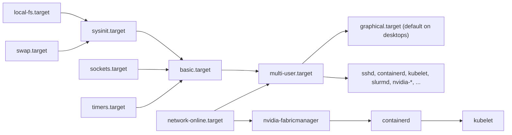
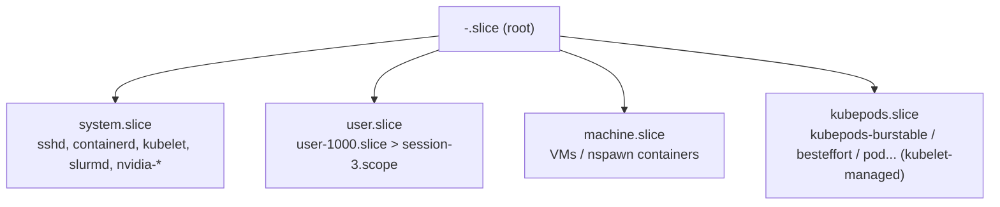

# 1.15 systemd: units, targets, timers, journald

| | |
|---|---|
| Level | Intermediate |
| Priority tier | 0 |
| Lab venue | GCP / GKE (an Ubuntu VM; a second RHEL-family VM is useful) |
| Part | Part 1: Linux, from the command line to the kernel and performance |
| Status | Drafted, labs **untested** |

## Why this matters for AI infrastructure

On every GPU node, almost everything that matters is a systemd unit: `nvidia-persistenced`, `nvidia-fabricmanager` (NVLink/NVSwitch), DCGM, `containerd` or CRI-O, `kubelet`, `slurmd`, `munge`, `sshd`, the node exporter, mount units for NVMe scratch and network storage, and the timers that trim disks and rotate logs. Ordering, restart behaviour and resource isolation among them decide whether a node comes up in a working state and whether a runaway job can take the node down:

- If `kubelet` or `containerd` starts before the Fabric Manager has initialised NVLink on an HGX system, the scheduler may hand out GPUs that cannot talk to each other over the fast fabric, and distributed jobs silently fall back to PCIe or hang.
- If a training job exhausts memory and the host's critical daemons (`sshd`, `journald`, `kubelet`) live in the same cgroup pressure domain as the job, the node becomes unreachable instead of just losing one pod.
- If a unit has no `Restart=`, a crashed `slurmd` leaves a node silently out of the cluster.
- A "cron job you cannot find" is often a systemd timer.

This chapter teaches systemd from the unit file up: unit types, the dependency and ordering model, service types and life cycle, drop-in overrides, targets, templates, socket and path activation, timers, resource control and sandboxing, `journald` and `journalctl`, `systemd-analyze` for debugging, and the AI-node patterns (ordering GPU services, protecting the host, graceful shutdown, health-gated start). Boot up to the start of systemd is chapter 1.14; logging policy, time synchronisation and cron are chapter 1.16; cgroup internals are chapter 1.18; namespaces are chapter 1.19; hardening with systemd sandboxing is touched here and expanded in 1.21.

## Prerequisites and outcomes

You should know processes and signals (1.8), shell scripting (1.9), boot flow (1.14) and cgroups at the introductory level (1.8 section 9).

After this chapter you can:

- Explain what systemd is, what a unit is, and list the unit types and their roles.
- Read and write service unit files; choose the right `Type=`; set `Restart=`, timeouts, users, environment, working directory, limits and standard output.
- Model dependencies correctly: `Wants`/`Requires`/`Requisite`/`BindsTo`/`PartOf`/`Conflicts` versus `Before`/`After`, default and implicit dependencies, `[Install]`, and what `enable` does.
- Override vendor units safely with drop-ins and `systemctl edit`; mask units; reload and reset properly.
- Use targets, set the default target, isolate, enter rescue and emergency modes; interpret `list-dependencies`.
- Write template units (`name@.service`) and use specifiers; build socket-activated and path-activated services.
- Write timers (`OnCalendar`, monotonic timers, `Persistent`), validate calendar expressions, and replace cron jobs.
- Apply resource control (CPU, memory, tasks, I/O, IP), slices and accounting; protect the host from workloads; set per-user limits.
- Use sandboxing options (`ProtectSystem`, `PrivateTmp`, `NoNewPrivileges`, capabilities, `DeviceAllow`) for services.
- Use `journalctl` fluently, configure the journal (persistent storage, size limits, rate limits), and forward logs.
- Debug with `systemctl status/show/cat/list-dependencies`, `systemd-analyze verify/blame/critical-chain/calendar/security`.
- Read a SysV init script world and the compatibility layer when you meet it.

## 1. What systemd is

systemd is the **init system and service manager** on essentially every mainstream distribution (RHEL and clones, Fedora, Debian, Ubuntu, SUSE, Arch). It is PID 1 (chapter 1.14) and does much more than start daemons: it tracks every process of every service in a **cgroup**, mounts filesystems, activates services on demand, runs timers, manages user sessions (`logind`), logs (`journald`), device events (`udevd` is part of it), name resolution (`resolved`), time synchronisation (`timesyncd`), network configuration (`networkd`), and more. Its design goals are **parallel start-up driven by dependencies** (instead of a fixed sequence of scripts), **reliable process supervision** (no PID files to guess), **on-demand activation**, and **uniform declarative configuration**.

The older **System V (`SysV`) `init`** started a fixed sequence of shell scripts one at a time; it was slow, relied on PID files and `ps` to find daemons, repeated boilerplate, and had no notion of on-demand services. Tools like **Upstart** (used in older Ubuntu releases) improved event-driven startup, while lightweight or embedded platforms sometimes use **runit**, **Android's custom `init`**, or **BSD-style `init`** (`HLW` Section 6.1). On all current releases of major Linux distributions, the standard implementation is **`systemd`**. You identify what you run with `ps -p 1 -o comm=`, `readlink -f /sbin/init`, or by checking for `/usr/lib/systemd` and `/etc/systemd` (if neither exists, check `/etc/init` for Upstart or `/etc/inittab` for System V `init`, covered in section 15).

systemd is **goal-oriented**: you define goals (units) that have dependencies on other units. To reach a goal, systemd starts its dependencies and then the unit itself, activating whatever is ready in parallel. After boot it keeps reacting to events (device appearance via udev, socket connections, timers, file changes) by activating more units.

## 2. Units

Everything systemd manages is a **unit**, described by a **unit file** in INI-like syntax (derived from the XDG desktop-entry format): sections in `[Brackets]`, `Key=value` lines, `#` or `;` comments.

| Unit type | Suffix | Purpose |
|---|---|---|
| Service | `.service` | A daemon or one-off command: the most common type |
| Target | `.target` | A named group/synchronisation point of units (replaces runlevels) |
| Socket | `.socket` | A listening socket or FIFO that triggers a service on first connection |
| Mount / Automount | `.mount` / `.automount` | A filesystem mount (generated from `/etc/fstab`) / mount on first access |
| Swap | `.swap` | A swap device or file |
| Device | `.device` | A udev-tagged device node as a dependency |
| Path | `.path` | Watches a file or directory and activates a service on change |
| Timer | `.timer` | Time-based activation of a service (cron replacement) |
| Slice | `.slice` | A node in the cgroup hierarchy for resource control (`system.slice`, `user.slice`) |
| Scope | `.scope` | A group of externally created processes (login sessions, containers) |
| Snapshot/others | | Obsolete or rarely used |

The full list and options are in `systemd.unit(5)` and the per-type manual pages (`systemd.service(5)`, `systemd.exec(5)`, `systemd.socket(5)`, `systemd.timer(5)`, `systemd.mount(5)`, `systemd.slice(5)`, `systemd.resource-control(5)`, `systemd.kill(5)`, `systemd.special(7)`).

### Where unit files live (and the precedence rule)

`systemctl -p UnitPath show` prints the search path. The important directories, from highest to lowest priority:

| Directory | Purpose |
|---|---|
| `/etc/systemd/system.control`, `/run/systemd/system.control` | Dynamic changes made by `systemctl set-property` |
| `/run/systemd/transient` | Transient units from `systemd-run` |
| **`/etc/systemd/system`** | **Your** units and overrides (administrator) |
| `/run/systemd/system` | Runtime/generated units |
| `/run/systemd/generator` | Units generated at boot (for example from `/etc/fstab` by `systemd-fstab-generator`) |
| **`/usr/lib/systemd/system`** (or `/lib/systemd/system`) | Units shipped by packages; **do not edit** |

**Rule: never modify files in `/usr/lib/systemd/system`.** Package upgrades overwrite them. Put new units in `/etc/systemd/system` and customise vendor units with **drop-ins** (next section). The same rule applies system-wide: prefer `/etc` over `/usr`. A file in `/etc` with the same name as one in `/usr/lib` **replaces** it entirely.

User services (per-user instances for ordinary users, `systemctl --user`) read `~/.config/systemd/user/` and `/etc/systemd/user/`; enable lingering (`loginctl enable-linger USER`) so they run without a login session.

### Anatomy of a service unit

```ini
# /etc/systemd/system/gpu-exporter.service
[Unit]
Description=GPU metrics exporter
Documentation=https://example.com/docs/gpu-exporter
After=network-online.target nvidia-persistenced.service
Wants=network-online.target
Requires=nvidia-persistenced.service

[Service]
Type=simple
User=exporter
Group=exporter
ExecStart=/usr/local/bin/gpu-exporter --listen 127.0.0.1:9400
ExecReload=/bin/kill -HUP $MAINPID
Restart=on-failure
RestartSec=5s
LimitNOFILE=65536
Environment=EXPORTER_LOG=info
EnvironmentFile=-/etc/default/gpu-exporter

[Install]
WantedBy=multi-user.target
```

- **`[Unit]`**: identity and relationships: `Description=`, `Documentation=`, dependencies and ordering (section 4), conditions (`ConditionPathExists=`, `ConditionHost=`, `ConditionVirtualization=`).
- **`[Service]`** (or `[Socket]`, `[Timer]`, `[Mount]`, `[Slice]`...): how this unit type behaves.
- **`[Install]`**: what `systemctl enable` should do (which targets want this unit); ignored at run time.

**Variables and specifiers.** In `Exec*=` lines, `$VAR` and `${VAR}` expand variables defined by `Environment=`/`EnvironmentFile=` (no shell involved: **no pipes, redirects, globbing or `&&`**; to use shell features call `/bin/sh -c '...'`). `$MAINPID` holds the tracked main PID (used in `ExecReload=/bin/kill -HUP $MAINPID`). **Specifiers** start with `%`: `%n` full unit name, `%N` unescaped name, `%p` prefix, `%i`/`%I` instance (section 7), `%H` hostname, `%u` user, `%t` runtime directory, `%%` literal percent. The shell does not get `$$`; write `$$` to pass a literal `$`. Prefixes on `Exec*=` commands: `-` (ignore failure), `+` (run with full privileges, ignoring `User=` and sandboxing), `!` (partly privileged), `@` (set `argv[0]`), `:` (no variable expansion), and `|` is not valid. An `EnvironmentFile` lines `KEY=value` (a `-` before the path makes a missing file non-fatal).

Default environment for services is minimal: `PATH` is reset to the standard system directories, `HOME`, `USER`, `LOGNAME`, `SHELL` set from `User=`, `LANG` from `locale.conf`, `INVOCATION_ID` unique per run, `NOTIFY_SOCKET` for `Type=notify`. **A service does not inherit your shell's environment**; this is the usual explanation for "works in my shell, fails as a service" (compare chapter 1.9). Check with `systemctl show -p Environment NAME` and `systemd-run --pty env`.

### Service types: how systemd knows a service is "started"

`Type=` tells systemd what the main process does at start-up and when to consider the unit started (so that units ordered `After=` it may proceed):

| `Type=` | Behaviour | Typical use |
|---|---|---|
| **`simple`** (default with `ExecStart=`) | The `ExecStart` process **is** the service and stays in the foreground; considered started immediately after fork | Modern foreground daemons, scripts |
| **`exec`** | Like simple, but started only after the `exec()` succeeded (catches missing binaries) | Preferable to `simple` where available |
| **`forking`** | The process forks and the parent exits; systemd treats the exit as "ready" and tracks the child (use `PIDFile=` if it writes one) | Traditional daemons that daemonise themselves |
| **`oneshot`** | The process runs to completion; the unit is "started" when it exits. Multiple `ExecStart=` allowed; usually with `RemainAfterExit=yes` so the unit counts as active afterwards | Setup tasks, `modprobe`, mount helpers, health gates |
| **`notify`** | The service tells systemd it is ready by calling `sd_notify("READY=1")` (also `notify-reload`) | Daemons with explicit readiness (systemd-aware software) |
| **`dbus`** | Ready when the service acquires a D-Bus name (`BusName=`) | Desktop-style services |
| **`idle`** | Like simple but delayed until other jobs are done (cosmetic ordering of console output) | Rare |

Because systemd tracks processes with **cgroups**, it knows every process of the service however many times they fork; you only need to say whether the main process forks.

**Common `[Service]` options**

| Option | Meaning |
|---|---|
| `ExecStart=`, `ExecStartPre=`, `ExecStartPost=` | Main command; commands before/after it (a failing `Pre` fails the start) |
| `ExecReload=`, `ExecStop=`, `ExecStopPost=` | Reload command; custom stop (otherwise `SIGTERM`); cleanup after stop regardless of result |
| `Restart=` | `no` (default), `on-success`, `on-failure`, `on-abnormal`, `on-abort`, `on-watchdog`, `always`. For daemons that must stay up use `on-failure` or `always` |
| `RestartSec=` | Delay between restarts (default 100 ms) |
| `StartLimitIntervalSec=`, `StartLimitBurst=` (in `[Unit]`) | Rate limit: more than N starts within the interval puts the unit into `failed (start-limit-hit)`; clear with `systemctl reset-failed` |
| `TimeoutStartSec=`, `TimeoutStopSec=`, `TimeoutSec=` | Wait for start/stop; at stop timeout systemd sends `SIGTERM` then, after `TimeoutStopSec`, `SIGKILL` |
| `KillMode=` (`control-group` default, `process`, `mixed`, `none`), `KillSignal=`, `SendSIGKILL=`, `FinalKillSignal=` | What gets signalled at stop; default kills **every process in the cgroup**. `mixed` sends `SIGTERM` to the main process and `SIGKILL` to the rest |
| `User=`, `Group=`, `SupplementaryGroups=`, `DynamicUser=yes` | Identity; `DynamicUser` allocates a transient UID |
| `WorkingDirectory=`, `RootDirectory=`, `Umask=`, `Nice=`, `CPUSchedulingPolicy=`, `IOSchedulingClass=` | Execution context |
| `Environment=`, `EnvironmentFile=`, `PassEnvironment=`, `UnsetEnvironment=` | Environment |
| `StandardInput=` (`null` default to `/dev/null`, `tty` to the console specified in `TTYPath=`, `tty-force` to disconnect any occupying process first, `tty-fail` to fail if the terminal is occupied, `socket` for socket-activated units, `file:`), `StandardOutput=`/`StandardError=` (`journal` default on most systems, `inherit` to the same place as standard input, `null`, `tty`, `syslog`, `kmsg`, `journal+console`, `file:/path`, `append:/path`, `socket`) | I/O stream redirection (`SCL` Chapter 30); output goes to the journal by default |
| `LimitCPU=`, `LimitFSIZE=`, `LimitDATA=`, `LimitSTACK=`, `LimitCORE=`, `LimitRSS=`, `LimitNOFILE=`, `LimitAS=`, `LimitNPROC=`, `LimitMEMLOCK=`, `LimitLOCKS=`, `LimitSIGPENDING=`, `LimitMSGQUEUE=`, `LimitNICE=`, `LimitRTPRIO=`, `LimitRTTIME=` | Per-unit `rlimit` resource ceilings (**systemd services ignore `/etc/security/limits.conf`**; chapter 1.8) |
| `RuntimeDirectory=`, `StateDirectory=`, `CacheDirectory=`, `LogsDirectory=`, `ConfigurationDirectory=` | Directories created and owned by the service user under `/run`, `/var/lib`, `/var/cache`, `/var/log`, `/etc` |
| `RemainAfterExit=yes` | Keep the unit "active" after the process exits (for `oneshot`) |
| `WatchdogSec=` | Service must ping the watchdog (`sd_notify WATCHDOG=1`) or it is restarted (with `Restart=on-watchdog/always`) |

## 3. Operating systemd: `systemctl`

```bash
systemctl                              # list loaded active units (same as list-units)
systemctl list-units --type=service --state=failed
systemctl list-units --all             # include inactive
systemctl list-unit-files              # installed units and their enablement state
systemctl status sshd                  # state, cgroup tree, recent log lines
systemctl is-active sshd; systemctl is-enabled sshd; systemctl is-failed sshd
sudo systemctl start|stop|restart|reload|try-restart NAME
sudo systemctl reload-or-restart NAME  # reload if supported, else restart
sudo systemctl enable NAME             # start at boot (creates symlinks per [Install]); does NOT start now
sudo systemctl enable --now NAME       # enable and start
sudo systemctl disable NAME            # remove boot-time links
sudo systemctl mask NAME               # link to /dev/null: cannot be started, even by dependency
sudo systemctl unmask NAME
sudo systemctl daemon-reload           # re-read unit files after you edit them (does NOT restart units)
sudo systemctl reset-failed [NAME]     # clear failed state / start-limit
systemctl cat NAME                     # unit file(s) plus drop-ins as systemd sees them
systemctl show NAME -p ActiveState,SubState,MainPID,ExecStart,Restart,CPUQuota   # properties
systemctl list-dependencies NAME       # what it needs (add --reverse: what needs it)
systemctl list-sockets; systemctl list-timers --all
systemctl list-jobs                    # queued start/stop jobs (spot the slow one at boot)
systemctl --failed                     # failed units
systemctl get-default; sudo systemctl set-default multi-user.target
sudo systemctl isolate rescue.target   # switch to a target, stopping units not part of it
sudo systemctl poweroff|reboot|halt|suspend; shutdown -h +10
systemctl --user ...                   # per-user manager; --machine=host for containers
```

Key semantics:

- **`enable` vs `start`**: enabling creates symbolic links (in a `.wants/` or `.requires/` directory of the target named in `[Install]`) so the unit is pulled in at boot; it does not start the unit now. A unit without an `[Install]` section is "static": it can only be started manually or by dependency. `disable` removes the links (it does not stop the unit).
- **`mask`** is stronger than `disable`: nothing can start it, manually or through a dependency (useful for `ctrl-alt-del.target`, unwanted services).
- **`reload` vs `restart` vs `daemon-reload`**: `reload` asks the *service* to re-read its own configuration (`ExecReload=`); `restart` stops and starts it; `daemon-reload` makes *systemd* re-read unit files. After editing a unit you need `daemon-reload` and then `restart` (systemd warns "unit file changed on disk").
- A **start request is a job** in a queue (visible in `list-jobs`); a job that waits on a slow dependency holds up the units behind it. At boot, a job stuck "running" is the unit to investigate.

`status` output explained:

```text
● sshd.service - OpenBSD Secure Shell server
     Loaded: loaded (/lib/systemd/system/ssh.service; enabled; vendor preset: enabled)
     Active: active (running) since Fri 2025-04-16 08:15:41 UTC; 1 month 1 day ago
       Docs: man:sshd(8)
   Main PID: 1110 (sshd)
      Tasks: 1 (limit: 4915)
     Memory: 5.1M
        CPU: 2.103s
     CGroup: /system.slice/ssh.service
             └─1110 "sshd: /usr/sbin/sshd -D [listener] 0 of 10-100 startups"
Apr 16 08:15:41 node1 systemd[1]: Started OpenBSD Secure Shell server.
```

`Loaded:` shows the file path, enablement and vendor preset; `Active:` the state (`active (running)`, `active (exited)` for oneshots, `inactive (dead)`, `activating`, `failed`, with a `Result` such as `exit-code`, `signal`, `timeout`, `start-limit-hit`); `Main PID`; `CGroup` tree (every process of the service); last log lines. Full logs: `journalctl -u NAME`.

## 4. Dependencies and ordering

Two **independent** concepts are easy to confuse:

- **Requirement dependencies** say *what must also be started*.
- **Ordering dependencies** say *in which order* units start once both are going to start.

By themselves `Requires=` and `Wants=` do **not** order anything: both units start in parallel. To start A after B and also pull B in, you need **both** `Wants=B` (or `Requires=B`) **and** `After=B`.

| Directive | Meaning |
|---|---|
| `Wants=B` | Start B when this unit starts, **but do not care whether B succeeds**. Soft; the recommended default, because failures do not cascade |
| `Requires=B` | Start B; **if B fails to start or is later stopped, this unit is stopped too**. Hard dependency |
| `Requisite=B` | B must **already** be active, or this unit fails immediately (no attempt to start B) |
| `BindsTo=B` | Like `Requires=`, and additionally this unit stops when B enters *inactive* for any reason (even a clean exit). Used for devices and mounts |
| `PartOf=B` | Stop/restart of B propagates to this unit; B's start does not start this |
| `Conflicts=B` | Starting this unit stops B (and vice versa); both cannot be active together |
| `Upholds=B` (newer) | Keep B running while this unit is active |
| `After=B` / `Before=B` | Ordering: this unit starts after / before B (stops in the reverse order). Only has effect if both are in the same transaction |
| `OnFailure=B` | Start B when this unit fails (alerts, remediation) |
| `Condition*=` / `Assert*=` | If a condition is false the unit is **skipped silently** (`Condition`) or **fails** (`Assert`); examples `ConditionPathExists=`, `ConditionFileNotEmpty=`, `ConditionVirtualization=`, `ConditionHost=`, `ConditionKernelCommandLine=`, `ConditionACPower=`; does not affect dependencies of other units |
| `StopWhenUnneeded=yes` | Stop this unit when nothing needs it any more |
| `PropagatesReloadTo=` / `ReloadPropagatedFrom=` | Forward reloads |

Why the soft/hard distinction matters: if the login prompt hard-required a database server that fails, you could not log in to fix the database. `Wants` keeps the failure local, in the way a traditional boot tolerated failing scripts. A missing data disk may stop an application but should not stop `sshd`. Use `Requires`/`BindsTo` only when the unit is genuinely useless or dangerous without the other.

**Default and implicit dependencies.** systemd adds some dependencies itself, to avoid boilerplate and mistakes: a service gets `Requires=` and `After=` `sysinit.target` and `basic.target` and `Conflicts=`/`Before=` `shutdown.target`; any unit listed in a target's `Wants=` is ordered `After=` that target's ... (the target is started after its members, so that reaching the target means they are up); mounts depend on their devices and parents; units using sockets depend on the socket units. Turn them off for early-boot units with `DefaultDependencies=no`. The defaults per unit type are listed in the DEFAULT DEPENDENCIES section of each manual page. See what systemd computed with `systemctl list-dependencies --all NAME`, `systemctl show -p After,Requires NAME`.

**The `[Install]` section** is the reverse direction of dependency: `WantedBy=multi-user.target` means "when enabled, add me to that target's wants". For example, in `HLW` Section 6.3.7, if `test1.target` has `[Install] WantedBy=test2.target`, running `systemctl enable test1.target` creates the symlink `/etc/systemd/system/test2.target.wants/test1.target -> /etc/systemd/system/test1.target` so starting `test2.target` pulls in `test1.target`. Conversely, some units such as `dbus-daemon.service` specify `Requires=dbus.socket` and `RefuseManualStart=yes` so they can only be started via socket/dependency activation rather than `systemctl start`. Other `[Install]` keys include `RequiredBy=`, `Alias=` (alternate names, for example `display-manager.service`), `Also=` (enable these units too), and `DefaultInstance=` (for templates). This is why you can change *when* a unit starts without editing a vendor file: add it to a target's wants by an `[Install]` in your own unit or via a drop-in.

**A worked example on GPU nodes**: ordering containerd and kubelet after the Fabric Manager without editing vendor units:

```ini
# sudo systemctl edit containerd.service      -> creates /etc/systemd/system/containerd.service.d/override.conf
[Unit]
After=nvidia-fabricmanager.service nvidia-persistenced.service
Wants=nvidia-fabricmanager.service nvidia-persistenced.service
```

```ini
# sudo systemctl edit kubelet.service
[Unit]
After=containerd.service nvidia-fabricmanager.service
Requires=containerd.service
```

Only add ordering where readiness really matters. And remember that for `Type=forking` or `simple` services "started" may not mean "ready": the Fabric Manager forks and may need seconds to finish NVSwitch initialisation after systemd considers it started. If readiness is the issue, wrap a **health gate**: a `Type=oneshot` unit with `RemainAfterExit=yes` and an `ExecStart=` script that polls (`nvidia-smi nvlink -s`, `nv-fabricmanager` status, `nvidia-smi -L | wc -l` equals the expected count) and fails if not ready within a timeout; then order `kubelet` after that gate unit (chapter 1.9 for the script pattern). Verify package-shipped unit names and options (`nvidia-fabricmanager.service` and the paths it ships) against your driver version.

## 5. Overriding units: drop-ins

**Never edit vendor units; add a drop-in.** A drop-in is a file `*.conf` in `/etc/systemd/system/NAME.service.d/` (the directory name is the unit name plus `.d`; for a type-wide override use `service.d/` under the type, and for dashes `foo-.service.d` for the prefix `foo-`). It contains only the sections and keys you want to add or change; everything else comes from the original. Drop-ins are applied in lexical file order, so prefix with numbers (`10-limits.conf`, `50-gpu.conf`). `systemctl edit NAME` creates and opens `override.conf` for you (and runs `daemon-reload` when you save); `systemctl edit --full NAME` copies the whole unit to `/etc` for a full replacement (loses vendor updates).

Rules for list-valued keys: assigning again **adds** (for example `ExecStartPre=`, `Environment=`, `After=`); an **empty assignment resets** the list. To replace `ExecStart=` you must clear it first:

```ini
[Service]
ExecStart=
ExecStart=/usr/bin/containerd --config /etc/containerd/gpu-config.toml
```

Verify the result with `systemctl cat NAME` (shows the file and every drop-in), `systemctl show NAME -p ExecStart`, and `systemd-analyze cat-config systemd/logind.conf` (for daemon config files that also support `.d` directories: `journald.conf.d`, `logind.conf.d`, `system.conf.d`). Check syntax before you reload: `systemd-analyze verify /etc/systemd/system/NAME.service`.

**Transient units**: `systemd-run` creates a unit on the fly: `sudo systemd-run --unit=backup --on-active=10m /usr/local/bin/backup.sh` (a one-off timer), `systemd-run --scope -p MemoryMax=2G ./job` (runs a command in a resource-limited scope), `systemd-run --pty --wait -p ProtectSystem=strict /bin/bash` (test a sandbox interactively). Great for labs and ad hoc limits.

**Changing properties at runtime**: `systemctl set-property NAME MemoryMax=4G CPUQuota=200%` applies immediately and persists as a drop-in under `/etc/systemd/system.control/` (add `--runtime` to make it non-persistent).

## 6. Targets

A **target** is a unit with no process: a *named synchronisation point and grouping* of other units, reached when its dependencies are up. Unlike SysV runlevels, several targets can be active at once and they can be requested individually.

| Target | Meaning |
|---|---|
| `default.target` | A link to the target the system boots to (`multi-user.target` or `graphical.target`) |
| `sysinit.target` | Early system initialisation (mounts of `/proc`..., swap, local fs, udev, random seed) |
| `basic.target` | Basic system ready: sockets, timers, paths, slices activated |
| `local-fs.target`, `remote-fs.target`, `swap.target` | Local filesystems, network filesystems, swap are mounted |
| `network.target` | Network *stack* configured (weak meaning: interfaces may not be up) |
| **`network-online.target`** | The network is actually usable; units that need an address (`NFS`, `kubelet`, `slurmd` registering) order `After=` and `Wants=` it. It waits for a "wait-online" service (`systemd-networkd-wait-online`, `NetworkManager-wait-online`) which can stall boot if an interface never comes up; configure which interfaces count |
| `multi-user.target` | Non-graphical multi-user system (runlevel 3 equivalent) |
| `graphical.target` | Multi-user plus graphical login (5) |
| `rescue.target` | Single-user shell with basic filesystems (1) |
| `emergency.target` | Minimal shell, root filesystem read-only |
| `shutdown.target`, `poweroff.target`, `reboot.target`, `halt.target`, `kexec.target` | Shutdown paths |
| `timers.target`, `sockets.target`, `paths.target`, `slices.target` | Groups of those unit types |
| `time-sync.target`, `nss-lookup.target`, `remote-fs-pre.target`, `getty.target` | Semantic markers other units order against |

Legacy: `runlevel0.target`..`runlevel6.target` are aliases (`runlevel3.target` -> `multi-user.target`); `systemctl isolate runlevel3.target` works; `who -r` still reports a runlevel.

Commands: `systemctl get-default`, `systemctl set-default multi-user.target` (servers should not run `graphical.target`), `systemctl isolate rescue.target` (start the target and stop everything not in its dependency set; **it does not apply to targets without `AllowIsolate=yes`**), `systemctl list-dependencies default.target`, `systemd-analyze critical-chain`. Dependencies between units form a **graph**, not a tree, which can be rendered with `systemd-analyze dot 'multi-user.target' | dot -Tsvg > g.svg` (filter patterns to keep it readable).



Boot-time **jobs** can be watched while the system comes up with `systemctl list-jobs`; a unit that takes minutes (an NFS mount, `network-online`, an unreachable LDAP) delays everything ordered after it: find it with `systemd-analyze blame` and `critical-chain`.

## 7. Templates and instances

A unit file whose name ends in `@` before the suffix (`getty@.service`, `worker@.service`) is a **template**; you instantiate it by supplying a string after the `@`: `getty@tty1.service`, `worker@3.service`. Inside, `%i` is the instance string (with special characters escaped) and `%I` the unescaped form. `%i` suits file names, `%I` suits arguments (for example a device path instantiated as `getty@-dev-ttyUSB0`: `%I` is `/dev/ttyUSB0`, `%i` is `-dev-ttyUSB0`; `systemd-escape --path /dev/ttyUSB0` computes the escaped name). Typical uses: one `getty` per console, one `nvidia-persistenced` or exporter per GPU index, one worker per NUMA node, `openvpn@client.service`, `wg-quick@wg0.service`, `systemd-fsck@.service`, `container@name.service`.

```ini
# /etc/systemd/system/gpu-job@.service
[Unit]
Description=Job runner bound to GPU %i
After=nvidia-persistenced.service
[Service]
Environment=CUDA_VISIBLE_DEVICES=%i
ExecStart=/usr/local/bin/runner --gpu %i
Restart=on-failure
[Install]
WantedBy=multi-user.target
```

`systemctl enable --now gpu-job@0.service gpu-job@1.service`; set `DefaultInstance=` for `enable` without an instance. Use `systemctl start 'gpu-job@{0..7}.service'` with the shell's brace expansion.

## 8. Socket, path and automount activation

systemd can hold the resource a service needs, start the service only when it is used (or immediately, in parallel), and hand the resource over. The pieces:

1. A **service unit** (`A.service`) that provides the function.
2. A **resource unit** (`A.socket`, `A.path`, `A.automount`, `A.timer`) that represents the trigger: a network or Unix socket, a file or directory, a mount point, a time.
3. The link, normally by **name** (`echo.socket` activates `echo.service`; use `Service=` in the socket or `Unit=` in a timer/path to name another).

```ini
# /etc/systemd/system/echo.socket
[Socket]
ListenStream=22222
Accept=true
[Install]
WantedBy=sockets.target

# /etc/systemd/system/echo@.service
[Service]
ExecStart=/bin/cat
StandardInput=socket
```

With `Accept=true`, systemd accepts each incoming connection itself and starts a new **instance** `echo@<n>-<local>-<peer>.service` for it (so the service is a template, and the service reads the connection as standard input/output). With `Accept=false` (the default), systemd listens and passes the **listening socket** to a single service (named `echo.service`, not a template), which does the `accept()` itself and keeps control until it exits (this is the usual form for real servers that understand socket activation: they receive the descriptor in `$LISTEN_FDS`, descriptor 3 onward, with `sd_listen_fds()`). Test: `sudo systemctl start echo.socket`, `ss -ltn | grep 22222`, `echo hi | nc localhost 22222`, `systemctl list-sockets`.

**Why it matters.** (1) *On-demand start*: a rarely used service consumes nothing until needed (the modern `inetd`). (2) *Parallel boot*: systemd can create the socket early; clients connect and queue while the real service is still starting. This removes ordering between services that use each other (`journald`, D-Bus, `sshd` itself on some distributions use `sshd.socket`). (3) *Restart without dropping connections*: the socket stays open while the service restarts. Pitfalls: the service must support the handoff; firewall and `ss -ltnp` show systemd as the listener, not the daemon; remember that a socket-activated `ssh` hides per-connection resource use.

**Path units** watch file system changes (`PathExists=`, `PathExistsGlob=`, `PathChanged=`, `PathModified=`, `DirectoryNotEmpty=`) and start the matching service: a drop directory of work files, a config reload when a file changes. **Automount units** (`x-systemd.automount` in `fstab`) mount a filesystem on first access (useful for NFS: a slow server no longer delays boot, only the first access) and optionally unmount on idle (`x-systemd.idle-timeout=`).

## 9. Timers: the cron replacement

A **timer** unit (`X.timer`) activates a service (`X.service`) at a time. Advantages over cron: logs are in the journal with the unit's context; the job runs in a controlled cgroup with limits and sandboxing; dependencies (`After=network-online.target`); catch-up of missed runs with `Persistent=true`; randomised delay to avoid a thundering herd; `systemctl list-timers` shows next and last run.

```ini
# /etc/systemd/system/fstrim-data.service
[Unit]
Description=Trim /data
[Service]
Type=oneshot
ExecStart=/usr/sbin/fstrim -v /data

# /etc/systemd/system/fstrim-data.timer
[Unit]
Description=Weekly trim of /data
[Timer]
OnCalendar=Sun *-*-* 03:00:00
RandomizedDelaySec=30min
Persistent=true
AccuracySec=1min
[Install]
WantedBy=timers.target
```

`sudo systemctl enable --now fstrim-data.timer` (enable the **timer**, not the service). Two families of triggers:

- **Realtime (calendar)**: `OnCalendar=` with the format `DayOfWeek Year-Month-Day Hour:Minute:Second`, with `*` wildcards, lists (`Mon,Fri`), ranges (`Mon..Fri`), steps (`*:0/15` every 15 minutes), and shorthands `hourly`, `daily`, `weekly`, `monthly`, `yearly`. Always test: `systemd-analyze calendar 'Mon..Fri 02:30'` (prints the normalised form and next elapse times; `--iterations=5` for more) and remember time zones (add `UTC` or a zone name in the expression).
- **Monotonic**: relative to an event: `OnBootSec=` (after boot), `OnStartupSec=`, `OnUnitActiveSec=` (after the unit last activated, for "every N minutes since last run"), `OnUnitInactiveSec=`, `OnActiveSec=`.

`Persistent=true` stores the last run time on disk and triggers a missed run at the next start (when the machine was off). `RandomizedDelaySec=` spreads load. `AccuracySec=` (default 1 min) lets systemd coalesce wake-ups; set `1s` when you need precision. A timer's service is not allowed to overlap itself: if the service is still running at the next trigger, the trigger is skipped for a `Type=oneshot` that is still active, so you rarely need `flock`. Compare the cron equivalents in chapter 1.16; `crontab` jobs still run (systemd even generates timers from some `anacron` setups); "a cron job I can't find" may be a timer (`systemctl list-timers --all`, `ls /etc/systemd/system/*.timer /usr/lib/systemd/system/*.timer`).

## 10. Resource control, slices and host protection

systemd places every service, scope and session into a **cgroup** whose position in the hierarchy is given by **slices**; the resource properties on a unit are applied to its cgroup (chapter 1.8 section 9; the controllers are explained in 1.18). On cgroup v2:



| Property | Meaning |
|---|---|
| `CPUAccounting=`, `MemoryAccounting=`, `IOAccounting=`, `TasksAccounting=`, `IPAccounting=` | Turn on statistics (shown by `systemctl status`, `systemd-cgtop`); most are on by default in current releases |
| `CPUWeight=` (1-10000, default 100) | Relative share under contention (replaces `CPUShares`). Raising `system.slice` favours daemons over siblings |
| `CPUQuota=` (e.g. `200%`) | Hard cap: percent of one CPU (100% = one core, 200% = two) |
| `AllowedCPUs=`, `AllowedMemoryNodes=` | cpuset: restrict to cores and NUMA nodes (cgroup v2) |
| `CPUAffinity=`, `NUMAPolicy=`, `NUMAMask=` | Process-level affinity and memory policy (not cgroup) |
| `MemoryLow=` | Best-effort protection: the kernel avoids reclaiming this much |
| `MemoryHigh=` | Throttle threshold: above it the unit is slowed and reclaimed before any kill |
| `MemoryMax=` | Hard limit: exceeding it triggers the cgroup's OOM kill |
| `MemorySwapMax=` | Limit swap use |
| `TasksMax=` | Limit processes + threads (anti fork-bomb) |
| `IOWeight=`, `IOReadBandwidthMax=`, `IOWriteBandwidthMax=`, `IOReadIOPSMax=`, `IOWriteIOPSMax=` (e.g. `IOReadBandwidthMax=/dev/nvme0n1 500M`) | Block I/O control |
| `IPAddressAllow=`, `IPAddressDeny=`, `RestrictNetworkInterfaces=` | eBPF-based network filtering per unit |
| `DeviceAllow=`, `DevicePolicy=` | Which device nodes (e.g. `/dev/nvidia0 rw`) the unit may access |
| `Delegate=yes` | Hand the cgroup subtree to the service so it manages sub-cgroups (container runtimes, kubelet, Slurm's cgroup plugin) |
| `Slice=` | Put the unit in a named slice |
| `OOMScoreAdjust=`, `OOMPolicy=` | OOM killer preference; what to do when a process is OOM-killed |

Commands: `systemd-cgls`, `systemd-cgtop` (live per-cgroup CPU, memory, I/O, tasks), `systemctl status NAME`, `systemctl set-property NAME MemoryMax=8G`, `systemd-run --scope -p ... cmd`, `systemctl show NAME -p MemoryCurrent,CPUUsageNSec,TasksCurrent`.

**Per-user limits.** Logins run in `user-UID.slice`, with all user sessions below it. Default limits for every user via a template drop-in `/etc/systemd/system/user-.slice.d/10-defaults.conf` (the trailing `-` makes it apply to all user slices):

```ini
[Slice]
TasksAccounting=yes
CPUAccounting=yes
MemoryAccounting=yes
TasksMax=1250
CPUQuota=800%
MemoryMax=64G
```

A specific user (by **UID**, not name): `/etc/systemd/system/user-1007.slice.d/20-limits.conf`. This is one of the best tools for **shared login nodes**: it limits CPU, memory and tasks per user regardless of how many shells they open (`nice` does not limit memory, and `ulimit` is per process). Session behaviour is in `/etc/systemd/logind.conf` (or `logind.conf.d/`): `KillUserProcesses=` (**set `no`**: `yes` kills `tmux`, `screen` and `nohup` jobs at logout), `SessionsMax=`, `RemoveIPC=` (frees shared memory and semaphores at the last logout: can surprise MPI users, set `no` on compute hosts if needed), `RuntimeDirectorySize=`, `IdleAction=`. `loginctl list-sessions`, `loginctl show-user NAME`, `loginctl enable-linger NAME`.

**Protecting the host from GPU workloads.** The production failure pattern: a job exhausts memory or saturates I/O; the kernel OOM killer and reclaim storms stall `sshd`, `journald` and `kubelet` that share pressure with it; the node goes `NotReady` and cannot even be reached by SSH; a leaked process holding `/dev/nvidiactl` then blocks GPU reset. Defences:

- Keep workloads and system daemons in **separate top-level slices** and give system daemons priority: a drop-in for `system.slice` with `CPUWeight=200` (relative weight) and `MemoryLow=2G` (protect resident memory). **Do not** put `MemoryHigh`/`MemoryMax` on `system.slice` itself (it contains `sshd`, `kubelet`, `containerd`; a cap there makes the kernel throttle or kill the very daemons you want to protect).
- In Kubernetes use the kubelet's `systemReserved`, `kubeReserved` and `enforceNodeAllocatable` settings so that `kubepods.slice` is capped below node capacity (Kubernetes chapters).
- Set `OOMScoreAdjust=-900` (or `-1000`) for `sshd`, `journald`, `kubelet` and `slurmd` so the OOM killer prefers job processes; set `OOMPolicy=continue` on services that should survive a child being killed.
- Give job slices a `MemoryMax=` so a runaway job is killed inside its own cgroup instead of the node's memory pressure reaching everything; Slurm does this with its cgroup plugin and `--mem` (Part 6).
- Handle `SIGTERM` and set `TimeoutStopSec=` long enough for GPU jobs and daemons to checkpoint and release devices (`SIGKILL` of a process in the middle of a DMA transfer can leave the device needing a reset).

```bash
sudo mkdir -p /etc/systemd/system/system.slice.d
cat <<'EOF' | sudo tee /etc/systemd/system/system.slice.d/50-host-priority.conf
[Slice]
CPUWeight=200
MemoryLow=2G
EOF
sudo systemctl daemon-reload          # applies slice properties; slices are not restarted
systemctl show system.slice -p CPUWeight,MemoryLow
```

**CPU and NUMA pinning for node daemons** that serve a particular NIC or GPU: `CPUAffinity=0-7`, `NUMAPolicy=bind`, `NUMAMask=0` in `[Service]` (chapter 1.17 and 1.28 for choosing the cores).

## 11. Sandboxing and service hardening

systemd can confine a service with a few lines, using namespaces, capabilities and seccomp under the hood (chapters 1.19 and 1.21 explain the kernel features):

| Option | Effect |
|---|---|
| `User=`, `DynamicUser=yes`, `NoNewPrivileges=yes` | Unprivileged user; no gaining privileges via setuid |
| `ProtectSystem=full\|strict` | `/usr`, `/boot`, `/etc` read-only (`strict`: the whole file system read-only except `ReadWritePaths=`) |
| `ProtectHome=yes\|read-only\|tmpfs` | Hide or protect `/home`, `/root`, `/run/user` |
| `PrivateTmp=yes`, `PrivateDevices=yes`, `PrivateNetwork=yes` | Own `/tmp`; minimal `/dev` (but **GPU services need the device nodes**: use `DeviceAllow=/dev/nvidia0 rw` and not `PrivateDevices`), no network |
| `ProtectKernelTunables=`, `ProtectKernelModules=`, `ProtectControlGroups=`, `ProtectClock=` | Read-only `/proc/sys`, no module loading, read-only cgroups |
| `CapabilityBoundingSet=`, `AmbientCapabilities=` | Drop capabilities (for example keep only `CAP_NET_BIND_SERVICE`) |
| `RestrictAddressFamilies=`, `RestrictNamespaces=`, `SystemCallFilter=@system-service` | Limit socket families, namespace creation, system calls |
| `MemoryDenyWriteExecute=yes`, `LockPersonality=yes` | Block W+X memory (breaks JIT-heavy runtimes) |
| `ReadOnlyPaths=`, `ReadWritePaths=`, `InaccessiblePaths=`, `BindPaths=`, `TemporaryFileSystem=` | Fine-grained mount namespace control |

`systemd-analyze security NAME` scores a unit (0 safe to 10 exposed) and lists each missing protection: a quick audit of all services is `systemd-analyze security`. Add protections gradually and test, since over-restriction produces confusing failures (check the journal for `permission denied` and `EPERM`, and `systemd-run -p ... --pty` to experiment).

## 12. Journald and `journalctl`

`systemd-journald` collects the standard output and error of every service, `syslog()` messages, kernel messages and audit records into a **structured, indexed binary journal**, each entry carrying fields such as `_SYSTEMD_UNIT`, `_PID`, `_UID`, `_HOSTNAME`, `PRIORITY`, `SYSLOG_IDENTIFIER`, `_BOOT_ID`, `_TRANSPORT`, and for containers `CONTAINER_ID`. Because the services' output is captured by systemd, the long-standing problem of start-up scripts writing to a console that disappears is solved.

```bash
journalctl                          # everything (oldest first); -r newest first
journalctl -b                       # this boot; -b -1 previous boot; --list-boots
journalctl -u sshd -u containerd    # by unit (repeatable; globs ok: -u 'nvidia-*')
journalctl -u kubelet -f            # follow
journalctl -k                       # kernel messages (dmesg)
journalctl -p err                   # priority err and worse; -p warning..err ranges; names emerg alert crit err warning notice info debug
journalctl --since "2025-06-01 10:00" --until "1 hour ago"; journalctl --since yesterday
journalctl -n 100 --no-pager; journalctl -e          # last lines; jump to end
journalctl -x                       # add explanatory catalog text
journalctl -o json-pretty -n 1; journalctl -o short-iso; journalctl -o cat   # output formats; cat = message only
journalctl _SYSTEMD_UNIT=slurmd.service _PID=1234    # match fields (AND); use + for OR
journalctl CONTAINER_NAME=trainer --since -10min
journalctl /usr/sbin/sshd           # by executable path
journalctl --disk-usage; journalctl --verify
sudo journalctl --vacuum-size=2G; sudo journalctl --vacuum-time=14d; sudo journalctl --rotate
journalctl --field _SYSTEMD_UNIT    # list values seen for a field
```

Reading journals from another machine's disk: `journalctl -D /mnt/var/log/journal` or `--root=/mnt`. Normal users see only their own messages unless in group `systemd-journal` or `adm`.

**Persistence and limits.** With the default `Storage=auto` the journal is written to `/var/log/journal` **only if that directory exists**; otherwise it lives in `/run/log/journal` (memory) and is lost at reboot: so `journalctl -b -1` fails after a crash. For nodes where post-mortem matters, set it explicitly:

```ini
# /etc/systemd/journald.conf.d/50-persistent.conf
[Journal]
Storage=persistent
Compress=yes
SystemMaxUse=10G
SystemKeepFree=2G
SystemMaxFileSize=500M
MaxRetentionSec=1month
RateLimitIntervalSec=30s
RateLimitBurst=10000
ForwardToSyslog=no
```

then `sudo systemctl restart systemd-journald` (create `/var/log/journal` and `sudo systemd-tmpfiles --create --prefix /var/log/journal` if needed). **Rate limiting** drops messages from a service that logs faster than the burst allows ("Suppressed N messages from X"), which can hide the very errors you want; raise the limits for chatty GPU and kubelet logs, or per unit (`LogRateLimitIntervalSec=`, `LogRateLimitBurst=` in the service). On big GPU nodes, size the journal explicitly, ship logs off-node (rsyslog `imjournal`, `systemd-journal-remote`, Fluent Bit, Vector, Promtail/Loki, an OpenTelemetry collector), and treat the on-node journal as a short buffer. Forwarding to classic `syslog` (`ForwardToSyslog=yes`) keeps `/var/log/messages`-style files in parallel when needed; the relationship, `rsyslog`, time and log rotation are chapter 1.16.

## 13. The other built-in services: networkd, resolved, timesyncd

systemd includes optional replacements for several traditional daemons. You will meet them on Ubuntu, Fedora and many cloud images:

- **`systemd-networkd`**: network configuration from `.network`, `.netdev` and `.link` files in `/etc/systemd/network/` (and `/usr/lib/systemd/network/`); the first matching file (alphabetical) for a link wins, so file names matter. `[Match]` selects interfaces (name, MAC, driver), `[Network]` sets DHCP or static `Address=`, `Gateway=`, `DNS=`. `networkctl status`, `networkctl list`. (NetworkManager and Netplan are alternatives; Part 2 covers Linux networking.)
- **`systemd-resolved`**: stub DNS resolver and cache at `127.0.0.53`, per-link DNS, DNSSEC and LLMNR options; `/etc/resolv.conf` is usually a link to its stub. `resolvectl status`, `resolvectl query host`, `resolvectl flush-caches`, `resolvectl statistics`. Configure in `/etc/systemd/resolved.conf` (`SCL` Chapter 30): `DNS=LIST` (space-separated IPv4/IPv6 DNS servers), `Domains=LIST` (search domain prefixes), and `Cache=yes|no|no-negative` (controls whether DNS responses are cached; `no-negative` disables caching of negative `NXDOMAIN` responses). `nsswitch.conf` needs `resolve` in the `hosts:` line (packages do this).
- **`systemd-timesyncd`**: a simple SNTP client (`NTP=`, `FallbackNTP=` in `timesyncd.conf`; `timedatectl status`, `timedatectl timesync-status`). Servers needing accurate or hierarchical time use `chrony` (chapter 1.16).
- **`logind`** (sessions, seats, power buttons), **`machined`/`nspawn`** (containers), **`homed`**, **`oomd`** (user-space out-of-memory killer using PSI), **`coredump`** (`coredumpctl list/info/debug`), **`tmpfiles`** and **`sysusers`** (declarative creation of directories and system users: `/etc/tmpfiles.d/*.conf` lines like `d /scratch 1777 root root 10d`), **`udevd`** (chapter 1.10).

## 14. Debugging and analysing

| Tool | Use |
|---|---|
| `systemctl status`, `journalctl -u NAME -b` | First look: state, `Result`, last messages |
| `systemctl cat`, `show`, `list-dependencies [--reverse]` | The effective unit, properties, relationships |
| `systemd-analyze verify FILE` | Static check: syntax, missing referenced files and units, ordering cycles |
| `systemd-analyze`, `blame`, `critical-chain [UNIT]`, `plot > boot.svg` | Boot time, slow units, the chain that actually delays a target |
| `systemd-analyze calendar EXPR` | Validate `OnCalendar` |
| `systemd-analyze security [UNIT]` | Sandboxing exposure score |
| `systemd-analyze cat-config systemd/journald.conf` | Merged configuration including `.d` files |
| `systemd-analyze dot`, `dump`, `unit-paths`, `log-level debug` | Graph, internal state, search path, runtime verbosity |
| `systemd-cgls`, `systemd-cgtop`, `systemd-run` | Cgroup tree, live usage, transient experiments |
| `SYSTEMD_LOG_LEVEL=debug systemctl ...`, boot parameters `systemd.log_level=debug systemd.log_target=kmsg` | Debug systemd itself |
| `systemctl list-jobs` | What is the boot waiting for? |
| `systemctl daemon-reload` warnings | A changed unit file not yet re-read |

Common failure strings: `Failed to start X: Unit X not found` (name/path/alias; `daemon-reload`), `Job for X failed because the control process exited with error code` (`journalctl -xeu X`), `start request repeated too quickly` (start-limit hit: `reset-failed`, fix the cause, lengthen `RestartSec`), `Dependency failed for X` (a `Requires`), `Unit is masked`, `status=203/EXEC` (the `ExecStart` binary cannot be executed: path, permission, noexec mount, wrong architecture, bad shebang), `status=200/CHDIR`, `217/USER` (bad `User=`), `226/NAMESPACE` (sandbox mount problem), `status=1/FAILURE` (the program's own exit), `signal=KILL`/`code=killed` (OOM or timeout kill), `Result: timeout`.

## 15. Shutdown, rescue and legacy

**Shutdown** goes through `shutdown.target`: systemd stops units in reverse order of start, sends `SIGTERM` to the remaining processes, waits `DefaultTimeoutStopSec` (typically 90 s), sends `SIGKILL`, unmounts filesystems, remounts root read-only and calls `reboot(2)`. `shutdown -h now` / `systemctl poweroff` is the proper way; `shutdown -r +10` schedules a reboot and creates `/etc/nologin` shortly before; `shutdown -c` cancels; `systemctl reboot --force` skips the unit stop (as does `-ff`, an unclean last resort). A unit that hangs shutdown for 90 seconds each time is a `TimeoutStopSec`, mount or signal-handling problem; look at `journalctl -b -1 -e`. Rescue: `systemd.unit=rescue.target`, `emergency.target`; live images for repairing `fstab` and passwords (chapter 1.14).

**SysV compatibility and `initramfs` review (`HLW` Sections 6.4–6.7).** `systemd` runs old init scripts in `/etc/init.d/` through the `systemd-sysv-generator`: for each `/etc/rc<N>.d` link (such as `/etc/rc5.d/S10sysklogd -> ../init.d/sysklogd`, `S12kerneld`, `S15netstd_init`, `S18netbase`, ..., `S99sshd` or `S99httpd`, where `S` + two-digit number `00`–`99` passes `start` and `K` passes `stop`, and `/etc/inittab` lines like `1:2345:respawn:/sbin/mingetty tty1` respawn console login prompts) it creates a service unit, runs the script with `start`/`stop`, and tracks its processes. While `chkconfig`/`update-rc.d`, `rc.local`, and `service NAME start` still work through this compatibility layer, do not expect miracles from System V compatibility mode—it still runs legacy init scripts serially and provides poor readiness tracking, so replace them with native units (`run-parts` still appears in cron and package scripts to run all scripts in a directory in lexical order). Also recall from Chapter 1.14 (`HLW` Section 6.7) that if a custom kernel has all drivers compiled in to mount the root filesystem directly, it can bypass the `initramfs` (`mkinitramfs` / `unmkinitramfs` on Ubuntu, `dracut` / `lsinitrd` on RHEL/Fedora) entirely.

## 16. AI-infrastructure patterns

- **Unit ordering for the GPU stack**: persistence daemon and Fabric Manager (NVLink/NVSwitch nodes) before the container runtime and kubelet; DCGM exporter after the driver; Slurm's `slurmd` after `munge`, the network, shared filesystem mounts and the GPU health gate. Express ordering with drop-ins so vendor units stay untouched, and gate on **readiness**, not only on process start (a `Type=oneshot` health unit that checks the expected GPU count, NVLink status, ECC state, PCIe link width, and mounts).
- **Restart policy**: `Restart=on-failure`, `RestartSec=5`, and a sensible `StartLimitBurst` for node agents (`slurmd`, `kubelet`, exporters); use `OnFailure=` to run an alert/drain unit when a critical service gives up (`scontrol update NodeName=... State=DRAIN Reason=...`).
- **Mounts**: NVMe scratch and network storage as `.mount`/`fstab` entries with `nofail`, `_netdev`, `x-systemd.requires=`, and ordering `Before=slurmd.service kubelet.service`, so a node does not advertise itself without its data; `x-systemd.automount` for large NFS trees.
- **Limits**: `LimitMEMLOCK=infinity`, `LimitNOFILE=1048576`, `LimitSTACK=` for `slurmd`, `containerd` and the container runtimes (these are *not* inherited from `limits.conf`; jobs started by Slurm or pods inherit from the daemon unless explicitly set) (chapter 1.8).
- **Graceful stop**: for services that host GPU work, handle `SIGTERM`, set `TimeoutStopSec=` generously (minutes), `KillMode=mixed` if only the main process should get `SIGTERM` first, and consider `ExecStop=` that drains (`scontrol`, `kubectl drain`, checkpoint trigger) before the kill.
- **Node-level timers**: `fstrim` weekly, SMART/NVMe health snapshot, `nvidia-smi` or DCGM diagnostic at idle, log pruning, cache clean-up (`tmpfiles.d` age rules), certificate renewal. Make timers `Persistent=true`, with `RandomizedDelaySec=` across the fleet so a thousand nodes do not hit the same API at the same second.
- **Host protection and observability**: slice-level limits (section 10); `systemd-cgtop` and `node_exporter`'s systemd collector (unit state, restarts) in dashboards; alert on `NRestarts` growth, `failed` units, and units stuck `activating`.
- **Golden image discipline**: ship unit files and drop-ins from configuration management (Ansible `systemd` module, chapter 4), version them, and verify `systemctl --failed` is empty plus `systemd-analyze verify` in the image build.
- **Containers and systemd**: container runtimes use the systemd cgroup driver (`SystemdCgroup = true` in containerd; `cgroupDriver: systemd` in the kubelet) so that systemd and the runtime agree on cgroup ownership; mismatches (one using `cgroupfs`, the other systemd) cause confusing resource accounting and instability on cgroup v2 (chapter 1.18, Kubernetes chapters).

## How it fails

1. **Unit edited but behaves the old way.** No `daemon-reload`, or the file is in the wrong directory, or a drop-in overrides it. `systemctl cat`, `daemon-reload`, `restart`.
2. **Ordering assumed from `Requires=`/`Wants=`.** Both start in parallel; add `After=`.
3. **Hard dependencies cascade failures** (login or the whole node unavailable because an optional service failed). Prefer `Wants=`.
4. **Service works in a shell, not as a unit.** Different environment, user, working directory, limits, sandbox (`PrivateTmp`, `ProtectSystem`), SELinux context, missing `PATH`. Reproduce with `systemd-run --pty -p User=...`; read `journalctl -xeu`.
5. **`Type=simple` for a daemonising program** leaves systemd thinking it died when the parent exits (service goes inactive though the daemon runs, and gets restarted or killed). Use `forking` with `PIDFile=` or run it in the foreground.
6. **`Type=forking` for a foreground program** hangs start until the timeout.
7. **`Restart=always` with a crash loop** floods logs and hits the start limit. Fix the cause, add `RestartSec`, rely on `OnFailure=`.
8. **`start-limit-hit`.** `systemctl reset-failed NAME` after fixing; adjust `StartLimitBurst`.
9. **Shell syntax in `ExecStart`** (pipes, `&&`, redirects) fails or behaves oddly. Use `/bin/sh -c`.
10. **`limits.conf` ignored.** Set `Limit*=` in the unit (or `DefaultLimitNOFILE=` in `system.conf`).
11. **`network-online.target` stalls boot** (wait-online waiting for an unused NIC). Configure the wait service to wait for specific links or mark them optional.
12. **`fstab` mount for an absent device hangs boot 90 s.** `nofail`, `x-systemd.device-timeout=`.
13. **Timer never fires**: timer not enabled (only the service was), invalid `OnCalendar` (check with `systemd-analyze calendar`), time zone mismatch, machine off without `Persistent=true`.
14. **Journal lost after reboot or crash** (`Storage=auto` without `/var/log/journal`). Make it persistent.
15. **Journal rate limiting hides the key message.** Raise limits for that unit or globally.
16. **`KillUserProcesses=yes` kills `tmux` sessions at logout.** Set `no`.
17. **Cgroup v1/v2 or driver mismatch** (runtime uses `cgroupfs` while systemd manages): odd limits, "unknown cgroup" errors. Align on the systemd driver.
18. **Memory limits on `system.slice`** cause the OOM killer or reclaim to hit `sshd` and `kubelet`. Use `MemoryLow`, `OOMScoreAdjust`, and cap workloads instead.
19. **A masked or disabled unit still starts** (it was started by a socket or timer instead): `systemctl list-sockets`, `list-timers`; disable the trigger as well.
20. **`systemctl isolate` disconnects your SSH session.** It stops units outside the target, including `sshd` if it is not part of it.

## Hands-on lab: systemd units, timers, slices, and VM drills

First, run the self-checking Python lab (`code/part01/systemd_units_journald_lab.py`) locally. It verifies unit directory precedence (`/etc/systemd/system` over `/usr/lib/systemd/system`), `Wants`/`Requires`/`Requisite` vs `After` ordering, drop-in `ExecStart=` reset rules, template specifiers (`%p`, `%i`, `%I`, `%n`), and `system.slice` host protection (`MemoryLow` vs `MemoryMax`).

```bash
python3 code/part01/systemd_units_journald_lab.py
```

Next, on a disposable GCP Ubuntu VM with `sudo` (all interactive VM commands below are `untested here`), work through these steps:

**A. Look around.**

```bash
ps -p 1 -o comm=; systemctl --version | head -1; systemctl get-default # (untested here)
systemctl -p UnitPath show; systemctl list-units --type=service --state=running | head -20 # (untested here)
systemctl status ssh 2>/dev/null || systemctl status sshd # (untested here)
systemctl cat ssh 2>/dev/null | head -30 # (untested here)
systemctl list-dependencies multi-user.target | head -30 # (untested here)
systemctl list-timers --all | head; systemctl list-sockets | head # (untested here)
systemd-analyze; systemd-analyze blame | head; systemd-analyze critical-chain | head # (untested here)
```

**B. Write, enable and break a service.**

```bash
sudo tee /usr/local/bin/hello.sh >/dev/null <<'EOF'
#!/bin/bash
echo "started pid $$ as $(id -un)"
trap 'echo "got SIGTERM, exiting"; exit 0' TERM
while true; do sleep 5; done
EOF
sudo chmod +x /usr/local/bin/hello.sh   # (untested here)
sudo tee /etc/systemd/system/hello.service >/dev/null <<'EOF'
[Unit]
Description=Hello demo
[Service]
ExecStart=/usr/local/bin/hello.sh
Restart=on-failure
RestartSec=2
[Install]
WantedBy=multi-user.target
EOF
sudo systemctl daemon-reload && sudo systemctl enable --now hello && systemctl status hello --no-pager # (untested here)
journalctl -u hello -n 5 --no-pager     # (untested here)
sudo kill -9 $(systemctl show -p MainPID --value hello); sleep 3; systemctl status hello --no-pager | head -8 # (untested here)
sudo systemctl stop hello; journalctl -u hello -n 3 --no-pager # (untested here)
```

**C. Drop-in override and verification.**

```bash
sudo systemctl edit hello               # (untested here) add: [Service]\nEnvironment=GREETING=hi\nMemoryMax=50M\nCPUQuota=20%
systemctl cat hello; systemctl show hello -p MemoryMax,CPUQuota,Environment # (untested here)
sudo systemctl restart hello; systemd-cgls --no-pager | grep -A2 hello # (untested here)
systemd-analyze verify /etc/systemd/system/hello.service # (untested here)
```

**D. Dependencies and ordering.**

```bash
sudo tee /etc/systemd/system/a.service >/dev/null <<'EOF'
[Unit]
Description=A
Wants=b.service
[Service]
Type=oneshot
RemainAfterExit=yes
ExecStart=/bin/sh -c 'date +%T.%N > /tmp/a.start'
EOF
sudo tee /etc/systemd/system/b.service >/dev/null <<'EOF'
[Unit]
Description=B
[Service]
Type=oneshot
RemainAfterExit=yes
ExecStart=/bin/sh -c 'sleep 2; date +%T.%N > /tmp/b.start'
EOF
sudo systemctl daemon-reload; sudo systemctl start a; cat /tmp/a.start /tmp/b.start # (untested here) parallel: a before b finishes
sudo systemctl stop a b; sudo sed -i 's/^Wants=b.service/Wants=b.service\nAfter=b.service/' /etc/systemd/system/a.service # (untested here)
sudo systemctl daemon-reload; sudo systemctl start a; cat /tmp/a.start /tmp/b.start # (untested here) now a after b
```

Try `Requires=` with a failing `b` (`ExecStart=/bin/false`) and compare with `Wants=`.

**E. Template and socket activation.**

```bash
sudo tee /etc/systemd/system/echo.socket >/dev/null <<'EOF'
[Socket]
ListenStream=22222
Accept=true
EOF
sudo tee /etc/systemd/system/echo@.service >/dev/null <<'EOF'
[Service]
ExecStart=/bin/cat
StandardInput=socket
EOF
sudo systemctl daemon-reload && sudo systemctl start echo.socket # (untested here)
ss -ltn | grep 22222; echo hello | nc -q1 localhost 22222; systemctl list-sockets | grep echo # (untested here)
sudo systemctl stop echo.socket         # (untested here)
```

**F. Timer.**

```bash
sudo tee /etc/systemd/system/tick.service >/dev/null <<'EOF'
[Service]
Type=oneshot
ExecStart=/bin/sh -c 'date >> /tmp/tick.log'
EOF
sudo tee /etc/systemd/system/tick.timer >/dev/null <<'EOF'
[Timer]
OnBootSec=1min
OnUnitActiveSec=30s
AccuracySec=1s
[Install]
WantedBy=timers.target
EOF
systemd-analyze calendar 'Mon..Fri *-*-* 02:30:00' # (untested here)
sudo systemctl daemon-reload && sudo systemctl enable --now tick.timer && systemctl list-timers | grep tick # (untested here)
sleep 100; cat /tmp/tick.log            # (untested here)
```

**G. Resource control.**

```bash
sudo systemd-run --scope -p MemoryMax=200M -p TasksMax=20 --unit=memtest python3 -c 'x=bytearray(400*1024*1024)'; echo "exit $?" # (untested here)
sudo systemd-run --unit=burn -p CPUQuota=25% sh -c 'while :; do :; done'; sleep 5; systemd-cgtop -n 1 -b | head -8; sudo systemctl stop burn # (untested here)
sudo systemctl set-property hello CPUQuota=10%; systemctl show hello -p CPUQuotaPerSecUSec # (untested here)
```

**H. Journal.**

```bash
journalctl --disk-usage; journalctl --list-boots | tail -3 # (untested here)
journalctl -b -p warning --no-pager | tail -20 # (untested here)
journalctl -u hello -o json-pretty -n 1 --no-pager | head -30 # (untested here)
logger -t labtest "hello from logger"; journalctl -t labtest -n 2 --no-pager # (untested here)
sudo mkdir -p /var/log/journal && sudo systemctl restart systemd-journald && journalctl --disk-usage # (untested here)
```

**I. Sandbox score.**

```bash
systemd-analyze security hello --no-pager | tail -20 # (untested here)
sudo systemctl edit hello               # (untested here) add: [Service]\nProtectSystem=strict\nPrivateTmp=yes\nNoNewPrivileges=yes\nProtectHome=yes
sudo systemctl restart hello; systemd-analyze security hello --no-pager | tail -3 # (untested here)
```

**J. Clean up.**

```bash
sudo systemctl disable --now hello tick.timer 2>/dev/null # (untested here)
sudo rm -rf /etc/systemd/system/{hello,a,b,tick}.service /etc/systemd/system/tick.timer /etc/systemd/system/echo.socket /etc/systemd/system/echo@.service /etc/systemd/system/hello.service.d /usr/local/bin/hello.sh /tmp/{a,b}.start /tmp/tick.log # (untested here)
sudo systemctl daemon-reload            # (untested here)
```

## Exercises

1. **Unit Search Precedence and Drop-In `ExecStart=` Reset:** (a) Order the directories `/usr/lib/systemd/system`, `/run/systemd/system`, `/etc/systemd/system`, and `/etc/systemd/system.control` from highest to lowest priority, and explain why you must never edit files inside `/usr/lib/systemd/system`; (b) write the exact `[Service]` lines in `/etc/systemd/system/containerd.service.d/override.conf` to replace `/usr/bin/containerd` with `/usr/bin/containerd --config /etc/containerd/gpu-config.toml`. Verify with `apply_dropin_list_assignments()` in `code/part01/systemd_units_journald.py`.
2. **Requirement vs. Ordering Directives (`Wants`, `Requires`, `Requisite` vs `After`):** Suppose `a.service` has `Wants=b.service` (without `After=b.service`). (a) In what order do `a` and `b` start, and does `a` still run if `b` fails? (b) What changes when you set `Requires=b.service` plus `After=b.service` versus `Requisite=b.service`?
3. **Template Specifiers (`%p`, `%i`, `%I`, `%n`) and Socket Activation (`Accept=true` vs `false`):** (a) Compute `%p`, `%i`, `%I`, and `%n` when `getty@.service` is instantiated for `/dev/ttyUSB0` (`getty@-dev-ttyUSB0.service`); (b) in `echo.socket` (`ListenStream=22222`), explain how `Accept=true` with `echo@.service` differs from `Accept=false` with `echo.service`.
4. **Protecting `system.slice` and Per-User Login Slices (`user-.slice.d`):** (a) Evaluate `audit_host_slice_protection()` when an administrator puts `MemoryMax=4G` on `system.slice` versus `MemoryLow=2G` and `CPUWeight=200` on `system.slice` with `OOMScoreAdjust=-900` on `sshd` and `kubelet`; (b) how do you cap every login user on a shared login node to `TasksMax=1250`, `CPUQuota=800%`, and `MemoryMax=64G` while ensuring `tmux` sessions survive logout (`KillUserProcesses=no`)?
5. **Ordering the GPU Daemon Stack and Health-Gate `oneshot` Units:** Write the drop-in ordering directives for `containerd.service` and `kubelet.service` on an NVSwitch HGX node running `nvidia-fabricmanager.service` and `nvidia-persistenced.service`, and explain why a `Type=oneshot` (`RemainAfterExit=yes`) health-gate unit is needed when a daemon's process start precedes hardware readiness.
6. **`journald` Persistence, Rate Limiting, and Diagnosing `203/EXEC` / `217/USER`:** (a) Why does `journalctl -b -1` fail on a system with `Storage=auto` when `/var/log/journal` does not exist, and what config keys in `/etc/systemd/journald.conf.d/50-persistent.conf` cap disk usage at `10G` and burst rate at `10000` per `30s`? (b) What causes `status=203/EXEC`, `status=217/USER`, and `status=226/NAMESPACE`?

## Checkpoint questions (20)

<details>
<summary>1. What limitations of System V `init` did `systemd` solve, and how do you identify which `init` system is running as `PID 1`?</summary>
SysV `init` ran shell scripts sequentially, relied on fragile PID files and `ps` grepping to track daemons, lacked dependency-based parallelism, and had no built-in process supervision or resource control. `systemd` starts units in parallel across a dependency graph, tracks every process of a service in a dedicated `cgroup`, activates services on demand (sockets, timers, paths, devices), and captures stdout/stderr in `journald`. Check `ps -p 1 -o comm=` or `readlink -f /sbin/init`.
</details>

<details>
<summary>2. Name ten `systemd` unit types and the role of each.</summary>
`.service` (daemons and one-shot commands), `.target` (synchronization milestones grouping units), `.socket` (network/IPC socket activation), `.mount` and `.automount` (filesystem mounts), `.timer` (calendar and monotonic schedules), `.path` (`inotify` file/directory watches), `.slice` (`cgroup` hierarchy nodes for resource control), `.scope` (externally spawned process groups such as user sessions and containers), `.device` (`udev`-exposed hardware nodes), and `.swap` (swap space).
</details>

<details>
<summary>3. In what order does `systemd` search unit directories, and why must you never edit files in `/usr/lib/systemd/system`?</summary>
From highest to lowest priority: `/etc/systemd/system.control` (`systemctl set-property`), `/run/systemd/transient` (`systemd-run`), **`/etc/systemd/system`** (administrator units and drop-ins), `/run/systemd/system` / `/run/systemd/generator`, and **`/usr/lib/systemd/system`** (vendor package defaults). Package upgrades overwrite `/usr/lib/systemd/system` without warning; always put custom units and `.d/*.conf` drop-ins in `/etc/systemd/system`.
</details>

<details>
<summary>4. Contrast `Type=simple`, `Type=exec`, `Type=forking`, `Type=oneshot`, and `Type=notify`.</summary>
`simple` considers the service started immediately after `systemd` forks; `exec` waits until the `execve()` call succeeds; `forking` waits for the initial parent process to exit after daemonizing into the background; `oneshot` waits for the command to finish exiting before dependent units proceed (often paired with `RemainAfterExit=yes`); and `notify` waits for the daemon to send `READY=1` over `$NOTIFY_SOCKET` (`sd_notify`).
</details>

<details>
<summary>5. Distinguish `Wants=`, `Requires=`, `Requisite=`, `BindsTo=`, `PartOf=`, and `Conflicts=`.</summary>
`Wants=` pulls in the target unit when starting but ignores its failure (the recommended default so failures do not cascade); `Requires=` aborts/stops this unit if the dependency fails; `Requisite=` fails immediately unless the dependency is *already* active; `BindsTo=` is like `Requires=` and also stops this unit if the dependency disappears at runtime; `PartOf=` propagates stops and restarts from the parent unit; and `Conflicts=` stops the other unit when this unit starts.
</details>

<details>
<summary>6. Why is `Requires=B.service` alone insufficient to make `A.service` start after `B.service`?</summary>
Requirement directives (`Wants=`, `Requires=`) and ordering directives (`After=`, `Before=`) are orthogonal in `systemd`. With `Requires=B.service` alone, `systemd` starts `A.service` and `B.service` simultaneously in parallel; you must specify **both** `Wants=B.service` (or `Requires=B.service`) **and** `After=B.service`.
</details>

<details>
<summary>7. What does `systemctl enable` actually do on disk, and how do `enable`, `start`, and `mask` differ?</summary>
`systemctl enable` reads the unit's `[Install]` section (`WantedBy=multi-user.target`) and creates a symlink in `/etc/systemd/system/multi-user.target.wants/` pointing to the unit file so it starts at boot; it does not start the service now unless `--now` is passed. `start` launches the service immediately without enabling it at boot, and `mask` symlinks the unit name in `/etc/systemd/system/` to `/dev/null` so nothing can start it manually or via dependencies.
</details>

<details>
<summary>8. What is the difference between `systemctl reload`, `systemctl restart`, and `systemctl daemon-reload`?</summary>
`reload` runs `ExecReload=` (such as `kill -HUP $MAINPID`) so the running daemon re-reads its own config without dropping connections; `restart` stops and starts the service process; and `daemon-reload` tells `PID 1` (`systemd`) to re-parse unit files and `/etc/fstab` on disk without restarting running services.
</details>

<details>
<summary>9. How do you safely override a vendor unit's `ExecStart=` using a drop-in file?</summary>
Run `sudo systemctl edit NAME` (which creates `/etc/systemd/system/NAME.service.d/override.conf`) and write an empty `ExecStart=` line before the new `ExecStart=` line so the list is cleared first:
`[Service]`
`ExecStart=`
`ExecStart=/usr/bin/my-daemon --new-flag`
</details>

<details>
<summary>10. Why do pipes (`|`), redirects (`>`), and `&&` fail inside `ExecStart=`, and how do specifiers `%i`, `%I`, `%n`, and `%H` work?</summary>
`systemd` executes `ExecStart=` directly via `execve()` rather than through a shell, so shell operators are passed as literal arguments unless wrapped in `/bin/sh -c '...'`. In template units (`name@.service`), `%i` is the escaped instance string, `%I` is the unescaped instance string, `%n` is the full unit name, and `%H` is the system hostname (`$$` passes a literal `$`).
</details>

<details>
<summary>11. How do `systemd` targets differ from SysV runlevels, and what is the difference between `network.target` and `network-online.target`?</summary>
Multiple `systemd` targets can be active simultaneously and form a dependency graph (`multi-user.target`, `graphical.target`, `timers.target`). `network.target` only indicates that the low-level network management stack has started (interfaces may not have IP addresses yet), whereas `network-online.target` blocks until `systemd-networkd-wait-online` or `NetworkManager-wait-online` confirms interfaces are configured and routable.
</details>

<details>
<summary>12. What are the three advantages of socket activation (`.socket`), and how does `Accept=true` differ from `Accept=false`?</summary>
Socket activation provides: (1) on-demand startup of rarely used daemons, (2) parallel boot without explicit `After=` ordering because `PID 1` opens the listening socket immediately and queues client connections while the daemon starts, and (3) zero-downtime service restarts without dropping the listening socket. `Accept=true` spawns a separate `name@<conn>.service` instance per connection (like `inetd`), whereas `Accept=false` passes the listening socket (`$LISTEN_FDS`) to one persistent daemon.
</details>

<details>
<summary>13. How do `OnCalendar=` and monotonic timers (`OnBootSec=`, `OnUnitActiveSec=`) work, and what do `Persistent=true` and `RandomizedDelaySec=` do?</summary>
`OnCalendar=` triggers on wall-clock schedules (`Mon..Fri *-*-* 02:30:00`, validated with `systemd-analyze calendar`), while monotonic timers trigger relative to boot (`OnBootSec=`) or the last run (`OnUnitActiveSec=`). `Persistent=true` records the last trigger timestamp on disk so missed runs execute immediately when a powered-off machine boots, and `RandomizedDelaySec=` adds random jitter to prevent fleet-wide thundering herds.
</details>

<details>
<summary>14. Contrast `CPUWeight=`, `CPUQuota=`, `MemoryLow=`, `MemoryHigh=`, `MemoryMax=`, and `TasksMax=`.</summary>
`CPUWeight=` (`1`–`10000`, default `100`) sets proportional CPU share under contention; `CPUQuota=` (`200%` = 2 cores) sets a hard CPU ceiling; `MemoryLow=` protects memory from page reclamation on a best-effort basis; `MemoryHigh=` throttles the cgroup and forces aggressive reclamation when exceeded; `MemoryMax=` triggers the cgroup OOM killer when exceeded; and `TasksMax=` caps total processes/threads.
</details>

<details>
<summary>15. Why must you never set `MemoryMax=` on `system.slice`, and how do you protect `sshd` and `kubelet` from GPU job OOM storms?</summary>
`system.slice` contains critical host services (`sshd`, `kubelet`, `containerd`, `slurmd`, `journald`); putting `MemoryMax=` on `system.slice` causes the kernel to throttle or OOM-kill those daemons. Instead, give `system.slice` `CPUWeight=200` and `MemoryLow=2G`, set `OOMScoreAdjust=-900` on `sshd` and `kubelet`, and enforce `MemoryMax=` on workload slices (`kubepods.slice`, `user-.slice`, or Slurm job cgroups).
</details>

<details>
<summary>16. How do you enforce aggregate CPU, memory, and process limits per login user on a shared cluster login node, and why set `KillUserProcesses=no`?</summary>
Create `/etc/systemd/system/user-.slice.d/10-defaults.conf` with `[Slice]` settings (`TasksMax=1250`, `CPUQuota=800%`, `MemoryMax=64G`), which applies to every user's `user-UID.slice` across all their SSH sessions (or override a single user in `user-1007.slice.d/`). Set `KillUserProcesses=no` in `/etc/systemd/logind.conf` so logging out of SSH does not kill the user's detached `tmux`, `screen`, or `nohup` processes.
</details>

<details>
<summary>17. What does `Delegate=yes` do in a service unit, and which AI infrastructure daemons require it?</summary>
`Delegate=yes` grants the service ownership of its own `cgroup v2` subtree so the daemon can create and manage child cgroups without conflicting with `PID 1`'s single-writer rule. It is required by `containerd`, `dockerd`, `kubelet`, and `slurmd`.
</details>

<details>
<summary>18. How do you make `systemd-journald` persistent across reboots, and what is the danger of default rate limiting on GPU nodes?</summary>
Either create `/var/log/journal` (with `Storage=auto`) or set `Storage=persistent` (along with `SystemMaxUse=10G`, `SystemKeepFree=2G`) in `/etc/systemd/journald.conf.d/50-persistent.conf` and restart `systemd-journald`. Default rate limiting (`RateLimitIntervalSec=30s`, `RateLimitBurst=10000`) drops log lines during a burst ("Suppressed N messages"), which can discard critical Xid/NCCL crash tracebacks unless raised.
</details>

<details>
<summary>19. What do `systemd-analyze blame`, `systemd-analyze critical-chain`, `systemd-analyze verify`, and `systemd-analyze security` do?</summary>
`blame` lists units sorted by the time they took to initialize; `critical-chain` prints the tree of time-critical blocking dependencies that delayed the target; `verify` checks unit files for syntax errors, missing executables, and dependency cycles; and `security` audits a service's sandboxing (`ProtectSystem=strict`, `PrivateTmp=yes`, `NoNewPrivileges=yes`, `DeviceAllow=`) and scores exposure from `0` to `10`.
</details>

<details>
<summary>20. What do the `systemd` exit status codes `203/EXEC`, `200/CHDIR`, `217/USER`, and `226/NAMESPACE` mean?</summary>
`203/EXEC` means the `ExecStart=` binary could not be executed (missing file, missing `+x` permission, `noexec` mount, missing `#!` interpreter, or wrong CPU architecture); `200/CHDIR` means `WorkingDirectory=` does not exist; `217/USER` means the `User=` or `Group=` account does not exist; and `226/NAMESPACE` means a sandboxing mount-namespace directive (`ReadWritePaths=`, `PrivateTmp=`) failed.
</details>

## Sources and review notes

- **Sources read in full:**
  - `how-linux-works-3rd-edition` — Brian Ward, *How Linux Works*, 3rd ed., **Chapter 6: How User Space Starts** (sections 6.1–6.7: introduction to `init`, identifying your `init` `systemd`/SysV/Upstart/`runit`/Android/BSD, `systemd` units and unit types, boot and dependency graphs, unit files and search path, variables and specifiers, `systemctl`, process tracking and `Type=`, `Wants`/`Requires`/`Before`/`After`, `test1.target`/`test2.target` `[Install]` `WantedBy=`, `dbus-daemon.service` and `echo.socket`/`echo@.service` socket activation, System V runlevels and `/etc/inittab` `1:2345:respawn:/sbin/mingetty tty1` and `/etc/rc5.d/` `S10sysklogd`..`S99sshd` link farm, `run-parts`, `telinit`, System V compatibility, shutdown, and `initramfs` `mkinitramfs`/`unmkinitramfs` and `dracut`) and **Chapter 7: System Configuration: Logging, System Time, Batch Jobs, and Users** (section 7.1 `journald` and `journalctl`).
  - `supercomputers-for-linux-sysadmins-managing-modern-hpc-clusters-and-supercomputers-from-software-to` — Sergey Zhumatiy, *Supercomputers for Linux SysAdmins*, **Chapter 7: UNIX and Linux – the Basics** (concept of service and key services), **Chapter 23: Booting and Init** (SysV vs `systemd` overview), and **Chapter 30: Systemd – A Short Course** (units, drop-ins and unit files, dependency options, `[Service]` options including `StandardInput=` `tty-force`/`tty-fail`/`socket` and `StandardOutput=`, `LimitCPU=`/`LimitNOFILE=`/`LimitMEMLOCK=`, environment, templates `@` and instances, `user-.slice.d` `TasksMax=1250` and `user-1007.slice.d`, `logind.conf` `KillUserProcesses=no`, `systemctl` commands, `journald.conf` and `journalctl`, `systemd-networkd`, `systemd-timesyncd`, `systemd-resolved` `DNS=`/`Domains=`/`Cache=no-negative`, and `systemd-analyze` `calendar`/`cat-config`/`verify`).
  - `nvidia-devops/volume-01/04-linux-systemd-containers-masterclass.md` — migrated the GPU service ordering (`nvidia-fabricmanager` -> `containerd` -> `kubelet`), `system.slice` host protection (`CPUWeight=200`, `MemoryLow=2G`, `OOMScoreAdjust=-900`), NUMA pinning from `systemd`, and `journald` tuning (cross-referenced with `volume-01/01-linux-compute-memory-masterclass.md`, `volume-01/02-linux-storage-io-masterclass.md`, and `volume-01/03-linux-networking-masterclass.md`, plus original study items 21–30 and Chapters 1.18, 1.19, 1.20, 1.21, 1.22, and 1.28).
- **Run here:** `python3 code/part01/systemd_units_journald_lab.py` (21 passed, 0 failed).
- **Explicitly labelled inferences:** The `nvidia-fabricmanager.service` / `nvidia-persistenced.service` -> `containerd.service` -> `kubelet.service` drop-in ordering, `user-UID.slice.d/` per-user slice overrides, `systemd-oomd`, `Type=oneshot` GPU health-gate pattern, and `SystemdCgroup = true` / `cgroupDriver: systemd` alignment connect `systemd` to Chapters 1.12, 1.18, 1.19, 1.20, 1.21, 1.22, 1.28, and Parts 5, 6, and 10 GPU cluster operations (plus original study items 22, 24, 26, 27, 28, and 29).
- **Not verified on live hardware:** All interactive VM `systemctl`, `systemd-run`, `systemd-analyze`, `journalctl`, and `nc` socket-activation commands are marked (untested here) and should be executed on a disposable Linux VM.
