# 1.16 Logging, time synchronisation, cron and batch jobs

| | |
|---|---|
| Level | Intermediate |
| Priority tier | 0 |
| Lab venue | GCP / GKE (an Ubuntu VM and optionally a second VM as a log/NTP server) |
| Part | Part 1: Linux, from the command line to the kernel and performance |
| Status | Drafted, labs **untested** |

## Why this matters for AI infrastructure

Picture a node that will not boot, a training job that has slowed to a crawl, or an on-call page in the middle of the night. In each case the first question is the same: what did the machine record before it went wrong? Three plain-looking services decide whether a cluster can be run at all.

Logs come first, because they are the only record of what a node did before it failed. On a fleet of thousands of GPU nodes, logs must also live off the node, stay searchable, and be rate-controlled. They must be kept long enough to tie a bad training run to an Xid error, an NCCL timeout, an OOM kill or a switch flap.

Time comes second, and it has to agree from node to node. Many things assume synchronised clocks: Slurm, Munge, Kerberos, TLS certificates, Kubernetes leases, distributed tracing, checkpoint timestamps, log correlation and some collective-communication timeouts. Munge credentials expire after seconds of skew. A node that is 90 seconds off can be silently rejected by the scheduler or by authentication, and logs from different nodes can no longer be put in order.

Scheduled work comes third. Log rotation, SSD trimming, cache cleaning, health probes, certificate renewal, backups and node reconciliation all run from cron or systemd timers. These jobs cause incidents of their own when they overlap, fail silently, or fire at the same second on every node.

The chapter takes the three services in turn and follows each one end to end. Logging means syslog concepts, `rsyslog`, the journal, `logrotate` and central collection. Time means the kernel clock, the RTC, time zones, NTP with `chrony` and `timesyncd`, PTP, and the failure modes you meet in clusters. Scheduling means cron, `anacron`, `at`, `batch` and systemd timers, including patterns for fleets. Systemd and `journalctl` mechanics are in chapter 1.15. Users and PAM are in 1.6 and 1.21, and monitoring systems are in Part 9.

When a symptom appears, first decide which of the three services it points to.

## Prerequisites and outcomes

Before you start, you need a little background from earlier chapters: systemd basics from 1.15, the shell from 1.2 and 1.9, file permissions from 1.6, and signals from 1.8.

By the end of the chapter you will be able to do the following:

- Explain syslog, including facilities, severities, the classic design with `/dev/log`, the daemon and network forwarding, and how syslog relates to the journal. You should also be able to read and write `rsyslog` rules.
- Check how logging is set up on a machine. Search logs by time, unit, boot, priority, field and text, and monitor them.
- Configure `logrotate`, size and retain the journal, and understand why open files and rotation interact.
- Design central logging for a cluster. That covers forwarding with `rsyslog` or the journal, agents such as Fluent Bit and Vector, retention and cost, and what to log from GPU nodes.
- Explain Unix time, including the epoch and UTC, the RTC and drift, and time zones and `TZ`. Manage them with `timedatectl` and `hwclock`.
- Configure time synchronisation with `chrony`, using servers, pools, local stratum, `makestep`, `allow`, `chronyc tracking` and `chronyc sources`. Know when `systemd-timesyncd` or PTP is the right choice.
- Write user and system crontabs, and understand cron's environment pitfalls. Use `anacron`, `at`, `batch` and `systemd-run` for one-off work.
- Choose between cron and timers, prevent overlaps, and add logging, locking and randomisation to scheduled jobs.
- Debug "my cron job did not run", time drift and log-flood incidents.

## 1. System logging

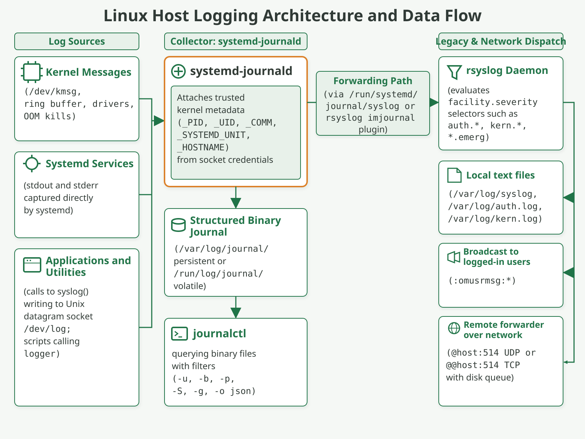

*Figure 1.16.1. Figure 1.16.1b. Systemd-journald collects kernel messages, service output, and syslog socket datagrams into structured binary storage, optionally forwarding to rsyslog for text logging and network transmission.*

It is three in the morning and a node has started misbehaving. The first thing you want to know is what it logged. Most programs report what they are doing to a system logger, and on Linux that has traditionally been the syslog service. A program calls `syslog()`, or it writes to `/dev/log`, which is a Unix datagram socket. The syslog daemon then sorts each message and sends it to files, the console, logged-in users, a database or another machine.

On a systemd system, journald receives these messages. It also collects the standard output and standard error of every service, along with kernel messages, and stores all of it in a structured binary journal. A traditional daemon such as rsyslog may run alongside it. On some Fedora and RHEL-family defaults, journald is the only logger. Applications may also skip the whole arrangement and write their own files, as databases, web servers, Slurm, Kubernetes components and vendor daemons do.

The traditional daemon is `syslogd`. On most contemporary systems journald does most of the work, so this section concentrates on the journal while still covering the older syslog tools.

A syslog line looks like this:

```text
Aug 19 17:59:48 duplex sshd[484]: Server listening on 0.0.0.0 port 22.
```

Each line holds four things: a timestamp, the host, the program with its PID, and the message. Behind the visible text, every message also carries a facility, which names the category of the sender, and a severity, which gives its urgency. The two together form the priority.

Severity tells you how urgent a message is. Read the table from top to bottom and notice the direction: 0 is the most urgent level, and 7 is the least urgent. A smaller number therefore means a message that matters more.

| Severity | Name | Meaning |
|---|---|---|
| 0 | `emerg` | System unusable |
| 1 | `alert` | Act immediately |
| 2 | `crit` | Critical condition |
| 3 | `err` | Error |
| 4 | `warning` | Warning |
| 5 | `notice` | Normal but significant |
| 6 | `info` | Informational |
| 7 | `debug` | Debug detail |

The facility list is fixed. It holds `kern`, `user`, `mail`, `daemon`, `auth`/`authpriv`, `syslog`, `lpr`, `news`, `uucp`, `cron` and `ftp`, plus `local0` to `local7`, which are free for your own applications. The list is hard-wired, it cannot be extended, and parts of it are obsolete, such as `uucp`. That is one reason many applications now log structured JSON through other channels.

One naming habit causes endless confusion. In the journal, severity is called priority, which you will see as the field `PRIORITY=` and the filter `journalctl -p`. The syslog protocol itself is described in RFC 3164, the original, and RFC 5424, the current version with optional structured data. Real senders vary, though.

### Checking what your machine runs

Before you change a single setting, find out which logger is running and where its files go. The commands below answer both questions.

```bash
ps -p 1 -o comm=                         # systemd?
systemctl is-active systemd-journald rsyslog syslog-ng 2>/dev/null
ls /etc/rsyslog.conf /etc/rsyslog.d /etc/syslog-ng 2>/dev/null
ls -l /var/log | head -30                # classic files: syslog/messages, auth.log/secure, kern.log, cron, dmesg, wtmp, btmp, lastlog
ls -ld /var/log/journal                  # does the journal persist?
journalctl --disk-usage
```

The usual files tell you a lot by their names. `syslog` or `messages` holds general messages, and `auth.log` or `secure` holds logins and `sudo`. You will also meet `kern.log`, `cron`, `dmesg`, `boot.log`, `apt/`, `dnf.log`, and `audit/audit.log` from auditd. Service subdirectories such as `nginx/` and `slurm/` hold their own logs.

Three login records are binary, so do not read them with `cat`. `wtmp` is the record behind `last`, `btmp` is the record behind `lastb`, which shows failed logins, and `lastlog` is the record behind `lastlog`. Dedicated tools read them. The journal itself lives in `/var/log/journal/`.

### rsyslog in a nutshell

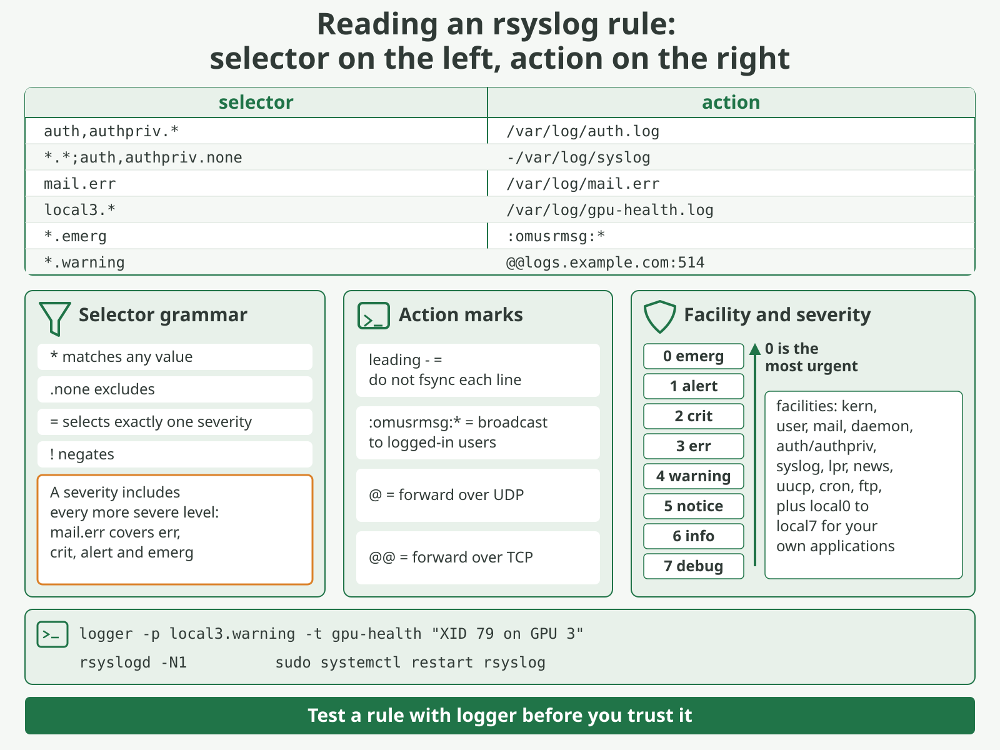

*Figure 1.16.2. A selector names facility and severity and includes every more severe level, while the action says where the message goes.*

rsyslog is the default text-file syslog daemon on Debian, Ubuntu and RHEL. It reads `/etc/rsyslog.conf`, then every file in `/etc/rsyslog.d/*.conf`. The classic style of rule maps a `facility.severity` selector to a destination. The modern style uses RainerScript filters. The examples below show both, side by side.

```text
# selector                          action
auth,authpriv.*                      /var/log/auth.log
*.*;auth,authpriv.none               -/var/log/syslog        # leading '-' = do not fsync each line
kern.*                               /var/log/kern.log
mail.err                             /var/log/mail.err
local3.*                             /var/log/gpu-health.log
*.emerg                              :omusrmsg:*             # broadcast to logged-in users
*.warning                            @@logs.example.com:514  # forward: '@' = UDP, '@@' = TCP
# modern filter syntax
if $programname == 'slurmd' then /var/log/slurm/slurmd.log
& stop
# input modules and reliable forwarding (queue so a down server does not drop logs)
module(load="imuxsock")      # /dev/log
module(load="imjournal")     # read the systemd journal
module(load="imtcp"); input(type="imtcp" port="514")
action(type="omfwd" target="logs.example.com" port="514" protocol="tcp"
       queue.type="LinkedList" queue.filename="fwd" queue.maxdiskspace="1g" queue.saveonshutdown="on"
       action.resumeRetryCount="-1")
```

A selector has a small grammar, and it is worth learning once. `*` matches any value, `.none` excludes, `=` selects exactly one severity, and `!` negates. A severity also includes every more severe level, so `mail.err` covers err, crit, alert and emerg. Test a rule with `logger` before you trust it:

```bash
logger -p local3.warning -t gpu-health "XID 79 on GPU 3"
rsyslogd -N1                      # check configuration syntax
sudo systemctl restart rsyslog
```

`logger` is the simplest way to write a syslog or journal message from a script. Use `-t` for the tag and `-p` for facility.severity. Add `-i` to include the PID, and `--journald` for structured fields on newer versions.

Network syslog gives the classic client-server design. One machine listens on UDP or TCP port 514, or TLS port 6514, and every other node forwards to it. Network devices such as switches, BMCs and storage appliances can act as syslog clients, which is why syslog survives next to the journal.

UDP can drop messages, and it has no authentication or encryption. For anything that matters, use TCP with TLS, which rsyslog configures with `gtls` or `ossl`. The original syslog trusts the sender, so spoofing is easy on an open network.

### Journal versus syslog

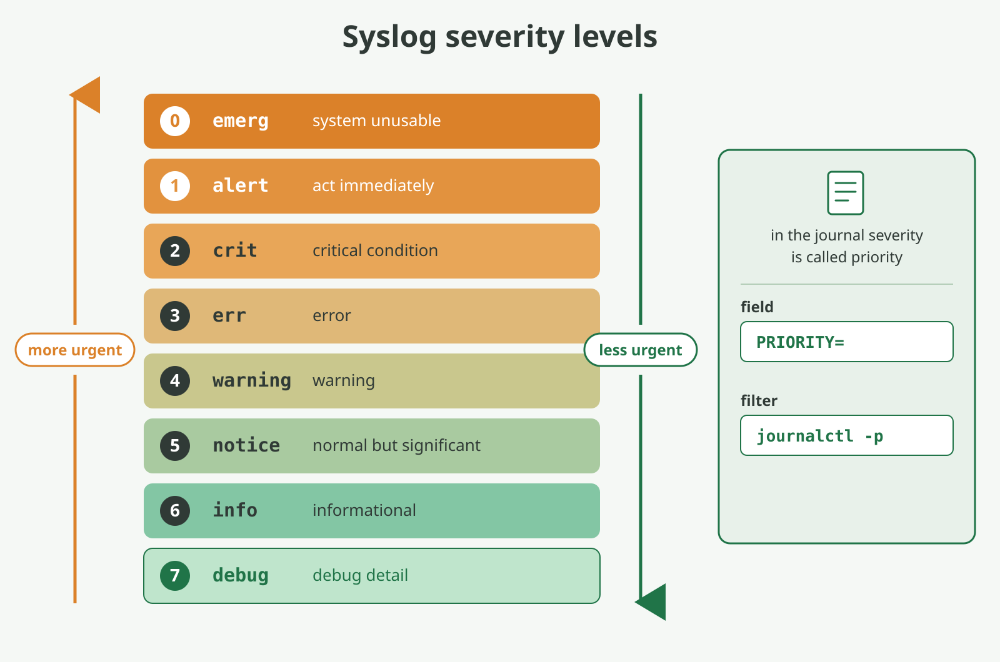

*Figure 1.16.3. A smaller severity number means a more urgent message.*

The journal and syslog store messages in very different ways, so compare them before you pick a design. The table sets them side by side.

| | journald | rsyslog / syslog-ng |
|---|---|---|
| Storage | Binary, indexed, structured fields, per-boot | Plain text files |
| Scope | One machine, rich queries (`journalctl`) | Strong at **aggregation across machines** and many output formats (files, databases, Kafka, Elasticsearch) |
| Captures | Service stdout/stderr, syslog, kernel, audit | Syslog protocol sources (plus journal via `imjournal`) |
| Rotation | Self-managed by size/age | `logrotate` |

Most hosts run journald as the collector, and there are two common ways to build on it. You can keep journald alone, query it with `journalctl`, and ship logs with an agent. Or you can forward to rsyslog when you need text files and network forwarding, using `ForwardToSyslog=yes` or rsyslog's `imjournal`. Pick one forwarding path only, or every message will appear twice.

Beyond a single host there is no single standard. Aggregation, storage, sender authentication and structured data all vary from site to site. The model has changed too. It used to be an administrator reading a file; now it is an analytics pipeline that searches and alerts on structured data.

Before you forward anything, pick one collector path for each host.

## 2. Searching and monitoring logs

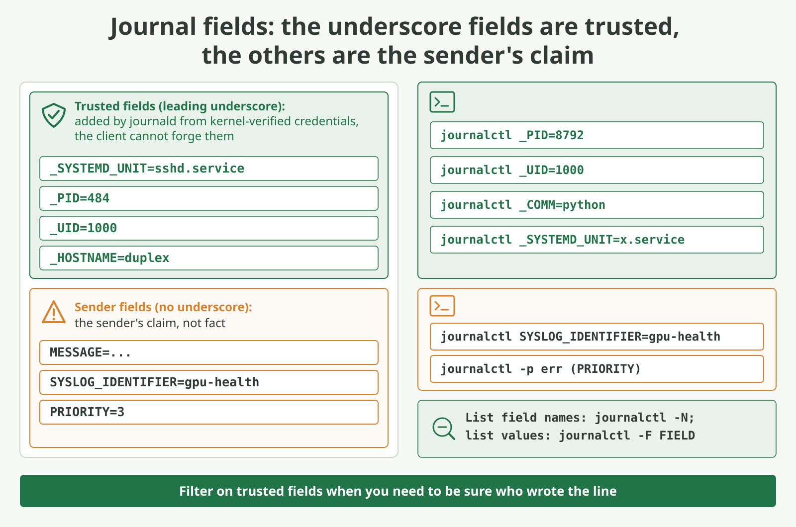

*Figure 1.16.4. Fields with a leading underscore are added by journald and cannot be forged, while the other fields are only the sender's claim.*

A job slows down, or a node drops out of the cluster, and you need the right slice of the journal quickly. The full set of options is in chapter 1.15, section 12, so this section sticks to the questions you ask most often. The table pairs each question with the filter that answers it.

| Question | Command |
|---|---|
| Last four hours | `journalctl -S -4h` (or `--since`); `-U`/`--until` for the end |
| Since a date/time | `journalctl -S 06:00:00`, `-S 2025-06-01`, `-S '2025-06-01 14:30:00'` |
| One unit | `journalctl -u slurmd`, `journalctl -u 'nvidia-*'`; list known units `journalctl -F _SYSTEMD_UNIT` |
| This/previous boot | `journalctl -b`, `-b -1`, `--list-boots`; did the last shutdown finish cleanly? `journalctl -r -b -1` and check for "Journal stopped" |
| Kernel messages | `journalctl -k [-b -1]` |
| Severity | `journalctl -p err`, `-p warning..err` (0 most severe to 7) |
| Text | `journalctl -g 'kernel.*memory'` (regular expression; needs a build with PCRE; shows only matching lines: then take the timestamp and use `-S` to see the surrounding messages) |
| By field | `journalctl _PID=8792`, `_UID=1000`, `_COMM=python`, `_SYSTEMD_UNIT=x.service`, `SYSLOG_IDENTIFIER=gpu-health`; list field names `journalctl -N`; values `journalctl -F FIELD` |
| Follow live | `journalctl -f` (`-fu UNIT`) |
| Machine-readable | `journalctl -o json` / `json-pretty`; `-o cat` message only |

One detail is easy to miss. `-S` accepts a relative time such as `-4h`, or an absolute one such as a date. Use `-p` to filter by severity, where 0 is the most severe and 7 the least.

Boot filters deserve a habit of their own, because they answer a different question. `journalctl -b` shows the current boot, from its start until now. Add an offset such as `-1` to step back to the previous boot, and run `journalctl --list-boots` to see the boot IDs with their time ranges. The `-k` option then shows kernel messages, with or without a particular boot selected.

```bash
$ journalctl --list-boots
-1 e598bd09e5c046838012ba61075dccbb Fri 2019-03-22 17:20:01 EDT—Fri 2019-04-12 08:13:52 EDT
0 5696e69b1c0b42d58b9c57c31d8c89cc Fri 2019-04-12 08:15:39 EDT—Fri 2019-08-02 19:17:01 EDT
```

Trusted fields begin with an underscore, such as `_SYSTEMD_UNIT`, `_PID`, `_UID` and `_HOSTNAME`. The client cannot forge them, because journald adds them from kernel-verified credentials. Fields without an underscore, such as `MESSAGE`, `SYSLOG_IDENTIFIER` and `PRIORITY`, come from the sender, so treat them as the sender's claim rather than as fact.

Reading the full journal needs root, or membership in `adm` or `systemd-journal`. For text logs, the classic tools still apply. Use `grep`, `less +F` and `tail -F`, which follows the file through rotation, plus `zgrep` for rotated `.gz` files. `awk` helps with fields, and `sort | uniq -c | sort -rn` counts messages by type.

`tail -f` is fine for watching one service while you debug, but it is not monitoring. A person watching a stream will miss things.

On a GPU node, a few reading habits repay the effort. Filter kernel messages for hardware and driver faults with `journalctl -k | grep -iE 'xid|nvrm|nvidia|mce|edac|nvme|pcie|aer|oom|segfault|tainted|call trace'`. Check the errors of the last boot with `journalctl -b -p err`. Look at the scheduler and its Munge daemon with `journalctl -u slurmd -u munge --since -2h`. Search for memory kills with `grep -E 'Out of memory|oom-kill' /var/log/kern.log`. Check login history with `last -x`, and failed attempts with `lastb | head`. Finally, find failed SSH logins with `journalctl _COMM=sshd -g 'Failed'`.

Before you go hunting, pick the unit and the time window first, then add the severity.

## 3. Rotating logs

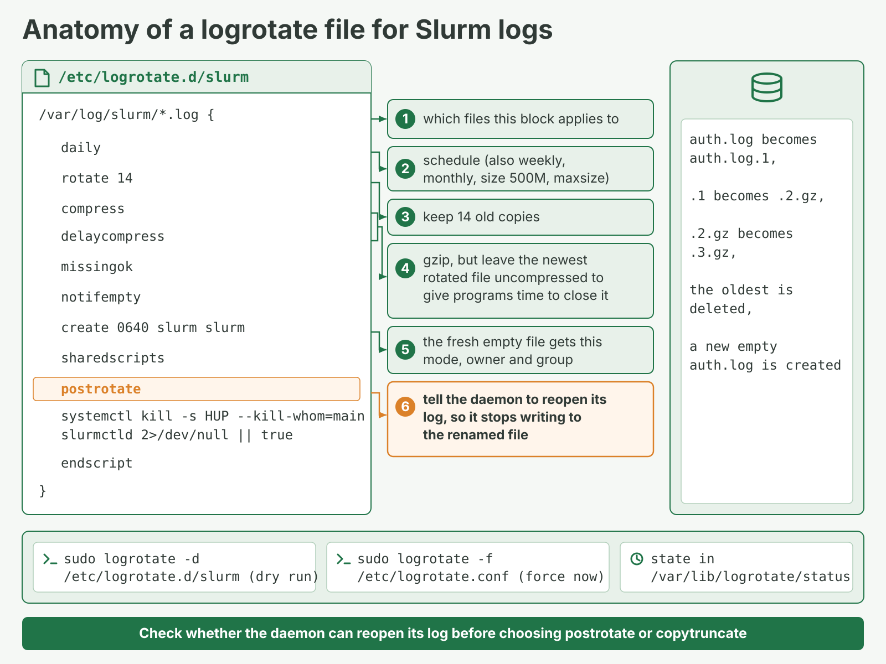

*Figure 1.16.5. Each logrotate line has a job, and the postrotate command is what makes the daemon reopen its log after the rename.*

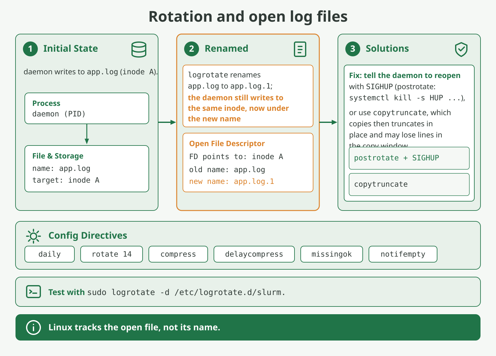

*Figure 1.16.6. A process keeps writing to the same inode after rename, so rotation needs a reopen or copytruncate.*

Text logs grow without limit, so something has to trim them, and that job falls to log rotation. Rotation splits a log into a series of chunks. On a typical host you might find `auth.log` as the current file, with `auth.log.1`, `.2.gz` and `.3.gz` behind it. Deleting the oldest lines from the front of a file is impractical, so rotation renames files instead. It deletes the oldest file, shifts each number up, renames the current file to `.1`, and creates a fresh empty file.

Distributions run `logrotate` once a day, either from a cron job or from a systemd timer called `logrotate.timer`. The global settings live in `/etc/logrotate.conf`, and each package adds its own file in `/etc/logrotate.d/`. Here is an example for Slurm logs:

```text
# /etc/logrotate.d/slurm
/var/log/slurm/*.log {
    daily
    rotate 14                # keep 14 old copies
    compress
    delaycompress            # compress the one before last (gives programs time to close the file)
    missingok
    notifempty
    create 0640 slurm slurm
    sharedscripts
    postrotate
        systemctl kill -s HUP --kill-whom=main slurmctld 2>/dev/null || true
    endscript
}
```

A handful of options come up again and again. `daily`, `weekly` and `monthly` set the schedule. `size 500M` or `maxsize` rotates by size, `rotate N` keeps N old copies, and `maxage N` limits how old a kept file may be.

Two options matter most for daemons. `copytruncate` copies the log and then truncates the original in place, which suits programs that cannot reopen their log, though it may lose lines in the copy window. `postrotate` ... `endscript` runs a command after rotation, and that command typically tells the daemon to reopen its log.

The rest are simpler. `compress` and `delaycompress` control gzip, `dateext` swaps the numbers for a date suffix, `create mode user group` sets the new file's permissions and owner, and `su user group` rotates as that user.

Test a config before you trust it. `sudo logrotate -d /etc/logrotate.d/slurm` runs a dry run in debug mode, and `sudo logrotate -f /etc/logrotate.conf` forces a rotation now. The state is kept in `/var/lib/logrotate/status`.

The subtle part is how rotation interacts with open files. A process that holds a log open keeps writing to the same inode, even after the file has been renamed, because Linux tracks the open file rather than its name. Messages written after the rename therefore land in `auth.log.1` until the process reopens its log.

If the daemon is told to reopen, with SIGHUP or `copytruncate`, writing continues into the new file. If the file is renamed before the program next opens it, `open()` simply creates a fresh file. A process that never reopens after the log is deleted leaves a large deleted-but-open file that still uses disk space. Find it with `lsof +L1`, covered in chapter 1.12. This is the standard "disk full, though the logs were rotated" bug.

The journal needs no logrotate at all. journald trims itself with limits on size, free space and age: `SystemMaxUse=`, `SystemKeepFree=` and `MaxRetentionSec=`. You can also run `journalctl --vacuum-size=2G` or `--vacuum-time=14d` by hand, as chapter 1.15 explains.

Container runtimes have their own rotation. Docker uses `max-size` and `max-file`, while containerd and the kubelet use `containerLogMaxSize` and `containerLogMaxFiles`. Unrotated container JSON logs are a classic reason a node's `/var` fills up.

Before you ship a new daemon, check whether it can reopen its log, because that decides which rotation method you need.

## 4. Central logging for clusters

Once you run a fleet, the logs on each node stop being the archive and become a buffer. The usual design has four steps: collect on each node, ship reliably, store and index centrally, then query and alert. The diagram below shows the flow.

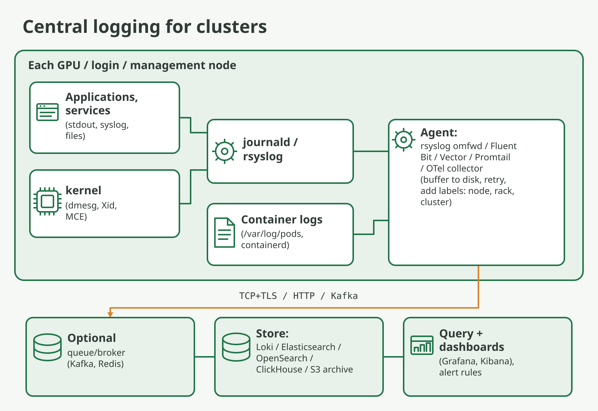

*Figure 1.16.7. Central logging for clusters.*

Reliability comes first, because a log you never received cannot be investigated. Agents should buffer to disk and retry, because syslog over UDP is not acceptable for audit-relevant logs. Back-pressure must never stall the application that writes the log.

Attach metadata to every line. Include the cluster, the node name and the rack, plus the job ID and user for Slurm, or the namespace and pod for Kubernetes. That is how logs line up with the job that produced them. Keep the timestamp in UTC, with nanosecond or millisecond precision.

Volume and cost are the next concern. A GPU node can produce gigabytes of logs per day from kubelet verbosity, NCCL debug output and framework logs. Decide the log level for each component, sample or drop noisy debug logs, and set retention tiers. Keep hot storage for days, then move to cheaper object storage for months. Rate-limit at the source too, and remember that journald rate limits hide bursts, so raise them for important units, as chapter 1.15 explains.

Security needs the same care, because logs contain usernames, paths and sometimes secrets. Authenticate and encrypt the transport, and protect the central store. Never log tokens, and limit who can read the logs. For audit logs, consider tamper evidence, such as immutable storage or signed journal sealing with `FSS`. The `auditd` daemon records security-relevant syscalls and file access, as chapter 1.21 covers.

On GPU nodes, capture the kernel ring buffer first. It carries Xid, NVRM, PCIe AER, MCE and EDAC memory errors, OOM kills, NVMe resets, soft lockups and link flaps. Capture the NVIDIA services too, such as `nvidia-fabricmanager`, `nvidia-persistenced` and DCGM.

Scheduler and runtime logs matter as well: `slurmd`, `munge`, containerd, kubelet and CNI. Storage client errors from NFS or Lustre belong in the pipeline, along with `sshd` and `sudo` authentication. Take the BMC system event log, SEL, through IPMI or Redfish. Finally, send application job output per job, either to the shared filesystem or to the log pipeline.

The last step is to turn recurring messages into counters and alert on rates. A Loki or Elastic rule can do this, and so can `mtail`, `grok_exporter` or a small script. An Xid that appears once is worth a ticket. A new Xid 79 or an ECC uncorrectable error should cordon or drain the node automatically, which Part 9 and the Slurm health checks cover.

Before you add a log source, decide which alert it feeds, so the source has a reason to exist.

## 5. Final notes on logging

A log line is only useful if someone, or something, can read it later without asking you what it means. Treat logging as a pipeline, not as a file on a disk. Standardise formats where you can, using JSON lines with a consistent schema. Keep time in UTC, and put a request or job ID in every message. Avoid multi-line stack traces, because they break line-based shippers, and use the shipper's multiline parser if you must log them. Never rely on a human tailing a file. Finally, remember the trust model: the sender's claim about who it is can be false unless the transport authenticates it.

Trust is the last piece, and the oldest version of it was no trust at all. The original syslog had no authentication to speak of. A server simply believed the machine or program it heard from. Logs also travelled without encryption, which left them open to snooping on networks with strict security needs.

Contemporary syslog servers offer encryption for each message and authentication for the machine where it originates. Individual applications are less clear. How can you be sure that the program calling itself your web server really is the web server? Ask that question before you trust a log line.

Before you ship a log, check that a machine can parse each line without help from a person.

## 6. Time

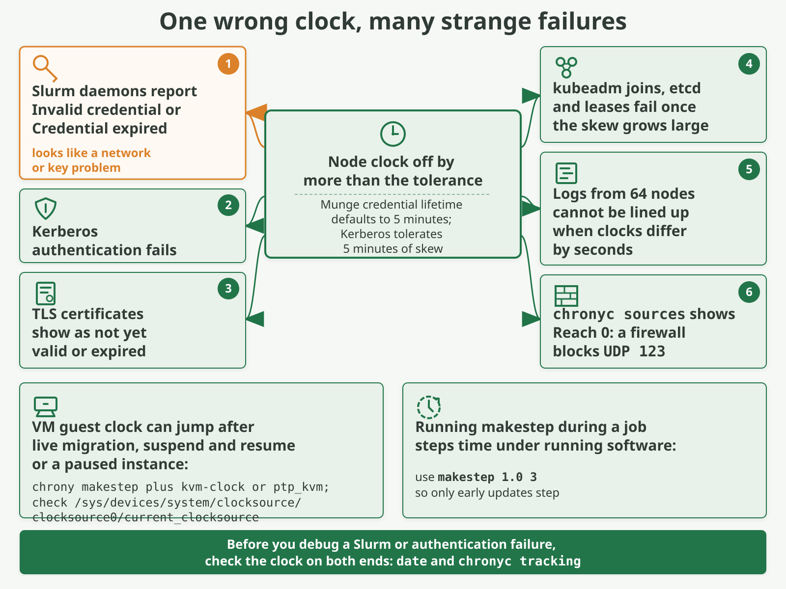

*Figure 1.16.8. A skewed clock shows up as authentication, certificate and cluster join errors that look like network or key problems.*

Two nodes disagree about the time by a few minutes, and jobs that land on the wrong one are rejected by authentication. Nothing looks broken on either machine, and nothing points at the clock. This section is about why that happens and how to stop it.

A Unix machine needs accurate time, and more of the system depends on it than most people expect. Authentication tokens from Munge, Kerberos, JWT and TLS compare timestamps. So do file timestamps used by `make`, `rsync` and backups. Logs, distributed databases and schedulers depend on time as well. When two machines disagree about the time, any of these can fail.

### The clocks

The system clock is kept by the kernel. It counts seconds, plus nanoseconds, since 1970-01-01 00:00:00 UTC, a moment called the epoch. Run `date +%s` to see the count. Programs turn that number into local time. The kernel clock has no time zones and no daylight saving, which is why servers should run in UTC.

The hardware clock, or real-time clock, shortened to RTC, is a battery-backed chip that keeps time while the machine is off. The kernel reads it at boot to set the system clock. `hwclock` reads and writes it: `hwclock --systohc` copies system time to the RTC, and `hwclock --hctosys` does the reverse. Keep the RTC in UTC with `timedatectl set-local-rtc 0`, which avoids zone and daylight-saving confusion. Dual-boot systems with Windows expect local time, and that is one reason to change the Windows setting instead.

Both clocks drift. The kernel clock can drift by seconds per day on bad hardware, so a machine that runs for months must be disciplined by a time protocol. Do not keep fixing drift by hand with `date -s` or `hwclock`, because a clock that jumps backward can lose or mangle time-based events.

You could run `adjtimex` to update the system clock smoothly from the RTC, as *How Linux Works* Section 7.5.1 describes. In practice, a network time daemon is the better choice. It slews the clock for small errors, which means speeding it up or slowing it down slightly, and it steps the clock only for large ones.

Three clocks matter to a programmer. `CLOCK_REALTIME` is wall time, and it jumps when someone sets it. `CLOCK_MONOTONIC` never jumps back, so use it to measure durations. `CLOCK_TAI` is the third. Software that measures elapsed time must use the monotonic clock. Leap seconds are handled either by smearing, as Google and many cloud providers do, or by stepping. Fleets should not mix servers that smear with servers that do not.

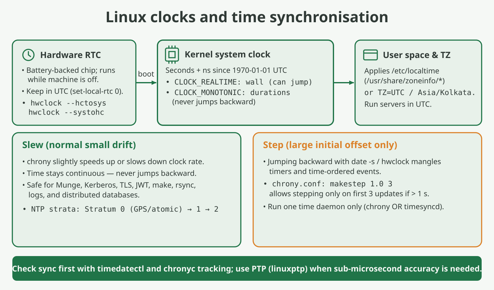

*Figure 1.16.9. Hardware RTC, kernel clocks, and NTP slewing versus stepping.*

### Time zones

The zone comes from `/etc/localtime`, which is a link to, or a copy of, a binary file under `/usr/share/zoneinfo/`. That directory holds the IANA tz database, with names such as `UTC`, `America/New_York` and `Asia/Kolkata`. Set the zone with `timedatectl set-timezone UTC`, or with `ln -sf /usr/share/zoneinfo/UTC /etc/localtime`, and list the available names with `timedatectl list-timezones`.

For a single shell or command, set the `TZ` variable instead, as in `TZ=Asia/Kolkata date` or `export TZ=UTC`. Cron and systemd timers read their schedules in the zone they run in, and timers accept an explicit zone in `OnCalendar`. Daylight-saving changes can make cron jobs run twice, or not at all, in some regions. That is one more reason to run servers in UTC.

The kernel stores a single count, and user-space programs convert it into a readable time. They apply the local zone and handle daylight saving, along with any other odd local rules. The zone comes from `/etc/localtime`, which is a binary file, so do not try to read it.

Zone files live in `/usr/share/zoneinfo`, which holds many zones and aliases. Copy one of those files to `/etc/localtime`, link to one, or use your distribution's tool. The `tzselect` command can help you find the right name. To try a zone in one shell, set the `TZ` variable. To use it for a single command, put `TZ` in front of that command.

```bash
$ export TZ=US/Central
$ date
$ TZ=US/Central date
```

These commands show and set the clock, the zone and the RTC.

```bash
date; date -u; date +%s; date -d @1700000000
timedatectl                       # local time, UTC, RTC time, zone, "System clock synchronized: yes", "NTP service: active"
timedatectl set-timezone UTC; timedatectl set-ntp true
sudo hwclock --show; sudo hwclock --systohc --utc
```

Read the `timedatectl` output first, because it answers most of the questions in one screen. It shows local time, UTC, the RTC time, the zone, and whether the system clock is synchronised and NTP is active.

### Network time: NTP

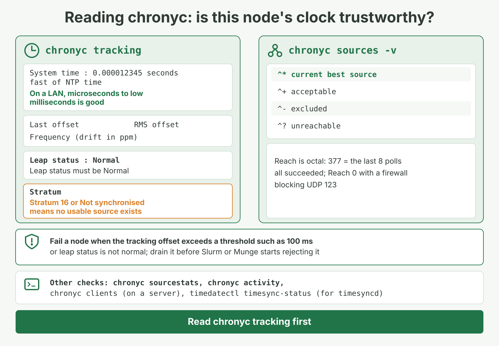

*Figure 1.16.10. Tracking shows the offset and stratum, and the sources list marks the best source with a star and shows reachability as an octal value.*

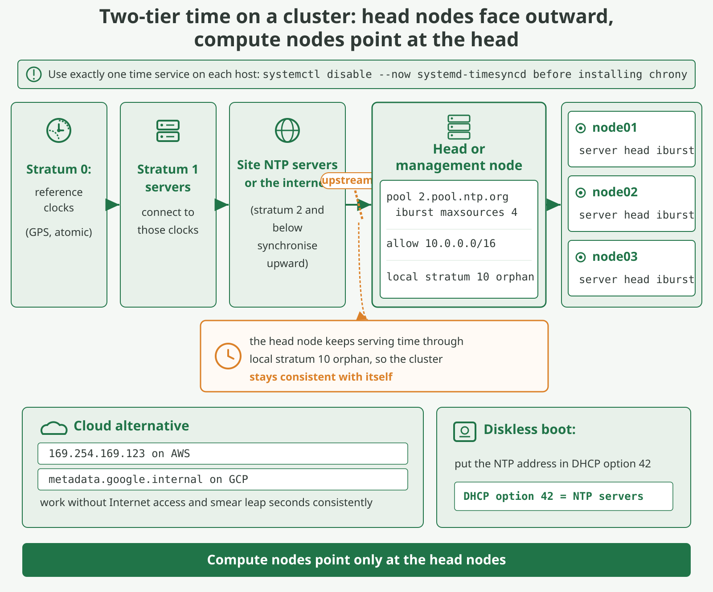

*Figure 1.16.11. Compute nodes need one directive pointing at the head nodes, and an orphan setting lets the head keep serving time when upstream is lost.*

NTP, the Network Time Protocol, synchronises a machine to a hierarchy of time servers. Servers are ranked by stratum, which is their distance from a trusted clock. Stratum 0 holds the reference clocks, such as GPS or atomic clocks. Stratum 1 servers connect to those clocks, stratum 2 servers synchronise to stratum 1, and so on. An NTP client measures several servers, filters out the bad ones, and steers the local clock. On Linux, you can choose from several implementations.

| Implementation | Notes |
|---|---|
| **`chrony`** (`chronyd`, `chronyc`) | The current recommended full NTP client/server; default on RHEL-family; handles intermittent connectivity, VMs (and hypervisor clocks), fast convergence, hardware timestamping, leap-second smearing, acts as a server for a cluster |
| **`systemd-timesyncd`** | A small SNTP client in systemd, default on Ubuntu desktops/servers (cloud images often use chrony); fine for a single host that just needs roughly correct time; not a server; limited diagnostics |
| **`ntpd`** (reference NTP daemon) | The classic; being replaced by chrony/ntpsec in distributions |
| **PTP** (`linuxptp`: `ptp4l`, `phc2sys`) | Precision Time Protocol, sub-microsecond with hardware timestamping NICs and PTP-aware switches; used for trading, telecom, some HPC/AI fabrics needing tight synchronisation and by clouds that expose PTP hardware clocks to VMs (`/dev/ptp*`) |

Use exactly one time service on each host, and disable the others. Before you install chrony, for example, run `systemctl disable --now systemd-timesyncd`.

The chrony configuration file is `/etc/chrony/chrony.conf` on Debian and Ubuntu, and `/etc/chrony.conf` on RHEL. Here is a configuration with comments:

```text
# upstream sources: a pool or specific servers; 'iburst' speeds up the first sync
pool 2.pool.ntp.org iburst maxsources 4
server time.internal.example.com iburst prefer
# allow a big step at startup (first 3 updates if offset > 1 s) instead of slewing for hours
makestep 1.0 3
# keep the RTC in sync
rtcsync
# remember drift
driftfile /var/lib/chrony/drift
# serve time to the cluster (on the head/management node)
allow 10.0.0.0/16
# act as a time server even if upstream is lost (isolated cluster): stratum 10 local reference
local stratum 10 orphan
# logging
logdir /var/log/chrony
```

The `makestep` line allows a large step only in the first three updates after startup. After that, every correction slews, which means the clock is nudged rather than jumped.

On a cluster, the standard layout has two tiers. Management, or head, nodes synchronise with the site's NTP servers or with the internet. Compute nodes point only at the head nodes, so a cluster with no outside connectivity still has consistent time. When upstream is lost, the head node uses `local stratum` or an `orphan` setting to keep serving time. Compute nodes then need only one directive, `server head iburst`.

For diskless boot, put the NTP address in DHCP option 42, as chapter 1.14 explains. In clouds, prefer the provider's internal time source, such as `169.254.169.123` on AWS or `metadata.google.internal` on GCP. These work without Internet access, and they smear leap seconds consistently.

These commands check whether chrony is working.

```bash
chronyc tracking                  # offset from true time, frequency error, stratum, last update, leap status
chronyc sources -v                # servers: '^*' = current best, '^+' = acceptable, '^-' excluded, '^?' unreachable; Reach octal (377 = last 8 polls ok)
chronyc sourcestats; chronyc activity
chronyc makestep                  # force an immediate step now (use sparingly)
chronyc clients                   # on a server: who is asking
timedatectl timesync-status       # for systemd-timesyncd
journalctl -u chrony -u chronyd --since -1h
```

Read `chronyc tracking` first. Its `System time` line gives the current offset, in the form `System time : 0.000012345 seconds fast of NTP time`. On a LAN, an offset of microseconds to low milliseconds is good. Watch `Last offset`, `RMS offset` and `Frequency`, which shows the drift in ppm, and confirm that `Leap status: Normal`. A `Stratum` of 16, or the words "Not synchronised", means no usable source exists.

Time problems show up in clusters in a few recurring ways.

- Munge credentials have a short lifetime, five minutes by default. A node whose clock differs by more than that TTL rejects them. Slurm daemons then report "Invalid credential" or "Credential expired", which look like network or key problems. Check `date` and `chronyc tracking` on both ends before you touch either.
- Kerberos tolerates five minutes of skew by default. TLS certificates show as "not yet valid" or "expired" when the clock is wrong. `kubeadm` joins, etcd and leases fail once the skew grows large.
- Correlating logs across nodes needs sub-second agreement. You can trace a hung training job through the logs of 64 nodes only if their clocks agree. When clocks differ by seconds, the logs cannot be lined up at all.
- On a VM, the guest clock may jump after a live migration, a suspend and resume, or a paused instance. Chrony with `makestep` handles this, together with the hypervisor's paravirtual clock, `kvm-clock` or `ptp_kvm`. Check the clock source with `cat /sys/devices/system/clocksource/clocksource0/current_clocksource`.
- Running `makestep` during a job steps time under software that is still running. Set `makestep 1.0 3` instead, which acts only early at boot, so later corrections slew.
- A firewall that blocks UDP 123 shows `Reach 0` in `chronyc sources`.
- GPU timestamps from `nvprof` or Nsight come from their own clocks. To align GPU traces across nodes, you still need synchronised host clocks. For microsecond alignment, use PTP.

Before you debug a Slurm or authentication failure, check the clock on both ends.

### Classic ntpd setup for a small cluster

Many older clusters ran the reference `ntpd` daemon instead of chrony. The layout is the same two-tier design as above. One head server talks to outside time servers, and every node talks only to that server. A cluster with no outside link still keeps one shared time source this way.

On the server, install the `ntp` package. Then list the upstream servers in `/etc/ntpd.conf`, and tell the daemon which internal interface to serve:

```text
server 1.us.pool.ntp.org
server 2.centos.pool.ntp.org
interface listen eth0   # internal interface
```

On each node, the `/etc/ntpd.conf` file needs only one line: `server server.cluster.myorg`. The last step is to enable the `ntpd` service at boot, on the server and on every node. The book itself warns that this recipe may be outdated, so treat it as a plan rather than a rule. For new work, use chrony as described above.

## 7. Scheduling recurring tasks: cron

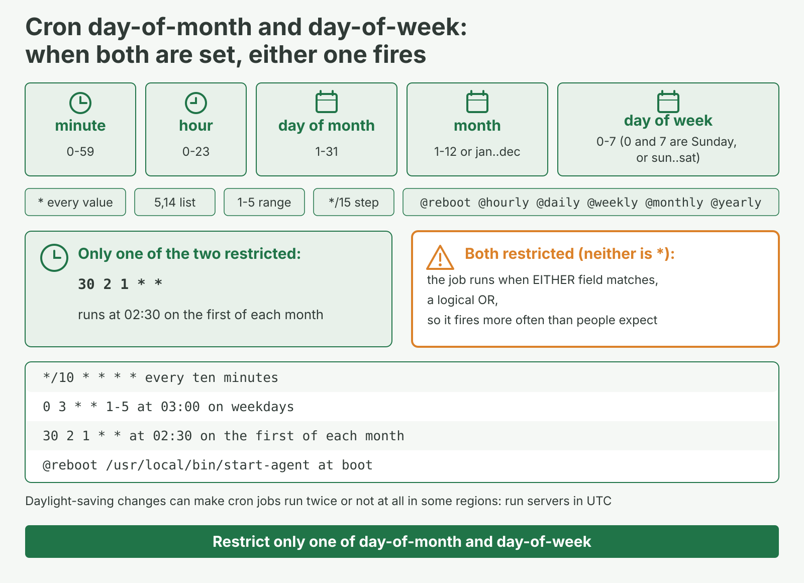

*Figure 1.16.12. If both day-of-month and day-of-week are restricted the job runs when either matches, so the schedule fires more often than expected.*

You inherit a node that runs a dozen unattended jobs, and the only documentation is the crontab itself. cron is the classic periodic scheduler, and it is old enough to be present on almost every Unix system you will meet. The `crond` daemon wakes every minute and runs jobs from crontab files. Each job is a command with five time fields in front of it:

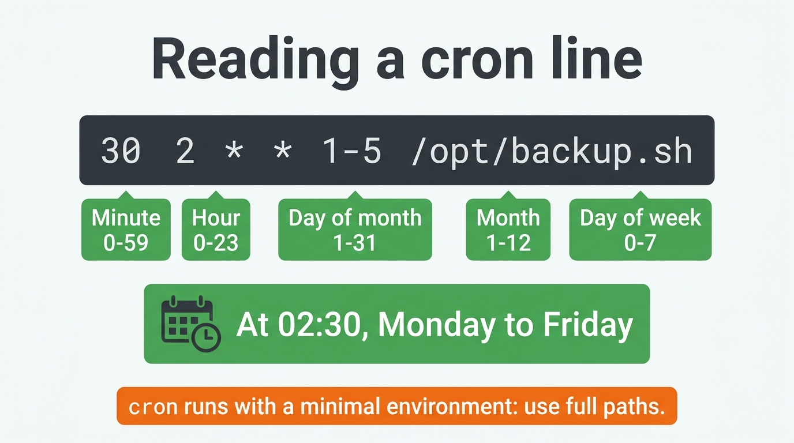

*Figure 1.16.13. The five time fields of a cron line and what the example means.*

```text
# minute  hour  day-of-month  month  day-of-week   command
  15      09    *             *      *             /home/juser/bin/spmake
```

Read the five fields from left to right, because each one accepts a narrow range of values. The table lists them.

| Field | Range |
|---|---|
| minute | 0-59 |
| hour | 0-23 |
| day of month | 1-31 |
| month | 1-12 (or `jan`..`dec`) |
| day of week | 0-7 (0 and 7 are Sunday; or `sun`..`sat`) |

A `*` matches every value. A list such as `5,14` matches both values, `1-5` is a range, and `*/15` is a step, meaning every 15. The shortcuts save typing: `@reboot`, `@hourly`, `@daily`, `@weekly`, `@monthly` and `@yearly`.

One trap catches almost everyone. If both day-of-month and day-of-week are restricted, meaning neither is `*`, the job runs when either field matches. That is a logical OR, so the schedule fires more often than people expect. A few examples show how this works. `*/10 * * * *` runs every ten minutes. `0 3 * * 1-5` runs at 03:00 on weekdays. `30 2 1 * *` runs at 02:30 on the first of each month. `@reboot /usr/local/bin/start-agent` runs at boot.

### Where crontabs live

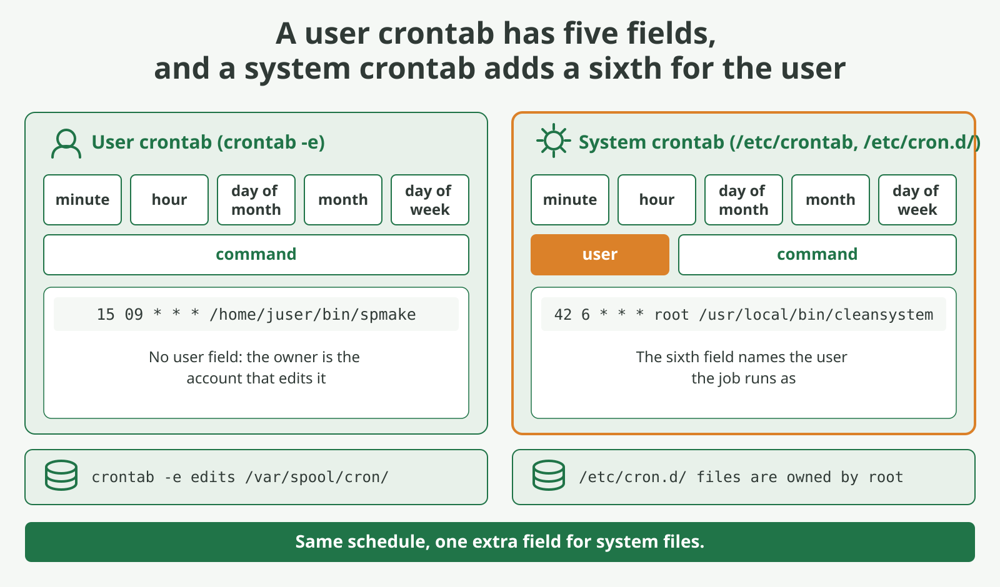

*Figure 1.16.14. A user crontab has five time fields followed by the command, while a system crontab adds a user field before the command.*

- User crontabs live in `/var/spool/cron/crontabs/` on Debian and in `/var/spool/cron/` on RHEL. Edit them only with `crontab -e`, which checks the syntax, and list them with `crontab -l`. Be careful with `crontab -r`, which removes the crontab with no confirmation. It sits right next to `-e` on the keyboard, which makes it a famous trap. Root can use `-u user`. These files have no user field.
- System crontabs are `/etc/crontab` and the files in `/etc/cron.d/`. They carry an extra sixth field, the user, as in `42 6 * * * root /usr/local/bin/cleansystem >/dev/null 2>&1`. Packages drop their own files into `/etc/cron.d/`. Scripts in `/etc/cron.hourly`, `/etc/cron.daily`, `/etc/cron.weekly` and `/etc/cron.monthly` are run by `run-parts` at those intervals. On Debian, the names must not contain dots or tildes, and the scripts must be executable. `anacron` runs these jobs on machines that are not always on, and it catches up on any job missed while the machine was off.
- Access control uses `/etc/cron.allow` and `/etc/cron.deny`.

### Cron's environment (the cause of most "works in my shell" failures)


*Figure 1.16.15. Cron sets only a handful of variables and a short PATH, so use absolute paths and test with the same minimal environment.*

Cron runs commands with a minimal environment, and this is the single biggest cause of a job that works in your terminal but fails on schedule. It sets only `HOME`, `LOGNAME`, `SHELL=/bin/sh` and `PATH=/usr/bin:/bin`. It does not run login startup files, and it gives the job no terminal. The working directory is the user's home.

Work around this in your crontab and in your scripts. Use absolute paths for commands and files. Set `PATH=` and `SHELL=/bin/bash` at the top of the crontab when you need them. Source the environment you need explicitly in your script, such as with `. /etc/profile.d/...`. Avoid `~` and aliases. Remember that `%` is special in the command field, so escape it as `\%`, as in `date +\%F`.

Output goes to the owner by mail if a mailer exists. Otherwise it is discarded. Redirect it yourself with `>> /var/log/job.log 2>&1`, or send it to the journal with `| logger -t myjob`. Set `MAILTO=` to send mail elsewhere or to turn it off. Cron logs each job's start and failure to syslog or the journal, so `journalctl -u cron`, `grep CRON /var/log/syslog`, or `/var/log/cron` on RHEL will show you what happened.

### Making cron jobs safe

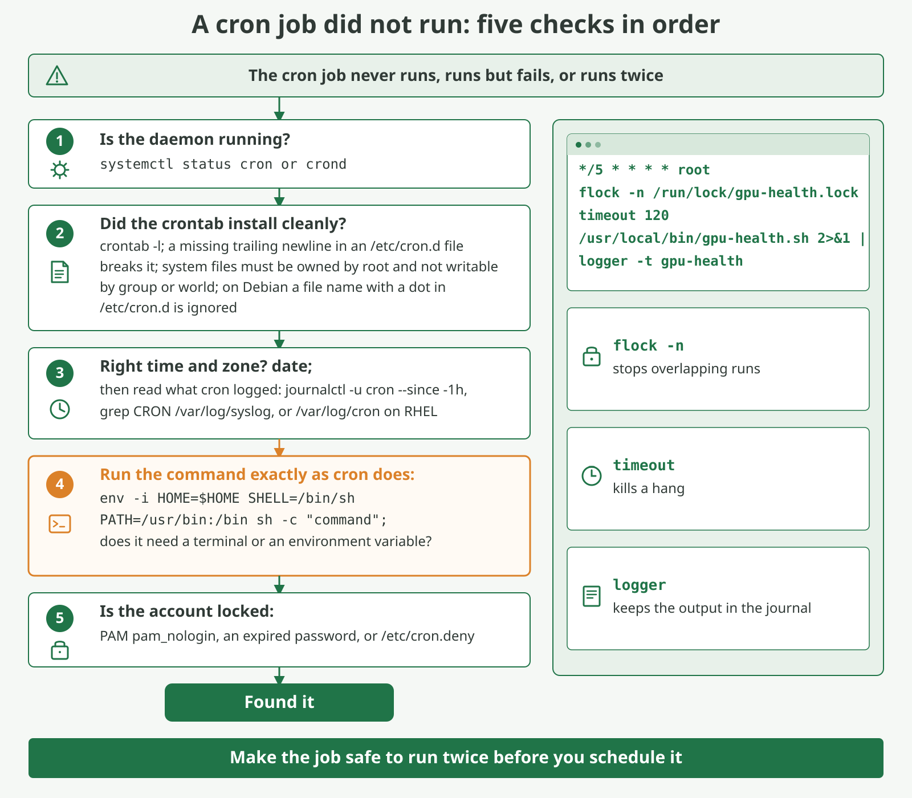

*Figure 1.16.16. Check the daemon, the crontab file, the time and logs, the minimal environment and the account, in that order.*

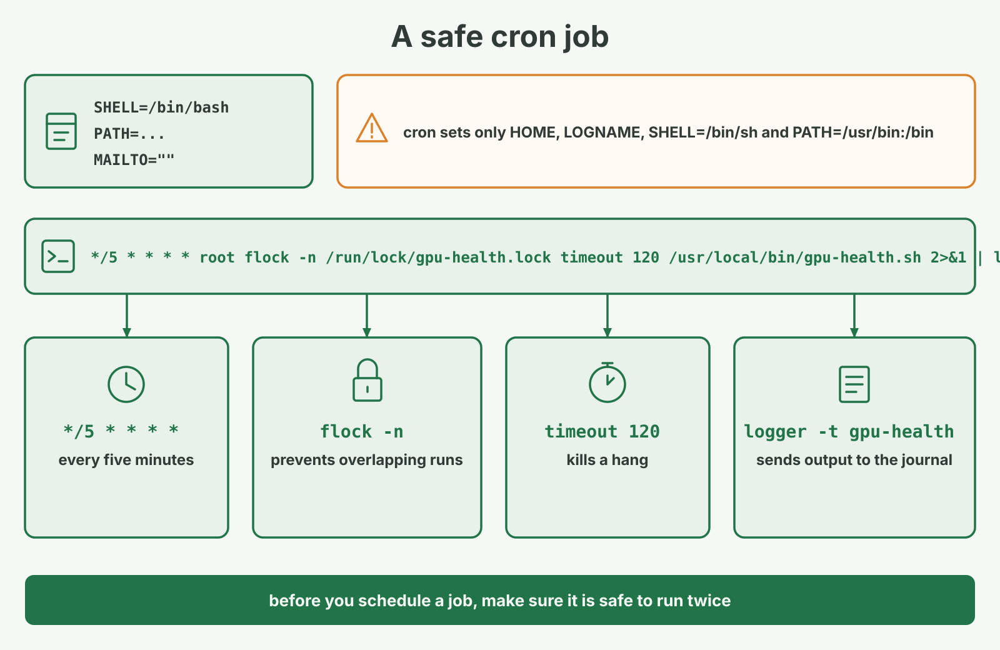

*Figure 1.16.17. Guards against overlap, hangs and lost output make a cron job safe on a fleet.*

This file shows a safe pattern you can copy. It sets the shell and the path, turns off mail, and wraps the job in two guards.

```bash
# /etc/cron.d/gpu-health
SHELL=/bin/bash
PATH=/usr/local/sbin:/usr/local/bin:/usr/sbin:/usr/bin:/sbin:/bin
MAILTO=""
*/5 * * * * root flock -n /run/lock/gpu-health.lock timeout 120 /usr/local/bin/gpu-health.sh 2>&1 | logger -t gpu-health
```

- `flock -n` prevents overlapping runs. Without it, a slow run and the next trigger would simply pile up.
- `timeout` kills a hang. A script stuck on a dead NFS mount keeps accumulating processes until the node falls over.
- Randomise the start on a fleet. Use `sleep $((RANDOM % 300)); cmd`, or `RandomizedDelaySec` in timers, so hundreds of nodes do not all hit the same API or filesystem at `:00`.
- Log to the journal or a file, and alert on failure. Cron hides exit codes unless you capture them. A heartbeat, or dead-man's-switch check, such as `curl -fsS https://healthcheck/ping` at the end of a successful run, catches jobs that silently stopped.
- Make jobs idempotent, as chapter 1.9 describes, so they tolerate re-runs and missed runs.

When a cron job does not run, work through a short checklist, in order. First, is `crond` running? Check `systemctl status cron` or `crond`. Next, did the crontab install without a syntax error? Check `crontab -l`. A missing trailing newline in an `/etc/cron.d` file breaks it, and so do wrong permissions or ownership. System files must be owned by root, and they must not be writable by group or world. On Debian, a file name with a dot in `/etc/cron.d` is ignored. Then check the time and zone with `date`, and read what cron logged with `journalctl -u cron --since -1h`.

Next, run the command exactly as cron does: `env -i HOME=$HOME SHELL=/bin/sh PATH=/usr/bin:/bin sh -c 'command'`. Ask yourself whether the command needs a terminal or an environment variable. Finally, check whether the user's account is locked, through PAM `pam_nologin`, an expired password, or `/etc/cron.deny`.

Before you schedule a job, make sure it is safe to run twice.

## 8. One-time tasks: `at`, `batch` and `systemd-run`

Sometimes you need a command to run exactly once, at some later time. That is what `at` is for, and the `atd` daemon must be running for it to work. The commands below show the basic moves.

```bash
at 22:30                 # then type commands, finish with Ctrl-D (reads stdin)
echo '/usr/local/bin/backup.sh' | at 02:00 tomorrow
at now + 2 hours; at 'noon Fri'; at 22:30 30.09.25
atq; at -c JOBID; atrm JOBID
batch                    # run when system load is below about 1.5 (reduces impact on busy hosts)
```

Finish the `at` prompt with Ctrl-D. Jobs run in a copy of your environment, taken at the moment you submit them. `systemd-run` is the modern equivalent, and it is more powerful:

```bash
sudo systemd-run --on-calendar='2025-09-30 18:00' /usr/bin/echo test       # transient timer + service (include a date, or it repeats daily)
sudo systemd-run --on-active=30m --unit=late-drain /usr/local/bin/drain-node.sh   # relative: in 30 minutes
systemd-run --user --on-active=1h /usr/bin/notify-send done                # user manager (loginctl enable-linger so it survives logout)
systemctl list-timers | grep late-drain; systemctl stop late-drain.timer     # cancel
```

Include a date in `--on-calendar`, because without one the timer repeats daily. `--on-active` counts from now. Add `--user` to run under your own user manager, and run `loginctl enable-linger` so the job survives logout.

On a shared cluster, ordinary users should submit work through the batch scheduler, which is Slurm in Part 6. They should not use cron or `at` on compute nodes. Login nodes often disable `at` and restrict cron, precisely to prevent unscheduled load. Recurring user jobs belong in Slurm, with `scrontab` or `sbatch --begin`, or in Kubernetes `CronJob`s.

Before you use `at` or cron on a shared cluster, check whether the scheduler should own the job.

## 9. cron versus systemd timers (*How Linux Works* Section 7.6.4)

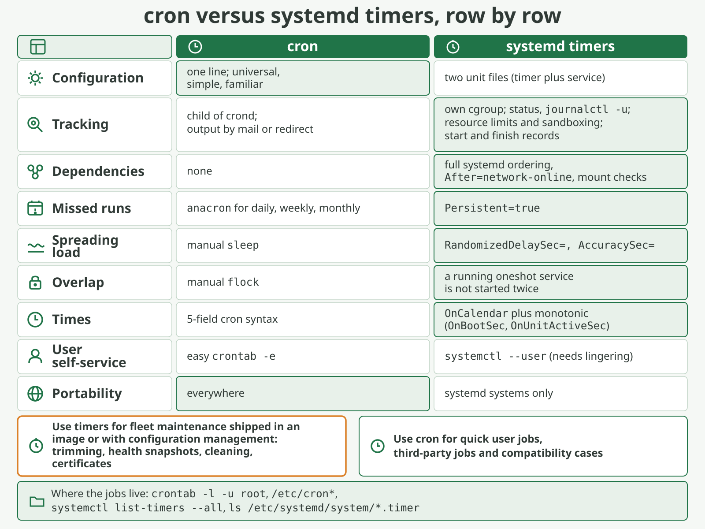

*Figure 1.16.18. Timers add tracking, ordering, catch-up and overlap protection, while cron is simpler and runs everywhere.*

Your node image ships a nightly trim job, and someone on the team asks why it is a systemd timer and not a cron line. The `cron` utility is one of the oldest parts of a Unix or Linux system. It predates Linux itself, and its configuration format has barely changed in decades. A tool that familiar stays everywhere.

Still, systemd timer units, covered in chapter 1.15, section 9, solve several old cron headaches. Both schedule recurring jobs, and each has clear strengths. Compare them in the table before you pick one.

| | cron | systemd timers |
|---|---|---|
| Configuration | One line; universal, simple, familiar | Two unit files (timer + service) |
| Tracking | Child of `crond`; output by mail/redirect | Own cgroup; status, `journalctl -u`; resource limits and sandboxing; start/finish records |
| Dependencies | None | Full systemd ordering (`After=network-online`, mount checks) |
| Missed runs | `anacron` for daily/weekly/monthly | `Persistent=true` |
| Spreading load | Manual `sleep` | `RandomizedDelaySec=`, `AccuracySec=` |
| Overlap | Manual `flock` | A running `oneshot` service is not started twice |
| Times | 5-field cron syntax | `OnCalendar` plus monotonic (`OnBootSec`, `OnUnitActiveSec`) |
| User self-service | Easy `crontab -e` | `systemctl --user` (needs lingering) |
| Portability | Everywhere | systemd systems only |

A practical rule covers most cases. Use timers for fleet maintenance that you ship in an image or with configuration management: trimming, health snapshots, cleaning and certificates. Use cron for quick user jobs, third-party jobs and compatibility cases. Whichever you choose, know where the jobs live: `crontab -l -u root`, `/etc/cron*`, `systemctl list-timers --all`, and `ls /etc/systemd/system/*.timer`.

Before you add a recurring job, pick the mechanism that matches where the job will run.

## 10. AI-infrastructure patterns

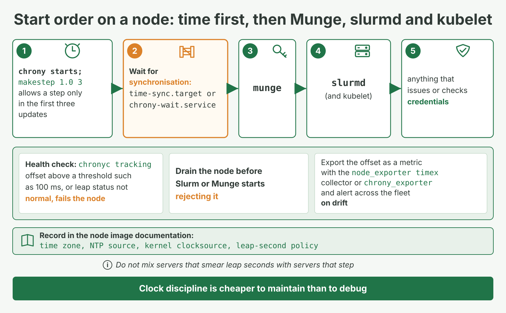

*Figure 1.16.19. Wait for clock synchronisation before starting Munge, slurmd and kubelet, and fail a node whose offset drifts past the threshold.*

Clock discipline is the fleet baseline, and it is much cheaper to maintain than to debug. Run chrony on every node and point it at the management nodes, or at the cloud's internal source. Use UTC everywhere, with `makestep 1.0 3`. Add a health check that fails a node when the `chronyc tracking` offset exceeds a threshold such as 100 ms, or when the leap status is not normal. Drain that node before Slurm or Munge starts rejecting it. Export the offset as a metric, using the `node_exporter` timex collector or `chrony_exporter`, and alert across the fleet on drift.

Boot order matters too, because some daemons must not start before the clock is right. Start chrony and wait for synchronisation, using `time-sync.target` or `chrony-wait.service`, before you start `munge`, `slurmd`, `kubelet`, and anything that issues or checks credentials. Chapter 1.15 covers the ordering rules.

The log pipeline for GPU nodes needs its own care. Forward the kernel ring buffer, service logs and job output centrally, including Xid, ECC and PCIe AER events. Alert on Xid classes, and label each line with its node, rack and job. Keep the on-node journal persistent but size-limited, as chapter 1.15 describes. Rotate application and container logs. Check that nothing in `/var/log` or `/var/lib/containerd` can fill `/`.

Health and housekeeping timers carry the routine work. Examples include `fstrim`, NVMe SMART snapshots, GPU diagnostics when the node is idle, stale-scratch cleaning with `tmpfiles.d` by age, certificate and token renewal, and log pruning. Randomise these timers across the fleet, make them idempotent, log to the journal, and alert when a heartbeat goes missing.

Scheduler behaviour depends on the clock more than people realise. Slurm accounting, job time limits, backfill, reservations and licence windows are all computed from daemon clocks. `slurmctld` and `slurmdbd` must agree with the database and with the compute nodes. After any change to the time source, restart the daemons in order and verify the result.

Reproducibility depends on recording the basics. Write the time zone, the NTP source, the kernel clocksource and the leap-second policy into the node image documentation. If jobs span cloud and on-premises sites, unify the smearing policy as well.

Audit and compliance raise the bar again. Many regulated environments require tamper-resistant log storage, set retention periods, and synchronised, trustworthy timestamps. Document the chain from the source clock all the way to the stored log.

Before you roll out a new node image, record its time settings and check that every daemon agrees with the clock.

## How it fails

Most of these failures show up as a symptom long before anyone suspects the cause. Each item below names a failure and its fix.

1. Disk fills up from logs. Unrotated application or container logs, a missing `copytruncate`, a deleted but open log, or an unbounded journal can each cause it. Set limits and rotation everywhere, and consider a separate `/var/log` filesystem or a quota.
2. Logs are lost on reboot when the journal lives only in memory. Use persistent storage, and ship logs off the node.
3. Messages go missing when journald or rsyslog rate limits drop a burst, when UDP syslog drops packets, or when a forwarder dies. Use reliable transport and queues, and raise the limits.
4. Messages appear twice when journald forwards to rsyslog, which also reads the journal. Pick one path.
5. Timestamps look wrong, or logs arrive out of order, after clock skew or mixed time zones. Use UTC and NTP.
6. The clock is wrong after boot, which can follow a dead RTC battery or a VM resume. Use `makestep`, `hwclock --systohc`, and `chrony-wait`.
7. Two time daemons fight each other, such as `timesyncd` with `chronyd` or `ntpd`. Disable all but one.
8. Slurm, Munge or Kerberos authentication fails, then recovers when the time is corrected. Check the time first.
9. A cron job never runs, runs but fails, or runs twice, or never, at a daylight-saving change. The causes include syntax, permissions, a name with a dot in `cron.d`, a stopped daemon, a wrong user or zone, and the environment. Relative paths, an unescaped `%`, and the lack of a terminal cause failures too.
10. Overlapping cron runs pile up when there is no lock and a dependency hangs. Use `flock` and `timeout`.
11. A thousand nodes hit the same service at `:00`. Randomise the start times.
12. `crontab -r` instead of `-e` wipes a crontab. Keep crontabs in version control, or use `/etc/cron.d`.
13. `at` jobs fail silently, because the environment is captured at submission and the output is mailed. Redirect the output.
14. Logs contain secrets or personal data and are widely readable. Scrub them, restrict access and keep retention minimal.
15. A log rotation signal kills the daemon when `SIGHUP` is not handled. Use `copytruncate` or the daemon's own reopen command.

Before you go live, check each of these failures against your own cluster.

## Hands-on lab: logging, logrotate, chrony, cron, and VM drills

Start with the self-checking Python lab, which you can run on your own machine and which needs nothing else. It checks syslog severity from `0` (`emerg`) to `7` (`debug`), and selector matching for `mail.err`, `*.warning` and `local3.=info`. It checks `logrotate` open-inode behavior for `SIGHUP` against `copytruncate`, and `chrony` with `makestep 1.0 3`. It also validates a 300 s skew for Munge and Kerberos, and it checks POSIX cron day-of-month OR day-of-week matching.

```bash
python3 code/part01/logging_time_cron_lab.py
```

Next, work through the steps below on a disposable GCP Ubuntu VM. Every interactive VM command has not been run on live hardware, so treat its output as unverified until you run it yourself.

**A. Inspect logging.**

```bash
systemctl is-active systemd-journald rsyslog; ls -l /var/log | head -20; ls -ld /var/log/journal
journalctl --disk-usage; journalctl --list-boots | tail -3
logger -t labtest -p local3.warning "hello from the lab"
journalctl -t labtest -n 2 --no-pager; grep -h labtest /var/log/syslog 2>/dev/null | tail -2
journalctl -S -1h -p warning --no-pager | tail; journalctl -k -g 'Linux version' --no-pager | head -2
journalctl -N | head -20; journalctl -F _SYSTEMD_UNIT | head
last -n 5; lastb -n 5 2>/dev/null; lastlog | head -5
```

**B. rsyslog rule.**

Add a rule that sends `local3` messages to their own file.

```bash
sudo apt install -y rsyslog
echo 'local3.*   /var/log/lab-local3.log' | sudo tee /etc/rsyslog.d/50-lab.conf
sudo rsyslogd -N1 && sudo systemctl restart rsyslog
logger -p local3.info -t labtest "to the local3 file"; cat /var/log/lab-local3.log
```

**C. logrotate.**

The config below rotates at 1k, so the loop that follows fills the file quickly.

```bash
sudo tee /etc/logrotate.d/lab >/dev/null <<'EOF'
/var/log/lab-local3.log {
    size 1k
    rotate 3
    compress
    delaycompress
    missingok
    notifempty
    create 0640 syslog adm
    postrotate
        systemctl kill -s HUP rsyslog 2>/dev/null || true
    endscript
}
EOF
for i in $(seq 1 60); do logger -p local3.info -t labtest "line $i padding padding padding"; done
sudo logrotate -d /etc/logrotate.d/lab 2>&1 | tail -15
sudo logrotate -f /etc/logrotate.d/lab; ls -l /var/log/lab-local3.log*
```

**D. Time.**

```bash
timedatectl; date -u; date +%s; date -d @0; TZ=Asia/Kolkata date; sudo hwclock --show
sudo apt install -y chrony; sudo systemctl disable --now systemd-timesyncd 2>/dev/null; sudo systemctl enable --now chrony
chronyc tracking; chronyc sources -v; chronyc sourcestats
sudo date -s '+90 seconds'; chronyc tracking | head -4; sudo chronyc makestep; sleep 2; chronyc tracking | head -4
cat /sys/devices/system/clocksource/clocksource0/current_clocksource
```

**E. cron.**

The first job writes the date every minute. The second file shows the minimal environment cron gives a job. The third shows `flock` skipping overlapping starts.

```bash
crontab -l 2>/dev/null; (crontab -l 2>/dev/null; echo '* * * * * date >> /tmp/cron-lab.txt 2>&1') | crontab -
sleep 70; cat /tmp/cron-lab.txt; journalctl -u cron --since -5min --no-pager | tail -5
sudo tee /etc/cron.d/lab-env >/dev/null <<'EOF'
SHELL=/bin/bash
PATH=/usr/local/bin:/usr/bin:/bin
* * * * * root env > /tmp/cron-env.txt 2>&1; echo "date \% test: $(date +\%F)" >> /tmp/cron-env.txt
EOF
sleep 70; cat /tmp/cron-env.txt         # note the minimal environment
sudo tee /etc/cron.d/lab-flock >/dev/null <<'EOF'
* * * * * root flock -n /run/lock/lab.lock sh -c 'echo start $(date +\%T) >> /tmp/lab-flock.txt; sleep 90; echo end $(date +\%T) >> /tmp/lab-flock.txt'
EOF
sleep 200; cat /tmp/lab-flock.txt       # overlapping starts are skipped
```

**F. at and systemd-run.**

```bash
sudo apt install -y at; echo 'date >> /tmp/at-lab.txt' | at now + 1 minute; atq
sudo systemd-run --on-active=45s --unit=lab-once sh -c 'date >> /tmp/run-lab.txt'; systemctl list-timers | grep lab-once
sleep 90; cat /tmp/at-lab.txt /tmp/run-lab.txt
```

**G. Clean up.**

Step G removes the lab's crontab, files and config. Run it only on the disposable VM.

```bash
crontab -r; sudo rm -f /etc/cron.d/lab-env /etc/cron.d/lab-flock /etc/rsyslog.d/50-lab.conf /etc/logrotate.d/lab /var/log/lab-local3.log* /tmp/cron-*.txt /tmp/lab-flock.txt /tmp/at-lab.txt /tmp/run-lab.txt
sudo systemctl restart rsyslog
```

## Exercises

1. **Syslog facilities, severities (`0`..`7`), and `rsyslog` selectors:** (a) List the 8 syslog severities from `0` (`emerg`) to `7` (`debug`), and state which messages match `mail.err`, `*.warning`, `local3.=info`, and `*.*;auth,authpriv.none`. (b) Explain why `@@logs.example.com:514` with a `LinkedList` disk queue is preferred over `@logs.example.com:514` for cluster log forwarding. Verify your answers with `matches_syslog_selector()` in `code/part01/logging_time_cron.py`.
2. **`logrotate` open-inode behavior, `SIGHUP`, and `copytruncate`:** Suppose `rsyslog` or a custom training daemon holds `/var/log/app.log` open while `logrotate` renames it to `/var/log/app.log.1` and creates a new empty `/var/log/app.log`. Where do later `write()` calls go in each case? (a) Neither a `postrotate` `SIGHUP` nor `copytruncate` is configured. (b) `postrotate` sends `SIGHUP`, so the daemon reopens `/var/log/app.log`. (c) `copytruncate` is used.
3. **`chrony` `makestep 1.0 3`, slew versus step, and the Munge/Kerberos `300 s` skew:** (a) Under `makestep 1.0 3`, how does `chronyd` correct a `90 s` clock offset on poll update `1`, compared with a `2.5 s` offset on poll update `10`? Why is stepping the clock backward dangerous for running jobs? (b) Why does a `400 s` clock skew between `slurmctld` and a compute node cause `munge` and Kerberos authentication to fail?
4. **Cluster NTP hierarchy, `local stratum 10 orphan`, and `chronyc sources`:** Write the `chrony.conf` directives for a cluster head node: `pool` or `server`, `allow 10.0.0.0/16`, `local stratum 10 orphan`, `makestep 1.0 3` and `rtcsync`. Then write the directives for a compute node, using `server head.cluster iburst`. Explain what `^*`, `^?`, and octal `Reach 377` versus `Reach 0` mean in `chronyc sources -v`.
5. **Cron syntax, the day-of-month OR day-of-week trap, and safe fleet wrappers:** (a) Write 5-field cron schedules for every 15 minutes, for 03:00 on weekdays (`1-5`), and for 02:30 on the 1st of every month. Explain when `0 3 15 * 1` runs, using `evaluate_cron_dom_dow_match()` to check your reasoning. (b) Why does a cron job using `$(date +%F)` fail unless it is written as `$(date +\%F)`? How do `flock -n`, `timeout` and `$((RANDOM % 300))` protect a 500-node cluster?
6. **`cron` versus `systemd` timers, and `at` / `systemd-run` one-offs:** Compare `cron` and `systemd` timers across five operational dimensions: cgroup isolation, `journalctl` logging, `After=` dependencies, `Persistent=true` versus `anacron`, and `RandomizedDelaySec=`. Then write the `systemd-run` command that executes `/usr/local/bin/drain-node.sh` once in 30 minutes.

## Checkpoint questions (20)

<details>
<summary>1. What are syslog facility and severity, and what are the eight severity levels from `0` to `7`?</summary>

The facility names the subsystem that produced the message, such as `kern`, `user`, `mail`, `daemon`, `auth`/`authpriv`, `cron`, or `local0`–`local7`. The severity shows how urgent the message is, from `0` for the highest to `7` for the lowest. The eight levels are `0` `emerg`, `1` `alert`, `2` `crit`, `3` `err`, `4` `warning`, `5` `notice`, `6` `info` and `7` `debug`.
</details>

<details>
<summary>2. How do processes submit messages to the local system logger, and how do you test logging from a shell script?</summary>

A program calls the C library's `syslog()` function, which writes datagrams to the Unix domain socket `/dev/log`. `systemd-journald` listens on that socket, and rsyslog can pick the messages up through `imuxsock` or `imjournal`. From a shell script or the command line, run `logger -p local3.warning -t gpu-health "XID 79 on GPU 3"`.
</details>

<details>
<summary>3. In `/etc/rsyslog.conf`, what do `mail.err`, `*.*;auth,authpriv.none`, `-/var/log/syslog`, and `@@logs.example.com:514` mean?</summary>

`mail.err` matches `mail` messages at `err` (`3`) and at the more severe levels `crit`, `alert` and `emerg`. `*.*;auth,authpriv.none` matches every facility except `auth` and `authpriv`. The leading `-` in `-/var/log/syslog` turns off the synchronous `fsync()` after every line. `@@` forwards over TCP to port `514`, while a single `@` uses UDP, which can lose messages.
</details>

<details>
<summary>4. What is the difference between trusted (`_PID`, `_UID`, `_SYSTEMD_UNIT`) and untrusted (`MESSAGE`, `SYSLOG_IDENTIFIER`) fields in `systemd-journald`?</summary>

Trusted fields begin with an underscore, such as `_PID`, `_UID`, `_GID`, `_COMM`, `_EXE` and `_SYSTEMD_UNIT`. `journald` attaches them from kernel-verified socket credentials, read with `SO_PEERCRED`, so the logging process cannot forge them. Untrusted fields have no underscore, such as `MESSAGE` and `SYSLOG_IDENTIFIER`, and the client supplies them.
</details>

<details>
<summary>5. Give `journalctl` commands for: (a) the last 4 hours of `slurmd`, (b) errors from the previous boot, (c) kernel messages matching `xid|nvrm`, and (d) binary login records (`wtmp`, `btmp`, `lastlog`).</summary>

(a) `journalctl -u slurmd -S -4h`. (b) `journalctl -b -1 -p err`. (c) `journalctl -k -g 'xid|nvrm'`. (d) The files `/var/log/wtmp`, `/var/log/btmp` and `/var/log/lastlog` are binary login databases. You read them with `last`, with `lastb` for failed logins, and with `lastlog`, not with `journalctl` or `cat`.
</details>

<details>
<summary>6. How does `logrotate` rotate a log file, and why does a daemon keep writing into `app.log.1` unless signaled or configured with `copytruncate`?</summary>

`logrotate` shifts the old numbered files up, renames `app.log` to `app.log.1`, and creates a fresh `app.log` with a new inode. Linux open file descriptors point to the inode, not the filename. So a running daemon keeps writing to `app.log.1` until `postrotate` sends `SIGHUP`. The other option is `copytruncate`, which copies `app.log` and truncates the original inode in place.
</details>

<details>
<summary>7. What do `delaycompress`, `missingok`, `notifempty`, and `sharedscripts` do in a `/etc/logrotate.d/` config?</summary>

`delaycompress` waits to compress `.1` until the next rotation, which gives processes time to close the old file. `missingok` ignores a missing log without raising an error. `notifempty` skips rotation when the file is empty, at 0 bytes. `sharedscripts` runs the `postrotate` script once for the whole wildcard match, such as `*.log`, rather than once per file.
</details>

<details>
<summary>8. What happens if `logrotate` deletes an old log file that a process still holds open without ever reopening?</summary>

The directory entry is removed, but the kernel cannot free the data blocks until the open file descriptor is closed. So `df -h` shows the disk full while `du -sh /var/log` shows little space used. Find the process with `sudo lsof +L1`, then restart it or signal it.
</details>

<details>
<summary>9. What five categories of logs must be shipped off-node to a central store on a production GPU cluster?</summary>

There are five categories. First, kernel ring buffer hardware and driver events, such as `Xid`, `NVRM`, PCIe `AER`, `MCE` and `EDAC` ECC errors, `OOM` kills and NVMe resets. Second, NVIDIA infrastructure daemons, such as `nvidia-fabricmanager`, `nvidia-persistenced` and `dcgm`. Third, scheduler and container runtime daemons, such as `slurmd`, `munge`, `containerd` and `kubelet`. Fourth, authentication and audit logs from `sshd`, `sudo` and `auditd`. Fifth, the out-of-band BMC System Event Logs, `SEL`.
</details>

<details>
<summary>10. What is the difference between the Linux kernel's system clock (`CLOCK_REALTIME` vs `CLOCK_MONOTONIC`) and the hardware RTC (`hwclock`)?</summary>

The kernel system clock counts seconds and nanoseconds in UTC since `1970-01-01 00:00:00 UTC`. `CLOCK_REALTIME` is wall-clock time, and it can step or slew. `CLOCK_MONOTONIC` counts forward from boot and never jumps back, so it measures elapsed intervals. The hardware Real-Time Clock, `RTC`, is a battery-backed chip on the motherboard. The kernel reads it at boot, and you can inspect or update it with `sudo hwclock --show` and `sudo hwclock --systohc --utc`.
</details>

<details>
<summary>11. Why should all cluster servers keep both `/etc/localtime` and the RTC in `UTC`?</summary>

Running in UTC removes daylight-saving-time (`DST`) jumps, which can make cron jobs run twice or be skipped. It also means log timestamps across clusters and containers line up without time zone conversion errors. Set the zone with `timedatectl set-timezone UTC`, and set the RTC with `timedatectl set-local-rtc 0`.
</details>

<details>
<summary>12. Why do NTP daemons slew the clock rather than stepping it during normal operation, and what does `makestep 1.0 3` in `chrony.conf` do?</summary>

Stepping the clock backward breaks timers, distributed locks, database transactions and `make` builds. Normally `chronyd` slews the clock by adjusting the kernel tick frequency through `adjtimex`. `makestep 1.0 3` lets `chronyd` step the clock at once, but only during the first `3` clock updates after startup, and only when the offset exceeds `1.0` second.
</details>

<details>
<summary>13. How should NTP be architected on an internal HPC/AI cluster so compute nodes stay synchronized even if the internet link goes down?</summary>

Configure the head nodes to sync with external upstream NTP servers. Have them serve time to the internal subnet with `allow 10.0.0.0/16`, and enable `local stratum 10 orphan` so they keep serving when upstream is lost. Point every compute node only at the head nodes, with `server head.cluster iburst`. The whole cluster then shares one coherent clock, even when it is cut off from the internet.
</details>

<details>
<summary>14. In `chronyc sources -v` and `chronyc tracking`, what do `^*`, `^+`, `^?`, octal `Reach 377` vs `0`, and `Stratum 16` indicate?</summary>

`^*` marks the source currently selected as primary. `^+` marks an acceptable source that is combined in. `^?` marks an unreachable source. `Reach` is an 8-bit shift register printed in octal. `377`, which is `11111111` in binary, means all eight recent polls succeeded. `0` means none did, as when UDP port `123` is blocked. `Stratum 16` means the node is unsynchronised.
</details>

<details>
<summary>15. Why does a 6-minute clock skew on a single compute node break Slurm job launch, and what else fails under clock skew?</summary>

The `munge` credentials used by `slurmctld` and `slurmd`, and Kerberos tickets, have a default five-minute window, which is `300 s`. A node skewed by six minutes rejects credentials as expired or not yet valid. Clock skew also breaks X.509 and TLS certificate checks, Kubernetes `kubelet` lease renewals and cross-node log correlation.
</details>

<details>
<summary>16. State the five time fields of a `crontab` entry and explain the POSIX `cron` trap when both day-of-month and day-of-week are specified.</summary>

The five fields are the minute (`0-59`), the hour (`0-23`), the day of month (`1-31`), the month (`1-12`), and the day of week (`0-7`, where `0` and `7` both mean Sunday). If both the day of month and the day of week are restricted, meaning not `*`, `cron` runs the job when either field matches. That is a logical OR, not an AND.
</details>

<details>
<summary>17. How do `/etc/crontab` and `/etc/cron.d/*` differ from `crontab -e`, and why can a file dropped into `/etc/cron.d/` be silently ignored on Debian/Ubuntu?</summary>

System crontabs, `/etc/crontab` and `/etc/cron.d/*`, have a sixth field that names the user, such as `root`, before the command. Per-user crontabs, which you edit with `crontab -e` and which are stored in `/var/spool/cron/`, leave out the user field. On Debian and Ubuntu, `cron` silently ignores a file in `/etc/cron.d/` if its name contains a dot, if it lacks a trailing newline, or if it is not owned by `root` with mode `0644`.
</details>

<details>
<summary>18. Give five reasons a script that runs fine in your interactive `bash` session fails inside `cron`.</summary>

There are five differences. First, `cron` sets a minimal `PATH=/usr/bin:/bin`, which lacks `/usr/local/bin` and `/usr/sbin`. Second, it runs `SHELL=/bin/sh`, which is `dash` on Ubuntu, not `bash`. Third, it does not source `~/.bashrc` or `~/.bash_profile`. Fourth, it starts in `$HOME` with no controlling terminal. Fifth, it turns unescaped `%` characters in the command line into newlines.
</details>

<details>
<summary>19. What is the difference between `at`, `batch`, `anacron`, and `systemd-run --on-active=`?</summary>

`at` schedules a one-time command at a set time, and it inherits your current environment. `batch` runs a one-time job only when the load average drops below `1.5`. `anacron` runs daily, weekly and monthly jobs on machines that are not powered on 24/7. `systemd-run --on-active=30m` creates a transient timer and service, with full cgroup and `journalctl` tracking.
</details>

<details>
<summary>20. How do you prevent a periodic health-check cron job across 500 GPU nodes from overlapping with itself, hanging on a dead mount, or causing a thundering herd?</summary>

Wrap the command in `flock -n /run/lock/health.lock`, which skips a run while the previous one is still active. Add `timeout 120` to kill hung probes on dead NFS or GPU calls. Add a random jitter delay, such as `sleep $((RANDOM % 300))`, or `RandomizedDelaySec=` in a systemd timer, so the nodes do not all hit the service at once.
</details>

## Sources and review notes

- **Sources read in full:**
  - `how-linux-works-3rd-edition` — Brian Ward, *How Linux Works*, 3rd ed., **Chapter 7: System Configuration: Logging, System Time, Batch Jobs, and Users** (sections 7.1 system logging, checking your log setup, searching and monitoring logs with `journalctl -S/-U/-u/-b/-k/-p/-g` and `--list-boots`, `logrotate` and open files, journal maintenance `--vacuum-size`/`--vacuum-time`, syslog facilities and severities `0`..`7`, syslog lack of authentication/encryption, 7.4 `getty` and `login`, 7.5 setting the time, RTC `hwclock` and `adjtimex`, kernel UTC time and `/etc/localtime` / `/usr/share/zoneinfo`, network time NTP, 7.6 scheduling recurring tasks with `cron`, `crontab -e/-l/-r`, `/etc/crontab` and `/etc/cron.d`, `anacron`, `systemd` timer units, `cron` vs timer units, 7.7 `at` and `systemd-run`, and 7.8 timer units for regular users and `loginctl enable-linger`; sections 7.2, 7.3, 7.9, and 7.10 are covered in Chapters 1.6 and 1.21).
  - `supercomputers-for-linux-sysadmins-managing-modern-hpc-clusters-and-supercomputers-from-software-to` — Sergey Zhumatiy, *Supercomputers for Linux SysAdmins*, **Chapter 7: UNIX and Linux – the Basics** (services, cron, and logging basics) and **Chapter 28: One-Two-Three Instructions** (NTP server and compute-node configuration; cross-referenced with Chapters 1.7, 1.12, 1.30, 6.19, 6.23, 6.24, and 6.30, plus original study items 21–30).
- **Run here:** `python3 code/part01/logging_time_cron_lab.py` (21 passed, 0 failed).
- **Explicitly labelled inferences:** The `chrony` `local stratum 10 orphan` head-node pattern (RFC 5905), Munge/Kerberos `300 s` (`5`-minute) skew failure diagnosis, `/proc/PID/fd/N` truncation, `/var/log/messages` vs `/var/log/syslog`, `/var/lib/docker` and `/var/lib/systemd/coredump` space cleanup, `_PID=1234`, `loghost:514`, and GPU node central log pipeline (Fluent Bit / Vector / Loki / OpenSearch) connect Linux logging, timekeeping, and scheduling to Part 6 Slurm and Part 9 observability operations (plus original study items 26, 27, and 29).
- **Not verified on live hardware:** All interactive VM commands (`logger`, `rsyslogd`, `logrotate`, `timedatectl`, `hwclock`, `chronyc`, `crontab`, `at`, `systemd-run`) are marked and should be executed on a disposable Linux VM.
