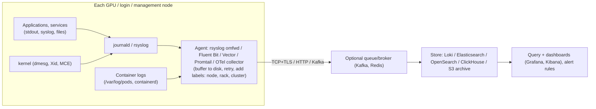

# 1.16 Logging, time synchronisation, cron and batch jobs

| | |
|---|---|
| Level | Intermediate |
| Priority tier | 0 |
| Lab venue | GCP / GKE (an Ubuntu VM and optionally a second VM as a log/NTP server) |
| Part | Part 1: Linux, from the command line to the kernel and performance |
| Status | Drafted, labs **untested** |

## Why this matters for AI infrastructure

Three plain-looking services decide whether a cluster can be operated at all:

- **Logs** are the only record of what a node did before it failed. With thousands of GPU nodes, you need them off-node, searchable, rate-controlled and retained for long enough to correlate a bad training run with an Xid error, an NCCL timeout, an OOM kill or a switch flap.
- **Time** must agree across nodes. Slurm, Munge (credentials expire in seconds of skew), Kerberos, TLS certificates, Kubernetes leases, distributed tracing, checkpoint timestamps, log correlation and even some collective-communication timeouts all assume synchronised clocks. A node 90 seconds off can be silently rejected by the scheduler or authentication, and logs from different nodes cannot be ordered.
- **Scheduled work** (log rotation, trimming SSDs, cache cleaning, health probes, certificate renewal, backups, node reconciliation) runs from cron or systemd timers. Jobs that overlap, fail silently, or run at the same second on every node cause incidents of their own.

This chapter covers system logging end to end (syslog concepts, `rsyslog`, the journal, `logrotate`, central collection), time (the kernel clock, the RTC, time zones, NTP with `chrony` and `timesyncd`, PTP, and the failure modes in clusters), and scheduling (cron, `anacron`, `at`, `batch`, and systemd timers), including patterns for fleets. Systemd and `journalctl` mechanics are in chapter 1.15; users and PAM are in 1.6 and 1.21; monitoring systems are Part 9.

## Prerequisites and outcomes

You should know systemd basics (1.15), the shell (1.2, 1.9), file permissions (1.6) and signals (1.8).

After this chapter you can:

- Explain syslog: facility, severity, the classic architecture (`/dev/log`, daemon, network forwarding), and its relationship to the journal; read and write `rsyslog` rules.
- Check how logging is set up on a machine, search logs by time, unit, boot, priority, field and text, and monitor them.
- Configure `logrotate`, size and retain the journal, and understand why open files and rotation interact.
- Design central logging for a cluster: forwarding with `rsyslog`/the journal, agents (Fluent Bit, Vector), retention and cost, and what to log from GPU nodes.
- Explain Unix time (epoch, UTC), the RTC and drift, time zones and `TZ`, and manage them with `timedatectl`, `hwclock`.
- Configure time synchronisation with `chrony` (servers, pools, local stratum, `makestep`, `allow`, `chronyc tracking/sources`) and know when `systemd-timesyncd` or PTP is appropriate.
- Write crontabs (user and system), understand cron's environment pitfalls, `anacron`, `at` and `batch`, and `systemd-run` one-offs.
- Choose between cron and timers; prevent overlaps; add logging, locking and randomisation to scheduled jobs.
- Debug "my cron job did not run", time drift, and log-flood incidents.

## 1. System logging

Most programs report what they are doing to a **system logger**. Historically that is the **syslog** service: programs call `syslog()` (or write to `/dev/log`, a Unix datagram socket), and the **syslog daemon** classifies each message and sends it to files, the console, logged-in users, a database, or another machine. On systemd systems **journald** receives these messages (and the standard output and error of every service, and kernel messages) and stores them in a structured binary journal; a traditional daemon such as **rsyslog** may run alongside it (or journald may be the only logger, as on some Fedora/RHEL-family defaults). Applications may also bypass all of this and write their own files (databases, web servers, Slurm, Kubernetes components, vendor daemons).

A syslog line:

```text
Aug 19 17:59:48 duplex sshd[484]: Server listening on 0.0.0.0 port 22.
```

(timestamp, host, program[PID], message). Underneath, every message also has a **facility** (the category of the sender) and a **severity** (urgency); together they form the *priority*.

| Severity | Name | Meaning |
|---|---|---|
| 0 | `emerg` | System unusable |
| 1 | `alert` | Act immediately |
| 2 | `crit` | Critical condition |
| 3 | `err` | Error |
| 4 | `warning` | Warning |
| 5 | `notice` | Normal but significant |
| 6 | `info` | Informational |
| 7 | `debug` | Debug detail |

Facilities are a fixed list: `kern`, `user`, `mail`, `daemon`, `auth`/`authpriv`, `syslog`, `lpr`, `news`, `uucp`, `cron`, `ftp`, and **`local0` to `local7`** (free for your own applications). The list is hard-wired and partly obsolete (such as `uucp`), and cannot be extended; that is why many applications now log structured JSON through other channels. In the journal the severity is called **priority** (`PRIORITY=`, `journalctl -p`), which is a common source of confusion. The protocol is described in RFC 3164 (original) and RFC 5424 (current, with optional structured data), but real-world senders vary.

### Checking what your machine runs

```bash
ps -p 1 -o comm=                         # systemd?
systemctl is-active systemd-journald rsyslog syslog-ng 2>/dev/null
ls /etc/rsyslog.conf /etc/rsyslog.d /etc/syslog-ng 2>/dev/null
ls -l /var/log | head -30                # classic files: syslog/messages, auth.log/secure, kern.log, cron, dmesg, wtmp, btmp, lastlog
ls -ld /var/log/journal                  # does the journal persist?
journalctl --disk-usage
```

Typical `/var/log` entries: `syslog` or `messages` (general), `auth.log` or `secure` (logins, `sudo`), `kern.log`, `cron`, `dmesg`, `boot.log`, `apt/`, `dnf.log`, `audit/audit.log` (auditd), service subdirectories (`nginx/`, `slurm/`), and the binary login records **`wtmp`** (`last`), **`btmp`** (`lastb`, failed logins) and **`lastlog`** (`lastlog`), which are read by dedicated tools, not `cat`. `/var/log/journal/` holds the journal.

### rsyslog in a nutshell

`rsyslog` (the default text-file syslog daemon on Debian, Ubuntu and RHEL) reads `/etc/rsyslog.conf` and `/etc/rsyslog.d/*.conf`. Classic **selector-action** rules map `facility.severity` to a destination; modern rules use RainerScript filters. Examples:

```text
# selector                          action
auth,authpriv.*                      /var/log/auth.log
*.*;auth,authpriv.none               -/var/log/syslog        # leading '-' = do not fsync each line
kern.*                               /var/log/kern.log
mail.err                             /var/log/mail.err
local3.*                             /var/log/gpu-health.log
*.emerg                              :omusrmsg:*             # broadcast to logged-in users
*.warning                            @@logs.example.com:514  # forward: '@' = UDP, '@@' = TCP
# modern filter syntax
if $programname == 'slurmd' then /var/log/slurm/slurmd.log
& stop
# input modules and reliable forwarding (queue so a down server does not drop logs)
module(load="imuxsock")      # /dev/log
module(load="imjournal")     # read the systemd journal
module(load="imtcp"); input(type="imtcp" port="514")
action(type="omfwd" target="logs.example.com" port="514" protocol="tcp"
       queue.type="LinkedList" queue.filename="fwd" queue.maxdiskspace="1g" queue.saveonshutdown="on"
       action.resumeRetryCount="-1")
```

`*` matches any, `.none` excludes, `=` selects exactly one severity, `!` negates, and a severity includes all **more severe** ones (`mail.err` is err, crit, alert, emerg). Test with `logger`:

```bash
logger -p local3.warning -t gpu-health "XID 79 on GPU 3"
rsyslogd -N1                      # check configuration syntax
sudo systemctl restart rsyslog
```

`logger` is the universal way to write a syslog/journal message from a script (`-t` tag, `-p facility.severity`, `-i` include PID, `--journald` structured fields on newer versions). **Network syslog** gives the classic client-server design: one machine listens (UDP/TCP 514, or TLS 6514) and every other node forwards to it; network devices (switches, BMCs, storage appliances) can be syslog clients, which is why syslog survives next to the journal. UDP can drop messages and has no authentication or encryption; use TCP with TLS (`gtls`/`ossl` in rsyslog) for anything that matters. Remember that the original syslog trusts the sender, so spoofing is trivial on an open network.

### Journal versus syslog

| | journald | rsyslog / syslog-ng |
|---|---|---|
| Storage | Binary, indexed, structured fields, per-boot | Plain text files |
| Scope | One machine, rich queries (`journalctl`) | Strong at **aggregation across machines** and many output formats (files, databases, Kafka, Elasticsearch) |
| Captures | Service stdout/stderr, syslog, kernel, audit | Syslog protocol sources (plus journal via `imjournal`) |
| Rotation | Self-managed by size/age | `logrotate` |

Most hosts run journald as the collector and either keep it alone (query with `journalctl`, ship with an agent) or forward to rsyslog for text files and network forwarding (`ForwardToSyslog=yes`, or rsyslog's `imjournal`). Choose one forwarding path to avoid duplicate messages. Logging has no single standard beyond a single host: aggregation, storage, authentication of senders and structured data all vary, and the consumption model has changed from "an admin reads a file" to "an analytics pipeline searches and alerts on structured data".

## 2. Searching and monitoring logs

With journald (details of the options in chapter 1.15 section 12), the questions you ask most often map to filters:

| Question | Command |
|---|---|
| Last four hours | `journalctl -S -4h` (or `--since`); `-U`/`--until` for the end |
| Since a date/time | `journalctl -S 06:00:00`, `-S 2025-06-01`, `-S '2025-06-01 14:30:00'` |
| One unit | `journalctl -u slurmd`, `journalctl -u 'nvidia-*'`; list known units `journalctl -F _SYSTEMD_UNIT` |
| This/previous boot | `journalctl -b`, `-b -1`, `--list-boots`; did the last shutdown finish cleanly? `journalctl -r -b -1` and check for "Journal stopped" |
| Kernel messages | `journalctl -k [-b -1]` |
| Severity | `journalctl -p err`, `-p warning..err` (0 most severe to 7) |
| Text | `journalctl -g 'kernel.*memory'` (regular expression; needs a build with PCRE; shows only matching lines: then take the timestamp and use `-S` to see the surrounding messages) |
| By field | `journalctl _PID=8792`, `_UID=1000`, `_COMM=python`, `_SYSTEMD_UNIT=x.service`, `SYSLOG_IDENTIFIER=gpu-health`; list field names `journalctl -N`; values `journalctl -F FIELD` |
| Follow live | `journalctl -f` (`-fu UNIT`) |
| Machine-readable | `journalctl -o json` / `json-pretty`; `-o cat` message only |

**Trusted fields** begin with an underscore (`_SYSTEMD_UNIT`, `_PID`, `_UID`, `_HOSTNAME`): the client cannot forge them, because journald adds them from kernel-verified credentials; fields without an underscore (`MESSAGE`, `SYSLOG_IDENTIFIER`, `PRIORITY`) are set by the sender. Access to the full journal needs root or membership of `adm` or `systemd-journal`. For text logs the classic tools apply: `grep`, `less +F`, `tail -F` (capital F follows through rotation), `zgrep` for rotated `.gz` files, `awk`, `sort | uniq -c | sort -rn` to count messages by type. `tail -f` is fine to watch one service while debugging but is not monitoring; a human watching a stream misses things.

Some useful reading habits on GPU nodes: `journalctl -k | grep -iE 'xid|nvrm|nvidia|mce|edac|nvme|pcie|aer|oom|segfault|tainted|call trace'` (hardware and driver faults), `journalctl -b -p err`, `journalctl -u slurmd -u munge --since -2h`, `grep -E 'Out of memory|oom-kill' /var/log/kern.log`, `last -x`, `lastb | head` (brute-force login attempts), `journalctl _COMM=sshd -g 'Failed'`.

## 3. Rotating logs

Text logs grow forever, so something must trim them. **Log rotation** divides a log into chunks: `auth.log` (current) and `auth.log.1`, `.2.gz`, `.3.gz` (older). Because deleting just the oldest lines from the front of a file is impractical, the rotation **renames** files: delete the oldest, shift each number up, rename the current to `.1`, create a fresh file. Distributions run **`logrotate`** daily from a cron job or a systemd timer (`logrotate.timer`), with global settings in `/etc/logrotate.conf` and per-package files in `/etc/logrotate.d/`:

```text
# /etc/logrotate.d/slurm
/var/log/slurm/*.log {
    daily
    rotate 14                # keep 14 old copies
    compress
    delaycompress            # compress the one before last (gives programs time to close the file)
    missingok
    notifempty
    create 0640 slurm slurm
    sharedscripts
    postrotate
        systemctl kill -s HUP --kill-whom=main slurmctld 2>/dev/null || true
    endscript
}
```

Options you will use: `daily|weekly|monthly`, `size 500M` / `maxsize`, `rotate N`, `maxage N`, `compress`/`delaycompress`, `dateext` (date suffix instead of numbers), `copytruncate` (copy then truncate in place, for programs that cannot reopen their log: may lose lines in the copy window), `create mode user group`, `postrotate ... endscript` (typically signal the daemon to reopen its log), `su user group` (rotate as that user). Test: `sudo logrotate -d /etc/logrotate.d/slurm` (debug, dry run), `sudo logrotate -f /etc/logrotate.conf` (force), state in `/var/lib/logrotate/status`.

**How rotation interacts with open files.** A process that has a log open keeps writing to the same *inode* even after it is renamed (Linux tracks the open file, not its name), so messages written after the rename appear in `auth.log.1` until the process reopens. If the daemon is told to reopen (SIGHUP or `copytruncate`), writing continues into the new file. If the file is renamed before the program next opens it, `open()` simply creates a fresh file. A process that **never reopens** after the log is deleted leaves a huge deleted-but-open file that still consumes disk (`lsof +L1`, chapter 1.12); this is the standard "disk full though logs were rotated" bug.

**The journal needs no logrotate**: journald trims itself using limits on size, free space and age (`SystemMaxUse=`, `SystemKeepFree=`, `MaxRetentionSec=`; `journalctl --vacuum-size=2G`, `--vacuum-time=14d`; chapter 1.15). Container runtimes have their own log rotation (Docker `max-size`/`max-file`, containerd/kubelet `containerLogMaxSize`/`containerLogMaxFiles`): unrotated container JSON logs are a classic reason for a node's `/var` filling up.

## 4. Central logging for clusters

On a fleet, logs on nodes are a buffer, not the archive. The usual architecture: **collect** on each node, **ship** reliably, **store and index** centrally, **query and alert**.



Design points:

- **Reliability**: agents buffer to disk and retry; syslog over UDP is not acceptable for audit-relevant logs. Back-pressure must not stall the application writing the log.
- **Metadata**: attach cluster, node name, rack, job ID/user (Slurm) or namespace/pod (Kubernetes) so logs correlate with jobs; keep the timestamp in UTC with nanosecond or millisecond precision.
- **Volume and cost**: GPU nodes can produce gigabytes of logs per day (kubelet verbosity, NCCL debug, framework logs). Decide levels per component, sample or drop noisy debug logs, set retention tiers (hot days, cheaper object storage months), and **rate-limit at the source** (journald rate limits hide bursts; raise them for important units, chapter 1.15).
- **Security**: authenticate and encrypt transport; protect the central store; logs contain usernames, paths, sometimes secrets (never log tokens); restrict who may read them; consider tamper evidence (immutable storage, signed journal sealing `FSS`) for audit logs; `auditd` records security-relevant syscalls and file access (chapter 1.21).
- **What to capture on GPU nodes**: kernel ring buffer (Xid, NVRM, PCIe AER, MCE/EDAC memory errors, OOM kills, NVMe resets, soft lockups, link flaps), NVIDIA services (`nvidia-fabricmanager`, `nvidia-persistenced`, DCGM), scheduler and runtime logs (`slurmd`, `munge`, containerd, kubelet, CNI), storage client errors (NFS, Lustre), `sshd`/`sudo` authentication, BMC system-event-log (SEL) via IPMI/Redfish, and application job output (per job, to the shared filesystem or the log pipeline).
- **From logs to metrics and alerts**: turn recurring messages into counters (a Loki/Elastic rule, `mtail`, `grok_exporter`, or a small script) and alert on rates: an Xid appearing once is worth a ticket; a new Xid 79 or ECC uncorrectable error should automatically cordon or drain the node (Part 9 and Slurm health checks).

## 5. Final notes on logging

Treat logging as a pipeline, not a file. Standardise formats where you can (JSON lines with a consistent schema), keep time in UTC, put a request/job ID in every message, avoid multi-line stack traces that break line-based shippers (or use shippers' multiline parsers), never rely on a human tailing a file, and remember the trust model: the sender's claim about who it is can be false unless the transport authenticates it.

## 6. Time

Unix machines need accurate time. Authentication tokens (Munge, Kerberos, JWT, TLS), file timestamps (`make`, `rsync`, backups), logs, distributed databases and schedulers all compare timestamps from different machines.

### The clocks

- The **system clock** is kept by the kernel as the number of seconds (plus nanoseconds) since **1970-01-01 00:00:00 UTC**, the *epoch* (`date +%s`). User-space programs convert this to local time. There are no time zones or daylight saving inside the kernel clock, which is why servers should live in **UTC**.
- The **hardware clock** or **real-time clock (RTC)** is a battery-backed chip that keeps time when the machine is off. The kernel reads it at boot to set the system clock; `hwclock` reads/writes it (`hwclock --systohc` copies system time to the RTC; `hwclock --hctosys` the reverse). Keep the RTC in **UTC** (`timedatectl set-local-rtc 0`) to avoid zone and daylight-saving confusion (dual-boot with Windows expects local time; one reason to change Windows' setting instead).
- Both drift. The kernel clock drifts by seconds per day on bad hardware; a machine that runs for months **must** be disciplined by a time protocol. You should not try to fix time drift repeatedly with `date -s` or `hwclock` because time-based system events can get lost or mangled when the clock jumps backward. While you could run a utility like `adjtimex` to smoothly update the system clock based on the RTC (`HLW` Section 7.5.1), in practice it is best to discipline your system time continuously with a network time daemon, which *slews* (speeds up or slows down slightly) the clock for small errors and *steps* only for large ones.
- Clocks you should know: `CLOCK_REALTIME` (wall time; jumps when set), `CLOCK_MONOTONIC` (never jumps back; for measuring durations), `CLOCK_TAI`. Software measuring elapsed time must use the monotonic clock. Leap seconds are handled by smearing (Google, many cloud providers) or stepping; fleets should not mix servers that smear and servers that do not.

### Time zones

The zone is controlled by `/etc/localtime`, a link (or copy) of a binary file under `/usr/share/zoneinfo/` (the IANA tz database: `UTC`, `America/New_York`, `Asia/Kolkata`). Set it with `timedatectl set-timezone UTC` (or `ln -sf /usr/share/zoneinfo/UTC /etc/localtime`); find names with `timedatectl list-timezones`. For one shell or one command use the `TZ` variable: `TZ=Asia/Kolkata date`, `export TZ=UTC`. Cron and systemd timers interpret schedules in the zone they run in (timers allow an explicit zone in `OnCalendar`); daylight-saving changes make cron jobs run twice or not at all in some regions, another reason to run servers in UTC.

```bash
date; date -u; date +%s; date -d @1700000000
timedatectl                       # local time, UTC, RTC time, zone, "System clock synchronized: yes", "NTP service: active"
timedatectl set-timezone UTC; timedatectl set-ntp true
sudo hwclock --show; sudo hwclock --systohc --utc
```

### Network time: NTP

**NTP** (Network Time Protocol) synchronises a machine to a hierarchy of time servers. Servers are organised by **stratum**: stratum 0 are reference clocks (GPS, atomic), stratum 1 servers are connected to them, stratum 2 synchronise to stratum 1, and so on. An NTP client takes measurements from several servers, filters out the bad ones, and steers the local clock. Implementations on Linux:

| Implementation | Notes |
|---|---|
| **`chrony`** (`chronyd`, `chronyc`) | The current recommended full NTP client/server; default on RHEL-family; handles intermittent connectivity, VMs (and hypervisor clocks), fast convergence, hardware timestamping, leap-second smearing, acts as a server for a cluster |
| **`systemd-timesyncd`** | A small SNTP client in systemd, default on Ubuntu desktops/servers (cloud images often use chrony); fine for a single host that just needs roughly correct time; not a server; limited diagnostics |
| **`ntpd`** (reference NTP daemon) | The classic; being replaced by chrony/ntpsec in distributions |
| **PTP** (`linuxptp`: `ptp4l`, `phc2sys`) | Precision Time Protocol, sub-microsecond with hardware timestamping NICs and PTP-aware switches; used for trading, telecom, some HPC/AI fabrics needing tight synchronisation and by clouds that expose PTP hardware clocks to VMs (`/dev/ptp*`) |

Use **one** time service per host; disable the others (`systemctl disable --now systemd-timesyncd` before installing chrony).

**chrony configuration** (`/etc/chrony/chrony.conf` on Debian/Ubuntu, `/etc/chrony.conf` on RHEL):

```text
# upstream sources: a pool or specific servers; 'iburst' speeds up the first sync
pool 2.pool.ntp.org iburst maxsources 4
server time.internal.example.com iburst prefer
# allow a big step at startup (first 3 updates if offset > 1 s) instead of slewing for hours
makestep 1.0 3
# keep the RTC in sync
rtcsync
# remember drift
driftfile /var/lib/chrony/drift
# serve time to the cluster (on the head/management node)
allow 10.0.0.0/16
# act as a time server even if upstream is lost (isolated cluster): stratum 10 local reference
local stratum 10 orphan
# logging
logdir /var/log/chrony
```

For a **cluster**, the standard layout is: management (head) nodes synchronise with the site's or the internet's NTP servers; compute nodes point **only at the head node(s)** (`server head.cluster iburst`), so a cluster without outside connectivity still has consistent time (the head node uses `local stratum` or an `orphan` setting when upstream is unavailable; compute nodes only need the one directive `server head iburst`). Put the NTP address in DHCP (option 42) for diskless boot (chapter 1.14). In clouds, prefer the provider's internal time source (the link-local metadata-adjacent NTP, e.g. `169.254.169.123` on AWS, `metadata.google.internal` on GCP) which is reachable without Internet access and smears leap seconds consistently.

```bash
chronyc tracking                  # offset from true time, frequency error, stratum, last update, leap status
chronyc sources -v                # servers: '^*' = current best, '^+' = acceptable, '^-' excluded, '^?' unreachable; Reach octal (377 = last 8 polls ok)
chronyc sourcestats; chronyc activity
chronyc makestep                  # force an immediate step now (use sparingly)
chronyc clients                   # on a server: who is asking
timedatectl timesync-status       # for systemd-timesyncd
journalctl -u chrony -u chronyd --since -1h
```

Read `chronyc tracking`: `System time : 0.000012345 seconds fast of NTP time` is the current offset (good: microseconds to low milliseconds on LAN), `Last offset`, `RMS offset`, `Frequency` (ppm drift) and `Leap status: Normal`. A `Stratum` of 16 or "Not synchronised" means no usable source.

**Time and clusters, failure modes.**

- **Munge** credentials have a short lifetime (default five minutes) and are rejected if the clocks differ more than the TTL; Slurm daemons then report authentication failures ("Invalid credential", "Credential expired") that look like network or key problems. Always check `date` and `chronyc tracking` on both ends first.
- **Kerberos** tolerates five minutes of skew by default; **TLS** certificates are "not yet valid" or "expired" if the clock is wrong; `kubeadm` joins, etcd and leases fail with large skew.
- **Log correlation** across nodes needs sub-second agreement; training-job "hangs" investigated through logs from 64 nodes are impossible to line up if clocks differ by seconds.
- **VMs**: after live migration, suspend/resume or a paused instance, the guest clock may jump; chrony with `makestep` and the hypervisor's paravirtual clock (`kvm-clock`, `ptp_kvm`) handles it; check the clocksource: `cat /sys/devices/system/clocksource/clocksource0/current_clocksource`.
- **`makestep` during a job** steps time under running software; set `makestep 1.0 3` (only early at boot) so later corrections slew.
- **Firewall** blocks UDP 123: `chronyc sources` shows `Reach 0`.
- **GPU timestamps** (`nvprof`/Nsight) have their own clocks; to align GPU traces across nodes you still need synchronised host clocks; for microsecond alignment PTP is used.

## 7. Scheduling recurring tasks: cron

**cron** is the classic periodic scheduler: the `crond` daemon wakes each minute and runs jobs from **crontab** files. A job is a command with five time fields:

```text
# minute  hour  day-of-month  month  day-of-week   command
  15      09    *             *      *             /home/juser/bin/spmake
```

| Field | Range |
|---|---|
| minute | 0-59 |
| hour | 0-23 |
| day of month | 1-31 |
| month | 1-12 (or `jan`..`dec`) |
| day of week | 0-7 (0 and 7 are Sunday; or `sun`..`sat`) |

A `*` matches every value; `5,14` a list; `1-5` a range; `*/15` a step (every 15). Shortcuts: `@reboot`, `@hourly`, `@daily`, `@weekly`, `@monthly`, `@yearly`. **Gotcha**: if both day-of-month and day-of-week are restricted (not `*`), the job runs when *either* matches. Examples: `*/10 * * * *` every ten minutes; `0 3 * * 1-5` 03:00 on weekdays; `30 2 1 * *` 02:30 on the first of each month; `@reboot /usr/local/bin/start-agent`.

### Where crontabs live

- **User crontabs**: one per user, in `/var/spool/cron/crontabs/` (Debian) or `/var/spool/cron/` (RHEL); edit only with `crontab -e` (validates the syntax), list `crontab -l`, remove `crontab -r` (no confirmation; a famous trap next to `-e` on the keyboard), root can use `-u user`. No user field in these files.
- **System crontabs**: `/etc/crontab` and files in `/etc/cron.d/` have **an extra sixth field, the user**: `42 6 * * * root /usr/local/bin/cleansystem >/dev/null 2>&1`. Packages drop files in `/etc/cron.d/`. Files in `/etc/cron.hourly|daily|weekly|monthly/` are scripts run by `run-parts` at those intervals (names without dots or tildes on Debian, must be executable); **`anacron`** runs them on machines that are not always on, catching up jobs missed while off.
- Access control: `/etc/cron.allow` and `/etc/cron.deny`.

### Cron's environment (the cause of most "works in my shell" failures)

Cron runs commands with a **minimal environment**: `HOME`, `LOGNAME`, `SHELL=/bin/sh`, `PATH=/usr/bin:/bin` only; no login startup files; no terminal; working directory is the user's home. So: use absolute paths for commands and files, set `PATH=` and `SHELL=/bin/bash` at the top of the crontab if needed, source environment explicitly in your script (`. /etc/profile.d/...`), avoid `~` and aliases, and remember `%` is special in the command field (escape as `\%`, for example inside `date +\%F`). Output (stdout and stderr) is **mailed to the owner** if a mailer exists, or discarded; redirect it explicitly (`>> /var/log/job.log 2>&1`) or send to the journal with `| logger -t myjob`. Set `MAILTO=` to direct or disable mail. The job's start and failure are logged by cron to syslog/journal (`journalctl -u cron`, `grep CRON /var/log/syslog`, `/var/log/cron` on RHEL).

### Making cron jobs safe

```bash
# /etc/cron.d/gpu-health
SHELL=/bin/bash
PATH=/usr/local/sbin:/usr/local/bin:/usr/sbin:/usr/bin:/sbin:/bin
MAILTO=""
*/5 * * * * root flock -n /run/lock/gpu-health.lock timeout 120 /usr/local/bin/gpu-health.sh 2>&1 | logger -t gpu-health
```

- **`flock -n`** prevents overlapping runs (a slow run plus the next trigger would otherwise stack up).
- **`timeout`** kills hangs (a script stuck on a dead NFS mount accumulates processes until the node falls over).
- **Randomise on a fleet**: `sleep $((RANDOM % 300)); cmd` (or `RandomizedDelaySec` in timers) so hundreds of nodes do not all hit the same API or filesystem at `:00`.
- **Log** to the journal or a file, and **alert on failure** (exit codes are invisible in cron unless you capture them; heartbeat/dead-man's-switch monitoring such as `curl -fsS https://healthcheck/ping` at the end of a successful run catches jobs that silently stopped).
- **Idempotent** jobs (chapter 1.9), written to tolerate re-runs and missed runs.

**Debugging "my cron job did not run"**: is `crond` running (`systemctl status cron|crond`)? Did the crontab install without a syntax error (`crontab -l`; a missing trailing newline in `/etc/cron.d` files, wrong permissions/ownership on system files: must be owned by root, not group/world writable; file names in `/etc/cron.d` with a dot are ignored on Debian)? What time zone and time is it (`date`)? What did cron log (`journalctl -u cron --since -1h`)? Run the command exactly as cron does: `env -i HOME=$HOME SHELL=/bin/sh PATH=/usr/bin:/bin sh -c 'command'`. Does the command need a terminal or environment variable? Did the user's account lock (PAM `pam_nologin`, expired password, `/etc/cron.deny`)?

## 8. One-time tasks: `at`, `batch` and `systemd-run`

`at` runs a command once at a future time; `atd` must be running:

```bash
at 22:30                 # then type commands, finish with Ctrl-D (reads stdin)
echo '/usr/local/bin/backup.sh' | at 02:00 tomorrow
at now + 2 hours; at 'noon Fri'; at 22:30 30.09.25
atq; at -c JOBID; atrm JOBID
batch                    # run when system load is below about 1.5 (reduces impact on busy hosts)
```

Jobs run in a copy of your environment at submission time (unlike cron). **`systemd-run`** is the modern equivalent and more powerful:

```bash
sudo systemd-run --on-calendar='2025-09-30 18:00' /usr/bin/echo test       # transient timer + service (include a date, or it repeats daily)
sudo systemd-run --on-active=30m --unit=late-drain /usr/local/bin/drain-node.sh   # relative: in 30 minutes
systemd-run --user --on-active=1h /usr/bin/notify-send done                # user manager (loginctl enable-linger so it survives logout)
systemctl list-timers | grep late-drain; systemctl stop late-drain.timer     # cancel
```

On shared clusters, ordinary users should submit work through the batch scheduler (Slurm, Part 6), not cron or `at`, on compute nodes; login nodes often disable `at` and restrict cron to prevent unscheduled load. Recurring user jobs belong in Slurm (`scrontab`, `sbatch --begin`) or Kubernetes `CronJob`s.

## 9. cron versus systemd timers (`HLW` Section 7.6.4)

The `cron` utility is one of the oldest components of a Unix/Linux system—it has been around for decades (predating Linux itself), and its configuration format has not changed much in all that time. When a tool is that universal, it stays everywhere, yet `systemd` timer units (chapter 1.15 section 9) solve several long-standing `cron` headaches. Both schedule recurring jobs, and each has clear strengths:

| | cron | systemd timers |
|---|---|---|
| Configuration | One line; universal, simple, familiar | Two unit files (timer + service) |
| Tracking | Child of `crond`; output by mail/redirect | Own cgroup; status, `journalctl -u`; resource limits and sandboxing; start/finish records |
| Dependencies | None | Full systemd ordering (`After=network-online`, mount checks) |
| Missed runs | `anacron` for daily/weekly/monthly | `Persistent=true` |
| Spreading load | Manual `sleep` | `RandomizedDelaySec=`, `AccuracySec=` |
| Overlap | Manual `flock` | A running `oneshot` service is not started twice |
| Times | 5-field cron syntax | `OnCalendar` plus monotonic (`OnBootSec`, `OnUnitActiveSec`) |
| User self-service | Easy `crontab -e` | `systemctl --user` (needs lingering) |
| Portability | Everywhere | systemd systems only |

Pragmatic rule: fleet maintenance that you ship in an image or with configuration management (trimming, health snapshots, cleaning, certificates) as **timers**; quick user or third-party jobs and compatibility cases as **cron**. Whichever you use, know where the jobs live (`crontab -l -u root`, `/etc/cron*`, `systemctl list-timers --all`, `ls /etc/systemd/system/*.timer`).

## 10. AI-infrastructure patterns

- **Clock discipline as a fleet baseline**: chrony on every node, pointing at the management nodes (or the cloud's internal source), UTC everywhere, `makestep 1.0 3`, and a health check that fails a node when `chronyc tracking` offset exceeds, say, 100 ms or the leap status is not normal (drain before Slurm/Munge starts rejecting it). Export the offset as a metric (`node_exporter` timex collector, `chrony_exporter`) and alert fleet-wide on drift.
- **Boot order**: start `chrony` and wait for synchronisation (`time-sync.target`, `chrony-wait.service`) before `munge`, `slurmd`, `kubelet` and anything issuing or checking credentials (chapter 1.15 ordering).
- **Log pipeline for GPU nodes**: forward the kernel ring buffer (Xid, ECC, PCIe AER), service logs and job output centrally; alert on Xid classes; label every line with node, rack and job; keep the on-node journal persistent but size-limited (chapter 1.15); rotate application logs and container logs; check that nothing in `/var/log` or `/var/lib/containerd` can fill `/`.
- **Health and housekeeping timers**: `fstrim`, NVMe SMART snapshots, GPU diagnostics when idle, stale-scratch cleaning (`tmpfiles.d` with age), certificate and token renewal, log pruning. Randomise across the fleet; make them idempotent; log to the journal; alert on missing heartbeats.
- **Scheduler time dependence**: Slurm accounting, job time limits, backfill, reservations and licence windows are computed from daemon clocks; `slurmctld` and `slurmdbd` times must agree with the database and compute nodes. After any time-source change restart the daemons in order and verify.
- **Reproducibility**: record time zone, NTP source, kernel clocksource and leap-second policy in the node image documentation; unify smearing policy across cloud and on-prem sites if jobs span both.
- **Audit and compliance**: tamper-resistant log storage, retention periods, and synchronised, trustworthy timestamps are explicit requirements in many regulated environments; document the chain from source clock to stored log.

## How it fails

1. **Disk full from logs.** Unrotated app/container logs, `copytruncate` missing, a deleted-but-open log (`lsof +L1`), journal unbounded. Limits and rotation everywhere; separate `/var/log` filesystem or quota.
2. **Logs lost on reboot** (journal in memory only). Persistent storage and off-node shipping.
3. **Messages missing** because journald/rsyslog rate limits dropped a burst, UDP syslog dropped packets, or a forwarder died. Reliable transport, queues, raised limits.
4. **Duplicate messages** (journald forwards to rsyslog which also reads the journal). Pick one path.
5. **Unreadable timestamps / out-of-order logs** from clock skew or mixed time zones. UTC and NTP.
6. **Clock wrong after boot** (dead RTC battery, VM resume). `makestep`, `hwclock --systohc`, `chrony-wait`.
7. **Two time daemons fighting** (`timesyncd` plus `chronyd` or `ntpd`). Disable all but one.
8. **Slurm/Munge/Kerberos auth failures that vanish when time is corrected.** Check time first.
9. **Cron job never runs** (syntax, permissions, name with a dot in `cron.d`, daemon down, wrong user/zone), **or runs but fails** (environment, relative paths, `%` unescaped, no terminal), **or runs twice/never at DST change**.
10. **Overlapping cron runs pile up** because no lock and a hung dependency. `flock`, `timeout`.
11. **A thousand nodes hit the same service at :00.** Randomise.
12. **`crontab -r` instead of `-e`** wipes a crontab. Keep crontabs in version control or use `/etc/cron.d`.
13. **`at` jobs fail silently** (environment captured at submission; output mailed). Redirect output.
14. **Logs contain secrets or personal data** and are widely readable. Scrub, restrict, retain minimally.
15. **Log rotation signal kills the daemon** (`SIGHUP` not handled). Use `copytruncate` or the daemon's reopen command.

## Hands-on lab: logging, logrotate, chrony, cron, and VM drills

First, run the self-checking Python lab (`code/part01/logging_time_cron_lab.py`) locally. It verifies syslog severity (`0` `emerg` .. `7` `debug`) and selector matching (`mail.err`, `*.warning`, `local3.=info`), `logrotate` open-inode target behavior (`SIGHUP` vs `copytruncate`), `chrony` `makestep 1.0 3` and Munge/Kerberos `300 s` skew validation, and POSIX `cron` day-of-month OR day-of-week matching.

```bash
python3 code/part01/logging_time_cron_lab.py
```

Next, on a disposable GCP Ubuntu VM (all interactive VM commands below are `untested here`), work through these steps:

**A. Inspect logging.**

```bash
systemctl is-active systemd-journald rsyslog; ls -l /var/log | head -20; ls -ld /var/log/journal # (untested here)
journalctl --disk-usage; journalctl --list-boots | tail -3 # (untested here)
logger -t labtest -p local3.warning "hello from the lab" # (untested here)
journalctl -t labtest -n 2 --no-pager; grep -h labtest /var/log/syslog 2>/dev/null | tail -2 # (untested here)
journalctl -S -1h -p warning --no-pager | tail; journalctl -k -g 'Linux version' --no-pager | head -2 # (untested here)
journalctl -N | head -20; journalctl -F _SYSTEMD_UNIT | head # (untested here)
last -n 5; lastb -n 5 2>/dev/null; lastlog | head -5 # (untested here)
```

**B. rsyslog rule.**

```bash
sudo apt install -y rsyslog             # (untested here)
echo 'local3.*   /var/log/lab-local3.log' | sudo tee /etc/rsyslog.d/50-lab.conf # (untested here)
sudo rsyslogd -N1 && sudo systemctl restart rsyslog # (untested here)
logger -p local3.info -t labtest "to the local3 file"; cat /var/log/lab-local3.log # (untested here)
```

**C. logrotate.**

```bash
sudo tee /etc/logrotate.d/lab >/dev/null <<'EOF'
/var/log/lab-local3.log {
    size 1k
    rotate 3
    compress
    delaycompress
    missingok
    notifempty
    create 0640 syslog adm
    postrotate
        systemctl kill -s HUP rsyslog 2>/dev/null || true
    endscript
}
EOF
for i in $(seq 1 60); do logger -p local3.info -t labtest "line $i padding padding padding"; done # (untested here)
sudo logrotate -d /etc/logrotate.d/lab 2>&1 | tail -15 # (untested here)
sudo logrotate -f /etc/logrotate.d/lab; ls -l /var/log/lab-local3.log* # (untested here)
```

**D. Time.**

```bash
timedatectl; date -u; date +%s; date -d @0; TZ=Asia/Kolkata date; sudo hwclock --show # (untested here)
sudo apt install -y chrony; sudo systemctl disable --now systemd-timesyncd 2>/dev/null; sudo systemctl enable --now chrony # (untested here)
chronyc tracking; chronyc sources -v; chronyc sourcestats # (untested here)
sudo date -s '+90 seconds'; chronyc tracking | head -4; sudo chronyc makestep; sleep 2; chronyc tracking | head -4 # (untested here)
cat /sys/devices/system/clocksource/clocksource0/current_clocksource # (untested here)
```

**E. cron.**

```bash
crontab -l 2>/dev/null; (crontab -l 2>/dev/null; echo '* * * * * date >> /tmp/cron-lab.txt 2>&1') | crontab - # (untested here)
sleep 70; cat /tmp/cron-lab.txt; journalctl -u cron --since -5min --no-pager | tail -5 # (untested here)
sudo tee /etc/cron.d/lab-env >/dev/null <<'EOF'
SHELL=/bin/bash
PATH=/usr/local/bin:/usr/bin:/bin
* * * * * root env > /tmp/cron-env.txt 2>&1; echo "date \% test: $(date +\%F)" >> /tmp/cron-env.txt
EOF
sleep 70; cat /tmp/cron-env.txt         # (untested here) note the minimal environment
sudo tee /etc/cron.d/lab-flock >/dev/null <<'EOF'
* * * * * root flock -n /run/lock/lab.lock sh -c 'echo start $(date +\%T) >> /tmp/lab-flock.txt; sleep 90; echo end $(date +\%T) >> /tmp/lab-flock.txt'
EOF
sleep 200; cat /tmp/lab-flock.txt       # (untested here) overlapping starts are skipped
```

**F. at and systemd-run.**

```bash
sudo apt install -y at; echo 'date >> /tmp/at-lab.txt' | at now + 1 minute; atq # (untested here)
sudo systemd-run --on-active=45s --unit=lab-once sh -c 'date >> /tmp/run-lab.txt'; systemctl list-timers | grep lab-once # (untested here)
sleep 90; cat /tmp/at-lab.txt /tmp/run-lab.txt # (untested here)
```

**G. Clean up.**

```bash
crontab -r; sudo rm -f /etc/cron.d/lab-env /etc/cron.d/lab-flock /etc/rsyslog.d/50-lab.conf /etc/logrotate.d/lab /var/log/lab-local3.log* /tmp/cron-*.txt /tmp/lab-flock.txt /tmp/at-lab.txt /tmp/run-lab.txt # (untested here)
sudo systemctl restart rsyslog          # (untested here)
```

## Exercises

1. **Syslog Facilities, Severities (`0`..`7`), and `rsyslog` Selectors:** (a) List the 8 syslog severities from `0` (`emerg`) to `7` (`debug`) and state which messages match `mail.err`, `*.warning`, `local3.=info`, and `*.*;auth,authpriv.none`; (b) why is `@@logs.example.com:514` with a `LinkedList` disk queue preferred over `@logs.example.com:514` for cluster log forwarding? Verify with `matches_syslog_selector()` in `code/part01/logging_time_cron.py`.
2. **`logrotate` Open-Inode Behavior, `SIGHUP`, and `copytruncate`:** Suppose `rsyslog` or a custom training daemon holds `/var/log/app.log` open when `logrotate` renames `/var/log/app.log` to `/var/log/app.log.1` and creates a new empty `/var/log/app.log`. Where do subsequent `write()` calls go if (a) neither `postrotate` `SIGHUP` nor `copytruncate` is configured, (b) `postrotate` sends `SIGHUP` so the daemon reopens `/var/log/app.log`, or (c) `copytruncate` is used?
3. **`chrony` `makestep 1.0 3`, Slew vs. Step, and Munge/Kerberos `300 s` Skew:** (a) Under `makestep 1.0 3`, how does `chronyd` correct a `90 s` clock offset on poll update `1` versus a `2.5 s` offset on poll update `10`, and why is stepping the clock backward dangerous for running jobs? (b) Why does a `400 s` clock skew between `slurmctld` and a compute node cause `munge` and Kerberos authentication to fail?
4. **Cluster NTP Hierarchy, `local stratum 10 orphan`, and `chronyc sources`:** Write the `chrony.conf` directives for a cluster head node (`pool`/`server`, `allow 10.0.0.0/16`, `local stratum 10 orphan`, `makestep 1.0 3`, `rtcsync`) and for a compute node (`server head.cluster iburst`), and explain what `^*`, `^?`, and octal `Reach 377` vs `Reach 0` mean in `chronyc sources -v`.
5. **Cron Syntax, the Day-of-Month OR Day-of-Week Trap, and Safe Fleet Wrappers:** (a) Write 5-field cron schedules for every 15 minutes, 03:00 on weekdays (`1-5`), and 02:30 on the 1st of every month, and explain when `0 3 15 * 1` runs (`evaluate_cron_dom_dow_match()`); (b) why does a cron job using `$(date +%F)` fail unless written as `$(date +\%F)`, and how do `flock -n`, `timeout`, and `$((RANDOM % 300))` protect a 500-node cluster?
6. **`cron` vs. `systemd` Timers and `at` / `systemd-run` One-Offs:** Compare `cron` and `systemd` timers across 5 operational dimensions (cgroup isolation, `journalctl` logging, `After=` dependencies, `Persistent=true` vs `anacron`, and `RandomizedDelaySec=`), and write the `systemd-run` command to execute `/usr/local/bin/drain-node.sh` once in 30 minutes.

## Checkpoint questions (20)

<details>
<summary>1. What are syslog facility and severity, and what are the eight severity levels from `0` to `7`?</summary>
The **facility** identifies the subsystem that generated the message (`kern`, `user`, `mail`, `daemon`, `auth`/`authpriv`, `cron`, `local0`–`local7`), and the **severity** indicates its urgency from `0` (highest) to `7` (lowest): `0` `emerg`, `1` `alert`, `2` `crit`, `3` `err`, `4` `warning`, `5` `notice`, `6` `info`, and `7` `debug`.
</details>

<details>
<summary>2. How do processes submit messages to the local system logger, and how do you test logging from a shell script?</summary>
Programs call the C library's `syslog()` function, which writes datagrams to the Unix domain socket `/dev/log` (listened on by `systemd-journald` and forwarded to `rsyslog` via `imuxsock` or `imjournal`). From a shell script or CLI, run `logger -p local3.warning -t gpu-health "XID 79 on GPU 3"`.
</details>

<details>
<summary>3. In `/etc/rsyslog.conf`, what do `mail.err`, `*.*;auth,authpriv.none`, `-/var/log/syslog`, and `@@logs.example.com:514` mean?</summary>
`mail.err` matches `mail` messages of severity `err` (`3`) and more severe (`crit`, `alert`, `emerg`); `*.*;auth,authpriv.none` matches all facilities except `auth` and `authpriv`; the leading `-` in `-/var/log/syslog` disables synchronous `fsync()` after every line; and `@@` forwards over TCP port `514` (`@` uses lossy UDP).
</details>

<details>
<summary>4. What is the difference between trusted (`_PID`, `_UID`, `_SYSTEMD_UNIT`) and untrusted (`MESSAGE`, `SYSLOG_IDENTIFIER`) fields in `systemd-journald`?</summary>
Fields starting with an leading underscore (`_PID`, `_UID`, `_GID`, `_COMM`, `_EXE`, `_SYSTEMD_UNIT`) are attached by `journald` using kernel-verified socket credentials (`SO_PEERCRED`) and cannot be forged by the logging process. Fields without an underscore are supplied by the client payload.
</details>

<details>
<summary>5. Give `journalctl` commands for: (a) the last 4 hours of `slurmd`, (b) errors from the previous boot, (c) kernel messages matching `xid|nvrm`, and (d) binary login records (`wtmp`, `btmp`, `lastlog`).</summary>
(a) `journalctl -u slurmd -S -4h`; (b) `journalctl -b -1 -p err`; (c) `journalctl -k -g 'xid|nvrm'`; (d) `/var/log/wtmp`, `/var/log/btmp`, and `/var/log/lastlog` are binary login databases read with `last`, `lastb` (failed logins), and `lastlog` rather than `journalctl` or `cat`.
</details>

<details>
<summary>6. How does `logrotate` rotate a log file, and why does a daemon keep writing into `app.log.1` unless signaled or configured with `copytruncate`?</summary>
`logrotate` shifts old numbered files up, renames `app.log` to `app.log.1`, and creates a fresh `app.log` with a new inode. Because open file descriptors in Linux reference the **inode** rather than the filename, a running daemon continues writing to the renamed `app.log.1` inode until `postrotate` sends `SIGHUP` (or `copytruncate` copies `app.log` and truncates the original inode in place).
</details>

<details>
<summary>7. What do `delaycompress`, `missingok`, `notifempty`, and `sharedscripts` do in a `/etc/logrotate.d/` config?</summary>
`delaycompress` postpones `gzip` compression of `.1` until the *next* rotation cycle (giving processes time to close the old descriptor); `missingok` ignores missing log files without error; `notifempty` skips rotation if the file is 0 bytes; and `sharedscripts` runs the `postrotate` script once for the whole wildcard match (`*.log`) rather than once per file.
</details>

<details>
<summary>8. What happens if `logrotate` deletes an old log file that a process still holds open without ever reopening?</summary>
The directory entry is unlinked, but the kernel cannot free the data blocks until the open file descriptor is closed (`df -h` shows the disk full while `du -sh /var/log` shows little space used). Find the process with `sudo lsof +L1` and restart or signal it.
</details>

<details>
<summary>9. What five categories of logs must be shipped off-node to a central store on a production GPU cluster?</summary>
(1) Kernel ring buffer hardware/driver events (`Xid`, `NVRM`, PCIe `AER`, `MCE`/`EDAC` ECC errors, `OOM` kills, NVMe resets), (2) NVIDIA infrastructure daemons (`nvidia-fabricmanager`, `nvidia-persistenced`, `dcgm`), (3) scheduler and container runtime daemons (`slurmd`, `munge`, `containerd`, `kubelet`), (4) authentication/audit logs (`sshd`, `sudo`, `auditd`), and (5) out-of-band BMC System Event Logs (`SEL`).
</details>

<details>
<summary>10. What is the difference between the Linux kernel's system clock (`CLOCK_REALTIME` vs `CLOCK_MONOTONIC`) and the hardware RTC (`hwclock`)?</summary>
The kernel system clock counts seconds and nanoseconds in UTC since `1970-01-01 00:00:00 UTC` (`CLOCK_REALTIME` is wall-clock time that can step/slew; `CLOCK_MONOTONIC` counts forward monotonically since boot for measuring elapsed intervals). The hardware Real-Time Clock (`RTC`) is a battery-backed motherboard chip read at boot and queried/updated with `sudo hwclock --show` and `sudo hwclock --systohc --utc`.
</details>

<details>
<summary>11. Why should all cluster servers keep both `/etc/localtime` and the RTC in `UTC`?</summary>
Running in `UTC` (`timedatectl set-timezone UTC` and `timedatectl set-local-rtc 0`) eliminates daylight-saving-time (`DST`) jumps (which cause cron jobs to run twice or be skipped) and ensures log timestamps across geographically distributed clusters and containers align directly without timezone conversion errors.
</details>

<details>
<summary>12. Why do NTP daemons slew the clock rather than stepping it during normal operation, and what does `makestep 1.0 3` in `chrony.conf` do?</summary>
Stepping the clock backward causes timers, distributed locks, database transactions, and `make` builds to malfunction. `chronyd` normally **slews** the clock by slightly adjusting the kernel tick frequency (`adjtimex`). `makestep 1.0 3` allows `chronyd` to **step** the clock immediately only during the first `3` clock updates after startup if the offset exceeds `1.0` second.
</details>

<details>
<summary>13. How should NTP be architected on an internal HPC/AI cluster so compute nodes stay synchronized even if the internet link goes down?</summary>
Configure the management/head nodes to sync with external upstream NTP servers and serve time to the internal subnet (`allow 10.0.0.0/16`) with `local stratum 10 orphan` enabled. Configure all compute nodes to point *only* at the internal head nodes (`server head.cluster iburst`), so the entire cluster shares a single coherent clock even when isolated from the internet.
</details>

<details>
<summary>14. In `chronyc sources -v` and `chronyc tracking`, what do `^*`, `^+`, `^?`, octal `Reach 377` vs `0`, and `Stratum 16` indicate?</summary>
`^*` marks the currently selected primary time source, `^+` marks combined acceptable sources, and `^?` marks an unreachable source. `Reach` is an 8-bit shift register printed in octal: `377` (`11111111` in binary) means all `8` recent polls succeeded, while `0` means zero responses (e.g., UDP port `123` blocked). `Stratum 16` means the node is unsynchronized.
</details>

<details>
<summary>15. Why does a 6-minute clock skew on a single compute node break Slurm job launch, and what else fails under clock skew?</summary>
`munge` authentication credentials (used by `slurmctld` and `slurmd`) and Kerberos tickets have a default `5`-minute (`300 s`) TTL window; a node skewed by 6 minutes rejects credentials as expired or not-yet-valid. Clock skew also breaks X.509/TLS certificate validation, Kubernetes `kubelet` lease renewals, and cross-node log correlation.
</details>

<details>
<summary>16. State the five time fields of a `crontab` entry and explain the POSIX `cron` trap when both day-of-month and day-of-week are specified.</summary>
The five fields are: (1) minute (`0-59`), (2) hour (`0-23`), (3) day of month (`1-31`), (4) month (`1-12`), and (5) day of week (`0-7`, where `0` and `7` are Sunday). If both day-of-month (field 3) and day-of-week (field 5) are restricted (not `*`), `cron` runs the job when **either** field matches (logical `OR`, not `AND`).
</details>

<details>
<summary>17. How do `/etc/crontab` and `/etc/cron.d/*` differ from `crontab -e`, and why can a file dropped into `/etc/cron.d/` be silently ignored on Debian/Ubuntu?</summary>
System crontab files (`/etc/crontab` and `/etc/cron.d/*`) include a **sixth field** specifying the username (`root`) before the command, whereas per-user crontabs (`crontab -e`, stored in `/var/spool/cron/`) omit the user field. On Debian/Ubuntu, `cron` silently ignores any file in `/etc/cron.d/` whose filename contains a dot (`.`), lacks a trailing newline, or is not owned by `root` with mode `0644`.
</details>

<details>
<summary>18. Give five reasons a script that runs fine in your interactive `bash` session fails inside `cron`.</summary>
(1) `cron` sets a minimal `PATH=/usr/bin:/bin` (missing `/usr/local/bin` and `/usr/sbin`); (2) `cron` uses `SHELL=/bin/sh` (`dash` on Ubuntu) rather than `bash`; (3) `cron` does not source `~/.bashrc` or `~/.bash_profile`; (4) the working directory is `$HOME` with no controlling TTY; and (5) unescaped `%` characters in the crontab command line are converted into newlines by `cron`.
</details>

<details>
<summary>19. What is the difference between `at`, `batch`, `anacron`, and `systemd-run --on-active=`?</summary>
`at` schedules a one-time command at a specific time (inheriting the caller's current environment); `batch` runs a one-time job only when the system load average drops below `1.5`; `anacron` runs daily/weekly/monthly jobs on machines that are not powered on 24/7; and `systemd-run --on-active=30m` creates a transient `systemd` timer and service unit with full `cgroup` and `journalctl` tracking.
</details>

<details>
<summary>20. How do you prevent a periodic health-check cron job across 500 GPU nodes from overlapping with itself, hanging on a dead mount, or causing a thundering herd?</summary>
Wrap the command in `flock -n /run/lock/health.lock` (to skip overlapping runs if the previous run is still active), `timeout 120` (to kill hung probes on dead NFS/GPU calls), and a randomized jitter delay (`sleep $((RANDOM % 300))` or `RandomizedDelaySec=` in a `systemd` timer).
</details>

## Sources and review notes

- **Sources read in full:**
  - `how-linux-works-3rd-edition` — Brian Ward, *How Linux Works*, 3rd ed., **Chapter 7: System Configuration: Logging, System Time, Batch Jobs, and Users** (sections 7.1 system logging, checking your log setup, searching and monitoring logs with `journalctl -S/-U/-u/-b/-k/-p/-g` and `--list-boots`, `logrotate` and open files, journal maintenance `--vacuum-size`/`--vacuum-time`, syslog facilities and severities `0`..`7`, syslog lack of authentication/encryption, 7.4 `getty` and `login`, 7.5 setting the time, RTC `hwclock` and `adjtimex`, kernel UTC time and `/etc/localtime` / `/usr/share/zoneinfo`, network time NTP, 7.6 scheduling recurring tasks with `cron`, `crontab -e/-l/-r`, `/etc/crontab` and `/etc/cron.d`, `anacron`, `systemd` timer units, `cron` vs timer units, 7.7 `at` and `systemd-run`, and 7.8 timer units for regular users and `loginctl enable-linger`; sections 7.2, 7.3, 7.9, and 7.10 are covered in Chapters 1.6 and 1.21).
  - `supercomputers-for-linux-sysadmins-managing-modern-hpc-clusters-and-supercomputers-from-software-to` — Sergey Zhumatiy, *Supercomputers for Linux SysAdmins*, **Chapter 7: UNIX and Linux – the Basics** (services, cron, and logging basics) and **Chapter 28: One-Two-Three Instructions** (NTP server and compute-node configuration; cross-referenced with Chapters 1.7, 1.12, 1.30, 6.19, 6.23, 6.24, and 6.30, plus original study items 21–30).
- **Run here:** `python3 code/part01/logging_time_cron_lab.py` (21 passed, 0 failed).
- **Explicitly labelled inferences:** The `chrony` `local stratum 10 orphan` head-node pattern (RFC 5905), Munge/Kerberos `300 s` (`5`-minute) skew failure diagnosis, `/proc/PID/fd/N` truncation, `/var/log/messages` vs `/var/log/syslog`, `/var/lib/docker` and `/var/lib/systemd/coredump` space cleanup, `_PID=1234`, `loghost:514`, and GPU node central log pipeline (Fluent Bit / Vector / Loki / OpenSearch) connect Linux logging, timekeeping, and scheduling to Part 6 Slurm and Part 9 observability operations (plus original study items 26, 27, and 29).
- **Not verified on live hardware:** All interactive VM commands (`logger`, `rsyslogd`, `logrotate`, `timedatectl`, `hwclock`, `chronyc`, `crontab`, `at`, `systemd-run`) are marked (untested here) and should be executed on a disposable Linux VM.
