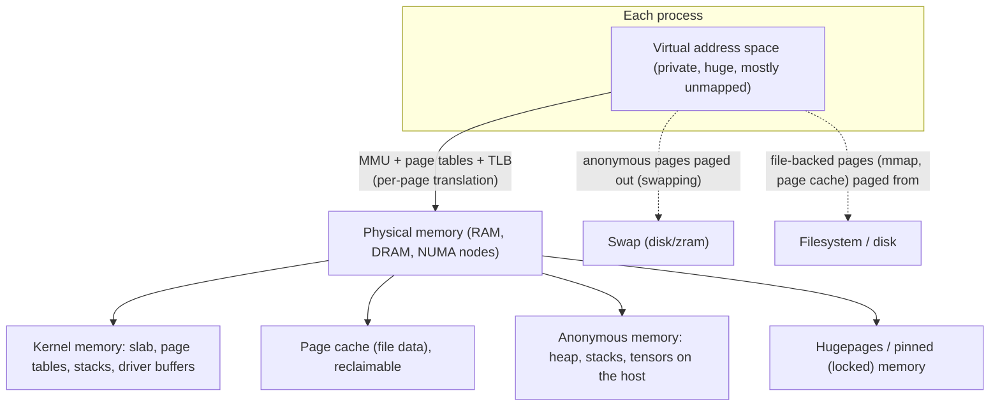
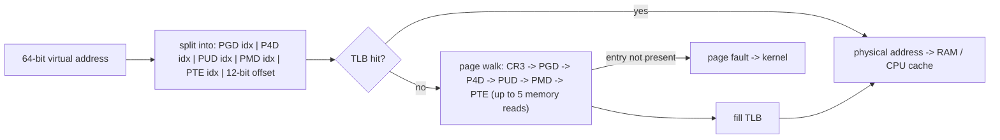
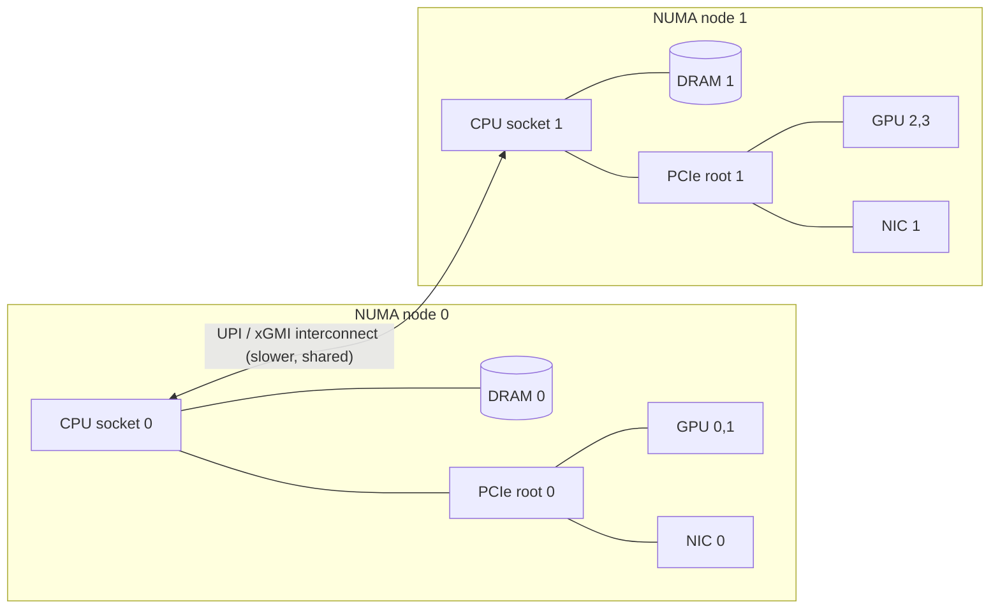
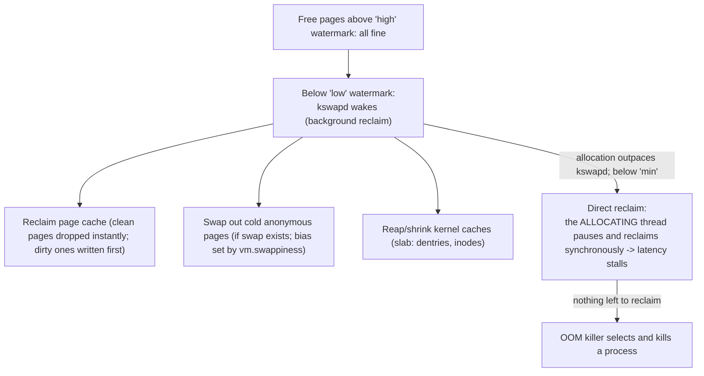

# 1.17 Memory management: virtual memory, NUMA, huge pages, OOM

| | |
|---|---|
| Level | Advanced |
| Priority tier | 0 |
| Lab venue | GCP / GKE (an Ubuntu VM; a multi-socket or multi-GPU machine for the NUMA commands) |
| Part | Part 1: Linux, from the command line to the kernel and performance |
| Status | Drafted, labs **untested** |

## Why this matters for AI infrastructure

Host memory is the hidden resource on a GPU server. The GPUs hold the model, but the host's RAM holds the dataset cache, the data-loader workers, pinned staging buffers, the framework's own heap, the page cache of everything read, the container images, and the CUDA driver's mappings. Most "mysterious" problems on GPU nodes turn out to be memory problems:

- A training job is **OOM-killed** (exit code 137) although `nvidia-smi` shows free GPU memory, because the *host* or the job's cgroup ran out of RAM.
- A data loader is slow because its memory lives on the **wrong NUMA node**, so every batch crosses the inter-socket link on the way to the GPU.
- Throughput wobbles every few minutes because **direct reclaim** or **transparent huge page compaction** stalls threads.
- A process cannot register RDMA or pinned memory because of the **`memlock`** limit, or the node swaps and the job slows by orders of magnitude.
- A long-running service's resident memory grows for days and nobody knows whether it is a leak, a cache, or allocator fragmentation.
- `free` shows 2 GB "free" and an alarm fires, although 400 GB is cache that the kernel would give back instantly.

This chapter builds the whole picture: virtual memory, paging, demand paging and overcommit; the page cache and reclaim; the memory hardware (DRAM, caches, MMU, TLB, NUMA); huge pages and THP; allocators; the OOM killer (system-wide and per cgroup); NUMA policy and placement; memory limits in cgroups and containers; the observability tools (`free`, `vmstat`, PSI, `/proc/meminfo`, `smaps`, `numastat`, `pmap`, `slabtop`, `perf`, BPF tools); and the method for diagnosing leaks, growth, saturation and locality. It ends with the GPU-specific points: pinned memory, `memlock`, NUMA binding for loaders, THP policy for training versus inference, and swap policy. Chapter 1.8 introduced page faults and `vmstat`; chapter 1.18 covers CPU scheduling and cgroups; chapter 1.28 assembles the tuning.

## Prerequisites and outcomes

You should know processes and the address space (1.8, 1.11), filesystem caching (1.12), sysctl (1.10) and systemd resource control (1.15).

After this chapter you can:

- Explain virtual memory, pages, page tables, the MMU and TLB, demand paging, minor and major faults, and RSS versus virtual size versus PSS.
- Describe how Linux frees memory (free lists, page cache, swapping, reaping, kswapd and direct reclaim, the OOM killer) and what swappiness, watermarks and overcommit do.
- Read `/proc/meminfo`, `free`, `vmstat`, `smem`/`smaps`, and distinguish "available" from "free", anonymous from file-backed memory, and kernel from user memory.
- Predict and tune the OOM killer: `oom_score`, `oom_score_adj`, cgroup memory limits, `memory.events`, `systemd-oomd`, and read an OOM log.
- Explain NUMA, inspect topology (`numactl -H`, `lscpu`, `nvidia-smi topo -m`), bind CPUs and memory, interpret `numastat` and automatic NUMA balancing, and avoid the cross-socket trap for GPU feeding.
- Configure huge pages (explicit and transparent), pick THP policy, and understand TLB reach.
- Choose and apply allocators (glibc, jemalloc, tcmalloc) and diagnose heap growth and leaks.
- Use cgroup memory controls and read their statistics for containers and Slurm jobs.
- Apply swap, memlock and pinned-memory settings correctly for GPU/RDMA workloads.

## 1. Memory at a glance



Four ideas carry the chapter:

1. **Virtual memory** gives each process the illusion of a large private address space; the kernel and hardware map pieces of it to physical RAM *on demand*.
2. **RAM is a cache** for disk and swap: the kernel fills spare memory with file data and reclaims it under pressure. "Free" memory is wasted memory.
3. **Locality matters twice**: temporal and spatial locality at the CPU-cache level, and **NUMA locality** at the socket level. Where a page lives decides how fast every access is.
4. **Limits are enforced per cgroup**, not only per machine. A container can be OOM-killed while the host has lots of RAM free.

## 2. Virtual memory and paging

**Terminology.** *Main memory* is the physical RAM (DRAM). *Virtual memory* is an abstraction: each process and the kernel have their own linear address space, mostly unpopulated, not "real" memory. *Resident* memory is what is currently in RAM. *Anonymous memory* has no file behind it (heap, stacks, `mmap` with `MAP_ANONYMOUS`); *file-backed memory* maps a file (program text, libraries, `mmap`ed data, the page cache). A *page* is the unit of mapping (4 KiB normally; 2 MiB and 1 GiB *huge pages* too). A *page fault* is an access to a virtual page that is not currently mapped to a physical page: it is normal and often cheap. *Paging* is moving pages between RAM and storage; *swapping* in Linux means paging **anonymous** memory to a swap device or file (Linux does not swap whole processes). An *address space* belongs to one process (plus a kernel space); *segments* are areas with a purpose (text, data, heap, stacks, mappings).

### Why virtual memory

It gives each process private memory regardless of others (**isolation**), lets programs be larger than RAM or only partially resident (**oversubscription**), lets the system share one physical copy of library code among many processes (**sharing**), allows files to be accessed as memory (`mmap`), and simplifies programming (contiguous addresses). The cost is address translation, handled by hardware.

### Translation: page tables, MMU and TLB

The CPU's **MMU** translates virtual addresses to physical addresses using **page tables** in RAM maintained by the kernel: a multi-level tree (four or five levels on x86-64: PGD, P4D, PUD, PMD, PTE). A 64-bit virtual address is split into index fields for each level plus a **page offset**; the walk reads one entry per level from RAM, so a naive translation would cost four or five extra memory accesses per access. The **TLB** (translation lookaside buffer) is a small, very fast cache of recent translations inside the CPU; a **TLB hit** costs almost nothing, a **TLB miss** triggers a hardware page-table walk (tens to hundreds of cycles, or a hundred nanoseconds if the table entries themselves miss the CPU caches). The TLB has limited entries (for example 64 for 4 KiB data pages), so its **reach** (entries x page size) is small with 4 KiB pages: a program with a multi-gigabyte working set misses constantly. **Huge pages** (2 MiB, 1 GiB) multiply the reach and also shorten the walk: that is why they matter for AI workloads with tens or hundreds of gigabytes of host memory (section 8).



### Demand paging, page faults, memory states

Linux allocates virtual memory immediately and **physical memory only when touched** (demand paging). A `malloc(1<<30)` or an `mmap` of a gigabyte consumes almost no RAM until the pages are written. Each virtual page is in one of four states: *unallocated*; *allocated but not mapped* (not yet touched); *mapped to RAM*; *mapped to swap* (paged out). Moving from "allocated, unmapped" to "mapped" is a page fault:

- **Minor fault**: satisfied without I/O (a new zero page for the heap, mapping an already-cached file page or a shared library page). Cheap and frequent.
- **Major fault**: requires reading from storage (first touch of an uncached file-backed page, or swapping in an anonymous page). Slow: milliseconds on spinning disks, tens to hundreds of microseconds on flash, and the thread blocks.

Two sizes follow: **virtual size (VSZ/VIRT)** is everything allocated (all states except unallocated); **resident set size (RSS)** is the part in RAM. **Shared memory** (shared libraries, `shmget`/`mmap` shared, tmpfs) is counted in the RSS of every process mapping it, so summing RSS over processes overstates use. **PSS** (proportional set size) divides shared pages among their users and sums correctly (`/proc/PID/smaps_rollup`, `smem`, `pmap -X`). **USS** (unique set size) is private memory only. The **working set size (WSS)** is the memory a process actively uses; performance collapses when the WSS exceeds available RAM (and improves greatly when it fits in the CPU caches). There is no standard WSS metric in tools (they report RSS), but estimates exist (`wss` tool using idle-page tracking; the "memory shrinking" negative experiment: reduce available memory step by step until swapping starts, only in test).

### Overcommit

Linux can grant more virtual memory than RAM plus swap, because programs rarely use everything they allocate. `vm.overcommit_memory`:

| Value | Policy |
|---|---|
| `0` (default) | Heuristic: refuse only obviously excessive single requests; everything else succeeds |
| `1` | Always allow (never fail `malloc`; used by some HPC/scientific and Redis-style setups) |
| `2` | Strict: total committed virtual memory limited to swap + `vm.overcommit_ratio`% of RAM (or `vm.overcommit_kbytes`); allocations fail with `ENOMEM` when exceeded |

The price of overcommit is that a failure is deferred: instead of `malloc` returning `NULL`, memory runs out later, at first touch, and the **OOM killer** (section 5) chooses a victim. With `2`, allocation errors surface early and predictably but many programs (including those that reserve large address spaces, such as JVMs and some CUDA/GPU runtimes and `fork` of big processes) misbehave. Strict mode is rare in practice; know the knob, and `grep -E 'Commit' /proc/meminfo` (`CommitLimit`, `Committed_AS`).

### Utilisation and saturation

Memory utilisation is "used versus total" **where file cache counts as available** (it is reclaimable). **Saturation** is demand exceeding available RAM, shown by page scanning, paging/swapping, direct reclaim, and OOM kills; PSI (section 6) measures it directly. **Errors** are allocation failures, OOM kills, and hardware errors (ECC; `edac-util`, `ipmitool sel`, `dmesg | grep -i -E 'mce|edac'`).

### Swap

Swap holds paged-out anonymous pages (and, for tmpfs, tmpfs pages). It lets rarely used memory (an idle daemon's heap) make room for cache, and gives a grace period under pressure: with swap an endlessly growing process first degrades (visible, debuggable), without swap it is OOM-killed immediately. The cost is that touching swapped memory blocks on disk I/O. **On GPU and latency-sensitive nodes the usual policy is little or no swap and low `vm.swappiness`, with the OOM killer and cgroup limits as the safety net**, because a training process that is partially swapped out slows by orders of magnitude and stalls collective communication for the whole job. Large-scale services often prefer to be OOM-killed and rescheduled over limping; just make sure the OOM victim is the job, not `sshd`/`kubelet` (chapter 1.15 section 10). `zram`/`zswap` (compressed swap in RAM) are middle options on small hosts. Commands: `swapon --show`, `free -h`, `cat /proc/swaps`, `swapoff -a`, `vm.swappiness`.

## 3. Memory hardware that affects performance

**DRAM** is volatile, dense memory; **DDR4/DDR5** channels set bandwidth (DDR5-4800 is 38.4 GB/s per channel; servers have 8 to 12 channels per socket, so hundreds of GB/s). Latency to DRAM is on the order of 80 to 100 ns (with CAS latency of tens of ns plus controller and interconnect). **CPU caches** (L1 per core, L2, shared L3; instruction and data) hide this: L1 about 1 ns, L2 a few ns, L3 ten-plus ns. The hardware moves data in **cache lines** (64 bytes). **ECC** memory detects and corrects single-bit errors (correctable errors are logged by EDAC and are a leading failure indicator; uncorrectable errors crash processes or the machine). **HBM** on GPUs is separate, much faster memory attached to the GPU; **Grace CPU LPDDR5X** memory and **NVLink-C2C** on GH200/GB200 give a coherent CPU-GPU address space but Linux still models CPU DRAM and GPU HBM as separate pools (and exposes the Grace memory as NUMA nodes).

### UMA versus NUMA

On a **UMA/SMP** machine every CPU reaches all memory with the same latency over a shared bus. Modern servers are **NUMA** (non-uniform memory access): each socket has its own memory controllers and attached DRAM (a *node*), and sockets are joined by an interconnect (UPI on Intel, Infinity Fabric/xGMI on AMD). A CPU reaches **local** memory directly and **remote** memory through the other CPU, which is slower (commonly 1.3x to 2x the latency, with reduced bandwidth, and it consumes interconnect bandwidth). Many modern CPUs present several NUMA nodes *per socket* (sub-NUMA clustering, NPS modes), so a 2-socket server can show 2, 4 or 8 nodes. PCIe devices (GPUs, NICs, NVMe) hang off a particular socket's root complex, so they too have a **home node**.



The "NUMA trap" for AI hosts: a data-loading process runs on node 0 and allocates its buffers there, but the GPU it feeds is attached to node 1. Every host-to-device copy then crosses the interconnect (memory on node 0, GPU on node 1's PCIe root). Fix by **binding** the loader's CPUs and memory to the GPU's node (section 7).

## 4. How Linux frees memory

Memory is requested from the kernel's **page allocator**, which keeps **free lists** per NUMA node and per memory zone (DMA, DMA32, Normal), organised by the **buddy allocator**: free blocks come in power-of-two sizes (order 0 = one page, order 9 = 2 MiB, ...) and neighbouring free blocks ("buddies") merge. The kernel's own small objects (inodes, dentries, task structs) come from the **slab/SLUB allocator**, which keeps per-type caches of pre-allocated objects (`slabtop`). User-space `malloc` obtains pages from the kernel and subdivides them (section 9).

When free memory falls, Linux uses several methods, in roughly this order as pressure rises:



- **Watermarks** (`min`, `low`, `high`, per zone) derive from `vm.min_free_kbytes` (the `low` and `high` marks scale from `min`; `vm.watermark_scale_factor` controls the gap, default 10 meaning 0.1% of memory; `vm.watermark_boost_factor` lets kswapd reclaim extra after fragmentation events). `kswapd` is the per-node background page-out daemon, scanning the active/inactive LRU lists. Hysteresis keeps it from flapping. **Direct reclaim** happens when an allocation cannot wait: the application thread itself does the reclaim work, which shows up as unexplained latency spikes and high `sys` time. Raising `vm.min_free_kbytes` moderately (and `watermark_scale_factor`) makes kswapd start earlier and can eliminate direct-reclaim stalls on large memory machines (test on a canary; very large values waste RAM and can cause other trouble).
- **Page cache vs anonymous**: `vm.swappiness` (0 to 100, default 60; up to 200 on cgroup v2/newer kernels) biases reclaim between dropping page cache and swapping anonymous pages. Setting it very low keeps application memory resident at the expense of cache. On GPU nodes the common settings are 0 to 10 (documentation often says 1). With 0 the kernel still swaps when it must.
- **`vm.vfs_cache_pressure`** (default 100) controls how eagerly dentry/inode caches are reclaimed (lower keeps them, 0 never reclaims and can cause OOM).
- **Dirty pages** (modified file data awaiting write-back) are limited by `vm.dirty_ratio`/`dirty_background_ratio` or the `_bytes` forms (chapter 1.12); a flood of dirty data can itself cause stalls.
- **Dropping caches** (`echo 3 > /proc/sys/vm/drop_caches`) is a test tool, not a tuning knob; the kernel refills the cache right away.
- **Compaction** defragments physical memory so that large contiguous blocks (huge pages, high-order allocations) can be found; it costs CPU and can stall (section 8). `cat /proc/buddyinfo`, `/proc/pagetypeinfo`, `/proc/vmstat` (`compact_*`, `thp_*`, `pgscan_*`, `pgsteal_*`, `allocstall_*`, `oom_kill`) show these.

## 5. The OOM killer

When reclaim fails, the kernel invokes the **out-of-memory (OOM) killer**: it selects a process by a "badness" score and kills it with `SIGKILL`, logging to the kernel ring buffer (`dmesg`, `journalctl -k`: `Out of memory: Killed process 1234 (python) total-vm:... anon-rss:...`, also `oom-kill:constraint=...`, and a dump of all candidate processes). The victim cannot clean up (no `SIGTERM`), so partial checkpoints and GPU state may be left behind; the exit status seen by a parent or by Kubernetes is `137` (128 + 9).

**Scoring.** `/proc/PID/oom_score` is a number (0 to 1000) roughly proportional to the share of RAM (and swap) the process (plus its children in some versions) uses, adjusted by **`/proc/PID/oom_score_adj`** (-1000 to +1000, added to the score): `-1000` makes a process immune to the OOM killer, `+1000` makes it the first choice. Older root-user bonuses no longer exist on current kernels. Protect critical daemons (`echo -1000 > /proc/$(pidof sshd)/oom_score_adj`, or `OOMScoreAdjust=-900` in the systemd unit, chapter 1.15) and optionally make batch workers preferred victims (`+500`).

**cgroup OOM.** With memory cgroups, each group has its own limit (`memory.max`). When a group exceeds it and cannot reclaim enough, the kernel runs the OOM killer **inside that cgroup**, killing one of its processes (or the whole group if `memory.oom.group=1`). This is exactly what happens to a container exceeding its limit: the host may have hundreds of gigabytes free. Evidence: `memory.events` (counters `high`, `max`, `oom`, `oom_kill`), `dmesg` messages with `constraint=CONSTRAINT_MEMCG` and the cgroup path, Kubernetes `OOMKilled` reason. Contrast with a **global OOM**, where the whole machine is out of memory. A different case is a **NUMA-constrained OOM**: a process bound (`--membind`, cpuset `cpuset.mems`) to a node that is full can OOM although other nodes have free memory (and low-memory zones such as DMA32 can also exhaust: look at the `Node 0 DMA32 free:...` lines in the OOM report).

**Userspace OOM daemons.** The kernel OOM killer reacts late, after the system has already thrashed. `systemd-oomd` (uses PSI and cgroup memory data to kill whole cgroups under sustained pressure), `earlyoom` and `nohang` act earlier. On clusters, the scheduler enforces memory limits (Slurm cgroup plugin with `--mem`, Kubernetes limits and kubelet eviction thresholds) so the node as a whole seldom reaches a global OOM. **Kubelet eviction** (`evictionHard: memory.available<...`) removes pods before the kernel OOM kills randomly; set node reservations (`systemReserved`, `kubeReserved`).

**Reading an OOM report**: find the `invoked oom-killer` line (who requested memory and the `gfp_mask`/`order`), the memory summary (`Mem-Info`: `active_anon`, `inactive_file`, `slab_reclaimable`, `free`, `shmem`), the per-zone free counts, the task table (pid, uid, `total_vm`, `rss`, `oom_score_adj`, name), and the `Killed process` line. If `shmem` or `tmpfs` is huge, in-memory filesystems (`/dev/shm`, `/tmp` on tmpfs, `emptyDir` Memory medium) are the consumer; if `slab_unreclaimable` is huge, a kernel/driver leak; if `anon_rss` of one process dominates, the application.

## 6. Observing memory

### The summary view: `free` and `/proc/meminfo`

```bash
free -h
#                total   used   free  shared  buff/cache  available
# Mem:           1.9Ti  120Gi   40Gi    1.2Gi      1.7Ti      1.7Ti
# Swap:             0B     0B     0B
free -mw                      # wide: separate 'buffers' and 'cache'
grep -E 'MemTotal|MemFree|MemAvailable|Buffers|^Cached|SwapTotal|SwapFree|Dirty|Writeback|AnonPages|Mapped|Shmem|Slab|SReclaimable|SUnreclaim|PageTables|Mlocked|HugePages|AnonHugePages|Hugepagesize|Committed_AS|CommitLimit' /proc/meminfo
```

**The key number is `available`** (`MemAvailable`): an estimate of how much memory is available to start new applications **without swapping**, counting reclaimable page cache and slab. `free` is idle memory, deliberately small. `buff/cache` is mostly reclaimable (but `shared`/tmpfs and `mlock`ed pages are not). The breakdown to remember: `AnonPages` (process private heap/stack), `Cached` (page cache incl. mapped files and tmpfs/`Shmem`), `Slab` (`SReclaimable` can be freed, `SUnreclaim` cannot), `PageTables`, `KernelStack`, `HugePages_*` (explicitly reserved, not available to ordinary allocation), `Mlocked`/`Unevictable`.

### Pressure and activity: `vmstat`, PSI, `sar`

```bash
vmstat 1 5                    # si/so = swap in/out per second; free/buff/cache; b = blocked; wa = I/O wait
cat /proc/pressure/memory     # some avg10=.. avg60=.. avg300=.. total=..  and  full ...
sar -B 1 5                    # paging: pgpgin/out, fault/s, majflt/s, pgscank/s, pgscand/s (direct scan), pgsteal/s, %vmeff
sar -r 1 5; sar -S 1 5        # memory utilisation; swap
grep -E 'pgscan|pgsteal|allocstall|oom_kill|thp_|compact_stall|numa_' /proc/vmstat
```

**PSI** (pressure stall information, Linux 4.20+): `some` is the percentage of time at least one task stalled waiting for memory; `full` is the time all non-idle tasks stalled. Averages over 10, 60 and 300 seconds. Any sustained non-zero `some`, and any `full`, is a saturation signal far more direct than free-memory numbers. Per-cgroup PSI exists in `memory.pressure`. `sar -B`: continuous `pgscand/s` (direct scans) means allocating threads are reclaiming themselves: stalls.

### Per process

```bash
ps -eo pid,ppid,user,rss,vsz,pmem,comm --sort=-rss | head       # RSS in KiB, VSZ; %MEM
top -o %MEM                    # M sorts by resident memory; columns VIRT, RES, SHR
cat /proc/PID/status | grep -E 'VmPeak|VmSize|VmRSS|RssAnon|RssFile|RssShmem|VmSwap|VmLck|VmHWM|Threads'   # VmHWM = peak RSS
cat /proc/PID/smaps_rollup     # Rss, Pss, Shared/Private Clean/Dirty, Anonymous, Swap, Locked (summed)
pmap -x PID | tail -20         # per-mapping Rss/Dirty; pmap -X for PSS; shows [heap], [stack], libraries, big anonymous mappings
smem -rk | head                # PSS, USS per process (install smem)
numastat -p PID                # which NUMA nodes hold this process's pages
```

In `top`: `VIRT` (everything allocated and mapped), `RES` (resident), `SHR` (the part of RES that is shared). Large `VIRT` is not a problem by itself (GPU processes show terabytes of VIRT because the CUDA driver reserves large address ranges). Look at `RES` and its anonymous part.

### Kernel memory and caches: `slabtop`, `/proc/slabinfo`

`sudo slabtop -o -s c | head -15` lists the kernel caches sorted by size (`dentry`, `inode_cache`, `ext4_inode_cache`, `kmalloc-*`, `nvidia`-related). A huge `dentry`/`inode` cache after scanning millions of files is normal and reclaimable; a growing `kmalloc-*` or driver cache that never shrinks is a kernel/driver leak (check `SUnreclaim`).

### Tracing: `perf`, BCC, `bpftrace`

Page-fault and allocation events: `perf stat -e page-faults,minor-faults,major-faults -p PID`, `perf record -e page-faults -g -p PID`, `perf trace -F all`. BCC/bpftrace tools (chapter 1.24): `drsnoop` (direct reclaim latency per process), `memleak -p PID` (allocations not freed, with stacks; high overhead), `oomkill` (traces OOM kills), `cachestat`, `slabratetop`, `numamove` (NUMA page migrations), `wss` (working-set estimation). Cheap trick: a CPU profile (flame graph) and search for `malloc`, `page_fault`, `clear_page`, `compact`, `isolate`.

### The method for memory problems

1. **USE**: utilisation (`available`, per-cgroup usage), saturation (PSI, `si/so`, `pgscand`, OOM kills), errors (allocation failures, OOM, ECC/EDAC).
2. **Characterise**: system-wide usage, kernel versus user, cache versus anonymous, biggest processes (RSS and PSS), cgroup limits and usage, NUMA distribution, huge page use, swap.
3. **Growth versus leak**: a *leak* is memory allocated and never freed (a bug); *growth* is normal use at a higher rate or a cache warming up. First ask "is it supposed to do that?" (check configuration, cache sizes, allocator behaviour). Then watch RSS over time per process (`pidstat -r 60`, node_exporter `process` metrics, `smem`), find the allocation path (`memleak`, `jemalloc`/`tcmalloc` heap profiling, language profilers such as Python `tracemalloc`, `memray`, `objgraph`; PyTorch `torch.cuda.memory_summary` is GPU memory, not host).
4. **Static**: total RAM and DIMM population (all channels filled?), memory speed, NUMA mode, BIOS settings, huge pages, overcommit, limits, allocator.
5. **Tune last, one change at a time** (section 10).

Memory capacity planning for training nodes: sum the data-loader worker footprints (each worker process may hold a copy of dataset indexes and decoded batches), pinned staging buffers, framework overhead, the page cache you want to keep for the dataset, and a margin; compare with `MemAvailable` and cgroup limits; test with the real job and watch `RssAnon` and PSI.

## 7. NUMA in practice

### Discover the topology

```bash
lscpu | grep -E 'Model name|Socket|NUMA|Thread|Core|L3'
numactl --hardware                 # nodes, CPUs per node, memory per node, node distance matrix
#   node distances:  node 0 1 / 0: 10 21 / 1: 21 10   (10 = local, 21 = about 2.1x remote cost)
ls /sys/devices/system/node/; cat /sys/devices/system/node/node0/cpulist
lstopo --of ascii                  # hwloc: sockets, caches, memory, PCI devices, GPUs, NICs
nvidia-smi topo -m                 # GPU<->GPU links (NV#, PIX, PHB, SYS) and each GPU's CPU/NUMA affinity
cat /sys/bus/pci/devices/0000:3b:00.0/numa_node        # a device's home node (-1 = unknown)
numastat                           # per-node numa_hit / numa_miss / numa_foreign / local_node / other_node
numastat -m                        # per-node meminfo-style breakdown
```

`numa_hit`: allocations satisfied on the intended node; `numa_miss`: allocated here although another node was intended (that node was full); `numa_foreign`: intended here but allocated elsewhere; `other_node`: allocations made by a process running on a different node than the page. Rising `numa_miss`/`other_node` while a workload runs means remote placement and cross-socket traffic.

### Policies and binding

The default policy is **local allocation with first touch**: a page is placed on the node of the CPU that first writes it. If one thread initialises a huge buffer and others on a different node use it, the buffer is entirely remote for them. Policies: **bind** (only these nodes), **preferred** (try this, fall back), **interleave** (round-robin pages across nodes, good for data accessed by all CPUs), **local** (default).

```bash
numactl --cpunodebind=1 --membind=1 python train.py --gpu 4        # run on node 1's CPUs with node 1's memory
numactl --interleave=all ./big_shared_table                        # spread pages over all nodes
numactl --physcpubind=16-31 --localalloc ./prog                   # particular cores, local memory
taskset -c 16-31 ./prog; taskset -cp 16-31 PID                     # CPU affinity only (memory follows first touch)
numactl --show                                                      # current policy of this shell
```

Per-GPU launch on an 8-GPU, 2-socket machine (illustrative; derive nodes from topology, never hard-code):

```bash
for g in 0 1 2 3 4 5 6 7; do
  node=$(cat /sys/bus/pci/devices/$(nvidia-smi --query-gpu=pci.bus_id --format=csv,noheader -i $g | sed 's/^0000//;s/^00000000/0000/' | tr 'A-Z' 'a-z')/numa_node)
  CUDA_VISIBLE_DEVICES=$g numactl --cpunodebind=$node --membind=$node python train.py --rank $g &
done; wait
```

In frameworks: pin each data-loader worker to the GPU's node (PyTorch `DataLoader(worker_init_fn=...)` calling `os.sched_setaffinity` and `libnuma`), use persistent workers so affinity survives epochs, create **pinned** host buffers from threads on the right node, and re-apply binding inside worker processes (a spawn start method or `exec` does not inherit `numactl` memory policy; `fork` does). Slurm provides `--cpu-bind`, `--mem-bind`, `--gpu-bind=closest`, and Kubernetes the Topology Manager and CPU/Memory Managers (Part 6 and Kubernetes chapters). Containers: `docker run --cpuset-cpus --cpuset-mems`.

**Automatic NUMA balancing** (`kernel.numa_balancing=1`) samples page accesses and migrates pages or threads toward each other; helpful for general workloads, but its scanning and page-migration faults add overhead and jitter, and the kernel's guesses are worse than explicit binding for GPU feeding. Many AI sites disable it (`sysctl kernel.numa_balancing=0`) on nodes where processes are explicitly bound; tune `kernel.numa_balancing_scan_size_mb` instead if keeping it on. `zone_reclaim_mode` (default 0 on modern kernels) makes allocation reclaim the local node before using a remote one; leave 0 except for specific database/NUMA-isolation reasons.

Grace-based systems (GH200/GB200) expose CPU memory and, depending on configuration, GPU memory as NUMA nodes with very different distances; the unified (coherent) address space removes the need to copy but not the need to place data well. Always read `numactl -H` and the platform guide.

## 8. Huge pages and transparent huge pages

With 4 KiB pages, a 256 GiB dataset needs 67 million page-table entries and the TLB can cache only a few dozen: constant misses and page walks. **Huge pages** (2 MiB, and 1 GiB on x86-64) reduce page-table size, shorten walks and increase TLB reach by 512x or more, giving typically a few percent (3% to 10%) to more on memory-heavy workloads, plus fewer page faults during initial population.

### Explicit huge pages (hugetlb)

Reserved at boot or runtime in a dedicated pool, **not swappable, not counted as normal available memory**, used by applications that ask for them:

```bash
grep -i huge /proc/meminfo                                  # HugePages_Total/Free/Rsvd/Surp, Hugepagesize
echo 1024 | sudo tee /proc/sys/vm/nr_hugepages              # 1024 x 2 MiB = 2 GiB (may fail if memory is fragmented)
sudo sysctl vm.nr_hugepages=1024                            # persist in /etc/sysctl.d
# 1 GiB pages need boot parameters (they must be reserved early): default_hugepagesz=1G hugepagesz=1G hugepages=64
cat /sys/kernel/mm/hugepages/hugepages-1048576kB/nr_hugepages
mount -t hugetlbfs none /mnt/huge -o pagesize=2M           # filesystem interface
# apps: mmap(... MAP_HUGETLB), shmget(SHM_HUGETLB), libhugetlbfs, DPDK, databases (Oracle, PostgreSQL huge_pages=on), VM hypervisors (QEMU -mem-path), NCCL/RDMA in some configurations
```

Use explicit huge pages for: VM guests and hypervisors, DPDK/RDMA data planes, large in-memory databases, and workloads that need guaranteed, predictable page size. Reserve them at boot when possible (fragmentation makes late reservation unreliable) and size them so the rest of the system still has memory; per-NUMA-node pools: `/sys/devices/system/node/node*/hugepages/`.

### Transparent huge pages (THP)

THP lets the kernel **automatically** back large aligned anonymous regions with 2 MiB pages and split or merge them as needed, with no application changes:

```bash
cat /sys/kernel/mm/transparent_hugepage/enabled      # [always] madvise never
cat /sys/kernel/mm/transparent_hugepage/defrag       # always defer defer+madvise [madvise] never
grep -E 'AnonHugePages|thp_' /proc/meminfo /proc/vmstat
echo madvise | sudo tee /sys/kernel/mm/transparent_hugepage/enabled        # runtime; or boot param transparent_hugepage=madvise
```

`enabled=always` uses huge pages wherever possible; `madvise` only for regions where the application calls `madvise(MADV_HUGEPAGE)`; `never` disables. `defrag` controls how hard the kernel works (direct compaction) to find a huge page at fault time. Trade-offs: THP can reduce TLB misses and page faults (good for throughput workloads such as training, with big contiguous tensors in host memory) but costs **latency spikes** when the kernel compacts memory or `khugepaged` collapses pages, and can **bloat** memory for sparse allocations (a few touched bytes can pin 2 MiB). Common guidance: **training/throughput nodes: `always` (or `madvise` with frameworks that opt in); latency-critical inference servers, databases and Redis: `madvise` or `never`**, with `defrag=defer` or `madvise` to avoid synchronous compaction stalls; test on your workload and watch `thp_fault_alloc`, `thp_collapse_alloc`, `compact_stall` in `/proc/vmstat` and application tail latency. Set policy at boot (kernel parameter or a `tuned`/systemd-tmpfiles unit), not by editing `/sys` once by hand.

When using large **pinned** host buffers, see section 11 for `memlock`.

## 9. Allocators and heap behaviour

`malloc` is user-space library code, not a system call: it obtains big chunks from the kernel (`brk` for the main heap, `mmap` for large requests and for per-thread arenas) and hands out pieces. `free` usually returns memory to the allocator, **not** to the operating system, so RSS stays high; this is normal ("heap growth"). glibc's `malloc_trim()` and `M_TRIM_THRESHOLD` can release top-of-heap and (since glibc 2.8) free ranges; very large allocations (above `M_MMAP_THRESHOLD`, default 128 KiB, dynamic) get their own `mmap` and are returned immediately on `free`. Multithreaded programs create up to 8x CPU-count arenas, which can multiply fragmentation: `MALLOC_ARENA_MAX=2..4`, `MALLOC_TRIM_THRESHOLD_`, `MALLOC_MMAP_THRESHOLD_` tune glibc; `GLIBC_TUNABLES=glibc.malloc.arena_max=4`.

| Allocator | Notes |
|---|---|
| **glibc malloc** (ptmalloc, from dlmalloc) | Default; bins by size, per-thread arenas; decent, can fragment in long-running multithreaded services |
| **jemalloc** | Multiple arenas, per-thread caches, size classes; scalable and fragmentation-resistant; heap profiling (`MALLOC_CONF=prof:true`); used by Facebook/Meta, Redis, Firefox; often reduces RSS growth in Python/C++ services |
| **tcmalloc** (gperftools / Google tcmalloc) | Per-thread caches, central heap, periodic return of memory; good for many small allocations; heap profiler; `libtcmalloc_minimal.so` |
| **mimalloc** | Compact, fast, good defaults |
| **Kernel: slab/SLUB** | Per-type object caches for kernel structs (`slabtop`, `kmem_cache_alloc`); originally developed by Jeff Bonwick for Solaris 2.4 (`[Bonwick 94]`) and enhanced with per-CPU object caches called *magazines* (`[Bonwick 01]`); SLUB is the modern Linux default |

Switch without recompiling with `LD_PRELOAD=/usr/lib/x86_64-linux-gnu/libjemalloc.so.2 python train.py` (verify in `/proc/PID/maps`); measure RSS and throughput before and after; the effect can be negative. **Python specifics**: CPython's `pymalloc` allocates 256 KiB arenas from the OS; a single surviving small object keeps an entire arena resident, so deleting a big list and calling `gc.collect()` does not drop RSS to its old value; reference cycles need the cyclic collector; native extension memory (NumPy, PyTorch host tensors) is allocated outside `pymalloc`. Mitigations: recycle worker processes (`maxtasksperchild`), use `jemalloc`, avoid holding giant Python object collections (use NumPy/Arrow/memory-mapped files), `del` plus `torch.cuda.empty_cache()` is for GPU memory only. For data loaders with many workers, `fork` shares pages copy-on-write, but Python reference counting writes to objects and **breaks sharing** (each worker gradually copies the dataset); store datasets in NumPy/Arrow/`mmap`/shared memory instead of Python lists to keep pages shared.

**Leak detection**: confirm monotonic growth of `RssAnon` over long periods under steady load; ask whether it is a cache or pool; use allocator debug/profiling (jemalloc `prof`, tcmalloc heap profiler, `valgrind massif` for small tests), `memleak` or `bpftrace -e 'uprobe:/lib/x86_64-linux-gnu/libc.so.6:malloc /pid == 4840/ { @[ustack] = hist(arg0); }'` in production (watch the overhead), Python `tracemalloc`/`memray`, `/proc/PID/smaps` to see which mapping grows (heap vs anonymous mmap vs shared), and `pmap -x` over time. Kernel-side leaks show as growing `Slab`/`SUnreclaim` or `PageTables`.

## 10. Tuning parameters

Defaults are usually sensible; change only against evidence. Representative `vm.*` and `kernel.*` settings (kernel documentation `Documentation/admin-guide/sysctl/vm.rst`):

| Parameter | Default | Meaning and GPU-node practice |
|---|---|---|
| `vm.swappiness` | 60 | Bias to swap anonymous pages over dropping cache. 0 to 10 on GPU/HPC nodes |
| `vm.overcommit_memory` / `vm.overcommit_ratio` | 0 / 50 | Overcommit policy; 2 gives strict accounting (usually not for GPU nodes) |
| `vm.min_free_kbytes` | dynamic | Minimum free pool and base of watermarks. Raise moderately on large-RAM nodes to avoid direct-reclaim stalls (for example hundreds of MB to a few GB; test) |
| `vm.watermark_scale_factor` | 10 | Gap between watermarks (0.1% of RAM per unit); raise to wake kswapd earlier |
| `vm.zone_reclaim_mode` | 0 | Leave 0 |
| `vm.vfs_cache_pressure` | 100 | Dentry/inode reclaim aggressiveness |
| `vm.dirty_ratio`, `vm.dirty_background_ratio` (or `_bytes`) | 20 / 10 | Write-back thresholds; use bytes forms on huge-RAM nodes (chapter 1.12) |
| `vm.max_map_count` | 65530 | Max memory mappings per process; **raise (e.g. 262144 to 1048576)** for frameworks and Elasticsearch/JVM/PyTorch loaders with many mmaps (error: "Cannot allocate memory" in `mmap`) |
| `vm.nr_hugepages` | 0 | Explicit huge pages pool |
| `vm.panic_on_oom` | 0 | 1 reboots on OOM (some HPC sites prefer fast failure) |
| `vm.oom_kill_allocating_task` | 0 | Kill the allocating process instead of scanning for the worst |
| `kernel.numa_balancing` | 1 | Disable when binding explicitly |
| `kernel.pid_max` / `kernel.threads-max` | 32768+ / varies | Raise for dense containers and many threads |
| `vm.compact_unevictable_allowed`, `vm.compaction_proactiveness` | | Compaction behaviour (THP stalls) |

```ini
# /etc/sysctl.d/90-gpu-node-memory.conf   (illustrative; validate on a canary node)
vm.swappiness = 1
vm.max_map_count = 1048576
vm.min_free_kbytes = 4194304        # 4 GiB on a 1+ TiB machine; far too much on small ones
vm.watermark_scale_factor = 100
vm.dirty_background_bytes = 1073741824
vm.dirty_bytes = 4294967296
kernel.numa_balancing = 0
```

Kernel command line (chapter 1.14): `transparent_hugepage=madvise`, `default_hugepagesz=1G hugepagesz=1G hugepages=N`, `numa_balancing=disable`, `crashkernel=`. Limits (chapter 1.8 and section 11): `LimitMEMLOCK=infinity`. `ulimit -v`/`-m`/`-d` exist but are crude; use cgroups.

## 11. Memory in cgroups, containers and GPU workloads

### cgroup v2 memory controller

```bash
cat /sys/fs/cgroup/<path>/memory.max          # hard limit ("max" = none)
cat /sys/fs/cgroup/<path>/memory.high         # throttle/reclaim threshold
cat /sys/fs/cgroup/<path>/memory.low          # protection (best effort); memory.min is a hard protection
cat /sys/fs/cgroup/<path>/memory.current      # current usage (anon + file cache + kernel memory)
cat /sys/fs/cgroup/<path>/memory.stat         # anon, file, kernel, slab, shmem, pgfault, pgmajfault, workingset_*, thp_*
cat /sys/fs/cgroup/<path>/memory.events       # low, high, max, oom, oom_kill (counters)
cat /sys/fs/cgroup/<path>/memory.pressure     # per-cgroup PSI
cat /sys/fs/cgroup/<path>/memory.swap.max / memory.swap.current
echo 1 > /sys/fs/cgroup/<path>/memory.oom.group     # kill the whole group on OOM
```

Key points: **`memory.current` includes page cache** charged to the cgroup; when it nears `memory.max`, the kernel reclaims the cgroup's own cache first, so high usage is not necessarily a problem, but the **working set** (`memory.stat` `anon`, active file) is. A container whose `anon` approaches `memory.max` will be OOM-killed. `memory.high` makes the group slow (throttled and reclaimed) before it is killed: a good soft limit for batch jobs. Kubernetes: `resources.limits.memory` sets `memory.max`; `requests.memory` influences scheduling and `memory.min/low` protection via QoS classes (Guaranteed, Burstable, BestEffort) and OOM score adjustments (BestEffort pods are killed first); `Memory` `emptyDir` (tmpfs) counts toward the pod's memory. Slurm's `--mem`, `--mem-per-cpu`, `--mem-per-gpu` become cgroup limits (`ConstrainRAMSpace`). Under cgroup v1 the equivalents are `memory.limit_in_bytes`, `memory.usage_in_bytes`, `memory.memsw.*`, `memory.oom_control`.

### Pinned (page-locked) memory, `memlock`, and DMA

GPUs and NICs transfer data by **DMA**, which needs physical addresses that do not move. **Pinned (page-locked) memory** is excluded from swapping and migration, so the device can read and write it directly: host-to-device copies from pinned memory are typically 2x to 3x faster than from pageable memory (no staging copy) and allow asynchronous overlap with compute (`cudaMemcpyAsync`; PyTorch `pin_memory=True`, `tensor.pin_memory()`, `non_blocking=True`). GPUDirect RDMA/Storage and InfiniBand verbs also require registered (pinned) memory. Consequences:

- Pinned memory is **limited by `RLIMIT_MEMLOCK`** (`ulimit -l`). Too low a limit makes registrations fail (`ibv_reg_mr` errors, CUDA "out of memory" pinning host memory, NCCL `ibv_reg_mr` failures). Set `memlock` to `unlimited` for HPC/AI users and services (`/etc/security/limits.d/*.conf` for logins, `LimitMEMLOCK=infinity` for systemd units, `--ulimit memlock=-1:-1` for Docker, Slurm `PropagateResourceLimits`, Kubernetes via runtime configuration) (chapters 1.8, 1.15).
- Pinned pages are **unevictable**: they reduce what the kernel can reclaim, count in `Mlocked`/`Unevictable`, and in cgroup accounting; pinning most of RAM invites OOM. Keep staging buffers sized to need and reuse them.
- Pinning cost: allocation is slow (it touches and locks every page); allocate once up front, not per batch.
- Huge pages for pinned buffers reduce the number of mappings and registration cost.
- Unified Virtual Memory (`cudaMallocManaged`) migrates pages between CPU and GPU on demand; oversubscription and thrashing are performance traps (a GPU topic).

### Host memory budget for a training node

Budget per node: operating system and daemons (a few GB) + data-loader workers (per worker: process overhead, decoded batches, prefetch queue x number of workers x GPUs) + pinned staging buffers + framework host allocations (CUDA context host memory, NCCL buffers, NCCL proxy threads) + page cache for the dataset (desired) + headroom for checkpoint staging in tmpfs or page cache + margin. A common mistake is multiplying workers (8 GPUs x 16 workers x 2 GB) and exceeding RAM, or putting checkpoints in `/dev/shm` without a size cap. Monitor `MemAvailable`, PSI, per-cgroup `memory.stat` and OOM counters.

### Swap and memory policy summary

| Node type | Swap | Swappiness | THP | NUMA balancing | Limits |
|---|---|---|---|---|---|
| Training / HPC compute | None or minimal | 0 to 10 | `always` or `madvise` (measure) | off, explicit binding | cgroup `memory.max` per job, `memlock` unlimited |
| Inference / latency-critical | None | 0 to 10 | `madvise` or `never`, `defrag=defer` | off, bind | Per-service limits, `memory.high` as early warning |
| Login / shared nodes | Small swap, maybe zram | 10 to 60 | default | default | **Per-user slice `MemoryMax`** (chapter 1.15) |
| Kubernetes workers | Usually off (kubelet requires special setting for swap) | low | per workload | per policy | `systemReserved`/`kubeReserved`, QoS classes, eviction thresholds |

## How it fails

1. **Exit code 137 / "Killed".** OOM kill. `dmesg -T | grep -i -E 'oom|killed process'`, `memory.events oom_kill`. Decide whether it was a cgroup OOM (limit too low or leak) or a global one.
2. **"Free memory is 0" panic.** Misreading `free`. Look at `available` and PSI.
3. **System slow, high load, `kswapd` busy or `sys` time high.** Memory pressure, direct reclaim, THP compaction. PSI, `sar -B`, `/proc/vmstat`.
4. **Swapping a GPU job.** Swap enabled with default swappiness; lower it or disable swap; find the oversized consumer.
5. **Cross-socket slowdown.** Loader on the wrong NUMA node; `numastat -p`, bind with `numactl`; compare `nvidia-smi topo -m`.
6. **THP stalls** (periodic latency spikes). `compact_stall`/`thp_*` counters; set `madvise`, `defrag=defer`.
7. **Hugepages unavailable** at runtime (`nr_hugepages` lower than requested): fragmentation; reserve at boot.
8. **`ibv_reg_mr` / pinned allocation fails.** `memlock` limit; `ulimit -l`, unit limits, container ulimits.
9. **"Cannot allocate memory" with free RAM.** `vm.max_map_count` exhausted, `overcommit_memory=2` limit, address-space limit (`ulimit -v`), cgroup limit, NUMA bind to a full node, or `fork` of a large process under strict overcommit.
10. **RSS never shrinks after freeing.** Allocator behaviour, Python arenas; not necessarily a leak. Recycle workers, change allocator.
11. **Dataloader workers each hold a full copy** (copy-on-write broken by refcounts). Use shared/mmap formats.
12. **`/dev/shm` or tmpfs fills memory.** Size limits; remember Memory `emptyDir`.
13. **Kernel slab leak** (`SUnreclaim` grows). Driver/kernel bug; reboot window; report with `slabtop` evidence.
14. **ECC errors accumulate then the node crashes.** Watch EDAC counters, replace DIMMs proactively.
15. **Kubernetes pod OOMKilled below node capacity.** Limit set too low or page cache counted; look at `memory.stat` working set; set `requests` = `limits` for Guaranteed QoS on training pods.
16. **OOM killer picks `sshd`/`kubelet`.** Missing `OOMScoreAdjust`; slices without protection.

## Hands-on lab: virtual memory, NUMA, huge pages, OOM, and VM drills

First, run the self-checking Python lab (`code/part01/memory_numa_oom_lab.py`) locally. It verifies TLB reach (`4 KiB` vs `2 MiB` vs `1 GiB` huge pages), `USS`/`PSS`/`RSS` shared-memory accounting, zone reclaim watermarks (`min`, `low`, `high` from `min_free_kbytes` and `watermark_scale_factor`), OOM badness scoring (`oom_score_adj`), and 8-GPU host RAM budgeting.

```bash
python3 code/part01/memory_numa_oom_lab.py
```

Next, on a disposable GCP Ubuntu VM with at least 4 GiB RAM and `sudo` (all interactive VM commands below are `untested here`; never run memory-exhaustion drills on a shared or production machine), work through these steps:

**A. Read memory.**

```bash
free -h; grep -E 'MemAvailable|Cached|AnonPages|Slab|SReclaimable|SUnreclaim|PageTables|Mlocked|Huge|Committed_AS|CommitLimit' /proc/meminfo # (untested here)
vmstat 1 3; cat /proc/pressure/memory; sar -B 1 3 2>/dev/null # (untested here)
ps -eo pid,rss,vsz,comm --sort=-rss | head -5 # (untested here)
cat /proc/$$/smaps_rollup; pmap -x $$ | tail -5 # (untested here)
sudo slabtop -o -s c | head -10         # (untested here)
```

**B. Demand paging.**

```bash
python3 - <<'EOF' # (untested here)
import mmap, os, time, resource
n = 1<<30
m = mmap.mmap(-1, n)        # 1 GiB anonymous, untouched
def rss(): return int(open('/proc/self/statm').read().split()[1]) * 4096 // (1<<20)
print("after mmap: RSS MiB", rss(), "minflt", resource.getrusage(resource.RUSAGE_SELF).ru_minflt)
for i in range(0, n, 4096): m[i] = 1
print("after touch: RSS MiB", rss(), "minflt", resource.getrusage(resource.RUSAGE_SELF).ru_minflt)
EOF
```

**C. Page cache and `available`.**

```bash
free -h; dd if=/dev/zero of=/tmp/big bs=1M count=2048 status=none; sync # (untested here)
free -h                                 # (untested here) buff/cache grew, available barely changed
echo 3 | sudo tee /proc/sys/vm/drop_caches >/dev/null; free -h # (untested here)
rm /tmp/big                             # (untested here)
```

**D. cgroup memory limit and OOM.**

```bash
sudo systemd-run --scope -p MemoryMax=300M -p MemorySwapMax=0 --unit=oomlab python3 -c 'x=[bytearray(10*1024*1024) for _ in range(100)]'; echo "exit $?" # (untested here)
sudo dmesg -T | tail -15 | grep -iE 'oom|killed' # (untested here)
sudo systemd-run --scope -p MemoryHigh=200M -p MemoryMax=600M --unit=highlab python3 -c '
import time
x=[bytearray(10*1024*1024) for _ in range(40)]
time.sleep(5)' # (untested here)
# inspect while running in another shell: systemctl show highlab.scope -p MemoryCurrent; cat /sys/fs/cgroup/system.slice/highlab.scope/memory.events
```

**E. oom_score_adj.**

```bash
sleep 600 & P=$!; cat /proc/$P/oom_score /proc/$P/oom_score_adj # (untested here)
echo 500 | sudo tee /proc/$P/oom_score_adj; cat /proc/$P/oom_score; sudo kill $P # (untested here)
```

**F. NUMA (on a multi-node machine, or `numactl --hardware` on any).**

```bash
sudo apt install -y numactl hwloc       # (untested here)
numactl --hardware; numastat; lscpu | grep -i numa # (untested here)
numactl --cpunodebind=0 --membind=0 python3 -c 'import os; print(open("/proc/self/numa_maps").read()[:400])' # (untested here)
numastat -p $$                          # (untested here)
```

**G. Huge pages and THP.**

```bash
cat /sys/kernel/mm/transparent_hugepage/{enabled,defrag}; grep -E 'AnonHugePages|HugePages_|Hugepagesize' /proc/meminfo # (untested here)
echo 128 | sudo tee /proc/sys/vm/nr_hugepages; grep HugePages_ /proc/meminfo; echo 0 | sudo tee /proc/sys/vm/nr_hugepages # (untested here)
sudo sh -c 'echo always > /sys/kernel/mm/transparent_hugepage/enabled' # (untested here)
python3 -c 'import mmap,time; m=mmap.mmap(-1,512<<20); [m.__setitem__(i,1) for i in range(0,512<<20,4096)]; print(open("/proc/self/smaps_rollup").read().split("AnonHugePages:")[1].split()[0],"kB in THP"); time.sleep(1)' # (untested here)
sudo sh -c 'echo madvise > /sys/kernel/mm/transparent_hugepage/enabled' # (untested here)
grep -E 'thp_fault_alloc|thp_collapse_alloc|compact_stall' /proc/vmstat # (untested here)
```

**H. Allocator behaviour.**

```bash
cat > /tmp/alloc.py <<'EOF'
import os
def rss(): return int(open('/proc/self/statm').read().split()[1])*4096//(1<<20)
d=[str(i)*1000 for i in range(1000000)]; print("allocated", rss())
del d; print("after del", rss())
import gc; gc.collect(); print("after gc", rss())
EOF
python3 /tmp/alloc.py                   # (untested here)
sudo apt install -y libjemalloc2; LD_PRELOAD=/usr/lib/x86_64-linux-gnu/libjemalloc.so.2 python3 /tmp/alloc.py # (untested here)
MALLOC_ARENA_MAX=1 python3 /tmp/alloc.py # (untested here)
```

**I. memlock.**

```bash
ulimit -l; ulimit -Sl 64; python3 -c 'import mmap,ctypes; libc=ctypes.CDLL("libc.so.6",use_errno=True); b=ctypes.create_string_buffer(1<<20); print(libc.mlock(b,ctypes.c_size_t(1<<20)), ctypes.get_errno())' # (untested here)
```

**J. (GPU VM, optional) pinned versus pageable.**

```bash
python3 - <<'EOF' # (untested here)
import torch,time
x=torch.empty(1<<28,dtype=torch.uint8); y=torch.empty(1<<28,dtype=torch.uint8).pin_memory()
for name,t in (("pageable",x),("pinned",y)):
    torch.cuda.synchronize(); s=time.time()
    for _ in range(5): t.cuda(non_blocking=True)
    torch.cuda.synchronize(); print(name, 5*(1<<28)/(time.time()-s)/1e9, "GB/s")
EOF
```

## Exercises

1. **Page Tables, TLB Reach, and Huge Pages (`4 KiB` vs `2 MiB` vs `1 GiB`):** (a) How many `4 KiB` page-table entries (`PTE`s) are required to map a `256 GiB` host dataset, and how many memory reads can a 5-level page walk (`CR3 -> PGD -> P4D -> PUD -> PMD -> PTE`) require on a TLB miss? (b) Using `compute_tlb_reach_bytes()` in `code/part01/memory_numa_oom.py`, compute the TLB reach in `MiB` of a `64`-entry data TLB with `4 KiB`, `2 MiB`, and `1 GiB` pages.\n2. **`VSZ`, `RSS`, `PSS`, `USS` Accounting and `free -h` `MemAvailable`:** (a) Four data-loader worker processes each have `100,000 KiB` of private anonymous memory and share a single `400,000 KiB` memory-mapped dataset; compute `USS`, `PSS`, and `RSS` per worker and compare `4 * RSS` against `4 * PSS`; (b) why is a node with `2 GiB` `free` and `400 GiB` `buff/cache` (`MemAvailable = 400 GiB`) healthy?\n3. **Page Reclaim Watermarks (`min`, `low`, `high`), `kswapd` vs. Direct Reclaim, and `OOM` Scoring:** (a) Using `compute_zone_watermarks_kib()` on a `100,000,000 KiB` (`~100 GB`) server with `min_free_kbytes = 90,000`, compare the `low` and `high` watermarks when `vm.watermark_scale_factor = 10` (`0.1%`) versus `100` (`1.0%`), and explain how waking `kswapd` earlier prevents synchronous direct-reclaim stalls (`pgscand/s`); (b) compute the effective `oom_score` (`compute_oom_effective_score()`) for `sshd` (`oom_score_adj = -1000`) and for a worker using `40%` of RAM with `oom_score_adj = +500`.\n4. **The NUMA GPU Trap, First-Touch Placement, and `numactl`:** Explain why a training rank whose CPU threads run on NUMA node `0` while driving a GPU attached to NUMA node `1` suffers reduced host-to-device bandwidth and high `other_node` counts in `numastat`. Write the command to bind the rank's CPUs and memory to the GPU's local NUMA node, and state what happens to that memory policy if a child worker is created via `spawn`/`exec` rather than `fork`.\n5. **User-Space Allocators, CPython `256 KiB` Arenas, and Copy-on-Write Refcount Breakage:** (a) Why does a Python process's `RSS` remain high after `del big_list; gc.collect()`, and how do `LD_PRELOAD=.../libjemalloc.so.2` and `MALLOC_ARENA_MAX=2` change heap retention? (b) Why do `fork()`ed PyTorch `DataLoader` workers gradually duplicate a shared Python `list` dataset across every worker in RAM, and what data structures prevent this copy-on-write breakage?\n6. **Pinned Host Memory, `RLIMIT_MEMLOCK`, and 8-GPU Host RAM Budgeting:** (a) Why are `cudaMemcpyAsync(..., pin_memory=True)` and GPUDirect RDMA `ibv_reg_mr` transfers `2x` to `3x` faster from pinned memory than from pageable memory, and what `ulimit` / `systemd` directive prevents `ENOMEM` registration failures? (b) Use `audit_training_node_ram_budget()` to evaluate whether `8` GPUs x `16` workers/GPU x `2 GiB`/worker + `32 GiB` pinned buffers + `16 GiB` OS fits on a `256 GiB` vs `512 GiB` host.

## Checkpoint questions (20)

<details>
<summary>1. What does virtual memory provide, and how do the MMU, multi-level page tables, and TLB translate a virtual address?</summary>
Virtual memory provides per-process address space isolation, oversubscription, shared library/file mapping (`mmap`), and contiguous virtual addressing. On each access, the CPU checks the **TLB** (*Translation Lookaside Buffer*); on a TLB hit, the physical address is returned in ~1 cycle. On a TLB miss, the hardware **MMU** walks the 4- or 5-level page table tree in RAM (`CR3 -> PGD -> P4D -> PUD -> PMD -> PTE`) to load the translation into the TLB, or raises a page fault if the PTE is not present.
</details>

<details>
<summary>2. Define `VSZ` (`VIRT`), `RSS` (`RES`), `PSS`, `USS`, and `WSS`, and explain why summing `RSS` across processes is misleading.</summary>
`VSZ` is total allocated virtual address space; `RSS` is resident memory currently mapped in RAM (including shared pages in full); `PSS` (*Proportional Set Size*, in `/proc/PID/smaps_rollup` and `smem`) divides shared pages evenly among the processes mapping them; `USS` (*Unique Set Size*) is private resident memory only; and `WSS` (*Working Set Size*) is the subset of memory actively referenced. Summing `RSS` counts shared libraries, `tmpfs`/`/dev/shm`, and CoW pages multiple times, whereas summing `PSS` equals true physical usage.
</details>

<details>
<summary>3. What is demand paging, and what is the difference between a minor page fault and a major page fault?</summary>
Under demand paging, `malloc()` or `mmap()` reserves virtual address ranges without allocating physical RAM frames until a page is first read or written. A **minor page fault** maps a physical page already in RAM (such as a newly zeroed anonymous page or an already-cached file page) with no disk I/O. A **major page fault** blocks the thread on storage I/O to read an uncached file page or swap in a paged-out anonymous page.
</details>

<details>
<summary>4. What are the three modes of `vm.overcommit_memory` (`0`, `1`, `2`), and why is mode `2` rarely used on GPU nodes?</summary>
`0` (default) uses a heuristic that allows reasonable overcommit while rejecting single allocations larger than available virtual capacity; `1` always allows virtual allocations (`malloc()` never returns `NULL`); and `2` enforces strict commit accounting limited to `swap + vm.overcommit_ratio% of RAM` (checked in `/proc/meminfo` via `CommitLimit` and `Committed_AS`). Mode `2` is avoided on GPU nodes because CUDA runtimes, JVMs, and `fork()` of large processes reserve huge virtual address spaces that they never fully touch.
</details>

<details>
<summary>5. In `free -h` and `/proc/meminfo`, what is the difference between `MemFree` and `MemAvailable`?</summary>
`MemFree` is completely unused RAM (which Linux keeps small by using spare RAM for the page cache). `MemAvailable` estimates how much memory can be given to new applications **without swapping**, combining `MemFree` with reclaimable page cache (`Cached`) and reclaimable kernel slab caches (`SReclaimable`), minus watermarks and non-reclaimable `Shmem`/`Mlocked` pages.
</details>

<details>
<summary>6. Trace what Linux does as free memory drops past the `high`, `low`, and `min` watermarks.</summary>
Above `high`, no reclaim runs. When free memory falls below the **`low`** watermark, the per-node background daemon **`kswapd`** wakes up and asynchronously reclaims clean page-cache pages, swaps out cold anonymous pages (if swap exists, weighted by `vm.swappiness`), and shrinks reclaimable slab caches (`dentries`/`inodes`) until free memory reaches `high`. If allocations outpace `kswapd` and hit the **`min`** watermark, the allocating application thread itself is forced into synchronous **direct reclaim** (`pgscand/s`, `allocstall`), stalling the application; if reclaim fails completely, the **OOM killer** runs.
</details>

<details>
<summary>7. How do `vm.swappiness`, `vm.min_free_kbytes`, and `vm.watermark_scale_factor` control page reclaim?</summary>
`vm.swappiness` (`0`–`200`, default `60`, set to `0`–`10` or `1` on GPU nodes) sets the relative preference for swapping anonymous memory versus reclaiming file page cache. `vm.min_free_kbytes` sets the `min` free memory watermark, and `vm.watermark_scale_factor` (default `10` = `0.1%` of RAM, often raised to `50`–`100` on TiB-scale servers) sets the spacing between `min`, `low`, and `high` so `kswapd` starts background reclaim earlier before threads hit direct reclaim.
</details>

<details>
<summary>8. Why is swap usually disabled or set to minimal `swappiness` on GPU training nodes?</summary>
If a GPU training rank's host memory is partially swapped to disk, touching those pages stalls the rank for milliseconds per fault, which stalls collective `NCCL` operations across *every* GPU in the job. Failing fast via cgroup OOM (`exit 137`) so the orchestrator can restart or reschedule the job is preferable to an entire multi-node cluster limping at 1% GPU utilization.
</details>

<details>
<summary>9. How does the Linux OOM killer select a victim, and how do you use `oom_score_adj` to protect host daemons?</summary>
The kernel scores candidate processes from `0` to `1000` (`/proc/PID/oom_score`) roughly proportional to their fraction of RAM + swap, then adds `/proc/PID/oom_score_adj` (`-1000` to `+1000`). Setting `oom_score_adj = -1000` makes a process completely immune (`0`), and setting `OOMScoreAdjust=-900` in `sshd.service`, `kubelet.service`, and `containerd.service` ensures the OOM killer picks a workload process instead of a critical node daemon.
</details>

<details>
<summary>10. How do you distinguish a cgroup OOM kill from a global host OOM kill or a NUMA-constrained OOM kill?</summary>
In `dmesg -T` / `journalctl -k`, a cgroup OOM prints `oom-kill:constraint=CONSTRAINT_MEMCG,nodemask=(null),cpuset=...,mems_allowed=...,oom_memcg=/kubepods.slice/...` and increments `oom_kill` inside that cgroup's `/sys/fs/cgroup/<path>/memory.events`, even when the host has hundreds of GiB free. A global OOM prints `constraint=CONSTRAINT_NONE` with host-wide low `free:` counts, and a NUMA-constrained OOM prints `constraint=CONSTRAINT_MEMORY_POLICY` or `CONSTRAINT_CPUSET` when a pinned NUMA node is full.
</details>

<details>
<summary>11. What is NUMA, how do you inspect a server's NUMA distance matrix and PCIe device affinity, and what do `numastat` counters mean?</summary>
In a NUMA (*Non-Uniform Memory Access*) server, each CPU socket (or sub-NUMA cluster) has local DRAM controllers and PCIe root complexes, connected to other sockets by an interconnect (`UPI` or `Infinity Fabric`/`xGMI`) with `1.3x`–`2.1x` higher latency (`numactl --hardware` shows `10` local vs `21` remote). Check GPU/NIC NUMA affinity via `nvidia-smi topo -m`, `lstopo`, and `/sys/bus/pci/devices/<BDF>/numa_node`. In `numastat`, `numa_hit` is local allocation as intended, `numa_miss`/`numa_foreign` is fallback to another node when full, and `other_node` is a CPU accessing memory allocated on a remote node.
</details>

<details>
<summary>12. What is the \"first-touch\" NUMA placement rule, how does it cause the GPU data-loader trap, and how do you fix it?</summary>
Under Linux's default local policy, a physical page is allocated on the NUMA node of the CPU core that **first writes (faults)** that page. If a data loader runs on socket `0` and faults its batch buffers there while feeding a GPU on socket `1`, every host-to-device DMA transfer crosses the inter-socket link. Fix it by launching each rank bound to its GPU's NUMA node (`numactl --cpunodebind=$node --membind=$node`), pinning `DataLoader` workers in `worker_init_fn`, and setting `kernel.numa_balancing = 0`.
</details>

<details>
<summary>13. Compare explicit huge pages (`hugetlbfs`) and Transparent Huge Pages (`THP`), and state the recommended THP policy for training vs. inference.</summary>
Explicit huge pages (`2 MiB` or `1 GiB`, configured via `vm.nr_hugepages` or boot parameters) are pre-reserved in a dedicated non-swappable pool and require applications to opt in (`MAP_HUGETLB`, `hugetlbfs`). THP automatically backs anonymous memory regions with `2 MiB` pages (`[always]`, `madvise`, `never`). Throughput-oriented training nodes benefit from `always` or `madvise` (higher TLB reach), whereas latency-critical inference servers and databases use `madvise` (or `never`) with `defrag=defer` to avoid synchronous memory-compaction latency spikes (`compact_stall`).
</details>

<details>
<summary>14. Why does a process's `RSS` often remain high after `free()` or Python `del`, and how do `jemalloc` and `tcmalloc` help?</summary>
User-space allocators (`glibc ptmalloc`, CPython `pymalloc` `256 KiB` arenas) retain freed blocks in internal bins/arenas for future allocations and cannot return an arena to the OS if a single small object at the top of the arena remains live. Preloading `libjemalloc.so.2` or `libtcmalloc.so.4` (or setting `MALLOC_ARENA_MAX=2`) reduces multithreaded arena fragmentation and returns unused pages more predictably.
</details>

<details>
<summary>15. Why do `fork()`ed Python `DataLoader` workers duplicate a shared Python `list` dataset in RAM, and how do you keep the dataset shared?</summary>
Although `fork()` shares parent memory pages copy-on-write, every time a worker reads an element of a Python `list` or `dict`, CPython increments the object's reference count (`ob_refcnt`) stored inside the object header, writing to the page and triggering a copy-on-write fault for the entire `4 KiB` page. Store datasets in contiguous `NumPy` arrays, `Apache Arrow` tables, `mmap` files, or `torch.Tensor.share_memory_()` so workers read raw bytes without mutating Python object headers.
</details>

<details>
<summary>16. How do you read `/proc/pressure/memory` (PSI) and `sar -B` when diagnosing node slowdowns?</summary>
In `/proc/pressure/memory`, `some` is the percentage of wall time (`avg10`, `avg60`, `avg300`) in which at least one task was stalled waiting on memory (reclaim/compaction/swap-in), and `full` is the percentage of time *all* non-idle tasks were stalled. In `sar -B`, non-zero `majflt/s` shows major page faults, `pgscank/s` shows background `kswapd` scanning, and non-zero `pgscand/s` proves application threads are blocking in synchronous direct reclaim.
</details>

<details>
<summary>17. In `cgroup v2`, what is the difference between `memory.min`, `memory.low`, `memory.high`, and `memory.max`, and why does `memory.current` include page cache?</summary>
`memory.min` hard-protects memory from reclaim; `memory.low` best-effort protects memory from reclaim; `memory.high` throttles the cgroup and forces aggressive reclaim before killing; and `memory.max` is the hard ceiling that triggers a cgroup OOM kill. `memory.current` includes both anonymous memory and file page cache charged to the cgroup; when `memory.current` nears `memory.max`, the kernel reclaims the cgroup's clean file cache first, so inspect `anon` in `memory.stat` to see true non-reclaimable pressure.
</details>

<details>
<summary>18. What is pinned (page-locked) host memory, why do CUDA and RDMA require it, and what happens if `RLIMIT_MEMLOCK` is too small?</summary>
Pinned memory (`mlock()`, `cudaMallocHost()`, PyTorch `pin_memory=True`) locks physical pages in RAM so the kernel cannot swap or migrate them, allowing GPUs and RDMA NICs to DMA directly without an intermediate kernel bounce buffer (`2x`–`3x` faster `H2D`/`D2H` bandwidth and true async overlap with compute). Because pinned pages are unevictable (`Mlocked` in `/proc/meminfo`), Linux caps them with `RLIMIT_MEMLOCK` (`ulimit -l`); if too small, `cudaHostAlloc` or `ibv_reg_mr` fails with out-of-memory, so AI nodes set `memlock` to `unlimited` (`LimitMEMLOCK=infinity`).
</details>

<details>
<summary>19. What causes `mmap` or `malloc` to fail with `Cannot allocate memory` (`ENOMEM`) when `free -h` shows plenty of `MemAvailable`?</summary>
Common causes are: (1) hitting `vm.max_map_count` (default `65530` mappings per process; raise to `1048576`), (2) hitting `RLIMIT_MEMLOCK` (`ulimit -l`) when pinning memory, (3) hitting a cgroup `memory.max` limit, (4) strict overcommit (`vm.overcommit_memory=2`), or (5) binding (`numactl --membind`) to a single exhausted NUMA node.
</details>

<details>
<summary>20. How do you budget host RAM for an 8-GPU training server, and which `/proc/meminfo` fields indicate a kernel/driver memory leak?</summary>
Sum OS/daemon reserve (`~16 GiB`) + (`num_gpus` x `workers_per_gpu` x per-worker RSS/prefetch) + pinned staging buffers + framework/NCCL host buffers + dataset page cache + `/dev/shm` checkpoint staging headroom. A kernel or driver memory leak appears as monotonically growing `Slab` / `SUnreclaim` (inspected with `slabtop`), `PageTables`, or `VmallocUsed` in `/proc/meminfo`.
</details>

## Sources and review notes

- **Sources read in full:**
  - `systems-performance-2nd-edition` — Brendan Gregg, *Systems Performance*, 2nd ed., **Chapter 7: Memory** (sections 7.1–7.8: terminology, virtual memory, paging, demand paging, overcommit, process swapping, file system cache usage, utilization and saturation, allocators, shared memory, working set size WSS, word size; hardware: main memory DRAM, DDR4/DDR5 multichannel, CPU caches, MMU, multiple page sizes, TLB; software: freeing memory, free lists, reaping, page scanning `kswapd`, slab/SLUB and Jeff Bonwick's per-CPU magazines `[Bonwick 94]`/`[Bonwick 01]`, process address space, `glibc`/`TCMalloc`/`jemalloc`; methodology: tools method, USE, characterizing usage, cycle analysis, monitoring, leak detection, static tuning, resource controls, micro-benchmarking, memory shrinking; observability tools: `vmstat`, PSI, `swapon`, `sar -B/-r/-S`, `slabtop`, `numastat`, `ps`, `top`, `pmap`, `perf`, `drsnoop`, `wss`, `bpftrace` `uprobe:libc:malloc`; and tuning).
  - `nvidia-devops/volume-01/01-linux-compute-memory-masterclass.md` — migrated the NUMA GPU trap, page tables and TLB walk, page cache and reclaim watermarks, `vm.swappiness`, NUMA policies and `numactl`, OOM score mechanics, the `mmap` and Python allocator arena examples, `numastat`, and `sysctl` tuning guide (cross-referenced with `volume-01/02-linux-storage-io-masterclass.md`, `volume-01/03-linux-networking-masterclass.md`, and `volume-01/04-linux-systemd-containers-masterclass.md`, plus original study items 21–30 and Chapters 1.8, 1.11, 1.12, 1.14, 1.15, 1.18, 1.22, 1.24, and 1.28).
- **Run here:** `python3 code/part01/memory_numa_oom_lab.py` (21 passed, 0 failed).
- **Explicitly labelled inferences:** The 8-GPU `DataLoader` worker RAM budget formula, CPython copy-on-write reference-count page dirtying in forked workers, `OOMScoreAdjust=-900/-1000`, `numa_pages_migrated`, kernel docs (`admin-guide/mm/transhuge.rst`, `admin-guide/mm/hugetlbpage.rst`, `admin-guide/cgroup-v2.rst`, `accounting/psi.rst`), and Grace GH200/GB200 NVLink-C2C NUMA topology guidance connect Linux virtual memory and NUMA internals to Part 5, Part 6, and Part 10 GPU workloads (plus original study items 22, 23, 24, 25, 26, 27, and 29).
- **Not verified on live hardware:** All interactive VM and GPU commands (`free`, `vmstat`, `sar`, `slabtop`, `systemd-run`, `numactl`, `numastat`, `pmap`, `ulimit -l`) are marked (untested here) and must be executed on a disposable test VM, never on a production host.
