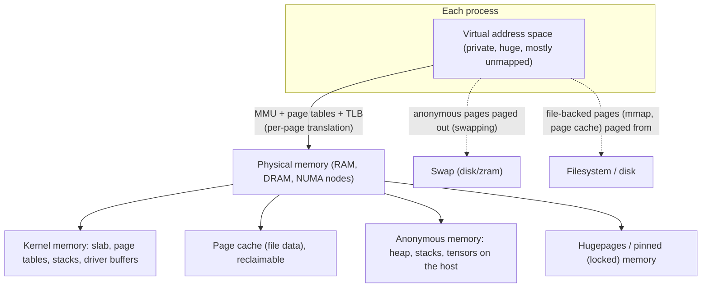
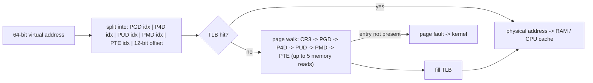
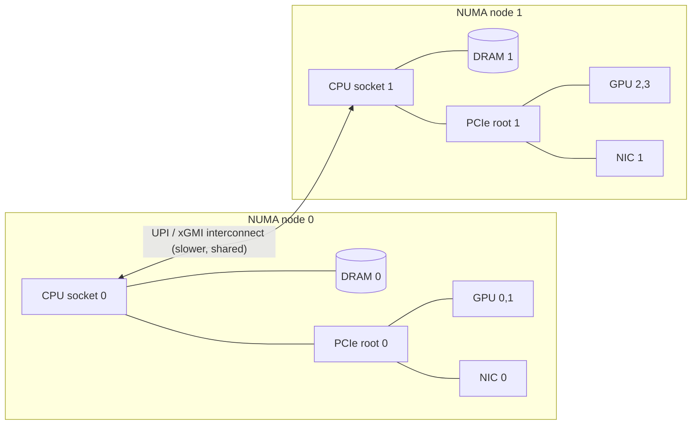
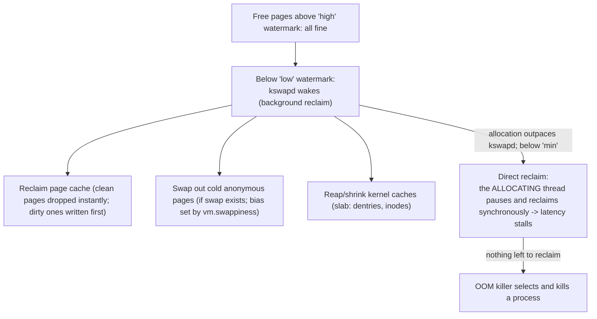

# 1.17 Memory management: virtual memory, NUMA, huge pages, OOM

| | |
|---|---|
| Level | Advanced |
| Priority tier | 0 |
| Lab venue | GCP / GKE (an Ubuntu VM; a multi-socket or multi-GPU machine for the NUMA commands) |
| Part | Part 1: Linux, from the command line to the kernel and performance |
| Status | Drafted, labs **untested** |

## Why this matters for AI infrastructure

Picture a GPU server near the end of a long training run. `nvidia-smi` looks healthy and the GPUs are cool, yet the job dies with exit code `137`. Nothing in the application log explains it. The cause is usually host memory, the resource that gets the least attention on a GPU node.

The GPUs hold the model, but the host's RAM holds almost everything around it. That includes the dataset cache, the data-loader workers, pinned staging buffers, the framework's own heap, the page cache of everything read, the container images, and the CUDA driver's mappings.

Most "mysterious" problems on GPU nodes turn out to be memory problems. Six symptoms come up again and again, and each one points to a different part of this chapter:

- A training job is **OOM-killed** with exit code `137` even though `nvidia-smi` shows free GPU memory. The host or the job's cgroup ran out of RAM, so the fix lies on the host, not on the GPU.
- A data loader is slow because its memory lives on the **wrong NUMA node**. Every batch then crosses the inter-socket link on the way to the GPU.
- Throughput wobbles every few minutes because **direct reclaim** or **transparent huge page compaction** stalls threads.
- A process cannot register RDMA or pinned memory because of the **`memlock`** limit. Or the node starts to swap, and the job slows by orders of magnitude.
- A long-running service's resident memory grows for days. Nobody knows whether that is a leak, a cache, or allocator fragmentation.
- `free` shows 2 GB "free" and an alarm fires. In fact, 400 GB is cache that the kernel would give back instantly.

This chapter builds the whole picture, one layer at a time. You will start with virtual memory, paging, demand paging and overcommit, then move on to the page cache and reclaim. From there you will look at the memory hardware: DRAM, caches, MMU, TLB and NUMA. Huge pages and THP come next, followed by allocators and the OOM killer, both system-wide and per cgroup.

The last parts cover NUMA policy and placement, memory limits in cgroups and containers, and the observability tools: `free`, `vmstat`, PSI, `/proc/meminfo`, `smaps`, `numastat`, `pmap`, `slabtop`, `perf` and the BPF tools. The chapter closes with a method for diagnosing leaks, growth, saturation and locality, and then applies it to GPUs. That GPU section covers pinned memory, `memlock`, NUMA binding for loaders, THP policy for training versus inference, and swap policy. Chapter 1.8 introduced page faults and `vmstat`. Chapter 1.18 covers CPU scheduling and cgroups, and chapter 1.28 assembles the tuning.

Start from the symptom you are seeing, and let the rest of the chapter explain why it happens. If a section ever feels abstract, come back to these six symptoms. One of them is almost certainly the reason you are reading.

## Prerequisites and outcomes

Before you start, make sure you know processes and the address space from chapters 1.8 and 1.11, filesystem caching from chapter 1.12, sysctl from chapter 1.10, and systemd resource control from chapter 1.15. This chapter uses all of them, and it will be hard to follow without them. Memory problems punish gaps in the basics more than most topics do.

When you finish, you should be able to do the following:

- Explain virtual memory, pages, page tables, the MMU and TLB, demand paging, minor and major faults, and RSS versus virtual size versus PSS.
- Describe how Linux frees memory (free lists, page cache, swapping, reaping, kswapd and direct reclaim, the OOM killer) and what swappiness, watermarks and overcommit do.
- Read `/proc/meminfo`, `free`, `vmstat`, `smem`/`smaps`, and distinguish "available" from "free", anonymous from file-backed memory, and kernel from user memory.
- Predict and tune the OOM killer: `oom_score`, `oom_score_adj`, cgroup memory limits, `memory.events`, `systemd-oomd`, and read an OOM log.
- Explain NUMA, inspect topology (`numactl -H`, `lscpu`, `nvidia-smi topo -m`), bind CPUs and memory, interpret `numastat` and automatic NUMA balancing, and avoid the cross-socket trap for GPU feeding.
- Configure huge pages (explicit and transparent), pick THP policy, and understand TLB reach.
- Choose and apply allocators (glibc, jemalloc, tcmalloc) and diagnose heap growth and leaks.
- Use cgroup memory controls and read their statistics for containers and Slurm jobs.
- Apply swap, memlock and pinned-memory settings correctly for GPU/RDMA workloads.

If one of these items feels out of reach, go back to the chapter it depends on before you continue.

## 1. Memory at a glance

Before the details, follow one process's memory to where it actually lives. A process sees one large, private block of addresses, but those addresses land in several places. Some sit in RAM, some wait on disk, and some are only promises. The diagram shows the paths a page can take.



Four ideas carry the chapter. Keep them in mind as you read, because most later sections return to one of them.

1. **Virtual memory** gives each process the illusion of a large private address space. The kernel and hardware map pieces of that space to physical RAM only when they are needed.
2. **RAM is a cache** for disk and swap. The kernel fills spare memory with file data and reclaims it under pressure. Free memory that sits unused is wasted memory.
3. **Locality matters twice.** It matters at the CPU-cache level, through temporal and spatial locality, and at the socket level, through NUMA locality. Where a page lives decides how fast every access is.
4. **Limits are enforced per cgroup**, not only per machine. A container can be OOM-killed while the host still has lots of RAM free.

When a process is slow or killed, ask which of these four ideas explains it before you touch any setting. In practice, the answer is usually the second or the fourth.

## 2. Virtual memory and paging

A program can ask for far more memory than the machine has free, and the request still succeeds. To see why, you need two ideas. Main memory is the physical RAM in the machine, also called DRAM. Virtual memory is something else: an abstraction that each process and the kernel see as their own address space.

Most of that address space is not populated. Resident memory is the part of it that currently sits in RAM. The rest is only a promise that the kernel can fill in later, and the promise costs nothing until a program touches it.

Memory also comes in two kinds, and the names say where the bytes come from. Anonymous memory has no file behind it. It holds the heap, the stacks, and `mmap` regions created with `MAP_ANONYMOUS`. File-backed memory maps a file, such as program text, libraries, `mmap`ed data, or the page cache.

The hardware moves memory in fixed units. A page is the unit the hardware maps, and it is normally 4 KiB. Huge pages are larger units, at 2 MiB and 1 GiB. A page fault happens when a program touches a virtual page that is not yet mapped to a physical page. It is a normal event, and it is often cheap.

Paging means moving pages between RAM and storage. In Linux, swapping means paging anonymous memory out to a swap device or file. Linux does not swap whole processes; it moves individual pages. Each process has its own address space, and the kernel has one too. Segments are the areas inside an address space with a purpose: text, data, heap, stacks and mappings.

### Why virtual memory

Virtual memory gives you several benefits at once, and each one is worth naming. Each process gets private memory no matter what the others do, which is called isolation. Programs can be larger than RAM, or only partly resident, which is called oversubscription. The system can keep one physical copy of library code and share it among many processes, which is called sharing. Files can be read and written as memory through `mmap`, and programmers get contiguous addresses that are simple to use. The cost is address translation, and the hardware handles that.

### Translation: page tables, MMU and TLB

The CPU cannot use a virtual address directly. Its MMU translates each virtual address into a physical address, and it relies on page tables that the kernel keeps in RAM. The tables form a multi-level tree, with four or five levels on x86-64: PGD, P4D, PUD, PMD and PTE. A 64-bit virtual address is split into an index for each level, plus a page offset.

Walking that tree costs time. The walk reads one entry per level from RAM, so a naive translation would add four or five extra memory accesses to every access. The TLB exists to avoid most of that cost. It is a small, very fast cache of recent translations inside the CPU, and its full name is translation lookaside buffer.

A TLB hit costs almost nothing. A TLB miss triggers a hardware page-table walk, which takes tens to hundreds of cycles. If the table entries themselves miss the CPU caches, the walk can take a hundred nanoseconds. The TLB holds only a limited number of entries, for example 64 for 4 KiB data pages. Its reach is the entry count times the page size, so with 4 KiB pages the reach stays small. A program with a multi-gigabyte working set therefore misses constantly, and every miss sends it back to the tables in RAM.

Huge pages, at 2 MiB and 1 GiB, multiply the reach and also shorten the walk. That is why they matter for AI workloads with tens or hundreds of gigabytes of host memory. Section 8 returns to this.

The diagram traces one translation from the virtual address to the answer. Notice that a TLB hit skips the walk entirely, and a missing entry leads to a page fault.



### Demand paging, page faults, memory states

Linux hands out virtual memory right away, but it gives out physical memory only when a page is touched. This is called demand paging. A call to `malloc(1<<30)`, or an `mmap` of a gigabyte, consumes almost no RAM until those pages are written. Each virtual page sits in one of four states. It can be unallocated. It can be allocated but not mapped, because nobody has touched it yet. It can be mapped to RAM, or mapped to swap after being paged out. Moving from allocated but unmapped to mapped is a page fault.

Faults come in two kinds, and the difference is cost:

- **Minor fault**: The kernel satisfies it without any I/O. Examples are a new zero page for the heap, or mapping a file page or shared library page that is already cached. These are cheap and frequent.
- **Major fault**: The kernel must read from storage. Examples are the first touch of an uncached file-backed page, or swapping an anonymous page back in. This is slow, taking milliseconds on spinning disks and tens to hundreds of microseconds on flash, and the thread blocks while it waits.

Two sizes help you read process memory, and people mix them up constantly. Virtual size, shown as VSZ or VIRT, counts everything allocated. Resident set size, or RSS, counts only the part in RAM. Shared memory makes RSS tricky. Shared libraries, `shmget` or shared `mmap`, and tmpfs are counted in the RSS of every process that maps them. Summing RSS over processes therefore overstates real use.

PSS, or proportional set size, fixes that problem. It divides shared pages among their users, so the sum comes out right. You can read it from `/proc/PID/smaps_rollup`, `smem`, or `pmap -X`. USS, or unique set size, counts only private memory.

The working set size, or WSS, is the memory a process actively uses. Performance collapses when the WSS exceeds available RAM. It improves greatly when the working set fits in the CPU caches. No standard WSS metric appears in common tools, which report RSS instead. Estimates are still possible. The `wss` tool uses idle-page tracking. The "memory shrinking" negative experiment reduces available memory step by step until swapping starts, but run it only in a test environment.

### Overcommit

Linux can grant more virtual memory than RAM plus swap. That sounds reckless until you remember how programs behave: they reserve far more address space than they ever touch. Programs rarely use everything they allocate, so the kernel makes that bet. The setting `vm.overcommit_memory` controls the policy.

| Value | Policy |
|---|---|
| `0` (default) | Heuristic: refuse only obviously excessive single requests; everything else succeeds |
| `1` | Always allow (never fail `malloc`; used by some HPC/scientific and Redis-style setups) |
| `2` | Strict: total committed virtual memory limited to swap + `vm.overcommit_ratio`% of RAM (or `vm.overcommit_kbytes`); allocations fail with `ENOMEM` when exceeded |

Only the value `2` enforces a hard limit. The other two values accept requests that the machine may not be able to back later.

Overcommit defers the failure, and that is the part to remember. Instead of `malloc` returning `NULL`, memory runs out later, at first touch. Then the OOM killer, covered in section 5, picks a victim. With `2`, allocation errors show up early and predictably. Many programs misbehave under strict limits, though. That includes programs that reserve large address spaces, such as JVMs, some CUDA and GPU runtimes, and `fork` of big processes. Strict mode is rare in practice, but learn the knob anyway. Check `grep -E 'Commit' /proc/meminfo`, which shows `CommitLimit` and `Committed_AS`.

### Utilisation and saturation

Two words from performance work will keep you honest when you look at memory. Utilisation is used memory compared with total memory, where file cache counts as available, because the kernel can reclaim it. Saturation is demand that exceeds available RAM. You see it in page scanning, paging and swapping, direct reclaim, and OOM kills. PSI, covered in section 6, measures it directly.

Errors form the third part of the picture. These are allocation failures, OOM kills, and hardware errors such as ECC problems. Check the hardware side with `edac-util`, `ipmitool sel`, or `dmesg | grep -i -E 'mce|edac'`.

### Swap

Swap holds paged-out anonymous pages, and for tmpfs, tmpfs pages. It lets rarely used memory, such as an idle daemon's heap, make room for cache. It also gives a grace period under pressure. With swap, an endlessly growing process first slows down, and you can see and debug that. Without swap, the OOM killer ends it immediately.

The cost is that touching swapped memory blocks on disk I/O. **On GPU and latency-sensitive nodes, the usual policy is little or no swap and a low `vm.swappiness`, with the OOM killer and cgroup limits as the safety net.** A partly swapped training process slows by orders of magnitude, and it can stall collective communication for the whole job.

Large-scale services often prefer to be OOM-killed and rescheduled rather than limp along. Make sure the OOM victim is the job, not `sshd` or `kubelet`. Chapter 1.15 covers that in section 10. On small hosts, `zram` and `zswap` offer middle options, because they compress swap in RAM.

Useful commands are `swapon --show`, `free -h`, `cat /proc/swaps`, `swapoff -a` and `vm.swappiness`. Before you add swap to a GPU node, decide which failure you would rather have: a slow job or a killed one.

## 3. Memory hardware that affects performance

Before you tune anything, know how far each kind of memory sits from the CPU. A value in a cache arrives almost immediately. The same value fetched from DRAM takes a noticeable journey through the memory controller and the interconnect. The size of that gap explains much of the behaviour you will see later in this chapter.

DRAM is dense, volatile memory. DDR4 and DDR5 channels set its bandwidth. DDR5-4800 delivers 38.4 GB/s per channel. Servers have 8 to 12 channels per socket, which adds up to hundreds of GB/s.

Latency to DRAM is on the order of 80 to 100 ns. That figure includes the CAS latency, which is tens of ns, plus the memory controller and the interconnect.

CPU caches hide much of that latency. There is an L1 cache per core, an L2 cache, and a shared L3, and each one holds both instructions and data. L1 takes about 1 ns, L2 a few ns, and L3 ten-plus ns. The hardware moves data in cache lines of 64 bytes.

ECC memory detects and corrects single-bit errors. Correctable errors are logged by EDAC, and they are a leading indicator of failure. Uncorrectable errors crash processes or the whole machine.

GPUs have their own memory, HBM, which is much faster and sits next to the GPU. Grace CPU LPDDR5X memory and NVLink-C2C on GH200 and GB200 give a coherent CPU-GPU address space. Linux still treats CPU DRAM and GPU HBM as separate pools, and it exposes the Grace memory as NUMA nodes.

### UMA versus NUMA

You will meet the NUMA trap the first time a job slows down after the scheduler moves it to the other socket. To understand why, start with the simpler design. On a UMA or SMP machine, every CPU reaches all memory with the same latency over a shared bus. Modern servers are NUMA, which stands for non-uniform memory access. Each socket has its own memory controllers and attached DRAM, and that group is called a node. Sockets are joined by an interconnect, which is UPI on Intel and Infinity Fabric or xGMI on AMD.

A CPU reaches local memory directly. It reaches remote memory through the other CPU, which is slower. Remote access commonly costs 1.3x to 2x the latency, with reduced bandwidth, and it uses interconnect bandwidth too. Many CPUs also present several NUMA nodes per socket, through sub-NUMA clustering or NPS modes. So a 2-socket server can show 2, 4 or 8 nodes.

PCIe devices such as GPUs, NICs and NVMe drives hang off one socket's root complex. That gives them a home node too.

The diagram shows a two-socket layout, with GPUs and NICs attached to each socket. Notice that the interconnect between the sockets is the slow path.



The NUMA trap is common on AI hosts, and it is easy to miss. A data-loading process runs on node 0 and allocates its buffers there. The GPU it feeds, though, is attached to node 1. Every host-to-device copy then crosses the interconnect, because the memory sits on node 0 while the GPU hangs off node 1's PCIe root. Picture a warehouse on the wrong side of town: the goods are correct, but every delivery pays the cross-town drive. The fix is to bind the loader's CPUs and memory to the GPU's node, which section 7 covers. Before you start a loader, check which node the GPU lives on, and bind to that node.

## 4. How Linux frees memory

A node raises an alarm because `free` shows very little memory. The alarm is often false, and this section explains why. Linux keeps RAM busy on purpose, and it gives memory back when something else needs it. Once you can see the machinery, an empty-looking free column stops being frightening.

Memory comes from the kernel's page allocator. It keeps free lists for each NUMA node and each memory zone, which are DMA, DMA32 and Normal. The buddy allocator organises those lists. Free blocks come in power-of-two sizes, where order 0 is one page and order 9 is 2 MiB. Neighbouring free blocks, called buddies, merge back together. Think of adjacent parking spaces opening up until a bus can park.

The kernel's own small objects, such as inodes, dentries and task structs, come from the slab or SLUB allocator. It keeps per-type caches of pre-allocated objects, which `slabtop` shows. User-space `malloc` gets pages from the kernel and subdivides them, which section 9 covers.

When free memory falls, Linux responds in stages. The diagram shows the order, roughly, as pressure rises.



The steps run roughly in order as pressure rises, and the last step is the OOM killer. The next paragraphs explain each of the knobs that shape those steps.

Watermarks are the `min`, `low` and `high` marks for each zone. They derive from `vm.min_free_kbytes`, and the `low` and `high` marks scale up from `min`. The setting `vm.watermark_scale_factor` controls the gap, and its default of 10 means 0.1% of memory. `vm.watermark_boost_factor` lets kswapd reclaim extra after fragmentation events. kswapd is the per-node background page-out daemon, and it scans the active and inactive LRU lists. Hysteresis keeps it from flapping.

Direct reclaim happens when an allocation cannot wait. The application thread does the reclaim work itself, which is why you notice it as unexplained latency spikes and high `sys` time. Raising `vm.min_free_kbytes` moderately, and `watermark_scale_factor` too, makes kswapd start earlier. On large-memory machines, that can remove direct-reclaim stalls. Test it on a canary first, because very large values waste RAM and can cause other trouble.

`vm.swappiness` decides how reclaim splits between dropping page cache and swapping anonymous pages. Its range is 0 to 100, with a default of 60, and up to 200 on cgroup v2 and newer kernels. Setting it very low keeps application memory resident, at the expense of cache. On GPU nodes, the common settings are 0 to 10, and the documentation often says 1. Even at 0, the kernel still swaps when it must.

`vm.vfs_cache_pressure`, with a default of 100, controls how eagerly dentry and inode caches are reclaimed. Lower values keep them longer. At 0, the kernel never reclaims them, and that can lead to OOM.

Dirty pages are modified file data waiting for write-back. Their limits come from `vm.dirty_ratio` and `dirty_background_ratio`, or from their `_bytes` forms, which chapter 1.12 covers. A flood of dirty data can cause stalls of its own.

Dropping caches with `echo 3 > /proc/sys/vm/drop_caches` is a test tool, not a tuning knob. The kernel refills the cache right away, so you gain nothing lasting.

Compaction defragments physical memory, so that large contiguous blocks for huge pages and high-order allocations can be found. It costs CPU and can stall, which section 8 covers. Look at `cat /proc/buddyinfo`, `/proc/pagetypeinfo` and `/proc/vmstat`. The counters to watch in `/proc/vmstat` are `compact_*`, `thp_*`, `pgscan_*`, `pgsteal_*`, `allocstall_*` and `oom_kill`.

When a node reports low free memory, check the page cache and reclaim counters before you assume a leak. Most of the time, the memory is doing exactly what it was designed to do.

## 5. The OOM killer

A training job disappears in the middle of the night, and the application logs show nothing useful. There is no traceback, no error, no goodbye. The reason is often the OOM killer. It is the kernel's last resort when memory runs out, and it leaves its trace in the kernel log rather than the application log. That is why the first place to look is `dmesg`, not your Python output.

When reclaim fails, the kernel invokes the **out-of-memory (OOM) killer**. Reclaim has already tried the gentler options: dropping cache, swapping, shrinking slab. When none of them frees enough, something has to give, and the kernel chooses a process to end. It selects that process using a "badness" score and kills it with `SIGKILL`. The event goes to the kernel ring buffer, which you can read with `dmesg` or `journalctl -k`. The key line looks like `Out of memory: Killed process 1234 (python) total-vm:... anon-rss:...`. The log also shows `oom-kill:constraint=...` and a dump of all candidate processes.

The victim gets no chance to clean up, because it receives `SIGKILL` rather than `SIGTERM`. There is no exception handler, no final checkpoint, no flush. Partial checkpoints and GPU state may be left behind. A parent process, or Kubernetes, sees the exit status `137`, which is 128 + 9.

Scoring decides who dies, and the scoring is simpler than it looks. `/proc/PID/oom_score` is a number from 0 to 1000. It roughly tracks the share of RAM, and swap, that the process uses. In some versions it also counts the process's children. You can shift the score with `/proc/PID/oom_score_adj`, which ranges from -1000 to +1000 and is added to the score. A value of `-1000` makes a process immune to the OOM killer. A value of `+1000` makes it the first choice. Older root-user bonuses no longer exist on current kernels.

Protect critical daemons, and let batch workers be preferred victims if you want that. You can run `echo -1000 > /proc/$(pidof sshd)/oom_score_adj`, or set `OOMScoreAdjust=-900` in the systemd unit, which chapter 1.15 covers. Batch workers can take `+500`.

A cgroup has its own limit, `memory.max`. When a group exceeds that limit and cannot reclaim enough, the kernel runs the OOM killer inside that cgroup. It kills one of the group's processes, or the whole group if `memory.oom.group=1`. This is exactly what happens to a container that exceeds its limit, even when the host has hundreds of gigabytes free.

The evidence for a cgroup OOM lives in `memory.events`, which has counters named `high`, `max`, `oom` and `oom_kill`. The `dmesg` messages show `constraint=CONSTRAINT_MEMCG` and the cgroup path. Kubernetes reports the reason `OOMKilled`.

A global OOM is different, because the whole machine is out of memory. A NUMA-constrained OOM is a third case. A process bound to a full node, through `--membind` or `cpuset.mems`, can hit OOM while other nodes still have free memory. Low-memory zones such as DMA32 can also run out, so check the `Node 0 DMA32 free:...` lines in the OOM report.

The kernel OOM killer reacts late, after the system has already thrashed. Userspace daemons act earlier. `systemd-oomd` uses PSI and cgroup memory data to kill whole cgroups under sustained pressure. `earlyoom` and `nohang` also act early. On clusters, the scheduler should enforce memory limits first. Slurm's cgroup plugin enforces `--mem`, and Kubernetes enforces limits and kubelet eviction thresholds. With those in place, the node as a whole seldom reaches a global OOM.

Kubelet eviction, set with `evictionHard` and `memory.available<...`, removes pods before the kernel OOM killer picks victims at random. Set node reservations with `systemReserved` and `kubeReserved`, so the system keeps room to work.

An OOM report tells you a story if you know where to look. Start with the `invoked oom-killer` line, which shows who requested memory, along with the `gfp_mask` and `order`. Next comes the memory summary, `Mem-Info`, with `active_anon`, `inactive_file`, `slab_reclaimable`, `free` and `shmem`. Then read the per-zone free counts, the task table with pid, uid, `total_vm`, `rss`, `oom_score_adj` and name, and the `Killed process` line.

Each part points to a different consumer. If `shmem` or `tmpfs` is huge, an in-memory filesystem is the consumer, such as `/dev/shm`, `/tmp` on tmpfs, or an `emptyDir` with the Memory medium. If `slab_unreclaimable` is huge, suspect a kernel or driver leak. If the `anon_rss` of one process dominates, the application is the consumer. Before you raise a memory limit, find which of these three grew.

## 6. Observing memory

When a node feels slow, memory is one of the first places to look. The tools in this section answer three different questions, and it helps to keep them apart. How much memory is there? Is anything waiting for it? And which process or cache is using it? Work from the summary down to the suspect, and do not start with a guess about a leak.

### The summary view: `free` and `/proc/meminfo`

Start with the summary, the way you would look at a fuel gauge before checking the engine. `free` and `/proc/meminfo` tell you how much memory the machine has and how much of it is really available. Run both before you draw any conclusion about a node.

```bash
free -h
#                total   used   free  shared  buff/cache  available
# Mem:           1.9Ti  120Gi   40Gi    1.2Gi      1.7Ti      1.7Ti
# Swap:             0B     0B     0B
free -mw                      # wide: separate 'buffers' and 'cache'
grep -E 'MemTotal|MemFree|MemAvailable|Buffers|^Cached|SwapTotal|SwapFree|Dirty|Writeback|AnonPages|Mapped|Shmem|Slab|SReclaimable|SUnreclaim|PageTables|Mlocked|HugePages|AnonHugePages|Hugepagesize|Committed_AS|CommitLimit' /proc/meminfo
```

The key number is `available`, which appears as `MemAvailable`. It estimates how much memory you can use to start new applications without swapping. It counts reclaimable page cache and slab. `free` is idle memory, and it is deliberately small. `buff/cache` is mostly reclaimable, but shared and tmpfs pages, and `mlock`ed pages, are not.

Remember this breakdown, because it answers most "where did my RAM go" questions. `AnonPages` is process private heap and stack. `Cached` is page cache, including mapped files and tmpfs through `Shmem`. `Slab` splits into `SReclaimable`, which can be freed, and `SUnreclaim`, which cannot. `PageTables` and `KernelStack` are kernel overhead. `HugePages_*` counts memory explicitly reserved, which ordinary allocation cannot use. `Mlocked` and `Unevictable` are pages that reclaim cannot touch.

### Pressure and activity: `vmstat`, PSI, `sar`

The summary tells you how much memory is in use. Pressure tells you whether anything is waiting for it. A machine can have plenty of memory and still be saturated, so check both views.

```bash
vmstat 1 5                    # si/so = swap in/out per second; free/buff/cache; b = blocked; wa = I/O wait
cat /proc/pressure/memory     # some avg10=.. avg60=.. avg300=.. total=..  and  full ...
sar -B 1 5                    # paging: pgpgin/out, fault/s, majflt/s, pgscank/s, pgscand/s (direct scan), pgsteal/s, %vmeff
sar -r 1 5; sar -S 1 5        # memory utilisation; swap
grep -E 'pgscan|pgsteal|allocstall|oom_kill|thp_|compact_stall|numa_' /proc/vmstat
```

PSI, or pressure stall information, appeared in Linux 4.20 and later. It answers a simple question: are tasks actually waiting for memory? `some` is the percentage of time at least one task stalled while waiting for memory. `full` is the time when all non-idle tasks stalled. Both come as averages over 10, 60 and 300 seconds. Any sustained non-zero `some` value, and any `full` value, signals saturation more directly than free-memory numbers do. Per-cgroup pressure lives in `memory.pressure`.

In `sar -B`, a steady `pgscand/s` means allocating threads are reclaiming memory for themselves. Each of those reclaim passes is a stall, which is why the number matters more than the amount of free memory.

### Per process

When one process is the suspect, look at it directly. Each command below shows a different slice of its memory, so read them together rather than picking one.

```bash
ps -eo pid,ppid,user,rss,vsz,pmem,comm --sort=-rss | head       # RSS in KiB, VSZ; %MEM
top -o %MEM                    # M sorts by resident memory; columns VIRT, RES, SHR
cat /proc/PID/status | grep -E 'VmPeak|VmSize|VmRSS|RssAnon|RssFile|RssShmem|VmSwap|VmLck|VmHWM|Threads'   # VmHWM = peak RSS
cat /proc/PID/smaps_rollup     # Rss, Pss, Shared/Private Clean/Dirty, Anonymous, Swap, Locked (summed)
pmap -x PID | tail -20         # per-mapping Rss/Dirty; pmap -X for PSS; shows [heap], [stack], libraries, big anonymous mappings
smem -rk | head                # PSS, USS per process (install smem)
numastat -p PID                # which NUMA nodes hold this process's pages
```

In `top`, `VIRT` covers everything allocated and mapped. `RES` is resident memory, and `SHR` is the shared part of `RES`. A large `VIRT` is not a problem by itself. GPU processes often show terabytes of `VIRT`, because the CUDA driver reserves large address ranges. Look at `RES` and its anonymous part instead, and compare the process against its own history rather than against a neighbour.

### Kernel memory and caches: `slabtop`, `/proc/slabinfo`

Run `sudo slabtop -o -s c | head -15` to list the kernel caches sorted by size. You will see caches such as `dentry`, `inode_cache`, `ext4_inode_cache`, `kmalloc-*`, and `nvidia`-related caches. A huge dentry or inode cache after scanning millions of files is normal, and the kernel can reclaim it. A `kmalloc-*` or driver cache that keeps growing and never shrinks is a sign of a kernel or driver leak. Check `SUnreclaim` to confirm.

### Tracing: `perf`, BCC, `bpftrace`

To see page faults and allocations as they happen, use `perf`: `perf stat -e page-faults,minor-faults,major-faults -p PID`, `perf record -e page-faults -g -p PID`, or `perf trace -F all`.

BCC and bpftrace tools, covered in chapter 1.24, answer narrower questions. `drsnoop` shows direct reclaim latency per process. `memleak -p PID` finds allocations that were never freed, with their stacks, but it has high overhead. `oomkill` traces OOM kills. `cachestat`, `slabratetop`, `numamove` (NUMA page migrations) and `wss` (working-set estimation) round out the set. A cheap trick is a CPU profile shown as a flame graph. Search it for `malloc`, `page_fault`, `clear_page`, `compact` and `isolate`.

### The method for memory problems

Work through these steps in order, and change one thing at a time. A memory investigation goes wrong when someone changes three settings and then cannot tell which one helped.

1. Run the USE check. Utilisation means `available` and per-cgroup usage. Saturation means PSI, `si/so`, `pgscand` and OOM kills. Errors are allocation failures, OOM kills, and ECC or EDAC events.
2. Characterise the system. Look at system-wide usage, kernel versus user memory, cache versus anonymous memory, the biggest processes by RSS and PSS, cgroup limits and usage, NUMA distribution, huge page use, and swap.
3. Decide growth versus leak. A leak is memory allocated and never freed, which is a bug. Growth is normal use at a higher rate, or a cache warming up. Ask first whether the process is supposed to do that, by checking its configuration, cache sizes and allocator behaviour. Then watch RSS over time with `pidstat -r 60`, node_exporter `process` metrics, or `smem`. Next, find the allocation path with `memleak`, `jemalloc` or `tcmalloc` heap profiling, or a language profiler such as Python `tracemalloc`, `memray` or `objgraph`. PyTorch `torch.cuda.memory_summary` reports GPU memory, not host memory.
4. Check the static setup: total RAM and DIMM population, with all channels filled, memory speed, NUMA mode, BIOS settings, huge pages, overcommit, limits and the allocator.
5. Tune last, one change at a time, as section 10 describes.

Plan capacity for a training node by adding up its needs. Each data-loader worker may hold a copy of the dataset indexes and decoded batches. Add the pinned staging buffers, the framework overhead, the page cache you want to keep for the dataset, and a margin. Compare that total with `MemAvailable` and the cgroup limits. Then test with the real job and watch `RssAnon` and PSI. A budget on paper is a starting point, not a promise.

## 7. NUMA in practice

NUMA settings only help once you know the layout of your machine. Start by discovering the topology, and read the distance matrix before you bind anything. Binding to the wrong node is worse than not binding at all, because it looks deliberate.

### Discover the topology

Four commands together tell you almost everything: `lscpu` for the summary, `numactl --hardware` for the memory map, `lstopo` for the device tree, and `nvidia-smi topo -m` for the GPUs. Run them on every new platform before you trust a habit.

```bash
lscpu | grep -E 'Model name|Socket|NUMA|Thread|Core|L3'
numactl --hardware                 # nodes, CPUs per node, memory per node, node distance matrix
#   node distances:  node 0 1 / 0: 10 21 / 1: 21 10   (10 = local, 21 = about 2.1x remote cost)
ls /sys/devices/system/node/; cat /sys/devices/system/node/node0/cpulist
lstopo --of ascii                  # hwloc: sockets, caches, memory, PCI devices, GPUs, NICs
nvidia-smi topo -m                 # GPU<->GPU links (NV#, PIX, PHB, SYS) and each GPU's CPU/NUMA affinity
cat /sys/bus/pci/devices/0000:3b:00.0/numa_node        # a device's home node (-1 = unknown)
numastat                           # per-node numa_hit / numa_miss / numa_foreign / local_node / other_node
numastat -m                        # per-node meminfo-style breakdown
```

The `numa_hit` counter means an allocation landed on the node it was meant for. `numa_miss` means it landed here although another node was intended, because that node was full. `numa_foreign` means it was intended here but landed elsewhere. `other_node` means a process allocated a page while running on a different node than the page's. If `numa_miss` or `other_node` rises while a workload runs, pages are being placed remotely and traffic crosses sockets.

### Policies and binding

The default policy is local allocation with first touch. A page lands on the node of the CPU that first writes it. That rule is sensible until a buffer is shared. If one thread initialises a huge buffer and other threads on a different node use it, that buffer is entirely remote for them. The other policies are bind, which uses only the named nodes; preferred, which tries a node and falls back; interleave, which spreads pages round-robin across nodes and suits data that every CPU reads; and local, which is the default.

```bash
numactl --cpunodebind=1 --membind=1 python train.py --gpu 4        # run on node 1's CPUs with node 1's memory
numactl --interleave=all ./big_shared_table                        # spread pages over all nodes
numactl --physcpubind=16-31 --localalloc ./prog                   # particular cores, local memory
taskset -c 16-31 ./prog; taskset -cp 16-31 PID                     # CPU affinity only (memory follows first touch)
numactl --show                                                      # current policy of this shell
```

Here is a per-GPU launch on an 8-GPU, 2-socket machine. Read it as a pattern rather than a recipe. It is illustrative, so derive the nodes from your own topology rather than hard-coding them.

```bash
for g in 0 1 2 3 4 5 6 7; do
  node=$(cat /sys/bus/pci/devices/$(nvidia-smi --query-gpu=pci.bus_id --format=csv,noheader -i $g | sed 's/^0000//;s/^00000000/0000/' | tr 'A-Z' 'a-z')/numa_node)
  CUDA_VISIBLE_DEVICES=$g numactl --cpunodebind=$node --membind=$node python train.py --rank $g &
done; wait
```

Inside frameworks, pin each data-loader worker to the GPU's node. In PyTorch, that means a `DataLoader(worker_init_fn=...)` that calls `os.sched_setaffinity` and `libnuma`. Use persistent workers so the affinity survives epochs. Create pinned host buffers from threads on the right node, and re-apply the binding inside worker processes too. One detail catches people out: a spawn start method or `exec` does not inherit the `numactl` memory policy, but `fork` does. Slurm provides `--cpu-bind`, `--mem-bind` and `--gpu-bind=closest`. Kubernetes offers the Topology Manager and the CPU and Memory Managers, covered in Part 6 and the Kubernetes chapters. For containers, use `docker run --cpuset-cpus --cpuset-mems`.

Automatic NUMA balancing, set with `kernel.numa_balancing=1`, samples page accesses and migrates pages or threads toward each other. That helps general workloads. Its scanning and page-migration faults add overhead and jitter, though, and the kernel's guesses are worse than explicit binding for GPU feeding. Many AI sites disable it with `sysctl kernel.numa_balancing=0` on nodes where processes are explicitly bound. If you keep it on, tune `kernel.numa_balancing_scan_size_mb` instead. The setting `zone_reclaim_mode` is 0 by default on modern kernels. When it is set, allocation reclaims the local node before it uses a remote one. Leave it at 0, except for specific database or NUMA-isolation reasons.

Grace-based systems, such as GH200 and GB200, expose CPU memory as NUMA nodes. Depending on configuration, GPU memory can appear as NUMA nodes too, and the distances differ a lot. The unified, coherent address space removes the need to copy data, but it does not remove the need to place data well. Always read `numactl -H` and the platform guide.

Bind by topology rather than by habit, and check `numactl -H` on every new platform. The machine will tell you where its memory and its GPUs live; the mistake is assuming they live in the same place.

## 8. Huge pages and transparent huge pages

A database team once asked for huge pages on every node, and the reason was simple. Their working set was large and their TLB was thrashing. Here is the problem a huge page solves. A 256 GiB dataset mapped with 4 KiB pages needs 67 million page-table entries. The TLB can cache only a few dozen of them, so the program misses constantly and pays for a page walk on most accesses.

Huge pages, at 2 MiB and 1 GiB on x86-64, address that problem. They shrink the page table, shorten the walk, and raise TLB reach by 512x or more. The gain is typically 3% to 10%, and it can be larger on memory-heavy workloads. You also see fewer page faults during initial population.

### Explicit huge pages (hugetlb)

Explicit huge pages are reserved at boot or at runtime, in a dedicated pool. That memory is not swappable, and it does not count as normal available memory. Only applications that ask for huge pages use them. The pool is a reservation, like a block of rooms held for a conference.

```bash
grep -i huge /proc/meminfo                                  # HugePages_Total/Free/Rsvd/Surp, Hugepagesize
echo 1024 | sudo tee /proc/sys/vm/nr_hugepages              # 1024 x 2 MiB = 2 GiB (may fail if memory is fragmented)
sudo sysctl vm.nr_hugepages=1024                            # persist in /etc/sysctl.d
# 1 GiB pages need boot parameters (they must be reserved early): default_hugepagesz=1G hugepagesz=1G hugepages=64
cat /sys/kernel/mm/hugepages/hugepages-1048576kB/nr_hugepages
mount -t hugetlbfs none /mnt/huge -o pagesize=2M           # filesystem interface
# apps: mmap(... MAP_HUGETLB), shmget(SHM_HUGETLB), libhugetlbfs, DPDK, databases (Oracle, PostgreSQL huge_pages=on), VM hypervisors (QEMU -mem-path), NCCL/RDMA in some configurations
```

Use explicit huge pages for VM guests and hypervisors, DPDK and RDMA data planes, large in-memory databases, and workloads that need a guaranteed, predictable page size. Reserve them at boot when you can, because fragmentation makes late reservation unreliable. Size the pool so the rest of the system still has memory. Per-NUMA-node pools live under `/sys/devices/system/node/node*/hugepages/`.

### Transparent huge pages (THP)

Transparent huge pages, or THP, work differently. The kernel backs large aligned anonymous regions with 2 MiB pages on its own, and it splits or merges them as needed. Applications need no changes, which is why the word transparent appears in the name.

```bash
cat /sys/kernel/mm/transparent_hugepage/enabled      # [always] madvise never
cat /sys/kernel/mm/transparent_hugepage/defrag       # always defer defer+madvise [madvise] never
grep -E 'AnonHugePages|thp_' /proc/meminfo /proc/vmstat
echo madvise | sudo tee /sys/kernel/mm/transparent_hugepage/enabled        # runtime; or boot param transparent_hugepage=madvise
```

The `enabled` setting has three values. `enabled=always` uses huge pages wherever possible. `madvise` applies only to regions where the application calls `madvise(MADV_HUGEPAGE)`. `never` disables THP. The `defrag` setting controls how hard the kernel works, through direct compaction, to find a huge page at fault time.

THP can reduce TLB misses and page faults. That helps throughput workloads such as training, which keep big contiguous tensors in host memory. The price is latency spikes when the kernel compacts memory or `khugepaged` collapses pages. THP can also bloat memory for sparse allocations, because a few touched bytes can pin 2 MiB.

The common guidance is this. Training and throughput nodes take `always`, or `madvise` with frameworks that opt in. **Latency-critical inference servers, databases and Redis take `madvise` or `never`, with `defrag=defer` or `madvise` to avoid synchronous compaction stalls.** Test on your workload, and watch `thp_fault_alloc`, `thp_collapse_alloc` and `compact_stall` in `/proc/vmstat`, along with application tail latency. Set the policy at boot, through a kernel parameter or a `tuned` or systemd-tmpfiles unit, rather than editing `/sys` by hand.

When you use large pinned host buffers, see section 11 for `memlock`.

## 9. Allocators and heap behaviour

Here is a surprise that catches many engineers. You free a large block, and RSS stays high anyway. That alone does not mean a leak. The allocator is holding the memory on purpose, the way a warehouse keeps shelving after a delivery leaves.

`malloc` is library code in user space, not a system call. It obtains big chunks from the kernel, using `brk` for the main heap and `mmap` for large requests and per-thread arenas, and then it hands out pieces. When you `free` memory, the allocator usually keeps it, so the memory returns to the allocator rather than to the operating system. RSS therefore stays high. This is normal heap growth.

glibc's `malloc_trim()` and `M_TRIM_THRESHOLD` can release memory at the top of the heap. Since glibc 2.8, they can release free ranges too. Very large allocations, above `M_MMAP_THRESHOLD`, get their own `mmap`. That threshold defaults to 128 KiB, but it is dynamic. Such allocations return to the OS right away on `free`.

Multithreaded programs can create up to 8x CPU-count arenas, and that multiplies fragmentation. Tune glibc with `MALLOC_ARENA_MAX=2..4`, `MALLOC_TRIM_THRESHOLD_` and `MALLOC_MMAP_THRESHOLD_`, or with `GLIBC_TUNABLES=glibc.malloc.arena_max=4`.

Several allocators compete with glibc, and each one trades speed, memory overhead and fragmentation differently. None of them is simply better than the others. The table lists the main options.

| Allocator | Notes |
|---|---|
| **glibc malloc** (ptmalloc, from dlmalloc) | Default; bins by size, per-thread arenas; decent, can fragment in long-running multithreaded services |
| **jemalloc** | Multiple arenas, per-thread caches, size classes; scalable and fragmentation-resistant; heap profiling (`MALLOC_CONF=prof:true`); used by Facebook/Meta, Redis, Firefox; often reduces RSS growth in Python/C++ services |
| **tcmalloc** (gperftools / Google tcmalloc) | Per-thread caches, central heap, periodic return of memory; good for many small allocations; heap profiler; `libtcmalloc_minimal.so` |
| **mimalloc** | Compact, fast, good defaults |
| **Kernel: slab/SLUB** | Per-type object caches for kernel structs (`slabtop`, `kmem_cache_alloc`); originally developed by Jeff Bonwick for Solaris 2.4 (`[Bonwick 94]`) and enhanced with per-CPU object caches called *magazines* (`[Bonwick 01]`); SLUB is the modern Linux default |

Measure before you switch, because the table describes what each allocator is built for, not what it will do to your workload. You can switch without recompiling, using `LD_PRELOAD=/usr/lib/x86_64-linux-gnu/libjemalloc.so.2 python train.py`. Check `/proc/PID/maps` to confirm the library loaded. Then measure RSS and throughput before and after, because the effect can be negative.

Python has its own quirks. CPython's `pymalloc` allocates 256 KiB arenas from the OS. A single surviving small object keeps an entire arena resident, which is why one small reference can hold a large block of memory. That means deleting a big list and calling `gc.collect()` may not bring RSS back to its old value. Reference cycles need the cyclic collector. Native extension memory, such as NumPy or PyTorch host tensors, is allocated outside `pymalloc`.

Several fixes help. Recycle worker processes with `maxtasksperchild`. Use `jemalloc`. Avoid holding giant collections of Python objects, and use NumPy, Arrow or memory-mapped files instead. Also note that `del` plus `torch.cuda.empty_cache()` acts on GPU memory only, not on host RAM.

Data loaders with many workers have one more trap. `fork` shares pages copy-on-write, but Python reference counting writes to objects, and that breaks the sharing. Each worker then gradually copies the dataset. Store datasets in NumPy, Arrow, `mmap` or shared memory instead of Python lists, so the pages stay shared.

To detect a leak, first confirm that `RssAnon` grows steadily over a long period under steady load. Then ask whether the growth is a cache or a pool. Next, use allocator profiling, such as the jemalloc `prof` option, the tcmalloc heap profiler, or `valgrind massif` for small tests. In production, `memleak` works, and so does this `bpftrace` one-liner, though you should watch its overhead: `bpftrace -e 'uprobe:/lib/x86_64-linux-gnu/libc.so.6:malloc /pid == 4840/ { @[ustack] = hist(arg0); }'`. Python `tracemalloc` and `memray` cover the Python side. Read `/proc/PID/smaps` to see which mapping grows, whether heap, anonymous mmap or shared, and run `pmap -x` over time. Kernel-side leaks show as growing `Slab`, `SUnreclaim` or `PageTables`.

When RSS climbs, decide whether the growth is a leak or a cache before you touch the allocator. The allocator is usually doing its job; the question is whether the program asked it to.

## 10. Tuning parameters

Defaults are usually sensible, so change a setting only when you have evidence. A default is the vendor's best guess for a typical machine, and a GPU node is not a typical machine, but that is a reason to measure, not a reason to guess. The table lists representative `vm.*` and `kernel.*` settings. The kernel documentation for them lives in `Documentation/admin-guide/sysctl/vm.rst`.

| Parameter | Default | Meaning and GPU-node practice |
|---|---|---|
| `vm.swappiness` | 60 | Bias to swap anonymous pages over dropping cache. 0 to 10 on GPU/HPC nodes |
| `vm.overcommit_memory` / `vm.overcommit_ratio` | 0 / 50 | Overcommit policy; 2 gives strict accounting (usually not for GPU nodes) |
| `vm.min_free_kbytes` | dynamic | Minimum free pool and base of watermarks. Raise moderately on large-RAM nodes to avoid direct-reclaim stalls (for example hundreds of MB to a few GB; test) |
| `vm.watermark_scale_factor` | 10 | Gap between watermarks (0.1% of RAM per unit); raise to wake kswapd earlier |
| `vm.zone_reclaim_mode` | 0 | Leave 0 |
| `vm.vfs_cache_pressure` | 100 | Dentry/inode reclaim aggressiveness |
| `vm.dirty_ratio`, `vm.dirty_background_ratio` (or `_bytes`) | 20 / 10 | Write-back thresholds; use bytes forms on huge-RAM nodes (chapter 1.12) |
| `vm.max_map_count` | 65530 | Max memory mappings per process; **raise (e.g. 262144 to 1048576)** for frameworks and Elasticsearch/JVM/PyTorch loaders with many mmaps (error: "Cannot allocate memory" in `mmap`) |
| `vm.nr_hugepages` | 0 | Explicit huge pages pool |
| `vm.panic_on_oom` | 0 | 1 reboots on OOM (some HPC sites prefer fast failure) |
| `vm.oom_kill_allocating_task` | 0 | Kill the allocating process instead of scanning for the worst |
| `kernel.numa_balancing` | 1 | Disable when binding explicitly |
| `kernel.pid_max` / `kernel.threads-max` | 32768+ / varies | Raise for dense containers and many threads |
| `vm.compact_unevictable_allowed`, `vm.compaction_proactiveness` | | Compaction behaviour (THP stalls) |

The file below is an illustrative starting point for a GPU node. It is a worked example, not a standard. Validate it on a canary node before you roll it out.

```ini
# /etc/sysctl.d/90-gpu-node-memory.conf   (illustrative; validate on a canary node)
vm.swappiness = 1
vm.max_map_count = 1048576
vm.min_free_kbytes = 4194304        # 4 GiB on a 1+ TiB machine; far too much on small ones
vm.watermark_scale_factor = 100
vm.dirty_background_bytes = 1073741824
vm.dirty_bytes = 4294967296
kernel.numa_balancing = 0
```

Kernel command line settings, covered in chapter 1.14, include `transparent_hugepage=madvise`, `default_hugepagesz=1G hugepagesz=1G hugepages=N`, `numa_balancing=disable` and `crashkernel=`. For limits, chapter 1.8 and section 11 cover `LimitMEMLOCK=infinity`. The `ulimit -v`, `-m` and `-d` options exist, but they are crude. Use cgroups instead.

## 11. Memory in cgroups, containers and GPU workloads

### cgroup v2 memory controller

A container gets its memory from a cgroup, and the cgroup decides when that container is out of memory. That is the key idea of this section: the limit that matters may belong to the group, not to the machine. Read these files to see what a container is allowed to use and what it actually uses.

```bash
cat /sys/fs/cgroup/<path>/memory.max          # hard limit ("max" = none)
cat /sys/fs/cgroup/<path>/memory.high         # throttle/reclaim threshold
cat /sys/fs/cgroup/<path>/memory.low          # protection (best effort); memory.min is a hard protection
cat /sys/fs/cgroup/<path>/memory.current      # current usage (anon + file cache + kernel memory)
cat /sys/fs/cgroup/<path>/memory.stat         # anon, file, kernel, slab, shmem, pgfault, pgmajfault, workingset_*, thp_*
cat /sys/fs/cgroup/<path>/memory.events       # low, high, max, oom, oom_kill (counters)
cat /sys/fs/cgroup/<path>/memory.pressure     # per-cgroup PSI
cat /sys/fs/cgroup/<path>/memory.swap.max / memory.swap.current
echo 1 > /sys/fs/cgroup/<path>/memory.oom.group     # kill the whole group on OOM
```

Two points matter most, and together they explain most container OOM surprises. `memory.current` includes page cache charged to the cgroup. When usage nears `memory.max`, the kernel reclaims the cgroup's own cache first, so high usage is not necessarily a problem. The working set is the real concern, and you find it in `memory.stat` under `anon` and active file. A container whose `anon` approaches `memory.max` will be OOM-killed.

`memory.high` slows the group down before it is killed, through throttling and reclaim. That makes it a good soft limit for batch jobs, because it turns a sudden death into a slowdown you can observe.

In Kubernetes, `resources.limits.memory` sets `memory.max`. `requests.memory` influences scheduling, and it drives `memory.min/low` protection through QoS classes: Guaranteed, Burstable and BestEffort. The same classes set OOM score adjustments, and BestEffort pods are killed first. A memory-backed `emptyDir`, which is tmpfs, counts toward the pod's memory.

Slurm's `--mem`, `--mem-per-cpu` and `--mem-per-gpu` become cgroup limits, through `ConstrainRAMSpace`. Under cgroup v1, the equivalents are `memory.limit_in_bytes`, `memory.usage_in_bytes`, `memory.memsw.*` and `memory.oom_control`.

### Pinned (page-locked) memory, `memlock`, and DMA

A job that runs fine on one node can fail on another while registering memory, even though the GPU has room. The difference is often the `memlock` limit. GPUs and NICs move data by DMA, which needs physical addresses that do not move. Pinned, or page-locked, memory is excluded from swapping and migration, so the device can read and write it directly. Host-to-device copies from pinned memory are typically 2x to 3x faster than copies from pageable memory, because no staging copy is needed. Pinned memory also allows asynchronous overlap with compute, through `cudaMemcpyAsync`, PyTorch `pin_memory=True`, `tensor.pin_memory()` and `non_blocking=True`. GPUDirect RDMA, GPUDirect Storage and InfiniBand verbs need registered, pinned memory too. Pinning has five consequences.

- Pinned memory is limited by `RLIMIT_MEMLOCK`, which you read with `ulimit -l`. A low limit makes registrations fail. Symptoms include `ibv_reg_mr` errors, CUDA "out of memory" errors while pinning host memory, and NCCL `ibv_reg_mr` failures. Set `memlock` to `unlimited` for HPC and AI users and services. Use `/etc/security/limits.d/*.conf` for logins, `LimitMEMLOCK=infinity` for systemd units, `--ulimit memlock=-1:-1` for Docker, Slurm `PropagateResourceLimits`, and runtime configuration for Kubernetes. Chapters 1.8 and 1.15 cover the details.
- Pinned pages are unevictable. They reduce what the kernel can reclaim, they count in `Mlocked` and `Unevictable`, and they count in cgroup accounting. Pinning most of RAM invites OOM, so keep staging buffers sized to need and reuse them.
- Pinning is slow, because allocation touches and locks every page. Allocate once up front, not per batch.
- Huge pages for pinned buffers reduce the number of mappings and the registration cost.
- Unified Virtual Memory, through `cudaMallocManaged`, migrates pages between CPU and GPU on demand. Oversubscription and thrashing are performance traps, and they belong to the GPU topic.

### Host memory budget for a training node

Budget host memory for each node in pieces, the way you would budget a household. Start with the operating system and daemons, which take a few GB. Add the data-loader workers. Each worker carries process overhead, decoded batches and a prefetch queue, so multiply that cost by the number of workers and GPUs. Then add the pinned staging buffers, the framework host allocations (CUDA context host memory, NCCL buffers, and NCCL proxy threads), the page cache you want to keep for the dataset, headroom for checkpoint staging in tmpfs or page cache, and a margin.

A common mistake is multiplying workers across GPUs: 8 GPUs x 16 workers x 2 GB can exceed RAM before you notice. Another is putting checkpoints in `/dev/shm` without a size cap. Monitor `MemAvailable`, PSI, per-cgroup `memory.stat` and the OOM counters.

### Swap and memory policy summary

The table brings the settings together by node type, so you can compare them side by side. Read it as a set of starting positions, not as law.

| Node type | Swap | Swappiness | THP | NUMA balancing | Limits |
|---|---|---|---|---|---|
| Training / HPC compute | None or minimal | 0 to 10 | `always` or `madvise` (measure) | off, explicit binding | cgroup `memory.max` per job, `memlock` unlimited |
| Inference / latency-critical | None | 0 to 10 | `madvise` or `never`, `defrag=defer` | off, bind | Per-service limits, `memory.high` as early warning |
| Login / shared nodes | Small swap, maybe zram | 10 to 60 | default | default | **Per-user slice `MemoryMax`** (chapter 1.15) |
| Kubernetes workers | Usually off (kubelet requires special setting for swap) | low | per workload | per policy | `systemReserved`/`kubeReserved`, QoS classes, eviction thresholds |

Start from the row that matches your node type, and change it only after you measure.

## How it fails

Use this list as a map from symptom to likely cause. Each entry names the check to run first, so start there. Check the named counters before you change a setting.

1. **Exit code 137 / "Killed".** This is an OOM kill. Check `dmesg -T | grep -i -E 'oom|killed process'` and `memory.events oom_kill`. Then decide whether it was a cgroup OOM, which points to a limit that is too low or a leak, or a global one.
2. **"Free memory is 0" panic.** Someone misread `free`. Look at `available` and PSI instead. The memory is probably cache, and the kernel will hand it back when asked.
3. **System slow, high load, `kswapd` busy or `sys` time high.** Memory pressure is the likely cause, through direct reclaim or THP compaction. Check PSI, `sar -B` and `/proc/vmstat`.
4. **Swapping a GPU job.** The node has swap enabled and swappiness is at its default, so pages from the job are going to disk. Lower swappiness or disable swap, and find the oversized consumer.
5. **Cross-socket slowdown.** One rank is fine and another is slow, and `numastat` shows remote traffic. The loader sits on the wrong NUMA node. Check `numastat -p`, bind with `numactl`, and compare against `nvidia-smi topo -m`.
6. **THP stalls, which show up as periodic latency spikes.** Latency is smooth for a while, then spikes, then recovers. Read the `compact_stall` and `thp_*` counters, then set `madvise` and `defrag=defer`.
7. **Huge pages unavailable at runtime, with `nr_hugepages` lower than requested.** The request looks right, yet the pool is smaller than asked for. Fragmentation is the cause, so reserve them at boot.
8. **`ibv_reg_mr` or pinned allocation fails.** The GPU has room, yet registration returns an error. Check the `memlock` limit with `ulimit -l`, the unit limits, and the container ulimits.
9. **"Cannot allocate memory" with free RAM.** Several limits can cause this. `vm.max_map_count` may be exhausted, or `overcommit_memory=2` may be limiting you. The address-space limit (`ulimit -v`) may be hit, or a cgroup limit may apply. A NUMA bind may point at a full node. A `fork` of a large process may also fail under strict overcommit.
10. **RSS never shrinks after freeing.** The program released the memory in its own accounting, but RSS stays high. Allocator behaviour or Python arenas cause this, and it is not necessarily a leak. Recycle workers or change the allocator.
11. **Dataloader workers each hold a full copy.** Memory grows with every worker you add, instead of staying flat. Reference counts break copy-on-write. Use shared or mmap formats.
12. **`/dev/shm` or tmpfs fills memory.** A job writes temporary files and the node runs out of memory while the files look disposable. Set size limits, and remember that a Memory `emptyDir` works the same way.
13. **Kernel slab leak, with `SUnreclaim` growing.** That points to a driver or kernel bug. Schedule a reboot window, and report it with `slabtop` evidence.
14. **ECC errors accumulate, then the node crashes.** Correctable errors climb in the logs before the failure. Watch the EDAC counters, and replace DIMMs before they fail.
15. **Kubernetes pod OOMKilled below node capacity.** The limit may be set too low, or page cache may be counted. Look at the working set in `memory.stat`. For training pods, set `requests` equal to `limits` to get Guaranteed QoS.
16. **OOM killer picks `sshd` or `kubelet`.** A login or a node daemon dies instead of the job. `OOMScoreAdjust` is missing, or the slices have no protection.

Start with the first symptom that matches, and confirm it with the counters before you change a setting. A symptom is a clue, not a diagnosis.

## Hands-on lab: virtual memory, NUMA, huge pages, OOM, and VM drills

Time to see these ideas move. Start with the self-checking Python lab, and run it on your own machine first. It verifies TLB reach with `4 KiB`, `2 MiB` and `1 GiB` huge pages. It checks `USS`, `PSS` and `RSS` shared-memory accounting, and zone reclaim watermarks (`min`, `low` and `high`, derived from `min_free_kbytes` and `watermark_scale_factor`). It also checks OOM badness scoring with `oom_score_adj`, and 8-GPU host RAM budgeting.

```bash
python3 code/part01/memory_numa_oom_lab.py
```

Next, use a disposable GCP Ubuntu VM with at least 4 GiB RAM and `sudo`, and work through the steps below. All interactive VM commands in this section are `untested here`. Never run memory-exhaustion drills on a shared or production machine. Take a snapshot first, then enjoy watching a VM misbehave on purpose.

**A. Read memory.** Begin with the counters you already know, and see what they show on a quiet machine. This is your baseline, and every later change is easier to read against it.

```bash
free -h; grep -E 'MemAvailable|Cached|AnonPages|Slab|SReclaimable|SUnreclaim|PageTables|Mlocked|Huge|Committed_AS|CommitLimit' /proc/meminfo # (untested here)
vmstat 1 3; cat /proc/pressure/memory; sar -B 1 3 2>/dev/null # (untested here)
ps -eo pid,rss,vsz,comm --sort=-rss | head -5 # (untested here)
cat /proc/$$/smaps_rollup; pmap -x $$ | tail -5 # (untested here)
sudo slabtop -o -s c | head -10         # (untested here)
```

**B. Demand paging.** Map one gigabyte, touch none of it, and watch RSS and the minor fault count. Then touch every page and watch them change. This is the clearest demonstration in the chapter of the gap between promised and real memory.

```bash
python3 - <<'EOF' # (untested here)
import mmap, os, time, resource
n = 1<<30
m = mmap.mmap(-1, n)        # 1 GiB anonymous, untouched
def rss(): return int(open('/proc/self/statm').read().split()[1]) * 4096 // (1<<20)
print("after mmap: RSS MiB", rss(), "minflt", resource.getrusage(resource.RUSAGE_SELF).ru_minflt)
for i in range(0, n, 4096): m[i] = 1
print("after touch: RSS MiB", rss(), "minflt", resource.getrusage(resource.RUSAGE_SELF).ru_minflt)
EOF
```

**C. Page cache and `available`.** Write a file, then compare `buff/cache` with `available`. Watch how much the cache grows and how little `available` moves. Dropping the cache is a test step, and the file is removed at the end.

```bash
free -h; dd if=/dev/zero of=/tmp/big bs=1M count=2048 status=none; sync # (untested here)
free -h                                 # (untested here) buff/cache grew, available barely changed
echo 3 | sudo tee /proc/sys/vm/drop_caches >/dev/null; free -h # (untested here)
rm /tmp/big                             # (untested here)
```

**D. cgroup memory limit and OOM.** Run a process that allocates past a `MemoryMax` limit, then read the kernel log. You are watching the cgroup version of the OOM killer, which is the one a container usually meets. The second run shows `MemoryHigh` throttling before the hard limit.

```bash
sudo systemd-run --scope -p MemoryMax=300M -p MemorySwapMax=0 --unit=oomlab python3 -c 'x=[bytearray(10*1024*1024) for _ in range(100)]'; echo "exit $?" # (untested here)
sudo dmesg -T | tail -15 | grep -iE 'oom|killed' # (untested here)
sudo systemd-run --scope -p MemoryHigh=200M -p MemoryMax=600M --unit=highlab python3 -c '
import time
x=[bytearray(10*1024*1024) for _ in range(40)]
time.sleep(5)' # (untested here)
# inspect while running in another shell: systemctl show highlab.scope -p MemoryCurrent; cat /sys/fs/cgroup/system.slice/highlab.scope/memory.events
```

**E. oom_score_adj.** Start a sleeping process, read its score, then raise its `oom_score_adj` and read the score again. The number is the kernel's ranking, and you are moving your process up the list on purpose.

```bash
sleep 600 & P=$!; cat /proc/$P/oom_score /proc/$P/oom_score_adj # (untested here)
echo 500 | sudo tee /proc/$P/oom_score_adj; cat /proc/$P/oom_score; sudo kill $P # (untested here)
```

**F. NUMA (on a multi-node machine, or `numactl --hardware` on any).** Read the topology, then see where a process's pages land. A single-node VM is still useful, because the commands and the output shape are the same.

```bash
sudo apt install -y numactl hwloc       # (untested here)
numactl --hardware; numastat; lscpu | grep -i numa # (untested here)
numactl --cpunodebind=0 --membind=0 python3 -c 'import os; print(open("/proc/self/numa_maps").read()[:400])' # (untested here)
numastat -p $$                          # (untested here)
```

**G. Huge pages and THP.** Read the THP settings, reserve a small pool of explicit huge pages, then test THP with `always` and return it to `madvise`. Put the setting back when you finish, so the VM is not left in an unusual state.

```bash
cat /sys/kernel/mm/transparent_hugepage/{enabled,defrag}; grep -E 'AnonHugePages|HugePages_|Hugepagesize' /proc/meminfo # (untested here)
echo 128 | sudo tee /proc/sys/vm/nr_hugepages; grep HugePages_ /proc/meminfo; echo 0 | sudo tee /proc/sys/vm/nr_hugepages # (untested here)
sudo sh -c 'echo always > /sys/kernel/mm/transparent_hugepage/enabled' # (untested here)
python3 -c 'import mmap,time; m=mmap.mmap(-1,512<<20); [m.__setitem__(i,1) for i in range(0,512<<20,4096)]; print(open("/proc/self/smaps_rollup").read().split("AnonHugePages:")[1].split()[0],"kB in THP"); time.sleep(1)' # (untested here)
sudo sh -c 'echo madvise > /sys/kernel/mm/transparent_hugepage/enabled' # (untested here)
grep -E 'thp_fault_alloc|thp_collapse_alloc|compact_stall' /proc/vmstat # (untested here)
```

**H. Allocator behaviour.** Build a large list of strings, free it, and watch whether RSS comes back. Then repeat the run with jemalloc and with a single glibc arena. The three runs answer the allocator question with evidence rather than opinion.

```bash
cat > /tmp/alloc.py <<'EOF'
import os
def rss(): return int(open('/proc/self/statm').read().split()[1])*4096//(1<<20)
d=[str(i)*1000 for i in range(1000000)]; print("allocated", rss())
del d; print("after del", rss())
import gc; gc.collect(); print("after gc", rss())
EOF
python3 /tmp/alloc.py                   # (untested here)
sudo apt install -y libjemalloc2; LD_PRELOAD=/usr/lib/x86_64-linux-gnu/libjemalloc.so.2 python3 /tmp/alloc.py # (untested here)
MALLOC_ARENA_MAX=1 python3 /tmp/alloc.py # (untested here)
```

**I. memlock.** Lower the soft `memlock` limit, then try to lock one megabyte and read the error code. This is the failure that stops RDMA and pinned allocations on an otherwise healthy node.

```bash
ulimit -l; ulimit -Sl 64; python3 -c 'import mmap,ctypes; libc=ctypes.CDLL("libc.so.6",use_errno=True); b=ctypes.create_string_buffer(1<<20); print(libc.mlock(b,ctypes.c_size_t(1<<20)), ctypes.get_errno())' # (untested here)
```

**J. (GPU VM, optional) pinned versus pageable.** Copy the same buffer to the GPU from pageable and pinned memory, then compare the bandwidth. The gap is why serious data loaders pin their staging buffers.

```bash
python3 - <<'EOF' # (untested here)
import torch,time
x=torch.empty(1<<28,dtype=torch.uint8); y=torch.empty(1<<28,dtype=torch.uint8).pin_memory()
for name,t in (("pageable",x),("pinned",y)):
    torch.cuda.synchronize(); s=time.time()
    for _ in range(5): t.cuda(non_blocking=True)
    torch.cuda.synchronize(); print(name, 5*(1<<28)/(time.time()-s)/1e9, "GB/s")
EOF
```

## Exercises

Work these on paper before you run anything. Each one is designed to make a number or a mechanism concrete, and the answers are easier to remember when you have made a wrong guess first.

1. **Page tables, TLB reach, and huge pages (4 KiB vs 2 MiB vs 1 GiB).** (a) How many 4 KiB page-table entries (`PTE`s) does a 256 GiB host dataset need? And how many memory reads can a 5-level page walk (`CR3 -> PGD -> P4D -> PUD -> PMD -> PTE`) require on a TLB miss? (b) Using `compute_tlb_reach_bytes()` in `code/part01/memory_numa_oom.py`, compute the TLB reach in MiB of a 64-entry data TLB with 4 KiB, 2 MiB, and 1 GiB pages.

2. **VSZ, RSS, PSS, USS accounting and `free -h` `MemAvailable`.** (a) Four data-loader worker processes each have 100,000 KiB of private anonymous memory. They share a single 400,000 KiB memory-mapped dataset. Compute USS, PSS, and RSS per worker, then compare 4 * RSS against 4 * PSS. (b) Why is a node with 2 GiB free and 400 GiB buff/cache (`MemAvailable = 400 GiB`) healthy?

3. **Page reclaim watermarks (min, low, high), kswapd vs. direct reclaim, and OOM scoring.** (a) Use `compute_zone_watermarks_kib()` on a 100,000,000 KiB (about 100 GB) server with `min_free_kbytes = 90,000`. Compare the low and high watermarks when `vm.watermark_scale_factor = 10` (0.1%) and when it is 100 (1.0%). Then explain how waking kswapd earlier prevents synchronous direct-reclaim stalls (`pgscand/s`). (b) Compute the effective `oom_score` (`compute_oom_effective_score()`) for sshd (`oom_score_adj = -1000`), and for a worker using 40% of RAM with `oom_score_adj = +500`.

4. **The NUMA GPU trap, first-touch placement, and numactl.** Explain why a training rank whose CPU threads run on NUMA node 0, while it drives a GPU attached to NUMA node 1, gets reduced host-to-device bandwidth and shows high `other_node` counts in `numastat`. Write the command that binds the rank's CPUs and memory to the GPU's local NUMA node. Then state what happens to that memory policy if a child worker is created via `spawn`/`exec` rather than `fork`.

5. **User-space allocators, CPython 256 KiB arenas, and copy-on-write refcount breakage.** (a) Why does a Python process's RSS stay high after `del big_list; gc.collect()`? And how do `LD_PRELOAD=.../libjemalloc.so.2` and `MALLOC_ARENA_MAX=2` change heap retention? (b) Why do `fork()`ed PyTorch `DataLoader` workers gradually duplicate a shared Python `list` dataset across every worker in RAM? Which data structures prevent this copy-on-write breakage?

6. **Pinned host memory, RLIMIT_MEMLOCK, and 8-GPU host RAM budgeting.** (a) Why are `cudaMemcpyAsync(..., pin_memory=True)` and GPUDirect RDMA `ibv_reg_mr` transfers 2x to 3x faster from pinned memory than from pageable memory? And which `ulimit` or `systemd` directive prevents `ENOMEM` registration failures? (b) Use `audit_training_node_ram_budget()` to evaluate whether 8 GPUs x 16 workers/GPU x 2 GiB/worker + 32 GiB pinned buffers + 16 GiB OS fits on a 256 GiB host, and on a 512 GiB host.

## Checkpoint questions (20)

<details>
<summary>1. What does virtual memory provide, and how do the MMU, multi-level page tables, and TLB translate a virtual address?</summary>

Virtual memory gives each process its own address space, lets programs run larger than RAM, shares library and file mappings through `mmap`, and offers contiguous virtual addresses. On every access, the CPU checks the **TLB** (*Translation Lookaside Buffer*). A TLB hit returns the physical address in ~1 cycle. A TLB miss makes the hardware **MMU** walk the 4- or 5-level page table tree in RAM (`CR3 -> PGD -> P4D -> PUD -> PMD -> PTE`) and load the result into the TLB. If the PTE is not present, the walk raises a page fault instead.
</details>

<details>
<summary>2. Define `VSZ` (`VIRT`), `RSS` (`RES`), `PSS`, `USS`, and `WSS`, and explain why summing `RSS` across processes is misleading.</summary>

`VSZ` is the total allocated virtual address space. `RSS` is the resident memory mapped in RAM, and it counts shared pages in full. `PSS` (*Proportional Set Size*, in `/proc/PID/smaps_rollup` and `smem`) splits each shared page evenly among the processes that map it. `USS` (*Unique Set Size*) counts only private resident memory. `WSS` (*Working Set Size*) is the part of memory a process actively references. Summing `RSS` counts shared libraries, `tmpfs` and `/dev/shm`, and copy-on-write pages several times over. Summing `PSS` gives true physical usage.
</details>

<details>
<summary>3. What is demand paging, and what is the difference between a minor page fault and a major page fault?</summary>

With demand paging, `malloc()` or `mmap()` reserves virtual address ranges without allocating RAM frames. Physical frames arrive only when a page is first read or written. A **minor page fault** maps a physical page that is already in RAM, such as a newly zeroed anonymous page or a file page already in the cache. It needs no disk I/O. A **major page fault** blocks the thread on storage I/O, either to read an uncached file page or to swap in an anonymous page.
</details>

<details>
<summary>4. What are the three modes of `vm.overcommit_memory` (`0`, `1`, `2`), and why is mode `2` rarely used on GPU nodes?</summary>

Mode `0` is the default. It uses a heuristic that allows reasonable overcommit and rejects single allocations larger than the available virtual capacity. Mode `1` always allows virtual allocations, so `malloc()` never returns `NULL`. Mode `2` enforces strict commit accounting, limited to `swap + vm.overcommit_ratio% of RAM`. You can check it in `/proc/meminfo` through `CommitLimit` and `Committed_AS`. GPU nodes avoid mode `2`, because CUDA runtimes, JVMs and `fork()` of large processes reserve huge virtual address spaces that they never fully touch.
</details>

<details>
<summary>5. In `free -h` and `/proc/meminfo`, what is the difference between `MemFree` and `MemAvailable`?</summary>

`MemFree` is RAM that nothing uses at all. Linux keeps it small, because spare RAM goes to the page cache. `MemAvailable` estimates how much memory new applications can get **without swapping**. It adds `MemFree` to reclaimable page cache (`Cached`) and reclaimable slab (`SReclaimable`). It then subtracts the watermarks and the non-reclaimable `Shmem` and `Mlocked` pages.
</details>

<details>
<summary>6. Trace what Linux does as free memory drops past the `high`, `low`, and `min` watermarks.</summary>

Above `high`, reclaim does not run. When free memory drops below the **`low`** watermark, `kswapd`, the per-node background daemon, wakes up. It reclaims clean page-cache pages, swaps out cold anonymous pages if swap exists (weighted by `vm.swappiness`), and shrinks reclaimable slab caches such as `dentries` and `inodes`. It keeps going until free memory reaches `high`. If allocations outpace `kswapd` and hit the **`min`** watermark, the allocating thread must do **direct reclaim** itself (`pgscand/s`, `allocstall`), which stalls the application. If reclaim fails completely, the **OOM killer** runs.
</details>

<details>
<summary>7. How do `vm.swappiness`, `vm.min_free_kbytes`, and `vm.watermark_scale_factor` control page reclaim?</summary>

`vm.swappiness` ranges from `0` to `200`, with a default of `60`. On GPU nodes, set it to `0` to `10`, or to `1`. It sets the preference for swapping anonymous memory over reclaiming file page cache. `vm.min_free_kbytes` sets the `min` free-memory watermark. `vm.watermark_scale_factor` sets the spacing between `min`, `low` and `high`. Its default of `10` means `0.1%` of RAM, and TiB-scale servers often raise it to `50` to `100`. The wider spacing lets `kswapd` start background reclaim earlier, before threads reach direct reclaim.
</details>

<details>
<summary>8. Why is swap usually disabled or set to minimal `swappiness` on GPU training nodes?</summary>

If part of a GPU training rank's host memory is swapped to disk, each fault stalls that rank for milliseconds. Those stalls hold up the collective `NCCL` operations across every GPU in the job. A fast failure is better. A cgroup OOM (`exit 137`) lets the orchestrator restart or reschedule the job. A whole multi-node cluster limping at 1% GPU utilization is worse.
</details>

<details>
<summary>9. How does the Linux OOM killer select a victim, and how do you use `oom_score_adj` to protect host daemons?</summary>

The kernel scores each candidate from `0` to `1000` in `/proc/PID/oom_score`, roughly in proportion to its share of RAM plus swap. It then adds `/proc/PID/oom_score_adj`, which ranges from `-1000` to `+1000`. Setting `oom_score_adj = -1000` makes a process immune, with a score of `0`. Setting `OOMScoreAdjust=-900` in `sshd.service`, `kubelet.service` and `containerd.service` means the OOM killer picks a workload process instead of a critical node daemon.
</details>

<details>
<summary>10. How do you distinguish a cgroup OOM kill from a global host OOM kill or a NUMA-constrained OOM kill?</summary>

In `dmesg -T` or `journalctl -k`, a cgroup OOM prints `oom-kill:constraint=CONSTRAINT_MEMCG,nodemask=(null),cpuset=...,mems_allowed=...,oom_memcg=/kubepods.slice/...`. It also increments `oom_kill` in that cgroup's `/sys/fs/cgroup/<path>/memory.events`, even when the host has hundreds of GiB free. A global OOM prints `constraint=CONSTRAINT_NONE`, with low host-wide `free:` counts. A NUMA-constrained OOM prints `constraint=CONSTRAINT_MEMORY_POLICY` or `CONSTRAINT_CPUSET` when a pinned NUMA node is full.
</details>

<details>
<summary>11. What is NUMA, how do you inspect a server's NUMA distance matrix and PCIe device affinity, and what do `numastat` counters mean?</summary>

In a NUMA (*Non-Uniform Memory Access*) server, each CPU socket, or sub-NUMA cluster, has local DRAM controllers and PCIe root complexes. Sockets connect through an interconnect, either `UPI` or `Infinity Fabric`/`xGMI`. Remote access runs at `1.3x` to `2.1x` the latency. `numactl --hardware` shows `10` for local and `21` for remote. To find GPU and NIC affinity, use `nvidia-smi topo -m`, `lstopo`, or `/sys/bus/pci/devices/<BDF>/numa_node`. In `numastat`, `numa_hit` is a local allocation as intended. `numa_miss` and `numa_foreign` mean a fallback to another node because the intended node was full. `other_node` means a CPU accessed memory allocated on a remote node.
</details>

<details>
<summary>12. What is the \"first-touch\" NUMA placement rule, how does it cause the GPU data-loader trap, and how do you fix it?</summary>

Under Linux's default local policy, a physical page is allocated on the NUMA node of the CPU core that first writes, or faults, that page. Suppose a data loader runs on socket `0` and faults its batch buffers there, while it feeds a GPU on socket `1`. Then every host-to-device DMA transfer crosses the inter-socket link. To fix it, launch each rank bound to its GPU's NUMA node with `numactl --cpunodebind=$node --membind=$node`. Pin the `DataLoader` workers in `worker_init_fn`, and set `kernel.numa_balancing = 0`.
</details>

<details>
<summary>13. Compare explicit huge pages (`hugetlbfs`) and Transparent Huge Pages (`THP`), and state the recommended THP policy for training vs. inference.</summary>

Explicit huge pages, at `2 MiB` or `1 GiB`, are configured with `vm.nr_hugepages` or boot parameters. They sit in a dedicated pool that cannot be swapped, and applications must opt in with `MAP_HUGETLB` or `hugetlbfs`. THP backs anonymous memory with `2 MiB` pages automatically, and its mode is `[always]`, `madvise` or `never`. Throughput-oriented training nodes benefit from `always` or `madvise`, because they get higher TLB reach. Latency-critical inference servers and databases use `madvise`, or `never`, with `defrag=defer`. That avoids synchronous compaction stalls, which show up as `compact_stall`.
</details>

<details>
<summary>14. Why does a process's `RSS` often remain high after `free()` or Python `del`, and how do `jemalloc` and `tcmalloc` help?</summary>

User-space allocators, such as glibc's ptmalloc and CPython's `pymalloc` with its `256 KiB` arenas, keep freed blocks in internal bins or arenas, ready for future allocations. An arena cannot go back to the OS while a single small object at its top stays live. Preloading `libjemalloc.so.2` or `libtcmalloc.so.4`, or setting `MALLOC_ARENA_MAX=2`, reduces arena fragmentation in multithreaded programs. It also returns unused pages more predictably.
</details>

<details>
<summary>15. Why do `fork()`ed Python `DataLoader` workers duplicate a shared Python `list` dataset in RAM, and how do you keep the dataset shared?</summary>

`fork()` shares the parent's pages copy-on-write, but reading a Python object still writes to it. Each time a worker reads an element of a `list` or `dict`, CPython increments the object's reference count (`ob_refcnt`). That count lives in the object header. The write triggers a copy-on-write fault for the whole `4 KiB` page. To keep the dataset shared, store it in contiguous `NumPy` arrays, `Apache Arrow` tables, `mmap` files, or with `torch.Tensor.share_memory_()`. Workers then read raw bytes without touching Python object headers.
</details>

<details>
<summary>16. How do you read `/proc/pressure/memory` (PSI) and `sar -B` when diagnosing node slowdowns?</summary>

In `/proc/pressure/memory`, `some` is the percentage of wall time, shown as `avg10`, `avg60` and `avg300`, in which at least one task waited on memory. That wait covers reclaim, compaction or swap-in. `full` is the percentage of time when *all* non-idle tasks were stalled. In `sar -B`, a non-zero `majflt/s` shows major page faults. `pgscank/s` shows background `kswapd` scanning. A non-zero `pgscand/s` proves that application threads are blocking in synchronous direct reclaim.
</details>

<details>
<summary>17. In `cgroup v2`, what is the difference between `memory.min`, `memory.low`, `memory.high`, and `memory.max`, and why does `memory.current` include page cache?</summary>

`memory.min` hard-protects memory from reclaim. `memory.low` protects it on a best-effort basis. `memory.high` throttles the cgroup and forces aggressive reclaim before anything is killed. `memory.max` is the hard ceiling, and reaching it triggers a cgroup OOM kill. `memory.current` includes both anonymous memory and file page cache charged to the cgroup. As it nears `memory.max`, the kernel reclaims the cgroup's clean file cache first. To see the real non-reclaimable pressure, look at `anon` in `memory.stat`.
</details>

<details>
<summary>18. What is pinned (page-locked) host memory, why do CUDA and RDMA require it, and what happens if `RLIMIT_MEMLOCK` is too small?</summary>

Pinned memory, created with `mlock()`, `cudaMallocHost()`, or PyTorch `pin_memory=True`, locks physical pages in RAM. The kernel cannot swap or move them. That lets GPUs and RDMA NICs DMA directly, with no intermediate kernel bounce buffer. The result is `2x` to `3x` faster `H2D` and `D2H` bandwidth, and true async overlap with compute. Pinned pages are unevictable, and they show up as `Mlocked` in `/proc/meminfo`. Linux caps them with `RLIMIT_MEMLOCK`, which you read with `ulimit -l`. If the limit is too small, `cudaHostAlloc` or `ibv_reg_mr` fails with an out-of-memory error. That is why AI nodes set `memlock` to `unlimited`, using `LimitMEMLOCK=infinity`.
</details>

<details>
<summary>19. What causes `mmap` or `malloc` to fail with `Cannot allocate memory` (`ENOMEM`) when `free -h` shows plenty of `MemAvailable`?</summary>

Five causes are common. The first is hitting `vm.max_map_count`, whose default is `65530` mappings per process; raise it to `1048576`. The second is hitting `RLIMIT_MEMLOCK` (`ulimit -l`) while pinning memory. The third is hitting a cgroup `memory.max` limit. The fourth is strict overcommit, `vm.overcommit_memory=2`. The fifth is binding with `numactl --membind` to a single exhausted NUMA node.
</details>

<details>
<summary>20. How do you budget host RAM for an 8-GPU training server, and which `/proc/meminfo` fields indicate a kernel/driver memory leak?</summary>

Budget the host RAM as a sum. Start with the OS and daemon reserve, about `~16 GiB`. Then add `num_gpus` x `workers_per_gpu` x the per-worker RSS and prefetch cost. Add the pinned staging buffers, the framework and NCCL host buffers, the dataset page cache, and the `/dev/shm` headroom for checkpoint staging. A kernel or driver leak shows up as `Slab` or `SUnreclaim` that grows steadily. Use `slabtop` to inspect it. A growing `PageTables` or `VmallocUsed` in `/proc/meminfo` points the same way.
</details>

## Sources and review notes

- **Sources read in full:**
  - `systems-performance-2nd-edition` — Brendan Gregg, *Systems Performance*, 2nd ed., **Chapter 7: Memory** (sections 7.1–7.8: terminology, virtual memory, paging, demand paging, overcommit, process swapping, file system cache usage, utilization and saturation, allocators, shared memory, working set size WSS, word size; hardware: main memory DRAM, DDR4/DDR5 multichannel, CPU caches, MMU, multiple page sizes, TLB; software: freeing memory, free lists, reaping, page scanning `kswapd`, slab/SLUB and Jeff Bonwick's per-CPU magazines `[Bonwick 94]`/`[Bonwick 01]`, process address space, `glibc`/`TCMalloc`/`jemalloc`; methodology: tools method, USE, characterizing usage, cycle analysis, monitoring, leak detection, static tuning, resource controls, micro-benchmarking, memory shrinking; observability tools: `vmstat`, PSI, `swapon`, `sar -B/-r/-S`, `slabtop`, `numastat`, `ps`, `top`, `pmap`, `perf`, `drsnoop`, `wss`, `bpftrace` `uprobe:libc:malloc`; and tuning).
  - `nvidia-devops/volume-01/01-linux-compute-memory-masterclass.md` — migrated the NUMA GPU trap, page tables and TLB walk, page cache and reclaim watermarks, `vm.swappiness`, NUMA policies and `numactl`, OOM score mechanics, the `mmap` and Python allocator arena examples, `numastat`, and `sysctl` tuning guide (cross-referenced with `volume-01/02-linux-storage-io-masterclass.md`, `volume-01/03-linux-networking-masterclass.md`, and `volume-01/04-linux-systemd-containers-masterclass.md`, plus original study items 21–30 and Chapters 1.8, 1.11, 1.12, 1.14, 1.15, 1.18, 1.22, 1.24, and 1.28).
- **Run here:** `python3 code/part01/memory_numa_oom_lab.py` (21 passed, 0 failed).
- **Explicitly labelled inferences:** The 8-GPU `DataLoader` worker RAM budget formula, CPython copy-on-write reference-count page dirtying in forked workers, `OOMScoreAdjust=-900/-1000`, `numa_pages_migrated`, kernel docs (`admin-guide/mm/transhuge.rst`, `admin-guide/mm/hugetlbpage.rst`, `admin-guide/cgroup-v2.rst`, `accounting/psi.rst`), and Grace GH200/GB200 NVLink-C2C NUMA topology guidance connect Linux virtual memory and NUMA internals to Part 5, Part 6, and Part 10 GPU workloads (plus original study items 22, 23, 24, 25, 26, 27, and 29).
- **Not verified on live hardware:** All interactive VM and GPU commands (`free`, `vmstat`, `sar`, `slabtop`, `systemd-run`, `numactl`, `numastat`, `pmap`, `ulimit -l`) are marked (untested here) and must be executed on a disposable test VM, never on a production host.
