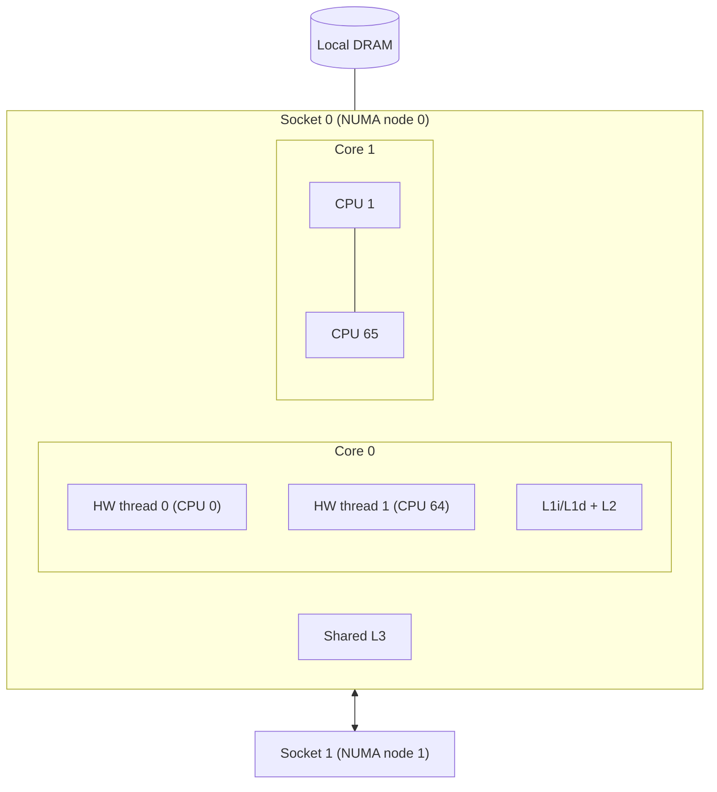
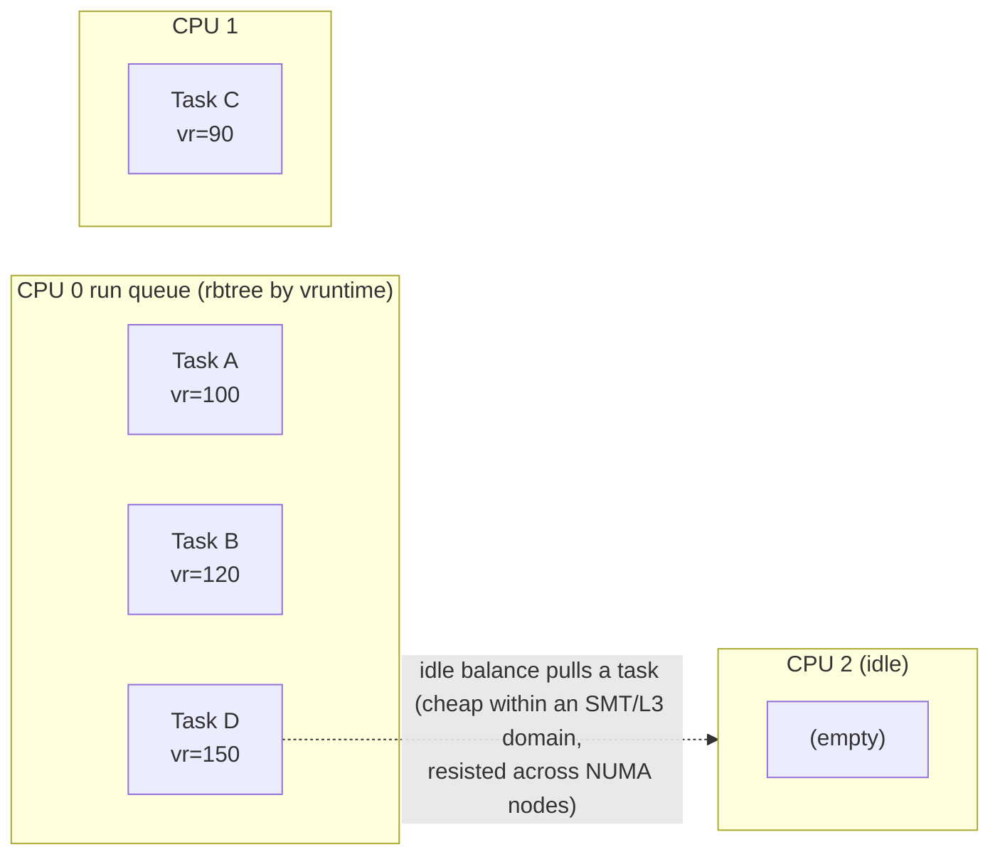
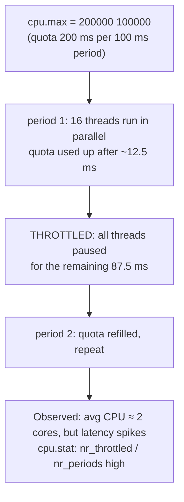
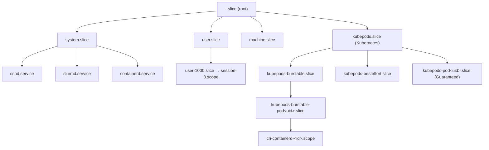
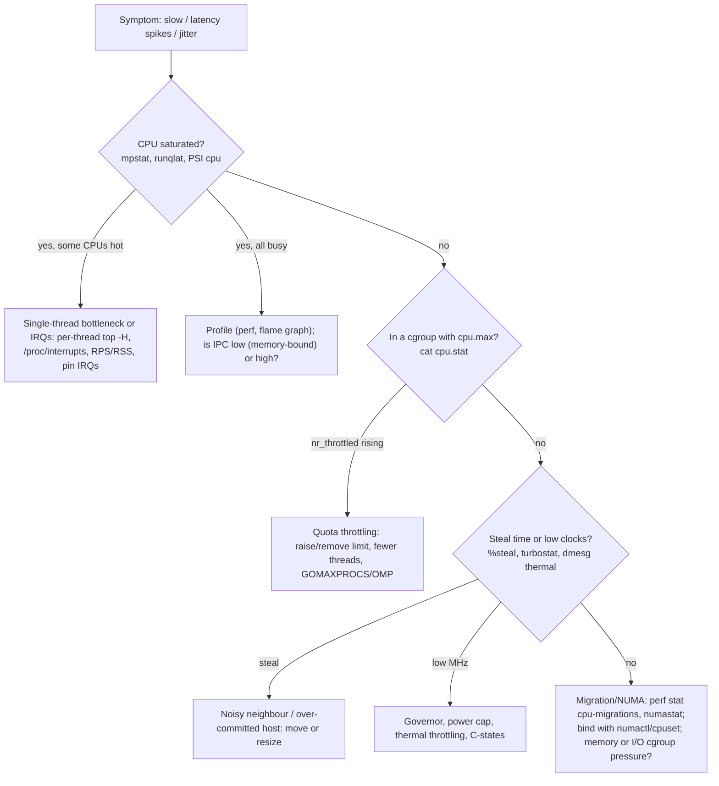

# 1.18 CPU scheduling and cgroups v1 and v2

| | |
|---|---|
| Level | Advanced |
| Priority tier | 0 |
| Lab venue | GCP / GKE (an Ubuntu VM with at least 4 vCPUs) |
| Part | Part 1: Linux, from the command line to the kernel and performance |
| Status | Drafted, labs **untested** |

## Why this matters for AI infrastructure

CPUs feed the GPUs. Every training step needs the CPU to decode and augment data, launch kernels, drive NCCL threads, handle interrupts from NICs and NVMe, and run the scheduler and container agents. A GPU starved by a throttled or badly placed CPU thread is a very expensive idle device. At the same time, the CPU is shared: dozens of containers, a kubelet or `slurmd`, monitoring agents, and sometimes other tenants. The kernel's **scheduler** decides who runs where and when, and **control groups (cgroups)** are the mechanism by which Slurm jobs, systemd services and Kubernetes pods get their CPU, memory and I/O shares and limits.

Typical incidents:

- A container with `limits.cpu: 4` shows 30% CPU use yet suffers latency spikes: **CFS bandwidth throttling** paused it for most of every 100 ms period.
- Training throughput varies run to run: data-loader threads migrate across cores and sockets, or hyper-thread siblings share a core with a busy neighbour.
- Interrupt handling for the NIC lands on the same cores as the feeding threads, stealing cycles.
- A real-time thread spins and makes the node unresponsive.
- The load average is 90 on a 64-thread node and nobody knows whether that is bad.
- A node's "CPU usage" in the cloud dashboard hides that the instance is being **stolen from** by the hypervisor.

This chapter explains CPU architecture (cores, SMT, caches, NUMA), how the Linux scheduler works (run queues, CFS and EEVDF, scheduling classes and policies, priorities, preemption, load balancing, scheduling domains), how to observe CPUs (utilisation, saturation, scheduler latency, IPC, profiling), how to control placement and priority (nice, affinity, cpusets, isolation, IRQ affinity, governors), and then **control groups** in depth: v1 versus v2, the hierarchy, the controllers (`cpu`, `cpuset`, `memory`, `io`, `pids`), CPU weight, quota and throttling, how systemd, Docker, Kubernetes and Slurm use them, and how to debug them. Namespaces (the other half of containers) follow in chapter 1.19.

## Prerequisites and outcomes

You should know processes, signals, `nice` and cgroup basics (1.8), memory and NUMA (1.17), systemd resource control (1.15), and kernel interfaces `/proc` and `/sys` (1.10).

After this chapter you can:

- Explain CPU, core, hardware thread (SMT), logical CPU, caches, and the effect of clock rate, IPC, stalls and SMT on performance.
- Describe the Linux scheduler: per-CPU run queues, time sharing, preemption, load balancing, scheduling domains, classes (stop, deadline, real-time, fair, idle) and policies, nice and weights, CFS (virtual runtime) and EEVDF, and why migration is costly.
- Measure CPU utilisation, saturation and scheduler latency; interpret `mpstat`, `top`, `pidstat`, `vmstat`, load average, PSI, `perf stat` (IPC), `runqlat`, and profiles/flame graphs.
- Set priorities and policies (`nice`, `chrt`), affinity (`taskset`, `numactl`, `sched_setaffinity`), and isolation (`isolcpus`, `nohz_full`, `irqaffinity`, cpusets); pin IRQs; choose governors and understand turbo and power states.
- Explain what a cgroup is, the differences between v1 and v2, and how to see which is in use.
- Create and inspect cgroups by hand; use the `cpu`, `cpuset`, `memory`, `io`, `pids` controllers; explain delegation and the "no internal processes" rule.
- Explain CPU weight versus quota, CFS bandwidth control and throttling, read `cpu.stat`, and size container CPU limits sensibly.
- Describe how systemd, containerd/Docker, Kubernetes (QoS classes, CPU Manager, cgroup drivers) and Slurm use cgroups, and troubleshoot common problems.

## 1. CPU basics

A **processor** (socket) contains **cores**; each core may offer two or more **hardware threads** (SMT, "Hyper-Threading") that share the core's execution units and caches. The operating system sees each hardware thread as a **logical CPU** (`nproc`, `lscpu`). Caches are arranged in levels: **L1** (per core, split instruction/data, about 32 to 64 KiB, about 1 ns), **L2** (per core, about 0.5 to 2 MiB), **L3** (shared across a group of cores, tens of MiB, ten-plus ns). Beyond that is DRAM, which may be local or remote (NUMA, chapter 1.17).



Performance concepts that matter:

- **Clock rate** (GHz) is cycles per second, but useful work depends on what the cycles do. A faster clock may just mean more *stall cycles* waiting for memory. Clock rate varies with load, temperature and power policy (turbo, throttling).
- **Pipelining, superscalar width, out-of-order execution and branch prediction** let a core finish several instructions per cycle. A mispredicted branch discards pipeline work.
- **IPC** (instructions per cycle) summarises efficiency: *low IPC* (below about 0.2 to 0.5) means the CPU is mostly stalled, typically on memory, so faster memory, better locality or fewer memory accesses help; *high IPC* (above about 1 to 2) means the CPU is busy executing, so the gain comes from running fewer instructions (better algorithm, vectorisation, compiler options). `perf stat` reports it.
- **Utilisation** counts all cycles the CPU is not idle, **including memory-stall cycles**; 100% busy does not mean 100% efficient.
- **SMT**: two hardware threads on one core share resources, so a thread gets less than a full core when the sibling is busy (the gain from SMT is workload dependent, typically 10% to 30% throughput; it can be a loss for latency-sensitive or memory-bound jobs). The scheduler prefers to spread load so each core has one busy thread before using siblings. Some HPC/AI sites disable SMT (BIOS) or leave sibling CPUs idle for predictable per-thread performance.
- **User time versus kernel time**: compute-heavy workloads (training, simulation) run about 95 to 99% user; I/O-heavy servers have high system time (system calls, interrupts, network stack).
- **Saturation**: runnable threads waiting for a CPU. Unlike disks, CPUs degrade gracefully near 100% because the scheduler can prioritise and preempt, but latency rises.
- **Multiprocess versus multithreading**: threads share memory (cheap communication, small overhead, one bug can crash all) while processes isolate (IPC costs, higher memory overhead). Python's GIL limits CPU parallelism in threads, so loaders use processes; native libraries (PyTorch ops, BLAS, NCCL) are multithreaded.
- **Priority inversion**: a low-priority thread holding a lock blocks a high-priority one while a medium-priority thread runs; fixed by priority inheritance (`PTHREAD_PRIO_INHERIT` mutexes, `PI` futexes).
- **Microarchitecture bugs and mitigations** (Spectre/Meltdown family) can cost CPU performance; `mitigations=off` trades security for speed and is a security decision.

## 2. The Linux scheduler

### Run queues, time sharing, preemption, load balancing

The scheduler is the kernel subsystem that assigns runnable threads (tasks) to logical CPUs. Its jobs:

- **Time sharing**: when more tasks are runnable than there are CPUs, each gets slices of time so all make progress. The system timer interrupt (`scheduler_tick`) drives accounting and preemption decisions (chapter 1.8: the clock tick).
- **Preemption**: when a higher-priority task becomes runnable (a wake-up from I/O completion, for example), the scheduler may interrupt the running task so the new one runs at once, reducing latency.
- **Load balancing**: moving tasks between CPUs so no CPU is idle while another has a queue.

Modern kernels keep a **run queue per CPU** (a data structure of runnable tasks on that CPU; CFS uses a red-black tree ordered by "virtual runtime"). Per-CPU queues avoid a global lock and keep a task on the same CPU where its data is cached (**cache warmth**, "CPU affinity" in the soft sense) and, on NUMA machines, on the node where its memory is. The cost is that the balancer must sometimes migrate tasks; the kernel's logic avoids migrations when the expected cost exceeds the benefit (a cache-hot task is not moved lightly), and uses **scheduling domains** that mirror the topology (SMT siblings, cores sharing an L3, sockets/NUMA nodes) so migrations are cheap within a core, more expensive within a socket, and strongly resisted across NUMA nodes.

The time a runnable task waits for a CPU is **scheduler latency** (run-queue latency): it is the CPU saturation signal. The thread states relevant here are *running* (on-CPU), *runnable* (waiting for CPU), and *sleeping* (waiting for something else); chapter 1.8.

### Scheduling classes and policies

Each task has a **scheduling policy** belonging to a **class**; classes are strictly ordered, so a task in a higher class always runs before any in a lower class:

| Class (highest first) | Policies | Meaning |
|---|---|---|
| **Stop** | (kernel internal) | Migration/stop tasks |
| **Deadline** | `SCHED_DEADLINE` | Earliest-deadline-first with parameters runtime, deadline, period: "run for R within D every P"; admission-controlled; for hard-ish real-time |
| **Real-time** | `SCHED_FIFO`, `SCHED_RR` | Fixed priority 1 to 99. FIFO runs until it blocks or is preempted by a higher priority; RR round-robins among equals with a time slice. A busy real-time task **starves everything of lower priority** on that CPU, including the shell you need to fix it. `RLIMIT_RTTIME` and the RT bandwidth limit (`kernel.sched_rt_runtime_us`, default 950000 of 1000000 µs) provide a safety valve |
| **Fair (CFS/EEVDF)** | `SCHED_OTHER`/`SCHED_NORMAL`, `SCHED_BATCH`, `SCHED_IDLE` | The default for ordinary processes: time-sharing weighted by nice. `BATCH` is for CPU-bound jobs (less preemption of others on wake-up). `IDLE` runs only when nothing else wants the CPU |
| **Idle** | (idle task) | Runs when nothing else is runnable; halts the CPU to save power |

```bash
chrt -p $$                          # policy and priority of this shell
sudo chrt -f 50 ./latency_task      # run with SCHED_FIFO priority 50
sudo chrt -r 10 -p PID              # set RR priority on a running task
chrt -m                             # priority ranges per policy
ps -eo pid,cls,rtprio,ni,pri,comm | head      # CLS: TS (normal), FF (FIFO), RR, B (batch), ISO, IDL, DLN
ulimit -r; cat /proc/sys/kernel/sched_rt_runtime_us /proc/sys/kernel/sched_rt_period_us
```

Use real-time policies sparingly, for genuinely latency-critical threads, with CPU isolation, and with `RLIMIT_RTTIME`. Container runtimes usually forbid RT unless configured; Kubernetes needs `--cpu-rt-runtime` settings with cgroup v1 `cpu.rt_runtime_us`, which is unavailable in v2 (a known limitation: RT in containers on v2 is hard).

### Nice values and weights

The **nice value** (-20 to +19; default 0) is the user-visible priority for the fair class: each nice step changes the task's **weight** by about 25% (nice 0 has weight 1024; nice 19 about 15; nice -20 about 88761), so under contention a nice -5 task gets roughly 3x the CPU of a nice 0 task. Nice affects only competition between runnable tasks on the same CPU; when CPUs are idle it changes nothing. `nice -n 10 cmd`, `renice -n 10 -p PID` (chapter 1.8). Since Linux 2.6.38 **autogroup** groups tasks by session so that a `make -j` in one terminal does not drown interactive shells; this means `nice` between sessions behaves per group, not per process (`/proc/PID/autogroup`; `kernel.sched_autogroup_enabled`). Under systemd, cgroups provide the real inter-service weighting (`CPUWeight`).

### CFS and EEVDF

The **Completely Fair Scheduler (CFS)**, the default fair scheduler from Linux 2.6.23 until roughly 6.6, tracks each task's **virtual runtime** (`vruntime`: time actually run, scaled inversely by weight). Tasks live in a red-black tree ordered by `vruntime`; the scheduler always picks the leftmost one (the task that has had the least CPU relative to its weight). A nice -5 task's `vruntime` advances more slowly, so it stays near the left and runs more. CFS has no fixed time slice: the "target latency" (period over which every runnable task should run once, scaled by the number of tasks, with a minimum granularity) determines slices. Known weakness: a task that has slept for a long time has a very low `vruntime` and, on wake-up, can run for a long time, hurting other latency-sensitive tasks (wake-up preemption heuristics try to compensate).

**EEVDF** (Earliest Eligible Virtual Deadline First), merged in Linux 6.6 and the fair-class scheduler of newer distributions, replaces most of those heuristics with an explicit model: a task is *eligible* if it has not received more than its fair share, and among eligible tasks the scheduler picks the one with the **earliest virtual deadline**, computed from a requested slice length and its weight; tasks with short slices get earlier deadlines and so lower latency. It improves wake-up latency for interactive/latency-sensitive tasks without per-heuristic tuning. Practically for you: the interfaces (nice, cpu weight, cgroup `cpu.weight`, `cpu.max`) are unchanged; some `sched_*` debug tunables in `/sys/kernel/debug/sched/` differ (`base_slice_ns`); and latency behaviour of mixed workloads is better. Check the kernel (`uname -r`) and `/sys/kernel/debug/sched/features` to know which you run.

### Load balancing and migration cost

Per-CPU queues need rebalancing: periodically (tick-based), when a CPU goes idle (**idle balance**/newidle), and at wake-up (**wake-affine**, choosing where to run a woken task near the waker or its previous CPU). Balancing walks the **scheduling domains** from smallest (SMT siblings) to largest (NUMA). Migrating a task across cores loses its L1/L2 cache contents; across sockets, it also loses locality to its memory (the kernel may later migrate pages with NUMA balancing). Frequent migration is a real overhead for latency-sensitive and memory-bound code: **pin** such threads (affinity) and keep their memory local. For AI workloads the pattern is "one rank per GPU, pinned to the cores and memory closest to that GPU", which is also what Slurm `--cpu-bind`/`--gpu-bind=closest` and the Kubernetes CPU Manager (static policy) implement.



### Interrupts and softirqs

Hardware interrupts (from the NIC, NVMe, GPU) run on the CPU they are routed to, preempting whatever runs there; their deferred work runs as **softirqs** (`ksoftirqd`), e.g. network receive processing. Heavy network or storage traffic can consume whole cores in interrupt context (visible as `hi`/`si` in `top`/`mpstat`). Control placement with **IRQ affinity** (`/proc/irq/N/smp_affinity_list`, `/proc/interrupts`), RSS/RPS queue settings (`ethtool -l/-L`, `/sys/class/net/eth0/queues/rx-*/rps_cpus`), and keep it away from cores that feed GPUs; the `irqbalance` daemon spreads IRQs automatically but can fight manual pinning (stop it or give it a policy: `IRQBALANCE_BANNED_CPUS`). `watch -n1 'grep -E "mlx|nvme|eth" /proc/interrupts'`, `mpstat -P ALL 1` (look for one CPU with high `%soft`), `cat /proc/softirqs`.

## 3. Observing CPUs

```bash
nproc; lscpu; lscpu -e                 # topology: socket/core/CPU, NUMA node, cache sizes, SMT siblings
cat /sys/devices/system/cpu/cpu0/topology/thread_siblings_list     # which CPUs are SMT siblings
uptime                                 # load averages 1/5/15 min
mpstat -P ALL 1                        # per-CPU %usr %sys %iowait %irq %soft %steal %idle: find the hot CPU
vmstat 1                               # r (runnable), us sy id wa st
top -H                                 # threads; press 1 for per-CPU; I toggles Irix mode (CPU % relative to one core or all)
pidstat -u -t 1                        # per-thread CPU, %usr %system %wait (time runnable but waiting for CPU) %CPU, CPU
cat /proc/pressure/cpu                 # PSI: some avg10=...  (tasks waiting for CPU)
perf stat -e cycles,instructions,cache-misses,context-switches,cpu-migrations ./prog    # IPC and migrations
sudo turbostat --quiet --interval 5    # actual frequencies, C-states, package power, temperature (Intel/AMD)
grep -E 'MHz' /proc/cpuinfo | head; cpupower frequency-info
sudo perf sched record -- sleep 5; sudo perf sched latency | head      # per-task scheduling delay
sudo runqlat 10 1; sudo runqlen 10 1    # BCC: histogram of scheduler latency; run-queue length (bcc-tools)
```

How to read these:

- **Load average** (`uptime`): the exponentially smoothed count of tasks that are running, runnable **or in uninterruptible sleep** (`D`). Compare with the number of logical CPUs; a load of 90 on 64 CPUs may mean queuing, or many `D` tasks stuck on I/O (chapter 1.8).
- **`mpstat -P ALL`**: a single CPU at 100% with others idle means a **single-threaded bottleneck** (or interrupts pinned to one core: check `%soft`/`%irq`). `%steal` (VMs): the hypervisor ran other guests on your vCPU; sustained steal on a cloud instance is a noisy-neighbour or over-commit signal. `%iowait` is idle time with outstanding I/O (a poor metric, chapter 1.13).
- **`pidstat -u`**'s `%wait` (newer sysstat) and `perf sched`/`runqlat` give **scheduler latency**, the true CPU-saturation metric. **PSI cpu `some`** non-zero means runnable tasks waited. Container CPU limits add another saturation form: throttling (section 7).
- **IPC** from `perf stat`: below about 0.5, suspect memory stalls (NUMA, cache misses, TLB); consider huge pages, binding, data layout. A training job whose host threads show high CPU utilisation and low IPC is memory-bound on the host.
- **Frequency**: `turbostat` reveals clocks that are lower than expected because of power caps, thermal throttling (`dmesg`: "cpu clock throttled"), or a power-saving governor.
- **Profiling** (chapter 1.24): sample at 99 Hz with `perf record -F 99 -a -g -- sleep 30` and view a flame graph; plateaus are where CPU time goes. Collect kernel and user stacks; use frame pointers (chapter 1.11 section 7).

### The method for CPU problems

(1) **Monitor** utilisation and saturation per CPU (`mpstat`, PSI, `runqlat`), including limits and throttling in containers; (2) **USE**: utilisation, saturation, errors (machine-check/EDAC, offlined CPUs, thermal events: `dmesg`, `mcelog`/`rasdaemon`); (3) **characterise**: user/system ratio, syscall rate, context-switch rate (voluntary = blocking, involuntary = preemption: `pidstat -w`), interrupt rate, thread count and parallelism; (4) **profile** (which code burns the cycles) and do **cycle analysis** (IPC, stall types) if CPU-bound; (5) **static review**: CPU model, microcode, BIOS power/SMT/NUMA settings, kernel version/scheduler, governors, mitigations, cgroup limits; (6) **tune** priority, binding, isolation and limits; (7) **micro-benchmark** only to establish limits (`sysbench cpu`, `stress-ng`), remembering that benchmarks often test compiler flags more than CPUs.

## 4. Controlling placement and priority

### Affinity

```bash
taskset -c 0-7 ./prog                  # start on CPUs 0..7
taskset -cp 8-15 PID                   # move a running process (all its threads: -a)
taskset -pc PID                        # show affinity list
numactl --cpunodebind=1 --membind=1 ./prog      # node-level CPU + memory binding (chapter 1.17)
cat /proc/PID/status | grep -E 'Cpus_allowed_list|Mems_allowed_list'
python3 -c 'import os; os.sched_setaffinity(0, {0,1,2,3}); print(os.sched_getaffinity(0))'
```

Affinity is inherited by children and by threads created later. A cgroup `cpuset` (section 6) restricts the allowed set from outside; affinity can only narrow it, never escape it. **Pitfalls**: pinning on a shared host where other tenants pin the same cores (contention while other CPUs idle); stale pins after hardware or topology changes; pinning a multithreaded process to fewer cores than it has busy threads; pinning to both SMT siblings versus one per core (choose deliberately: one thread per physical core avoids SMT contention); and OpenMP/MKL/BLAS thread pools that oversubscribe (`OMP_NUM_THREADS`, `MKL_NUM_THREADS`, `OMP_PROC_BIND`, `OMP_PLACES`).

### Isolation: keeping the kernel and others off chosen cores

For latency- or jitter-sensitive work (dedicated data-loader or communication cores, real-time threads, benchmarks), remove housekeeping from some CPUs:

| Mechanism | Effect |
|---|---|
| `isolcpus=2-15` (boot) | The general scheduler does not place tasks there unless pinned (also managed domains `isolcpus=domain,managed_irq,...`) |
| `nohz_full=2-15` (boot) | Stop the periodic tick on those CPUs when only one task runs (reduces jitter); requires the kernel built with `CONFIG_NO_HZ_FULL` |
| `rcu_nocbs=2-15` | Offload RCU callbacks from those CPUs |
| `irqaffinity=0-1` (boot), `/proc/irq/N/smp_affinity_list` | Route IRQs to housekeeping CPUs only |
| `systemd` `CPUAffinity=` in `system.conf`/`user.conf` | Confine system services and user sessions to housekeeping CPUs |
| cpuset cgroups with exclusive CPUs | Dynamic isolation without reboot (`cpuset.cpus.partition=isolated` in v2) |
| `tuned` profiles `cpu-partitioning`, `realtime` | Packaged settings (RHEL) |

Kubernetes: the **CPU Manager** with `static` policy gives Guaranteed pods with integer CPU requests exclusive cores; the **Topology Manager** aligns CPU, memory and device (GPU, NIC) NUMA placement. Slurm: `TaskPlugin=task/affinity,task/cgroup`, `--cpu-bind=cores`, `CoreSpecCount` reserves cores for the system.

### Governors and power states

The CPU frequency scaling driver (`intel_pstate`, `amd-pstate`, `acpi-cpufreq`) and **governors** decide clocks: `performance` (maximum frequency), `powersave` (with `intel_pstate` this is still a dynamic policy), `schedutil`, `ondemand`, `conservative`. `cpupower frequency-set -g performance` or `/sys/devices/system/cpu/cpu*/cpufreq/scaling_governor`; `cpupower idle-info` lists **C-states** (idle sleep depths; deep states save power but add wake-up latency, which matters for jitter and fast interconnect polling: limit with `processor.max_cstate=1`/`intel_idle.max_cstate=1` or `/dev/cpu_dma_latency`, `tuned` latency profiles). **Turbo/boost** raises single-core clocks when power and thermals allow; benchmarks and fleets should record whether it is on. GPU servers generally use a performance profile (BIOS and OS) so that the CPU side does not become the variable. Verify with `turbostat`.

## 5. Control groups: the idea

A **control group (cgroup)** is a kernel mechanism that **groups processes** and applies **resource accounting and limits** to the group as a whole. Where `nice` and `ulimit` act on a single process, cgroups give a *set* of processes a combined budget: "these 40 processes together may use at most 4 CPUs and 16 GiB". They are the basis of container resource limits (Docker `--cpus`, `--memory`; Kubernetes requests/limits), Slurm job confinement, and systemd's resource control (`CPUQuota=`, `MemoryMax=`, chapter 1.15). They are a kernel feature, independent of systemd, but systemd manages most of them on modern systems.

How it works: cgroups form a **tree** (hierarchy) exposed as a special filesystem (`cgroup` or `cgroup2`) under `/sys/fs/cgroup`. Each **directory is a cgroup**; creating a directory creates a group; files inside are its interface (`cgroup.procs` lists member PIDs, others set limits or show statistics). A process belongs to a cgroup; its children inherit that membership. **Controllers** (subsystems) are the resource-specific parts: `cpu`, `cpuset`, `memory`, `io`/`blkio`, `pids`, `hugetlb`, `rdma`, `devices`, `freezer`, `perf_event`, `net_cls`/`net_prio` (v1), `misc`.

### v1 versus v2

| | cgroups v1 | cgroups v2 |
|---|---|---|
| Hierarchies | **One hierarchy per controller** (`/sys/fs/cgroup/cpu/`, `/memory/`, `/blkio/`, ...) | **A single unified hierarchy**; each group can enable several controllers |
| Process membership | A process may be in a different group in each hierarchy (up to one per controller) | A process is in **exactly one** cgroup |
| Mount | many mounts (tmpfs of `cgroup` mounts) | one `cgroup2` mount at `/sys/fs/cgroup` |
| Processes in non-leaf groups | Allowed | **"No internal processes" rule**: only leaf cgroups (or the root) may contain processes when child controllers are enabled; interior nodes only distribute resources |
| Controller enabling | Implicit by mount | Explicit: write `+cpu +memory` into the parent's `cgroup.subtree_control` |
| CPU interface | `cpu.shares` (relative), `cpu.cfs_quota_us`/`cpu.cfs_period_us`, `cpuacct` separate | `cpu.weight` (1 to 10000, default 100), `cpu.max` ("quota period"), `cpu.stat` |
| Memory interface | `memory.limit_in_bytes`, `memory.usage_in_bytes`, `memsw`, `kmem` | `memory.max`, `memory.high`, `memory.low`, `memory.min`, `memory.current`, `memory.swap.max`, `memory.events`, unified accounting incl. kernel memory, page cache and swap |
| I/O | `blkio` (throttle works on direct I/O only; weights need CFQ/BFQ) | `io.max`, `io.weight`, works with buffered writeback (with cgroup-aware writeback) |
| Pressure info | none | `*.pressure` (PSI) files per group |
| Delegation | messy | clean: delegate a subtree to a less-privileged owner |
| Status | Legacy; kept for compatibility | **Default** on current distributions (RHEL 9, Ubuntu 22.04+, Debian 11+, Fedora) |

The v1 flexibility (different groupings per controller) was almost never used, and made controllers interact badly; v2 is simpler and more capable. **A controller in use in v1 cannot be used in v2 at the same time**; "hybrid" systems mount both (`/sys/fs/cgroup/unified`), usually with systemd on v1 plus a v2 for specific controllers. Check which you have:

```bash
stat -fc %T /sys/fs/cgroup/          # cgroup2fs = pure v2; tmpfs = v1 or hybrid
mount | grep cgroup
cat /proc/self/cgroup                # v2: single line "0::/path"; v1: many lines "N:controller:/path"
cat /sys/fs/cgroup/cgroup.controllers
grep cgroup /proc/filesystems
# switch (boot parameter): systemd.unified_cgroup_hierarchy=1 (v2) or =0 (v1); on RHEL 8 default was v1, RHEL 9 is v2
```

Older container tooling (old Docker, Kubernetes before 1.25/1.19 support, some NVIDIA container toolkit and GPU monitoring tools, old cAdvisor, Java before 15/jdk8u372 container awareness) expects v1; check compatibility before moving a fleet to v2.

## 6. cgroups v2 by hand

All of this needs root. Work in a throwaway VM.

```bash
cd /sys/fs/cgroup
cat cgroup.controllers                 # controllers available here: cpuset cpu io memory hugetlb pids rdma misc
cat cgroup.subtree_control             # controllers enabled for children
sudo mkdir demo && ls demo             # creating a directory creates a cgroup; the kernel populates the files
echo "+cpu +memory +pids" | sudo tee cgroup.subtree_control    # enable controllers for the children of the root
cat demo/cgroup.controllers
echo $$ | sudo tee demo/cgroup.procs   # move this shell into the group (one PID per write)
cat /proc/self/cgroup                  # 0::/demo
```

Core files in every cgroup:

| File | Meaning |
|---|---|
| `cgroup.procs` | PIDs in the group (write a PID to move it; moves the whole process, all threads) |
| `cgroup.threads` | Thread IDs (only for "threaded" cgroups) |
| `cgroup.controllers` | Controllers available to this group |
| `cgroup.subtree_control` | Controllers enabled for children |
| `cgroup.events` | `populated 0/1`, `frozen`; pollable to learn when a group becomes empty |
| `cgroup.type` | `domain` (normal), `domain threaded`, `threaded`, `domain invalid` |
| `cgroup.max.depth`, `cgroup.max.descendants` | Limits on the subtree |
| `cgroup.freeze`, `cgroup.kill` | Freeze all processes; kill them all (kernel 5.14+) |
| `cgroup.stat` | Number of descendants and dying descendants |

Removing a cgroup: `rmdir` it once it has no processes and no children (not `rm -r`). Dying cgroups can linger until their memory pages are reclaimed.

### The no-internal-processes rule and delegation

In v2, a cgroup that has controllers enabled in `cgroup.subtree_control` (that is, one that distributes resources to children) cannot itself contain processes, except the root. So write the tree with processes in **leaves**: `/slice/service-a/` holds processes; `/slice/` only organises. This is why a container runtime or systemd creates a leaf scope or service per workload. If `echo +cpu > cgroup.subtree_control` fails with "Device or resource busy", the group still contains processes: move them into a child first.

**Delegation**: to let an unprivileged user or a container manager manage a subtree, `chown` the directory and the files `cgroup.procs`, `cgroup.subtree_control` and `cgroup.threads` to them (systemd: `Delegate=yes` on the unit). The delegatee can create descendants and set limits within the budget the parent grants, but cannot exceed it. Rootless containers and Kubernetes pods rely on this; a runtime must not touch cgroups outside its delegated subtree. **Never run a second manager of the same cgroup tree** (for example a custom script writing under `/sys/fs/cgroup/system.slice` while systemd owns it): the single-writer rule is why Kubernetes uses either the `systemd` or the `cgroupfs` driver, and it must be the same one as the kubelet and the container runtime use (section 9).

## 7. The CPU controller: weight, quota and throttling

### Weight (shares): relative fairness

`cpu.weight` (1 to 10000, default 100; v1 equivalent `cpu.shares`, default 1024) sets the group's proportion **only under contention**, among siblings. Two sibling groups with weights 100 and 300 get 25% and 75% of the CPU time **when both want more than they get**; if one is idle, the other may use everything. Weights are hierarchical: a group's share is relative to its siblings at each level. This is the Kubernetes **CPU request** mechanism (request translated to shares/weight). It never wastes capacity and never limits.

### Quota: hard ceiling (CFS bandwidth control)

`cpu.max` has the form `$MAX $PERIOD` in microseconds (default `max 100000`). `200000 100000` means the group may use up to 200 ms of CPU time per 100 ms period, i.e. **2 CPUs' worth**, summed across all its threads. v1: `cpu.cfs_quota_us` and `cpu.cfs_period_us`. This is the Kubernetes **CPU limit** and Docker `--cpus`.

```bash
echo "200000 100000" | sudo tee /sys/fs/cgroup/demo/cpu.max     # at most 2 CPUs
echo 50  | sudo tee /sys/fs/cgroup/demo/cpu.weight              # half the default weight under contention
echo "max 100000" | sudo tee /sys/fs/cgroup/demo/cpu.max         # remove the ceiling
cat /sys/fs/cgroup/demo/cpu.stat
# usage_usec, user_usec, system_usec, nr_periods, nr_throttled, throttled_usec, nr_bursts, burst_usec
```

**How throttling works**: each period the group receives its quota, distributed to per-CPU run queues in slices (`sched_cfs_bandwidth_slice_us`, default 5 ms). When all quota is consumed before the period ends, **every thread of the group is paused until the next period starts**, even though other CPUs may be idle. A multi-threaded program with 16 busy threads and a 2-CPU quota burns the 200 ms in about 12.5 ms and then sleeps for 87.5 ms of every period. Consequences:

- Average utilisation looks low (about 2 CPUs) but **tail latency is awful**: request handlers stop for up to a full period.
- More threads makes it worse, not better. Thread pools sized from `nproc` (which reports the *host's* CPUs, not the limit) oversubscribe: Go (`GOMAXPROCS`), Java (before container support), OpenMP, Python `os.cpu_count()` all need the limit passed or detected (`automaxprocs`, `-XX:ActiveProcessorCount`, `OMP_NUM_THREADS`).
- Kernel bugs in earlier versions (before 5.4, with the slice-expiry fix) caused throttling even when quota was unused; use a recent kernel.
- `cpu.max.burst` (kernel 5.14+) allows saving unused quota for short bursts.

**Detecting it**: `nr_throttled / nr_periods` in `cpu.stat` (and `throttled_usec`), container metrics `container_cpu_cfs_throttled_periods_total / container_cpu_cfs_periods_total` (cAdvisor), and PSI `cpu.pressure` for the group. A common guidance in practice: for latency-sensitive services, set CPU *requests* (weights) and avoid tight *limits*, or give generous limits; for batch/AI jobs, limits protect neighbours but make sure data-loader and communication threads are counted. (Flag: policy of "no CPU limits" is debated; the right answer depends on whether noisy-neighbour protection or tail latency matters more, and on the CPU Manager static policy, which gives exclusive cores to Guaranteed pods and makes quota irrelevant.)



### cpuset: which CPUs and memory nodes

`cpuset.cpus` and `cpuset.mems` restrict the CPUs and NUMA nodes (`cpuset.cpus.effective`, `cpuset.mems.effective` show what is actually in force after parent constraints and hotplug). v1: `cpuset.cpus`, `cpuset.mems`, `cpuset.cpu_exclusive`, `cpuset.memory_migrate`. v2 adds **partitions**: `cpuset.cpus.partition` set to `root` or `isolated` makes a group with exclusive CPUs, taken out of scheduler load balancing of the parent (isolated), a runtime alternative to `isolcpus`.

```bash
echo "+cpuset" | sudo tee /sys/fs/cgroup/cgroup.subtree_control
echo 4-7 | sudo tee /sys/fs/cgroup/demo/cpuset.cpus
echo 0   | sudo tee /sys/fs/cgroup/demo/cpuset.mems        # NUMA node 0 only
cat /sys/fs/cgroup/demo/cpuset.cpus.effective
```

An empty `cpuset.cpus` inherits the parent's. A cpuset gives *placement* (a hard allow-list) and no throttling, so it is the right tool for "this job gets cores 4 to 7" while quota is for "this job gets 4 CPUs' worth of time anywhere". Slurm's `task/cgroup` and Kubernetes CPU Manager use cpusets for exclusive cores.

### Other controllers in brief

| Controller | Key v2 files | Notes |
|---|---|---|
| `memory` | `memory.max` (hard limit, triggers cgroup OOM), `memory.high` (throttling limit, reclaim pressure before OOM), `memory.low`/`memory.min` (protection), `memory.current`, `memory.stat`, `memory.events` (`oom`, `oom_kill`, `high`, `max`), `memory.swap.max`, `memory.oom.group` | Counts anon, page cache, kernel memory, swap. See chapter 1.17 for OOM; **pinned/GPU-registered host memory and hugetlbfs count differently**: a data loader with large pinned buffers hits `memory.max` sooner than expected |
| `io` | `io.max` (`MAJ:MIN rbps= wbps= riops= wiops=`), `io.weight`, `io.latency`, `io.stat`, `io.pressure` | Works for buffered writes with cgroup-aware writeback; needs a blk-mq scheduler for weights (BFQ/`io.cost`) |
| `pids` | `pids.max`, `pids.current` | Stops fork bombs; Kubernetes `podPidsLimit` |
| `hugetlb` | `hugetlb.2MB.max`, `hugetlb.1GB.max` | Cap huge-page use |
| `rdma` | `rdma.max`, `rdma.current` | Limits RDMA/IB verbs resources per group |
| `misc` | `misc.max` | Scalar resources, e.g. SEV ASIDs |
| `devices` | v1 `devices.allow/deny`; v2 implemented as **eBPF programs** attached to the cgroup | Which device nodes (e.g. `/dev/nvidia*`) the group may open; this is how container runtimes expose GPUs to a container, and why GPU access can break after a v2 migration or a systemd reload that rewrites device rules |
| `freezer` | v1 `freezer.state`; v2 `cgroup.freeze` | Pause an entire group |

**GPUs are not a cgroup controller.** Device access is controlled through the devices cgroup (allow `/dev/nvidia0`, `/dev/nvidiactl`, `/dev/nvidia-uvm`) and runtime hooks (NVIDIA Container Toolkit); GPU *quantity* is controlled by the Kubernetes device plugin and scheduler, and by Slurm GRES with `ConstrainDevices=yes`. Chapter 1.22 and Part 7 cover this.

### PSI and monitoring per cgroup

Each cgroup has `cpu.pressure`, `memory.pressure`, `io.pressure` (PSI): `some avg10=... avg60=... avg300=... total=...`. `some` means at least one task stalled, `full` means all non-idle tasks stalled. PSI per cgroup is the best "is this container resource-starved" signal and drives `systemd-oomd` and Kubernetes node-pressure eviction (memory). Tools: `systemd-cgls`, `systemd-cgtop`, `cat /proc/PID/cgroup`, `lscgroup`/`cgget` (libcgroup), `crictl stats`, `kubectl top pod`, `docker stats`.

## 8. Systemd, Docker, Slurm and the cgroup tree

systemd owns the tree on most systems and organises it by **slices** (`-.slice` root, `system.slice` for services, `user.slice` for login sessions, `machine.slice` for VMs and containers) containing **services** and **scopes** (externally created processes, such as containers or login sessions):



Systemd resource directives map to the cgroup files (chapter 1.15 section on resource control): `CPUWeight=` → `cpu.weight`, `CPUQuota=200%` → `cpu.max`, `AllowedCPUs=` → `cpuset.cpus`, `MemoryMax=`/`MemoryHigh=`/`MemoryLow=`, `IOWeight=`, `IOReadBandwidthMax=`, `TasksMax=` → `pids.max`, `Delegate=`, `DevicePolicy=`/`DeviceAllow=`. Use `systemctl set-property --runtime unit CPUQuota=50%` and `systemd-run --scope -p CPUQuota=100% -p MemoryMax=2G command` to experiment; `systemd-cgls`, `systemd-cgtop`.

**Slurm** (Part 6): with `ProctrackType=proctrack/cgroup`, `TaskPlugin=task/cgroup,task/affinity` and `cgroup.conf` (`ConstrainCores=yes`, `ConstrainRAMSpace=yes`, `ConstrainDevices=yes`, `ConstrainSwapSpace=yes`, `CgroupPlugin=autodetect` or `cgroup/v2`), each job gets a cgroup under `slurmstepd`'s tree with its cores, memory and GPUs confined; memory overshoot triggers an OOM kill of the job step, reported as `OUT_OF_MEMORY`. Slurm requires the same cgroup version as the node's actual mounts, and v2 support needs a sufficiently recent Slurm (flag: verify the version matrix for your site).

**Docker/containerd**: `docker run --cpus 2 --cpu-shares 512 --cpuset-cpus 0-3 --memory 8g --memory-swap 8g --pids-limit 512 --device /dev/nvidia0 --gpus all`. The runtime (runc) creates a cgroup for the container, writes the limits, and moves the container's init into it; with the systemd driver the cgroup is a transient scope named `docker-<id>.scope`. Inside the container, `/proc/self/cgroup` shows `0::/` (a cgroup namespace view, chapter 1.19), and `/sys/fs/cgroup/cpu.max` shows its own limit; tools that read `/proc/cpuinfo` or `nproc` still see the host's CPUs unless **lxcfs** or limit-aware runtimes are used.

## 9. Kubernetes and cgroups

Kubernetes translates pod spec into cgroup settings (kubelet plus the container runtime):

| Pod spec | cgroup v1 | cgroup v2 |
|---|---|---|
| `requests.cpu: 500m` | `cpu.shares = 512` (milli × 1024 / 1000) | `cpu.weight` (converted from shares to the 1 to 10000 range) |
| `limits.cpu: 2` | `cpu.cfs_quota_us = 200000`, period 100000 | `cpu.max = 200000 100000` |
| `requests.memory` | used for scheduling and eviction; `memory.min` only with the MemoryQoS feature on v2 | same |
| `limits.memory: 4Gi` | `memory.limit_in_bytes` | `memory.max` |
| `pids` via kubelet `podPidsLimit` | `pids.max` | `pids.max` |
| Hugepages requests | `hugetlb.*.limit_in_bytes` | `hugetlb.*.max` |

**QoS classes** are derived from requests/limits and determine the position in the cgroup tree and OOM/eviction order: **Guaranteed** (requests equal limits for every container, for CPU and memory), **Burstable** (some request set, not equal), **BestEffort** (none). The kernel OOM score adjustment (`oom_score_adj`) is set accordingly (Guaranteed -997, BestEffort 1000, Burstable in between), so BestEffort pods die first.

**CPU Manager** (kubelet `--cpu-manager-policy=static`): Guaranteed pods with integer CPU requests are given **exclusive cores** removed from the shared pool, via cpuset; combine with the **Topology Manager** (`single-numa-node` or `best-effort` policy) and **Memory Manager**/Device Manager to align CPU, memory and GPUs/NICs to one NUMA node. This is the standard recipe for GPU training pods that need stable host-thread performance. Reserve system cores with `--reserved-cpus` or `kubeReserved`/`systemReserved`. (Kubernetes details: Part 5.)

**Cgroup driver** (`cgroupDriver: systemd` or `cgroupfs`): kubelet and the container runtime (containerd `SystemdCgroup = true` in `config.toml`) **must use the same driver**; on systemd hosts always use `systemd` so there is one writer of the tree. A mismatch produces nodes that run but behave strangely under resource pressure, or kubelet failing at start. Kubernetes supports cgroup v2 as GA from 1.25; the kernel should be 5.8 or newer (preferably 5.14+), and `crictl info` / `stat -fc %T /sys/fs/cgroup` tells the truth.

**Known gotchas**: CPU limit throttling (section 7); memory limit counting page cache, so containers "leak" memory that is only cache (the kernel reclaims it at limit, but alerts fire first: use working set, `memory.stat` `inactive_file`); `OOMKilled` (exit 137) versus node-level eviction; limits that make `nproc`-sized thread pools oversubscribe; the NVIDIA device plugin and containers losing GPU access after `systemctl daemon-reload` or a cgroup driver mismatch (device rules reset): the fix is `nvidia-ctk runtime configure --runtime=containerd --cdi.enabled` plus matching driver settings (flag: verify against current NVIDIA Container Toolkit docs).

## 10. Troubleshooting



Failure modes and quick checks:

- **`echo ... > cgroup.subtree_control` fails**: group has processes, or the parent has not enabled that controller first; enable top-down.
- **Controller not available in v2**: it is mounted in a v1 hierarchy (hybrid mode) or unsupported by the kernel config; `cat /proc/cgroups`.
- **Process cannot be moved**: you wrote a TID, not a PID; or the target is a threaded/invalid cgroup; or lacking write permission on the common ancestor's `cgroup.procs` (the v2 delegation rule requires write access to the closest common ancestor).
- **Limit ineffective inside a container**: tool reads host `/proc`; check `/sys/fs/cgroup` from inside.
- **Docker or Kubernetes fails after distro upgrade**: the distro moved to v2; old tools (cAdvisor, Docker < 20.10, NVIDIA toolkit < 1.4, monitoring agents) misbehave.
- **Real-time throttling** (`sched: RT throttling activated` in `dmesg`): an RT task consumed its 95% share; fix the task, not the limit.
- **Interference between system services and workload cores**: `systemd` `CPUAffinity`, `tuned` isolation, `irqbalance` ban mask.
- **Dying cgroup accumulation** (`cgroup.stat` `nr_dying_descendants` large) after heavy container churn: memory not yet reclaimed; a known source of slowdowns (flag: kernel-version dependent).

## 11. Lab: watch weights, quota and cpuset work (untested)

Use a VM with at least 4 vCPUs and cgroup v2 (Ubuntu 22.04+). Everything is a throwaway; run as root.

1. **Topology**: `lscpu -e`, `cat /sys/devices/system/cpu/cpu0/topology/thread_siblings_list`, `numactl -H`. Record sockets, cores, SMT.
2. **Generate load**: install `stress-ng` (`apt install stress-ng`). In one terminal: `stress-ng --cpu 4 --timeout 300 &`; watch `mpstat -P ALL 1`.
3. **Nice**: start two `stress-ng --cpu 1` with `nice -n 0` and `nice -n 10`, pinned to the same CPU with `taskset -c 0`; use `top -H` to observe the CPU split (about 10:1).
4. **Create the group**: `mkdir /sys/fs/cgroup/lab; echo "+cpu +cpuset" > /sys/fs/cgroup/cgroup.subtree_control; mkdir /sys/fs/cgroup/lab/{a,b}; echo "+cpu" > /sys/fs/cgroup/lab/cgroup.subtree_control`.
5. **Weights**: `echo 100 > lab/a/cpu.weight; echo 300 > lab/b/cpu.weight`; start `taskset -c 0 stress-ng --cpu 1 --timeout 120` with PID written to `a/cgroup.procs` and another to `b/cgroup.procs` (or use `systemd-run --scope -p CPUWeight=...`). Expect about 25%/75% on CPU 0. Remove the CPU pin: do the shares hold when idle CPUs exist? (They should not matter.)
6. **Quota**: `echo "50000 100000" > lab/a/cpu.max`; run `stress-ng --cpu 4` inside `a`; observe total of about 50% of one CPU; `cat lab/a/cpu.stat` and note `nr_throttled`. Change to `"50000 10000"` (10 ms period) and compare latency using a simple `cyclictest`-like loop or `sysbench`.
7. **Throttling latency**: run a tiny HTTP server or a loop that measures `sleep 0.001` wake-up time inside `a` with 8 busy threads; compare p99 under `max 100000` and `50000 100000`.
8. **cpuset**: `echo "+cpuset" > lab/cgroup.subtree_control; echo 2-3 > lab/a/cpuset.cpus; echo 0 > lab/a/cpuset.mems`; confirm `Cpus_allowed_list` of the stress processes and `mpstat -P ALL`.
9. **Memory & PID limits**: `echo +memory +pids > lab/cgroup.subtree_control; echo 200M > lab/a/memory.max; echo 50 > lab/a/pids.max`; run `stress-ng --vm 1 --vm-bytes 500M`; read `memory.events` (`oom_kill`) and `dmesg`. Try a fork bomb inside the group only after `pids.max` is set.
10. **systemd view**: `systemd-run --scope -p CPUQuota=50% -p MemoryMax=300M stress-ng --cpu 2 --timeout 60`; in another shell `systemd-cgls`, `systemd-cgtop`, and read the cgroup files under `/sys/fs/cgroup/system.slice/run-*.scope`.
11. **Container view**: `docker run --rm --cpus 0.5 -it ubuntu bash -c 'cat /sys/fs/cgroup/cpu.max; nproc'` (note `nproc` still shows host CPUs); then find the container's cgroup on the host.
12. **Cleanup**: kill processes, `rmdir` leaf cgroups bottom-up.

Record observed outputs; mark the lab tested only after you have executed it.

## 12. Common mistakes

- Treating CPU utilisation as efficiency (stall cycles count as busy).
- Using load average without counting `D` tasks and logical CPU count.
- Setting tight CPU limits on latency-sensitive or highly threaded services.
- Pinning without considering SMT siblings, IRQs, or NUMA memory.
- Using real-time priorities without isolation or bandwidth limits.
- Running two cgroup managers (script plus systemd) or mismatched Kubernetes/containerd drivers.
- Assuming `nproc` reflects the container limit.
- Forgetting that v2 forbids processes in non-leaf groups with controllers enabled.
- Disabling mitigations or enabling `nohz_full` without understanding the security or kernel-config consequences.

## 13. Interview angles

- "Explain how a Kubernetes CPU limit is enforced and why a pod can be throttled at 30% average usage." (CFS bandwidth, period, burst across threads, `nr_throttled`.)
- "cgroup v1 versus v2: what changed and why does it matter for GPU nodes?" (unified hierarchy, eBPF device control, PSI, delegation, tooling compatibility.)
- "Requests versus limits at the kernel level." (shares/weight versus quota.)
- "How would you give a training job stable CPU performance?" (CPU Manager static, Topology Manager, isolate IRQs, governors, SMT, binding to the GPU-local NUMA node, avoid quota.)
- "The load average is high but CPUs are idle." (uninterruptible sleep, I/O.)
- "CFS versus EEVDF in one paragraph."

## 14. Checkpoint questions (30)

1. What is the difference between a CPU, a core, a hardware thread and a logical CPU? **A:** Socket/processor package contains cores; a core may have several hardware threads (SMT) sharing execution units; the OS schedules onto logical CPUs, one per hardware thread.
2. Why can 100% CPU utilisation be inefficient? **A:** Stalled cycles waiting on memory count as busy; low IPC reveals it.
3. What does IPC below 0.5 usually indicate, and what do you try? **A:** Memory-stall bound; improve locality/NUMA binding/huge pages/data layout rather than fewer instructions.
4. Name the scheduling classes in priority order. **A:** Stop, deadline, real-time (FIFO/RR), fair (CFS/EEVDF: NORMAL/BATCH/IDLE), idle.
5. Why are real-time policies dangerous? **A:** A busy RT task starves lower classes on that CPU, including the tools needed to recover; limited only by the RT bandwidth safety valve.
6. How does nice affect CPU share? **A:** Each step changes weight about 25%; matters only under contention on the same CPU.
7. What does CFS's `vruntime` represent and how is the next task picked? **A:** Weighted CPU time consumed; the task with the smallest vruntime (leftmost in the red-black tree).
8. What does EEVDF change? **A:** Picks among eligible tasks by earliest virtual deadline based on slice and weight, improving latency without heuristics (Linux 6.6+).
9. Why are there per-CPU run queues? **A:** Avoid a global lock and keep cache warmth; the balancer migrates when needed.
10. What are scheduling domains? **A:** A hierarchy mirroring topology (SMT, LLC, socket, NUMA) guiding load-balancing frequency and migration cost.
11. Why is cross-NUMA migration expensive? **A:** Loses cache and locality to the task's memory.
12. What is scheduler latency and how do you measure it? **A:** Time runnable before running; `runqlat`, `perf sched latency`, PSI cpu, `pidstat -u` `%wait`.
13. What does load average count? **A:** Running, runnable and uninterruptible (D) tasks, exponentially averaged.
14. What does `%steal` mean? **A:** The hypervisor ran something else while the vCPU was runnable.
15. How do you find which CPUs are SMT siblings? **A:** `lscpu -e` or `thread_siblings_list` in sysfs.
16. How do you pin a running process to CPUs 0 to 3? **A:** `taskset -cp 0-3 PID` (add `-a` for all threads).
17. Name three boot or runtime mechanisms for CPU isolation. **A:** `isolcpus`, `nohz_full`/`rcu_nocbs`, `irqaffinity`, cpuset isolated partitions, systemd `CPUAffinity`.
18. Why might `irqbalance` hurt a tuned system? **A:** It reshuffles IRQ affinity, undoing manual pinning.
19. What is a cgroup? **A:** A kernel grouping of processes with shared resource accounting and limits, exposed as a directory tree.
20. v1 versus v2: the key structural difference? **A:** v1 has separate hierarchies per controller; v2 has one unified hierarchy with each process in exactly one group.
21. How do you tell which version a host uses? **A:** `stat -fc %T /sys/fs/cgroup` (`cgroup2fs`), `/proc/self/cgroup` format, mounts.
22. What is the "no internal processes" rule? **A:** In v2, a group with controllers enabled for children cannot hold processes itself (except root); processes live in leaves.
23. How do you enable the memory controller for a group's children? **A:** Write `+memory` to the group's `cgroup.subtree_control` (the parent must have it enabled too).
24. Difference between `cpu.weight` and `cpu.max`? **A:** Weight is relative share under contention (request); max is a hard ceiling quota/period (limit).
25. What does `cpu.max` `200000 100000` mean? **A:** Up to 200 ms CPU time per 100 ms period summed across threads, i.e. two CPUs' worth.
26. Why does throttling cause latency despite low average CPU? **A:** When quota is used early in a period all threads pause until the next period.
27. How do you detect CFS throttling? **A:** `nr_throttled`, `throttled_usec` in `cpu.stat`, cAdvisor throttling metrics, cpu PSI.
28. How are Kubernetes requests and limits mapped? **A:** Requests to shares/weight; CPU limits to quota; memory limits to `memory.max`; QoS to cgroup placement and OOM score.
29. Why must kubelet and containerd use the same cgroup driver? **A:** Two writers (systemd vs cgroupfs) conflict on the tree causing inconsistent accounting and failures.
30. How do containers get GPU device access under cgroup v2? **A:** Device node permissions enforced by eBPF device programs on the cgroup, configured by runtime/NVIDIA toolkit; not a GPU controller.

## 15. Sources and review notes

**Written in original words.** Principal sources:

- Brendan Gregg, *Systems Performance*, 2nd ed., chapter 6 (CPUs): terminology, models, concepts, architecture, scheduler, methodology, tuning (affinity, exclusive cpusets, resource controls, governors).
- Brian Ward, *How Linux Works*, 3rd ed., chapter 8 (cgroup basics and the CPU/memory controllers) and process chapters.
- Sourcing from the project's own `nvidia-devops` notes: Volume 1 chapter 1 (scheduler concepts, CFS vruntime, pinning with `numactl --physcpubind`) and chapter 4 (slices, cgroup v2), migrated and rewritten.
- Kernel documentation (cgroup-v2 admin guide, CFS bandwidth control, sched-design) from general knowledge; **verify specific file names and defaults against the running kernel's `Documentation/` and `man 7 cgroups`**.

**Flagged for verification before publishing:**

- EEVDF merge version and exact tunables (`base_slice_ns` location) per distro kernel.
- Kubernetes cgroup v2 GA release, MemoryQoS feature gate status, CPU Manager and Topology Manager policy names.
- Slurm minimum version for cgroup v2 and the `cgroup.conf` parameters.
- NVIDIA Container Toolkit commands and cgroup v2 device handling.
- `cpu.max.burst` kernel version, RT throttling default values.
- All labs are **untested** and need a real run.
