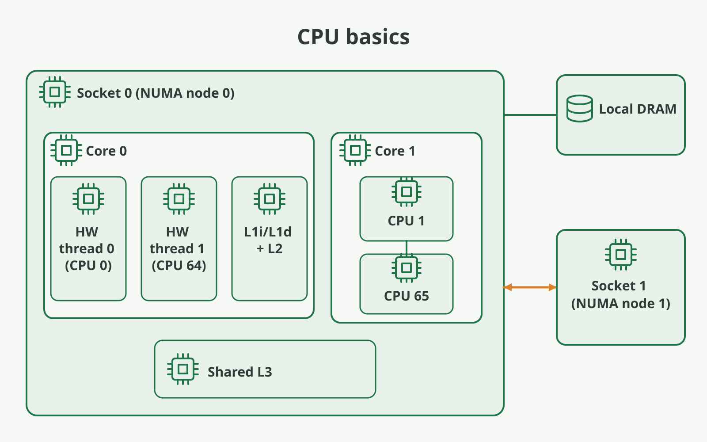
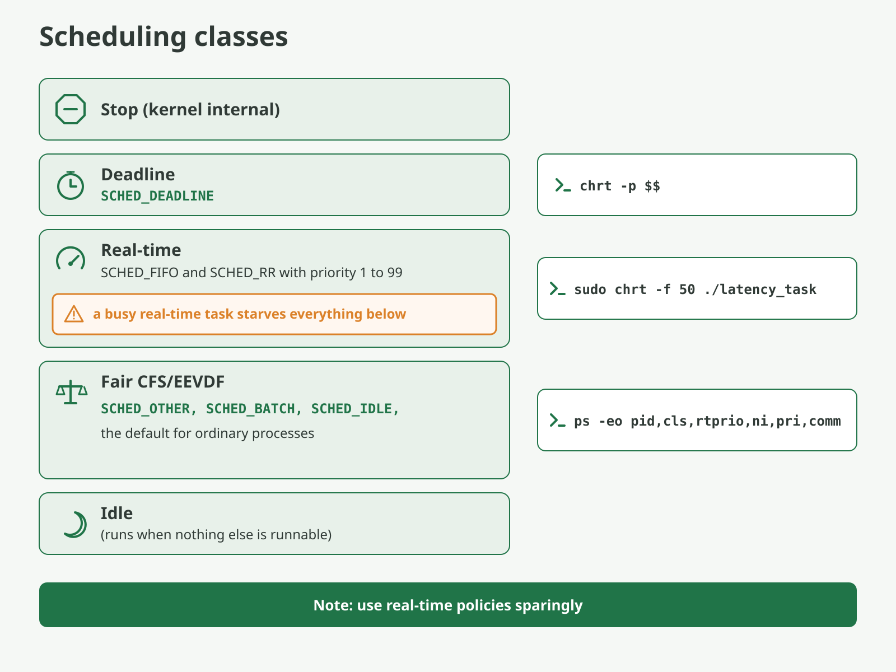
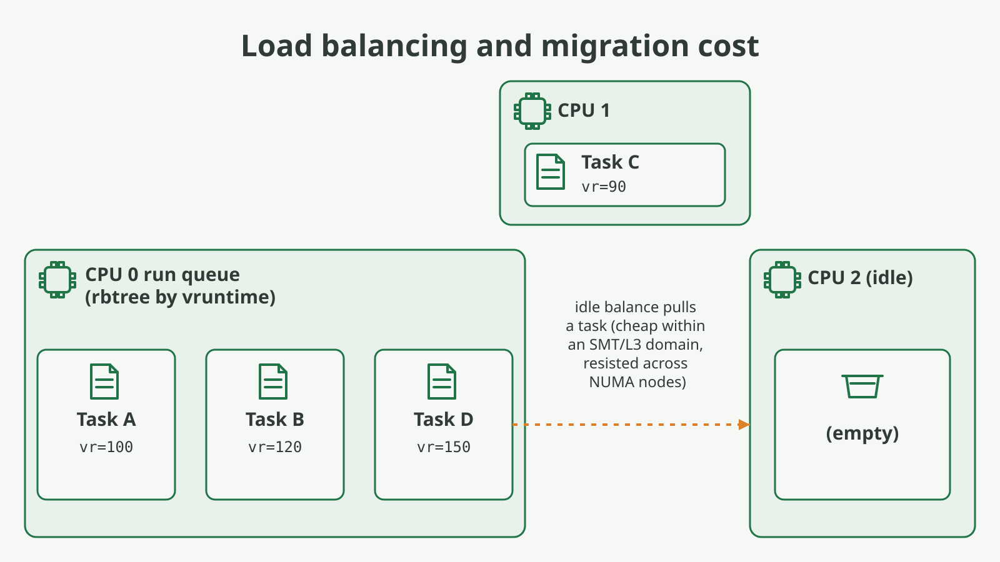
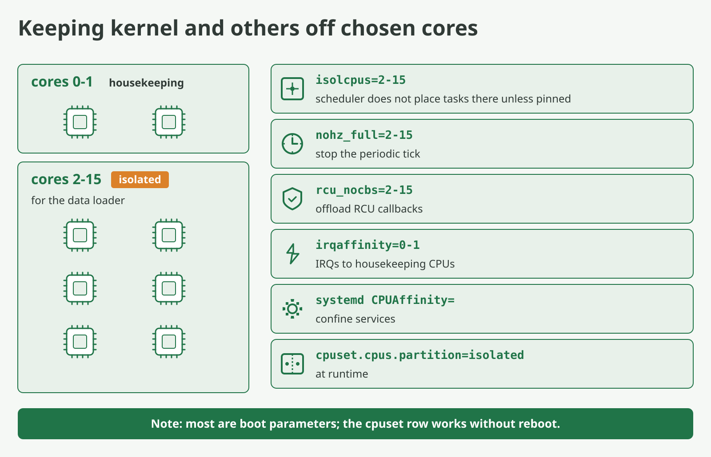
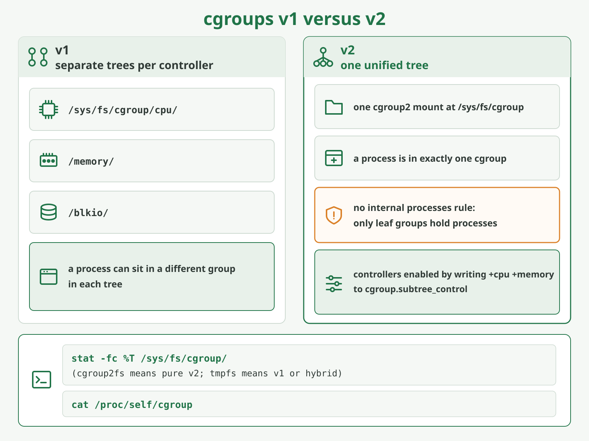
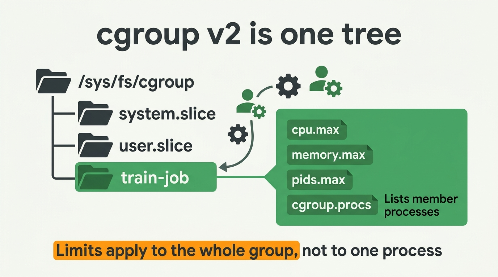
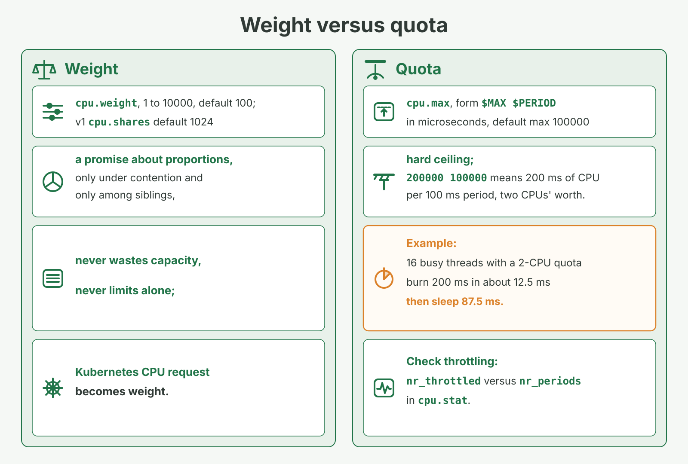
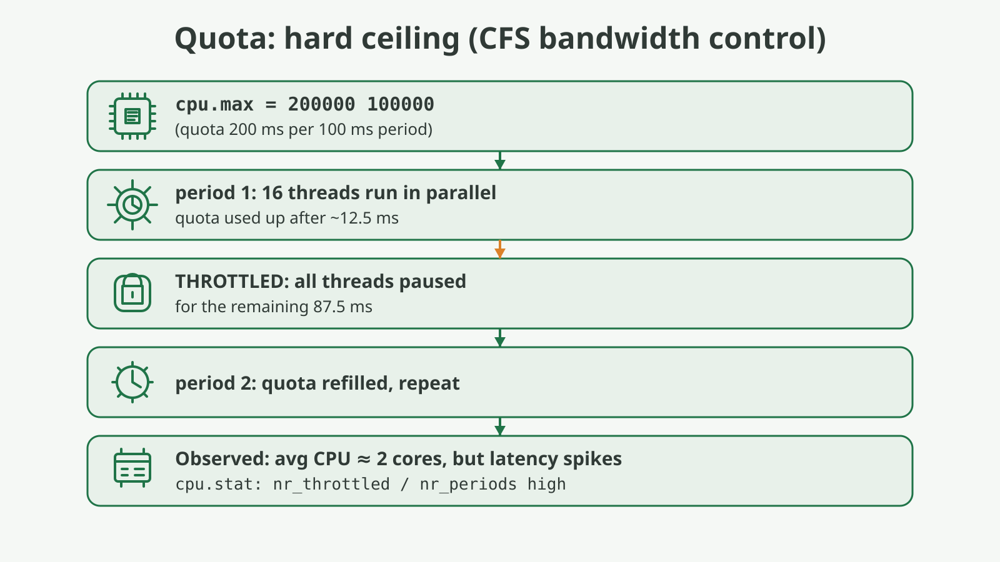
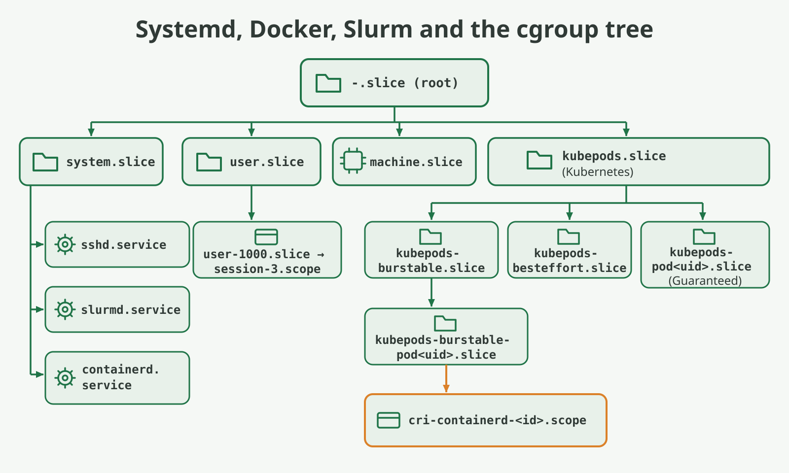
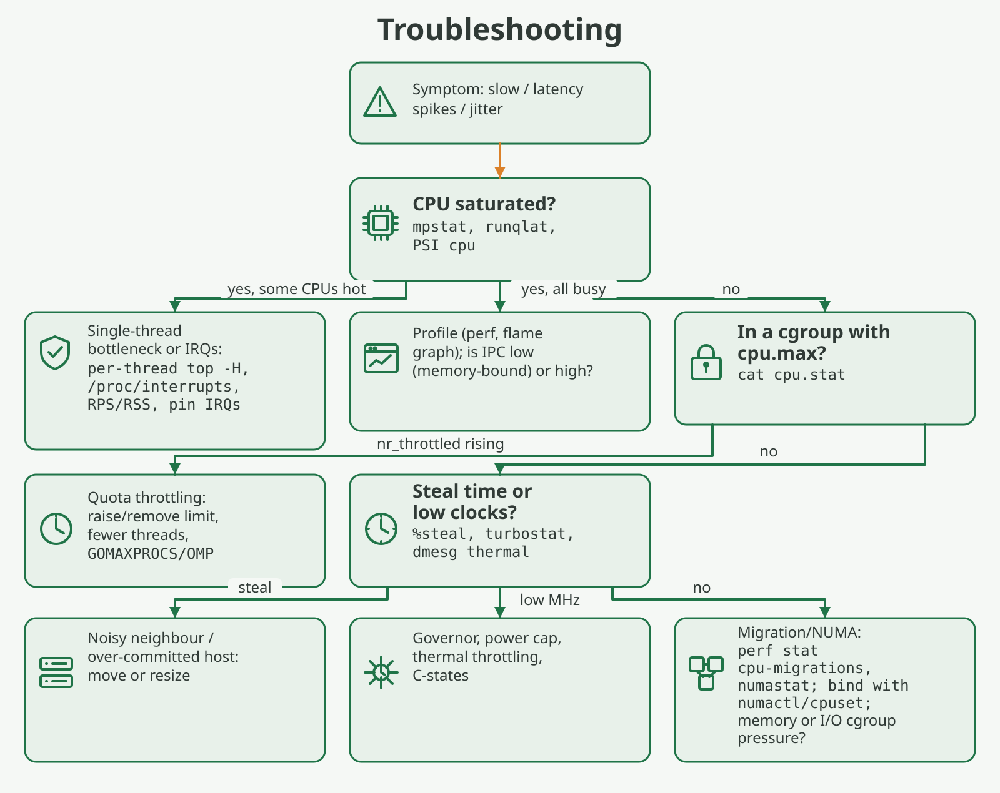

# 1.18 CPU scheduling and cgroups v1 and v2

| | |
|---|---|
| Level | Advanced |
| Priority tier | 0 |
| Lab venue | GCP / GKE (an Ubuntu VM with at least 4 vCPUs) |
| Part | Part 1: Linux, from the command line to the kernel and performance |
| Status | Drafted, labs **untested** |

## Why this matters for AI infrastructure

Suppose a training job that ran all week at full speed suddenly slows down, and the GPU dashboard shows the GPUs sitting idle. Nothing in the job has changed. The cause is often on the CPU side, where every training step decodes and augments data, launches kernels, drives NCCL threads, and handles interrupts from NICs and NVMe. The scheduler and the container agents also need those same cores. A GPU that starves because one CPU thread is throttled or badly placed is a very expensive device doing nothing.

The CPU, meanwhile, is shared. Dozens of containers, a kubelet or `slurmd`, monitoring agents and sometimes other tenants all compete for the same cores. Even a small monitoring agent that wakes up often is one more task in the queue on the cores your training step needs. The kernel's **scheduler** decides who runs where and when. **Control groups**, or **cgroups** for short, are the mechanism that gives Slurm jobs, systemd services and Kubernetes pods their CPU, memory and I/O shares and limits.

A pod can look idle and still be starved. A container with `limits.cpu: 4` may show only 30% CPU use, yet suffer latency spikes, because **CFS bandwidth throttling** paused it for most of every 100 ms period. Training throughput can also vary from run to run. Data-loader threads may migrate across cores and sockets, or hyper-thread siblings may share a core with a busy neighbour. Interrupts from the NIC can land on the same cores that feed the GPUs and steal their cycles. A real-time thread that spins can make the whole node unresponsive. A load average of 90 on a 64-thread node sounds alarming, and nobody knows whether it is bad. Finally, the "CPU usage" in a cloud dashboard can hide the fact that the hypervisor is **stealing** cycles from the instance.

This chapter takes you from the hardware up to the kernel's control tools. It starts with CPU architecture: cores, SMT, caches and NUMA. Next comes the Linux scheduler, with its run queues, CFS and EEVDF, scheduling classes and policies, priorities, preemption, load balancing and scheduling domains. You then learn to observe CPUs through utilisation, saturation, scheduler latency, IPC and profiling. After that, you control placement and priority with nice, affinity, cpusets, isolation, IRQ affinity and governors. The second half covers control groups in depth: v1 versus v2, the hierarchy, and the controllers `cpu`, `cpuset`, `memory`, `io` and `pids`. You will see how CPU weight, quota and throttling work, how systemd, Docker, Kubernetes and Slurm use cgroups, and how to debug them. Namespaces, the other half of containers, follow in chapter 1.19.

The two halves meet in the middle. A scheduler decides which task runs next. A cgroup decides how much of the machine the tasks in a group may use between them. Once you can read both, most "the node is slow" tickets become questions you can answer with a command.

Before you change a CPU limit, find out whether the CPU is busy, waiting or throttled. Each of those states has a different fix.

## Prerequisites and outcomes

You should already know processes, signals, `nice` and cgroup basics (1.8), memory and NUMA (1.17), systemd resource control (1.15), and the kernel interfaces `/proc` and `/sys` (1.10). If a term below feels new, the earlier chapter is the better place to start. Nothing here depends on you remembering the details.

When you finish this chapter, you will be able to do the following.

- Explain a CPU, a core, a hardware thread (SMT) and a logical CPU. Describe how caches, clock rate, IPC, stalls and SMT affect performance.
- Describe the Linux scheduler: per-CPU run queues, time sharing, preemption, load balancing and scheduling domains. Cover the classes (stop, deadline, real-time, fair and idle) and policies, nice and weights, CFS (virtual runtime) and EEVDF, and why migration is costly.
- Measure CPU utilisation, saturation and scheduler latency. Read `mpstat`, `top`, `pidstat`, `vmstat`, the load average, PSI, `perf stat` (IPC), `runqlat`, and profiles and flame graphs.
- Set priorities and policies with `nice` and `chrt`. Set affinity with `taskset`, `numactl` and `sched_setaffinity`. Set isolation with `isolcpus`, `nohz_full`, `irqaffinity` and cpusets. You can also pin IRQs, choose governors, and understand turbo and power states.
- Explain what a cgroup is, how v1 differs from v2, and how to see which one is in use.
- Create and inspect cgroups by hand. Use the `cpu`, `cpuset`, `memory`, `io` and `pids` controllers, and explain delegation and the "no internal processes" rule.
- Explain CPU weight versus quota, CFS bandwidth control and throttling. Read `cpu.stat`, and size container CPU limits sensibly.
- Describe how systemd, containerd, Docker, Kubernetes and Slurm use cgroups. Describe the Kubernetes QoS classes, CPU Manager and cgroup drivers, and troubleshoot common problems.

## 1. CPU basics

Suppose two identical nodes run the same job, and one of them is consistently slower. Same image, same data, same GPU model. Before you blame the code, look at how the CPU is built, because the layout decides which threads compete for which resources.

Start with the names, since people use them loosely. A **processor**, also called a socket, is the physical chip, and it holds several cores. Each core may offer two or more hardware threads. That trick is **SMT**, short for simultaneous multithreading, and Intel calls its version Hyper-Threading. The hardware threads on one core share its execution units and caches, so they are not two full cores. The operating system sees each hardware thread as a **logical CPU**, and you can count them with `nproc` and `lscpu`.

Caches sit between the core and main memory, and they come in levels, like shelves that grow larger and slower as you move away from the core. **L1** belongs to each core and is split into instruction and data parts. It is about 32 to 64 KiB in size. It answers in about 1 ns. **L2** also belongs to each core, at about 0.5 to 2 MiB. **L3** is shared by a group of cores. It holds tens of MiB and answers in ten-plus ns. Past the caches sits DRAM, which can be local or remote. Remote memory is the NUMA effect from chapter 1.17.

The diagram below shows how these pieces fit together on a two-socket machine.



*Figure 1.18.1. CPU basics.*

Read it slowly: two hardware threads share core 0, and each socket has its own local DRAM.

Several ideas decide how much useful work a CPU does per second. As you read them, keep one question in mind: how much of each cycle does your code actually use? Clock rate is the first number people look at, and it is easy to over-read. It counts cycles per second, but what matters is what those cycles do. A faster clock can simply mean more stall cycles spent waiting for memory. The clock also moves with load, temperature and power policy, through turbo and throttling.

A modern core can finish several instructions in one cycle. Pipelining, superscalar width, out-of-order execution and branch prediction make that possible. Think of a factory line, where the goal is to keep every station busy at once. A mispredicted branch throws away the pipeline work it caused, the way a wrong batch sends work back to the start.

**IPC**, or instructions per cycle, sums up that efficiency in one number. When IPC is low, below about 0.2 to 0.5, the CPU is mostly stalled, usually on memory. Then faster memory, better locality or fewer memory accesses help. When IPC is high, above about 1 to 2, the CPU is busy executing. The gain then comes from running fewer instructions, through a better algorithm, vectorisation or compiler options. The `perf stat` command reports IPC.

Utilisation counts every cycle that is not idle. That includes the cycles spent waiting on memory. So a CPU at 100% busy is not necessarily 100% efficient. Keep the two ideas apart in your head, because most CPU tuning mistakes come from mixing them up.

SMT lets two hardware threads share one core. Each thread gets less than a full core when its sibling is busy. The gain depends on the workload. SMT typically adds 10% to 30% throughput, but it can be a loss for latency-sensitive or memory-bound jobs. The scheduler tries to spread load, so that each core has one busy thread before it uses a sibling. Some HPC and AI sites disable SMT in the BIOS, or leave sibling CPUs idle, to get predictable per-thread performance.

User time and kernel time tell you what kind of work the CPU does. Compute-heavy jobs, such as training or simulation, spend about 95 to 99% of their time in user code. I/O-heavy servers show high system time, because of system calls, interrupts and the network stack. When a profile surprises you, this ratio is often the first clue about where to look.

Saturation is the state where runnable threads wait for a CPU. Unlike disks, CPUs degrade gracefully near 100%. The scheduler can prioritise and preempt, but latency still rises as the queue grows.

Threads and processes trade off differently. Threads share memory, so communication is cheap and the overhead is small. The cost is that one bug can crash all of them. Processes isolate each other, but they cost more to talk to and each one uses more memory. Python's GIL limits CPU parallelism inside threads, which is why data loaders use processes. Native libraries, such as PyTorch ops, BLAS and NCCL, are multithreaded.

Priority inversion happens when a low-priority thread holds a lock that a high-priority thread needs. Picture a junior engineer holding the only key to a room that the lead needs, while someone unrelated keeps asking the junior questions. A medium-priority thread then keeps running, and the high-priority thread waits. The fix is priority inheritance, using `PTHREAD_PRIO_INHERIT` mutexes or `PI` futexes.

Microarchitecture bugs, such as the Spectre and Meltdown family, can cost CPU performance. Setting `mitigations=off` trades security for speed. That is a security decision, not a tuning knob, so make it deliberately.

## 2. The Linux scheduler

### Run queues, time sharing, preemption, load balancing

Picture a busy node where more threads want to run than there are CPUs. Something has to decide which threads run now and which ones wait. That is the scheduler's job.

The scheduler is the kernel subsystem that assigns runnable threads, called tasks, to logical CPUs. It does three jobs, and the rest of this section takes them one at a time. The first is **time sharing**. When more tasks are runnable than there are CPUs, each one gets slices of time, so that all of them make progress. The system timer interrupt, `scheduler_tick`, drives the accounting and the preemption decisions. Chapter 1.8 covers the clock tick.

The second job is **preemption**. When a higher-priority task becomes runnable, for example after an I/O completion wakes it, the scheduler may interrupt the running task. The new task then runs at once, which lowers its latency. The third job is **load balancing**. It moves tasks between CPUs, so that no CPU sits idle while another one has a queue.

Modern kernels keep a **run queue** for each CPU. A run queue is simply the list of runnable tasks waiting for that CPU. CFS keeps its queue as a red-black tree ordered by virtual runtime, so the next task to run is always at the left edge. Per-CPU queues do two useful things at once. They avoid a global lock, and they keep a task on the CPU where its data is cached. That second effect is called **cache warmth**, and it is a soft form of CPU affinity. On a NUMA machine, the queues also keep a task near the node where its memory lives.

The cost is that the balancer must sometimes move tasks. The kernel skips a move when the expected cost is higher than the benefit, so a cache-hot task is not moved lightly. The kernel uses **scheduling domains** that mirror the hardware topology: SMT siblings, cores that share an L3, and sockets or NUMA nodes. Migrations are cheap within a core, more expensive within a socket, and strongly resisted across NUMA nodes.

The time a runnable task waits for a CPU is **scheduler latency**, also called run-queue latency. It is the signal that CPUs are saturated. The thread states that matter here are running, which means on a CPU; runnable, which means waiting for a CPU; and sleeping, which means waiting for something else. Chapter 1.8 covers these states. When a node feels slow, look at scheduler latency first, because it shows whether tasks are queuing for a CPU.

### Scheduling classes and policies



*Figure 1.18.2. The real-time class sits above every fair task, which makes it powerful and dangerous.*

Suppose a real-time job spins on a CPU, and the shell you need to fix it stops responding. That happens when the scheduling class is wrong for the job. Each task has a **scheduling policy**, and each policy belongs to a **class**. The classes are strictly ordered, so a task in a higher class always runs before any task in a lower class.

| Class (highest first) | Policies | Meaning |
|---|---|---|
| **Stop** | (kernel internal) | Migration/stop tasks |
| **Deadline** | `SCHED_DEADLINE` | Earliest-deadline-first with parameters runtime, deadline, period: "run for R within D every P"; admission-controlled; for hard-ish real-time |
| **Real-time** | `SCHED_FIFO`, `SCHED_RR` | Fixed priority 1 to 99. FIFO runs until it blocks or is preempted by a higher priority; RR round-robins among equals with a time slice. A busy real-time task **starves everything of lower priority** on that CPU, including the shell you need to fix it. `RLIMIT_RTTIME` and the RT bandwidth limit (`kernel.sched_rt_runtime_us`, default 950000 of 1000000 µs) provide a safety valve |
| **Fair (CFS/EEVDF)** | `SCHED_OTHER`/`SCHED_NORMAL`, `SCHED_BATCH`, `SCHED_IDLE` | The default for ordinary processes: time-sharing weighted by nice. `BATCH` is for CPU-bound jobs (less preemption of others on wake-up). `IDLE` runs only when nothing else wants the CPU |
| **Idle** | (idle task) | Runs when nothing else is runnable; halts the CPU to save power |

Read the table from the top, and notice where the real-time class sits: above every fair task. That position is what makes it both powerful and dangerous. A real-time thread does not share politely with the rest of the machine; it takes the CPU and keeps it.

The commands below let you check and change the policy of a task.

```bash
chrt -p $$                          # policy and priority of this shell
sudo chrt -f 50 ./latency_task      # run with SCHED_FIFO priority 50
sudo chrt -r 10 -p PID              # set RR priority on a running task
chrt -m                             # priority ranges per policy
ps -eo pid,cls,rtprio,ni,pri,comm | head      # CLS: TS (normal), FF (FIFO), RR, B (batch), ISO, IDL, DLN
ulimit -r; cat /proc/sys/kernel/sched_rt_runtime_us /proc/sys/kernel/sched_rt_period_us
```

Use real-time policies sparingly. Reserve them for genuinely latency-critical threads, and combine them with CPU isolation and `RLIMIT_RTTIME`. Container runtimes usually forbid real-time priorities unless you configure them to allow it. Kubernetes needs `--cpu-rt-runtime` settings with cgroup v1's `cpu.rt_runtime_us`. That file is not available in v2, which is a known limitation: real-time work inside containers on v2 is hard.

### Nice values and weights

Suppose you start a long build on a shared workstation, and the editor in the next terminal slows to a crawl. Nice values are the first tool for that kind of competition. The **nice value** runs from -20 to +19, with 0 as the default. It is the user-visible priority for the fair class. Each nice step changes the task's **weight** by about 25%.

The weight at nice 0 is 1024. At nice 19 it is about 15. At nice -20 it is about 88761. So under contention, a nice -5 task gets roughly 3x the CPU of a nice 0 task. Look at how far apart the ends are: at nice 19 a task is almost invisible next to a nice -20 one.

Nice matters only when tasks compete for the same CPU. When CPUs sit idle, changing nice changes nothing. Use `nice -n 10 cmd` to start a command at a lower priority, and `renice -n 10 -p PID` to change a running one. Chapter 1.8 covers both commands.

Since Linux 2.6.38, **autogroup** groups tasks by session. Its purpose is to stop a `make -j` in one terminal from drowning the interactive shells in other terminals. The side effect is that nice between sessions behaves per group, not per process. You can inspect this in `/proc/PID/autogroup` and the `kernel.sched_autogroup_enabled` setting. On a systemd host, cgroups provide the real weighting between services, through `CPUWeight`.

### CFS and EEVDF

Consider a latency-sensitive service that sleeps between requests. How the scheduler handles its wake-ups decides how quickly it answers the next one.

The Completely Fair Scheduler, or CFS, was the default fair scheduler from Linux 2.6.23 until roughly 6.6. CFS tracks each task's **virtual runtime**, or `vruntime`. That is the time a task actually ran, scaled inversely by its weight. Tasks sit in a red-black tree ordered by `vruntime`. The scheduler always picks the leftmost task, which is the one that has had the least CPU relative to its weight. A nice -5 task's `vruntime` grows more slowly, so it stays near the left and runs more.

CFS has no fixed time slice. The target latency decides the slices. That is the period in which every runnable task should run once. The period scales with the number of tasks, and a minimum granularity applies. CFS also has one known weakness. A task that has slept for a long time has a very low `vruntime`. When it wakes, it can run for a long time and hurt other latency-sensitive tasks. Wake-up preemption heuristics try to compensate.

**EEVDF**, or Earliest Eligible Virtual Deadline First, merged in Linux 6.6. It is now the fair-class scheduler of newer distributions. EEVDF replaces most of those heuristics with an explicit model. A task is eligible if it has not received more than its fair share. Among the eligible tasks, the scheduler picks the one with the earliest virtual deadline. That deadline comes from the requested slice length and the weight. Tasks with short slices get earlier deadlines, so they see lower latency. The result is better wake-up latency for interactive tasks, without per-heuristic tuning.

For you, the interfaces stay the same. Nice, the cgroup `cpu.weight` and `cpu.max` all work as before. Some `sched_*` debug tunables under `/sys/kernel/debug/sched/` differ, such as `base_slice_ns`. Latency for mixed workloads is better. Check the kernel with `uname -r`, and read `/sys/kernel/debug/sched/features` to see which scheduler you run.

### Load balancing and migration cost

Picture a data loader whose threads keep moving between cores, though nobody asked them to. Each move throws away the cache contents the thread has built up. Migration is a real cost, and load balancing is the reason it happens.

Per-CPU queues need rebalancing, or one CPU would hold a long queue while another sits empty. The kernel does this in three ways. It balances periodically, on the tick. It balances when a CPU goes idle, which is called idle balance or newidle. It also balances at wake-up, when wake-affine chooses where to run a woken task, near the waker or its previous CPU. Balancing walks the scheduling domains from the smallest, the SMT siblings, to the largest, the NUMA nodes.

Migrating a task across cores loses its L1 and L2 cache contents. Migrating it across sockets also loses locality to its memory. The kernel may later move the pages too, through NUMA balancing. Frequent migration is a real overhead for latency-sensitive and memory-bound code. Pin such threads with affinity, and keep their memory local.

For AI workloads, the pattern is one rank per GPU, pinned to the cores and memory closest to that GPU. Slurm's `--cpu-bind` and `--gpu-bind=closest` options, and the Kubernetes CPU Manager static policy, both implement this pattern.

The diagram shows idle balance in action. CPU 2 has nothing to run, so the balancer can pull Task D from the queue on CPU 0. The pull is cheap inside an SMT or L3 domain, and strongly resisted across NUMA nodes.



*Figure 1.18.3. Load balancing and migration cost.*

If a latency-sensitive thread keeps moving between cores, pin it with affinity and keep its memory local.

### Interrupts and softirqs

Sometimes one CPU is busy with network work, and the application threads on that core slow down. The interrupt path is the likely cause, not your code.

Hardware interrupts come from the NIC, NVMe and GPU. They run on the CPU they are routed to, and they preempt whatever runs there. Their deferred work runs as **softirqs**. A softirq is the second half of an interrupt: the driver does the urgent part at once and schedules the rest to run a moment later, which is what `ksoftirqd` handles. Network receive processing is one example. Heavy network or storage traffic can take whole cores in interrupt context. You see this as `hi` and `si` in `top` and `mpstat`.

To control where interrupts land, use **IRQ affinity**. Read `/proc/irq/N/smp_affinity_list` and `/proc/interrupts`. For network queues, check the RSS and RPS settings with `ethtool -l` and `ethtool -L`, and with `/sys/class/net/eth0/queues/rx-*/rps_cpus`. Keep interrupts away from the cores that feed GPUs. The `irqbalance` daemon spreads IRQs for you, but it can fight manual pinning. Either stop it or give it a policy with `IRQBALANCE_BANNED_CPUS`.

Use `watch -n1 'grep -E "mlx|nvme|eth" /proc/interrupts'` to watch the NIC and NVMe interrupt counts. Run `mpstat -P ALL 1` and look for one CPU with high `%soft`. Then check `cat /proc/softirqs` to see which softirq is busy.

Before you pin any workload, check where its interrupts land, so that the cores feeding the GPUs stay clear.

## 3. Observing CPUs

Suppose a node's load average looks alarming, and a colleague asks whether the CPUs are actually busy. Several commands can answer that question, and each one shows a different part of the picture. The block below lists the most useful ones.

```bash
nproc; lscpu; lscpu -e                 # topology: socket/core/CPU, NUMA node, cache sizes, SMT siblings
cat /sys/devices/system/cpu/cpu0/topology/thread_siblings_list     # which CPUs are SMT siblings
uptime                                 # load averages 1/5/15 min
mpstat -P ALL 1                        # per-CPU %usr %sys %iowait %irq %soft %steal %idle: find the hot CPU
vmstat 1                               # r (runnable), us sy id wa st
top -H                                 # threads; press 1 for per-CPU; I toggles Irix mode (CPU % relative to one core or all)
pidstat -u -t 1                        # per-thread CPU, %usr %system %wait (time runnable but waiting for CPU) %CPU, CPU
cat /proc/pressure/cpu                 # PSI: some avg10=...  (tasks waiting for CPU)
perf stat -e cycles,instructions,cache-misses,context-switches,cpu-migrations ./prog    # IPC and migrations
sudo turbostat --quiet --interval 5    # actual frequencies, C-states, package power, temperature (Intel/AMD)
grep -E 'MHz' /proc/cpuinfo | head; cpupower frequency-info
sudo perf sched record -- sleep 5; sudo perf sched latency | head      # per-task scheduling delay
sudo runqlat 10 1; sudo runqlen 10 1    # BCC: histogram of scheduler latency; run-queue length (bcc-tools)
```

Each command answers a different question, so read them with a question in mind. Some ask how busy the CPUs are, and others ask how much of that busy time is really waiting. Here is how to read the most useful ones.

The **load average** from `uptime` is an exponentially smoothed count of tasks that are running, runnable, or in uninterruptible sleep (`D`). It is the first number people quote and the easiest one to misread. Compare it with the number of logical CPUs. A load of 90 on 64 CPUs may mean queuing. It may also mean many `D` tasks stuck on I/O, which chapter 1.8 covers.

With `mpstat -P ALL`, one CPU at 100% while the others sit idle points to a single-threaded bottleneck. It can also mean that interrupts are pinned to one core, so check `%soft` and `%irq` for that case. On a VM, `%steal` means the hypervisor ran other guests on your vCPU. Sustained steal on a cloud instance is a sign of a noisy neighbour or an over-committed host. `%iowait` is idle time with I/O outstanding, which makes it a poor metric, as chapter 1.13 explains.

The `%wait` column from `pidstat -u`, in newer sysstat, and the output of `perf sched` or `runqlat` give you **scheduler latency**. That is the true measure of CPU saturation. A non-zero **PSI cpu `some`** value means runnable tasks waited. Container CPU limits add another form of saturation, which is throttling. Section 7 covers throttling.

IPC comes from `perf stat`, or from `pmcarch`, and it tells you how efficiently the CPU works. The `pmcarch` tool prints `K_CYCLES`, `K_INSTR`, `IPC`, `BR_RETIRED`, `BR_MISPRED`, `BMR%`, `LLCREF`, `LLCMISS`, and `LLC%`. In SP Chapter 6, `IPC = 0.91` appears with `BMR% = 3.44` and `LLC% = 73.45`. When IPC is below about 0.5, suspect memory stalls from NUMA, cache misses or the TLB. Then consider huge pages, binding and data layout. A training job whose host threads show high CPU use and low IPC is memory-bound on the host.

Clock speed is the next thing to check. `turbostat` shows clocks that are lower than you expect. The cause may be a power cap, thermal throttling (look for "cpu clock throttled" in `dmesg`), or a power-saving governor.

To find where the CPU time goes, profile the node. Sample at 49 or 99 Hz with `perf record -F 99 -a -g -- sleep 30`. You can also run `perf script flamegraph -a -F 99 sleep 10`, or `bpftrace -e 'profile:hz:49 { @[ustack] = count(); }'`. The helpers `cpudist`, `hardirqs`, `softirqs` and `tlbstat` answer narrower questions. Then view a flame graph, where the plateaus show where the CPU time goes. Collect both kernel and user stacks, and use frame pointers, as chapter 1.11 section 7 explains. See chapter 1.24 and SP Section 6.5.4 for more on profiling.

### The method for CPU problems

When a CPU problem lands on your desk, a fixed sequence keeps you from guessing. Step 1 monitors utilisation and saturation for each CPU, using `mpstat`, PSI and `runqlat`. Include limits and throttling in containers. Step 2 applies the USE method: check utilisation, saturation and errors. Errors include machine-check and EDAC events, offlined CPUs and thermal events. Use `dmesg`, `mcelog` or `rasdaemon` to find them.

Step 3 characterises the workload. Look at the user-to-system ratio, the syscall rate and the context-switch rate. Voluntary switches mean the thread blocked, and involuntary ones mean it was preempted. `pidstat -w` shows both. Also look at the interrupt rate and the thread count. Step 4 profiles the code to see which parts burn the cycles. If the job is CPU-bound, Step 4 also does cycle analysis with IPC and stall types.

Step 5 reviews the static setup. Check the CPU model, microcode, the BIOS power, SMT and NUMA settings, the kernel version and scheduler, the governors, the mitigations and the cgroup limits. Step 6 tunes priority, binding, isolation and limits. Step 7 runs micro-benchmarks only to establish the limits of the machine, with tools such as `sysbench cpu` and `stress-ng`. Benchmarks often test compiler flags more than CPUs, so read their results with care.

Finish the first three steps before you tune anything. A tuning change made without measurements is only a guess.

## 4. Controlling placement and priority

### Affinity

Suppose a data loader keeps landing on busy cores while other cores sit idle. Affinity lets you say which CPUs a process may use.

```bash
taskset -c 0-7 ./prog                  # start on CPUs 0..7
taskset -cp 8-15 PID                   # move a running process (all its threads: -a)
taskset -pc PID                        # show affinity list
numactl --cpunodebind=1 --membind=1 ./prog      # node-level CPU + memory binding (chapter 1.17)
cat /proc/PID/status | grep -E 'Cpus_allowed_list|Mems_allowed_list'
python3 -c 'import os; os.sched_setaffinity(0, {0,1,2,3}); print(os.sched_getaffinity(0))'
```

Affinity passes down to children and to threads created later. A cgroup `cpuset` (section 6) restricts the allowed set from outside, and affinity can only narrow that set, never escape it. Think of the cpuset as the fence around a field, and affinity as the spot inside the field where you choose to stand.

A few pitfalls catch people out. Pinning on a shared host can collide with other tenants who pin the same cores, so contention rises while other CPUs stay idle. Pins can also go stale after hardware or topology changes. Pinning a multithreaded process to fewer cores than it has busy threads causes contention. Choose deliberately between pinning to both SMT siblings and pinning to one thread per core. One thread per physical core avoids SMT contention. OpenMP, MKL and BLAS thread pools can oversubscribe as well, so check `OMP_NUM_THREADS`, `MKL_NUM_THREADS`, `OMP_PROC_BIND` and `OMP_PLACES`.

### Isolation: keeping the kernel and others off chosen cores



*Figure 1.18.4. Isolation keeps the rest of the system off the cores you reserve for latency-sensitive work.*

Picture a dedicated data-loader core that loses cycles each time the kernel or a system service wakes up on it. Isolation keeps the rest of the system off those cores. For latency- or jitter-sensitive work, such as dedicated data-loader or communication cores, real-time threads or benchmarks, you remove housekeeping work from some CPUs.

| Mechanism | Effect |
|---|---|
| `isolcpus=2-15` (boot) | The general scheduler does not place tasks there unless pinned (also managed domains `isolcpus=domain,managed_irq,...`) |
| `nohz_full=2-15` (boot) | Stop the periodic tick on those CPUs when only one task runs (reduces jitter); requires the kernel built with `CONFIG_NO_HZ_FULL` |
| `rcu_nocbs=2-15` | Offload RCU callbacks from those CPUs |
| `irqaffinity=0-1` (boot), `/proc/irq/N/smp_affinity_list` | Route IRQs to housekeeping CPUs only |
| `systemd` `CPUAffinity=` in `system.conf`/`user.conf` | Confine system services and user sessions to housekeeping CPUs |
| cpuset cgroups with exclusive CPUs | Dynamic isolation without reboot (`cpuset.cpus.partition=isolated` in v2) |
| `tuned` profiles `cpu-partitioning`, `realtime` | Packaged settings (RHEL) |

Most of these settings are boot parameters, so they take effect after a reboot. The cpuset row is the exception, because it isolates CPUs at runtime. Kubernetes handles this with the CPU Manager's `static` policy. It gives Guaranteed pods with integer CPU requests exclusive cores. The Topology Manager aligns CPU, memory and device placement, such as GPU and NIC, to the same NUMA node. Slurm uses `TaskPlugin=task/affinity,task/cgroup` with `--cpu-bind=cores`, and `CoreSpecCount` reserves cores for the system.

### Governors and power states

Suppose a GPU node's clocks drift with the power policy. Then the CPU side becomes a variable in every benchmark you run.

The CPU frequency scaling driver, such as `intel_pstate`, `amd-pstate` or `acpi-cpufreq`, works with a **governor** to decide the clocks. Think of the governor as cruise control for the CPU: it watches load and picks a speed. Governors include `performance`, which runs at maximum frequency, plus `powersave`, `schedutil`, `ondemand` and `conservative`. With `intel_pstate`, `powersave` is still a dynamic policy. Set a governor with `cpupower frequency-set -g performance`, or write to `/sys/devices/system/cpu/cpu*/cpufreq/scaling_governor`.

`cpupower idle-info` lists the **C-states**, which are the idle sleep depths. Deep states save power, but waking from them adds latency. That matters for jitter and for fast interconnect polling. You can limit the depth with `processor.max_cstate=1` or `intel_idle.max_cstate=1`. You can also use `/dev/cpu_dma_latency` or `tuned` latency profiles.

**Turbo**, or boost, raises single-core clocks when power and thermals allow it. Benchmarks and fleets should record whether it is on. GPU servers generally use a performance profile in the BIOS and the OS, so that the CPU side does not become the variable. Verify the result with `turbostat`.

Before you benchmark a GPU node, record its governor and turbo settings, so that your results can be compared later.

## 5. Control groups: the idea

Suppose you want to give a whole service a fixed CPU budget, but that service forks many helper processes. A `nice` value acts on one process at a time, so it cannot express a budget for the group.

A **control group**, or **cgroup**, is a kernel mechanism. It groups processes and applies resource accounting and limits to the group as a whole. Where `nice` and `ulimit` act on a single process, a cgroup gives a set of processes a combined budget. These 40 processes together may use at most 4 CPUs and 16 GiB. The difference is like telling one person to work more slowly versus giving a whole department a fixed number of hours for the week.

Cgroups are the basis of container resource limits, such as Docker `--cpus` and `--memory`, and of Kubernetes requests and limits. They also confine Slurm jobs, and systemd uses them for resource control, such as `CPUQuota=` and `MemoryMax=`. Chapter 1.15 covers that. Cgroups are a kernel feature that does not depend on systemd, but on modern systems systemd manages most of them.

Cgroups form a **tree**, also called a hierarchy. The tree appears as a special filesystem under `/sys/fs/cgroup`. Each directory is a cgroup, so creating a directory creates a group. The files inside that directory are its interface. The `cgroup.procs` file lists the member PIDs, and the other files set limits or show statistics. A process belongs to one cgroup at a time, and its children inherit that membership.

**Controllers**, also called subsystems, are the resource-specific parts. They include `cpu`, `cpuset`, `memory`, `io` and `blkio`, `pids`, `hugetlb`, `rdma`, `devices`, `freezer`, `perf_event`, `net_cls` and `net_prio` in v1, and `misc`.

### v1 versus v2



*Figure 1.18.5. In v2 every process belongs to exactly one cgroup in a single hierarchy.*

A GPU node that works on one distribution can behave differently on the next, because the cgroup layout may change under your tools. Knowing which version you run is the first step.

| | cgroups v1 | cgroups v2 |
|---|---|---|
| Hierarchies | **One hierarchy per controller** (`/sys/fs/cgroup/cpu/`, `/memory/`, `/blkio/`, ...) | **A single unified hierarchy**; each group can enable several controllers |
| Process membership | A process may be in a different group in each hierarchy (up to one per controller) | A process is in **exactly one** cgroup |
| Mount | many mounts (tmpfs of `cgroup` mounts) | one `cgroup2` mount at `/sys/fs/cgroup` |
| Processes in non-leaf groups | Allowed | **"No internal processes" rule**: only leaf cgroups (or the root) may contain processes when child controllers are enabled; interior nodes only distribute resources |
| Controller enabling | Implicit by mount | Explicit: write `+cpu +memory` into the parent's `cgroup.subtree_control` |
| CPU interface | `cpu.shares` (relative), `cpu.cfs_quota_us`/`cpu.cfs_period_us`, `cpuacct` separate | `cpu.weight` (1 to 10000, default 100), `cpu.max` ("quota period"), `cpu.stat` |
| Memory interface | `memory.limit_in_bytes`, `memory.usage_in_bytes`, `memsw`, `kmem` | `memory.max`, `memory.high`, `memory.low`, `memory.min`, `memory.current`, `memory.swap.max`, `memory.events`, unified accounting incl. kernel memory, page cache and swap |
| I/O | `blkio` (throttle works on direct I/O only; weights need CFQ/BFQ) | `io.max`, `io.weight`, works with buffered writeback (with cgroup-aware writeback) |
| Pressure info | none | `*.pressure` (PSI) files per group |
| Delegation | messy | clean: delegate a subtree to a less-privileged owner |
| Status | Legacy; kept for compatibility | **Default** on current distributions (RHEL 9, Ubuntu 22.04+, Debian 11+, Fedora) |

Why did the design change? In v1, each controller had its own tree, and a process could sit at a different place in each one. That sounds flexible, but the flexibility was almost never used, and it let controllers interact badly. v2 is simpler and more capable: one tree, easier to reason about and easier to delegate. A controller that is in use in v1 cannot be used in v2 at the same time. Hybrid systems mount both, usually at `/sys/fs/cgroup/unified`. They run systemd on v1 and add a v2 hierarchy for specific controllers.

Check which version you have with these commands.

```bash
stat -fc %T /sys/fs/cgroup/          # cgroup2fs = pure v2; tmpfs = v1 or hybrid
mount | grep cgroup
cat /proc/self/cgroup                # v2: single line "0::/path"; v1: many lines "N:controller:/path"
cat /sys/fs/cgroup/cgroup.controllers
grep cgroup /proc/filesystems
# switch (boot parameter): systemd.unified_cgroup_hierarchy=1 (v2) or =0 (v1); on RHEL 8 default was v1, RHEL 9 is v2
```

Older container tooling expects v1. That includes old Docker, Kubernetes before 1.25/1.19 support, some NVIDIA container toolkit and GPU monitoring tools, old cAdvisor, and Java before 15/jdk8u372 container awareness. Check compatibility before you move a fleet to v2. This is why the version check above is worth running on every node you touch.

## 6. cgroups v2 by hand

Before you trust a container runtime with your cgroups, build one yourself. The files are plain text, and once you have created a group by hand you will know which file to read when a pod behaves strangely. The steps below need root, so work in a throwaway VM.



*Figure 1.18.6. In cgroup v2 every group is a directory; its control files set limits for all member processes.*

```bash
cd /sys/fs/cgroup
cat cgroup.controllers                 # controllers available here: cpuset cpu io memory hugetlb pids rdma misc
cat cgroup.subtree_control             # controllers enabled for children
sudo mkdir demo && ls demo             # creating a directory creates a cgroup; the kernel populates the files
echo "+cpu +memory +pids" | sudo tee cgroup.subtree_control    # enable controllers for the children of the root
cat demo/cgroup.controllers
echo $$ | sudo tee demo/cgroup.procs   # move this shell into the group (one PID per write)
cat /proc/self/cgroup                  # 0::/demo
```

Read the commands as small changes to the tree. The `mkdir` creates a group, and the kernel fills it with files. Writing to `cgroup.subtree_control` enables controllers for the children. Writing a PID to `cgroup.procs` moves that process into the group. Nothing here needs a daemon, which is the point: the filesystem itself is the interface.

Every cgroup has the same core files. The table lists the ones you will use most.

| File | Meaning |
|---|---|
| `cgroup.procs` | PIDs in the group (write a PID to move it; moves the whole process, all threads) |
| `cgroup.threads` | Thread IDs (only for "threaded" cgroups) |
| `cgroup.controllers` | Controllers available to this group |
| `cgroup.subtree_control` | Controllers enabled for children |
| `cgroup.events` | `populated 0/1`, `frozen`; pollable to learn when a group becomes empty |
| `cgroup.type` | `domain` (normal), `domain threaded`, `threaded`, `domain invalid` |
| `cgroup.max.depth`, `cgroup.max.descendants` | Limits on the subtree |
| `cgroup.freeze`, `cgroup.kill` | Freeze all processes; kill them all (kernel 5.14+) |
| `cgroup.stat` | Number of descendants and dying descendants |

Remove a cgroup with `rmdir`, not `rm -r`, and only after it has no processes and no children. The kernel refuses while either condition is unmet. Dying cgroups can linger until their memory pages are reclaimed.

### The no-internal-processes rule and delegation

Suppose a rootless container runtime needs to create groups inside its own corner of the tree. The kernel lets you hand over that corner without handing over the whole tree.

In v2, a cgroup that enables controllers in `cgroup.subtree_control` cannot also hold processes, except the root. Put processes in leaves instead. Think of a branch in the tree: it can pass resources down to the branches below it, or it can hold a workload, but not both. So `/slice/service-a/` holds processes, and `/slice/` only organises them. That is why a container runtime or systemd creates a leaf scope or service for each workload. If `echo +cpu > cgroup.subtree_control` fails with "Device or resource busy", the group still holds processes. Move them into a child first.

**Delegation** lets an unprivileged user or a container manager run a subtree. You `chown` the directory and the files `cgroup.procs`, `cgroup.subtree_control` and `cgroup.threads` to that owner. With systemd, you set `Delegate=yes` on the unit. The delegatee can create descendants and set limits within the budget the parent grants, but it cannot exceed that budget. Rootless containers and Kubernetes pods rely on this. A runtime must not touch cgroups outside its delegated subtree.

Never run a second manager of the same cgroup tree. A custom script that writes under `/sys/fs/cgroup/system.slice` while systemd owns that tree causes conflicts. That single-writer rule is why Kubernetes uses one cgroup driver, either `systemd` or `cgroupfs`. The kubelet and the container runtime must use the same one, as section 9 explains.

Before you write to any cgroup file, check who owns that part of the tree.

## 7. The CPU controller: weight, quota and throttling



*Figure 1.18.7. A weight is a proportion that only matters under contention, but a quota is a ceiling that always applies.*

### Weight (shares): relative fairness

Suppose two sibling groups compete for the same CPU. How much each one gets depends on its weight, and only when both groups are busy. A weight is a promise about proportions, not a cap.

`cpu.weight` runs from 1 to 10000, with a default of 100. Its v1 equivalent is `cpu.shares`, which defaults to 1024. The weight sets a group's proportion only under contention, and only among siblings. Take two sibling groups with weights 100 and 300. When both want more CPU than they get, they receive 25% and 75% of it. If one group goes idle, the other may use everything. Weights are hierarchical, so a group's share is relative to its siblings at each level.

This is the mechanism behind the Kubernetes CPU request, which is converted into shares or weight. A weight never wastes capacity, and it never limits anything on its own. On an idle machine it is invisible; under pressure it decides the split.

### Quota: hard ceiling (CFS bandwidth control)

Picture a service with a hard budget of two CPUs' worth of time, even on a machine where other CPUs sit idle. That is what a quota does, and the quota is the ceiling that counts.

`cpu.max` takes the form `$MAX $PERIOD`, in microseconds. The default is `max 100000`. The value `200000 100000` means the group may use up to 200 ms of CPU time per 100 ms period. That is two CPUs' worth, summed across all its threads. The v1 equivalents are `cpu.cfs_quota_us` and `cpu.cfs_period_us`. The quota is the Kubernetes CPU limit, and it is what Docker's `--cpus` sets.

```bash
echo "200000 100000" | sudo tee /sys/fs/cgroup/demo/cpu.max     # at most 2 CPUs
echo 50  | sudo tee /sys/fs/cgroup/demo/cpu.weight              # half the default weight under contention
echo "max 100000" | sudo tee /sys/fs/cgroup/demo/cpu.max         # remove the ceiling
cat /sys/fs/cgroup/demo/cpu.stat
# usage_usec, user_usec, system_usec, nr_periods, nr_throttled, throttled_usec, nr_bursts, burst_usec
```

Here is how throttling works. Each period, the group receives its quota and hands it out to the per-CPU run queues in slices. The slice size is `sched_cfs_bandwidth_slice_us`, which defaults to 5 ms. When the group uses up its quota before the period ends, every thread in the group pauses until the next period starts. That happens even when other CPUs sit idle. Think of a fuel allowance for a car: once it is spent, the car waits for the next fill-up even if the road is empty.

Take a program with 16 busy threads and a 2-CPU quota. It burns the 200 ms of quota in about 12.5 ms. Then it sleeps for 87.5 ms of every period.

That leads to three consequences. The first is that average utilisation looks low, at about 2 CPUs, but tail latency is awful. Request handlers can stop for up to a full period.

The second is that more threads make it worse, not better. Thread pools sized from `nproc` oversubscribe, because `nproc` reports the host's CPUs rather than the limit. Go (`GOMAXPROCS`), Java before container support, OpenMP and Python's `os.cpu_count()` all need the limit passed in or detected. The tools for that are `automaxprocs`, `-XX:ActiveProcessorCount` and `OMP_NUM_THREADS`.

The third is a kernel detail. Bugs before 5.4, with the slice-expiry fix, caused throttling even when quota went unused. So use a recent kernel. The `cpu.max.burst` setting, in kernel 5.14 and later, lets a group save unused quota for short bursts.

To detect throttling, compare `nr_throttled` with `nr_periods` in `cpu.stat`, and check `throttled_usec`. Container metrics from cAdvisor show the same thing, in `container_cpu_cfs_throttled_periods_total` and `container_cpu_cfs_periods_total`. You can also read the group's PSI file, `cpu.pressure`.

Two rules of thumb follow from this. For latency-sensitive services, a common practice is to set CPU requests, which become weights, and to avoid tight limits. Generous limits are the other option. For batch and AI jobs, limits protect your neighbours, but make sure data-loader and communication threads are counted. Whether to run without CPU limits is still debated. The answer depends on whether noisy-neighbour protection or tail latency matters more. It also depends on the CPU Manager static policy, which gives exclusive cores to Guaranteed pods and makes quota irrelevant for them.

The diagram traces one throttling period from start to finish.



*Figure 1.18.8. Quota: hard ceiling (CFS bandwidth control).*

Notice that the average looks healthy while the pauses hide inside each period.

### cpuset: which CPUs and memory nodes

Sometimes a job needs specific cores, not just a share of time. That is what a cpuset does. A quota says how much time a group may use; a cpuset says where that time may be spent.

`cpuset.cpus` and `cpuset.mems` restrict the CPUs and NUMA nodes a group may use. `cpuset.cpus.effective` and `cpuset.mems.effective` show what is actually in force, after parent constraints and hotplug. In v1 the files are `cpuset.cpus`, `cpuset.mems`, `cpuset.cpu_exclusive` and `cpuset.memory_migrate`. v2 adds **partitions**. Setting `cpuset.cpus.partition` to `root` or `isolated` makes a group with exclusive CPUs. An isolated partition comes out of the parent's scheduler load balancing. That gives you a runtime alternative to `isolcpus`.

```bash
echo "+cpuset" | sudo tee /sys/fs/cgroup/cgroup.subtree_control
echo 4-7 | sudo tee /sys/fs/cgroup/demo/cpuset.cpus
echo 0   | sudo tee /sys/fs/cgroup/demo/cpuset.mems        # NUMA node 0 only
cat /sys/fs/cgroup/demo/cpuset.cpus.effective
```

An empty `cpuset.cpus` inherits the parent's value. A cpuset gives placement, which is a hard allow-list, and it does no throttling. So it suits a job that must run on cores 4 to 7. A quota suits a job that may run on any cores, as long as it gets 4 CPUs' worth of time. Slurm's `task/cgroup` and the Kubernetes CPU Manager use cpusets for exclusive cores.

### Other controllers in brief

Each controller has its own set of files, and each file enforces a different part of the limit. The table lists the rest.

| Controller | Key v2 files | Notes |
|---|---|---|
| `memory` | `memory.max` (hard limit, triggers cgroup OOM), `memory.high` (throttling limit, reclaim pressure before OOM), `memory.low`/`memory.min` (protection), `memory.current`, `memory.stat`, `memory.events` (`oom`, `oom_kill`, `high`, `max`), `memory.swap.max`, `memory.oom.group` | Counts anon, page cache, kernel memory, swap. See chapter 1.17 for OOM; **pinned/GPU-registered host memory and hugetlbfs count differently**: a data loader with large pinned buffers hits `memory.max` sooner than expected |
| `io` | `io.max` (`MAJ:MIN rbps= wbps= riops= wiops=`), `io.weight`, `io.latency`, `io.stat`, `io.pressure` | Works for buffered writes with cgroup-aware writeback; needs a blk-mq scheduler for weights (BFQ/`io.cost`) |
| `pids` | `pids.max`, `pids.current` | Stops fork bombs; Kubernetes `podPidsLimit` |
| `hugetlb` | `hugetlb.2MB.max`, `hugetlb.1GB.max` | Cap huge-page use |
| `rdma` | `rdma.max`, `rdma.current` | Limits RDMA/IB verbs resources per group |
| `misc` | `misc.max` | Scalar resources, e.g. SEV ASIDs |
| `devices` | v1 `devices.allow/deny`; v2 implemented as **eBPF programs** attached to the cgroup | Which device nodes (e.g. `/dev/nvidia*`) the group may open; this is how container runtimes expose GPUs to a container, and why GPU access can break after a v2 migration or a systemd reload that rewrites device rules |
| `freezer` | v1 `freezer.state`; v2 `cgroup.freeze` | Pause an entire group |

Pay attention to the memory row. Pinned, GPU-registered host memory and hugetlbfs count differently. So a data loader with large pinned buffers can hit `memory.max` sooner than you expect.

**GPUs are not a cgroup controller.** Device access is controlled through the devices cgroup, which allows nodes such as `/dev/nvidia0`, `/dev/nvidiactl` and `/dev/nvidia-uvm`. Runtime hooks, such as the NVIDIA Container Toolkit, complete the picture. GPU quantity is controlled by the Kubernetes device plugin and scheduler, and by Slurm GRES with `ConstrainDevices=yes`. Chapter 1.22 and Part 7 cover this.

### PSI and monitoring per cgroup

When a container feels slow, you need to know which resource it lacks. Per-group pressure files answer that question.

Each cgroup has `cpu.pressure`, `memory.pressure` and `io.pressure`, which are PSI files. PSI stands for pressure stall information, and the name is literal: it measures time lost to waiting. Each one reports values in the form `some avg10=... avg60=... avg300=... total=...`. `some` means at least one task stalled. `full` means all non-idle tasks stalled. PSI per cgroup is the best signal that a container is starved for a resource. It also drives `systemd-oomd` and the Kubernetes node-pressure eviction for memory.

Tools include `systemd-cgls`, `systemd-cgtop`, `cat /proc/PID/cgroup`, `docker stats`, `kubectl top pod` and `crictl stats`. The `lscgroup` and `cgget` commands come from libcgroup.

Before you raise a limit, check the group's pressure file to confirm which resource is short.

## 8. Systemd, Docker, Slurm and the cgroup tree

Most of the time you do not create cgroups yourself. systemd, Docker and Slurm create them for you, and you need to know where they land. You may never have written a line under `/sys/fs/cgroup`, yet every service and every container on your node lives in a group that someone else created.

systemd owns the tree on most systems. It organises the tree into **slices**. `-.slice` is the root, `system.slice` holds services, `user.slice` holds login sessions, and `machine.slice` holds VMs and containers. Services and **scopes** sit inside the slices. A scope groups processes that were created outside systemd, such as a container or a login session. The diagram shows one part of this layout. Every process on the node ends up in one of these branches, so the tree is also your first map when a limit looks wrong.



*Figure 1.18.9. Systemd, Docker, Slurm and the cgroup tree.*

Notice that Kubernetes gets its own slice, `kubepods.slice`, with a branch for each QoS class.

Systemd resource directives map onto cgroup files. `CPUWeight=` maps to `cpu.weight`, and `CPUQuota=200%` maps to `cpu.max`. `AllowedCPUs=` maps to `cpuset.cpus`. `MemoryMax=`, `MemoryHigh=` and `MemoryLow=` map to the memory files. `IOWeight=` and `IOReadBandwidthMax=` map to the I/O files, and `TasksMax=` maps to `pids.max`. `Delegate=`, `DevicePolicy=` and `DeviceAllow=` complete the list. Chapter 1.15 covers resource control in more detail.

To experiment, use `systemctl set-property --runtime unit CPUQuota=50%`, or `systemd-run --scope -p CPUQuota=100% -p MemoryMax=2G command`. The second is the quick fairness fence: it starts one command inside its own transient scope with the limits you name, and leaves the rest of the tree alone. Watch the result with `systemd-cgls` and `systemd-cgtop`.

**Slurm**, covered in Part 6, can confine jobs through cgroups. Set `ProctrackType=proctrack/cgroup` and `TaskPlugin=task/cgroup,task/affinity`. In `cgroup.conf`, set `ConstrainCores=yes`, `ConstrainRAMSpace=yes`, `ConstrainDevices=yes` and `ConstrainSwapSpace=yes`. Then set `CgroupPlugin=autodetect` or `cgroup/v2`. Each job gets a cgroup under the `slurmstepd` tree, with its cores, memory and GPUs confined. Memory overshoot triggers an OOM kill of the job step, which is reported as `OUT_OF_MEMORY`. Slurm must match the cgroup version that the node actually mounts. Support for v2 needs a sufficiently recent Slurm, so check the version matrix for your site.

**Docker and containerd** create a cgroup for each container. A single `docker run` command can set several limits at once, such as `docker run --cpus 2 --cpu-shares 512 --cpuset-cpus 0-3 --memory 8g --memory-swap 8g --pids-limit 512 --device /dev/nvidia0 --gpus all`. The runtime, runc, creates a cgroup for the container, writes the limits, and moves the container's init process into it. With the systemd driver, the cgroup is a transient scope named `docker-<id>.scope`.

Inside the container, `/proc/self/cgroup` shows `0::/`. That is the cgroup namespace view, which chapter 1.19 explains. `/sys/fs/cgroup/cpu.max` shows the container's own limit. Tools that read `/proc/cpuinfo` or `nproc` still see the host's CPUs, unless you use lxcfs or a runtime that understands limits.

Before you blame a limit for odd behaviour, look at the cgroup tree from inside the container and from the host.

## 9. Kubernetes and cgroups

A pod asks for a certain amount of CPU and memory. On the node, that request turns into a number in one of the files you met in section 6. The kubelet and the container runtime do the translation, and they do it differently depending on the cgroup version.

The table shows how a pod spec maps to cgroup files in each version. Read each row as a question: what does your pod spec ask for, and which file on the node enforces it?

| Pod spec | cgroup v1 | cgroup v2 |
|---|---|---|
| `requests.cpu: 500m` | `cpu.shares = 512` (milli × 1024 / 1000) | `cpu.weight` (converted from shares to the 1 to 10000 range) |
| `limits.cpu: 2` | `cpu.cfs_quota_us = 200000`, period 100000 | `cpu.max = 200000 100000` |
| `requests.memory` | used for scheduling and eviction; `memory.min` only with the MemoryQoS feature on v2 | same |
| `limits.memory: 4Gi` | `memory.limit_in_bytes` | `memory.max` |
| `pids` via kubelet `podPidsLimit` | `pids.max` | `pids.max` |
| Hugepages requests | `hugetlb.*.limit_in_bytes` | `hugetlb.*.max` |

The QoS class comes from the requests and limits you set. It decides a pod's position in the cgroup tree, and its order for OOM and eviction. A **Guaranteed** pod sets requests equal to limits for every container, for both CPU and memory. A **Burstable** pod sets some request or limit, but the values are not all equal. A **BestEffort** pod sets none. Check which class your pods land in before you set limits.

The kernel's OOM score adjustment, `oom_score_adj`, follows the class. Guaranteed pods get -997, BestEffort pods get 1000, and Burstable pods fall in between. So BestEffort pods die first.

With the kubelet flag `--cpu-manager-policy=static`, Guaranteed pods that request integer CPUs get **exclusive cores**. Those cores come out of the shared pool and are set through a cpuset. Combine this with the Topology Manager, using the `single-numa-node` or `best-effort` policy. The Memory Manager and the Device Manager help too. Together they align CPU, memory and GPUs or NICs to one NUMA node. This is the standard recipe for GPU training pods that need stable host-thread performance. Reserve system cores with `--reserved-cpus`, or with `kubeReserved` and `systemReserved`. Part 5 covers Kubernetes in more detail.

The cgroup driver must match across the stack. Set `cgroupDriver: systemd` or `cgroupfs` in the kubelet, and the container runtime must use the same driver. For containerd, that means `SystemdCgroup = true` in `config.toml`. On systemd hosts, always use `systemd`, so there is one writer of the tree. A mismatch can produce nodes that run but behave strangely under resource pressure, or a kubelet that fails to start. Kubernetes supports cgroup v2 as GA from 1.25. Use a kernel 5.8 or newer, and preferably 5.14 or newer. Run `crictl info` and `stat -fc %T /sys/fs/cgroup` to see what your node really runs.

Several gotchas catch people out. CPU limit throttling is the first one, covered in section 7. Memory limits count page cache, so a container can look like it leaks memory that is only cache. The kernel reclaims that cache at the limit, but alerts fire first. Use the working set instead, and check `inactive_file` in `memory.stat`. An `OOMKilled` status with exit 137 is a different event from a node-level eviction. Limits can also make `nproc`-sized thread pools oversubscribe.

Finally, the NVIDIA device plugin and containers can lose GPU access after `systemctl daemon-reload`, or after a cgroup driver mismatch, because the device rules reset. The fix is `nvidia-ctk runtime configure --runtime=containerd --cdi.enabled`, plus matching driver settings. Verify this against the current NVIDIA Container Toolkit docs, and check both settings if you run kubelet and containerd together.

## 10. Troubleshooting

When a node gets slow, start with the flowchart below. It walks you through the first questions to ask, in the order that saves the most time.



*Figure 1.18.10. Troubleshooting.*

Read the flowchart from the top, one question at a time. Each answer sends you to a different family of fixes.

Some failures show up again and again. If `echo ... > cgroup.subtree_control` fails, the group still has processes, or the parent has not enabled that controller yet. Enable controllers from the top down. If a controller is missing in v2, it is probably mounted in a v1 hierarchy, which is hybrid mode. It can also be unsupported by the kernel config, so check `cat /proc/cgroups`.

If a process will not move into a group, the first suspect is the identifier. You may have written a TID, a thread ID, instead of a PID. The target may be a threaded or invalid cgroup. You may also lack write permission on the common ancestor's `cgroup.procs`, because the v2 delegation rule requires write access to the closest common ancestor.

A limit can look ineffective inside a container. Often the tool reads the host's `/proc`. Check `/sys/fs/cgroup` from inside the container instead. A Docker or Kubernetes install that fails after a distro upgrade usually means the distro moved to v2. Old tools, such as cAdvisor, Docker before 20.10, NVIDIA toolkit before 1.4 and some monitoring agents, can misbehave on v2.

If `dmesg` shows `sched: RT throttling activated`, a real-time task has used its 95% share. Fix the task, not the limit. Interference between system services and workload cores is another cause. Check systemd `CPUAffinity`, `tuned` isolation and the `irqbalance` ban mask.

Finally, a large `nr_dying_descendants` value in `cgroup.stat` means dying cgroups are piling up after heavy container churn. Their memory has not been reclaimed yet, and this is a known source of slowdowns. The effect depends on the kernel version.

## 11. Hands-on lab: CPU scheduling, weights, quota, cpuset, and VM drills

Start with the self-checking Python lab, which you run locally. The lab is `code/part01/cpu_sched_cgroups_lab.py`. It verifies the 5 Linux scheduling classes. It also classifies IPC as memory-stall or instruction-bound (`0.30` versus `0.91` versus `1.80`). It checks CFS `vruntime` nice-weight scaling and cgroup v2 `cpu.weight` proportional sharing. It tests the CFS bandwidth quota (`cpu.max` `200000 100000`) with 16 throttled threads (`12.5 ms` active, `87.5 ms` throttled). Finally, it checks the cgroup v2 no-internal-processes rule.

```bash
python3 code/part01/cpu_sched_cgroups_lab.py
```

Next, use a disposable Ubuntu 22.04 or newer VM with at least 4 vCPUs and cgroup v2. All the interactive VM commands below have not been run on live hardware. Work through these steps in order. If a command fails, check that you are root and that the controller is enabled before you go on.

1. **Topology**: run `lscpu -e`, `cat /sys/devices/system/cpu/cpu0/topology/thread_siblings_list` and `numactl -H`. Record the sockets, cores and SMT setting.
2. **Generate load**: install `stress-ng` with `apt install stress-ng`. In one terminal, run `stress-ng --cpu 4 --timeout 300 &`, and watch `mpstat -P ALL 1`.
3. **Nice**: start two `stress-ng --cpu 1` processes with `nice -n 0` and `nice -n 10`. Pin both to the same CPU with `taskset -c 0`. Use `top -H` to observe the CPU split, which should be about 10:1.
4. **Create the group**: run `mkdir /sys/fs/cgroup/lab; echo "+cpu +cpuset" > /sys/fs/cgroup/cgroup.subtree_control; mkdir /sys/fs/cgroup/lab/{a,b}; echo "+cpu" > /sys/fs/cgroup/lab/cgroup.subtree_control`.
5. **Weights**: run `echo 100 > lab/a/cpu.weight; echo 300 > lab/b/cpu.weight`. Start `taskset -c 0 stress-ng --cpu 1 --timeout 120`, write its PID to `a/cgroup.procs`, and start another one for `b/cgroup.procs`. Or use `systemd-run --scope -p CPUWeight=...` instead. Expect about 25% and 75% on CPU 0. Then remove the CPU pin. Do the shares still hold when idle CPUs exist? They should not matter.
6. **Quota**: run `echo "50000 100000" > lab/a/cpu.max`, then `stress-ng --cpu 4` inside `a`. You should see a total of about 50% of one CPU. Run `cat lab/a/cpu.stat` and note `nr_throttled`. Change the quota to `"50000 10000"`, which is a 10 ms period, and compare latency with a simple `cyclictest`-like loop or `sysbench`.
7. **Throttling latency**: run a small HTTP server, or a loop that measures the wake-up time of `sleep 0.001`, inside `a` with 8 busy threads. Compare the p99 under `max 100000` and under `50000 100000`.
8. **cpuset**: run `echo "+cpuset" > lab/cgroup.subtree_control; echo 2-3 > lab/a/cpuset.cpus; echo 0 > lab/a/cpuset.mems`. Confirm the `Cpus_allowed_list` of the stress processes, and check `mpstat -P ALL`.
9. **Memory and PID limits**: run `echo +memory +pids > lab/cgroup.subtree_control; echo 200M > lab/a/memory.max; echo 50 > lab/a/pids.max`. Then run `stress-ng --vm 1 --vm-bytes 500M`, and read `memory.events` (the `oom_kill` field) and `dmesg`. Try a fork bomb inside the group only after `pids.max` is set.
10. **systemd view**: run `systemd-run --scope -p CPUQuota=50% -p MemoryMax=300M stress-ng --cpu 2 --timeout 60`. In another shell, run `systemd-cgls` and `systemd-cgtop`, and read the cgroup files under `/sys/fs/cgroup/system.slice/run-*.scope`.
11. **Container view**: run `docker run --rm --cpus 0.5 -it ubuntu bash -c 'cat /sys/fs/cgroup/cpu.max; nproc'`. Note that `nproc` still shows the host's CPUs. Then find the container's cgroup on the host.
12. **Cleanup**: kill the processes, then `rmdir` the leaf cgroups from the bottom up.

## 12. Common mistakes

These are the mistakes that show up most often in this chapter. Check your work against each one before you tune anything.

- Treating CPU utilisation as efficiency. Stall cycles count as busy time, so a busy CPU can still do little work.
- Reading the load average without counting `D` tasks and without comparing it to the logical CPU count.
- Setting tight CPU limits on latency-sensitive or highly threaded services.
- Pinning threads without considering SMT siblings, IRQs or NUMA memory.
- Using real-time priorities without isolation or bandwidth limits.
- Running two cgroup managers, such as a script plus systemd, or mismatched Kubernetes and containerd drivers.
- Assuming `nproc` reflects the container limit.
- Forgetting that v2 forbids processes in non-leaf groups that have controllers enabled.
- Disabling mitigations, or enabling `nohz_full`, without understanding the security or kernel-config consequences.

## 13. Interview angles

Use these questions to test your understanding. After each one, you will find the points a good answer should cover.

- "Explain how a Kubernetes CPU limit is enforced, and why a pod can be throttled at 30% average usage." The answer covers CFS bandwidth, the period, bursts across threads, and `nr_throttled`.
- "cgroup v1 versus v2: what changed, and why does it matter for GPU nodes?" The answer covers the unified hierarchy, eBPF device control, PSI, delegation and tooling compatibility.
- "Requests versus limits at the kernel level." The answer compares shares or weight with quota.
- "How would you give a training job stable CPU performance?" The answer covers CPU Manager static, Topology Manager, IRQ isolation, governors, SMT, binding to the GPU-local NUMA node, and avoiding quota.
- "The load average is high but the CPUs are idle." The answer points to uninterruptible sleep and I/O.
- "CFS versus EEVDF in one paragraph."

## Exercises

Try each exercise on paper first. Then check your reasoning against the tools you can run yourself.

1. **CPU topology, IPC stall versus instruction-bound regimes, and `perf stat` / `pmcarch`:** (a) Distinguish a socket, a physical core, an SMT hardware thread and a logical CPU. Explain why `100%` CPU utilization in `mpstat` does not mean `100%` instruction efficiency. (b) Classify `IPC = 0.30`, `IPC = 0.91` (`pmcarch`: `87,166,313` instructions / `96,163,187` cycles) and `IPC = 1.80`. State how you would optimize a `memory_stall_bound` workload compared with an `instruction_execution_bound` workload. Verify your answer with `classify_ipc_bottleneck()` in `code/part01/cpu_sched_cgroups.py`.
2. **Scheduling classes, `SCHED_FIFO` starvation, and CFS `vruntime` versus EEVDF:** (a) List the 5 Linux scheduling classes in strict priority order (`SCHED_CLASSES_HIGHEST_TO_LOWEST`). Explain what `kernel.sched_rt_runtime_us = 950000` (`95%` of `1,000,000 µs`) protects against. (b) Compute how much `vruntime` advances over `10,000,000 ns` (`10 ms`) of actual execution for a `nice 0` task (`weight 1024`) and for a `nice -5` task (`weight 3121`). Then summarize what EEVDF (Linux `6.6+`) changes.
3. **CFS bandwidth quota throttling (`cpu.max`) versus relative `cpu.weight`:** (a) Two sibling cgroups have `cpu.weight` set to `100` and `300`. What share of CPU time does each receive when both are CPU-bound on the same cores, and what happens when one is idle? (b) A container has `cpu.max = "200000 100000"` (`200 ms` quota per `100 ms` period, which is `2.0` CPUs) and runs `16` active worker threads at the same time. Calculate how many milliseconds of wall time it takes to exhaust the `200 ms` quota. Then calculate how long all `16` threads are paused during each `100 ms` period (`simulate_cfs_quota_period()`).
4. **cgroup v1 versus v2 architecture and the no-internal-processes rule:** (a) Contrast cgroup v1 and cgroup v2 across hierarchy structure, buffered writeback `io.max` accounting, per-cgroup PSI (`*.pressure`), and GPU `/dev/nvidia*` device control (`devices.allow` versus eBPF). (b) Why does `echo "+cpu +memory" > /sys/fs/cgroup/demo/cgroup.subtree_control` fail with `EBUSY` (`Device or resource busy`) when `/sys/fs/cgroup/demo/cgroup.procs` is not empty?
5. **CPU affinity, core isolation (`isolcpus`, `nohz_full`) and IRQ pinning for GPU feeding:** Write the workflow to isolate cores `2-15` for latency-critical GPU feeding or communication threads. Use `isolcpus`, `nohz_full`, `rcu_nocbs`, `irqaffinity=0-1`, `IRQBALANCE_BANNED_CPUS`, `cpupower frequency-set -g performance` and `max_cstate=1`. Then explain why OpenMP and BLAS thread pools (`OMP_NUM_THREADS`) must be sized to the pinned core count rather than the host's `nproc`.
6. **Kubernetes QoS classes, CPU Manager `static`, and cgroup driver alignment:** (a) Show how Kubernetes maps `requests.cpu: 500m` and `limits.cpu: 2` to cgroup v1 and v2 files. State the `oom_score_adj` values for the `Guaranteed`, `Burstable` and `BestEffort` pods. (b) Explain why `kubelet` (`cgroupDriver: systemd`) and `containerd` (`SystemdCgroup = true`) must use the exact same cgroup driver. Then explain how the CPU Manager (`static`) and the Topology Manager (`single-numa-node`) remove CFS quota throttling for GPU training pods.

## Checkpoint questions (20)

<details>
<summary>1. What is the difference between a processor socket, a physical core, an SMT hardware thread, and a logical CPU?</summary>

A processor **socket** (package) holds several physical **cores**. With **SMT** (*Simultaneous Multithreading*, also called Hyper-Threading), each physical core presents two or more **hardware threads**. Those threads share the core's execution units and its L1 and L2 caches. Linux schedules tasks onto each hardware thread as a separate **logical CPU**, which you can see with `nproc` and `lscpu -e`.
</details>

<details>
<summary>2. Why can `100%` CPU utilization be inefficient, and what does an `IPC` below `0.5` versus above `1.0` tell you?</summary>

Picture a CPU that reads 100% busy. OS CPU utilization counts every non-idle cycle, including the **memory-stall cycles** spent waiting on cache misses or DRAM fetches. So a busy CPU can still be inefficient. An **IPC** (*instructions per cycle*, measured with `perf stat`) below about `0.5` means the CPU is mostly stalled on memory. The fixes are NUMA binding, huge pages or cache-friendly data layouts. An IPC above about `1.0` to `2.0` means the CPU is busy retiring instructions. Then you optimize with better algorithms, SIMD vectorization or compiler flags.
</details>

<details>
<summary>3. Name the five Linux scheduling classes in strict priority order and explain the danger of `SCHED_FIFO` / `SCHED_RR`.</summary>

From highest to lowest, the classes are (1) **Stop**, which handles kernel migration and stop tasks, (2) **Deadline** (`SCHED_DEADLINE`), (3) **Real-time** (`SCHED_FIFO` and `SCHED_RR`, with priorities `1` to `99`), (4) **Fair** (`CFS` and `EEVDF`, covering `SCHED_NORMAL`/`SCHED_OTHER`, `SCHED_BATCH` and `SCHED_IDLE`), and (5) **Idle**. Real-time tasks strictly preempt the Fair class. So a spinning `SCHED_FIFO` thread starves every normal process on that CPU, including `sshd` and your shell. The RT bandwidth safety valve limits this, using `kernel.sched_rt_runtime_us = 950000` out of `1000000 µs`.
</details>

<details>
<summary>4. How do `nice` values (`-20` to `+19`) map to scheduler weights, and what does `autogroup` do?</summary>

Each `nice` step changes a task's scheduler weight by about `25%`. Nice `0` has weight `1024`, nice `-20` has `88761`, and nice `+19` has `15`. A `nice -5` task, with weight `3121`, gets roughly `3x` the CPU share of a nice `0` task, but only when the two compete on the same CPU. With `kernel.sched_autogroup_enabled`, tasks are grouped by session or TTY. So a parallel build such as `make -j` in one terminal does not starve interactive shells in another.
</details>

<details>
<summary>5. How does CFS (`vruntime`) pick the next task to run, and what did EEVDF (Linux 6.6+) improve?</summary>

**CFS** (*Completely Fair Scheduler*) tracks each task's weighted **virtual runtime**, where `vruntime = actual_runtime * 1024 / weight`. It keeps the tasks in a red-black tree on each CPU, and it always runs the leftmost one, which has the smallest `vruntime`. **EEVDF** (*Earliest Eligible Virtual Deadline First*, Linux `6.6+`) first decides which tasks are *eligible*, meaning they have received no more than their fair share. Then it picks the eligible task with the **earliest virtual deadline**. That deadline depends on the requested slice length and the weight. The result is lower wake-up latency for latency-sensitive threads, and no brittle heuristics are needed.
</details>

<details>
<summary>6. Why do Linux use per-CPU run queues and scheduling domains, and why is cross-NUMA task migration costly?</summary>

Per-CPU run queues avoid contention on a global scheduler lock. They also keep a task on the CPU where its L1 and L2 caches are warm. **Scheduling domains** mirror the hardware topology: SMT siblings, then a shared L3 cache, then the socket, then the NUMA nodes. Load balancing prefers cheap local migrations. It strongly resists moving a thread across sockets, because the thread then loses its L1, L2 and L3 cache state, and its local DRAM access too.
</details>

<details>
<summary>7. What is scheduler (run-queue) latency, and which four tools measure it?</summary>

Scheduler latency is the time a runnable task, in the `R` state, spends waiting in a run queue before it gets onto a CPU core. Four tools measure it. The first is `/proc/pressure/cpu`, through the PSI `some` value. The second is the `%wait` column from `pidstat -u 1`. The third is `runqlat` and `runqlen` from BCC or bpftrace, which show histograms. The fourth is `perf sched record` followed by `perf sched latency`.
</details>

<details>
<summary>8. What does the Linux load average (`uptime`) actually count, and what does `%steal` in `mpstat` mean?</summary>

Unlike other Unix systems, Linux counts running tasks and runnable tasks that wait for a CPU. It also counts tasks in uninterruptible sleep, the `D` state, which wait on disk, NFS or lock I/O. In `mpstat -P ALL 1`, `%steal` is the percentage of time a virtual CPU had runnable work, but the hypervisor ran another guest or a host task instead.
</details>

<details>
<summary>9. How do hardware interrupts and `softirqs` steal cycles from GPU data loaders, and how do you isolate them?</summary>

NIC and NVMe interrupts run on the core their IRQ is routed to. They also trigger `NET_RX` and `BLOCK` softirqs. Both preempt the user-space threads on that core, which shows up as `%irq` and `%soft` in `mpstat -P ALL 1` and in `/proc/interrupts`. To isolate the workload cores, set `/proc/irq/N/smp_affinity_list`, or use the boot parameter `irqaffinity=0-1`. Set `IRQBALANCE_BANNED_CPUS` too, so that `irqbalance` does not move IRQs back onto the GPU-feeding cores.
</details>

<details>
<summary>10. Compare boot-time and runtime CPU isolation mechanisms (`isolcpus`, `nohz_full`, `rcu_nocbs`, and `cpuset` partitions).</summary>

`isolcpus=2-15` removes cores from general scheduler load balancing. `nohz_full=2-15` turns off the periodic timer tick when a single task runs on an isolated core. `rcu_nocbs=2-15` moves kernel RCU callback processing to the housekeeping cores. In cgroup v2, setting `cpuset.cpus.partition` to `isolated` creates an exclusive, isolated CPU partition at runtime, with no reboot.
</details>

<details>
<summary>11. How do CPU frequency governors (`performance` vs `powersave`) and deep C-states affect GPU cluster workloads?</summary>

Frequency governors, set with `cpupower frequency-set -g performance`, control the P-state clock scaling. Deep idle **C-states** power down the core's logic when it is idle. They add wake-up latency of tens of microseconds when a thread, or an RDMA or GPU completion, wakes the core. GPU nodes therefore run the `performance` governor and cap deep C-states, with `processor.max_cstate=1` or `intel_idle.max_cstate=1`, to remove wake-up jitter. Verify the actual clocks, and any thermal or power throttling, with `sudo turbostat`.
</details>

<details>
<summary>12. What is the structural difference between `cgroups v1` and `cgroups v2`, and how do you check which version a host is running?</summary>

`cgroups v1` mounts a separate hierarchy for each resource controller, such as `/sys/fs/cgroup/cpu`, `/memory` and `/blkio`. A process can sit in a different path for each controller. `cgroups v2` mounts a single unified hierarchy at `/sys/fs/cgroup`, and every process belongs to exactly one cgroup. To check your host, run `stat -fc %T /sys/fs/cgroup/`, which prints `cgroup2fs` on v2. On v2, `/proc/self/cgroup` shows a single `0::/path` line.
</details>

<details>
<summary>13. State the `cgroup v2` \"no internal processes\" rule and how controllers are enabled down the tree.</summary>

In `cgroup v2`, a non-root cgroup that enables controllers for its children, by writing `+cpu +memory` to its `cgroup.subtree_control`, cannot hold processes itself. Processes must live only in **leaf** cgroups, and interior nodes only distribute resource budgets. If the group still lists PIDs in `cgroup.procs`, enabling `subtree_control` fails with `EBUSY` (`Device or resource busy`).
</details>

<details>
<summary>14. Contrast `cpu.weight` and `cpu.max` in `cgroup v2`.</summary>

`cpu.weight` runs from `1` to `10000`, with a default of `100`, and it corresponds to the Kubernetes `requests.cpu`. It is a work-conserving relative share. It divides CPU cycles in proportion among competing siblings under contention. A group can still use `100%` of the idle CPUs when its siblings are quiet. `cpu.max`, written as `$MAX $PERIOD` with a default of `max 100000`, corresponds to the Kubernetes `limits.cpu`. You can think of `cpu.weight` as a share and `cpu.max` as a fence. It is a non-work-conserving hard ceiling, a CFS bandwidth quota. It throttles the group once the quota is spent, even if every other CPU on the machine is idle.
</details>

<details>
<summary>15. Explain quantitatively why a container with `cpu.max = "200000 100000"` (`2` CPUs) and `16` threads experiences `87.5 ms` pauses at low average CPU usage.</summary>

Suppose you run a container with `cpu.max = "200000 100000"`. That grants `200 ms` of total CPU time per `100 ms` wall-clock period. When `16` threads wake up together, they burn `16 * 12.5 ms = 200 ms` of quota in just **`12.5 ms`** of wall-clock time. After that, the kernel throttles, or pauses, all `16` threads for the remaining **`87.5 ms`** of the `100 ms` window. The `nr_throttled` and `throttled_usec` counters in `cpu.stat` climb quickly.
</details>

<details>
<summary>16. Why do thread pools inside containers often oversubscribe CPUs, and how do you fix it in Python, OpenMP/PyTorch, Go, and Java?</summary>

Inside a container, `/proc/cpuinfo`, `nproc` and `os.cpu_count()` still report the **host's** total logical CPU count, such as `128`, instead of the container's `cpu.max` quota, such as `4` cores. So runtimes start `128` threads that throttle each other right away. To fix it, check `len(os.sched_getaffinity(0))` and `/sys/fs/cgroup/cpu.max`. Then set `OMP_NUM_THREADS`, `MKL_NUM_THREADS` or `torch.set_num_threads()`. Check these values before you tune any thread count. In Go, use `GOMAXPROCS` through `automaxprocs`. In Java, use the container-aware `-XX:ActiveProcessorCount` flag.
</details>

<details>
<summary>17. How does `cpuset` (`cpuset.cpus` and `cpuset.mems`) differ from `cpu.max`, and what is `cpuset.cpus.partition=isolated`?</summary>

`cpuset.cpus` and `cpuset.mems` bind a cgroup to a specific set of physical CPU cores and NUMA memory nodes. They involve no CFS quota time-slicing and no throttling. In `cgroup v2`, setting `cpuset.cpus.partition=isolated` turns those cores into an exclusive partition. The partition is removed from the parent's scheduler load balancing.
</details>

<details>
<summary>18. How are GPUs and `/dev/nvidia*` device nodes controlled under `cgroup v1` versus `cgroup v2`?</summary>

The Linux kernel has no `gpu` cgroup controller for GPU compute or memory slices. Instead, container runtimes and Slurm (with `ConstrainDevices=yes`) limit which `/dev/nvidia*` character device nodes a cgroup may open or control with `ioctl()`. In `cgroup v1`, this uses the `devices.allow` and `devices.deny` files. In `cgroup v2`, it uses eBPF `BPF_PROG_TYPE_CGROUP_DEVICE` programs attached to the cgroup.
</details>

<details>
<summary>19. How does Kubernetes map Pod `requests` and `limits` to QoS classes (`Guaranteed`, `Burstable`, `BestEffort`) and `kubepods.slice`?</summary>

A pod is **`Guaranteed`** when every container sets `requests` equal to `limits` for both CPU and memory. Its cgroup sits under `kubepods-pod<uid>.slice`, and its `oom_score_adj` is `-997`. A pod is **`Burstable`** when at least one request or limit is set, without full equality. It sits under `kubepods-burstable.slice`. A pod is **`BestEffort`** when no requests or limits are set. It sits under `kubepods-besteffort.slice`, and its `oom_score_adj` is `1000`. With kubelet `--cpu-manager-policy=static` and the Topology Manager, `Guaranteed` pods that request integer CPUs get exclusive, NUMA-aligned `cpuset` cores.
</details>

<details>
<summary>20. Why must `kubelet` and `containerd` use the same cgroup driver (`systemd`), and what happens after `systemctl daemon-reload` if GPU CDI/device rules are misconfigured?</summary>

Under `cgroup v2`'s single-writer rule, `systemd` owns `/sys/fs/cgroup`. If the `kubelet` uses `cgroupfs` while `containerd` uses `systemd` (`SystemdCgroup = true`), two managers write conflicting cgroup trees. Also, when `systemd` manages container scopes, a `systemctl daemon-reload` can re-evaluate unit device policies. That can strip the `/dev/nvidia*` eBPF permissions from running containers. The exception is a setup where the NVIDIA Container Toolkit is properly integrated with `containerd`, using `--cdi.enabled` and the `systemd` cgroup driver.
</details>

## Sources and review notes

- **Sources read in full:**
  - `systems-performance-2nd-edition` — Brendan Gregg, *Systems Performance*, 2nd ed., **Chapter 6: CPUs** (sections 6.1–6.9: terminology, models, concepts clock rate/instructions/IPC/utilization/saturation/preemption/priority inversion/multiprocess vs multithreading/word size/compiler optimization, architecture hardware/L1-L3 caches/SMT/pipelining/superscalar/out-of-order/branch prediction/MMU/NUMA/interconnects, kernel scheduler/scheduling classes/CFS/run-queue latency, methodology tools/USE/workload characterization `99/1` user/kernel ratio/profiling at `49`/`99` Hz and flame graphs/cycle analysis `pmcarch` IPC `0.91`/monitoring/static tuning/resource controls/micro-benchmarking, observability tools `uptime`/`vmstat`/`mpstat`/`sar`/`ps`/`top`/`pidstat`/`time`/`turbostat`/`showboost`/`pmcarch`/`tlbstat`/`perf`/`profile`/`cpudist`/`runqlat`/`runqlen`/`softirqs`/`hardirqs`/`bpftrace`, and tuning) and **Chapter 11: Cloud Computing** (cgroup v1/v2 CPU shares/weights vs CFS quota throttling).
  - `how-linux-works-3rd-edition` — Brian Ward, *How Linux Works*, 3rd ed., **Chapter 8: Process and Resource Utilization** (section 8.7 *Control Groups (cgroups)*: v1 vs v2 unified hierarchy, viewing `/proc/PID/cgroup`, and manipulating `cpu.weight` and `memory.stat`).
  - `nvidia-devops/volume-01/01-linux-compute-memory-masterclass.md` and `nvidia-devops/volume-01/04-linux-systemd-containers-masterclass.md` — migrated the scheduler concepts, CFS `vruntime` vs EEVDF, `numactl --physcpubind`, `systemd` slices, and `cgroup v2` hierarchy (cross-referenced with `volume-01/02-linux-storage-io-masterclass.md` and `volume-01/03-linux-networking-masterclass.md`, plus original study items 21–30 and Chapters 1.8, 1.10, 1.11, 1.13, 1.15, 1.17, 1.19, 1.22, and 1.24).
- **Run here:** `python3 code/part01/cpu_sched_cgroups_lab.py` (22 passed, 0 failed).
- **Explicitly labelled inferences:** The 16-thread `cpu.max = "200000 100000"` (`12.5 ms` active / `87.5 ms` throttled) worked calculation, kernel `Documentation/` references, Kubernetes CPU Manager `static` + Topology Manager `single-numa-node` recipe for GPU pods, and Slurm `task/cgroup` `ConstrainCores=yes` / `ConstrainDevices=yes` settings connect the Linux scheduler and cgroups v2 to Part 5 and Part 6 cluster operations (plus original study items 24, 26, 27, 28, and 29).
- **Not verified on live hardware:** All interactive VM, `stress-ng`, `/sys/fs/cgroup`, `chrt`, `taskset`, `cpupower`, `turbostat`, and `docker` commands are marked and must be executed on a disposable Linux VM.
