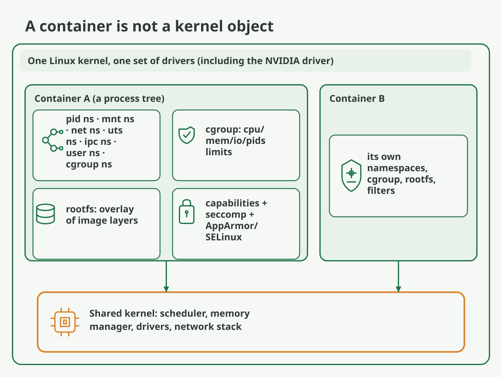
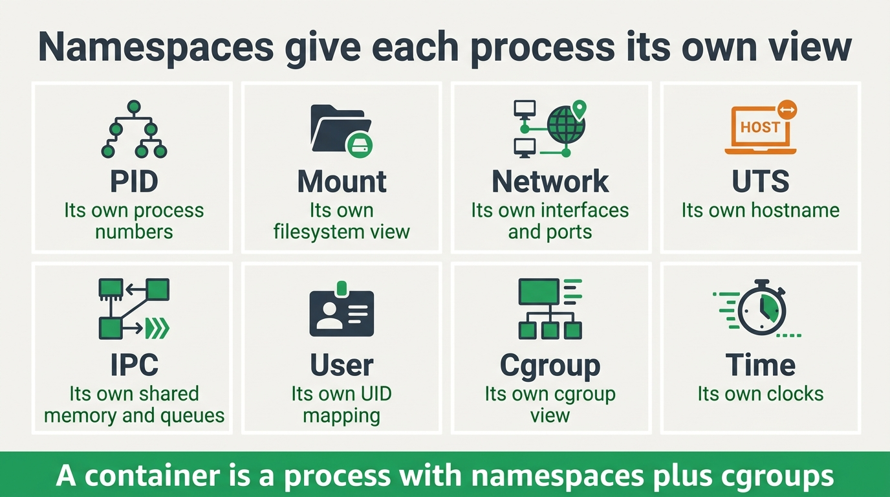
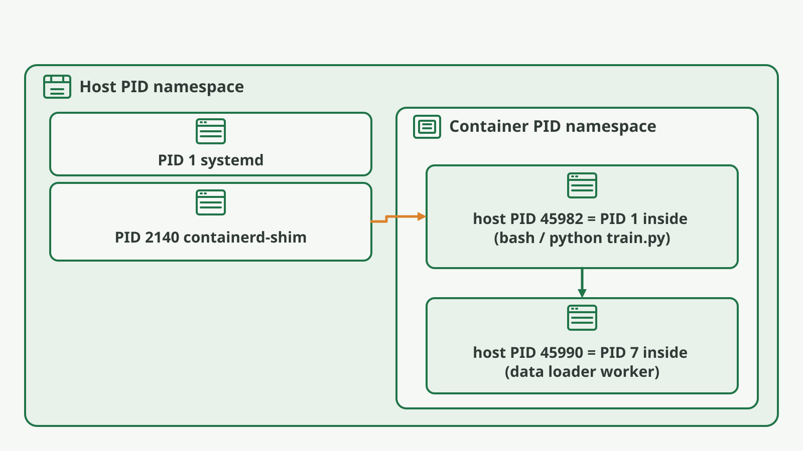
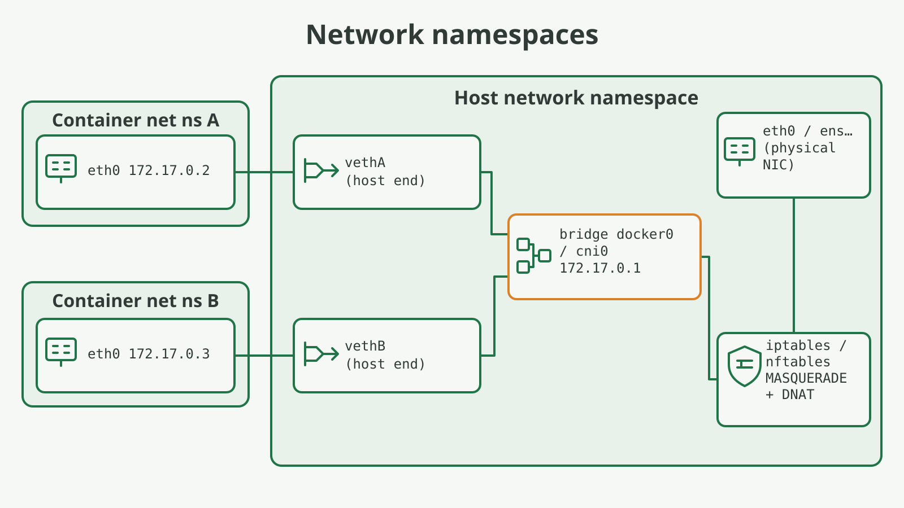
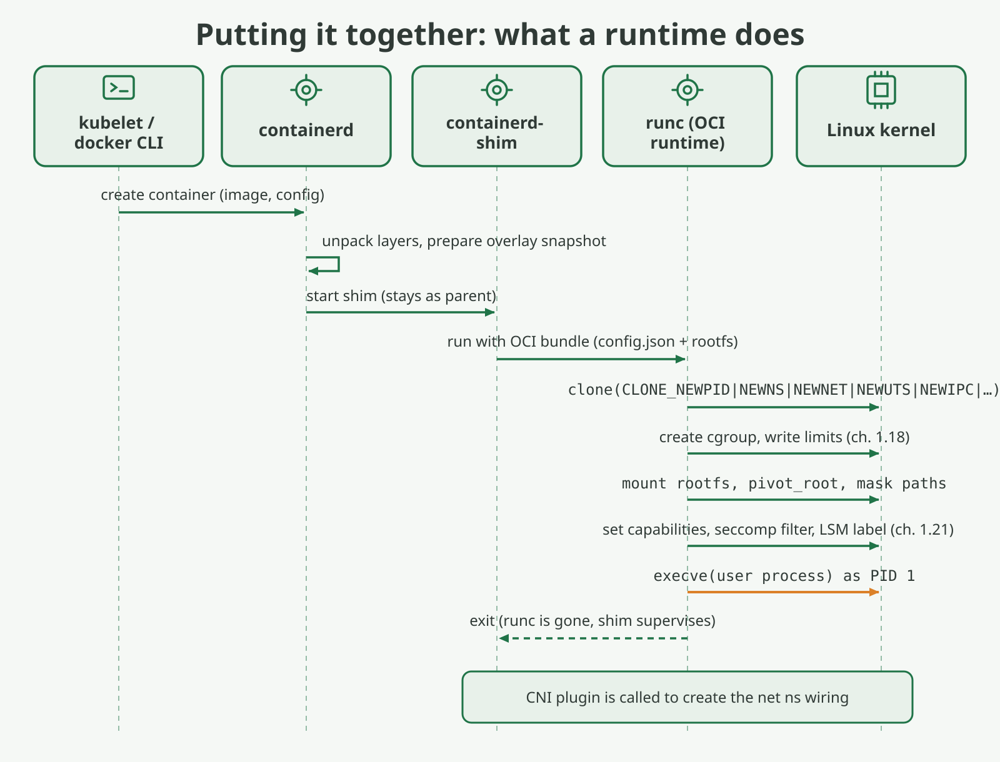

# 1.19 Namespaces: the kernel feature behind containers

| | |
|---|---|
| Level | Intermediate |
| Priority tier | 0 |
| Lab venue | GCP / GKE (an Ubuntu VM; root needed) |
| Part | Part 1: Linux, from the command line to the kernel and performance |
| Status | Drafted, labs **untested** |

## Why this matters for AI infrastructure

Picture your first on-call week on a GPU cluster. Almost every AI workload you meet runs inside a container. It might be a Kubernetes pod, an Enroot or Pyxis container under Slurm, or a Docker image on a developer's laptop. If you cannot say what a container is at the kernel level, you will struggle to debug any of them. The failures below are the ones that trace back to this chapter:

- A training script started with `bash -c` never checkpoints on `SIGTERM`. It runs as PID 1 of a PID namespace, and the kernel gives PID 1 no default signal actions.
- Inside a pod, `nproc`, `free` and `top` show the **host's** 128 CPUs and 2 TiB of RAM. The cgroup, however, allows only 8 CPUs and 64 GiB.
- Two pods on the same node cannot use shared memory (NCCL SHM, MPI) between them, because their IPC namespaces differ.
- A pod loses its network, or `hostNetwork: true` changes how InfiniBand and NCCL behave.
- File ownership on NFS or Lustre looks wrong, because user namespaces remap UIDs.
- A write to a multi-gigabyte file in an image layer fills `/var/lib/containerd`, because of overlayfs copy-up.
- Security reviews ask whether a container is privileged, shares the host PID namespace, or has a remapped user namespace.

Chapter 1.18 showed you how to limit what a process can *use*, with cgroups. This chapter shows you how to limit what a process can *see*, with namespaces. Add a root filesystem, capabilities and seccomp from chapter 1.21, and the pieces make up a container. Chapter 1.20 then puts them together in a hands-on lab that builds a container by hand.

## Prerequisites and outcomes

Before you start, four earlier chapters will make this one easier: processes and signals in 1.8, the mount and filesystem model in 1.12, kernel interfaces in 1.10, and cgroups in 1.18. The networking details used here, such as bridges, veth and NAT, are covered fully in Part 2. This chapter gives you just enough of them to follow along.

After this chapter you can:

- State precisely what a container is and is not: a process tree with a set of namespaces, a cgroup, a root filesystem and a reduced privilege set, all sharing the host kernel.
- List the eight namespace types, what each one isolates, and the system calls that create or join them (`clone`, `unshare`, `setns`).
- Inspect a process's namespaces (`/proc/PID/ns`, `lsns`, `nsenter`) and create your own (`unshare`).
- Explain PID namespace semantics (PID 1 behaviour, zombie reaping, signal rules), mount namespaces and propagation, `chroot` versus `pivot_root`, and OverlayFS layers, copy-up and whiteouts.
- Explain network namespaces, veth pairs, bridges and NAT, and how pods share namespaces.
- Explain user namespaces, UID mapping, rootless containers and their limitations.
- Compare containers, VMs and lightweight (micro)VMs, and know their isolation, performance and observability trade-offs.
- Identify and avoid the common pitfalls: host-view tools inside containers, PID 1 handling, large writes to the image layer, and tracing limits.

## 1. A container is not a kernel object

Here is a fact that surprises almost everyone: the Linux kernel has no object called a container. Ask the kernel for its container objects and you will find none. A "container" is user-space tooling, such as Docker, containerd with runc, Podman, LXC or Enroot, that combines several separate kernel features. The table shows the four pieces and the chapter that covers each one.

| Feature | What it controls | Chapter |
|---|---|---|
| **Namespaces** | What the process *sees* (processes, mounts, network, hostname, IPC, users, cgroup view, clocks) | this one |
| **cgroups** | What the process may *use* (CPU, memory, I/O, PIDs, devices) | 1.18 |
| **Root filesystem** | Its own `/` (an image unpacked or overlaid, entered with `pivot_root`) | this one |
| **Capabilities, seccomp, LSMs** | What it may *do* (privileged operations, system calls, files by label/profile) | 1.21 |

Two of those pieces are this chapter's subject: namespaces and the root filesystem. The other two belong to chapters 1.18 and 1.21. The diagram below shows how several containers sit on one shared kernel.



*Figure 1.19.1. A container is not a kernel object.*

Gregg puts it this way: the kernel keeps a pointer, `struct nsproxy`, from each task to its namespaces. That structure is the closest thing the kernel has to a "container". Because the kernel is shared, a container starts in milliseconds. It uses no guest-kernel memory, has no virtualisation overhead on CPU or memory, and calls the GPU driver natively. The price is real, though. All containers contend for the same kernel locks, caches and queues, which is the noisy-neighbour problem. A kernel bug or panic affects every container on that node. Guests cannot load their own kernel modules or run a different kernel. Isolation is also weaker than hardware virtualisation, because the attack surface is the whole system-call interface.

The history is short, and worth knowing. `chroot` from Unix V7 in 1979 changed a process's idea of `/`. FreeBSD jails in 1998 and Solaris Zones in 2005 added whole-system partitioning. Linux added mount namespaces in 2.4.19 in 2002, then the other namespace types over many releases. Cgroups arrived in 2.6.24 in 2008. LXC in 2008 and Docker in 2013 packaged these pieces. The OCI specification standardised the image and runtime format, and Kubernetes in 2014 became the orchestrator.

Before you debug a container, decide which of those four pieces is the likely cause.

## 2. The namespace types

Two services on one host can both insist on port 80, and neither one notices the other. The network namespace is what makes that possible. A **namespace** wraps a global system resource, so that the processes inside it see their own isolated copy. Changes made inside are visible only to members of that namespace, never to anyone outside it. Every process always belongs to exactly one namespace of each type, starting with the host's initial namespaces, often called the "init" namespaces.



*Figure 1.19.2. Each namespace type gives a process its own view of one kind of resource.*

| Namespace | Clone flag | Isolates | Notes |
|---|---|---|---|
| **mnt** | `CLONE_NEWNS` | Mount points (the filesystem tree as seen) | First namespace (2002), hence the odd flag name |
| **pid** | `CLONE_NEWPID` | Process ID numbering and visibility (`/proc` content) | First process is PID 1 inside; nests hierarchically |
| **net** | `CLONE_NEWNET` | Network devices, IP addresses, routes, firewall rules, sockets, ports, `/proc/net` | A new one has only a down `lo` |
| **uts** | `CLONE_NEWUTS` | Hostname and NIS domain name (`uname`) | "UNIX Time-sharing System" |
| **ipc** | `CLONE_NEWIPC` | System V IPC objects and POSIX message queues | Shared memory segments (`shmget`) |
| **user** | `CLONE_NEWUSER` | UID/GID number space, capabilities | Root inside can be an unprivileged user outside |
| **cgroup** | `CLONE_NEWCGROUP` | The view of the cgroup hierarchy root | Container sees its own cgroup as `/` |
| **time** | `CLONE_NEWTIME` | `CLOCK_MONOTONIC`/`CLOCK_BOOTTIME` offsets | Added in Linux 5.6; rarely used |

The table lists all eight types. Notice the flag for the mount namespace: `CLONE_NEWNS` looks odd only because it was the first namespace, added in 2002, before the naming pattern settled.

Read the rows one at a time, because each type answers one practical question. The mount namespace gives a process its own view of the filesystem tree, which is how a container gets its own `/`. The PID namespace gives it its own process numbering, which is how a container's main program becomes PID 1. The network namespace gives it its own devices, addresses, routes and ports, which is how two containers can both use port 80.

The remaining four are just as practical, though you will meet them less often. The UTS namespace gives a process its own hostname and NIS domain name. The IPC namespace gives it its share of System V IPC objects and POSIX message queues. The user namespace gives it its own UID and GID number space, along with its own capabilities. The cgroup namespace gives it its own view of the cgroup hierarchy root, and the time namespace offsets its monotonic and boot clocks.

Three system calls do all the work. Each one creates or joins a namespace in a different way.

- **`clone(2)`** (and `clone3`) creates a new process, optionally inside new namespaces through the `CLONE_NEW*` flags. Runtimes use it to start a container's first process.
- **`unshare(2)`** moves the calling process into new namespaces. For PID namespaces, only its future children enter the new one. The `unshare(1)` command wraps this call.
- **`setns(2)`** joins an existing namespace through a file descriptor from `/proc/PID/ns/*`. `nsenter(1)` wraps it. In practice, `docker exec` and `kubectl exec` are "setns into the container's namespaces and exec a program".

A namespace stays alive as long as something still refers to it. That can be a process inside it, an open file descriptor to `/proc/PID/ns/xxx`, or a bind mount of that file. The last case is how `ip netns` keeps named network namespaces under `/run/netns` alive, with no process running in them.

### Inspecting namespaces

The commands below let you look at namespaces on a running system, and they work on any Linux host. Each `ns` symlink carries an inode number, and two processes that show the same number share a namespace.

```bash
ls -l /proc/$$/ns/                     # symlinks like net:[4026531992]; the number is the namespace inode
readlink /proc/$$/ns/net               # compare two processes: same number = same namespace
lsns                                   # list all namespaces, number of processes, first process
lsns -t net                            # only network namespaces
sudo lsns -p 1234                      # the namespaces of PID 1234
sudo nsenter -t 1234 -n ip addr        # run `ip addr` in PID 1234's network namespace
sudo nsenter -t 1234 -m -u -i -n -p /bin/sh   # approximately what `docker exec` does
cat /proc/self/uid_map /proc/self/gid_map     # user namespace mappings (see section 6)
cat /proc/sys/user/max_user_namespaces        # per-user limits (user.max_*_namespaces)
```

Here is a practical debugging recipe for Kubernetes. First, find the container's host PID, using `crictl inspect <id> | grep -i pid` or `docker inspect -f '{{.State.Pid}}'`. Then run `nsenter -t PID -n` to use host tools, such as tcpdump, ss and ethtool, inside the pod's network namespace. That works even when the image has none of those tools. It is one of the most useful skills in this chapter.

Learn to read the `/proc/PID/ns` links before you need them during an incident.

## 3. PID namespaces

Run `ps` inside a container and the list starts at PID 1. That surprise is a PID namespace at work. A PID namespace gives its members a private PID numbering, and the first process in it is always PID 1. Inside, the process sees only itself and its descendants in `/proc`, and only once `/proc` is mounted from inside that namespace. The same process can have a different PID in each namespace. PID 1 in a container may be PID 45982 on the host. PID namespaces also nest: a parent namespace sees all descendants, each with its own number, while a child sees nothing above it.



*Figure 1.19.3. PID namespaces.*

PID 1 is the init of its namespace, and it follows three special rules. The first rule is that PID 1 has no default signal actions. A signal sent from inside the namespace reaches PID 1 only if PID 1 installed a handler for it. `SIGKILL` and `SIGSTOP` from inside are ignored. From the parent namespace they still work, which is how `docker stop`, `kubectl delete pod` and the kubelet's `SIGTERM` followed by `SIGKILL` reach the process.

That rule creates a trap. A shell script running as PID 1 with no `SIGTERM` handler ignores the termination request. The runtime then waits out the grace period, 30 seconds in Kubernetes by default, before it sends `SIGKILL`. A training job loses its chance to checkpoint. The fix is to end the script with `exec python train.py`, so the program itself becomes PID 1 and installs its own handler. You can also use a tiny init, such as `tini`, `docker run --init`, `dumb-init` or Kubernetes `shareProcessNamespace`.

The second rule is about zombies. Orphaned processes in the namespace are re-parented to PID 1, and PID 1 must call `wait()` on them. If it does not, zombies accumulate and can eventually exhaust the PID limit from chapter 1.18, `pids.max`. Real init programs reap zombies. Many application PID 1s do not, and chapter 1.8 covers zombies in detail.

The third rule follows from the same idea. When PID 1 exits, the kernel kills every other process in that namespace with `SIGKILL`, and the namespace cannot fork new processes. That is why a container dies when its main process dies.

`unshare --pid` affects only children, so add `--fork` if you want the shell itself to be PID 1. `/proc` is a mount too. After you create a PID namespace, mount a fresh `proc`, with `mount -t proc proc /proc` or `unshare --mount-proc`. Otherwise tools such as `ps` still show the host's view.

Kubernetes ties these ideas together. Each pod has a `pause` container, also called the infra container, that holds the pod's shared namespaces. With `shareProcessNamespace: true`, all containers in the pod share one PID namespace, and `pause` runs as PID 1 and reaps zombies. `hostPID: true` puts the pod in the **host** PID namespace. Some profilers and node agents need that, but it is a strong security exposure.

Before you give a pod `hostPID: true`, check whether the workload truly needs to see host processes.

### Seeing a container from the host

Inside a container, a process listing may show only the shell and the `ps` command itself. That shell has PID 1, the number normally reserved for init on a full system. The container therefore looks like a small machine of its own, but it is not one. Open a second terminal on the host and list processes, and you will find the same shell with a much larger PID.

```
root 20189 0.2 0.0 2408 2104 pts/0 Ss+ 08:36 0:00 /bin/bash
```

This is the PID namespace at work. It gives the container's processes their own numbering, starting at 1, and hides every process outside it. The host still sees each process under its real PID. When you debug a container, look at it from the host as well as from inside.

## 4. Mount namespaces, root changes and OverlayFS

### Mount namespaces and propagation

A naive mount inside a new namespace can leak back to the host, which surprises people the first time they see it. To understand why, start with how a new mount namespace is built. It begins with a **copy** of its parent's mount table. Mounts and unmounts made later inside it do not affect the other namespace. Propagation flags on each mount point decide what may cross between them.

| Flag | Meaning |
|---|---|
| `shared` | Mount/unmount events propagate to and from peer mounts |
| `slave` | Receives events from the master, sends none |
| `private` | No propagation either way |
| `unbindable` | Private and cannot be bind-mounted |

Each flag sets one pattern of traffic, like a rule at a doorway. A `shared` mount sends and receives events. A `slave` mount only receives them, and a `private` mount does neither. An `unbindable` mount is private and cannot be bind-mounted.

The leak is a real risk. `systemd` makes `/` shared by default, so a naive new mount namespace can leak mounts back to the host. Container runtimes therefore remount the root as `rslave` or `rprivate` first, with `unshare --propagation private` or `mount --make-rprivate /`. Kubernetes exposes the same choice through `mountPropagation`. `HostToContainer` (rslave) lets a pod see mounts created later on the host, which CSI drivers rely on. `Bidirectional` (rshared) lets the container create mounts that are visible on the host, and it needs privileged mode. To inspect propagation, use `findmnt -o TARGET,PROPAGATION` or `cat /proc/self/mountinfo`, where the optional fields show `shared:N` and `master:N`.

Before you set `mountPropagation` on a pod, decide which direction the mounts need to travel.

### chroot versus pivot_root

Here is why the difference matters. If a process can still reach the old root, `chroot` has not isolated it. `chroot(2)` changes a process's root directory, but the old root can stay reachable through open file descriptors, or through `fchdir` tricks if the process has root privilege. It is a convenience, not a security boundary.

Container runtimes take a different approach. They create a mount namespace, set up the new root, and call **`pivot_root(2)`**. That swaps the root mount, so the old root can be unmounted and detached completely.

For a minimal container, the sequence runs as follows. Create a new mount namespace, then make the mounts private. Bind-mount the new rootfs onto itself, then mount `proc`, `sysfs` (read-only), and a `tmpfs` for `/dev`, along with the device nodes. Next, `pivot_root` into the new root, then unmount the old root. Drop capabilities, and finally exec the program. Sensitive host paths, such as `/proc/kcore`, `/sys/firmware` and parts of `/proc/sys`, are masked or made read-only. The OCI spec calls these the "masked paths".

When you build a container root, rely on `pivot_root`, because `chroot` is not a security boundary.

### OverlayFS: images as layers

Write to a big file that came from an image, and the kernel may copy the whole file before your write even lands. That behaviour comes from OverlayFS, so it helps to know how the layers fit together. A container image is an ordered stack of **read-only layers**. Each layer is a tar of filesystem changes, named by its hash. To run a container, the runtime mounts those layers with **OverlayFS**, a union filesystem built into the kernel. It uses four settings:

- `lowerdir=` takes one or more read-only directories, the image layers. Separate them with colons. The leftmost one is the topmost.
- `upperdir=` is the read-write layer. It starts empty, and all changes land there.
- `workdir=` is an empty scratch directory on the same filesystem as `upperdir`, used for atomic operations.
- The **merged** view is what the container sees as `/`.

```bash
mkdir -p lower1 lower2 upper work merged
echo "from layer 1" > lower1/a.txt ; echo "from layer 2" > lower2/a.txt ; echo only-in-2 > lower2/b.txt
sudo mount -t overlay overlay -o lowerdir=lower2:lower1,upperdir=upper,workdir=work merged
cat merged/a.txt                  # "from layer 2": upper layers hide lower ones
echo changed > merged/a.txt       # copy-up: file copied to upper, then modified
ls upper                          # a.txt now exists in upper; lower1/lower2 unchanged
rm merged/b.txt ; ls -l upper/b.txt   # a whiteout: a character device 0/0 hides the lower file
mount | grep overlay              # compare with a running container's root: docker run --rm alpine mount | head -1
```

Run these commands and watch where each change lands. The file in the top layer hides the one below it. Writing to it copies it up, and the lower layers stay untouched.

Four behaviours matter most in practice. The first is **copy-up**. The first write to a file that lives in a lower layer copies the entire file into the upper layer. Metadata-only changes copy only metadata, on modern kernels with `metacopy`. A training job that appends to a multi-GB file baked into an image therefore triggers a huge copy. A database stored in the image layer does the same. The copy doubles disk use and can fill the node's image storage, at `/var/lib/containerd` or `/var/lib/docker`. The result is evictions and `NodeNotReady`. Mutable and large data belongs in volumes, such as bind mounts, `emptyDir`, hostPath or PVCs, because volumes bypass overlay completely.

The second is **whiteouts**. Deleting a lower file creates a 0/0 character device, or an opaque-directory xattr for removed directories, in the upper layer. That marker hides the file, but the lower data stay on disk. So deleting a file in a later Dockerfile layer does not shrink the image. The earlier layer still holds the bytes. That is why a secret baked into a layer and "deleted" later can still be extracted.

The third is performance. Metadata-heavy operations, such as `stat` and `readdir`, cost more through overlay. Random I/O on the image layer is slower than on a raw filesystem. Cache layers, such as package caches, should therefore be volumes. Model weights and datasets should be mounted, not copied into images. The Gregg book shows a kernel stack in which a container write goes through `ovl_write_iter` before it reaches XFS. The filesystem underneath matters as well, because overlayfs needs `d_type` support and XFS needs `ftype=1`.

The fourth is sharing. Containers from the same image share lower-layer files and their page cache, which saves memory compared with VMs. Rootless mode uses `fuse-overlayfs` on older kernels, which is slower. Kernel 5.11 and later allow unprivileged overlay mounts inside user namespaces. Other storage drivers exist too, including `btrfs`, `zfs`, `devicemapper`, and containerd snapshotters such as `stargz` lazy-pulling. On Kubernetes nodes, overlayfs through containerd's snapshotter is the norm.

Image builds add their own layers, one for each `RUN` or `COPY` step. The *How Linux Works* book, Section 17.2, shows a small example. Its 3-line Dockerfile has `FROM alpine:latest`, `RUN apk update && apk add bash` and `CMD ["/bin/bash"]`. Running `docker build -t hlw_test .` sends a `2.048kB` build context to the Docker daemon. It pulls `alpine:latest`, which is `f70734b6a266` at `5.61MB`. Then it runs `apk add bash` inside an intermediate container, `fb082e6a0728`. Finally it commits the image `hlw_test:latest`, which is `1b64f94e5a54` at `9.19MB`. Inside the running container, `docker run -it hlw_test` followed by `mount` shows the root as `overlay on / type overlay (rw,relatime,lowerdir=/var/lib/docker/overlay2/l/...,upperdir=/var/lib/docker/overlay2/.../diff,workdir=/var/lib/docker/overlay2/.../work)`.

Three habits follow from all of this. Combine Dockerfile steps, and use multi-stage builds to keep build tools out of the final image. Pin base image tags or digests, because `latest` is not reproducible. An image's `ENTRYPOINT` and `CMD` define PID 1. Use the exec form `["python","train.py"]`, not the shell form, so that no `sh` wraps your program. Docker also keeps stopped containers and old images by default. Check them with `docker ps -a`, `docker images` and `docker system df`. Clean up with `docker rmi` or `docker system prune`, and do that with care.

Before you size a node's disk, check whether your writes land in a volume or in the image layer.

### Reading an overlay mount on the host

Run `mount` inside a container and the root filesystem appears as an overlay, not a device. The output looks something like this, with long directory names under `/var/lib/docker/overlay2/`:

```
overlay on / type overlay (rw,relatime,lowerdir=/var/lib/docker/overlay2/l/C3D66CQYRP4SCXWFFY6HHF6X5Z:/var/lib/docker/overlay2/l/K4BLIOMNRROX3SS5GFPB7SFISL:/var/lib/docker/overlay2/l/2MKIOXW5SUB2YDOUBNH4G4Y7KF1,upperdir=/var/lib/docker/overlay2/d064be6692c0c6ff4a45ba9a7a02f70e2cf5810a15bcb2b728b00dc5b7d0888c/diff,workdir=/var/lib/docker/overlay2/d064be6692c0c6ff4a45ba9a7a02f70e2cf5810a15bcb2b728b00dc5b7d0888c/work)
```

The output names three directories: `lowerdir`, `upperdir` and `workdir`. The `lowerdir` value can hold several colon-separated paths. Each one is a build layer, and the last one is the base distribution from the first build step. The layers stack from right to left, so later steps sit above earlier ones.

The `upperdir` sits on top of all of them, and every change the container makes lands there. The `workdir` is scratch space the filesystem driver uses before it writes changes to the upper directory. It must be empty when the filesystem is mounted.

Rootless Podman uses the FUSE version of overlay, so `mount` shows less detail. You can examine the `fuse-overlayfs` processes on the host instead. Images with many build steps have many layers, so tools often combine `RUN` commands or use multistage builds to reduce them.

## 5. Network namespaces

When a pod's network misbehaves, start in its network namespace. The namespace decides which devices, addresses and routes the pod can use. A new network namespace contains only a loopback interface, and that interface is down. It has no other devices, no routes and no firewall rules. Each namespace has its own IP addresses, routing tables, ARP table, `iptables` or `nftables` rules, sockets and port space, plus its own `/proc/net`. That is why two containers can both listen on port 80. Moving a physical or virtual interface into a namespace removes it from the original one.

The standard way to connect a namespace is a **veth pair**. Think of it as a virtual Ethernet cable with two ends, each one a separate interface. One end stays in the host namespace and attaches to a **bridge**, such as `docker0` or `cni0`, or it is routed. The other end moves into the container's namespace, is renamed `eth0`, and gets an address. Traffic leaving the host is usually **NAT**ed, or masqueraded, by iptables or nftables. Published ports use DNAT rules.



*Figure 1.19.4. Network namespaces.*

The commands below build this wiring by hand. Run them in order on a disposable host, and you will see each step for yourself. Then ping in both directions to confirm the link works.

```bash
sudo ip netns add demo                              # named network namespace (bind-mounted under /run/netns)
sudo ip link add vethH type veth peer name vethC    # a veth pair in the host namespace
sudo ip link set vethC netns demo                   # move one end in
sudo ip addr add 10.9.0.1/24 dev vethH && sudo ip link set vethH up
sudo ip netns exec demo ip addr add 10.9.0.2/24 dev vethC
sudo ip netns exec demo ip link set vethC up ; sudo ip netns exec demo ip link set lo up
sudo ip netns exec demo ping -c2 10.9.0.1
sudo ip netns exec demo ip route add default via 10.9.0.1        # then enable forwarding + NAT on the host
ip -br link ; sudo ip netns exec demo ip -br link
sudo ip netns del demo
```

You will meet several variants in practice.

- **Pod networking in Kubernetes**: All containers in a pod share one network namespace, which the pause container creates. A CNI plugin, such as Calico, Cilium or Flannel, creates the veth, assigns the pod IP and installs routes or tunnels. `hostNetwork: true` puts the pod in the *host's* namespace, which gives no isolation. Node agents use it, and so do some performance-sensitive jobs.
- **Docker modes**: `bridge` is the default. The others are `host`, `none`, `container:<id>`, which joins another container's namespace, and `macvlan` or `ipvlan`, which give the container an address directly on the physical network.
- **Rootless Podman** cannot create veth pairs without privilege. It uses a user-space TCP/IP stack instead, `slirp4netns` or `pasta`. That means lower throughput, and containers cannot reach each other the same way.
- **High-performance fabrics**: SR-IOV virtual functions or RDMA devices can move into a container's namespace, through Multus, the SR-IOV CNI or `rdma-shared-device-plugin`. RDMA in containers needs the right device files and the host IB stack. In shared mode it also needs the RDMA subsystem's own namespace mode, set with `rdma system set netns exclusive|shared`. `hostNetwork` is often used with NCCL over InfiniBand, to avoid NAT and the CNI path. Parts 2, 8 and 9 cover the details.
- **Tracing**: `ss`, `tcpdump` and `ethtool` can run from the host with `nsenter -t PID -n` or `ip netns exec`.

When a pod's traffic misbehaves, first check whether it uses the pod network or the host network.

## 6. User namespaces, UID mapping and rootless containers

Imagine that a container's root process somehow escapes the container. User namespaces are the reason it still lands on the host as an ordinary user. A user namespace has its own UID and GID number space, and its own capability set. The kernel keeps the mapping in `/proc/PID/uid_map` and `gid_map`, as triplets of `inside_start outside_start length`. Process "root", UID 0 inside the namespace, can be UID 100000 on the host. So even if it escapes, it is an unprivileged user outside.

Inside the namespace, root has capabilities only over resources that the namespace owns. It can mount inside its own mount namespace and configure its own network namespace, but it has no real power over the host. An unprivileged user can therefore create a user namespace and, inside it, other namespaces. This is the basis of **rootless containers**, used by Podman, rootless Docker, Enroot, and Apptainer or Singularity in user-namespace mode.

```bash
unshare --user --map-root-user bash        # become "root" inside, mapped to your UID outside
id; cat /proc/self/uid_map                 # uid 0 inside = your uid outside
touch /root-owned 2>&1                     # no real privilege: fails on host-owned paths
exit
cat /etc/subuid /etc/subgid                # subordinate ID ranges allotted to each user (newuidmap/newgidmap)
```

The trade-offs matter on HPC and AI clusters. Files on shared storage, such as NFS, Lustre, GPFS or BeeGFS, are owned by real UIDs. ID-mapped access through a user namespace can break ownership, permissions and quotas, and those breakages are hard to spot from inside the container. Kernel support for features such as ID-mapped mounts (5.12 and later) varies. That is why many clusters run containers as the real user, through Enroot and Pyxis, or through Apptainer's setuid or fakeroot modes. Others run privileged or root containers with security profiles, such as AppArmor, SELinux and seccomp from chapter 1.21, instead of remapping user namespaces.

Kubernetes support for user namespaces, `hostUsers: false`, is newer and sits behind a feature gate, so check its status for your version. User namespaces also enlarge the kernel's attack surface. Some distributions restrict unprivileged creation, through `kernel.unprivileged_userns_clone` or, on recent Ubuntu releases, an AppArmor restriction. Check your distribution's policy before you depend on them.

Before you move a workload to rootless mode, check who owns its data on shared storage.

## 7. UTS, IPC, cgroup and time namespaces

A PyTorch job crashes with a bus error, and its logs say nothing about memory. You may suspect the code, but a common cause is the IPC namespace and the size of `/dev/shm`. The four namespaces in this section are smaller than the ones before, but each one still changes what a process sees.

- **UTS**: The container has its own hostname, which `hostname` or `uname -n` shows. Kubernetes sets it to the pod name. Change it inside the container and the host never notices. Gregg notes that the UTS nodename works as a convenient container identifier for BPF tools.
- **IPC**: System V shared memory, semaphores and message queues are namespaced, and so are POSIX message queues. Containers in different IPC namespaces cannot share SysV segments. Within a pod, all containers share the IPC namespace by default, and `hostIPC: true` joins the host's instead. NCCL, MPI and PyTorch data-loader workers use shared memory heavily. PyTorch's `DataLoader` uses `/dev/shm`, which is a tmpfs. Docker defaults it to 64 MiB, a classic cause of "bus error" crashes in containers. Raise the limit with `--shm-size`, with `--ipc=host`, or with an `emptyDir` that has `medium: Memory`. MPI ranks in separate pods on the same node fall back to network paths, because they do not share IPC.
- **Cgroup namespace**: This makes `/proc/self/cgroup` and `/sys/fs/cgroup` show the container's cgroup as the root (`0::/`), hiding the host's cgroup layout. It changes the *view*, not the limits. Chapter 1.18 covers the limits.
- **Time namespace**: This holds per-container offsets for the monotonic and boot clocks, not for wall time. Checkpoint and restore migration with CRIU uses it.

When a PyTorch job crashes on shared memory, check the size of `/dev/shm` before you change the code.

## 8. Putting it together: what a runtime does

When you run `docker run` or the kubelet starts a pod, a chain of programs does the work. Knowing that chain tells you which step failed. The sequence below is simplified, but it shows which program makes each kernel call.



*Figure 1.19.5. Putting it together: what a runtime does.*

The OCI runtime spec, in `config.json`, lists every namespace, mount, capability, cgroup path and hook. `runc spec` generates a template for you. Reading a real container's `config.json` is the best way to learn what your platform configures. The shim keeps the container's stdio and exit status after `runc` exits, so containerd can restart without killing the containers.

When a container fails at start, look at the step that failed, not only at the final error.

## 9. Containers, VMs and lightweight VMs

Every choice here is a trade. Choosing between a container and a VM means trading isolation against start time and GPU access. The table compares four options.

| | Hardware VM (KVM/QEMU) | Container | MicroVM (Firecracker, Kata) | User-space kernel (gVisor) |
|---|---|---|---|---|
| Kernel | Own guest kernel | Shared host kernel | Own minimal guest kernel | Go "kernel" intercepting syscalls |
| Isolation | Strong (hardware, small VMM interface) | Weaker (whole syscall surface, kernel bugs) | Strong, with hardware boundary | Medium, high overhead for syscall-heavy loads |
| Start time | Seconds | Milliseconds | About 100 to 200 ms | Milliseconds |
| Memory overhead | Hundreds of MiB (guest kernel, QEMU) | Near zero | Few MiB (Firecracker) to tens of MiB (Kata) | Moderate |
| Observability | Guest has its own `/proc`, tracing works inside | Tools inside often show **host** statistics; tracing mostly blocked | Like VMs | Limited |
| GPU access | Passthrough (VFIO) or vGPU/MIG | Native driver access via device nodes | Passthrough possible but complex | Limited |
| Typical use | Cloud instances, isolation of tenants | Microservices, ML jobs, CI | Serverless, multi-tenant sandboxes, Kata for strong pod isolation | Sandboxing untrusted code |

Look at the GPU row first if you run AI workloads, because it decides how much of the GPU you can reach. A container uses the native driver through device nodes, while a VM needs passthrough or vGPU.

AI clusters run containers on bare metal or VM nodes, because they need the GPU driver, RDMA and local storage natively. Multi-tenant providers, such as neoclouds like CoreWeave and Nebius, often wrap customer workloads in VMs, or in Kata or KubeVirt, for tenant isolation. They still pass GPUs through. MIG and vGPU partition a physical GPU for sharing, which Part 7 covers. Virtualisation internals, such as VT-x, EPT, virtio and VFIO, come in chapters 1.26 and 1.27.

For a multi-tenant GPU service, decide early whether the isolation needs a hardware boundary.

## 10. Observing containers (and the traps)

Run `top` inside a container and it may show busy CPUs and busy disks, even though your container is idle. Those numbers belong to the host and to other tenants. Containers hide some information and distort the rest. Five traps come up again and again.

- **Tools inside a container often show host data.** The summary lines of `top`, `uptime` and the load average, `mpstat`, `vmstat`, `free` and `iostat` all report the host. The reason is that `/proc` and `/sys` statistics are not namespaced. So `/proc/cpuinfo`, `/proc/meminfo` and `/proc/stat` describe the whole machine. Per-process tools, such as `ps` and `pidstat`, are filtered by the PID namespace, so they behave differently. For a container's true usage and limits, read its cgroup files: `cpu.stat`, `memory.current`, `memory.events`, `io.stat` and PSI. Chapter 1.18 explains them. `lxcfs` can present cgroup-aware `/proc` files.
- **Limits are checked first.** Gregg's strategy is that software resource-control limits are hit long before hardware limits. So check cgroup limits and throttling before you blame the hardware. Most traditional tools, such as `top` and `iostat`, are blind to those limits.
- **From the host, everything is visible.** Container processes appear in the host's `ps` with host PIDs. You can map a PID to its container through `/proc/PID/cgroup`, where the container ID appears in the path. `crictl ps`, `docker ps` and `nsenter` also help. The kernel has no container ID of its own. BPF tools use the cgroup ID or the UTS nodename instead.
- **Tracing from inside is mostly blocked.** `perf`, `bpftrace` and `strace` (which uses `ptrace`) need capabilities such as `SYS_ADMIN`, `PERFMON`, `BPF` and `SYS_PTRACE`. They also need access to `/sys/kernel/debug`. Container seccomp profiles block `perf_event_open`, `bpf` and `ptrace` by default. Operators trace from the host instead, or they use debug containers or ephemeral containers, through `kubectl debug`, that share the target's PID namespace.

A fifth trap is noisy neighbours. Contention on shared kernel resources, such as the dentry cache, locks, interrupts and CPU caches, can slow a container without any limit being hit. Diagnosing that needs host-side tools.

Before you blame the hardware for a slow container, read its cgroup files and check for throttling.

## 11. GPUs inside containers

A container can start cleanly and still fail to see a GPU. Namespaces and cgroups know nothing about GPUs, so the GPU layer has to supply the pieces itself. A GPU reaches a process in two forms: device nodes, and user-space libraries. The device nodes are `/dev/nvidia0..N`, `/dev/nvidiactl`, `/dev/nvidia-uvm`, `/dev/nvidia-uvm-tools` and `/dev/nvidia-modeset`. MIG adds `/dev/nvidia-caps/*`. The libraries, such as `libcuda.so` and NVML, must match the host kernel driver version.

To give a container a GPU, a runtime has to do three things. First, it makes the device nodes exist in the container's mount namespace, by bind mount or by `mknod`. Second, it allows those devices in the devices cgroup, which chapter 1.18 covers. Third, it mounts the driver's user-space libraries and binaries, such as `nvidia-smi`, from the host. The CUDA toolkit libraries can live in the image, but the driver library cannot.

The NVIDIA Container Toolkit automates these three steps. It includes `nvidia-container-runtime`, `nvidia-ctk` and `libnvidia-container`. Historically it worked through an OCI prestart hook. It now prefers CDI, the Container Device Interface. CDI is a declarative spec file that lists device nodes, mounts and environment variables, and you create one with `nvidia-ctk cdi generate`. Because the driver lives in the shared kernel, GPU performance inside a container matches bare metal.

Parts 7 and 8 cover the toolkit, the Kubernetes device plugin, the GPU Operator, MIG and time-slicing in depth. Verify toolkit commands and CDI behaviour against current NVIDIA documentation before you rely on them.

Before you debug a GPU in a container, confirm which layer should supply the device, the driver library or the cgroup permission.

## 12. Other flavours of "virtual"

Not every isolation tool is a container. Some are tools for a shared host, and some are runtimes built for HPC. Knowing which one you are looking at saves confusion later.

- **LXC, LXD and Incus** run system containers. Each one runs a whole init and several services. You set up more by hand, including the network and UID mappings, so they feel closer to a lightweight VM. The first Docker versions were built on LXC.
- **Podman** is daemonless and rootless-first, with a Docker-compatible CLI. Its containers are children of the invoking process tree, or they run as systemd units through Quadlet.
- **Enroot and Pyxis** form NVIDIA's HPC container path for Slurm. Enroot is unprivileged. It converts images into a squashfs that unpacks into a directory, uses `unshare`-style namespaces, and needs no daemon. Pyxis integrates it with Slurm through `srun --container-image`. Apptainer and Singularity are the other HPC runtimes, and the Slurm chapters cover them.
- **Language-level environments**, such as Python `venv`, conda and `nvm`, are not kernel isolation. The *How Linux Works* book, Section 17.4, shows the venv case. Running `python3 -m venv test-venv` creates a directory with system-like subdirectories: `bin`, `include` and `lib`. Sourcing `. test-venv/bin/activate` (sourced, not executed) changes `PATH`, `sys.path` and `VIRTUAL_ENV` in the current shell. A program then sees a different set of libraries. `deactivate` restores the shell. These environments help when Python dependencies conflict on a shared host, but they share nothing with kernel namespaces.

Ward lists several pitfalls of containers. Big base images and writable layers waste storage. You still need a real Linux host and its maintenance. Resource limits do not create capacity. Ephemeral filesystems need a plan for data and logs. Most tooling targets web services rather than HPC. Careless builds produce bloat and fragility. `latest` tags break reproducibility. Image provenance and supply-chain trust must be managed. Containers also do not make slow startup faster.

Before you reach for a tool here, decide which kind of isolation the job needs: kernel, hardware, or just a Python path.

## 13. Failure modes and diagnosis

A container misbehaves during an on-call shift, and you need to get from symptom to cause quickly. This table is built for that moment. It maps common symptoms to their likely causes and fixes. Scan the symptom column first, then read the fix in the right-hand column.

| Symptom | Likely cause | Check / fix |
|---|---|---|
| Pod ignores `SIGTERM`, killed after 30 s, no checkpoint | Shell wrapper or non-handling program is PID 1 | `exec` in entrypoint, `tini`/`--init`, handle `SIGTERM` in the program; raise `terminationGracePeriodSeconds` for large checkpoints |
| Zombie processes pile up, `fork: retry` | PID 1 does not reap; `pids.max` reached | Use an init; check `ps -eo stat \| grep Z`, `cgroup pids.current` |
| `free`/`nproc` show host values, app oversizes thread pools | `/proc` not namespaced | Read cgroup limits; set thread counts explicitly; `lxcfs`; limit-aware runtimes |
| PyTorch "bus error" / DataLoader hangs in container | `/dev/shm` too small (64 MiB default in Docker) | `--shm-size`, `--ipc=host`, memory-backed `emptyDir` |
| Cannot see/mount new host mounts inside container | Mount propagation `private` | Use `HostToContainer` (`rslave`) |
| Node disk full under `/var/lib/containerd` | Large writes to writable layer, stopped containers, unused images, logs | `crictl images`, `du`, move data to volumes, image GC thresholds, log rotation |
| Same image works as root, fails as non-root | UID mapping, file ownership of volumes | `id` inside vs outside, `fsGroup`, user namespace mappings, `/etc/subuid` |
| `Operation not permitted` for `mount`, `ip`, `sysctl` | Missing capability or seccomp/LSM block | Chapter 1.21; do not "fix" with `--privileged` without review |
| `nvidia-smi` fails inside container: "driver/library version mismatch" | Container has own libcuda not matching host driver, or toolkit hook missing | Let the toolkit inject host driver libs; do not bake driver libs in images |
| GPU visible on host, not in container | Device nodes not in container / devices cgroup denies / runtime not configured | `ls -l /dev/nvidia*` in container, runtime class, CDI spec, cgroup driver match (1.18) |
| Pod-to-pod traffic works across nodes but not on the same node (or vice versa) | CNI, bridge netfilter, MTU, hairpin | `nsenter -t PID -n ip route; ss; tcpdump`, check `br_netfilter` sysctls |
| `Cannot create user namespace` | Disabled by policy/sysctl, `user.max_user_namespaces=0` | Distribution policy; AppArmor restriction on Ubuntu |
| Mount leaks onto the host | Shared propagation on root | `--make-rprivate`; verify with `findmnt -o PROPAGATION` |

Most rows trace back to a namespace or a limit that this chapter explains. Notice that many fixes say what to leave alone, such as not baking driver libraries into images.

When you cannot tell where to start, work through five questions from the top down.

1. Can the process start at all? Check the image pull, the rootfs, the entrypoint exit code, `crictl ps -a`, `kubectl describe pod` and the events.
2. Are any limits hit? Look at cgroup `memory.events`, `cpu.stat` throttling and `pids`.
3. What does the container see, in terms of mounts, network, user and devices?
4. What does the host see for the same PID? Use `nsenter`, or host-side `strace` and `perf`.
5. What does the container share with its neighbours, such as the kernel, devices, the NIC and the disks?

Work the five questions in order, and stop at the first one that explains the symptom.

## 14. Hands-on lab: explore and build with namespaces

Start with the self-checking Python lab, `code/part01/namespaces_containers_lab.py`, and run it locally. It verifies the 8 Linux namespace types and the `clone(2)` flags. It checks PID 1 signal delivery from inside and outside the namespace, for `SIGTERM` and `SIGKILL`. It also covers OverlayFS `lowerdir` and `upperdir` lookup, whiteouts (`0, 0`), and `4 GiB` copy-up byte accounting. Last, it checks `uid_map` translation in a user namespace.

```bash
python3 code/part01/namespaces_containers_lab.py
```

Next, use a disposable Ubuntu 22.04 or later VM with `root`. All interactive VM commands below have not been run on live hardware. A full container is assembled in Chapter 1.20. Work through these steps in order.

1. **Inspect**: `ls -l /proc/$$/ns`, `lsns`. Start `docker run -d --name nsdemo alpine sleep 600` (if Docker is installed), get its PID with `docker inspect -f '{{.State.Pid}}' nsdemo`, then run `sudo ls -l /proc/<PID>/ns` and compare inode numbers with the host shell. Which are the same, and which differ? With default settings, `user` should be the same, while `mnt`, `pid`, `net`, `ipc`, `uts` and `cgroup` differ.
2. **UTS**: `sudo unshare --uts bash -c 'hostname lab-box; hostname'`, then run `hostname` in your original shell.
3. **PID**: `sudo unshare --pid --fork --mount-proc bash`. Run `ps aux` and `echo $$`. From another terminal, find that shell's host PID with `pgrep -f 'unshare --pid'`, then `pstree -p`, and note the two PIDs. Try `kill -9 1` inside, where nothing happens, then `kill -9 <host PID>` from outside.
4. **PID 1 signals**: In the PID namespace, run `sh -c 'sleep 1000'` as PID 1 with `sudo unshare --pid --fork --mount-proc sh -c 'sleep 1000'`. Try `kill -TERM` from outside, using the host PID, and then from a second process inside. Next, compare `exec sleep 1000` with a script that uses `trap 'echo got TERM; exit' TERM`.
5. **Mount**: Run `sudo unshare --mount bash`, then `mkdir /tmp/m && mount -t tmpfs tmpfs /tmp/m && touch /tmp/m/x && findmnt /tmp/m`. Open another host shell and look: the mount is not visible. Repeat with `mount --make-rshared /` first, and with a bind mount, to see propagation. Use `findmnt -o TARGET,PROPAGATION`.
6. **Overlay**: Run the OverlayFS commands from section 4. Inspect `upper/` after you write and delete, and examine a whiteout with `ls -l`.
7. **Network**: Follow the `ip netns` and veth recipe in section 5, and ping in both directions. Then add `iptables -t nat -A POSTROUTING -s 10.9.0.0/24 -j MASQUERADE` and `sysctl -w net.ipv4.ip_forward=1` to give the namespace Internet access. Delete the namespace afterwards.
8. **User**: Run `unshare --user --map-root-user bash`, then view `id` and `/proc/self/uid_map`. Try to read `/etc/shadow`, and try `mount -t tmpfs`, which works only when combined with `--mount`.
9. **Enter an existing container's namespaces**: `sudo nsenter -t <PID> -n -p -m ip addr`, then `sudo nsenter -t <PID> -n ss -tlnp`.
10. **IPC**: Run `ipcmk -M 1024` on the host, then `ipcs -m`. Next, run `sudo unshare --ipc ipcs -m`. The segment is invisible there. Compare this with `docker run --ipc=host`.
11. **Clean up**: Run `docker rm -f nsdemo`, and remove the `/tmp/m` directories, the overlay directories and the namespaces.

Do the lab on a disposable VM, and clean up at the end so that you leave no namespaces or overlay directories behind.

## 15. Common mistakes

Most container mistakes repeat a few patterns, and those patterns are worth naming.

Some come from a wrong mental model. Do not believe a container has its own kernel, or that it is a security boundary equal to a VM. Do not trust `top`, `free`, `/proc/cpuinfo` or `nproc` inside a container, because they show the host.

Some come from PID 1 and the image layer. Do not use a shell script as PID 1 without `exec` or an init, or you lose signals and zombie reaping. Do not write datasets, checkpoints or caches into the image layer. Deleting a file in a later layer does not remove a secret or shrink the image.

Some come from settings. Do not run `--privileged`, `hostPID`, `hostNetwork` or `hostIPC` casually to make something work. Do not expect two cooperating MPI or NCCL workers in different pods to share memory. Remapping user namespaces changes ownership on shared storage. Do not bake driver libraries into images, because the runtime should inject them from the host.

Before you add a host namespace to a pod, write down which workload needs it.

## 16. Interview angles

Use these questions to test yourself. Each answer should be a short mechanism you can say aloud. If an answer does not come easily, reread the section that covers it.

- "What is a container, at the kernel level?" Namespaces plus cgroups, a rootfs, and capabilities and seccomp, all on a shared kernel. There is no kernel object.
- "How does `kubectl exec` work?" A CRI call goes to the runtime, which uses `setns` to enter the container's namespaces, then execs the program.
- "Why does my container ignore SIGTERM?" PID 1 semantics.
- "Explain container networking on a node." A namespace, a veth pair, a bridge, and NAT or CNI. A pod shares one network namespace.
- "Containers versus VMs for multi-tenant GPU cloud?" Isolation, GPU passthrough, noisy neighbours, Kata or KubeVirt, and MIG.
- "What does OverlayFS do and what is copy-up?"
- "What does `hostNetwork: true` change for NCCL over InfiniBand?"
- "What are user namespaces good for, and why are they hard on HPC storage?"

## Exercises

Work these after the lab. Each one asks you for a mechanism, and where a function is named, the function that checks it.

1. **What a container is, the 8 namespaces, and `clone` / `unshare` / `setns`:** (a) List the 8 Linux namespace types and their `CLONE_NEW*` flags (`NAMESPACE_CLONE_FLAGS` in `code/part01/namespaces_containers.py`), and explain why `mnt` uses `CLONE_NEWNS`. (b) Distinguish `clone()`, `unshare()` and `setns()`, and explain how `kubectl exec` / `docker exec` and `sudo nsenter -t PID -n` use `/proc/PID/ns/*`.
2. **PID namespace semantics, PID 1 signal rules and zombie reaping:** Using `evaluate_pid1_signal_delivery()`, determine whether PID 1 inside a container receives: (a) `SIGTERM` sent from the host (`docker stop`) when PID 1 is a `bash -c` wrapper with no custom `SIGTERM` handler, (b) `SIGTERM` when PID 1 is `python train.py` (`exec`ed) with a signal handler, (c) `SIGKILL` sent from inside the container, and (d) `SIGKILL` sent from the host after the 30-second grace period.
3. **Mount propagation, `chroot` versus `pivot_root`, and OverlayFS copy-up and whiteouts:** (a) Why do container runtimes set root mount propagation to `rprivate` or `rslave`, and use `pivot_root(2)` instead of `chroot(2)`? (b) Given `mount -t overlay overlay -o lowerdir=lower2:lower1,upperdir=upper,workdir=work merged`, determine what `cat merged/a.txt` returns when `a.txt` exists in both `lower2` and `lower1`. Determine what happens on disk when a job appends 4 KiB to a 4 GiB lower-layer file (`compute_overlay_copy_up_bytes()`), and how a 0, 0 character-device whiteout hides a deleted lower file.
4. **Network namespaces, veth pairs, pod sharing and `/dev/shm` IPC:** (a) Trace how a veth pair connects a container's network namespace to a host bridge (`docker0` / `cni0`). List which namespaces are shared across all containers in a Kubernetes pod, and which are isolated per container. (b) Why does PyTorch `DataLoader` crash with `Bus error` (`SIGBUS`) in default Docker containers (64 MiB `/dev/shm`)? Name three ways to fix it.
5. **User namespaces, `uid_map` and HPC shared-storage pitfalls:** Given `/proc/PID/uid_map` containing `0 100000 65536`, calculate the host UID that corresponds to container UID `0` and to container UID `1000` (`translate_userns_uid()`). Why do HPC and AI clusters using shared NFS, Lustre or BeeGFS storage typically use Enroot/Pyxis or Apptainer, running as the user's real UID, rather than remapped rootless user namespaces?
6. **Observability traps inside containers and GPU CDI injection:** (a) Why do `free`, `top`, `uptime`, `vmstat` and `nproc`, run *inside* a container, report the host's 128 CPUs and 2 TiB of RAM? Which files inside `/sys/fs/cgroup/` show the container's true usage and limits? (b) State the three steps that `nvidia-container-toolkit` or CDI performs to expose a GPU to a container without baking `libcuda.so.1` into the container image.

## Checkpoint questions (20)

<details>
<summary>1. Is there a \"container\" object in the Linux kernel, and how do namespaces and cgroups divide the work?</summary>

No. The closest kernel structure is `struct nsproxy`, which points to a task's namespaces. A container is an ordinary process tree. Namespaces limit what the process can see, and cgroups limit what resources it can use. A root filesystem, built with `OverlayFS` and `pivot_root`, gives it its own `/`. Capabilities, seccomp and LSMs limit what actions it can perform. All of this runs on the one host kernel.
</details>

<details>
<summary>2. Name the eight Linux namespace types, their `CLONE_NEW*` flags, and what each isolates.</summary>

The eight types are these. `mnt` (`CLONE_NEWNS`) isolates the mount table. `pid` (`CLONE_NEWPID`) isolates process ID numbering. `net` (`CLONE_NEWNET`) covers network devices, IPs, routes, firewall rules and sockets. `uts` (`CLONE_NEWUTS`) holds the hostname and NIS domain name. `ipc` (`CLONE_NEWIPC`) covers SysV IPC and POSIX message queues. `user` (`CLONE_NEWUSER`) holds the UID and GID number space and the capabilities. `cgroup` (`CLONE_NEWCGROUP`) sets the root view of `/sys/fs/cgroup`. `time` (`CLONE_NEWTIME`, Linux 5.6+) offsets `CLOCK_MONOTONIC` and `CLOCK_BOOTTIME`.
</details>

<details>
<summary>3. Contrast the three namespace system calls `clone(2)`, `unshare(2)`, and `setns(2)`.</summary>

`clone(2)` creates a new child process and places it directly into new namespaces, using `CLONE_NEW*`. `unshare(2)` moves the calling process itself into new namespaces. The exception is `CLONE_NEWPID`, where only later children enter the new PID namespace. `setns(2)` joins an existing namespace, identified by an open file descriptor to `/proc/PID/ns/*`. `nsenter`, `docker exec` and `kubectl exec` all use it.
</details>

<details>
<summary>4. How do you inspect which namespaces a process belongs to, and what keeps a namespace alive when all its processes exit?</summary>

Read the `/proc/PID/ns/*` symlinks, such as `net:[4026531992]`. Matching inode numbers mean the same namespace. You can also run `lsns -p PID`. A namespace stays alive while at least one process is in it, while a process holds an open file descriptor to `/proc/PID/ns/*`, or while the namespace file is bind-mounted, as `ip netns add` does under `/run/netns/`.
</details>

<details>
<summary>5. What three special rules apply to `PID 1` inside a PID namespace?</summary>

First, PID 1 has no default signal actions. Signals sent to it are ignored unless it installs a handler. `SIGKILL` and `SIGSTOP` from inside the namespace are ignored completely, although `SIGKILL` from the parent or host namespace still kills it. Second, PID 1 must reap orphans. Orphaned processes are re-parented to it, and it must call `wait()`, or zombies pile up. Third, when PID 1 exits, the kernel sends `SIGKILL` to every remaining process in that namespace.
</details>

<details>
<summary>6. Why does a training container started with `ENTRYPOINT ["/bin/sh", "-c", "python train.py"]` ignore `SIGTERM` on `kubectl delete pod`, and how do you fix it?</summary>

`/bin/sh` becomes PID 1 and does not forward `SIGTERM` to its child, `python train.py`. It also does not exit on `SIGTERM` while it runs as PID 1. After `terminationGracePeriodSeconds`, which defaults to `30 s`, kubelet sends `SIGKILL`, and the job dies without saving a checkpoint. Use the JSON exec form, `ENTRYPOINT ["python", "train.py"]`. Or end a wrapper script with `exec python train.py`. You can also run `tini` or `--init` as PID 1.
</details>

<details>
<summary>7. Why must `unshare --pid` be combined with `--fork` and `--mount-proc`?</summary>

A process's own PID is fixed when it is created. So `unshare(CLONE_NEWPID)` places only future children into the new PID namespace. `--fork` forks a child shell, which becomes PID 1. `ps` and `top` read `/proc`, so you also need a fresh `proc` mount, which `--mount-proc` provides and which implies a new mount namespace. Without it, `ps` still lists the host's `/proc`.
</details>

<details>
<summary>8. Explain mount propagation modes (`shared`, `slave`, `private`, `unbindable`) and when Kubernetes needs `HostToContainer` (`rslave`).</summary>

`shared` propagates mount and unmount events both ways between peers. `slave` receives events from its master but sends none of its own. `private` isolates events in both directions. `unbindable` is private and cannot be bind-mounted. Container runtimes default container mounts to `rprivate` or `rslave`, so they never leak onto the host. Kubernetes CSI plugins use `mountPropagation: HostToContainer` (`rslave`) so that volumes mounted on the host later appear inside running containers.
</details>

<details>
<summary>9. Why do container runtimes use `pivot_root(2)` instead of `chroot(2)`?</summary>

`chroot(2)` changes only the root for path lookups. The host filesystem stays mounted and reachable through open directory descriptors or `fchdir` tricks. `pivot_root(2)`, used inside a private mount namespace, swaps the root mount to the container's new rootfs. The old host root can then be unmounted and detached completely.
</details>

<details>
<summary>10. How does `OverlayFS` combine `lowerdir`, `upperdir`, and `workdir` into `merged`, and in what order are multiple `lowerdir` layers stacked?</summary>

`lowerdir` holds one or more read-only image layers, separated by colons. In `lowerdir=layer3:layer2:layer1`, the leftmost directory is the topmost read-only layer. `upperdir` is the writable container layer where every change goes. `workdir` is an empty directory on the same filesystem as `upperdir`, used for atomic staging. `merged` presents the unified `/` view.
</details>

<details>
<summary>11. What are `OverlayFS` copy-up and whiteouts, and why does deleting a file in a later `Dockerfile` `RUN` step not reduce image size or remove secrets?</summary>

The first write to a file in a `lowerdir` copies the entire file up into `upperdir`. That is copy-up. Modifying a multi-GB file baked into an image therefore doubles disk usage and stalls I/O. Deleting a lower-layer file creates a `0, 0` character device in `upperdir`, which is a whiteout. It hides the filename in `merged`, but the bytes stay untouched in the read-only lower layer tar archive. So deleting a file in a later Dockerfile step does not shrink the image or remove a secret.
</details>

<details>
<summary>12. How does a `veth` pair and host bridge wire up a container's network namespace, and how do you run host `tcpdump` or `ss` inside a minimal container that lacks networking tools?</summary>

A `veth` pair works like a virtual patch cable. One end, `eth0`, goes into the container's network namespace with `ip link set ... netns`. The host end attaches to a bridge, such as `docker0` or `cni0`, with NAT rules from `iptables` or `nftables`. To run host tools inside a distroless or minimal container, find its host PID with `crictl inspect` or `docker inspect -f '{{.State.Pid}}'`. Then run `sudo nsenter -t <PID> -n tcpdump -ni eth0`, or `ss -tlnp`.
</details>

<details>
<summary>13. Which namespaces do containers inside the same Kubernetes Pod share, and what do `hostNetwork: true`, `hostPID: true`, and `hostIPC: true` do?</summary>

By default, containers in a Kubernetes pod share the `pause` (sandbox) container's `net`, `ipc` and `uts` namespaces. The `pid` namespace is shared only with `shareProcessNamespace: true`. Each container still gets its own `mnt` namespace, for its own image rootfs. `hostNetwork: true`, `hostPID: true` and `hostIPC: true` place the pod in the host's matching namespace.
</details>

<details>
<summary>14. How do user namespaces (`CLONE_NEWUSER`) and `/proc/PID/uid_map` enable rootless containers, and why are they problematic on shared HPC filesystems?</summary>

`/proc/PID/uid_map` maps container UIDs to unprivileged host UIDs. One mapping, `0 100000 65536`, sends container root, UID 0, to host UID 100000. The process gets capabilities only over resources its user namespace owns. On shared HPC filesystems, such as `NFS`, `Lustre`, `GPFS` and `BeeGFS`, files carry the user's real cluster UID. Remapped subordinate UIDs then fail permission and quota checks. That is why `Enroot`/`Pyxis` and `Apptainer` map the user's real UID instead.
</details>

<details>
<summary>15. Why do PyTorch `DataLoader` workers and `NCCL` often crash with `Bus error` (`SIGBUS`) inside Docker containers, and how do you fix it?</summary>

PyTorch `DataLoader` queues and NCCL intra-node SHM channels put their shared memory in `/dev/shm`, a `tmpfs`. Docker caps that at `64 MiB` by default. Once a batch is larger than that, writes into the `mmap`ed `/dev/shm` file hit `SIGBUS`. Fix it with `--shm-size=16g` or `--ipc=host` in Docker. In Kubernetes, mount an `emptyDir` with `medium: Memory` at `/dev/shm`.
</details>

<details>
<summary>16. Trace the hand-off between `kubelet`/`docker`, `containerd`, `containerd-shim`, and `runc` when starting a container.</summary>

`kubelet` calls `containerd` through CRI. `containerd` unpacks the image layers into an OverlayFS snapshot and starts `containerd-shim`. The shim runs `runc` with the OCI bundle, `config.json` plus `rootfs`. `runc` calls `clone(CLONE_NEW*)`, sets up cgroups, mounts, `pivot_root`, capabilities and seccomp, then `execve()`s the entrypoint as PID 1. `runc` then exits, and the lightweight `containerd-shim` stays as parent, supervising stdio and exit status.
</details>

<details>
<summary>17. Compare hardware VMs (`KVM`/`QEMU`), OS containers (`runc`), MicroVMs (`Firecracker`/`Kata`), and user-space kernels (`gVisor`).</summary>

Hardware VMs run a full guest kernel with strong hardware isolation (VT-x/EPT), and they support VFIO GPU passthrough. The cost is seconds of boot time and hundreds of MiB of RAM. OS containers share the host kernel. They start in milliseconds, add near-zero memory overhead, and reach `/dev/nvidia*` at native speed, but they expose the host's syscall surface. MicroVMs, such as Firecracker and Kata, boot a minimal guest kernel in ~100–200 ms with hardware isolation. gVisor intercepts container syscalls in a user-space Go kernel.
</details>

<details>
<summary>18. Why do `top`, `free`, `vmstat`, `iostat`, and `nproc` lie when run inside a container, and what should you read instead?</summary>

`/proc/meminfo`, `/proc/cpuinfo`, `/proc/stat` and `/proc/diskstats` are not namespaced. So tools that read them inside a container show the whole host: its CPUs, RAM, load average and disk I/O. Read the container's cgroup files instead, such as `/sys/fs/cgroup/cpu.max`, `cpu.stat`, `memory.current`, `memory.max`, `memory.events`, `io.stat` and the `*.pressure` files. You can also mount `lxcfs`.
</details>

<details>
<summary>19. What three actions must a container runtime (`nvidia-container-toolkit` / CDI) take to give a container access to a GPU, and why must you never bake `libcuda.so.1` into an image?</summary>

The runtime must do three things. It exposes `/dev/nvidia0..N`, `/dev/nvidiactl`, `/dev/nvidia-uvm` and `/dev/nvidia-caps/*` in the container's mount namespace. It allows those major and minor numbers in the container's devices cgroup. It bind-mounts the host's user-space driver libraries, `libcuda.so.1` and `libnvidia-ml.so.1`, plus `nvidia-smi`. Never bake `libcuda.so.1` into the image. An image with its own copy causes a `driver/library version mismatch` whenever it runs on a host whose kernel driver is a different version.
</details>

<details>
<summary>20. How do Python `venv` / `conda` environments (`test-venv/bin/activate`) and HPC runtimes (`Enroot` + `Pyxis`) differ from Docker?</summary>

Python `venv` is purely a change to user-space paths. Running `python3 -m venv test-venv` and then `. test-venv/bin/activate` changes `PATH`, `VIRTUAL_ENV` and `sys.path`, with no namespace or cgroup isolation at all. Enroot with Pyxis, started by `srun --container-image=...`, is NVIDIA's daemonless HPC container runtime. It unpacks OCI images into squashfs trees, and it uses unprivileged user and mount namespaces, running as the job's real UID inside Slurm's job cgroup.
</details>

## Sources and review notes

- **Sources read in full:**
  - `how-linux-works-3rd-edition` — Brian Ward, *How Linux Works*, 3rd ed., **Chapter 17: Virtualization** (sections 17.1–17.4: virtual machines and hypervisors, containers vs VMs, Docker and Podman privileges, building an Alpine image `hlw_test:latest` `1b64f94e5a54` `9.19MB` from `alpine:latest` `f70734b6a266` `5.61MB` with `apk update && apk add bash` in intermediate container `fb082e6a0728`, running and inspecting container processes from the host, `/var/lib/docker/overlay2` mount structure, container networking, LXC, Kubernetes, container pitfalls, and runtime-based Python `test-venv` `. test-venv/bin/activate`).
  - `systems-performance-2nd-edition` — Brendan Gregg, *Systems Performance*, 2nd ed., **Chapter 11: Cloud Computing** (section 11.3 OS virtualization: `struct nsproxy`, namespaces and cgroups, `ovl_write_iter` overlayfs write path, overhead, resource controls, observability traps where `/proc/meminfo` and `/proc/cpuinfo` report host metrics, UTS nodename in BPF tools, and section 11.4 lightweight MicroVM virtualization).
  - `nvidia-devops/volume-01/04-linux-systemd-containers-masterclass.md` — migrated the namespace deep dive, `unshare` lab, OverlayFS mechanics, and PID 1 signal handling (cross-referenced with Chapters 1.8, 1.10, 1.12, 1.18, 1.20, 1.21, 1.22, 1.26, and 1.27, plus original study items 21–30).
- **Run here:** `python3 code/part01/namespaces_containers_lab.py` (19 passed, 0 failed).
- **Explicitly labelled inferences:** The `containerd` -> `containerd-shim` -> `runc` sequence diagram, `/run/netns/name` bind mounts, `/dev/shm` `64 MiB` PyTorch `DataLoader` `SIGBUS` diagnosis, `nvidia-ctk` CDI injection, and `Enroot` + `Pyxis` Slurm comparison connect Linux namespaces and OverlayFS to Part 5, Part 6, and Part 7 GPU cluster operations (plus original study items 22, 23, 25, 26, 27, 28, and 29).
- **Not verified on live hardware:** All interactive VM, `unshare`, `nsenter`, `ip netns`, `mount -t overlay`, and `docker` commands are marked and must be executed on a disposable Linux VM.
