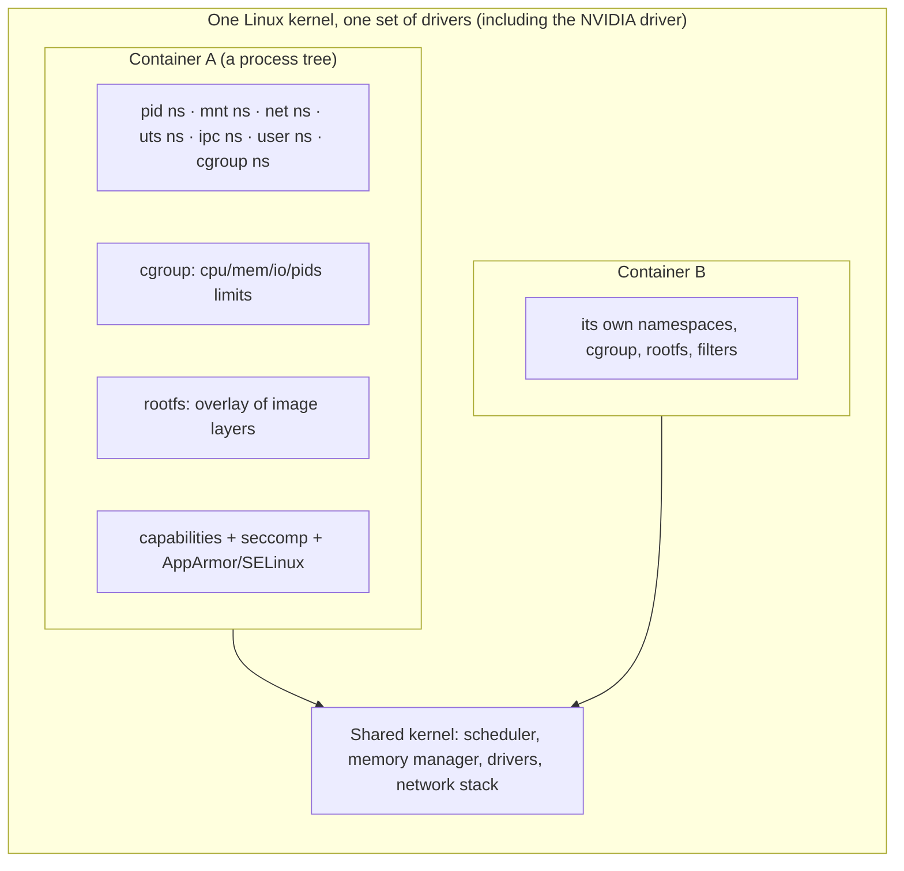
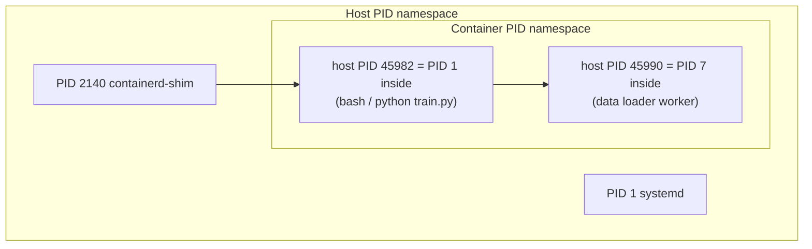
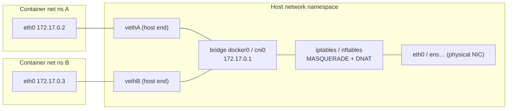
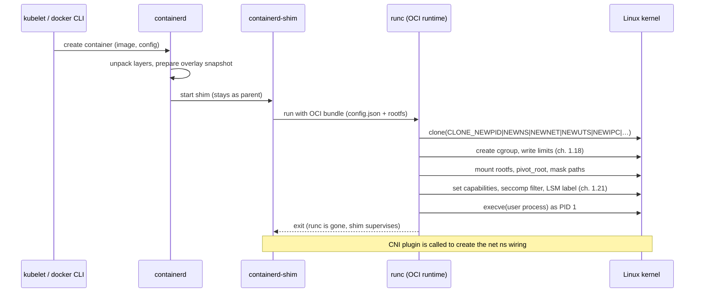

# 1.19 Namespaces: the kernel feature behind containers

| | |
|---|---|
| Level | Intermediate |
| Priority tier | 0 |
| Lab venue | GCP / GKE (an Ubuntu VM; root needed) |
| Part | Part 1: Linux, from the command line to the kernel and performance |
| Status | Drafted, labs **untested** |

## Why this matters for AI infrastructure

Almost every AI workload on a modern cluster runs in a container: a Kubernetes pod, an Enroot/Pyxis container under Slurm, a Docker image on a developer box. If you do not know what a container *is* at the kernel level, you cannot debug it. Typical failures all trace back to this chapter:

- A training script started with `bash -c` never checkpoints on `SIGTERM` because it is PID 1 of a PID namespace and the kernel gives PID 1 no default signal actions.
- `nproc`, `free` and `top` inside a pod show the **host's** 128 CPUs and 2 TiB while the cgroup allows 8 CPUs and 64 GiB.
- Two pods on the same node cannot use shared memory (NCCL SHM, MPI) between them because their IPC namespaces differ.
- A pod loses its network, or `hostNetwork: true` changes how InfiniBand and NCCL behave.
- File ownership on NFS or Lustre is wrong because user namespaces remap UIDs.
- An image-layer write of a multi-gigabyte file fills `/var/lib/containerd` (overlayfs copy-up).
- Security reviews ask "is this container privileged? does it share the host PID namespace? is the user namespace remapped?"

Chapter 1.18 explained *limiting* what a process can use (cgroups). This chapter explains *limiting what it can see*: **namespaces**. Together with a root filesystem, capabilities and seccomp (chapter 1.21), they are what a container is. Chapter 1.20 puts them together in a hands-on lab that builds a container by hand.

## Prerequisites and outcomes

You should know processes and signals (1.8), the mount/filesystem model (1.12), kernel interfaces (1.10), and cgroups (1.18). Networking details used here (bridges, veth, NAT) are developed fully in Part 2; this chapter gives just enough.

After this chapter you can:

- State precisely what a container is and is not: a process (tree) with a set of namespaces, a cgroup, a root filesystem, a reduced privilege set, all sharing the host kernel.
- List the eight namespace types, what each isolates, and the system calls that create or join them (`clone`, `unshare`, `setns`).
- Inspect a process's namespaces (`/proc/PID/ns`, `lsns`, `nsenter`) and create your own (`unshare`).
- Explain PID namespace semantics (PID 1 behaviour, zombie reaping, signal rules), mount namespaces and propagation, `chroot` versus `pivot_root`, and OverlayFS layers, copy-up and whiteouts.
- Explain network namespaces, veth pairs, bridges and NAT, and how pods share namespaces.
- Explain user namespaces, UID mapping, rootless containers and their limitations.
- Compare containers, VMs and lightweight (micro)VMs and know the isolation, performance and observability trade-offs.
- Identify and avoid the common pitfalls: host-view tools inside containers, PID 1 handling, large writes to the image layer, tracing limitations.

## 1. A container is not a kernel object

The Linux kernel has **no object called a container**. A "container" is user-space tooling (Docker, containerd with runc, Podman, LXC, Enroot) that composes several independent kernel features:

| Feature | What it controls | Chapter |
|---|---|---|
| **Namespaces** | What the process *sees* (processes, mounts, network, hostname, IPC, users, cgroup view, clocks) | this one |
| **cgroups** | What the process may *use* (CPU, memory, I/O, PIDs, devices) | 1.18 |
| **Root filesystem** | Its own `/` (an image unpacked or overlaid, entered with `pivot_root`) | this one |
| **Capabilities, seccomp, LSMs** | What it may *do* (privileged operations, system calls, files by label/profile) | 1.21 |



Gregg's way of putting it: the kernel keeps a pointer (`struct nsproxy`) from each task to its namespaces; that structure is the closest thing the kernel has to a "container". Because the kernel is shared, a container starts in milliseconds, uses no guest-kernel memory, has no virtualisation overhead on CPU or memory, and calls the GPU driver natively. The price: all containers contend for the same kernel locks, caches and queues (noisy neighbours), a kernel bug or panic affects every container, guests cannot load their own kernel modules or run a different kernel, and isolation is weaker than hardware virtualisation because the attack surface is the whole system-call interface.

History in one paragraph: `chroot` (Unix V7, 1979) changed a process's idea of `/`; FreeBSD jails (1998) and Solaris Zones (2005) added whole-system partitioning; Linux added mount namespaces in 2.4.19 (2002) and then, over many releases, the other namespace types; cgroups arrived in 2.6.24 (2008); LXC (2008) and Docker (2013) packaged these; the OCI specification standardised the image and runtime format; Kubernetes (2014) became the orchestrator.

## 2. The namespace types

A **namespace** wraps a global system resource so that processes inside it see their own isolated instance. Changes inside are visible only to members. Every process is always in exactly one namespace of each type (initially the host's "init" namespaces).

| Namespace | Clone flag | Isolates | Notes |
|---|---|---|---|
| **mnt** | `CLONE_NEWNS` | Mount points (the filesystem tree as seen) | First namespace (2002), hence the odd flag name |
| **pid** | `CLONE_NEWPID` | Process ID numbering and visibility (`/proc` content) | First process is PID 1 inside; nests hierarchically |
| **net** | `CLONE_NEWNET` | Network devices, IP addresses, routes, firewall rules, sockets, ports, `/proc/net` | A new one has only a down `lo` |
| **uts** | `CLONE_NEWUTS` | Hostname and NIS domain name (`uname`) | "UNIX Time-sharing System" |
| **ipc** | `CLONE_NEWIPC` | System V IPC objects and POSIX message queues | Shared memory segments (`shmget`) |
| **user** | `CLONE_NEWUSER` | UID/GID number space, capabilities | Root inside can be an unprivileged user outside |
| **cgroup** | `CLONE_NEWCGROUP` | The view of the cgroup hierarchy root | Container sees its own cgroup as `/` |
| **time** | `CLONE_NEWTIME` | `CLOCK_MONOTONIC`/`CLOCK_BOOTTIME` offsets | Added in Linux 5.6; rarely used |

Three system calls do all the work:

- **`clone(2)`** (and `clone3`) creates a new process, optionally in new namespaces (`CLONE_NEW*` flags). This is how runtimes start a container's first process.
- **`unshare(2)`** moves the *calling* process into new namespaces (for PID namespaces, only its *future children* enter the new one). The `unshare(1)` command wraps it.
- **`setns(2)`** joins an *existing* namespace through a file descriptor from `/proc/PID/ns/*`. `nsenter(1)` wraps it, and `docker exec`/`kubectl exec` are essentially "setns into the container's namespaces and exec a program".

A namespace lives as long as something references it: a process in it, an open file descriptor to `/proc/PID/ns/xxx`, or a bind mount of that file (which is how `ip netns` keeps named network namespaces under `/run/netns` alive with no process).

### Inspecting namespaces

```bash
ls -l /proc/$$/ns/                     # symlinks like net:[4026531992]; the number is the namespace inode
readlink /proc/$$/ns/net               # compare two processes: same number = same namespace
lsns                                   # list all namespaces, number of processes, first process
lsns -t net                            # only network namespaces
sudo lsns -p 1234                      # the namespaces of PID 1234
sudo nsenter -t 1234 -n ip addr        # run `ip addr` in PID 1234's network namespace
sudo nsenter -t 1234 -m -u -i -n -p /bin/sh   # approximately what `docker exec` does
cat /proc/self/uid_map /proc/self/gid_map     # user namespace mappings (see section 6)
cat /proc/sys/user/max_user_namespaces        # per-user limits (user.max_*_namespaces)
```

Practical debugging recipe for Kubernetes: find the container's host PID (`crictl inspect <id> | grep -i pid`, or `docker inspect -f '{{.State.Pid}}'`), then `nsenter -t PID -n` to run host tools (tcpdump, ss, ethtool) *inside the pod's network namespace* even when the image has no such tools. This is one of the most useful skills in this chapter.

## 3. PID namespaces

A PID namespace gives its members a private PID numbering. The first process in it is **PID 1**; it sees only itself and its descendants in `/proc` (once `/proc` is mounted from inside that namespace). The same process has *different PIDs in different namespaces*: PID 1 in the container may be PID 45982 on the host. PID namespaces nest: a parent namespace sees all descendants (with its own numbers); a child sees nothing above it.



Special behaviour of PID 1 (the "init" of the namespace):

1. **No default signal actions.** Signals sent *from inside the namespace* to PID 1 are only delivered if PID 1 installed a handler for them; `SIGKILL` and `SIGSTOP` from inside are ignored. From the parent namespace they work (that is how `docker stop`, `kubectl delete pod` and the kubelet's `SIGTERM` then `SIGKILL` reach it). Consequence: a shell script as PID 1 that installed no `SIGTERM` handler ignores the termination request; the runtime waits out the grace period (30 s in Kubernetes by default) then sends `SIGKILL`. A training job loses its chance to checkpoint. Use `exec python train.py` as the script's last command so the program itself becomes PID 1 and installs its own handler, or use a tiny init (`tini`, `docker run --init`, `dumb-init`, Kubernetes `shareProcessNamespace`).
2. **Reaping orphans.** Orphans in the namespace are re-parented to PID 1, which must call `wait()`; if it does not, zombies accumulate (eventually exhausting the PID limit, chapter 1.18 `pids.max`). Real init programs reap; application PID 1s often do not (chapter 1.8 zombies).
3. **When PID 1 exits, the kernel kills every other process in that namespace** (`SIGKILL`), and the namespace becomes unusable for new forks. This is why a container dies when its main process dies.

`unshare --pid` only affects *children*: to have the shell itself be PID 1 use `--fork`. Also `/proc` is a mount; after creating a PID namespace you must mount a fresh `proc` (`mount -t proc proc /proc`, or `unshare --mount-proc`) in a mount namespace, otherwise tools like `ps` still show the host's view.

Kubernetes ties these together: the pod's `pause` (infra) container holds the pod's shared namespaces; with `shareProcessNamespace: true` all containers in the pod share one PID namespace and `pause` runs as PID 1 and reaps zombies. `hostPID: true` puts the pod in the **host** PID namespace (needed for some profilers and node agents, and a strong security exposure).

## 4. Mount namespaces, root changes and OverlayFS

### Mount namespaces and propagation

A new mount namespace starts with a **copy** of its parent's mount table. Later mounts and unmounts inside do not affect the other namespace, subject to **propagation flags** on each mount point:

| Flag | Meaning |
|---|---|
| `shared` | Mount/unmount events propagate to and from peer mounts |
| `slave` | Receives events from the master, sends none |
| `private` | No propagation either way |
| `unbindable` | Private and cannot be bind-mounted |

`systemd` makes `/` shared by default, so a naive new mount namespace can leak mounts back to the host; container runtimes therefore remount the root `rslave` or `rprivate` first (`unshare --propagation private` or `mount --make-rprivate /`). Kubernetes `mountPropagation: HostToContainer` (rslave) lets a pod see mounts created later on the host (CSI drivers rely on this); `Bidirectional` (rshared) lets the container create mounts visible on the host and needs privileged mode. Inspect with `findmnt -o TARGET,PROPAGATION` and `cat /proc/self/mountinfo` (optional fields show `shared:N`, `master:N`).

### chroot versus pivot_root

`chroot(2)` changes a process's root directory but keeps the old root reachable through open file descriptors or by `fchdir` tricks if the process has root privilege; it is a convenience, not a security boundary. Container runtimes instead create a mount namespace, set up the new root, and call **`pivot_root(2)`**, which swaps the root mount and lets the old root be unmounted and detached completely. The sequence for a minimal container: new mount namespace → make mounts private → bind-mount the new rootfs on itself → mount `proc`, `sysfs` (read-only), `tmpfs` for `/dev`, device nodes → `pivot_root` into it → unmount the old root → drop capabilities → exec the program. Sensitive host paths (`/proc/kcore`, `/sys/firmware`, parts of `/proc/sys`) are masked or read-only (the "masked paths" in the OCI spec).

### OverlayFS: images as layers

A container image is an ordered stack of **read-only layers** (each a tar of filesystem changes, content-addressed by hash). To run a container the runtime mounts them with **OverlayFS**, a union filesystem built into the kernel:

- `lowerdir=` one or more read-only directories (the image layers; colon-separated, **leftmost is topmost**);
- `upperdir=` the read-write layer, initially empty, where all changes land;
- `workdir=` an empty scratch directory on the same filesystem as `upperdir`, used for atomic operations;
- the **merged** view is what the container sees as `/`.

```bash
mkdir -p lower1 lower2 upper work merged
echo "from layer 1" > lower1/a.txt ; echo "from layer 2" > lower2/a.txt ; echo only-in-2 > lower2/b.txt
sudo mount -t overlay overlay -o lowerdir=lower2:lower1,upperdir=upper,workdir=work merged
cat merged/a.txt                  # "from layer 2": upper layers hide lower ones
echo changed > merged/a.txt       # copy-up: file copied to upper, then modified
ls upper                          # a.txt now exists in upper; lower1/lower2 unchanged
rm merged/b.txt ; ls -l upper/b.txt   # a whiteout: a character device 0/0 hides the lower file
mount | grep overlay              # compare with a running container's root: docker run --rm alpine mount | head -1
```

Key behaviours:

- **Copy-up**: the first write to a file that lives in a lower layer copies the *entire file* to the upper layer (metadata-only changes copy only metadata on modern kernels with `metacopy`). A training job that appends to a multi-GB file baked into an image, or a database in the image layer, triggers a huge copy, doubles disk use, and can fill the node's image storage (`/var/lib/containerd` or `/var/lib/docker`), causing evictions and `NodeNotReady`. **Mutable and large data belongs in volumes** (bind mounts, `emptyDir`, hostPath, PVCs), which bypass overlay completely.
- **Whiteouts**: deleting a lower file creates a 0/0 character device (or an opaque-directory xattr for removed directories) in the upper layer; the lower data remain on disk. Deleting a file in a later Dockerfile layer **does not shrink the image**: the earlier layer still holds the bytes, which is why secrets baked into a layer and "deleted" later remain extractable.
- **Performance**: metadata-heavy operations (`stat`, `readdir`) cost more through overlay; random I/O on the image layer is slower than on a raw filesystem. Cache layers (e.g. package caches) should be volumes; model weights and datasets should be mounted, not copied into images. The Gregg book shows a kernel stack where a container write goes through `ovl_write_iter` before reaching XFS: the filesystem below matters (overlayfs needs `d_type` support; XFS needs `ftype=1`).
- **Page cache sharing**: containers from the same image share lower-layer files and their page cache, saving memory relative to VMs.
- **Rootless mode** uses `fuse-overlayfs` on older kernels (slower); kernel 5.11+ allows unprivileged overlay mounts inside user namespaces.
- Other storage drivers exist (`btrfs`, `zfs`, `devicemapper`, containerd snapshotters including `stargz` lazy-pulling); on Kubernetes nodes overlayfs through containerd's snapshotter is the norm.

Image *build* notes (Docker/OCI, `HLW` Section 17.2): each `RUN`/`COPY` step creates a layer. For example, in `HLW` Section 17.2.2, building a 3-line `Dockerfile` (`FROM alpine:latest`, `RUN apk update && apk add bash`, `CMD ["/bin/bash"]`) with `docker build -t hlw_test .` sends a `2.048kB` build context to the Docker daemon, pulls `alpine:latest` (`f70734b6a266`, `5.61MB`), runs `apk add bash` inside an intermediate container (`fb082e6a0728`), and commits the final image `hlw_test:latest` (`1b64f94e5a54`, `9.19MB`). Inside the running container (`docker run -it hlw_test`), `mount` shows `/` mounted as `overlay on / type overlay (rw,relatime,lowerdir=/var/lib/docker/overlay2/l/...,upperdir=/var/lib/docker/overlay2/.../diff,workdir=/var/lib/docker/overlay2/.../work)`. Combine Dockerfile steps and use multi-stage builds to keep build tools out of the final image; pin base image tags or digests (`latest` is not reproducible); an image's `ENTRYPOINT`/`CMD` define PID 1 (use the exec form `["python","train.py"]`, not shell form, so there is no wrapping `sh`). Docker keeps stopped containers and old images by default: `docker ps -a`, `docker images`, `docker rmi`, `docker system df`, `docker system prune` (with care).

## 5. Network namespaces

A new network namespace contains nothing but a loopback interface in the DOWN state: no devices, routes or firewall rules. It has its own IP addresses, routing tables, ARP table, `iptables`/`nftables` rules, sockets and port space (two containers can both listen on port 80), and its own `/proc/net`. Moving a physical or virtual interface into a namespace removes it from the original one.

The standard way to connect it is a **veth pair**: a virtual Ethernet cable whose two ends are separate interfaces. One end stays in the host namespace and is attached to a **bridge** (`docker0`, `cni0`, or a CNI plugin's equivalent) or routed; the other is moved into the container's namespace and renamed `eth0` with an address. Traffic leaving the host to the outside is typically **NAT**ed (masquerade) by iptables/nftables, and published ports are DNAT rules.



```bash
sudo ip netns add demo                              # named network namespace (bind-mounted under /run/netns)
sudo ip link add vethH type veth peer name vethC    # a veth pair in the host namespace
sudo ip link set vethC netns demo                   # move one end in
sudo ip addr add 10.9.0.1/24 dev vethH && sudo ip link set vethH up
sudo ip netns exec demo ip addr add 10.9.0.2/24 dev vethC
sudo ip netns exec demo ip link set vethC up ; sudo ip netns exec demo ip link set lo up
sudo ip netns exec demo ping -c2 10.9.0.1
sudo ip netns exec demo ip route add default via 10.9.0.1        # then enable forwarding + NAT on the host
ip -br link ; sudo ip netns exec demo ip -br link
sudo ip netns del demo
```

Variants you will meet:

- **Pod networking in Kubernetes**: all containers of a pod share one network namespace (created by the pause container); a **CNI plugin** (Calico, Cilium, Flannel, and so on) creates the veth, assigns the pod IP and installs routes or tunnels. `hostNetwork: true` puts the pod in the *host's* namespace (no isolation; used by node agents and sometimes by performance-sensitive jobs).
- **Docker modes**: `bridge` (default), `host`, `none`, `container:<id>` (join another container's namespace), `macvlan`/`ipvlan` (give the container an address directly on the physical network).
- **Rootless Podman** cannot create veth pairs without privilege, so it uses a user-space TCP/IP stack (`slirp4netns` or `pasta`): lower throughput and containers cannot reach each other the same way.
- **High-performance fabrics**: SR-IOV virtual functions or RDMA devices can be moved into a container's namespace (Multus, SR-IOV CNI, `rdma-shared-device-plugin`); RDMA in containers needs the right device files, the host IB stack and, with shared-mode RDMA, the RDMA subsystem's own namespace mode (`rdma system set netns exclusive|shared`). `hostNetwork` is frequently used with NCCL over InfiniBand to avoid NAT and the CNI path. Details in Parts 2, 8 and 9.
- **Tracing**: `ss`, `tcpdump`, `ethtool` can be run from the host with `nsenter -t PID -n` or `ip netns exec`.

## 6. User namespaces, UID mapping and rootless containers

A user namespace has its own UID/GID number space and **its own capability set**. The kernel keeps a mapping table (`/proc/PID/uid_map`, `gid_map`: `inside_start outside_start length`). Process "root" (UID 0) in the namespace can be UID 100000 on the host, so even if it escapes the container it is an unprivileged user outside. Inside, it has capabilities **only over resources owned by that namespace** (it can mount in its own mount namespace, configure its own network namespace) but not over the host. Hence an unprivileged user can create a user namespace and, within it, other namespaces: this is the basis of **rootless containers** (Podman, rootless Docker, Enroot, Apptainer/Singularity in user-namespace mode).

```bash
unshare --user --map-root-user bash        # become "root" inside, mapped to your UID outside
id; cat /proc/self/uid_map                 # uid 0 inside = your uid outside
touch /root-owned 2>&1                     # no real privilege: fails on host-owned paths
exit
cat /etc/subuid /etc/subgid                # subordinate ID ranges allotted to each user (newuidmap/newgidmap)
```

The trade-offs matter for HPC/AI: files on shared storage (NFS, Lustre, GPFS, BeeGFS) are owned by real UIDs, and ID-mapped access through a user namespace can break ownership, permissions and quotas; kernel features like ID-mapped mounts (5.12+) and filesystem support vary. That is why many clusters run containers as the real user (Enroot/Pyxis, Apptainer's setuid or "fakeroot" modes) or as privileged/root containers with security profiles (AppArmor, SELinux, seccomp; chapter 1.21) rather than user-namespace remapping. Kubernetes user-namespace support (`hostUsers: false`) is newer and feature-gated; verify its status for your version. User namespaces also enlarge the kernel attack surface, so some distributions restrict unprivileged creation (`kernel.unprivileged_userns_clone`, Ubuntu's AppArmor restriction in recent releases; flag: check your distribution).

## 7. UTS, IPC, cgroup and time namespaces

- **UTS**: the container has its own hostname (`hostname`, `uname -n`); Kubernetes sets it to the pod name. Changing it inside does not affect the host. Gregg notes the UTS nodename is a convenient container identifier for BPF tools.
- **IPC**: System V shared memory, semaphores and message queues, plus POSIX message queues, are namespaced. **Containers in different IPC namespaces cannot share SysV segments.** Within a pod all containers share the IPC namespace by default (`hostIPC: true` joins the host's). NCCL, MPI and PyTorch data-loader workers use shared memory heavily: PyTorch's `DataLoader` uses `/dev/shm` (tmpfs; Docker defaults it to 64 MiB, a classic cause of "bus error" crashes in containers: raise it with `--shm-size`, `--ipc=host` or an `emptyDir` with `medium: Memory`). MPI ranks in *separate pods* on the same node fall back to network paths because they do not share IPC.
- **Cgroup namespace**: makes `/proc/self/cgroup` and `/sys/fs/cgroup` show the container's cgroup as the root (`0::/`), hiding the host's cgroup path layout. It changes the *view*, not the limits (chapter 1.18).
- **Time namespace**: per-container offsets of the monotonic and boot clocks (not wall time); used for checkpoint/restore (CRIU) migration.

## 8. Putting it together: what a runtime does

When `docker run` or the kubelet asks containerd/runc to start a container, the sequence (simplified) is:



The **OCI runtime spec** (`config.json`) lists every namespace, mount, capability, cgroup path and hook; `runc spec` generates a template, and reading a real container's `config.json` is the best way to learn what your platform configures. The **shim** keeps the container's stdio and exit status after `runc` exits, so containerd can restart without killing containers.

## 9. Containers, VMs and lightweight VMs

| | Hardware VM (KVM/QEMU) | Container | MicroVM (Firecracker, Kata) | User-space kernel (gVisor) |
|---|---|---|---|---|
| Kernel | Own guest kernel | Shared host kernel | Own minimal guest kernel | Go "kernel" intercepting syscalls |
| Isolation | Strong (hardware, small VMM interface) | Weaker (whole syscall surface, kernel bugs) | Strong, with hardware boundary | Medium, high overhead for syscall-heavy loads |
| Start time | Seconds | Milliseconds | About 100 to 200 ms | Milliseconds |
| Memory overhead | Hundreds of MiB (guest kernel, QEMU) | Near zero | Few MiB (Firecracker) to tens of MiB (Kata) | Moderate |
| Observability | Guest has its own `/proc`, tracing works inside | Tools inside often show **host** statistics; tracing mostly blocked | Like VMs | Limited |
| GPU access | Passthrough (VFIO) or vGPU/MIG | Native driver access via device nodes | Passthrough possible but complex | Limited |
| Typical use | Cloud instances, isolation of tenants | Microservices, ML jobs, CI | Serverless, multi-tenant sandboxes, Kata for strong pod isolation | Sandboxing untrusted code |

Rules of thumb: AI clusters run containers on bare metal or VM nodes because they need the GPU driver, RDMA and local storage natively; multi-tenant providers (neoclouds like CoreWeave, Nebius) often wrap customer workloads in VMs or Kata/KubeVirt for tenant isolation while still passing GPUs through; MIG and vGPU partition a physical GPU for sharing (Part 7). Virtualisation internals (VT-x, EPT, virtio, VFIO) are chapters 1.26 and 1.27.

## 10. Observing containers (and the traps)

Containers hide and distort information:

- **Tools inside a container often show host data.** `top` summary lines, `uptime`/load average, `mpstat`, `vmstat`, `free`, `iostat`, and `/proc/cpuinfo`, `/proc/meminfo`, `/proc/stat` report the **host**, because `/proc` and `/sys` statistics are not namespaced. An idle container can show busy disks and CPU that belong to other tenants. Per-process tools (`ps`, `pidstat`) are filtered by the PID namespace. Use the container's **cgroup files** (`cpu.stat`, `memory.current`, `memory.events`, `io.stat`, PSI) for its true usage and limits (chapter 1.18). `lxcfs` can present cgroup-aware `/proc` files.
- **Limits are checked first.** Gregg's strategy: software resource-control limits are hit long before hardware limits, so check cgroup limits and throttling before blaming hardware; most traditional tools (`top`, `iostat`) are blind to them.
- **From the host everything is visible**: container processes appear in the host `ps` with host PIDs; map a PID to a container with `/proc/PID/cgroup` (the container ID is in the path), `crictl ps`/`docker ps`, `nsenter`. There is no container ID in the kernel; BPF tools use the cgroup ID or the UTS nodename.
- **Tracing from inside a container is mostly blocked**: `perf`, `bpftrace`, `strace`(ptrace) need capabilities (`SYS_ADMIN`, `PERFMON`, `BPF`, `SYS_PTRACE`) and access to `/sys/kernel/debug`; container seccomp profiles block `perf_event_open`, `bpf`, `ptrace` by default. Operators trace from the host or use debug containers/ephemeral containers (`kubectl debug`) sharing the target's PID namespace.
- **Noisy neighbours**: contention on shared kernel resources (dentry cache, locks, interrupts, CPU caches) can slow a container without any limit being hit; the diagnosis requires host-side tools.

## 11. GPUs inside containers

Nothing in the namespace/cgroup set knows about GPUs. A GPU appears to a process as **device nodes** (`/dev/nvidia0..N`, `/dev/nvidiactl`, `/dev/nvidia-uvm`, `/dev/nvidia-uvm-tools`, `/dev/nvidia-modeset`; `/dev/nvidia-caps/*` for MIG) plus **user-space libraries** (`libcuda.so`, NVML, and so on) that must match the *host kernel driver version*. To give a container a GPU, a runtime must (1) make the device nodes exist in the container's mount namespace (bind or `mknod`), (2) allow them in the devices cgroup (chapter 1.18), and (3) mount the driver's user-space libraries and binaries (`nvidia-smi`) from the host into the container, since the CUDA *toolkit* libraries can live in the image but the driver library cannot. The **NVIDIA Container Toolkit** (`nvidia-container-runtime`, `nvidia-ctk`, `libnvidia-container`) automates this, historically through an OCI prestart hook and now preferably via **CDI** (Container Device Interface: a declarative spec file listing device nodes, mounts and environment, `nvidia-ctk cdi generate`). Because the driver is in the shared kernel, GPU performance in a container equals bare metal. Chapters in Parts 7 and 8 cover the toolkit, the Kubernetes device plugin, GPU Operator, MIG and time-slicing in depth; flag: verify toolkit commands and CDI behaviour against current NVIDIA documentation.

## 12. Other flavours of "virtual"

- **LXC/LXD/Incus**: system containers that run a whole init and multiple services; more manual (you set up the network, UID mappings), closer to a lightweight VM in spirit. The first Docker versions were built on LXC.
- **Podman**: daemonless, rootless-first, Docker-compatible CLI; containers are children of the invoking process tree (or systemd units via Quadlet).
- **Enroot + Pyxis (Slurm)**: NVIDIA's HPC container path: unprivileged, converts images to a squashfs unpacked into a directory, uses `unshare`-style namespaces without a daemon, and integrates with Slurm via the Pyxis plugin (`srun --container-image`). Apptainer/Singularity is the other HPC runtime. Covered in the Slurm chapters.
- **Language-level environments** (Python `venv`, conda, `nvm`, `HLW` Section 17.4) are not isolation in the kernel sense: running `python3 -m venv test-venv` creates a directory with system-like subdirectories (`bin`, `include`, `lib`), and sourcing `. test-venv/bin/activate` (not executing it) changes search paths (`PATH`, `sys.path`, `VIRTUAL_ENV`) in the current shell so a program sees different library sets (`deactivate` restores the shell). Useful for resolving conflicting Python package dependencies on a shared host, but they share nothing with kernel namespaces.
- **Pitfalls of containers** (Ward): wasted storage from big base images and writable layers; you still need a real Linux host and its maintenance; resource limits do not create capacity; ephemeral filesystems require a plan for data and logs; most tooling targets web services, not HPC; careless builds produce bloat and fragility; `latest` tags break reproducibility; image provenance and supply-chain trust must be managed; containers do not make slow startup faster.

## 13. Failure modes and diagnosis

| Symptom | Likely cause | Check / fix |
|---|---|---|
| Pod ignores `SIGTERM`, killed after 30 s, no checkpoint | Shell wrapper or non-handling program is PID 1 | `exec` in entrypoint, `tini`/`--init`, handle `SIGTERM` in the program; raise `terminationGracePeriodSeconds` for large checkpoints |
| Zombie processes pile up, `fork: retry` | PID 1 does not reap; `pids.max` reached | Use an init; check `ps -eo stat \| grep Z`, `cgroup pids.current` |
| `free`/`nproc` show host values, app oversizes thread pools | `/proc` not namespaced | Read cgroup limits; set thread counts explicitly; `lxcfs`; limit-aware runtimes |
| PyTorch "bus error" / DataLoader hangs in container | `/dev/shm` too small (64 MiB default in Docker) | `--shm-size`, `--ipc=host`, memory-backed `emptyDir` |
| Cannot see/mount new host mounts inside container | Mount propagation `private` | Use `HostToContainer` (`rslave`) |
| Node disk full under `/var/lib/containerd` | Large writes to writable layer, stopped containers, unused images, logs | `crictl images`, `du`, move data to volumes, image GC thresholds, log rotation |
| Same image works as root, fails as non-root | UID mapping, file ownership of volumes | `id` inside vs outside, `fsGroup`, user namespace mappings, `/etc/subuid` |
| `Operation not permitted` for `mount`, `ip`, `sysctl` | Missing capability or seccomp/LSM block | Chapter 1.21; do not "fix" with `--privileged` without review |
| `nvidia-smi` fails inside container: "driver/library version mismatch" | Container has own libcuda not matching host driver, or toolkit hook missing | Let the toolkit inject host driver libs; do not bake driver libs in images |
| GPU visible on host, not in container | Device nodes not in container / devices cgroup denies / runtime not configured | `ls -l /dev/nvidia*` in container, runtime class, CDI spec, cgroup driver match (1.18) |
| Pod-to-pod traffic works across nodes but not on the same node (or vice versa) | CNI, bridge netfilter, MTU, hairpin | `nsenter -t PID -n ip route; ss; tcpdump`, check `br_netfilter` sysctls |
| `Cannot create user namespace` | Disabled by policy/sysctl, `user.max_user_namespaces=0` | Distribution policy; AppArmor restriction on Ubuntu |
| Mount leaks onto the host | Shared propagation on root | `--make-rprivate`; verify with `findmnt -o PROPAGATION` |

A generic top-down method for "something is wrong inside a container": (1) can the process start (image pull, rootfs, entrypoint exit code, `crictl ps -a`, `kubectl describe pod`, events)? (2) are limits hit (cgroup `memory.events`, `cpu.stat` throttling, `pids`)? (3) what does the container see (mounts, network, user, devices)? (4) what does the host see for the same PID (`nsenter`, host-side `strace`/`perf`)? (5) what is shared with neighbours (kernel, devices, NIC, disks)?

## 14. Hands-on lab: explore and build with namespaces

First, run the self-checking Python lab (`code/part01/namespaces_containers_lab.py`) locally. It verifies the 8 Linux namespace types and `clone(2)` flags, PID 1 in-namespace vs parent-namespace signal delivery (`SIGTERM` and `SIGKILL`), OverlayFS `lowerdir`/`upperdir`/whiteout (`0, 0`) lookup resolution and `4 GiB` copy-up byte accounting, and user-namespace `uid_map` translation.

```bash
python3 code/part01/namespaces_containers_lab.py
```

Next, on a disposable Ubuntu 22.04+ VM with `root` (all interactive VM commands below are `untested here`; a full container is assembled in Chapter 1.20), work through these steps:

1. **Inspect**: `ls -l /proc/$$/ns`, `lsns`. Start `docker run -d --name nsdemo alpine sleep 600` (if Docker is installed), get its PID with `docker inspect -f '{{.State.Pid}}' nsdemo`, then `sudo ls -l /proc/<PID>/ns` and compare inode numbers with the host shell: which are the same, which differ? (With default settings `user` should be the same; `mnt`, `pid`, `net`, `ipc`, `uts`, `cgroup` differ.)
2. **UTS**: `sudo unshare --uts bash -c 'hostname lab-box; hostname'`, then `hostname` in your original shell.
3. **PID**: `sudo unshare --pid --fork --mount-proc bash`; run `ps aux`, `echo $$`; from another terminal find that shell's host PID (`pgrep -f 'unshare --pid'` then `pstree -p`) and note the two PIDs. Try `kill -9 1` inside (nothing happens), then `kill -9 <host PID>` from outside.
4. **PID 1 signals**: in the PID namespace run `sh -c 'sleep 1000'` as PID 1 (`sudo unshare --pid --fork --mount-proc sh -c 'sleep 1000'`), try `kill -TERM` from outside (host PID) vs from a second process inside; then use `exec sleep 1000` vs a script with `trap 'echo got TERM; exit' TERM`.
5. **Mount**: `sudo unshare --mount bash`; `mkdir /tmp/m && mount -t tmpfs tmpfs /tmp/m && touch /tmp/m/x && findmnt /tmp/m`; open another host shell and look: not visible. Repeat with `mount --make-rshared /` first and a bind mount to see propagation (use `findmnt -o TARGET,PROPAGATION`).
6. **Overlay**: run the OverlayFS commands in section 4; inspect `upper/` after writing and deleting; examine a whiteout with `ls -l`.
7. **Network**: follow the `ip netns` + veth recipe in section 5; ping both directions; then add `iptables -t nat -A POSTROUTING -s 10.9.0.0/24 -j MASQUERADE` and `sysctl -w net.ipv4.ip_forward=1` to give the namespace Internet access. Delete the namespace afterwards.
8. **User**: `unshare --user --map-root-user bash`; view `id`, `/proc/self/uid_map`; try to read `/etc/shadow` and to `mount -t tmpfs` (works only if combined with `--mount`).
9. **Enter an existing container's namespaces**: `sudo nsenter -t <PID> -n -p -m ip addr; sudo nsenter -t <PID> -n ss -tlnp`.
10. **IPC**: `ipcmk -M 1024` on the host; `ipcs -m`; then `sudo unshare --ipc ipcs -m`: it is invisible. Compare with `docker run --ipc=host`.
11. **Clean up**: `docker rm -f nsdemo`; remove `/tmp/m` directories, overlay dirs and namespaces.

## 15. Common mistakes

- Believing a container has its own kernel, or that it is a security boundary equal to a VM.
- Using a shell script as PID 1 without `exec` or an init, losing signals and zombie reaping.
- Trusting `top`, `free`, `/proc/cpuinfo` and `nproc` inside a container.
- Writing datasets, checkpoints or caches into the image layer.
- Deleting files in a later layer and assuming secrets or size are gone.
- Running `--privileged` or `hostPID`/`hostNetwork`/`hostIPC` casually to "make it work".
- Putting two cooperating MPI/NCCL workers in different pods and expecting shared memory.
- Forgetting that user-namespace remapping changes ownership on shared storage.
- Baking driver libraries into images instead of letting the runtime inject them from the host.

## 16. Interview angles

- "What is a container, at the kernel level?" Namespaces + cgroups + rootfs + capabilities/seccomp on a shared kernel; no kernel object.
- "How does `kubectl exec` work?" CRI call to the runtime, which uses `setns` into the container's namespaces and execs.
- "Why does my container ignore SIGTERM?" PID 1 semantics.
- "Explain container networking on a node." Namespace, veth pair, bridge, NAT/CNI; pod shares one network namespace.
- "Containers versus VMs for multi-tenant GPU cloud?" Isolation, GPU passthrough, noisy neighbours, Kata/KubeVirt, MIG.
- "What does OverlayFS do and what is copy-up?"
- "What does `hostNetwork: true` change for NCCL over InfiniBand?"
- "What are user namespaces good for, and why are they hard on HPC storage?"

## Exercises

1. **What a Container Is, the 8 Namespaces, and `clone` / `unshare` / `setns`:** (a) List the 8 Linux namespace types and their `CLONE_NEW*` flags (`NAMESPACE_CLONE_FLAGS` in `code/part01/namespaces_containers.py`), and explain why `mnt` uses `CLONE_NEWNS`; (b) distinguish `clone()`, `unshare()`, and `setns()`, and explain how `kubectl exec` / `docker exec` and `sudo nsenter -t PID -n` use `/proc/PID/ns/*`.
2. **PID Namespace Semantics, PID 1 Signal Rules, and Zombie Reaping:** Using `evaluate_pid1_signal_delivery()`, determine whether PID 1 inside a container receives: (a) `SIGTERM` sent from the host (`docker stop`) when PID 1 is a `bash -c` wrapper with no custom `SIGTERM` handler, (b) `SIGTERM` when PID 1 is `python train.py` (`exec`ed) with a signal handler, (c) `SIGKILL` sent from inside the container, and (d) `SIGKILL` sent from the host after the 30-second grace period.
3. **Mount Propagation, `chroot` vs. `pivot_root`, and OverlayFS Copy-Up / Whiteouts:** (a) Why do container runtimes set root mount propagation to `rprivate` or `rslave` and use `pivot_root(2)` instead of `chroot(2)`? (b) Given `mount -t overlay overlay -o lowerdir=lower2:lower1,upperdir=upper,workdir=work merged`, determine what `cat merged/a.txt` returns when `a.txt` exists in both `lower2` and `lower1`, what happens on disk when a job appends `4 KiB` to a `4 GiB` lower-layer file (`compute_overlay_copy_up_bytes()`), and how a `0, 0` character-device whiteout hides a deleted lower file.
4. **Network Namespaces, `veth` Pairs, Pod Sharing, and `/dev/shm` IPC:** (a) Trace how a `veth` pair connects a container's network namespace to a host bridge (`docker0` / `cni0`), and list which namespaces are shared across all containers in a Kubernetes Pod versus isolated per container; (b) why does PyTorch `DataLoader` crash with `Bus error` (`SIGBUS`) in default Docker containers (`64 MiB` `/dev/shm`), and what are three ways to fix it?
5. **User Namespaces, `uid_map`, and HPC Shared Storage Pitfalls:** Given `/proc/PID/uid_map` containing `0 100000 65536`, calculate the host UID corresponding to container UID `0` and container UID `1000` (`translate_userns_uid()`). Why do HPC/AI clusters using shared NFS, Lustre, or BeeGFS storage typically use Enroot/Pyxis or Apptainer running as the user's real UID rather than remapped rootless user namespaces?
6. **Observability Traps Inside Containers and GPU CDI Injection:** (a) Why do `free`, `top`, `uptime`, `vmstat`, and `nproc` run *inside* a container report the host's 128 CPUs and 2 TiB RAM, and which files inside `/sys/fs/cgroup/` show the container's true usage and limits? (b) State the three steps `nvidia-container-toolkit` / CDI performs to expose a GPU to a container without baking `libcuda.so.1` into the container image.

## Checkpoint questions (20)

<details>
<summary>1. Is there a \"container\" object in the Linux kernel, and how do namespaces and cgroups divide the work?</summary>

No; the closest kernel structure is `struct nsproxy` pointing to a task's namespaces. A container is an ordinary Linux process tree built from **namespaces** (limiting what the process can *see*), **cgroups** (limiting what resources the process can *use*), a **root filesystem** (`OverlayFS` + `pivot_root`), and **capabilities / seccomp / LSMs** (limiting what actions the process can *perform*), all sharing the single host kernel.
</details>

<details>
<summary>2. Name the eight Linux namespace types, their `CLONE_NEW*` flags, and what each isolates.</summary>

(1) `mnt` (`CLONE_NEWNS`): mount table; (2) `pid` (`CLONE_NEWPID`): process ID numbering; (3) `net` (`CLONE_NEWNET`): network devices, IPs, routes, firewall rules, and sockets; (4) `uts` (`CLONE_NEWUTS`): hostname and NIS domain name; (5) `ipc` (`CLONE_NEWIPC`): SysV IPC and POSIX message queues; (6) `user` (`CLONE_NEWUSER`): UID/GID number space and capabilities; (7) `cgroup` (`CLONE_NEWCGROUP`): root view of `/sys/fs/cgroup`; and (8) `time` (`CLONE_NEWTIME`, Linux 5.6+): `CLOCK_MONOTONIC` / `CLOCK_BOOTTIME` offsets.
</details>

<details>
<summary>3. Contrast the three namespace system calls `clone(2)`, `unshare(2)`, and `setns(2)`.</summary>

`clone(2)` creates a new child process placed directly into new namespaces (`CLONE_NEW*`); `unshare(2)` moves the calling process itself into newly created namespaces (except for `CLONE_NEWPID`, where only subsequent children enter the new PID namespace); and `setns(2)` joins an existing namespace specified by an open file descriptor to `/proc/PID/ns/*` (used by `nsenter`, `docker exec`, and `kubectl exec`).
</details>

<details>
<summary>4. How do you inspect which namespaces a process belongs to, and what keeps a namespace alive when all its processes exit?</summary>

Inspect `/proc/PID/ns/*` symlinks (e.g., `net:[4026531992]`, where matching inode numbers mean the same namespace) or run `lsns -p PID`. A namespace remains alive as long as at least one process belongs to it, a process holds an open file descriptor to `/proc/PID/ns/*`, or the namespace file is bind-mounted (as `ip netns add` does under `/run/netns/`).
</details>

<details>
<summary>5. What three special rules apply to `PID 1` inside a PID namespace?</summary>

(1) **Signal immunity for unhandled signals**: PID 1 has no default signal actions—signals sent to PID 1 are ignored unless PID 1 explicitly installs a signal handler (`SIGKILL` and `SIGSTOP` from inside the namespace are ignored completely, though `SIGKILL` from the parent/host namespace kills it); (2) **Orphan reaping**: orphaned processes inside the namespace are reparented to PID 1, which must `wait()` on them to prevent zombie accumulation; and (3) **Namespace teardown**: when PID 1 exits, the kernel sends `SIGKILL` to every remaining process in that PID namespace.
</details>

<details>
<summary>6. Why does a training container started with `ENTRYPOINT ["/bin/sh", "-c", "python train.py"]` ignore `SIGTERM` on `kubectl delete pod`, and how do you fix it?</summary>

`/bin/sh` becomes PID 1 inside the container's PID namespace and does not forward `SIGTERM` to its child `python train.py`, nor does `/bin/sh` exit on `SIGTERM` when running as PID 1; after `terminationGracePeriodSeconds` (`30 s`), kubelet sends `SIGKILL`, aborting the job without saving a checkpoint. Fix it by using the JSON exec form `ENTRYPOINT ["python", "train.py"]`, using `exec python train.py` at the end of a wrapper script, or running `tini` / `--init` as PID 1.
</details>

<details>
<summary>7. Why must `unshare --pid` be combined with `--fork` and `--mount-proc`?</summary>

A process's own PID is fixed at creation, so `unshare(CLONE_NEWPID)` only places *future children* into the new PID namespace (`--fork` forks a child shell as PID 1). Because `ps` and `top` read `/proc`, you must also mount a fresh `proc` instance (`--mount-proc`, which implies a new mount namespace) or `ps` will still list the host's `/proc`.
</details>

<details>
<summary>8. Explain mount propagation modes (`shared`, `slave`, `private`, `unbindable`) and when Kubernetes needs `HostToContainer` (`rslave`).</summary>

`shared` propagates mount and unmount events bidirectionally between peers; `slave` receives mount events from its master without propagating its own mounts back; `private` isolates mount events in both directions; and `unbindable` prevents bind-mounting. Container runtimes default container mounts to `rprivate`/`rslave` so container mounts never leak onto the host, while Kubernetes CSI storage plugins use `mountPropagation: HostToContainer` (`rslave`) so volumes mounted dynamically on the host appear inside running containers.
</details>

<details>
<summary>9. Why do container runtimes use `pivot_root(2)` instead of `chroot(2)`?</summary>

`chroot(2)` only alters the root directory pathname lookup for a process while leaving the host filesystem mounted and reachable via open directory descriptors or root `fchdir` escapes. `pivot_root(2)` inside a private mount namespace swaps the root mount point to the container's new rootfs and allows the old host root mount to be completely unmounted and detached.
</details>

<details>
<summary>10. How does `OverlayFS` combine `lowerdir`, `upperdir`, and `workdir` into `merged`, and in what order are multiple `lowerdir` layers stacked?</summary>

`lowerdir` holds one or more read-only image layers separated by colons (`lowerdir=layer3:layer2:layer1`, where the **leftmost** directory is the topmost read-only layer), `upperdir` is the writable container layer where all modifications go, `workdir` is an empty directory on the same filesystem as `upperdir` used for atomic staging, and `merged` presents the unified `/` view.
</details>

<details>
<summary>11. What are `OverlayFS` copy-up and whiteouts, and why does deleting a file in a later `Dockerfile` `RUN` step not reduce image size or remove secrets?</summary>

On the first write to a file residing in a `lowerdir`, OverlayFS copies the **entire file** up into `upperdir` (**copy-up**), so modifying a multi-GB file baked into an image doubles disk usage and stalls I/O. Deleting a lower-layer file creates a `0, 0` character device (**whiteout**) in `upperdir` that hides the filename in `merged`, while the underlying bytes remain untouched in the read-only lower layer tar archive.
</details>

<details>
<summary>12. How does a `veth` pair and host bridge wire up a container's network namespace, and how do you run host `tcpdump` or `ss` inside a minimal container that lacks networking tools?</summary>

A `veth` pair acts as a virtual patch cable: one end (`eth0`) is placed inside the container's network namespace (`ip link set ... netns`), and the host end is attached to a bridge (`docker0` or `cni0`) with `iptables`/`nftables` NAT. To run host diagnostic tools inside a distroless/minimal container's network namespace, find its host PID (`crictl inspect` or `docker inspect -f '{{.State.Pid}}'`) and run `sudo nsenter -t <PID> -n tcpdump -ni eth0` (or `ss -tlnp`).
</details>

<details>
<summary>13. Which namespaces do containers inside the same Kubernetes Pod share, and what do `hostNetwork: true`, `hostPID: true`, and `hostIPC: true` do?</summary>

By default, all containers in a Kubernetes Pod share the `pause` (sandbox) container's **`net`**, **`ipc`**, and **`uts`** namespaces (and `pid` if `shareProcessNamespace: true`), while each container gets its own **`mnt`** namespace (its own image rootfs). Setting `hostNetwork: true`, `hostPID: true`, or `hostIPC: true` places the pod directly in the host's corresponding namespace.
</details>

<details>
<summary>14. How do user namespaces (`CLONE_NEWUSER`) and `/proc/PID/uid_map` enable rootless containers, and why are they problematic on shared HPC filesystems?</summary>

`/proc/PID/uid_map` maps container UIDs to unprivileged host UIDs (e.g., `0 100000 65536` maps container `root` `UID 0` to host `UID 100000`), granting capabilities only over resources owned by that user namespace. On shared HPC filesystems (`NFS`, `Lustre`, `GPFS`, `BeeGFS`), files are owned by the user's real cluster UID, so remapped subordinate UIDs fail permission and quota checks—which is why `Enroot`/`Pyxis` and `Apptainer` map the user's real UID instead.
</details>

<details>
<summary>15. Why do PyTorch `DataLoader` workers and `NCCL` often crash with `Bus error` (`SIGBUS`) inside Docker containers, and how do you fix it?</summary>

PyTorch `DataLoader` multiprocessing queues and `NCCL` intra-node SHM channels allocate shared memory segments in `/dev/shm` (`tmpfs`), which Docker caps at **`64 MiB`** by default. When a batch exceeds `64 MiB`, writes into the `mmap`ed `/dev/shm` file hit `SIGBUS`. Fix it by passing `--shm-size=16g` (or `--ipc=host`) in Docker, or mounting an `emptyDir` with `medium: Memory` at `/dev/shm` in Kubernetes.
</details>

<details>
<summary>16. Trace the hand-off between `kubelet`/`docker`, `containerd`, `containerd-shim`, and `runc` when starting a container.</summary>

`kubelet` calls `containerd` via CRI; `containerd` unpacks image layers into an OverlayFS snapshot and spawns `containerd-shim`; the shim invokes `runc` with the OCI bundle (`config.json` + `rootfs`); `runc` calls `clone(CLONE_NEW*)`, configures cgroups, mounts, `pivot_root`, capabilities, and seccomp, and `execve()`s the container entrypoint as PID 1; `runc` then exits, leaving the lightweight `containerd-shim` as the parent supervising stdio and exit status.
</details>

<details>
<summary>17. Compare hardware VMs (`KVM`/`QEMU`), OS containers (`runc`), MicroVMs (`Firecracker`/`Kata`), and user-space kernels (`gVisor`).</summary>

Hardware VMs run a full guest kernel with strong hardware (`VT-x`/EPT) isolation and VFIO GPU passthrough at the cost of seconds of boot time and hundreds of MiB of RAM. OS containers share the host kernel with millisecond startup, zero memory overhead, and native `/dev/nvidia*` driver speed, but expose the host syscall surface. MicroVMs (`Firecracker`, `Kata`) boot a minimal guest kernel in `~100–200 ms` with hardware isolation, while `gVisor` intercepts container syscalls in a user-space Go kernel.
</details>

<details>
<summary>18. Why do `top`, `free`, `vmstat`, `iostat`, and `nproc` lie when run inside a container, and what should you read instead?</summary>

`/proc/meminfo`, `/proc/cpuinfo`, `/proc/stat`, and `/proc/diskstats` are **not namespaced** by the kernel, so tools reading them inside a container display the entire host's CPUs, RAM, load average, and disk I/O. Always read the container's cgroup files (`/sys/fs/cgroup/cpu.max`, `cpu.stat`, `memory.current`, `memory.max`, `memory.events`, `io.stat`, and `*.pressure`), or mount `lxcfs`.
</details>

<details>
<summary>19. What three actions must a container runtime (`nvidia-container-toolkit` / CDI) take to give a container access to a GPU, and why must you never bake `libcuda.so.1` into an image?</summary>

The runtime must: (1) expose `/dev/nvidia0..N`, `/dev/nvidiactl`, `/dev/nvidia-uvm`, and `/dev/nvidia-caps/*` in the container's mount namespace, (2) allow those major/minor numbers in the container's devices cgroup, and (3) bind-mount the host's user-space driver libraries (`libcuda.so.1`, `libnvidia-ml.so.1`) and `nvidia-smi`. Baking `libcuda.so.1` into the image causes `driver/library version mismatch` whenever the image runs on a host with a different kernel driver version.
</details>

<details>
<summary>20. How do Python `venv` / `conda` environments (`test-venv/bin/activate`) and HPC runtimes (`Enroot` + `Pyxis`) differ from Docker?</summary>

Python `venv` (`python3 -m venv test-venv` and `. test-venv/bin/activate`) is purely a user-space path manipulation (`PATH`, `VIRTUAL_ENV`, `sys.path`) with zero kernel namespace or cgroup isolation. `Enroot` + `Pyxis` (`srun --container-image=...`) is NVIDIA's daemonless HPC container runtime: it unpacks OCI images into squashfs trees and uses unprivileged user + mount namespaces running as the job's real UID inside Slurm's job cgroup.
</details>

## Sources and review notes

- **Sources read in full:**
  - `how-linux-works-3rd-edition` — Brian Ward, *How Linux Works*, 3rd ed., **Chapter 17: Virtualization** (sections 17.1–17.4: virtual machines and hypervisors, containers vs VMs, Docker and Podman privileges, building an Alpine image `hlw_test:latest` `1b64f94e5a54` `9.19MB` from `alpine:latest` `f70734b6a266` `5.61MB` with `apk update && apk add bash` in intermediate container `fb082e6a0728`, running and inspecting container processes from the host, `/var/lib/docker/overlay2` mount structure, container networking, LXC, Kubernetes, container pitfalls, and runtime-based Python `test-venv` `. test-venv/bin/activate`).
  - `systems-performance-2nd-edition` — Brendan Gregg, *Systems Performance*, 2nd ed., **Chapter 11: Cloud Computing** (section 11.3 OS virtualization: `struct nsproxy`, namespaces and cgroups, `ovl_write_iter` overlayfs write path, overhead, resource controls, observability traps where `/proc/meminfo` and `/proc/cpuinfo` report host metrics, UTS nodename in BPF tools, and section 11.4 lightweight MicroVM virtualization).
  - `nvidia-devops/volume-01/04-linux-systemd-containers-masterclass.md` — migrated the namespace deep dive, `unshare` lab, OverlayFS mechanics, and PID 1 signal handling (cross-referenced with Chapters 1.8, 1.10, 1.12, 1.18, 1.20, 1.21, 1.22, 1.26, and 1.27, plus original study items 21–30).
- **Run here:** `python3 code/part01/namespaces_containers_lab.py` (19 passed, 0 failed).
- **Explicitly labelled inferences:** The `containerd` -> `containerd-shim` -> `runc` sequence diagram, `/run/netns/name` bind mounts, `/dev/shm` `64 MiB` PyTorch `DataLoader` `SIGBUS` diagnosis, `nvidia-ctk` CDI injection, and `Enroot` + `Pyxis` Slurm comparison connect Linux namespaces and OverlayFS to Part 5, Part 6, and Part 7 GPU cluster operations (plus original study items 22, 23, 25, 26, 27, 28, and 29).
- **Not verified on live hardware:** All interactive VM, `unshare`, `nsenter`, `ip netns`, `mount -t overlay`, and `docker` commands are marked (untested here) and must be executed on a disposable Linux VM.
