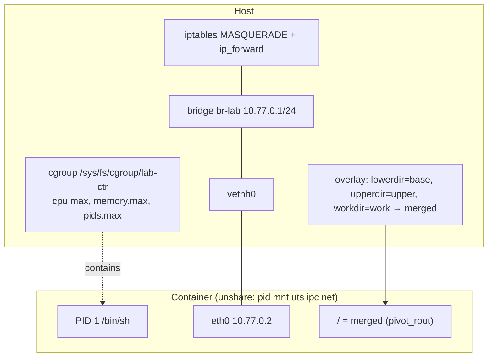

# 1.20 Lab: build a container by hand with unshare, chroot, cgroups and overlayfs

| | |
|---|---|
| Level | Intermediate |
| Priority tier | 0 |
| Lab venue | GCP VM (Ubuntu 22.04+, 2 vCPU, cgroup v2, root access) |
| Part | Part 1: Linux, from the command line to the kernel and performance |
| Status | Drafted, **every step untested**; run it and record real output |

## Why this lab

Chapters 1.18 and 1.19 explained the parts. Here you assemble them into something that behaves like `docker run`, so that a container is never magic again. At the end you compare your hand-made container with a real one (`docker run` or `ctr run`) and see the same namespaces, cgroup and overlay mount. This is also the best preparation for interview questions such as "what happens when a pod starts?".

Outcomes: build a root filesystem; give a process private PID, mount, UTS, IPC and network namespaces; change root with `pivot_root`; stack layers with OverlayFS; confine CPU, memory and PIDs with a cgroup; wire the network with a veth pair, bridge and NAT; drop privileges; then break and fix it on purpose.

## Safety

Use a throwaway VM. Everything here needs root and touches mounts, network and cgroups. Never run it on a GPU production node. Keep a second SSH session open in case you lose networking. Work under `/lab`.

## Architecture of what we build



## Step 0. Preconditions

```bash
sudo -i
stat -fc %T /sys/fs/cgroup          # expect cgroup2fs
uname -r; unshare --version; ip -V
mkdir -p /lab && cd /lab
```

## Step 1. Root filesystem

Any minimal tree works. Two options:

```bash
# Option A: Alpine mini root filesystem (check the current release URL and checksum first)
mkdir -p base && cd base
curl -fLO https://dl-cdn.alpinelinux.org/alpine/v3.20/releases/x86_64/alpine-minirootfs-3.20.3-x86_64.tar.gz
tar -xzf alpine-minirootfs-*.tar.gz && cd ..

# Option B: export from an image you trust
docker create --name seed alpine:3.20 && docker export seed | tar -x -C base && docker rm seed
```

Verify checksums before trusting any download (flag: confirm the URL and version). `ls base` should show `bin etc lib usr ...`.

## Step 2. Plain chroot, and why it is not enough

```bash
chroot base /bin/sh -c 'ls /; cat /etc/os-release; ps aux | head -3'
```

You get a different filesystem but the host's hostname, network and processes (`ps` fails because `/proc` is absent; mount it and you see the whole host). Record what is shared. Note that a root process can escape a chroot; it is not isolation.

## Step 3. Namespaces with unshare

```bash
unshare --pid --fork --mount --uts --ipc --net --mount-proc=/lab/base/proc \
        chroot base /bin/sh
# inside:
hostname container1 ; hostname
echo $$ ; ps aux
ip link
mount | head
exit
```

Questions to answer in your notes: What PID is the shell? Which interfaces exist? Is the hostname change visible on the host? Why did `--mount-proc` need a path under the new root?

## Step 4. Layers with OverlayFS and a proper root switch

Use a read-only base plus a writable layer so the base stays pristine, and swap root with `pivot_root` instead of `chroot`.

```bash
mkdir -p upper work merged
mount -t overlay overlay -o lowerdir=/lab/base,upperdir=/lab/upper,workdir=/lab/work /lab/merged

cat > /lab/enter.sh <<'EOF'
#!/bin/sh
# runs inside the new namespaces
set -e
mount --make-rprivate /
mount --bind /lab/merged /lab/merged
cd /lab/merged
mkdir -p proc sys dev tmp oldroot
mount -t proc proc proc
mount -t sysfs -o ro sysfs sys
mount -t tmpfs -o size=64m tmpfs dev
mknod -m 666 dev/null c 1 3 ; mknod -m 666 dev/zero c 1 5
mknod -m 666 dev/urandom c 1 9 ; mknod -m 666 dev/tty c 5 0
mount -t tmpfs tmpfs tmp
pivot_root . oldroot
cd /
umount -l /oldroot ; rmdir /oldroot
hostname container1
exec /bin/sh
EOF
chmod +x enter.sh
unshare --pid --fork --mount --uts --ipc --net /lab/enter.sh
```

Inside: `cat /proc/1/cmdline`, `mount | head`, `touch /newfile`, `rm /etc/hostname`. Exit and inspect on the host: `ls /lab/upper`, `ls -l /lab/upper/etc` (look for the whiteout character device), confirm `/lab/base` is untouched. Run two containers with separate `upper` and `work` directories on the same `base` to see layer sharing.

## Step 5. Put it in a cgroup (CPU, memory, PIDs)

Create the group before entering and move the starting process into it so its children inherit membership.

```bash
echo "+cpu +memory +pids" > /sys/fs/cgroup/cgroup.subtree_control
mkdir /sys/fs/cgroup/lab-ctr
echo "50000 100000" > /sys/fs/cgroup/lab-ctr/cpu.max       # half a CPU
echo 128M            > /sys/fs/cgroup/lab-ctr/memory.max
echo 64              > /sys/fs/cgroup/lab-ctr/pids.max
sh -c 'echo $$ > /sys/fs/cgroup/lab-ctr/cgroup.procs; exec unshare --pid --fork --mount --uts --ipc --net /lab/enter.sh'
```

Tests inside the container (install tools if missing: `apk add stress-ng` needs networking from Step 6, or use shell loops):

```bash
while :; do :; done &            # see ~50% CPU on the host with top
cat /proc/self/cgroup            # with no cgroup namespace this shows the full path
:(){ :|:& };:                    # fork bomb: stopped by pids.max (do this ONLY with pids.max set)
head -c 300M /dev/zero | tail -c 1   # memory pressure: watch OOM kill
```

On the host: `cat /sys/fs/cgroup/lab-ctr/{cpu.stat,memory.events,pids.current}` and `dmesg | tail`. Add `--cgroup` to `unshare` and observe the changed `/proc/self/cgroup`.

## Step 6. Networking

Prepare the host side once, then give each container a veth pair. Because the container's network namespace is created by `unshare --net`, find it through the child's PID.

```bash
ip link add br-lab type bridge && ip addr add 10.77.0.1/24 dev br-lab && ip link set br-lab up
sysctl -w net.ipv4.ip_forward=1
iptables -t nat -A POSTROUTING -s 10.77.0.0/24 ! -o br-lab -j MASQUERADE

# start the container in the background (a sleeping shell), capture its host PID
unshare --pid --fork --mount --uts --ipc --net sh -c 'echo $$ > /lab/ctr.pid; sleep 3600' &
sleep 1; PID=$(cat /lab/ctr.pid)    # this PID is inside the new pid namespace's parent view; if wrong, use: pgrep -f 'sleep 3600'

ip link add vethh0 type veth peer name vethc0
ip link set vethh0 master br-lab up
ip link set vethc0 netns $PID
nsenter -t $PID -n ip link set vethc0 name eth0
nsenter -t $PID -n ip addr add 10.77.0.2/24 dev eth0
nsenter -t $PID -n ip link set eth0 up
nsenter -t $PID -n ip link set lo up
nsenter -t $PID -n ip route add default via 10.77.0.1
nsenter -t $PID -n ping -c2 10.77.0.1
nsenter -t $PID -n ping -c2 8.8.8.8       # works only with NAT and a reachable Internet
```

The `ctr.pid` value may be the PID inside the new PID namespace; if `nsenter` fails, resolve the host PID with `pgrep -f 'sleep 3600'`. Stop and remove with `kill`, `ip link del br-lab`, `iptables -t nat -D POSTROUTING ...`. To integrate with Step 4, run `enter.sh` after the network has been configured (for example keep the namespace alive with a holder process and `nsenter` into it with `-t $PID -n -m -u -i -p`).

## Step 7. Reduce privilege

Containers drop most capabilities and filter system calls. Experiment with:

```bash
capsh --print                                  # current bounding set (install libcap2-bin)
capsh --drop=cap_sys_admin,cap_net_raw,cap_sys_module --                # then try mount/ping/modprobe
setpriv --bounding-set=-sys_admin,-net_admin --no-new-privs sh          # alternative
unshare --user --map-root-user ...             # run the whole thing rootless (mounts/overlay need kernel support)
```

Concept check (full treatment in 1.21): `no_new_privs`, capability sets, seccomp filters and LSM profiles are the layers Docker adds on top of what you built.

## Step 8. Compare with a real container

```bash
docker run -d --name real --cpus 0.5 --memory 128m --pids-limit 64 alpine:3.20 sleep 3600
P=$(docker inspect -f '{{.State.Pid}}' real)
ls -l /proc/$P/ns ; lsns -p $P
cat /proc/$P/cgroup ; cat /sys/fs/cgroup/system.slice/docker-*.scope/{cpu.max,memory.max,pids.max}
nsenter -t $P -m cat /proc/mounts | head -5
ip -br link | grep veth ; bridge link
docker rm -f real
```

Make a table: for each property (namespaces, cgroup limits, rootfs mount, veth/bridge, capabilities from `grep Cap /proc/$P/status`, seccomp from `grep Seccomp /proc/$P/status`) record what your hand-built container has and what Docker adds. Typical gaps: masked `/proc` paths, read-only `/sys`, default seccomp profile, capability drop list, a user-defined bridge with DNS, port publishing rules.

## Step 9. Break it on purpose

1. Remove `mount --make-rprivate /` and mount something inside; observe a leak on the host with `findmnt -o TARGET,PROPAGATION`.
2. Make PID 1 a shell script without `exec` and send `SIGTERM` from the host (host PID) and from inside.
3. Skip mounting `/proc` and run `ps`, `free`; then mount and compare `free` with the cgroup's `memory.max`.
4. Write 200 MB into the container's `/` and see where the bytes land (`du -sh /lab/upper`).
5. Set `memory.max` very low and watch `memory.events` count `oom_kill`.
6. Create a file in `/lab/merged` while the container runs and see when the container sees it.
7. Delete the cgroup directory while processes remain (what error?).

## Step 10. Clean up

```bash
pkill -f 'sleep 3600' ; umount -l /lab/merged 2>/dev/null
ip link del vethh0 2>/dev/null ; ip link del br-lab 2>/dev/null
iptables -t nat -D POSTROUTING -s 10.77.0.0/24 ! -o br-lab -j MASQUERADE 2>/dev/null
rmdir /sys/fs/cgroup/lab-ctr 2>/dev/null ; rm -rf /lab
```

## Troubleshooting

| Symptom | Cause | Fix |
|---|---|---|
| `unshare: unshare failed: Operation not permitted` | Not root, or restricted | Use `sudo -i`; check LSM/sysctl restrictions |
| `ps` shows host processes | `/proc` not remounted in the new mount namespace | `--mount-proc` or `mount -t proc proc /proc` after making mounts private |
| `pivot_root: Invalid argument` | New root is not a mount point, or parent mount is shared | Bind-mount it onto itself, `mount --make-rprivate /` |
| `mount: wrong fs type` for overlay | Overlay module missing or workdir on a different filesystem | `modprobe overlay`; keep `upper` and `work` on one filesystem |
| No network inside | veth not moved/renamed/up, no route, no NAT, forwarding off | Re-check each `ip` command; `sysctl net.ipv4.ip_forward`; `iptables -t nat -S` |
| `echo > cgroup.procs: Device or resource busy` | Internal-process rule or threaded cgroup | Move into a leaf; enable controllers on the parent first |
| `memory.max` file missing | Controller not enabled in `cgroup.subtree_control` | Enable `+memory` at the parent |
| Container cannot write | Read-only mount or tmpfs size | Check mount options and `df` |

## Checkpoint questions (30)

1. What is the minimum set of kernel features that make a container? **A:** Namespaces, cgroup, root filesystem, reduced privileges on a shared kernel.
2. Why isn't `chroot` enough? **A:** It changes only the root directory; no isolation of processes, network, hostname; escapable by root.
3. Why does `unshare --pid` need `--fork`? **A:** Only children enter the new PID namespace.
4. Why mount `proc` after creating a PID namespace? **A:** `/proc` otherwise shows the old view.
5. What does `--mount-proc` do? **A:** Creates the mount namespace and mounts a fresh `/proc` for the new PID namespace.
6. Why `mount --make-rprivate /` before mounting? **A:** Prevent propagation to/from the host.
7. What does `pivot_root` do that `chroot` doesn't? **A:** Swaps the root mount in the namespace, allowing the old root to be detached.
8. Why bind-mount the new root onto itself? **A:** `pivot_root` requires the new root to be a mount point.
9. Role of `lowerdir`, `upperdir`, `workdir`? **A:** Read-only layers, writable layer, scratch space.
10. How do you keep several containers sharing one base? **A:** One lowerdir, separate upper/work per container.
11. How do you see what a container changed? **A:** Inspect its upperdir.
12. What does a whiteout look like on disk? **A:** A character device 0/0.
13. Why create `/dev` nodes by hand? **A:** The container needs minimal devices; runtimes create a tmpfs `/dev` with allowed nodes.
14. Why read-only `/sys`? **A:** Reduce ability to affect the host kernel settings.
15. How do you put a process tree in a cgroup before it forks? **A:** Write the starting shell's PID into `cgroup.procs` before `exec unshare`.
16. What do `cpu.max 50000 100000` and `memory.max 128M` do? **A:** Half a CPU's quota; hard memory ceiling with OOM kill.
17. What stops a fork bomb? **A:** `pids.max`.
18. Which file shows OOM kills? **A:** `memory.events` (`oom_kill`).
19. How do you attach a veth peer to a process's network namespace? **A:** `ip link set vethc0 netns <PID>`.
20. Why is NAT needed? **A:** The container subnet is private; masquerade rewrites sources for outside traffic.
21. Why enable `ip_forward`? **A:** The host must route between bridge and uplink.
22. How does `nsenter` help debugging? **A:** Runs host tools in the container's namespaces.
23. What does the cgroup namespace change? **A:** The view of cgroup paths, not the limits.
24. How can you compare with Docker? **A:** Inspect `/proc/PID/ns`, cgroup files, mounts, capabilities for a Docker container.
25. What does Docker add beyond this lab? **A:** Image management, default seccomp/capability drops, masked paths, networking with DNS/port publishing, lifecycle and logs.
26. Why does a script as PID 1 break signal handling? **A:** PID 1 has no default signal actions and scripts may not forward signals.
27. Why can writes to `/` fill the host? **A:** They land in the upperdir on host storage.
28. What happens if the container's PID 1 exits? **A:** The kernel kills the rest of the namespace.
29. Why is rootless harder for networking and overlay? **A:** Needs privileges for veth/bridges and mounts; uses slirp4netns/fuse-overlayfs or newer kernel support.
30. What is the main security difference between your container and a VM? **A:** Shared kernel; attack surface is the whole system-call interface.

## Sources and review notes

Written in original words from: Brian Ward, *How Linux Works*, 3rd ed., chapter 17 (container concepts, overlay filesystem listing, Docker networking, PID 1 and init, pitfalls); Gregg, *Systems Performance*, 2nd ed., chapter 11 (namespaces, cgroups, overhead, observability); the project's `nvidia-devops` Volume 1 chapter 4 (`unshare` and OverlayFS walkthroughs, migrated and rewritten); manual pages `unshare(1)`, `nsenter(1)`, `pivot_root(8)`, `ip-netns(8)`, `capsh(1)`.

**Flagged:** Alpine URL/version and checksum; whether `ctr.pid` captures the host PID (script is untested); cgroup path names for Docker scopes; overlay behaviour on your kernel/filesystem; all steps are **untested**.
