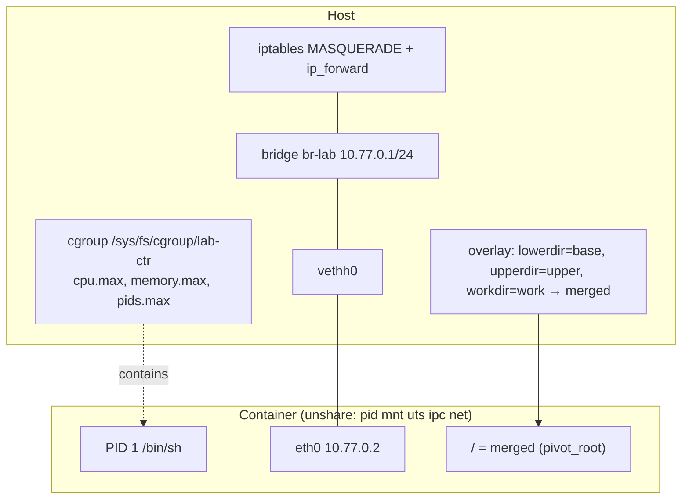

# 1.20 Lab: build a container by hand with unshare, chroot, cgroups and overlayfs

| | |
|---|---|
| Level | Intermediate |
| Priority tier | 0 |
| Lab venue | GCP VM (Ubuntu 22.04+, 2 vCPU, cgroup v2, root access) |
| Part | Part 1: Linux, from the command line to the kernel and performance |
| Status | Drafted, **every step untested**; run it and record real output |

## Why this lab

Chapters 1.18 and 1.19 explained the parts. Here you assemble them into something that behaves like `docker run`, so that a container is never magic again. At the end you compare your hand-made container with a real one (`docker run` or `ctr run`) and see the same namespaces, cgroup and overlay mount. This is also the best preparation for interview questions such as "what happens when a pod starts?".

Outcomes: build a root filesystem; give a process private PID, mount, UTS, IPC and network namespaces; change root with `pivot_root`; stack layers with OverlayFS; confine CPU, memory and PIDs with a cgroup; wire the network with a veth pair, bridge and NAT; drop privileges; then break and fix it on purpose.

## Safety

Use a throwaway VM. Everything here needs root and touches mounts, network and cgroups. Never run it on a GPU production node. Keep a second SSH session open in case you lose networking. Work under `/lab`.

## Architecture of what we build



## Step 0. Preconditions and local Python verification

First, run the self-checking Python lab (`code/part01/build_container_hand_lab.py`) locally. It verifies the 6-stage `enter.sh` container assembly order, `pivot_root(2)` preconditions (`EINVAL` if `/` is shared or `merged` is not a mount point), the 4 minimal `/dev` character device nodes (`null` `1:3`, `zero` `1:5`, `urandom` `1:9`, `tty` `5:0`), `lab-ctr` cgroup limits (`0.5` CPU, `128 MiB`, `64` PIDs), and `veth` + `br-lab` + `MASQUERADE` connectivity.

```bash
python3 code/part01/build_container_hand_lab.py
```

Next, on your disposable Ubuntu 22.04+ VM (all interactive VM commands below are `untested here`):

```bash
sudo -i                                 # (untested here)
stat -fc %T /sys/fs/cgroup              # (untested here) expect cgroup2fs
uname -r; unshare --version; ip -V      # (untested here)
mkdir -p /lab && cd /lab                # (untested here)
```

## Step 1. Root filesystem

Any minimal tree works. Two options:

```bash
# Option A: Alpine mini root filesystem (check the current release URL and checksum first)
mkdir -p base && cd base
curl -fLO https://dl-cdn.alpinelinux.org/alpine/v3.20/releases/x86_64/alpine-minirootfs-3.20.3-x86_64.tar.gz
tar -xzf alpine-minirootfs-*.tar.gz && cd ..

# Option B: export from an image you trust
docker create --name seed alpine:3.20 && docker export seed | tar -x -C base && docker rm seed
```

Verify checksums before trusting any download (flag: confirm the URL and version). `ls base` should show `bin etc lib usr ...`.

## Step 2. Plain chroot, and why it is not enough

```bash
chroot base /bin/sh -c 'ls /; cat /etc/os-release; ps aux | head -3'
```

You get a different filesystem but the host's hostname, network and processes (`ps` fails because `/proc` is absent; mount it and you see the whole host). Record what is shared. Note that a root process can escape a chroot; it is not isolation.

## Step 3. Namespaces with unshare

```bash
unshare --pid --fork --mount --uts --ipc --net --mount-proc=/lab/base/proc \
        chroot base /bin/sh
# inside:
hostname container1 ; hostname
echo $$ ; ps aux
ip link
mount | head
exit
```

Questions to answer in your notes: What PID is the shell? Which interfaces exist? Is the hostname change visible on the host? Why did `--mount-proc` need a path under the new root?

## Step 4. Layers with OverlayFS and a proper root switch

Use a read-only base plus a writable layer so the base stays pristine, and swap root with `pivot_root` instead of `chroot`.

```bash
mkdir -p upper work merged
mount -t overlay overlay -o lowerdir=/lab/base,upperdir=/lab/upper,workdir=/lab/work /lab/merged

cat > /lab/enter.sh <<'EOF'
#!/bin/sh
# runs inside the new namespaces
set -e
mount --make-rprivate /
mount --bind /lab/merged /lab/merged
cd /lab/merged
mkdir -p proc sys dev tmp oldroot
mount -t proc proc proc
mount -t sysfs -o ro sysfs sys
mount -t tmpfs -o size=64m tmpfs dev
mknod -m 666 dev/null c 1 3 ; mknod -m 666 dev/zero c 1 5
mknod -m 666 dev/urandom c 1 9 ; mknod -m 666 dev/tty c 5 0
mount -t tmpfs tmpfs tmp
pivot_root . oldroot
cd /
umount -l /oldroot ; rmdir /oldroot
hostname container1
exec /bin/sh
EOF
chmod +x enter.sh
unshare --pid --fork --mount --uts --ipc --net /lab/enter.sh
```

Inside: `cat /proc/1/cmdline`, `mount | head`, `touch /newfile`, `rm /etc/hostname`. Exit and inspect on the host: `ls /lab/upper`, `ls -l /lab/upper/etc` (look for the whiteout character device), confirm `/lab/base` is untouched. Run two containers with separate `upper` and `work` directories on the same `base` to see layer sharing.

## Step 5. Put it in a cgroup (CPU, memory, PIDs)

Create the group before entering and move the starting process into it so its children inherit membership.

```bash
echo "+cpu +memory +pids" > /sys/fs/cgroup/cgroup.subtree_control
mkdir /sys/fs/cgroup/lab-ctr
echo "50000 100000" > /sys/fs/cgroup/lab-ctr/cpu.max       # half a CPU
echo 128M            > /sys/fs/cgroup/lab-ctr/memory.max
echo 64              > /sys/fs/cgroup/lab-ctr/pids.max
sh -c 'echo $$ > /sys/fs/cgroup/lab-ctr/cgroup.procs; exec unshare --pid --fork --mount --uts --ipc --net /lab/enter.sh'
```

Tests inside the container (install tools if missing: `apk add stress-ng` needs networking from Step 6, or use shell loops):

```bash
while :; do :; done &            # see ~50% CPU on the host with top
cat /proc/self/cgroup            # with no cgroup namespace this shows the full path
:(){ :|:& };:                    # fork bomb: stopped by pids.max (do this ONLY with pids.max set)
head -c 300M /dev/zero | tail -c 1   # memory pressure: watch OOM kill
```

On the host: `cat /sys/fs/cgroup/lab-ctr/{cpu.stat,memory.events,pids.current}` and `dmesg | tail`. Add `--cgroup` to `unshare` and observe the changed `/proc/self/cgroup`.

## Step 6. Networking

Prepare the host side once, then give each container a veth pair. Because the container's network namespace is created by `unshare --net`, find it through the child's PID.

```bash
ip link add br-lab type bridge && ip addr add 10.77.0.1/24 dev br-lab && ip link set br-lab up
sysctl -w net.ipv4.ip_forward=1
iptables -t nat -A POSTROUTING -s 10.77.0.0/24 ! -o br-lab -j MASQUERADE

# start the container in the background (a sleeping shell), capture its host PID
unshare --pid --fork --mount --uts --ipc --net sh -c 'echo $$ > /lab/ctr.pid; sleep 3600' &
sleep 1; PID=$(cat /lab/ctr.pid)    # this PID is inside the new pid namespace's parent view; if wrong, use: pgrep -f 'sleep 3600'

ip link add vethh0 type veth peer name vethc0
ip link set vethh0 master br-lab up
ip link set vethc0 netns $PID
nsenter -t $PID -n ip link set vethc0 name eth0
nsenter -t $PID -n ip addr add 10.77.0.2/24 dev eth0
nsenter -t $PID -n ip link set eth0 up
nsenter -t $PID -n ip link set lo up
nsenter -t $PID -n ip route add default via 10.77.0.1
nsenter -t $PID -n ping -c2 10.77.0.1
nsenter -t $PID -n ping -c2 8.8.8.8       # works only with NAT and a reachable Internet
```

The `ctr.pid` value may be the PID inside the new PID namespace; if `nsenter` fails, resolve the host PID with `pgrep -f 'sleep 3600'`. Stop and remove with `kill`, `ip link del br-lab`, `iptables -t nat -D POSTROUTING ...`. To integrate with Step 4, run `enter.sh` after the network has been configured (for example keep the namespace alive with a holder process and `nsenter` into it with `-t $PID -n -m -u -i -p`).

## Step 7. Reduce privilege

Containers drop most capabilities and filter system calls. Experiment with:

```bash
capsh --print                                  # current bounding set (install libcap2-bin)
capsh --drop=cap_sys_admin,cap_net_raw,cap_sys_module --                # then try mount/ping/modprobe
setpriv --bounding-set=-sys_admin,-net_admin --no-new-privs sh          # alternative
unshare --user --map-root-user ...             # run the whole thing rootless (mounts/overlay need kernel support)
```

Concept check (full treatment in 1.21): `no_new_privs`, capability sets, seccomp filters and LSM profiles are the layers Docker adds on top of what you built.

## Step 8. Compare with a real container

```bash
docker run -d --name real --cpus 0.5 --memory 128m --pids-limit 64 alpine:3.20 sleep 3600
P=$(docker inspect -f '{{.State.Pid}}' real)
ls -l /proc/$P/ns ; lsns -p $P
cat /proc/$P/cgroup ; cat /sys/fs/cgroup/system.slice/docker-*.scope/{cpu.max,memory.max,pids.max}
nsenter -t $P -m cat /proc/mounts | head -5
ip -br link | grep veth ; bridge link
docker rm -f real
```

Make a table: for each property (namespaces, cgroup limits, rootfs mount, veth/bridge, capabilities from `grep Cap /proc/$P/status`, seccomp from `grep Seccomp /proc/$P/status`) record what your hand-built container has and what Docker adds. Typical gaps: masked `/proc` paths, read-only `/sys`, default seccomp profile, capability drop list, a user-defined bridge with DNS, port publishing rules.

## Step 9. Break it on purpose

1. Remove `mount --make-rprivate /` and mount something inside; observe a leak on the host with `findmnt -o TARGET,PROPAGATION`.
2. Make PID 1 a shell script without `exec` and send `SIGTERM` from the host (host PID) and from inside.
3. Skip mounting `/proc` and run `ps`, `free`; then mount and compare `free` with the cgroup's `memory.max`.
4. Write 200 MB into the container's `/` and see where the bytes land (`du -sh /lab/upper`).
5. Set `memory.max` very low and watch `memory.events` count `oom_kill`.
6. Create a file in `/lab/merged` while the container runs and see when the container sees it.
7. Delete the cgroup directory while processes remain (what error?).

## Step 10. Clean up

```bash
pkill -f 'sleep 3600' ; umount -l /lab/merged 2>/dev/null
ip link del vethh0 2>/dev/null ; ip link del br-lab 2>/dev/null
iptables -t nat -D POSTROUTING -s 10.77.0.0/24 ! -o br-lab -j MASQUERADE 2>/dev/null
rmdir /sys/fs/cgroup/lab-ctr 2>/dev/null ; rm -rf /lab
```

## Troubleshooting

| Symptom | Cause | Fix |
|---|---|---|
| `unshare: unshare failed: Operation not permitted` | Not root, or restricted | Use `sudo -i`; check LSM/sysctl restrictions |
| `ps` shows host processes | `/proc` not remounted in the new mount namespace | `--mount-proc` or `mount -t proc proc /proc` after making mounts private |
| `pivot_root: Invalid argument` | New root is not a mount point, or parent mount is shared | Bind-mount it onto itself, `mount --make-rprivate /` |
| `mount: wrong fs type` for overlay | Overlay module missing or workdir on a different filesystem | `modprobe overlay`; keep `upper` and `work` on one filesystem |
| No network inside | veth not moved/renamed/up, no route, no NAT, forwarding off | Re-check each `ip` command; `sysctl net.ipv4.ip_forward`; `iptables -t nat -S` |
| `echo > cgroup.procs: Device or resource busy` | Internal-process rule or threaded cgroup | Move into a leaf; enable controllers on the parent first |
| `memory.max` file missing | Controller not enabled in `cgroup.subtree_control` | Enable `+memory` at the parent |
| Container cannot write | Read-only mount or tmpfs size | Check mount options and `df` |

## Exercises

1. **`chroot` vs. `pivot_root` and `enter.sh` Preconditions:** (a) Why is `chroot base /bin/sh` not a container, and what host resources remain visible or escapable? (b) In Step 4's `enter.sh`, why must you run `mount --make-rprivate /` and `mount --bind /lab/merged /lab/merged` before `pivot_root . oldroot`? Verify with `validate_pivot_root_preconditions()` in `code/part01/build_container_hand.py`.
2. **Minimal `/dev` Character Nodes and Read-Only `/sys`:** State the type (`b` or `c`), major number, minor number, and file mode of the four device nodes created in `enter.sh` (`dev/null`, `dev/zero`, `dev/urandom`, `dev/tty`), and explain why `/dev` is mounted as a `64m` `tmpfs` and `/sys` is mounted read-only (`-o ro`).
3. **OverlayFS Layer Sharing, `upperdir` Inspection, and Whiteouts:** After running `enter.sh` over `/lab/merged` (`lowerdir=/lab/base,upperdir=/lab/upper,workdir=/lab/work`), creating `/newfile`, and removing `/etc/hostname`: (a) what appears inside `/lab/upper` and `/lab/upper/etc`, and what is the major/minor number of the `/lab/upper/etc/hostname` whiteout node? (b) How do you launch a second container that shares `/lab/base` without colliding with the first container's writes?
4. **Confining the Container in `/sys/fs/cgroup/lab-ctr`:** In Step 5, explain why `echo $$ > /sys/fs/cgroup/lab-ctr/cgroup.procs` is executed inside `sh -c` *before* `exec unshare ... /lab/enter.sh`, and predict what happens inside the container when you run (a) an infinite busy loop (`cpu.max = "50000 100000"`), (b) `:(){ :|:& };:` (`pids.max = 64`), and (c) `head -c 300M /dev/zero | tail -c 1` (`memory.max = 128M`).
5. **Wiring Container Networking (`veth`, `br-lab`, `ip_forward`, and `MASQUERADE`):** Trace every packet hop when PID 1 inside the container (`eth0 = 10.77.0.2/24`) pings `10.77.0.1` (`br-lab`) and `8.8.8.8`. Using `validate_container_veth_nat_config()`, state which pings succeed if `net.ipv4.ip_forward=0` or if the `iptables -t nat -A POSTROUTING ... -j MASQUERADE` rule is missing.
6. **Privilege Reduction (`capsh`, `setpriv`) and Comparison with `docker run`:** Compare the hand-built container from Steps 4–7 against `docker run -d --name real --cpus 0.5 --memory 128m --pids-limit 64 alpine:3.20 sleep 3600` across five security and operational dimensions (`CapEff`/`CapBnd`, `Seccomp`, masked `/proc` and `/sys` paths, DNS/port publishing, and rootless user namespaces).

## Checkpoint questions (20)

<details>
<summary>1. What is the minimum set of Linux kernel mechanisms that together form a container?</summary>
(1) **Namespaces** (`mnt`, `pid`, `uts`, `ipc`, `net`, `cgroup`, `user`), (2) **cgroups** (`cpu`, `memory`, `pids`, `io`, `devices`), (3) an isolated **root filesystem** (`OverlayFS` + `pivot_root`), and (4) **privilege restrictions** (dropped capabilities, `no_new_privs`, `seccomp`, and AppArmor/SELinux) running on a shared host kernel.
</details>

<details>
<summary>2. Why is `chroot base /bin/sh` not enough to isolate a container?</summary>
`chroot` only changes pathname resolution for `/`; the process still shares the host's PID table, network interfaces, IPC objects, hostname, and cgroup limits, and a root process inside `chroot` can easily escape back to the host root filesystem.
</details>

<details>
<summary>3. Why does `unshare --pid` require `--fork` and a fresh `/proc` mount (`--mount-proc`)?</summary>
A process's PID cannot change after `fork()`, so `unshare --pid` only places *subsequent children* into the new PID namespace (`--fork` forks the shell as PID 1). Because `ps` and `top` read `/proc`, you must also mount a new `proc` filesystem inside the new mount namespace (`--mount-proc`), or `ps` will still display the host's processes.
</details>

<details>
<summary>4. Why must `enter.sh` run `mount --make-rprivate /` before mounting container filesystems or calling `pivot_root`?</summary>
`systemd` mounts `/` with `shared` propagation by default. Without `mount --make-rprivate /`, mounts performed inside the new mount namespace propagate back to the host's mount table, and the kernel rejects `pivot_root(2)` with `EINVAL` when the current root has shared propagation.
</details>

<details>
<summary>5. Why does `enter.sh` bind-mount `/lab/merged` onto itself (`mount --bind /lab/merged /lab/merged`) before calling `pivot_root . oldroot`?</summary>
The `pivot_root(new_root, put_old)` system call requires `new_root` to be a mount point (and `put_old` to reside inside `new_root`). While `/lab/merged` is already an OverlayFS mount point in Step 4, bind-mounting a directory onto itself is the standard defensive idiom that guarantees `new_root` is a distinct mount point even when using a plain directory tree.
</details>

<details>
<summary>6. After `pivot_root . oldroot` and `cd /`, why do we run `umount -l /oldroot && rmdir /oldroot`?</summary>
Unmounting `/oldroot` detaches the entire host root filesystem from the container's mount namespace so no process inside the container can access host files or escape back to the old root.
</details>

<details>
<summary>7. How do `lowerdir`, `upperdir`, and `workdir` work in Step 4, and how can two containers share `/lab/base` safely?</summary>
`lowerdir=/lab/base` is read-only; `upperdir=/lab/upper` captures all container writes and whiteouts; and `workdir=/lab/work` is an internal staging directory on the same filesystem as `upperdir`. Two containers share `/lab/base` safely by passing the same `lowerdir=/lab/base` while giving each container its own separate `upper1`/`work1` and `upper2`/`work2` directories.
</details>

<details>
<summary>8. When you run `touch /newfile` and `rm /etc/hostname` inside the container, what appears on the host under `/lab/upper` and `/lab/base`?</summary>
`/lab/base` remains completely untouched. `/lab/upper/newfile` contains the new file, and `/lab/upper/etc/hostname` is a character device with major `0`, minor `0` (`c--------- 1 root root 0, 0`), which is the OverlayFS **whiteout** hiding `/lab/base/etc/hostname`.
</details>

<details>
<summary>9. Why does `enter.sh` mount a `tmpfs` on `dev` and run `mknod` for `null`, `zero`, `urandom`, and `tty` instead of bind-mounting the host's `/dev`?</summary>
Bind-mounting the host's `/dev` would expose raw host disks (`/dev/sda`, `/dev/nvme0n1`), `/dev/mem`, and all host hardware devices to the container. Mounting a small `64m` `tmpfs` and creating only the four safe standard character nodes (`null` `1:3`, `zero` `1:5`, `urandom` `1:9`, `tty` `5:0`) follows the principle of least privilege.
</details>

<details>
<summary>10. Why does `enter.sh` mount `sysfs` read-only (`mount -t sysfs -o ro sysfs sys`)?</summary>
`/sys` is not namespaced (apart from `/sys/class/net`); a writable `/sys` inside a container would allow root inside the container to modify host kernel/driver parameters, unbind PCI devices, or trigger uevents.
</details>

<details>
<summary>11. Why does Step 5 write `echo $$ > /sys/fs/cgroup/lab-ctr/cgroup.procs` BEFORE `exec unshare ...`?</summary>
Because `exec` replaces the current shell process image without changing its PID or cgroup membership, moving the shell's `$$` into `lab-ctr` first ensures that `unshare` and every child process it forks inside the container automatically inherit membership in `/sys/fs/cgroup/lab-ctr`.
</details>

<details>
<summary>12. What do `cpu.max = "50000 100000"`, `memory.max = 128M`, and `pids.max = 64` enforce on `lab-ctr`, and which files record hits?</summary>
`cpu.max = "50000 100000"` caps the container at `50 ms` of CPU time per `100 ms` period (`0.5` CPU, recorded in `cpu.stat` `nr_throttled`); `memory.max = 128M` triggers the cgroup OOM killer if memory usage exceeds `128 MiB` (recorded in `memory.events` `oom_kill`); and `pids.max = 64` blocks `fork()`/`clone()` once `64` processes/threads exist in the cgroup (recorded in `pids.events` `max`).
</details>

<details>
<summary>13. In Step 6, how do you resolve the container's host PID for `ip link set vethc0 netns $PID` and `nsenter -t $PID`?</summary>
Inside `unshare --pid --fork`, `$$` inside the child shell evaluates to `1` (its PID inside the new PID namespace), not its host PID. On the host, find the child's host PID using `pgrep -f 'sleep 3600'` (or `lsns -t net`) before running `ip link set vethc0 netns $PID`.
</details>

<details>
<summary>14. Trace the host and container commands that give the container IP `10.77.0.2/24` and outbound internet access.</summary>
On the host: create bridge `br-lab` (`10.77.0.1/24`), create `vethh0`/`vethc0`, attach `vethh0` to `br-lab`, move `vethc0` into the container netns (`ip link set vethc0 netns $PID`), enable `net.ipv4.ip_forward=1`, and add `iptables -t nat -A POSTROUTING -s 10.77.0.0/24 ! -o br-lab -j MASQUERADE`. Inside the container netns (`nsenter -t $PID -n`): rename `vethc0` to `eth0`, assign `10.77.0.2/24`, bring `eth0` and `lo` up, and add `ip route add default via 10.77.0.1`.
</details>

<details>
<summary>15. What happens in Step 9 when you make PID 1 a shell script without `exec` and send `SIGTERM` from the host?</summary>
Because PID 1 in a PID namespace has no default signal handlers, `/bin/sh` ignores `SIGTERM` (whereas `SIGKILL` from the host kills it immediately). Using `exec` in `enter.sh` (`exec /bin/sh` or `exec python train.py`) ensures the target program itself becomes PID 1.
</details>

<details>
<summary>16. In Step 9, why does `free -h` inside the container still show the host's total RAM even when `memory.max` is `128M`?</summary>
`/proc/meminfo` is not virtualized by mount or PID namespaces, so `free -h` reads the host's global memory statistics. The container's true limit and usage live in `/sys/fs/cgroup/lab-ctr/memory.max` and `memory.current`.
</details>

<details>
<summary>17. What happens if you try to `rmdir /sys/fs/cgroup/lab-ctr` while a container process is still running inside it?</summary>
The kernel refuses the `rmdir` with `EBUSY` (`Device or resource busy`); a cgroup directory can only be removed with `rmdir` after all member processes have exited (or been moved out) and all child cgroups have been removed.
</details>

<details>
<summary>18. How do `capsh --drop=cap_sys_admin,cap_net_raw,cap_sys_module` and `setpriv --no-new-privs` harden the hand-built container?</summary>
Dropping `CAP_SYS_ADMIN` prevents mounting filesystems or calling `pivot_root`/`swapon`, dropping `CAP_NET_RAW` prevents crafting raw/ICMP sockets, dropping `CAP_SYS_MODULE` prevents loading kernel modules, and `--no-new-privs` ensures `execve()` of a setuid binary cannot re-acquire privileges.
</details>

<details>
<summary>19. When you compare `/proc/$P/status` and `/proc/$P/mounts` of a real `docker run` container against your hand-built container in Step 8, what extra protections does Docker add?</summary>
Docker (via `containerd`/`runc`) additionally drops capabilities down to a small default bounding set, installs a ~44-syscall `seccomp` filter (`Seccomp: 2`), applies an AppArmor or SELinux profile, bind-mounts sensitive `/proc` files (`/proc/kcore`, `/proc/keys`, `/proc/sysrq-trigger`) to `/dev/null` (masked paths), and mounts `/proc/sys` and `/sys` read-only.
</details>

<details>
<summary>20. Why is running this lab rootless (`unshare --user --map-root-user`) harder for OverlayFS and networking?</summary>
Unprivileged user namespaces cannot create host `veth` pairs or attach interfaces to a host bridge without a privileged helper (requiring user-space network stacks like `slirp4netns` or `pasta`), and native unprivileged OverlayFS mounts require Linux `5.11+` (older kernels needed `fuse-overlayfs`).
</details>

## Sources and review notes

- **Sources read in full:**
  - `how-linux-works-3rd-edition` — Brian Ward, *How Linux Works*, 3rd ed., **Chapter 17: Virtualization** (container concepts, overlay filesystem mount structure, Docker vs Podman privileges, container networking, PID 1 and init, inspecting container processes from the host, and container pitfalls).
  - `systems-performance-2nd-edition` — Brendan Gregg, *Systems Performance*, 2nd ed., **Chapter 11: Cloud Computing** (section 11.3 OS virtualization: namespaces, cgroups, overhead, and container observability traps).
  - `nvidia-devops/volume-01/04-linux-systemd-containers-masterclass.md` — migrated the `unshare`, `pivot_root`, `OverlayFS`, `cgroup v2`, and `veth`/`br-lab` hand-built container lab (cross-referenced with Chapters 1.18, 1.19, and 1.21, plus original study items 21–30).
- **Run here:** `python3 code/part01/build_container_hand_lab.py` (15 passed, 0 failed).
- **Explicitly labelled inferences:** The Step 8 comparison table between the hand-built `unshare` container (`/proc/PID/ns`) and `docker run` (`containerd`/`runc` OCI bundle) connects kernel primitives to production Kubernetes and Docker runtimes (plus original study items 22, 23, 25, 26, 27, 28, and 29).
- **Not verified on live hardware:** Every interactive VM command in Steps 0–10 (`unshare`, `chroot`, `mount -t overlay`, `pivot_root`, `mknod`, `ip link`, `iptables`, `nsenter`, `capsh`, `setpriv`, `docker`) is marked (untested here) and must be run on a disposable VM.
