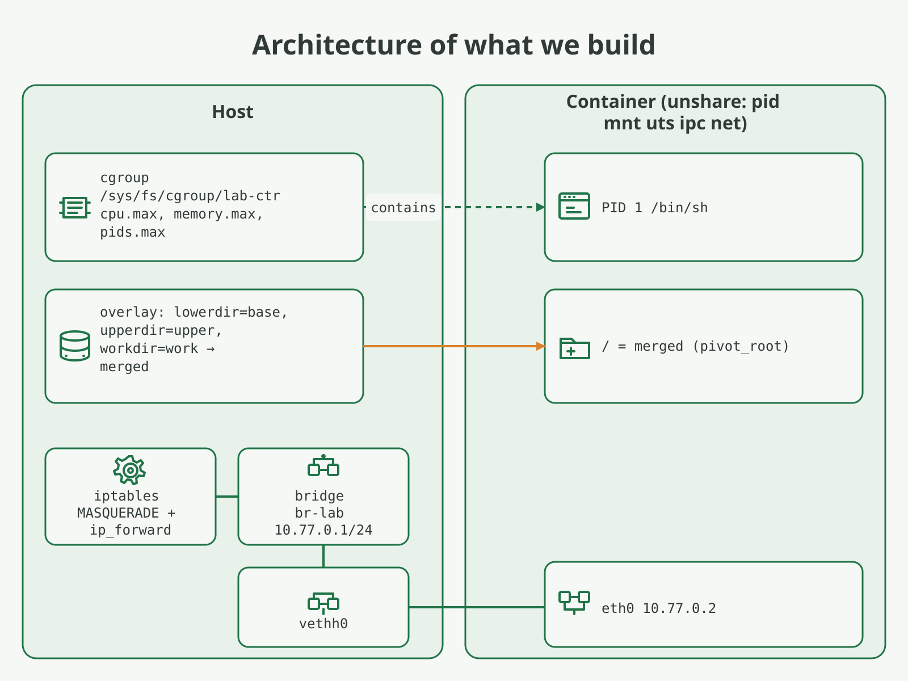

# 1.20 Lab: build a container by hand with unshare, chroot, cgroups and overlayfs

| | |
|---|---|
| Level | Intermediate |
| Priority tier | 0 |
| Lab venue | GCP VM (Ubuntu 22.04+, 2 vCPU, cgroup v2, root access) |
| Part | Part 1: Linux, from the command line to the kernel and performance |
| Status | Drafted, **every step untested**; run it and record real output |

## Why this lab

Every engineer who runs containers eventually meets a puzzle the documentation cannot explain. A container will not start, a log file is missing, a process disappears, and the only honest answer left is, "I don't know what Docker is actually doing." This lab is built to take that answer away from you. Chapters 1.18 and 1.19 explained the parts of a container one at a time. Here you pick those parts up and assemble them with your own hands.

By the end you will stand your hand-made container next to a real one. Start the real one with `docker run` or `ctr run`, and look at both side by side. They show the same namespaces, the same cgroup and the same overlay mount. Once you have seen that with your own eyes, a container stops being magic. You will also be ready for the classic interview question, "what happens when a pod starts?"

Here is the shape of the build. First you create a root filesystem. Then you give a process its own PID, mount, UTS, IPC and network namespaces. You switch its root with `pivot_root` and stack layers with OverlayFS. A cgroup confines its CPU, memory and PIDs. A veth pair, a bridge and NAT wire its network. At the end you drop privileges, then break and fix the setup on purpose.

## Safety

Start on a throwaway VM, one you can rebuild at any time without losing anything you care about. Everything in this lab needs root, and it changes mounts, networking and cgroups on the machine under your hands. A single mistake can cut your own SSH session, so keep a second session open as a lifeline. Never run this on a GPU production node. Do all your work under `/lab`, and cleanup becomes one command at the end.

## Architecture of what we build

The picture below is the machine you are about to assemble, all in one view. Read it from the host box outward, and notice that each box is something you will create by hand in the steps that follow.



*Figure 1.20.1. Architecture of what we build.*

## Step 0. Preconditions and local Python verification

Before you touch a VM, run the self-checking Python lab on your laptop. It takes a moment, and it shows you what the later steps must get right. The lab lives in `code/part01/build_container_hand_lab.py`, and it walks the ground you are about to cover.

The script checks the 6-stage `enter.sh` assembly order. It checks the `pivot_root(2)` preconditions, which fail with `EINVAL` when `/` is shared or `merged` is not a mount point. It checks the 4 minimal `/dev` character device nodes: `null` `1:3`, `zero` `1:5`, `urandom` `1:9` and `tty` `5:0`. It also checks the `lab-ctr` cgroup limits of `0.5` CPU, `128 MiB` and `64` PIDs, along with the `veth`, `br-lab` and `MASQUERADE` connectivity.

```bash
python3 code/part01/build_container_hand_lab.py
```

Then move to your disposable Ubuntu 22.04+ VM. No interactive command from here on has been run on live hardware, because its output was not captured. Run each one yourself, and write down what you really see. Your own output is the record that matters.

```bash
sudo -i
stat -fc %T /sys/fs/cgroup              # expect cgroup2fs
uname -r; unshare --version; ip -V
mkdir -p /lab && cd /lab
```

## Step 1. Root filesystem

Every container needs a filesystem to live in, the way a house needs a floor. The smallest useful one is only a few megabytes, and almost any minimal tree will do. Pick whichever of the two options suits you.

```bash
# Option A: Alpine mini root filesystem (check the current release URL and checksum first)
mkdir -p base && cd base
curl -fLO https://dl-cdn.alpinelinux.org/alpine/v3.20/releases/x86_64/alpine-minirootfs-3.20.3-x86_64.tar.gz
tar -xzf alpine-minirootfs-*.tar.gz && cd ..

# Option B: export from an image you trust
docker create --name seed alpine:3.20 && docker export seed | tar -x -C base && docker rm seed
```

Verify checksums before you trust any download, and confirm the URL and version first. When the tree is in place, `ls base` should show `bin etc lib usr ...`. That short list is your first sign that you have a real root filesystem and not an empty directory.

## Step 2. Plain chroot, and why it is not enough

The oldest trick for isolation is `chroot`. It changes what one process sees as `/`, so the process looks around and finds a smaller world. Try it first, because it shows you exactly what is still missing.

```bash
chroot base /bin/sh -c 'ls /; cat /etc/os-release; ps aux | head -3'
```

After the `chroot`, you look around and see a different filesystem. Everything else still belongs to the host, though: the hostname, the network and the processes. `ps` fails because `/proc` is absent, and if you mount `/proc`, you see the whole host. So write down everything that is still shared. Remember, too, that a root process can escape a `chroot`. Treat `chroot` as a convenience, not as isolation. A different `/` is not the same thing as a container.

## Step 3. Namespaces with unshare

Now you give the shell a private view of the machine. This one command starts a shell inside its own PID, mount, UTS, IPC and network namespaces. A namespace is a walled-off view of one kind of system resource, and each flag below asks the kernel for one more wall. Run it, then look around.

```bash
unshare --pid --fork --mount --uts --ipc --net --mount-proc=/lab/base/proc \
        chroot base /bin/sh
# inside:
hostname container1 ; hostname
echo $$ ; ps aux
ip link
mount | head
exit
```

Now the container starts to feel real. The shell has its own process space, its own hostname and its own interfaces. Before you leave this step, write down answers to four questions. What PID does the shell have? Which network interfaces exist? Can the host see the hostname change? And why did `--mount-proc` need a path under the new root?

## Step 4. Layers with OverlayFS and a proper root switch

Two problems remain after Step 3. First, every container would write into the same base directory, so one container's changes would show up in the next. Second, `chroot` can be escaped. OverlayFS solves the first problem. It gives you a read-only base with a private writable layer on top, so the base stays clean. `pivot_root` solves the second problem, because it swaps the root and lets you detach the old one completely.

```bash
mkdir -p upper work merged
mount -t overlay overlay -o lowerdir=/lab/base,upperdir=/lab/upper,workdir=/lab/work /lab/merged

cat > /lab/enter.sh <<'EOF'
#!/bin/sh
# runs inside the new namespaces
set -e
mount --make-rprivate /
mount --bind /lab/merged /lab/merged
cd /lab/merged
mkdir -p proc sys dev tmp oldroot
mount -t proc proc proc
mount -t sysfs -o ro sysfs sys
mount -t tmpfs -o size=64m tmpfs dev
mknod -m 666 dev/null c 1 3 ; mknod -m 666 dev/zero c 1 5
mknod -m 666 dev/urandom c 1 9 ; mknod -m 666 dev/tty c 5 0
mount -t tmpfs tmpfs tmp
pivot_root . oldroot
cd /
umount -l /oldroot ; rmdir /oldroot
hostname container1
exec /bin/sh
EOF
chmod +x enter.sh
unshare --pid --fork --mount --uts --ipc --net /lab/enter.sh
```

Now poke around inside. Run `cat /proc/1/cmdline`, `mount | head`, `touch /newfile` and `rm /etc/hostname`. Then exit and inspect the result from the host, where you can run `ls /lab/upper` and `ls -l /lab/upper/etc` to find the whiteout character device. A whiteout is a small marker that hides a file from the read-only base, so a deleted file looks gone inside the container while the base stays as it was. Confirm that `/lab/base` is untouched. Finally, run two containers with separate `upper` and `work` directories on the same `base` to see how the layers are shared. When a container's files look wrong, check the upper layer first, because that is where its writes land.

## Step 5. Put it in a cgroup (CPU, memory, PIDs)

So far the container can see very little, but it can still use up the whole machine. A cgroup is the kernel's tool for putting a ceiling on that use, and you want one in place before a job lands on a shared node. Picture a noisy neighbour that runs a fork bomb on a shared GPU node. Without a limit, it takes the machine down for everyone. The order matters. Create the group first, then move the starting shell into it. Every child then inherits the membership.

```bash
echo "+cpu +memory +pids" > /sys/fs/cgroup/cgroup.subtree_control
mkdir /sys/fs/cgroup/lab-ctr
echo "50000 100000" > /sys/fs/cgroup/lab-ctr/cpu.max       # half a CPU
echo 128M            > /sys/fs/cgroup/lab-ctr/memory.max
echo 64              > /sys/fs/cgroup/lab-ctr/pids.max
sh -c 'echo $$ > /sys/fs/cgroup/lab-ctr/cgroup.procs; exec unshare --pid --fork --mount --uts --ipc --net /lab/enter.sh'
```

Next, run the tests inside the container, and keep one eye on the host. If a tool is missing, you can install `stress-ng` with `apk add stress-ng`, but that needs the networking from Step 6. Shell loops work too.

```bash
while :; do :; done &            # see ~50% CPU on the host with top
cat /proc/self/cgroup            # with no cgroup namespace this shows the full path
:(){ :|:& };:                    # fork bomb: stopped by pids.max (do this ONLY with pids.max set)
head -c 300M /dev/zero | tail -c 1   # memory pressure: watch OOM kill
```

Back on the host, you can read `cat /sys/fs/cgroup/lab-ctr/{cpu.stat,memory.events,pids.current}` and check `dmesg | tail`. Then add `--cgroup` to `unshare` and watch how `/proc/self/cgroup` changes. The first run shows the full host path, and the second shows a short one.

## Step 6. Networking

A container with no network is a sealed box. It can compute, and that is all. Set up the host side once, with a bridge and NAT. Then give each container one end of a veth pair. A veth pair is two virtual cable ends: one stays on the host, and the other appears inside the container. Because `unshare --net` creates the container's network namespace, you reach that namespace through the child's PID.

```bash
ip link add br-lab type bridge && ip addr add 10.77.0.1/24 dev br-lab && ip link set br-lab up
sysctl -w net.ipv4.ip_forward=1
iptables -t nat -A POSTROUTING -s 10.77.0.0/24 ! -o br-lab -j MASQUERADE

# start the container in the background (a sleeping shell), capture its host PID
unshare --pid --fork --mount --uts --ipc --net sh -c 'echo $$ > /lab/ctr.pid; sleep 3600' &
sleep 1; PID=$(cat /lab/ctr.pid)    # this PID is inside the new pid namespace's parent view; if wrong, use: pgrep -f 'sleep 3600'

ip link add vethh0 type veth peer name vethc0
ip link set vethh0 master br-lab up
ip link set vethc0 netns $PID
nsenter -t $PID -n ip link set vethc0 name eth0
nsenter -t $PID -n ip addr add 10.77.0.2/24 dev eth0
nsenter -t $PID -n ip link set eth0 up
nsenter -t $PID -n ip link set lo up
nsenter -t $PID -n ip route add default via 10.77.0.1
nsenter -t $PID -n ping -c2 10.77.0.1
nsenter -t $PID -n ping -c2 8.8.8.8       # works only with NAT and a reachable Internet
```

Two details need your attention. The `ctr.pid` value may be the PID inside the new PID namespace, not the host PID. If `nsenter` fails, resolve the host PID with `pgrep -f 'sleep 3600'` instead. To clean up, stop the process and remove the network pieces with `kill`, `ip link del br-lab` and `iptables -t nat -D POSTROUTING ...`. To integrate with Step 4, run `enter.sh` once the network is configured. One way is to keep the namespace alive with a holder process, then use `nsenter` with `-t $PID -n -m -u -i -p` to join it.

## Step 7. Reduce privilege

Your container still runs as full root inside its namespaces. That is far more power than any real workload needs, and it is the gap between a lab toy and something you would trust on a shared node. Real runtimes drop most capabilities and filter system calls. A capability is a single privileged power, such as the right to mount a filesystem or load a kernel module, and it can be taken away on its own. Try the same ideas yourself with the commands below.

```bash
capsh --print                                  # current bounding set (install libcap2-bin)
capsh --drop=cap_sys_admin,cap_net_raw,cap_sys_module --                # then try mount/ping/modprobe
setpriv --bounding-set=-sys_admin,-net_admin --no-new-privs sh          # alternative
unshare --user --map-root-user ...             # run the whole thing rootless (mounts/overlay need kernel support)
```

Here is a concept check before you move on. Chapter 1.21 covers each item in full. `no_new_privs`, capability sets, seccomp filters and LSM profiles are the layers Docker adds on top of what you built.

## Step 8. Compare with a real container

Time to hold your work up against the real thing. Start a real container with the same limits you set by hand, and then look at the kernel's own records for it.

```bash
docker run -d --name real --cpus 0.5 --memory 128m --pids-limit 64 alpine:3.20 sleep 3600
P=$(docker inspect -f '{{.State.Pid}}' real)
ls -l /proc/$P/ns ; lsns -p $P
cat /proc/$P/cgroup ; cat /sys/fs/cgroup/system.slice/docker-*.scope/{cpu.max,memory.max,pids.max}
nsenter -t $P -m cat /proc/mounts | head -5
ip -br link | grep veth ; bridge link
docker rm -f real
```

Now comes the payoff. Use the output above to line the real container up against yours. Make a table with one row for each property. The rows are namespaces, cgroup limits, the rootfs mount, the veth and bridge setup, capabilities from `grep Cap /proc/$P/status`, and seccomp from `grep Seccomp /proc/$P/status`. In each row, record what your hand-built container has and what Docker adds. The typical gaps you will find are masked `/proc` paths, a read-only `/sys`, the default seccomp profile, the capability drop list, a user-defined bridge with DNS, and port publishing rules. Each gap is a feature someone had to build, and now you know where it lives.

## Step 9. Break it on purpose

Suppose an on-call page reports that a container has eaten the machine's memory. That page is easier to answer once you have broken the same setup yourself in daylight, with nobody waiting on you. Breaking the setup on purpose teaches you more than a clean run does. Try each of these seven experiments in turn, and note what changes.

1. Remove the `mount --make-rprivate /` line from `enter.sh`, mount something inside, and look for a leak on the host with `findmnt -o TARGET,PROPAGATION`.
2. Make PID 1 a shell script without `exec`, then send `SIGTERM` from the host (host PID) and from inside.
3. Skip mounting `/proc` and run `ps` and `free`. Then mount it and compare `free` with the cgroup's `memory.max`.
4. Write 200 MB into the container's `/` and see where the bytes land with `du -sh /lab/upper`.
5. Set `memory.max` very low and watch `memory.events` count `oom_kill`.
6. Create a file in `/lab/merged` while the container runs, and see when the container sees it.
7. Delete the cgroup directory while processes remain, and note which error you get.

When an experiment surprises you, find the layer that caused it before you change anything. That habit is the real lesson of this step, and it is the one you will use at 3 a.m.

## Step 10. Clean up

When you finish, clean up in one pass. These commands stop the sleeping process, unmount the overlay, remove the network and cgroup, and delete `/lab`. Run them even if a step failed, so your next attempt starts from a known state.

```bash
pkill -f 'sleep 3600' ; umount -l /lab/merged 2>/dev/null
ip link del vethh0 2>/dev/null ; ip link del br-lab 2>/dev/null
iptables -t nat -D POSTROUTING -s 10.77.0.0/24 ! -o br-lab -j MASQUERADE 2>/dev/null
rmdir /sys/fs/cgroup/lab-ctr 2>/dev/null ; rm -rf /lab
```

## Troubleshooting

When something breaks, start with the first column and find your symptom. The likely cause and the fix sit beside it in the same row. Read the cause before you type the fix, because the cause is the part you will meet again on another machine.

| Symptom | Cause | Fix |
|---|---|---|
| `unshare: unshare failed: Operation not permitted` | Not root, or restricted | Use `sudo -i`; check LSM/sysctl restrictions |
| `ps` shows host processes | `/proc` not remounted in the new mount namespace | `--mount-proc` or `mount -t proc proc /proc` after making mounts private |
| `pivot_root: Invalid argument` | New root is not a mount point, or parent mount is shared | Bind-mount it onto itself, `mount --make-rprivate /` |
| `mount: wrong fs type` for overlay | Overlay module missing or workdir on a different filesystem | `modprobe overlay`; keep `upper` and `work` on one filesystem |
| No network inside | veth not moved/renamed/up, no route, no NAT, forwarding off | Re-check each `ip` command; `sysctl net.ipv4.ip_forward`; `iptables -t nat -S` |
| `echo > cgroup.procs: Device or resource busy` | Internal-process rule or threaded cgroup | Move into a leaf; enable controllers on the parent first |
| `memory.max` file missing | Controller not enabled in `cgroup.subtree_control` | Enable `+memory` at the parent |
| Container cannot write | Read-only mount or tmpfs size | Check mount options and `df` |

## Exercises

Answer these on paper before you rerun any step. Writing an answer forces you to commit, and a wrong answer is easy to repair once it is visible. If you get stuck, go back to the step each question names.

1. **`chroot` vs. `pivot_root` and `enter.sh` Preconditions:** (a) Why is `chroot base /bin/sh` not a container? Which host resources stay visible or escapable? (b) In Step 4's `enter.sh`, why must you run `mount --make-rprivate /` and `mount --bind /lab/merged /lab/merged` before `pivot_root . oldroot`? Check your answer with `validate_pivot_root_preconditions()` in `code/part01/build_container_hand.py`.
2. **Minimal `/dev` Character Nodes and Read-Only `/sys`:** For each of the four device nodes created in `enter.sh` (`dev/null`, `dev/zero`, `dev/urandom`, `dev/tty`), state the type (`b` or `c`), the major number, the minor number and the file mode. Then explain why `/dev` is mounted as a `64m` `tmpfs`, and why `/sys` is mounted read-only (`-o ro`).
3. **OverlayFS Layer Sharing, `upperdir` Inspection, and Whiteouts:** Suppose you run `enter.sh` over `/lab/merged` (`lowerdir=/lab/base,upperdir=/lab/upper,workdir=/lab/work`), create `/newfile`, and remove `/etc/hostname`. (a) What appears inside `/lab/upper` and `/lab/upper/etc`? What are the major and minor numbers of the `/lab/upper/etc/hostname` whiteout node? (b) How would you launch a second container that shares `/lab/base` without colliding with the first container's writes?
4. **Confining the Container in `/sys/fs/cgroup/lab-ctr`:** In Step 5, explain why `echo $$ > /sys/fs/cgroup/lab-ctr/cgroup.procs` runs inside `sh -c` *before* `exec unshare ... /lab/enter.sh`. Then predict what happens inside the container for each of these: (a) an infinite busy loop with `cpu.max = "50000 100000"`, (b) `:(){ :|:& };:` with `pids.max = 64`, and (c) `head -c 300M /dev/zero | tail -c 1` with `memory.max = 128M`.
5. **Wiring Container Networking (`veth`, `br-lab`, `ip_forward`, and `MASQUERADE`):** Trace each packet hop when PID 1 inside the container, with `eth0 = 10.77.0.2/24`, pings `10.77.0.1` on `br-lab` and then `8.8.8.8`. Next, use `validate_container_veth_nat_config()` to decide which pings succeed in two cases. In the first, `net.ipv4.ip_forward=0`. In the second, the `iptables -t nat -A POSTROUTING ... -j MASQUERADE` rule is missing.
6. **Privilege Reduction (`capsh`, `setpriv`) and Comparison with `docker run`:** Compare the hand-built container from Steps 4 to 7 with `docker run -d --name real --cpus 0.5 --memory 128m --pids-limit 64 alpine:3.20 sleep 3600`. Cover five dimensions: `CapEff` and `CapBnd`, `Seccomp`, masked `/proc` and `/sys` paths, DNS and port publishing, and rootless user namespaces.

## Checkpoint questions (20)

<details>
<summary>1. What is the minimum set of Linux kernel mechanisms that together form a container?</summary>

A container needs four kernel mechanisms working together. The first is **namespaces**: `mnt`, `pid`, `uts`, `ipc`, `net`, `cgroup` and `user`. The second is **cgroups**: `cpu`, `memory`, `pids`, `io` and `devices`. The third is an isolated **root filesystem**, built from `OverlayFS` and `pivot_root`. The fourth is **privilege restrictions**, which include dropped capabilities, `no_new_privs`, `seccomp`, and AppArmor or SELinux. All four run on one shared host kernel.
</details>

<details>
<summary>2. Why is `chroot base /bin/sh` not enough to isolate a container?</summary>

`chroot` changes only how `/` is resolved for the process. The process still shares the host's PID table, network interfaces, IPC objects, hostname and cgroup limits. A root process inside a `chroot` can also easily escape back to the host root filesystem.
</details>

<details>
<summary>3. Why does `unshare --pid` require `--fork` and a fresh `/proc` mount (`--mount-proc`)?</summary>

A process cannot change its PID after `fork()`. So `unshare --pid` only places *subsequent children* into the new PID namespace. The `--fork` flag forks the shell, and that child becomes PID 1. Tools such as `ps` and `top` read `/proc`, so you must also mount a fresh `proc` filesystem inside the new mount namespace with `--mount-proc`. Without it, `ps` still shows the host's processes.
</details>

<details>
<summary>4. Why must `enter.sh` run `mount --make-rprivate /` before mounting container filesystems or calling `pivot_root`?</summary>

`systemd` mounts `/` as `shared` by default. Any mount you make in the new namespace would then leak back into the host's mount table. The kernel also refuses `pivot_root(2)` with `EINVAL` while the current root is shared. Running `mount --make-rprivate /` first cuts that link, so your mounts stay private.
</details>

<details>
<summary>5. Why does `enter.sh` bind-mount `/lab/merged` onto itself (`mount --bind /lab/merged /lab/merged`) before calling `pivot_root . oldroot`?</summary>

The `pivot_root(new_root, put_old)` call needs `new_root` to be a mount point, and `put_old` must sit inside `new_root`. In Step 4, `/lab/merged` is already an OverlayFS mount point. Even so, bind-mounting a directory onto itself is the standard defensive idiom. It guarantees that `new_root` is a distinct mount point, even when you use a plain directory tree.
</details>

<details>
<summary>6. After `pivot_root . oldroot` and `cd /`, why do we run `umount -l /oldroot && rmdir /oldroot`?</summary>

After `pivot_root`, the old host root is still mounted at `/oldroot`. Left alone, that would hand the container the whole host. Unmounting it detaches the host filesystem from the container's mount namespace. Nothing inside can then reach host files or climb back to the old root.
</details>

<details>
<summary>7. How do `lowerdir`, `upperdir`, and `workdir` work in Step 4, and how can two containers share `/lab/base` safely?</summary>

`lowerdir=/lab/base` is read-only. `upperdir=/lab/upper` captures every write and whiteout the container makes. `workdir=/lab/work` is an internal staging directory, and it must sit on the same filesystem as `upperdir`. Two containers can share `/lab/base` safely. Both pass the same `lowerdir=/lab/base`, and each gets its own separate directories, such as `upper1` and `work1` for one and `upper2` and `work2` for the other.
</details>

<details>
<summary>8. When you run `touch /newfile` and `rm /etc/hostname` inside the container, what appears on the host under `/lab/upper` and `/lab/base`?</summary>

`/lab/base` stays completely untouched. `/lab/upper/newfile` holds the new file. `/lab/upper/etc/hostname` is a character device with major `0` and minor `0`, shown as `c--------- 1 root root 0, 0`. That device is the OverlayFS **whiteout**, and it hides `/lab/base/etc/hostname`.
</details>

<details>
<summary>9. Why does `enter.sh` mount a `tmpfs` on `dev` and run `mknod` for `null`, `zero`, `urandom`, and `tty` instead of bind-mounting the host's `/dev`?</summary>

A bind mount of the host's `/dev` would expose raw host disks, such as `/dev/sda` and `/dev/nvme0n1`. It would also expose `/dev/mem` and every other host hardware device. Instead, `enter.sh` mounts a small `64m` `tmpfs` and creates only the four safe standard character nodes: `null` `1:3`, `zero` `1:5`, `urandom` `1:9` and `tty` `5:0`. That follows the principle of least privilege.
</details>

<details>
<summary>10. Why does `enter.sh` mount `sysfs` read-only (`mount -t sysfs -o ro sysfs sys`)?</summary>

`/sys` is not namespaced, apart from `/sys/class/net`. If `/sys` were writable, root inside the container could change host kernel and driver parameters. It could also unbind PCI devices or trigger uevents.
</details>

<details>
<summary>11. Why does Step 5 write `echo $$ > /sys/fs/cgroup/lab-ctr/cgroup.procs` BEFORE `exec unshare ...`?</summary>

Think of it as getting the person into the room before the work starts. `exec` replaces the shell's program, but it keeps the same PID and the same cgroup. So when you move the shell's `$$` into `lab-ctr` first, `unshare` and every process it forks inside the container are born into `/sys/fs/cgroup/lab-ctr`.
</details>

<details>
<summary>12. What do `cpu.max = "50000 100000"`, `memory.max = 128M`, and `pids.max = 64` enforce on `lab-ctr`, and which files record hits?</summary>

`cpu.max = "50000 100000"` caps the container at `50 ms` of CPU time in each `100 ms` period. That works out to `0.5` CPU, and throttling shows up in `cpu.stat` as `nr_throttled`. `memory.max = 128M` sets the limit at `128 MiB`. When usage goes over it, the cgroup OOM killer steps in, and you can see the hit in `memory.events` as `oom_kill`. `pids.max = 64` blocks `fork()` and `clone()` once `64` processes or threads exist in the cgroup. Those hits are recorded in `pids.events` as `max`.
</details>

<details>
<summary>13. In Step 6, how do you resolve the container's host PID for `ip link set vethc0 netns $PID` and `nsenter -t $PID`?</summary>

Inside `unshare --pid --fork`, `$$` in the child shell evaluates to `1`. That is its PID inside the new PID namespace, not its host PID. So on the host, find the real PID first, with `pgrep -f 'sleep 3600'` or `lsns -t net`. Do this before you run `ip link set vethc0 netns $PID`.
</details>

<details>
<summary>14. Trace the host and container commands that give the container IP `10.77.0.2/24` and outbound internet access.</summary>

On the host, you create the bridge `br-lab` at `10.77.0.1/24` and the pair `vethh0` and `vethc0`. Then you attach `vethh0` to `br-lab`, and move `vethc0` into the container's network namespace with `ip link set vethc0 netns $PID`. Next, enable `net.ipv4.ip_forward=1` and add `iptables -t nat -A POSTROUTING -s 10.77.0.0/24 ! -o br-lab -j MASQUERADE`. Inside the container namespace, reached with `nsenter -t $PID -n`, you rename `vethc0` to `eth0` and give it `10.77.0.2/24`. Then bring up `eth0` and `lo`, and add `ip route add default via 10.77.0.1`.
</details>

<details>
<summary>15. What happens in Step 9 when you make PID 1 a shell script without `exec` and send `SIGTERM` from the host?</summary>

PID 1 in a PID namespace gets no default signal handlers. So a plain `/bin/sh` simply ignores `SIGTERM`, and only `SIGKILL` from the host stops it. That is why `enter.sh` ends with `exec`. With `exec /bin/sh` or `exec python train.py`, the real program becomes PID 1 and can handle the signal itself.
</details>

<details>
<summary>16. In Step 9, why does `free -h` inside the container still show the host's total RAM even when `memory.max` is `128M`?</summary>

Mount and PID namespaces do not virtualize `/proc/meminfo`. So `free -h` reads the host's global memory statistics. The container's real limit and usage live in `/sys/fs/cgroup/lab-ctr/memory.max` and `memory.current`, so read those files instead.
</details>

<details>
<summary>17. What happens if you try to `rmdir /sys/fs/cgroup/lab-ctr` while a container process is still running inside it?</summary>

The kernel refuses the `rmdir` with `EBUSY`, which prints as `Device or resource busy`. A cgroup directory can only go once all its member processes have exited or moved out. Any child cgroups must be removed first.
</details>

<details>
<summary>18. How do `capsh --drop=cap_sys_admin,cap_net_raw,cap_sys_module` and `setpriv --no-new-privs` harden the hand-built container?</summary>

Dropping `CAP_SYS_ADMIN` stops the container from mounting filesystems, or from calling `pivot_root` or `swapon`. Dropping `CAP_NET_RAW` stops it from crafting raw or ICMP sockets. Dropping `CAP_SYS_MODULE` stops it from loading kernel modules. And `--no-new-privs` makes sure that `execve()` of a setuid binary cannot win back privileges.
</details>

<details>
<summary>19. When you compare `/proc/$P/status` and `/proc/$P/mounts` of a real `docker run` container against your hand-built container in Step 8, what extra protections does Docker add?</summary>

Docker, working through `containerd` and `runc`, adds several protections. It drops capabilities down to a small default bounding set. It installs a `seccomp` filter of about 44 system calls, which shows up as `Seccomp: 2`. It applies an AppArmor or SELinux profile. It also bind-mounts sensitive `/proc` files to `/dev/null`. Those files are `/proc/kcore`, `/proc/keys` and `/proc/sysrq-trigger`, and they are the masked paths. Finally, it mounts `/proc/sys` and `/sys` read-only.
</details>

<details>
<summary>20. Why is running this lab rootless (`unshare --user --map-root-user`) harder for OverlayFS and networking?</summary>

Unprivileged user namespaces cannot create host `veth` pairs or attach interfaces to a host bridge by themselves. That needs a privileged helper, or a user-space network stack such as `slirp4netns` or `pasta`. Native unprivileged OverlayFS mounts also need Linux `5.11+`. Older kernels needed `fuse-overlayfs` instead.
</details>

## Sources and review notes

- **Sources read in full:**
  - `how-linux-works-3rd-edition` — Brian Ward, *How Linux Works*, 3rd ed., **Chapter 17: Virtualization** (container concepts, overlay filesystem mount structure, Docker vs Podman privileges, container networking, PID 1 and init, inspecting container processes from the host, and container pitfalls).
  - `systems-performance-2nd-edition` — Brendan Gregg, *Systems Performance*, 2nd ed., **Chapter 11: Cloud Computing** (section 11.3 OS virtualization: namespaces, cgroups, overhead, and container observability traps).
  - `nvidia-devops/volume-01/04-linux-systemd-containers-masterclass.md` — migrated the `unshare`, `pivot_root`, `OverlayFS`, `cgroup v2`, and `veth`/`br-lab` hand-built container lab (cross-referenced with Chapters 1.18, 1.19, and 1.21, plus original study items 21–30).
- **Run here:** `python3 code/part01/build_container_hand_lab.py` (15 passed, 0 failed).
- **Explicitly labelled inferences:** The Step 8 comparison table between the hand-built `unshare` container (`/proc/PID/ns`) and `docker run` (`containerd`/`runc` OCI bundle) connects kernel primitives to production Kubernetes and Docker runtimes (plus original study items 22, 23, 25, 26, 27, 28, and 29).
- **Not verified on live hardware:** Every interactive VM command in Steps 0–10 (`unshare`, `chroot`, `mount -t overlay`, `pivot_root`, `mknod`, `ip link`, `iptables`, `nsenter`, `capsh`, `setpriv`, `docker`) is marked and must be run on a disposable VM.
