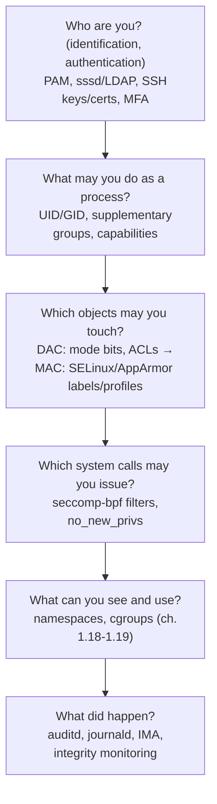

# 1.21 Linux security: capabilities, SELinux, AppArmor, seccomp, PAM, SSH hardening

| | |
|---|---|
| Level | Advanced |
| Priority tier | 0 |
| Lab venue | GCP VM (Ubuntu and a Rocky/RHEL-family VM for SELinux) |
| Part | Part 1: Linux, from the command line to the kernel and performance |
| Status | Drafted, labs **untested** |

## Why this matters for AI infrastructure

A GPU cluster is an expensive, shared, high-value target: model weights, proprietary data, SSH keys that reach hundreds of nodes, and compute that can be stolen for crypto-mining. It is also a place where hardening done by the book can silently destroy performance or break GPU, InfiniBand and container access. A good AI-infrastructure engineer must be able to do both: harden the node *and* explain which controls to relax, which not to, and why.

Typical situations:

- A compliance team applies a CIS benchmark and `nvidia-smi` stops working in containers, MPI jobs fail with `Operation not permitted` on cross-memory attach, or core dumps vanish when a NCCL crash needs debugging.
- Someone "fixes" an SELinux denial by running `setenforce 0` and the audit finding follows you for a year.
- A pod runs `--privileged` "because the GPU did not show up".
- An SSH key with no passphrase and agent forwarding to every node means one stolen laptop compromises the cluster.
- Secure Boot is enabled and the NVIDIA kernel module refuses to load (`Lockdown: unsigned module loading is restricted`).
- A multi-tenant neocloud customer asks how their containers are isolated from the neighbour's.

This chapter builds the security model from the kernel's point of view: users and identity, setuid, **discretionary** access control (file permissions), then **capabilities** that split root's power, **seccomp** system-call filters, **mandatory** access control (**SELinux**, **AppArmor**), **PAM** and **sudo** for authentication and authorisation, **SSH** hardening, **auditing**, kernel hardening, secure boot, and the AI-cluster-specific adjustments. It connects to containers (chapter 1.19), kernel modules (1.22), and Kubernetes admission control (the cluster-level counterpart, section 12).

## Prerequisites and outcomes

You should know file permissions and ownership (1.4/1.5), processes (1.8), `/proc` and `/sys` (1.10), boot and Secure Boot (1.14), and namespaces (1.19).

After this chapter you can:

- Explain identification, authentication and authorisation; the real, effective, saved and filesystem UIDs; how setuid and `sudo` work; and why setuid programs are a primary attack surface.
- Read and manage `/etc/passwd`, `/etc/shadow`, `/etc/group`, and account policy.
- Explain PAM function types, control flags, stacks and modules, and read a real `/etc/pam.d/sshd`.
- Explain Linux capabilities (permitted, effective, inheritable, bounding, ambient sets), read them from `/proc` and `getpcaps`, and drop them for a service or container.
- Explain seccomp-bpf, `no_new_privs`, and default container profiles.
- Explain SELinux (types, contexts, booleans, `audit2allow`, modes) and AppArmor (profiles, complain/enforce), and diagnose denials without disabling them.
- Harden SSH (keys, certificates, `sshd_config`, jump hosts, forwarding) and understand the internal-SSH needs of MPI and Slurm launchers.
- Use auditd, `journalctl`, `last`, `faillog`, and file integrity tooling; apply kernel and sysctl hardening (Yama, dmesg restrict, kptr, unprivileged BPF, user namespaces).
- State which CIS-style rules need adjustment on GPU/HPC nodes and which must not be relaxed.
- Describe Kubernetes admission control and Pod Security as the cluster-side enforcement of the same ideas.

## 1. The security model in one picture

Security on Linux is layered; each layer answers a different question.



Principles that run through every section: **least privilege** (give a process only what it needs), **defence in depth** (several independent layers so one failure is not fatal), **default deny** where practical, **separation of duties**, and **auditability**. Another principle matters on shared clusters: *assume a compromised workload* and limit the blast radius (a user's job must not reach another tenant's data or the management network).

## 2. Users, groups and the superuser

At the kernel level users are only numbers. The kernel knows UIDs and GIDs; user names exist in user space. The only UID with special meaning to the kernel is **0**, and since Linux 2.2 even that special meaning is decomposed into capabilities (section 4).

### The account databases

| File | Content |
|---|---|
| `/etc/passwd` | `name:x:UID:GID:comment(GECOS):home:shell`, world-readable. The `x` means the hash is in shadow; `*` or `!` in the shadow field means no password login; an empty field means *no password required* (never allowed) |
| `/etc/shadow` | `name:hash:lastchange:min:max:warn:inactive:expire:`, readable only by root; hash format `$6$` (SHA-512), `$y$` (yescrypt) etc. |
| `/etc/group`, `/etc/gshadow` | Group names, GIDs, members; group passwords are essentially unused (use `sudo`) |
| `/etc/shells` | Valid login shells (checked by `chsh` and some PAM modules) |
| `/etc/login.defs` | Defaults for account creation (UID ranges, password aging) used by `useradd` |
| `/etc/subuid`, `/etc/subgid` | Subordinate ID ranges for user namespaces (rootless containers, chapter 1.19) |

Pseudo-users (`daemon`, `nobody`, `www-data`, `slurm`, `munge`) have no login shell (`/usr/sbin/nologin` or `/bin/false`) and exist so services can run unprivileged. UID ranges conventionally: 0 root, 1 to 99 or 999 system accounts, 1000 and above humans; clusters assign stable numeric UIDs through LDAP/SSSD so that file ownership matches on all nodes (chapter 6.24).

```bash
id; id alice; getent passwd alice; getent group docker      # getent follows nsswitch (files, sss, ldap...)
sudo useradd -m -s /bin/bash -u 2001 -G video,render alice    # humans using GPUs often need video/render groups
sudo usermod -aG docker alice        # warning: docker group ≈ root on the host
sudo passwd -l alice                 # lock password login;   passwd -S alice : status
sudo chage -l alice ; sudo chage -M 90 -m 1 -W 14 alice       # password aging
sudo vipw ; sudo vipw -s             # safe editors with locking; never edit /etc/passwd with a plain editor
last ; lastb ; lastlog ; who ; w     # login history, failed logins (btmp), current sessions
```

Never share accounts; give each human a personal account and each service its own unprivileged account; automate creation (Ansible `user` module, identity provider). Remove or lock accounts at offboarding. Check for UID 0 duplicates: `awk -F: '$3==0' /etc/passwd`, empty passwords: `sudo awk -F: '$2==""' /etc/shadow`.

### Process credentials: real, effective, saved, filesystem UIDs

A process carries several IDs:

- **Effective UID (euid)**: used for permission checks (file access, most privileged operations).
- **Real UID (ruid)**: who started the process; controls who may signal it.
- **Saved set-user-ID (suid)**: lets a process drop privilege temporarily and regain it.
- **Filesystem UID (fsuid)**: used for filesystem checks (rarely differs).

Kernel rules for changing identity: a process may run a setuid executable if it can execute the file; a process with euid 0 (or `CAP_SETUID`) may become any user via `setuid()` and friends; unprivileged processes may only swap among their own real/effective/saved IDs. `su` and `sudo` are setuid-root programs that authenticate (through PAM) and then call `setuid()`. `ps -eo pid,euser,ruser,comm` shows both.

### Setuid, setgid and sticky bits

A **setuid** executable runs with the euid of its *owner* (`passwd`, `sudo`, `su`, `mount`, `ping` on older systems). Because they cross a privilege boundary, bugs in them are prime escalation routes: a root-owned setuid copy of a shell is a root backdoor. Audit them regularly:

```bash
sudo find / -xdev -perm -4000 -type f -ls 2>/dev/null     # setuid files;  -perm -2000 for setgid
mount | grep -E 'nosuid|noexec'                           # data filesystems (/tmp, /scratch, /home) should usually be nosuid,nodev
```

Mount user-writable and data filesystems `nosuid,nodev` (and `noexec` where workloads allow; many HPC sites cannot use `noexec` on scratch because users run their own binaries). **Sticky bit** on directories (`/tmp`, mode `1777`) lets only the file's owner delete it. Capabilities (next sections) let many programs drop setuid entirely (`ping` now commonly uses `cap_net_raw`).

## 3. Authentication: PAM, sudo, passwords

### PAM: Pluggable Authentication Modules

Applications (`login`, `sshd`, `sudo`, `su`, `passwd`, `cron`, `gdm`) do not implement authentication themselves; they call **libpam**, and an administrator-written stack of **modules** decides. Configuration is in `/etc/pam.d/<service>` (service name = application), with `/etc/pam.d/other` as the fallback (should deny). Each line has three parts: **type**, **control**, **module [arguments]**.

| Type | Question answered |
|---|---|
| `auth` | Is the user who they claim (password, key, token, MFA)? |
| `account` | Is the account allowed now (expired, locked, time/host restrictions, `nologin`)? |
| `session` | Setup/teardown around a session (limits, home directory creation, logging, systemd session registration, `pam_limits`) |
| `password` | Changing credentials (complexity, hash algorithm, history) |

Control flags make rules **stack**:

| Flag | Success | Failure |
|---|---|---|
| `required` | Continue; overall result can still succeed | Continue (so timing does not leak), but final result is failure |
| `requisite` | Continue | **Stop immediately, fail** |
| `sufficient` | **Stop immediately, succeed** (if no earlier `required` failed) | Continue |
| `optional` | Result ignored unless it is the only module | Ignored |
| `include` / `substack` | Pull in another file's stack for that type | |
| `[value=action ...]` | Advanced syntax mapping specific return codes to actions (`success=2 default=ignore`, etc.) | |

A classic stack (from the chsh example): `auth sufficient pam_rootok.so` (root passes); `auth requisite pam_shells.so` (shell must be in `/etc/shells`); `auth sufficient pam_unix.so` (password check); `auth required pam_deny.so` (default deny). Trace it: rootok succeeds → done; else shells fails → stop with failure; else unix correct → success; else deny → failure.

Commonly used modules: `pam_unix` (traditional passwords and `/etc/shadow`; `nullok` allows empty passwords and should not be set), `pam_sss` (SSSD/LDAP/Kerberos), `pam_faillock`/`pam_tally2` (lock after repeated failures), `pam_pwquality` (password strength), `pam_limits` (applies `/etc/security/limits.conf` and `limits.d`), `pam_access` (`/etc/security/access.conf` host/user allow lists), `pam_time`, `pam_nologin` (`/etc/nologin` blocks non-root login during maintenance), `pam_wheel` (restrict `su` to a group), `pam_google_authenticator`/`pam_oath`/`pam_u2f` (MFA), `pam_systemd` (registers the session with logind), `pam_slurm_adopt` (HPC: only users with a running job on the node may log in, and their SSH session joins the job's cgroup), `pam_namespace`, `pam_env`, `pam_exec`.

```bash
ls /etc/pam.d ; cat /etc/pam.d/sshd ; cat /etc/pam.d/common-auth       # Debian/Ubuntu (generated by pam-auth-update)
cat /etc/pam.d/system-auth /etc/pam.d/password-auth                      # RHEL family (managed by authselect)
man -k pam_ ; man pam.conf ; man pam_faillock
grep password.*unix /etc/pam.d/*         # which hash algorithm is used when SETTING passwords (e.g. sha512 / yescrypt)
faillock --user alice ; faillock --user alice --reset
```

Cautions: **a broken PAM stack can lock everyone out, including root.** Always keep a root console session open (and BMC console access) while editing; test with a second session; keep a copy; prefer the distribution tools (`authselect`, `pam-auth-update`) over hand edits of generated files. Verifying passwords uses whatever hash the stored value indicates (libcrypt auto-detects), while the *setting* algorithm is configured on the `password` line. `/etc/login.defs` mostly matters for tools that bypass PAM.

### sudo and su

`sudo` runs a command as another user (default root) according to `/etc/sudoers` and `/etc/sudoers.d/*`, always edited with `visudo` (syntax checked). Principles:

```sudoers
# /etc/sudoers.d/gpu-ops   (mode 0440)
Cmnd_Alias GPUOPS = /usr/bin/nvidia-smi, /usr/bin/systemctl restart nvidia-persistenced
%gpuops ALL=(root) GPUOPS               # a group may run only listed commands as root
Defaults:%gpuops log_output, !visiblepw, use_pty
Defaults timestamp_timeout=5, logfile="/var/log/sudo.log"
```

- Grant **specific commands**, not `ALL`, where feasible; beware that many programs (editors, pagers, `find`, `awk`, `tar`, `less`, `vim`) provide shell escapes, so `sudo vim` is full root (use `sudoedit`, `NOEXEC`).
- Use group membership (`wheel` on RHEL, `sudo` on Debian), log invocations (`sudo -l`, journald, I/O logging), and keep `Defaults use_pty` and `requiretty` policies deliberately.
- `su -` starts a login shell as root and needs root's password; prefer `sudo -i` with individual accountability and disable direct root SSH login.
- `NOPASSWD` is common for automation accounts but must be scoped to specific commands and protected by SSH key security.
- `Defaults stay_setuid` keeps the real UID root for programs that dislike a non-root ruid; understand the side effects before using it.

### Passwords and authentication factors

Policy: long passphrases over complexity rules, no reuse, rate-limit failures (`pam_faillock`), aging only where policy demands, MFA for interactive access to bastions. For machines, **keys not passwords**: SSH keys or certificates (section 7), service credentials via a secret manager, and short-lived tokens. Centralise accounts with LDAP/SSSD or FreeIPA so lock/disable happens in one place. Protect `/etc/shadow` backups; treat any exposed hash as compromised.

## 4. Capabilities: splitting root into pieces

Traditional Unix has two kinds of process: root (all-powerful) and everyone else. Linux decomposes root's powers into about 40 **capabilities**, each a distinct privilege that can be granted, dropped or inherited separately. A process with euid 0 *normally* holds all of them, but a process with a few capabilities and a non-zero UID can do just those operations.

Some that matter in infrastructure work:

| Capability | Allows |
|---|---|
| `CAP_NET_BIND_SERVICE` | Bind ports below 1024 |
| `CAP_NET_RAW` | Raw sockets (`ping`, packet crafting) |
| `CAP_NET_ADMIN` | Configure interfaces, routes, firewall, traffic control, many RDMA/network settings |
| `CAP_SYS_ADMIN` | A huge catch-all: mount, namespaces, many `ioctl`s, BPF (older), `swapon`, hostname…; "the new root" |
| `CAP_SYS_PTRACE` | Trace/inspect arbitrary processes, `process_vm_readv` |
| `CAP_SYS_MODULE` | Load/unload kernel modules |
| `CAP_SYS_RAWIO` | Raw I/O ports and `/dev/mem`-style access |
| `CAP_SYS_NICE` | Set real-time priorities, change nice of others, set CPU affinity of others |
| `CAP_SYS_RESOURCE` | Override resource limits, quotas, reserved space |
| `CAP_IPC_LOCK` | `mlock`, huge pages: needed by RDMA applications to pin memory beyond `ulimit -l` |
| `CAP_DAC_OVERRIDE`, `CAP_DAC_READ_SEARCH` | Bypass file permission checks |
| `CAP_CHOWN`, `CAP_FOWNER`, `CAP_SETUID`, `CAP_SETGID`, `CAP_SETFCAP` | Change ownership; act as owner; switch IDs; set file capabilities |
| `CAP_KILL`, `CAP_AUDIT_WRITE`, `CAP_MKNOD`, `CAP_PERFMON`, `CAP_BPF`, `CAP_CHECKPOINT_RESTORE` | Signals to any process; audit records; create device nodes; performance monitoring; BPF; checkpoint/restore |

Each thread has **five capability sets**:

| Set | Meaning |
|---|---|
| **Permitted** | Upper bound of what the thread may hold in its effective set |
| **Effective** | Capabilities actually checked by the kernel right now |
| **Inheritable** | May be passed across `execve` (together with file inheritable sets) |
| **Bounding** | A limit on what can ever be gained through `execve`; dropping from it is irreversible for the process tree |
| **Ambient** | Capabilities kept across `execve` of non-privileged programs (lets unprivileged programs inherit selected capabilities safely) |

**File capabilities** can be attached to executables (extended attribute `security.capability`), replacing setuid-root: `sudo setcap cap_net_bind_service=+ep /usr/local/bin/myserver`, `getcap -r / 2>/dev/null`. They interact with `no_new_privs` and with filesystem mount options (`nosuid` ignores them).

```bash
grep Cap /proc/self/status                     # CapInh CapPrm CapEff CapBnd CapAmb as hex masks
capsh --decode=000001ffffffffff                # decode a mask (apt install libcap2-bin)
getpcaps $$ ; getpcaps 1
capsh --print
sudo setpriv --bounding-set=-sys_admin,-sys_module,-sys_rawio --no-new-privs -- bash    # drop and lock
systemd-analyze security sshd.service          # exposure score of a unit, incl. capabilities
# systemd unit hardening:
#   CapabilityBoundingSet=CAP_NET_BIND_SERVICE   AmbientCapabilities=CAP_NET_BIND_SERVICE
#   NoNewPrivileges=yes   ProtectSystem=strict   ProtectHome=yes   PrivateTmp=yes   PrivateDevices=yes
#   SystemCallFilter=@system-service   RestrictAddressFamilies=AF_INET AF_INET6   MemoryDenyWriteExecute=yes
```

**Containers** start with a reduced bounding set (Docker's default drops `SYS_ADMIN`, `NET_ADMIN`, `SYS_MODULE`, `SYS_PTRACE`, `SYS_TIME` and more; Kubernetes `securityContext.capabilities.drop: ["ALL"]` then `add` only what is needed). `--privileged` (Docker) or `privileged: true` (Kubernetes) gives all capabilities, all devices, and disables seccomp and LSM confinement: it is effectively root on the host and must never be a casual fix. For GPUs: access needs device nodes and device-cgroup permission, **not** privilege; RDMA applications need `IPC_LOCK` (and possibly `SYS_RESOURCE`); profilers need `SYS_ADMIN` or `PERFMON`; NVIDIA tools that change GPU clocks/persistence mode need the host. Note that `CAP_SYS_ADMIN` in a user namespace is scoped to that namespace (chapter 1.19), unlike on the host.

## 5. seccomp: filtering system calls

**seccomp** (secure computing mode) lets a process install a filter that decides what happens for each system call: allow, return an error, kill the process or thread, send a signal, log, or notify a supervisor. **seccomp-bpf** expresses the filter as a classic BPF program that inspects the syscall number and its arguments (not pointer contents). Filters are inherited by children, cannot be removed, and stack (the most restrictive result wins). To install one without privilege a process must first set **`no_new_privs`** (`prctl(PR_SET_NO_NEW_PRIVS)`), which also makes `execve` ignore setuid bits and file capabilities, so a filtered process cannot regain privilege through a setuid binary.

```bash
grep -E 'Seccomp|NoNewPrivs' /proc/self/status        # Seccomp: 0 none, 1 strict, 2 filter
docker run --rm alpine grep Seccomp /proc/self/status # 2 = default profile active
docker run --rm --security-opt seccomp=unconfined alpine grep Seccomp /proc/self/status   # 0
```

Docker/containerd ship a **default profile** that allows most system calls but blocks dangerous ones (`mount`, `kexec_load`, `init_module`, `reboot`, `ptrace` on older kernels, `bpf`, `perf_event_open`, `keyctl`…). Kubernetes: `securityContext.seccompProfile.type: RuntimeDefault` (recommended for all pods) or `Localhost`. Systemd: `SystemCallFilter=`. Tools such as `strace -c`, `oci-seccomp-bpf-hook` or `inspektor-gadget` help generate allow-lists. Gregg's observability caveat applies: default profiles are why `perf`, `strace` and `bpftrace` fail inside containers. Writing tight custom profiles for AI workloads is often impractical (frameworks and drivers use many calls); `RuntimeDefault` is the sensible baseline, with `unconfined` reserved for trusted debug pods.

## 6. Mandatory access control: SELinux and AppArmor

**Discretionary access control (DAC)** is the owner/group/other permission model: the owner decides, and root bypasses. **Mandatory access control (MAC)**, implemented as a **Linux Security Module (LSM)**, adds a *system-wide policy* the owner cannot override: even root, or a compromised service running as root, can only touch what policy allows. DAC and MAC are *both* checked; MAC can only deny more. `cat /sys/kernel/security/lsm` lists active LSMs.

### SELinux (RHEL, Rocky, Fedora, Amazon Linux; also used by Android)

SELinux labels every process and object with a **security context** `user:role:type:level`. The **type** is what matters in the standard "targeted" policy: *type enforcement* rules say "domain `httpd_t` may read files of type `httpd_sys_content_t`". Everything not explicitly allowed is denied (default deny), and denials are logged as **AVC** messages.

```bash
getenforce ; sestatus                      # Enforcing / Permissive / Disabled; policy name
sudo setenforce 0|1                        # runtime toggle (permissive/enforcing); not persistent. Persistent: /etc/selinux/config
ls -Z /var/www ; ps -eZ | head ; id -Z     # file, process and user contexts
sudo ausearch -m avc,user_avc -ts recent   # recent denials (auditd) ; also: journalctl -t setroubleshoot
sudo sealert -a /var/log/audit/audit.log   # setroubleshoot: human-readable explanations and suggested fixes
sudo audit2why < denials.txt ; sudo audit2allow -M mymod < denials.txt   # generate a local policy module (review carefully)
sudo semodule -i mymod.pp ; semodule -l
getsebool -a | grep container ; sudo setsebool -P container_use_devices on     # booleans: policy switches
sudo semanage fcontext -a -t container_file_t '/scratch/models(/.*)?' ; sudo restorecon -Rv /scratch/models
sudo semanage port -a -t ssh_port_t -p tcp 2222        # allow sshd on a nonstandard port
chcon -t ... file                          # temporary relabel; restorecon resets to policy
```

Modes: **enforcing** (denies and logs), **permissive** (logs only: use to develop policy for one domain, `semanage permissive -a type_t`), **disabled** (no labels; re-enabling requires a full relabel at next boot, `touch /.autorelabel`). The standard workflow for a denial is: (1) reproduce, (2) read the AVC (`ausearch`, `sealert`), (3) find whether a **boolean**, a **file label** (`semanage fcontext` + `restorecon`) or a **port label** fixes it, (4) only then consider a custom module with `audit2allow`, reviewed for over-breadth. Do not run `setenforce 0` or disable SELinux as the fix. Typical causes: files moved (not copied) keep their old label; data in a non-standard directory needs a label; containers need `container_file_t` on bind mounts (`:z`/`:Z` flags in Docker/Podman relabel them); GPU and RDMA device nodes need a type that the container domain may access (`container_use_devices`, `container-selinux` and NVIDIA Container Toolkit policies; flag: the exact mechanism varies by distribution and toolkit version; verify against current documentation).

### AppArmor (Ubuntu, Debian, SUSE)

AppArmor confines programs with **path-based profiles** instead of labels: each profile lists files, capabilities, network and mount rules a program may use. Simpler to write and reason about than SELinux, but less granular for complex systems.

```bash
sudo aa-status                              # loaded profiles; enforce vs complain; confined processes
ls /etc/apparmor.d ; cat /etc/apparmor.d/usr.sbin.tcpdump
sudo aa-complain /usr/sbin/foo ; sudo aa-enforce /usr/sbin/foo      # per-profile modes (apparmor-utils)
sudo aa-genprof /usr/bin/myapp ; sudo aa-logprof                     # build/update a profile from logged accesses
sudo apparmor_parser -r /etc/apparmor.d/profile ; journalctl -k | grep -i 'apparmor="DENIED"'
```

Docker applies `docker-default` to containers; Kubernetes can set a profile per container (annotations on older versions, `securityContext.appArmorProfile` on newer; flag: verify version). `--security-opt apparmor=unconfined` disables it. Recent Ubuntu releases also use AppArmor to restrict unprivileged user namespaces (chapter 1.19).

**Choosing**: use whatever your distribution ships and supports (SELinux on the RHEL family, AppArmor on Ubuntu/Debian); running both is not the norm. In an AI cluster keep MAC **on** and handle GPU/InfiniBand/NFS/Lustre/scratch paths with labels or profiles; fleets that disable MAC "for performance" are usually disabling it for convenience (the overhead is small).

## 7. SSH hardening

SSH is the front door and the lateral-movement path. Key facts:

- Use **public-key** (or certificate) authentication; disable passwords; forbid root login or restrict it to `prohibit-password` for break-glass; use modern algorithms (Ed25519); protect private keys with passphrases and an agent (`ssh-agent`, hardware keys such as FIDO2 `ed25519-sk`).
- **SSH certificates** (a CA signs user and host keys with principals and expiry) scale far better than copying `authorized_keys` to thousands of nodes: set `TrustedUserCAKeys` and `AuthorizedPrincipalsFile`, short validity (hours), and HostCertificate to remove trust-on-first-use prompts. Tools: `ssh-keygen -s`, HashiCorp Vault SSH CA, step-ca, Teleport.
- Put cluster nodes behind a **bastion/jump host** (`ProxyJump`), restrict inbound SSH by network ACL or firewall, and log everything.

```bash
# /etc/ssh/sshd_config.d/10-hardening.conf   (validate: sudo sshd -t ; then reload, keep an existing session open)
PermitRootLogin no
PasswordAuthentication no
KbdInteractiveAuthentication no          # (ChallengeResponseAuthentication on older versions)
PubkeyAuthentication yes
AuthenticationMethods publickey          # or publickey,keyboard-interactive for MFA
AllowGroups ssh-users hpc-users
MaxAuthTries 3
LoginGraceTime 30
ClientAliveInterval 300
ClientAliveCountMax 2
X11Forwarding no
AllowAgentForwarding no                  # prefer ProxyJump; agent forwarding exposes your agent to the remote root
AllowTcpForwarding no                    # enable per-group via Match blocks only where needed
PermitUserEnvironment no
UsePAM yes
LogLevel VERBOSE                         # logs key fingerprints
Match Group hpc-users
    AllowTcpForwarding yes
```

```bash
ssh-keygen -t ed25519 -a 100 -C "alice@lab" -f ~/.ssh/id_ed25519
ssh-copy-id -i ~/.ssh/id_ed25519.pub alice@node01     # install the public key (permissions: ~/.ssh 700, authorized_keys 600)
ssh -J bastion node01 ; ssh -o ProxyJump=bastion node01
sudo sshd -T | sort | less                            # the effective configuration
ssh -vvv node01                                       # client-side debugging
ssh-audit node01                                      # third-party audit of algorithms
journalctl -u ssh -u sshd -f ; sudo grep 'Failed password' /var/log/auth.log
fail2ban-client status sshd                           # ban repeated failures (or pam_faillock)
```

Cluster specifics: MPI launchers (`mpirun` with the rsh/ssh launcher, `pdsh`, Horovod/`torchrun` multi-node helpers) often need **non-interactive node-to-node SSH**; Slurm's `srun` does not (it uses `slurmd`/MUNGE). Restrict node-to-node SSH to the private management network, use per-user keys or host-based certificates limited to compute nodes, and use `pam_slurm_adopt` to allow only users with a running job. Consider disabling SSH to compute nodes entirely for users and offering `srun --pty`. Keep SSH host keys unique per node (golden images must regenerate them; chapter 1.28).

## 8. Auditing, logging and integrity

- **auditd** records security-relevant events from the kernel audit subsystem: syscalls, file watches, logins, privilege use, SELinux denials. Rules in `/etc/audit/rules.d/*.rules`: `-w /etc/passwd -p wa -k identity`, `-w /etc/sudoers -p wa -k scope`, `-a always,exit -F arch=b64 -S execve -k exec` (volume warning), `-a always,exit -F arch=b64 -S init_module,finit_module,delete_module -k modules`. Query with `ausearch -k identity`, summarise with `aureport`, and ship to a central log system. Boot with `audit=1` to cover early processes.
- **journald/syslog** for authentication logs (`/var/log/auth.log` or `/var/log/secure`), `sudo` I/O logs, and `last`/`lastb`. Forward logs off-node; an attacker with root deletes local logs.
- **File integrity**: AIDE or Tripwire baselines, `rpm -V`/`debsums` for package-file verification, IMA/EVM (kernel integrity measurement), `dm-verity` for immutable roots. Golden-image fleets can compare checksums of the image.
- **Vulnerability management**: kernel and package updates (security advisories, `unattended-upgrades` or `dnf-automatic` gated by canary testing; GPU nodes must couple kernel updates with driver rebuilds, chapter 1.22), CVE scanning of images and hosts, rebooting or live patching.
- **Malware/anomaly**: unexpected high-CPU processes (cryptominers) show up in `top`, DCGM utilisation without scheduled jobs, outbound connections to unknown hosts (`ss -tnp`), new setuid files, new systemd units and cron jobs, modified `authorized_keys`.

## 9. Kernel and system hardening

| Setting | Effect | Notes |
|---|---|---|
| `kernel.yama.ptrace_scope=1` | Restrict ptrace to descendants (2 admin only, 3 none) | Debuggers, MPI cross-memory-attach and profilers are affected; test MPI stack before raising |
| `kernel.dmesg_restrict=1`, `kernel.kptr_restrict=1/2` | Hide kernel log and addresses from unprivileged users | Reduces info leaks; affects some profilers |
| `kernel.unprivileged_bpf_disabled=1` | Block unprivileged eBPF | Recommended; observability agents run privileged |
| `kernel.perf_event_paranoid=2..3` | Restrict `perf` for unprivileged | Set 1 or lower deliberately for profiling users (chapter 1.24) |
| `kernel.randomize_va_space=2` | ASLR | Leave on |
| `kernel.kexec_load_disabled=1`, `kernel.modules_disabled=1` | Block kexec / further module loading | `modules_disabled` is one-way until reboot; incompatible with GPU driver loading after boot |
| `fs.protected_hardlinks/symlinks/fifos/regular=1/2`, `fs.suid_dumpable=0` | Mitigate `/tmp` races; no setuid core dumps | On by default in modern kernels |
| `net.ipv4.conf.*.rp_filter`, `accept_redirects=0`, `send_redirects=0`, `net.ipv4.tcp_syncookies=1` | Network stack hardening | Careful with multi-homed GPU nodes: strict `rp_filter` can drop legitimate traffic on multiple fabrics |
| `net.ipv4.ip_forward=0` | No routing unless needed | Container hosts and CNI need 1 |
| Boot options: `lockdown=integrity`, `init_on_alloc=1`, `slab_nomerge`, `pti`, mitigations | Kernel self-protection | Mitigation costs: measure; `mitigations=off` is a security decision |
| `module.sig_enforce`, Secure Boot, kernel lockdown | Only signed modules load | Required to sign NVIDIA modules (below) |
| Core dumps: `kernel.core_pattern`, `LimitCORE`, `ulimit -c` | Control where crashes go | CIS says disable; GPU/NCCL debugging needs them, so send to a protected directory (below) |
| `/tmp`, `/var/tmp`, `/dev/shm` mounted `nosuid,nodev,noexec` | Block executables in world-writable dirs | `/dev/shm` `noexec` can break some frameworks; test |
| Disable unused services, protocols and filesystems (`systemctl list-unit-files --state=enabled`, `modprobe.d` blacklists) | Reduce attack surface | |

Tools to measure rather than guess: `lynis audit system`, `systemd-analyze security`, OpenSCAP with the CIS/STIG profile (`oscap xccdf eval`), and Ansible roles for the CIS benchmarks (e.g. the community `ansible-lockdown` projects; flag: review before applying). Benchmarks are a baseline, not a goal: score gaming is not security.

### Secure Boot and module signing (links to 1.14, 1.22)

With UEFI Secure Boot, the firmware only runs signed boot loaders; the signed kernel then enforces **lockdown**, and only loads kernel modules signed by a key in the kernel's trusted keyrings. The NVIDIA driver (open or proprietary modules) is out-of-tree, so on a Secure Boot node you must **sign it** with a key enrolled in the firmware `db` or the Machine Owner Key list (MOK): generate a key pair, `mokutil --import` the public key (confirmed at next boot on the console), sign `nvidia*.ko` with the kernel's `sign-file` tool (DKMS can do it automatically with configured key paths), and verify with `modinfo nvidia | grep sig`. A failed load shows `Lockdown: ... unsigned module loading is restricted` or "Required key not available" in `dmesg`. Disabling Secure Boot is simpler but weakens the boot chain, and many compliance regimes forbid it; fleets sign in the image pipeline.

## 10. Hardening AI/HPC nodes without breaking them

From the project's operations notes (Volume 10, chapter 3, rewritten and checked for consistency): enterprise baselines were written for web servers; GPU clusters need documented, deliberate exceptions.

| Typical baseline rule | Why it hurts AI nodes | Better stance |
|---|---|---|
| Disable core dumps everywhere | NCCL/CUDA/PyTorch crashes need cores and symbols | Enable cores to a protected, quota-limited location (`kernel.core_pattern=/var/crash/%e.%p`, mode 0700, retention), or use `systemd-coredump`; strip sensitive data handling policy |
| `ptrace_scope` ≥ 2 | Breaks debuggers, `gdb attach`, some MPI shared-memory transports (CMA) | Keep 1; verify MPI (`--mca btl_vader_single_copy_mechanism` etc., flag: version dependent) |
| Default-deny host firewall on all interfaces | Adds per-packet cost on TCP paths; misconfigured rules break RoCE (UDP 4791) and storage; native InfiniBand bypasses the kernel IP stack so a host firewall does not see it | Keep a firewall on management/user-facing interfaces; segment the fabrics physically (VLANs, partition keys/PKeys on IB, switch ACLs); explicitly permit RoCEv2 where used; document the decision |
| Strict `rp_filter`, no forwarding | Multi-NIC nodes with several subnets; CNI hosts | Per-interface settings, `rp_filter=2` (loose) where needed |
| Disable SELinux/AppArmor | Seems to "fix" GPU access | Keep enforcing; label devices, use container policies/booleans, write minimal modules |
| `noexec` on `/tmp` `/dev/shm` `/scratch` | Frameworks JIT-compile kernels, extract wheels, use shm | Test per workload; apply `nosuid,nodev` universally, `noexec` only where it works |
| Disable all SSH between nodes | MPI/launchers | Allow node-to-node SSH on the management network with scoped keys, or use `srun`/`pam_slurm_adopt` |
| `mitigations` always on | Some CPU-bound loops pay a visible cost | Keep defaults unless benchmarked and risk-accepted; multi-tenant systems should keep them |
| Passwordless `sudo` for the automation account | Needed for Ansible/BCM | Scope to specific commands, limit source IPs, key in a vault |

Physical and platform controls matter as much as OS controls: BMC/Redfish network isolation and credential rotation (chapters 6.x and Part 1b), firmware signing, out-of-band management on a separate VLAN, IB partition keys and Subnet Manager protection, secure erase of NVMe scratch between tenants, GPU memory scrubbing/reset between jobs, MIG for hardware-level partitioning, and confidential-computing modes where tenants demand them (H100 and later; flag: verify support and performance cost).

For **container workloads on shared nodes**: run as non-root with `runAsNonRoot`, `allowPrivilegeEscalation: false`, `readOnlyRootFilesystem: true` where possible, drop all capabilities, `seccompProfile: RuntimeDefault`, no `hostPath` to sensitive directories, no `hostPID/hostIPC/hostNetwork` unless justified, resource limits, signed and scanned images from trusted registries, and network policies. The Docker socket mounted into a container is root on the host.

## 11. Unix permissions you must not forget

- Check ownership and mode of `/etc/ssh`, `~/.ssh` (700), `authorized_keys` (600), private keys (600), `/etc/shadow` (000 or 640 root:shadow), `/etc/sudoers.d` (440). SSH silently ignores keys when permissions are wrong (`StrictModes yes`).
- World-writable files and directories without sticky bit: `find / -xdev -type f -perm -0002`, `find / -xdev -type d -perm -0002 -not -perm -1000`.
- Unowned files (UID not in passwd after migrations): `find / -xdev -nouser -o -nogroup`.
- `umask` (027 or 077 for service accounts), and ACLs (`getfacl`, `setfacl`) for finer sharing than group bits; shared project directories use the setgid bit (`chmod 2770`).
- `lsof`/`ss -tlnp` to find listening services; each open port needs a reason.

## 12. Kubernetes admission control and Pod Security (cluster-side)

Everything above is enforced on a node; in Kubernetes, the **API server** can stop dangerous workloads from being scheduled in the first place. From *Production Kubernetes* (chapter 8) rewritten: every request is authenticated, authorised (RBAC), passes **mutating** admission (which may change the object, e.g. the ServiceAccount controller adds a default service account and token volume, sidecar injectors add containers), then schema validation, then **validating** admission (which may only accept or reject; for example `NamespaceLifecycle` refuses to create objects in a terminating namespace). Only if all validating controllers admit does the object reach etcd; one rejection suffices to deny. Admission controllers sit in the **critical path** of every matching request: webhooks add latency and can take the cluster down if unavailable.

- **In-tree controllers** are enabled with API server flags (`--enable-admission-plugins`, `--disable-admission-plugins`): `LimitRanger`, `ResourceQuota`, `ServiceAccount`, `NamespaceLifecycle`, `PodSecurity` and others. Managed Kubernetes services restrict which flags you can change, which historically pushed features out of tree.
- **Dynamic admission webhooks** (`MutatingWebhookConfiguration`, `ValidatingWebhookConfiguration`): the API server POSTs an `AdmissionReview` (object, operation, user info, old object) over TLS to your service and gets allow/deny (and a JSONPatch for mutating). Configuration points: match rules (resources, operations), `failurePolicy` (**Fail** closed versus **Ignore** open: a security trade-off), `timeoutSeconds`, `sideEffects`, `namespaceSelector` (exclude `kube-system` and the webhook's own namespace to avoid deadlock), `reinvocationPolicy`, and the CA bundle (cert-manager commonly issues the certificates).
- **PodSecurityPolicy** was removed (Kubernetes 1.25). Its in-tree replacement is **Pod Security Admission** with namespace labels enforcing the three **Pod Security Standards**: `privileged`, `baseline` (blocks known escalations: host namespaces, privileged, hostPath volumes of risk, added capabilities beyond a safe set, unsafe sysctls) and `restricted` (non-root, drop ALL, seccomp RuntimeDefault, no privilege escalation). Modes: `enforce`, `audit`, `warn`.
- **Policy engines**: OPA **Gatekeeper** (Rego constraint templates) and **Kyverno** (YAML policies; can mutate and generate) express rules such as "images only from our registry", "no latest tag", "GPU pods must set limits", "no hostPath outside allow-list", and CEL-based `ValidatingAdmissionPolicy` (in-process, no webhook) is the newer built-in alternative (flag: verify availability by version).
- GPU relevance: device plugin and GPU Operator components legitimately run privileged/hostPath in system namespaces; user namespaces get `restricted` or `baseline`; scheduling controls (taints/tolerations, `runtimeClassName`, node selectors) are policy too.

The Kubernetes security chapters later in the book go deeper (RBAC, service accounts, network policies, secrets, supply-chain controls).

## 13. Failure modes and troubleshooting

| Symptom | Likely cause | Check / fix |
|---|---|---|
| Locked out after PAM edit | Broken stack ordering / missing module | Use console/rescue; restore backup; test with a second session in future |
| SSH key rejected | Permissions of `~/.ssh` or home, wrong user, `AllowGroups`, SELinux context of `.ssh`, key type disabled | `journalctl -u sshd`, `sshd -T`, `ssh -vvv`, `restorecon -R ~/.ssh` |
| `Permission denied` for root on a file | SELinux/AppArmor, immutable attribute (`lsattr`), read-only mount, capabilities dropped | `ausearch -m avc`, `aa-status`, `lsattr`, `mount` |
| Service works with `setenforce 0` only | Missing label/boolean/policy | Do not leave permissive; find denial and fix label or boolean |
| Container cannot open `/dev/nvidia*` | Device cgroup, SELinux type, missing toolkit/CDI | `ls -lZ /dev/nvidia*`, `getsebool container_use_devices`, runtime config |
| MPI "Operation not permitted" on shared memory | `ptrace_scope` or missing `SYS_PTRACE` in container | Check Yama setting, transport options |
| `nvidia` module fails to load, Lockdown message | Secure Boot with unsigned module | Sign module / enroll MOK |
| `sudo: effective uid is not 0` | `sudo` binary lost setuid bit or filesystem mounted `nosuid` | `ls -l $(which sudo)`, mount options |
| Users cannot log in after identity change | SSSD/LDAP outage, NSS cache, PAM `account` failure | `getent passwd user`, `sssctl`, `systemctl status sssd` |
| Everything slow at login | DNS reverse lookups (`UseDNS`), LDAP timeouts, PAM modules | `sshd` debug logs, SSSD logs |
| Audit log fills disk | Over-broad rules (execve on a busy node) | Tune rules; `max_log_file_action`; central shipping |
| Cluster-wide API errors after enabling a webhook | Webhook down with `failurePolicy: Fail`, matched itself | Exclude system namespaces; HA webhook; emergency delete configuration |

## 14. Hands-on lab: harden a node step by step

First, run the self-checking Python lab (`code/part01/linux_security_hardening_lab.py`) locally. It verifies PAM stack evaluation (`required`, `requisite`, `sufficient`, `optional` on the `chsh` stack), the 5 Linux thread capability sets and `no_new_privs` `execve()` rules, SELinux security context (`user:role:type:level`) parsing, and Yama `ptrace_scope` (`0`..`3`) access control.

```bash
python3 code/part01/linux_security_hardening_lab.py
```

Next, on a disposable Ubuntu 22.04+ VM and a Rocky/Alma 9 VM for SELinux (all interactive VM commands below are `untested here`; keep a second SSH session and console access open), work through these steps:

1. **Baseline**: `lynis audit system` (install `lynis`) and `systemd-analyze security | head -20`; save the report. List setuid files, listening ports (`ss -tlnp`), enabled services, and users with shells.
2. **Accounts**: create `alice` and a `gpuops` group; add a sudoers drop-in allowing one command; verify with `sudo -l -U alice` and `visudo -c`. Lock an account and show the shadow field change.
3. **PAM**: read `/etc/pam.d/sshd` and `common-auth`; add `pam_faillock` (or `pam_tally2` on old systems) with 3 attempts; test with deliberately wrong passwords (from a second machine) and reset with `faillock`.
4. **SSH**: generate an Ed25519 key; install it; apply the hardening drop-in from section 7; `sshd -t`, reload, test a new session before closing the old one; confirm password login is refused; try `ssh -J` through a second VM.
5. **Capabilities**: run `getpcaps $$`; `setcap cap_net_bind_service+ep` on a tiny Python HTTP server copy and bind port 80 as a normal user; list file capabilities with `getcap`; use `setpriv` to drop `sys_admin` and show `mount` failing.
6. **systemd sandboxing**: write a unit for a simple service with `NoNewPrivileges`, `ProtectSystem=strict`, `PrivateTmp`, `CapabilityBoundingSet=`, `SystemCallFilter=@system-service`; compare `systemd-analyze security` scores before and after.
7. **seccomp**: `docker run` with default vs `seccomp=unconfined` and compare `/proc/self/status`; run `unshare` or `mount` inside; write a tiny custom seccomp JSON denying `mkdir` and test it (Docker `--security-opt seccomp=profile.json`).
8. **SELinux (Rocky)**: `getenforce`; serve a file from a non-standard directory with nginx/httpd, observe the denial in `ausearch`, fix with `semanage fcontext` + `restorecon`; toggle a boolean; generate a module with `audit2allow` for a deliberate violation and read it before installing; never use `setenforce 0` except to demonstrate that the denial disappears.
9. **AppArmor (Ubuntu)**: `aa-status`; put a profile in complain mode, trigger accesses, use `aa-logprof`, then enforce.
10. **auditd**: add watch rules on `/etc/passwd` and `/etc/sudoers`; modify them; query with `ausearch -k`.
11. **Kernel settings**: apply a `sysctl.d` drop-in with a few settings from section 9 and verify with `sysctl -a`; test that a debugger attach behaves as `ptrace_scope` implies.
12. **Secure Boot (optional, needs UEFI VM with Secure Boot)**: observe `mokutil --sb-state`; try loading an unsigned module (`insmod`) and read `dmesg`; sign a small test module following the kernel documentation.
13. **Kubernetes (optional)**: on a test cluster label a namespace `pod-security.kubernetes.io/enforce=restricted` and deploy a privileged pod (rejected) and a compliant pod.
14. Re-run `lynis`; write down which findings you accepted and why (a risk-acceptance table).

## 15. Common mistakes

- Disabling SELinux/AppArmor or using `--privileged` as a fix.
- Editing PAM or SSH config without a second session.
- Treating `docker` group membership as harmless.
- Granting `sudo ALL` or `NOPASSWD: ALL` broadly; allowing editors via sudo.
- Long-lived, unprotected SSH private keys and agent forwarding to untrusted hosts.
- Identical SSH host keys across cloned nodes.
- Applying a CIS profile wholesale to GPU nodes without testing GPU, RDMA, MPI and container paths.
- Leaving world-writable shared directories and no `nosuid`.
- Not shipping logs off the node.
- Forgetting that a firewall does not filter native InfiniBand and that SR-IOV/RDMA devices bypass many network controls.

## 16. Interview angles

- "Explain capabilities versus root; which would a GPU job need?" (little: device access, perhaps `IPC_LOCK`.)
- "A container can't see the GPU on an SELinux host; how do you debug without disabling SELinux?"
- "How do you stop one tenant's job from reading another's data on a shared node?" (users/permissions, namespaces, cgroups devices, LSM, MIG, scratch cleanup, network.)
- "Design SSH access for 5,000 nodes." (CA, bastion, certificates, `pam_slurm_adopt`, logging.)
- "What is the difference between DAC and MAC?"
- "Explain PAM control flags with an example."
- "How would you secure the NVIDIA driver with Secure Boot at fleet scale?"
- "What admission controls would you add to a GPU Kubernetes platform?"

## Exercises

1. **Real, Effective, and Saved UIDs, Setuid Risks, and Safe Account Editing:** (a) Distinguish a process's real UID (`ruid`), effective UID (`euid`), and saved set-user-ID (`suid`), and explain how `sudo` and `passwd` use the setuid bit (`-4000`); (b) why must you use `vipw` / `vipw -s` and `visudo`, why is `sudo vim` equivalent to granting full root shell access, and why should user-writable mounts include `nosuid,nodev`?
2. **PAM Function Types, Control Flags, and Tracing the `chsh` Stack (`HLW` Section 7.10):** (a) State the question answered by each of the 4 PAM function types (`auth`, `account`, `session`, `password`) and the difference between `required`, `requisite`, `sufficient`, and `optional`; (b) trace `evaluate_pam_stack()` in `code/part01/linux_security_hardening.py` on the 4-line `chsh` stack (`sufficient pam_rootok.so`, `requisite pam_shells.so`, `sufficient pam_unix.so`, `required pam_deny.so`) when a non-root user has an invalid shell versus when `pam_faillock.so` (`required`) fails before `pam_unix.so` (`sufficient`) succeeds.
3. **Linux Capabilities, the 5 Capability Sets, and `no_new_privs` + `seccomp-bpf`:** (a) Name the 5 per-thread capability sets (`CAPABILITY_SETS`) and state which specific capability allows binding ports `< 1024`, pinning RDMA/GPU memory beyond `ulimit -l`, loading kernel modules, or acting as a catch-all sysadmin privilege; (b) why must an unprivileged process set `no_new_privs` before installing a `seccomp-bpf` filter (`evaluate_execve_capabilities()`), and why do `strace` and `perf` fail inside default containers?
4. **DAC vs. MAC, Diagnosing SELinux Denials Without `setenforce 0`, and AppArmor:** (a) Parse the SELinux security context `system_u:object_r:container_file_t:s0:c1,c2` (`parse_selinux_context()`) and contrast SELinux label-based type enforcement with AppArmor path-based profiles; (b) write the 4-step diagnostic and remediation workflow (`ausearch -m avc`, `sealert`, `setsebool -P container_use_devices on`, `semanage fcontext -a -t container_file_t '/scratch/models(/.*)?' && restorecon -Rv`) when a container is denied access to a GPU device or host bind mount.
5. **SSH Hardening, Certificates, `pam_slurm_adopt`, and GPU/HPC CIS Exceptions:** (a) Why do SSH certificates (`TrustedUserCAKeys`, short TTLs, `ProxyJump` bastions, `AllowAgentForwarding no`) scale better than static `authorized_keys` across 5,000 GPU nodes, and what does `pam_slurm_adopt` do on compute nodes? (b) For each of the following CIS rules, explain why a naive setting breaks AI/HPC clusters and state the proper production stance: disabling all core dumps, setting `kernel.yama.ptrace_scope=2` (`check_yama_ptrace_allowed()`), applying a default-deny host firewall on RoCEv2 (`UDP 4791`) / InfiniBand interfaces, and enabling UEFI Secure Boot on nodes with DKMS `nvidia.ko`.
6. **Kubernetes Admission Chain, Pod Security Admission, and Policy Engines (`PK` Chapter 8):** Trace an API request through Authentication -> RBAC Authorization -> Mutating Admission -> Schema Validation -> Validating Admission -> `etcd`. Contrast the three Pod Security Standards (`privileged`, `baseline`, `restricted`), and explain how a `ValidatingWebhookConfiguration` with `failurePolicy: Fail` can deadlock a cluster unless `kube-system` and the webhook's own namespace are excluded via `namespaceSelector`.

## Checkpoint questions (20)

<details>
<summary>1. What does the Linux kernel know about user accounts, and what do `x`, `*`, `!`, and an empty password field mean in `/etc/passwd` and `/etc/shadow`?</summary>

The kernel only knows numeric UIDs and GIDs (`UID 0` is root, decomposed into capabilities). Usernames and group names live in user space (`/etc/passwd`, `/etc/group`, NSS/SSSD/LDAP). In `/etc/passwd`, `x` means the password hash is stored in `/etc/shadow`; in `/etc/shadow`, `*` or `!` disables password login (while still allowing SSH keys/sudo), and an empty field means no password is required (a critical vulnerability).
</details>

<details>
<summary>2. Distinguish a process's real UID (`ruid`), effective UID (`euid`), saved set-user-ID (`suid`), and filesystem UID (`fsuid`).</summary>

`euid` (and `fsuid`) is checked by the kernel for file access and privileged operations; `ruid` records the user who launched the process and determines who can send signals to it; and `suid` records the initial `euid` from a setuid exec so the process can temporarily drop privilege to `ruid` and later switch back.
</details>

<details>
<summary>3. Why are setuid-root binaries a major attack surface, how do you audit them across a node, and how do mount options and file capabilities reduce that risk?</summary>

A setuid-root binary (`-perm -4000`) executes with `euid = 0` regardless of who launched it, so any vulnerability or shell escape inside it yields full root compromise. Audit with `sudo find / -xdev -perm -4000 -type f -ls`, mount user-writable filesystems (`/tmp`, `/home`, `/scratch`) with `nosuid,nodev`, and replace setuid-root bits with narrow file capabilities (`setcap cap_net_raw+ep /bin/ping`).
</details>

<details>
<summary>4. Name the four PAM function types and explain the four primary control flags (`required`, `requisite`, `sufficient`, `optional`).</summary>

The four types are `auth` (verify identity), `account` (check account validity/access restrictions), `session` (run session setup/teardown such as `pam_limits`, `pam_systemd`, `pam_slurm_adopt`), and `password` (update passwords). For control flags: `required` remembers failure but continues running the rest of the stack; `requisite` aborts the stack immediately on failure; `sufficient` returns success immediately if no prior `required` module failed; and `optional` is ignored unless no other module returned a verdict.
</details>

<details>
<summary>5. What does `pam_slurm_adopt` do on an HPC/AI compute node, and why must you always keep an open root console session when editing `/etc/pam.d/*` or `/etc/ssh/sshd_config`?</summary>

`pam_slurm_adopt` denies SSH login to a compute node unless the user has an active Slurm job running on that node, and automatically places the user's SSH session into the running job's `cgroup` so it is subject to the job's CPU/memory/GPU limits and cleaned up when the job ends. Keeping an open root session prevents a syntax error in PAM or `sshd_config` from locking you out of the server.
</details>

<details>
<summary>6. Why is granting `sudo vim` or `sudo less` equivalent to granting `sudo ALL`, and what is the safe alternative?</summary>

Interactive editors and pagers (`vim`, `less`, `more`, `view`) include built-in shell-escape commands (`:!bash`), allowing the user to spawn an unrestricted root shell. Use `sudoedit` (`sudo -e`, which runs the editor as the unprivileged user on a temporary copy) or enforce `NOEXEC` in `/etc/sudoers`.
</details>

<details>
<summary>7. What are the five per-thread Linux capability sets, and how do you inspect a running process's capabilities?</summary>

The five sets are: **Permitted** (ceiling of capabilities the thread can activate), **Effective** (capabilities currently active and checked by the kernel), **Inheritable** (passed across `execve` when matched by file inheritable bits), **Bounding** (irreversible upper bound on what can ever be acquired across `execve`), and **Ambient** (inherited across non-setuid/non-filecap `execve` calls). Inspect `/proc/PID/status` (`CapInh`, `CapPrm`, `CapEff`, `CapBnd`, `CapAmb`), decode with `capsh --decode=HEX`, or run `getpcaps PID`.
</details>

<details>
<summary>8. Why is `CAP_SYS_ADMIN` called \"the new root\", and which capabilities do GPU and RDMA containers actually need?</summary>

`CAP_SYS_ADMIN` authorizes hundreds of sensitive kernel operations (`mount`, `pivot_root`, `swapon`, namespace creation, many driver `ioctl`s), making it nearly equivalent to full root. Standard GPU containers need **no extra capabilities**—only `/dev/nvidia*` character nodes and device-cgroup access; containers using InfiniBand/RoCE RDMA (`ibv_reg_mr`) or large pinned memory need `CAP_IPC_LOCK` (and `ulimit -l unlimited`).
</details>

<details>
<summary>9. How does `seccomp-bpf` work, why does it require `no_new_privs`, and why do `perf` and `strace` fail inside default containers?</summary>

`seccomp-bpf` attaches a BPF filter to a process that inspects every system call number and its register arguments, returning allow, `EPERM`/`ENOSYS`, `SIGSYS`, or killing the task (`Seccomp: 2` in `/proc/PID/status`). Unprivileged processes must set `no_new_privs` first so a filtered process cannot `execve()` a setuid binary and trick it into failing a privileged syscall. Default Docker/containerd seccomp profiles block `perf_event_open`, `bpf`, `ptrace`, `mount`, and `kexec_load`.
</details>

<details>
<summary>10. What is the difference between Discretionary Access Control (`DAC`) and Mandatory Access Control (`MAC`)?</summary>

Under **DAC** (standard Unix owner/group/other permissions and POSIX ACLs), the owner of a file decides who may access it, and `root` (`CAP_DAC_OVERRIDE`) bypasses permissions. Under **MAC** (**SELinux** or **AppArmor**, implemented via Linux Security Modules), the kernel enforces a system-wide security policy after DAC checks pass; even a compromised `root` process is confined to the actions permitted for its security domain/profile.
</details>

<details>
<summary>11. What are the four fields of an SELinux security context (`user:role:type:level`), and what are the three SELinux modes?</summary>

In `system_u:object_r:container_file_t:s0:c1,c2`, the four fields are SELinux **user** (`system_u`), **role** (`object_r`), **type/domain** (`container_file_t`, which drives Type Enforcement rules), and **MLS/MCS sensitivity level** (`s0:c1,c2`, used to isolate containers from each other). The three modes are **Enforcing** (blocks and logs denials), **Permissive** (logs AVC denials without blocking), and **Disabled**.
</details>

<details>
<summary>12. State the proper 4-step workflow for resolving an SELinux denial without leaving `setenforce 0` enabled.</summary>

(1) Reproduce the failure and inspect the AVC denial with `sudo ausearch -m avc,user_avc -ts recent` or `sudo sealert -a /var/log/audit/audit.log`; (2) check whether an existing SELinux **boolean** enables the feature (`getsebool -a | grep container`, `sudo setsebool -P container_use_devices on`); (3) check whether a file path or port has the wrong **label** (`ls -Z`, fixed persistently with `sudo semanage fcontext -a -t container_file_t '/scratch/models(/.*)?' && sudo restorecon -Rv /scratch/models` or `semanage port`); and (4) only if needed, generate and audit a minimal policy module with `audit2allow -M`.
</details>

<details>
<summary>13. How does AppArmor differ from SELinux, and which commands inspect and switch AppArmor profile modes?</summary>

AppArmor confines binaries using **file-path profiles** (`/etc/apparmor.d/`) rather than inode extended-attribute labels (`xattr`). Inspect loaded profiles with `sudo aa-status`, switch a profile into learning/logging mode with `sudo aa-complain /path/to/bin`, update rules from logs with `sudo aa-logprof`, and enforce with `sudo aa-enforce /path/to/bin`.
</details>

<details>
<summary>14. List six essential `/etc/ssh/sshd_config` hardening settings and explain why `ProxyJump` is safer than `AllowAgentForwarding yes`.</summary>

(1) `PermitRootLogin no`, (2) `PasswordAuthentication no` and `KbdInteractiveAuthentication no`, (3) `PubkeyAuthentication yes` / `AuthenticationMethods publickey`, (4) `AllowGroups ssh-users hpc-users`, (5) `MaxAuthTries 3` and `LoginGraceTime 30`, and (6) `AllowAgentForwarding no` and `X11Forwarding no`. Agent forwarding (`ssh -A`) exposes a Unix socket on the remote host that any root user on that host can use to sign challenges with your laptop's keys; `ProxyJump` (`ssh -J bastion node01`) tunnels the encrypted SSH session through the bastion without exposing your agent socket on the bastion.
</details>

<details>
<summary>15. How do SSH certificates (`TrustedUserCAKeys` and `HostCertificate`) solve the scale problems of `~/.ssh/authorized_keys` and `known_hosts`?</summary>

Instead of distributing and revoking static public keys across thousands of nodes, an SSH Certificate Authority signs short-lived user certificates (e.g., valid for 8–12 hours with embedded principals and source-IP constraints) and host certificates. Nodes trust the CA public key (`TrustedUserCAKeys`), and clients trust the host CA (`@cert-authority`), eliminating both `authorized_keys` drift and TOFU (`trust on first use`) prompts.
</details>

<details>
<summary>16. How do you watch sensitive files and kernel module loads with `auditd`, and why must `execve` audit rules be scoped carefully on GPU nodes?</summary>

Add watch rules in `/etc/audit/rules.d/*.rules` (`-w /etc/passwd -p wa -k identity`, `-w /etc/sudoers -p wa -k scope`, and `-a always,exit -F arch=b64 -S init_module,finit_module,delete_module -k modules`) and query with `ausearch -k identity` / `aureport`. Unfiltered `-S execve` rules on a busy compilation or training node generate massive log volume that can saturate disk I/O and fill `/var/log/audit`.
</details>

<details>
<summary>17. Explain the four values of `kernel.yama.ptrace_scope` (`0`, `1`, `2`, `3`) and why setting `ptrace_scope >= 2` breaks MPI and debugging on HPC/AI nodes.</summary>

`0` allows any process to `ptrace` any other process running under the same UID; `1` (default) restricts unprivileged `ptrace` to direct descendants (parent tracing child); `2` restricts `ptrace` to processes with `CAP_SYS_PTRACE`; and `3` disables `ptrace` system-wide even for root. Setting `ptrace_scope >= 2` breaks `gdb -p PID`, `py-spy`, and OpenMPI/UCX Cross-Memory Attach (`process_vm_readv`/`process_vm_writev`) between sibling MPI ranks on the same node.
</details>

<details>
<summary>18. Why must enterprise CIS rules on core dumps, host firewalls, `rp_filter`, and `/tmp` `noexec` be tailored on GPU clusters?</summary>

Debugging NCCL/CUDA segfaults requires core dumps (enable to a root-only quota-capped `/var/crash` or `systemd-coredump`); host IP firewalls add CPU overhead, can drop RoCEv2 (`UDP 4791`), and do not filter native InfiniBand RDMA (which bypasses the kernel network stack and must be isolated via IB `PKeys`); strict `rp_filter=1` drops asymmetric traffic on multi-NIC GPU fabrics (use `rp_filter=2` loose mode); and `/tmp` or `/dev/shm` `noexec` breaks Triton/CUDA/PyTorch JIT kernel compilation unless `TMPDIR` is redirected.
</details>

<details>
<summary>19. Why does `nvidia.ko` fail to load with `Lockdown: unsigned module loading is restricted` when UEFI Secure Boot is enabled, and how is it fixed at fleet scale?</summary>

Under UEFI Secure Boot, the kernel runs in integrity lockdown mode and rejects any kernel module not signed by a key in the system's trusted keyrings (`db` or Machine Owner Key `MOK`). At fleet scale, the image build or DKMS pipeline signs `nvidia*.ko` (`sign-file sha256 priv.key pub.der nvidia.ko`) using an organization key enrolled in the nodes' UEFI `db` or `MOK` (`mokutil --import`).
</details>

<details>
<summary>20. Trace the Kubernetes API admission control chain and contrast Pod Security Admission (`privileged`, `baseline`, `restricted`) with OPA Gatekeeper / Kyverno.</summary>

After Authentication and RBAC Authorization, every API request passes through **Mutating Admission** (which can modify the object via JSONPatch), **Schema Validation**, and **Validating Admission** (where any single rejection denies the request before `etcd`). **Pod Security Admission (PSA)** is the built-in controller enforcing `privileged`, `baseline`, and `restricted` standards via namespace labels (`enforce`/`audit`/`warn`), while **OPA Gatekeeper** (`ConstraintTemplate` in Rego), **Kyverno**, and CEL `ValidatingAdmissionPolicy` enforce custom organization policies.
</details>

## Sources and review notes

- **Sources read in full:**
  - `how-linux-works-3rd-edition` — Brian Ward, *How Linux Works*, 3rd ed., **Chapter 7: System Configuration: Logging, System Time, Batch Jobs, and Users** (sections 7.2 `/etc/passwd` and `vipw`, 7.3 `/etc/shadow` and `/etc/group`, 7.4 `getty` and `login`, 7.9 user IDs `ruid`/`euid`/`suid` and setuid security implications, identification/authentication/authorization, NSS libraries, and 7.10 Pluggable Authentication Modules PAM `/etc/pam.d/`, function types `auth`/`account`/`session`/`password`, control flags `required`/`requisite`/`sufficient`/`optional`, and the `chsh` stack walkthrough).
  - `supercomputers-for-linux-sysadmins-managing-modern-hpc-clusters-and-supercomputers-from-software-to` — Sergey Zhumatiy, *Supercomputers for Linux SysAdmins*, **Chapter 8: UNIX and Linux – Working Techniques** (PAM overview) and **Chapter 10: Remote Management** (SSH keys and daemon configuration).
  - `production-kubernetes` — Josh Rosso, Rich Lander, Alexander Brand, and John Harris, *Production Kubernetes*, **Chapter 8: Admission Control** (the API server admission chain: mutating admission, schema validation, validating admission, `NamespaceLifecycle`, `MutatingWebhookConfiguration` and `ValidatingWebhookConfiguration`, `failurePolicy`, Pod Security Standards `privileged`/`baseline`/`restricted`, and OPA Gatekeeper `ConstraintTemplate`; detailed webhook code and Rego policies are covered in Chapter 5.14).
  - `nvidia-devops/volume-10/03-os-provisioning-and-linux-security-hardening.md` — migrated the AI/HPC node hardening guidance, CIS benchmark adjustments (core dumps, `ptrace_scope=1`, RoCEv2 UDP `4791` and InfiniBand `PKeys`, multi-homed `rp_filter=2`), SELinux with GPU devices, and UEFI Secure Boot MOK module signing (cross-referenced with Chapters 1.4, 1.5, 1.6, 1.8, 1.10, 1.14, 1.18, 1.19, 1.22, 1.24, 1.28, 5.14, and 6.24, plus original study items 21–30).
- **Run here:** `python3 code/part01/linux_security_hardening_lab.py` (19 passed, 0 failed).
- **Explicitly labelled inferences:** The CIS-versus-AI/HPC exception matrix, `pam_slurm_adopt` cgroup adoption workflow, and Kubernetes Pod Security Standards mapping for GPU Operator vs tenant namespaces connect Linux kernel security mechanisms to Part 5 and Part 6 cluster operations (plus original study items 22, 23, 24, 25, 26, 27, 28, and 29).
- **Not verified on live hardware:** All interactive VM, PAM, `sshd`, `setcap`, `setpriv`, SELinux (`semanage`, `restorecon`, `audit2allow`), AppArmor (`aa-status`), `auditd`, and `mokutil` commands are marked (untested here) and must be tested on a disposable VM with an open rescue console.
