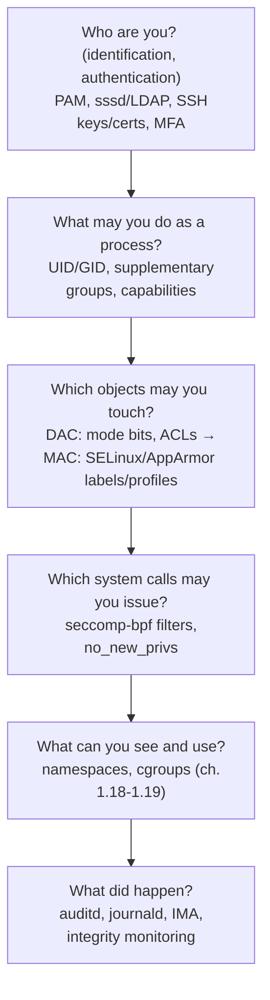

# 1.21 Linux security: capabilities, SELinux, AppArmor, seccomp, PAM, SSH hardening

| | |
|---|---|
| Level | Advanced |
| Priority tier | 0 |
| Lab venue | GCP VM (Ubuntu and a Rocky/RHEL-family VM for SELinux) |
| Part | Part 1: Linux, from the command line to the kernel and performance |
| Status | Drafted, labs **untested** |

## Why this matters for AI infrastructure

Picture a GPU cluster that holds model weights, proprietary data, and SSH keys that reach hundreds of nodes. The compute on that cluster is worth stealing too, because an intruder can put it to work on crypto-mining. All of that makes the cluster a shared, high-value target.

Hardening such a node helps, but the same hardening can silently destroy performance. It can also break GPU, InfiniBand and container access. So a good AI-infrastructure engineer has to do both jobs at once: harden the node, and know which controls to relax, which to keep, and why.

You will meet situations like these:

- A compliance team applies a CIS benchmark, and `nvidia-smi` stops working in containers.
- MPI jobs fail with `Operation not permitted` on cross-memory attach, and core dumps vanish when a NCCL crash needs debugging.
- Someone "fixes" an SELinux denial by running `setenforce 0`, and the audit finding follows you for a year.
- A pod runs `--privileged` "because the GPU did not show up".
- An SSH key with no passphrase, plus agent forwarding to every node, means one stolen laptop compromises the cluster.
- Secure Boot is enabled, and the NVIDIA kernel module refuses to load (`Lockdown: unsigned module loading is restricted`).
- A multi-tenant neocloud customer asks how their containers are isolated from the neighbour's.

We build the security model here from the kernel's point of view, starting where the kernel starts, with users and identity. From there we take setuid and discretionary access control, meaning the owner, group and other file permissions. Next come capabilities, which split root's power into pieces, and seccomp, which filters system calls. Mandatory access control follows with SELinux and AppArmor.

The chapter then covers PAM and sudo for authentication, SSH hardening, auditing, kernel and system hardening, Secure Boot, and the AI-cluster-specific adjustments. It connects to containers in chapter 1.19, to kernel modules in chapter 1.22, and to Kubernetes admission control, the cluster-side counterpart in section 12.

Read the rest of the chapter with one question in mind. Which control protects this node, and what does it cost the job running on it?

## Prerequisites and outcomes

This chapter assumes you already know file permissions and ownership (1.4/1.5), processes (1.8), `/proc` and `/sys` (1.10), boot and Secure Boot (1.14), and namespaces (1.19). If one of those is shaky, revisit it first. The controls in this chapter build directly on them.

After this chapter you can:

- Explain identification, authentication and authorisation. Tell the real, effective, saved and filesystem UIDs apart. Describe how setuid and `sudo` work, and why setuid programs are a primary attack surface.
- Read and manage `/etc/passwd`, `/etc/shadow`, `/etc/group`, and account policy.
- Explain PAM function types, control flags, stacks and modules, and read a real `/etc/pam.d/sshd`.
- Explain Linux capabilities, including the permitted, effective, inheritable, bounding and ambient sets. Read them from `/proc` and `getpcaps`, and drop them for a service or container.
- Explain seccomp-bpf, `no_new_privs`, and default container profiles.
- Explain SELinux (types, contexts, booleans, `audit2allow`, modes) and AppArmor (profiles, complain and enforce). Diagnose denials without disabling the controls.
- Harden SSH with keys, certificates, `sshd_config`, jump hosts and forwarding. Understand the internal SSH needs of MPI and Slurm launchers.
- Use auditd, `journalctl`, `last`, `faillog`, and file integrity tooling. Apply kernel and sysctl hardening, including Yama, dmesg restrict, kptr, unprivileged BPF, and user namespaces.
- State which CIS-style rules need adjustment on GPU and HPC nodes, and which rules must not be relaxed.
- Describe Kubernetes admission control and Pod Security as the cluster-side enforcement of the same ideas.

## 1. The security model in one picture

Suppose an engineer logs in and starts a training job. Before a single byte of model data is read, the kernel has already asked several questions about that request. Who is asking? What may this process do? Which files may it touch, and which system calls may it make?

Security on Linux is layered, and each layer answers one of those questions. A request from a user or a service passes through them in order. Read the diagram from top to bottom, starting with who is asking and ending with what happened. The third layer is where two access-control models meet: DAC, the permissions an owner sets, and MAC, a policy the owner cannot override. Section 6 takes them apart.



Several principles run through every section of this chapter. The first and most important is **least privilege**, which asks you to give a process only what it needs. Defence in depth means stacking several independent layers, so that one failure is not fatal. Where practical, aim for default deny. Keep separation of duties and auditability in view as well.

Shared clusters add one more principle to the list. Assume that a workload may be compromised, and limit the blast radius. A user's job must not reach another tenant's data or the management network, even when that job goes wrong.

## 2. Users, groups and the superuser

Suppose a service account can read a file it should never touch. Suppose, too, that a job seems to have root-like power on a shared node. Both problems start in the same place, in how the kernel thinks about users.

At the kernel level, users are only numbers. The kernel knows UIDs and GIDs, and user names exist only in user space. The only UID with special meaning to the kernel is **0**. Since Linux 2.2, even that special meaning has been split into capabilities, which section 4 covers.

### The account databases

Each account lives in a few small files, and each file has one job. The table shows what each file holds and who is allowed to read it, so you know where to look when an account misbehaves.

| File | Content |
|---|---|
| `/etc/passwd` | `name:x:UID:GID:comment(GECOS):home:shell`, world-readable. The `x` means the hash is in shadow; `*` or `!` in the shadow field means no password login; an empty field means *no password required* (never allowed) |
| `/etc/shadow` | `name:hash:lastchange:min:max:warn:inactive:expire:`, readable only by root; hash format `$6$` (SHA-512), `$y$` (yescrypt) etc. |
| `/etc/group`, `/etc/gshadow` | Group names, GIDs, members; group passwords are essentially unused (use `sudo`) |
| `/etc/shells` | Valid login shells (checked by `chsh` and some PAM modules) |
| `/etc/login.defs` | Defaults for account creation (UID ranges, password aging) used by `useradd` |
| `/etc/subuid`, `/etc/subgid` | Subordinate ID ranges for user namespaces (rootless containers, chapter 1.19) |

Pseudo-users are accounts for services, such as `daemon`, `nobody`, `www-data`, `slurm` and `munge`. They carry no login shell, either `/usr/sbin/nologin` or `/bin/false`. That lets a service run unprivileged without anyone ever logging in as it.

The numbering has meaning too. UID 0 is root. UIDs 1 to 99 or 999 are system accounts, and 1000 and above are humans. Clusters assign stable numeric UIDs through LDAP or SSSD, so file ownership matches on every node (chapter 6.24).

The block below shows the commands for inspecting and managing accounts.

```bash
id; id alice; getent passwd alice; getent group docker      # getent follows nsswitch (files, sss, ldap...)
sudo useradd -m -s /bin/bash -u 2001 -G video,render alice    # humans using GPUs often need video/render groups
sudo usermod -aG docker alice        # warning: docker group ≈ root on the host
sudo passwd -l alice                 # lock password login;   passwd -S alice : status
sudo chage -l alice ; sudo chage -M 90 -m 1 -W 14 alice       # password aging
sudo vipw ; sudo vipw -s             # safe editors with locking; never edit /etc/passwd with a plain editor
last ; lastb ; lastlog ; who ; w     # login history, failed logins (btmp), current sessions
```

Notice the warning on the `usermod` line, because it matters. Adding a user to the `docker` group gives that user root-equivalent power on the host. Treat that one step as a privileged decision.

Never share accounts. Give each person a personal account, and give each service its own unprivileged account. Automate that creation with a tool such as the Ansible `user` module or your identity provider, and remove or lock accounts when people leave.

Two quick checks catch the common mistakes. Look for a second UID 0 account with `awk -F: '$3==0' /etc/passwd`. Look for empty passwords with `sudo awk -F: '$2==""' /etc/shadow`.

### Process credentials: real, effective, saved, filesystem UIDs

A running process carries several IDs at once, and each one answers a different question.

- The effective UID (euid) decides permission checks, such as file access and most privileged operations.
- The real UID records who started the process, and it controls who may signal it.
- The saved set-user-ID (suid) lets a process drop privilege temporarily and regain it later.
- The filesystem UID is used for filesystem checks, and it rarely differs from the effective UID.

The kernel has clear rules for changing identity. A process may run a setuid executable if it can execute the file. A process with euid 0, or with `CAP_SETUID`, may become any user through `setuid()` and friends. An unprivileged process can only swap among its own real, effective and saved IDs.

`su` and `sudo` are setuid-root programs. They authenticate through PAM, then call `setuid()`. Run `ps -eo pid,euser,ruser,comm` to see both the effective and the real user of each process.

### Setuid, setgid and sticky bits

A setuid executable runs with the euid of its owner. Examples include `passwd`, `sudo`, `su`, `mount` and, on older systems, `ping`. These programs cross a privilege boundary, so a bug in one is a prime route for privilege escalation. A root-owned setuid copy of a shell is simply a root backdoor.

Run the two checks below to list setuid files and to see which mounts already carry the `nosuid` or `noexec` flags.

```bash
sudo find / -xdev -perm -4000 -type f -ls 2>/dev/null     # setuid files;  -perm -2000 for setgid
mount | grep -E 'nosuid|noexec'                           # data filesystems (/tmp, /scratch, /home) should usually be nosuid,nodev
```

Mount user-writable and data filesystems with `nosuid,nodev`. Add `noexec` where your workloads allow it, though many HPC sites cannot use `noexec` on scratch, because users run their own binaries there.

A sticky bit on a directory, such as `/tmp` with mode `1777`, lets only a file's owner delete it. Capabilities, covered in the next sections, let many programs drop setuid entirely. For example, `ping` now commonly uses `cap_net_raw`.

Audit setuid files on a schedule, and treat any file you did not expect as a finding.

## 3. Authentication: PAM, sudo, passwords

Before a user reaches a shell, the node has to answer a simple question. Who is this, and how do they prove it? The answer is assembled from several pieces, and PAM is the part most engineers meet first.

### PAM: Pluggable Authentication Modules

Suppose `sshd` rejects one user while another user gets in with the same password. The answer usually lies in PAM, the shared login desk that decides who gets in.

PAM stands for Pluggable Authentication Modules. Applications such as `login`, `sshd`, `sudo`, `su`, `passwd`, `cron` and `gdm` do not implement authentication themselves. They call **libpam**, and an administrator-written stack of **modules** makes the decision. Each application has its own file under `/etc/pam.d/<service>`, where the service name is the application's name. The file `/etc/pam.d/other` is the fallback, and it should deny. Each line has three parts: a type, a control flag, and a module with its arguments.

The type says which question the line answers.

| Type | Question answered |
|---|---|
| `auth` | Is the user who they claim (password, key, token, MFA)? |
| `account` | Is the account allowed now (expired, locked, time/host restrictions, `nologin`)? |
| `session` | Setup/teardown around a session (limits, home directory creation, logging, systemd session registration, `pam_limits`) |
| `password` | Changing credentials (complexity, hash algorithm, history) |

The control flag decides what happens when a module succeeds or fails. That small decision is how the rules stack. When a `required` module fails, the stack keeps going, which the table describes as keeping timing from leaking, but the final result is still a failure. A `requisite` failure stops the stack at once.

| Flag | Success | Failure |
|---|---|---|
| `required` | Continue; overall result can still succeed | Continue (so timing does not leak), but final result is failure |
| `requisite` | Continue | **Stop immediately, fail** |
| `sufficient` | **Stop immediately, succeed** (if no earlier `required` failed) | Continue |
| `optional` | Result ignored unless it is the only module | Ignored |
| `include` / `substack` | Pull in another file's stack for that type | |
| `[value=action ...]` | Advanced syntax mapping specific return codes to actions (`success=2 default=ignore`, etc.) | |

A classic stack comes from the chsh example, and it is worth tracing line by line. The line `auth sufficient pam_rootok.so` lets root pass straight through. `auth requisite pam_shells.so` requires the shell to be listed in `/etc/shells`. `auth sufficient pam_unix.so` checks the password, and `auth required pam_deny.so` denies by default.

Follow the order. If root passes, the stack is done. If root does not pass and the shell check fails, the stack stops with failure. If the password is correct, the stack succeeds. Otherwise, the deny line gives failure.

Several modules do the everyday work, and the first group checks the password itself. `pam_unix` handles traditional passwords and `/etc/shadow`, and its `nullok` option allows empty passwords, which should never be set. `pam_sss` connects to SSSD, LDAP or Kerberos, and `pam_pwquality` checks password strength.

A second group controls access. `pam_faillock` and `pam_tally2` lock an account after repeated failures. `pam_limits` applies `/etc/security/limits.conf` and `limits.d`, and `pam_access` uses `/etc/security/access.conf` as a host and user allow list. `pam_time` and `pam_nologin` restrict when logins happen. `pam_nologin` reads `/etc/nologin` to block non-root logins during maintenance, and `pam_wheel` restricts `su` to a group.

Multi-factor modules include `pam_google_authenticator`, `pam_oath` and `pam_u2f`. `pam_systemd` registers the session with logind. On HPC nodes, `pam_slurm_adopt` lets only users with a running job on the node log in, and moves their SSH session into the job's cgroup. Others include `pam_namespace`, `pam_env` and `pam_exec`.

The commands below show where the stacks live and how to inspect them. Run them before you change anything.

```bash
ls /etc/pam.d ; cat /etc/pam.d/sshd ; cat /etc/pam.d/common-auth       # Debian/Ubuntu (generated by pam-auth-update)
cat /etc/pam.d/system-auth /etc/pam.d/password-auth                      # RHEL family (managed by authselect)
man -k pam_ ; man pam.conf ; man pam_faillock
grep password.*unix /etc/pam.d/*         # which hash algorithm is used when SETTING passwords (e.g. sha512 / yescrypt)
faillock --user alice ; faillock --user alice --reset
```

**A broken PAM stack can lock everyone out, including root.** Keep a root console session open while you edit, and keep BMC console access ready too. Test in a second session, and keep a copy of the original file. Where you can, prefer the distribution tools, `authselect` and `pam-auth-update`, over hand edits of generated files.

One small detail explains a common puzzle. Password checks use whatever hash the stored value indicates, because libcrypt detects it automatically. The algorithm used when setting a password, however, is configured on the `password` line. `/etc/login.defs` matters mostly for tools that bypass PAM.

### sudo and su

`sudo` runs a command as another user, by default root. It follows the rules in `/etc/sudoers` and `/etc/sudoers.d/*`. Always edit those files with `visudo`, because it checks the syntax before saving. The file below gives one group a few GPU commands, and nothing more.

```sudoers
# /etc/sudoers.d/gpu-ops   (mode 0440)
Cmnd_Alias GPUOPS = /usr/bin/nvidia-smi, /usr/bin/systemctl restart nvidia-persistenced
%gpuops ALL=(root) GPUOPS               # a group may run only listed commands as root
Defaults:%gpuops log_output, !visiblepw, use_pty
Defaults timestamp_timeout=5, logfile="/var/log/sudo.log"
```

Grant specific commands rather than `ALL` wherever you can. Many programs, including editors, pagers, `find`, `awk`, `tar`, `less` and `vim`, provide shell escapes, so `sudo vim` gives full root. Use `sudoedit` or `NOEXEC` to close that route.

Decide who gets sudo through group membership. The group is `wheel` on RHEL and `sudo` on Debian. Log invocations through `sudo -l`, journald or I/O logging, and keep the `Defaults use_pty` and `requiretty` policies deliberate.

`su -` starts a login shell as root and needs root's password. Prefer `sudo -i` instead, because it keeps individual accountability. Disable direct root SSH login as well.

`NOPASSWD` is common for automation accounts, but it must be limited to specific commands and protected by good SSH key security. `Defaults stay_setuid` keeps the real UID as root for programs that dislike a non-root ruid. Understand the side effects before you use it.

### Passwords and authentication factors

A sound password policy favours long passphrases over complexity rules. It forbids reuse, rate-limits failures with `pam_faillock`, and sets password aging only where policy demands it. Interactive access to bastions needs MFA.

Machines should use **keys, not passwords**. Use SSH keys or certificates (section 7), keep service credentials in a secret manager, and issue short-lived tokens. Centralise accounts with LDAP/SSSD or FreeIPA, so that locking or disabling an account happens in one place. Protect backups of `/etc/shadow`, and treat any exposed hash as compromised.

## 4. Capabilities: splitting root into pieces

Suppose a server must bind a port below 1024, but it should never be able to load a kernel module. Traditional Unix offers only two kinds of process: root, which is all-powerful, and everyone else.

Linux breaks root's powers into about 40 **capabilities**. Each capability is a distinct privilege, one key rather than the whole ring, and each can be granted, dropped or inherited separately. A process with euid 0 *normally* holds all of them. A process with a few capabilities and a non-zero UID can still do just those operations.

Some capabilities matter most in infrastructure work. The table lists them.

| Capability | Allows |
|---|---|
| `CAP_NET_BIND_SERVICE` | Bind ports below 1024 |
| `CAP_NET_RAW` | Raw sockets (`ping`, packet crafting) |
| `CAP_NET_ADMIN` | Configure interfaces, routes, firewall, traffic control, many RDMA/network settings |
| `CAP_SYS_ADMIN` | A huge catch-all: mount, namespaces, many `ioctl`s, BPF (older), `swapon`, hostname…; "the new root" |
| `CAP_SYS_PTRACE` | Trace/inspect arbitrary processes, `process_vm_readv` |
| `CAP_SYS_MODULE` | Load/unload kernel modules |
| `CAP_SYS_RAWIO` | Raw I/O ports and `/dev/mem`-style access |
| `CAP_SYS_NICE` | Set real-time priorities, change nice of others, set CPU affinity of others |
| `CAP_SYS_RESOURCE` | Override resource limits, quotas, reserved space |
| `CAP_IPC_LOCK` | `mlock`, huge pages: needed by RDMA applications to pin memory beyond `ulimit -l` |
| `CAP_DAC_OVERRIDE`, `CAP_DAC_READ_SEARCH` | Bypass file permission checks |
| `CAP_CHOWN`, `CAP_FOWNER`, `CAP_SETUID`, `CAP_SETGID`, `CAP_SETFCAP` | Change ownership; act as owner; switch IDs; set file capabilities |
| `CAP_KILL`, `CAP_AUDIT_WRITE`, `CAP_MKNOD`, `CAP_PERFMON`, `CAP_BPF`, `CAP_CHECKPOINT_RESTORE` | Signals to any process; audit records; create device nodes; performance monitoring; BPF; checkpoint/restore |

Notice that `CAP_SYS_ADMIN` covers so much that the table calls it "the new root".

Each thread has five capability sets. They work together, and each one has its own role.

| Set | Meaning |
|---|---|
| **Permitted** | Upper bound of what the thread may hold in its effective set |
| **Effective** | Capabilities actually checked by the kernel right now |
| **Inheritable** | May be passed across `execve` (together with file inheritable sets) |
| **Bounding** | A limit on what can ever be gained through `execve`; dropping from it is irreversible for the process tree |
| **Ambient** | Capabilities kept across `execve` of non-privileged programs (lets unprivileged programs inherit selected capabilities safely) |

The effective set is what the kernel checks at any given moment. The bounding set caps what can ever be gained through `execve`. Once you drop a capability from that set, you cannot undo it for that process tree.

**File capabilities** can be attached to executables through the extended attribute `security.capability`, replacing setuid-root. Set one with `sudo setcap cap_net_bind_service=+ep /usr/local/bin/myserver`, and list them across the system with `getcap -r / 2>/dev/null`. They interact with `no_new_privs`. Filesystem mount options matter too, because `nosuid` makes the kernel ignore them.

The commands below read the sets of a running process, decode a mask, and drop capabilities from a shell. The systemd lines at the bottom are unit settings, not commands, and they lock a service down the same way.

```bash
grep Cap /proc/self/status                     # CapInh CapPrm CapEff CapBnd CapAmb as hex masks
capsh --decode=000001ffffffffff                # decode a mask (apt install libcap2-bin)
getpcaps $$ ; getpcaps 1
capsh --print
sudo setpriv --bounding-set=-sys_admin,-sys_module,-sys_rawio --no-new-privs -- bash    # drop and lock
systemd-analyze security sshd.service          # exposure score of a unit, incl. capabilities
# systemd unit hardening:
#   CapabilityBoundingSet=CAP_NET_BIND_SERVICE   AmbientCapabilities=CAP_NET_BIND_SERVICE
#   NoNewPrivileges=yes   ProtectSystem=strict   ProtectHome=yes   PrivateTmp=yes   PrivateDevices=yes
#   SystemCallFilter=@system-service   RestrictAddressFamilies=AF_INET AF_INET6   MemoryDenyWriteExecute=yes
```

Containers start with a reduced bounding set. Docker's default drops `SYS_ADMIN`, `NET_ADMIN`, `SYS_MODULE`, `SYS_PTRACE`, `SYS_TIME` and more. Kubernetes `securityContext.capabilities.drop: ["ALL"]` drops everything first, and then `add` grants only what is needed.

`--privileged` (Docker) or `privileged: true` (Kubernetes) is a different story. It gives all capabilities, all devices, and disables seccomp and LSM confinement. That makes the container effectively root on the host, so it must never be a casual fix.

GPU work needs less than you might think. Access needs device nodes and device-cgroup permission, **not** privilege. RDMA applications need `IPC_LOCK`, and possibly `SYS_RESOURCE`. Profilers need `SYS_ADMIN` or `PERFMON`. NVIDIA tools that change GPU clocks or persistence mode need the host. Note that `CAP_SYS_ADMIN` inside a user namespace is scoped to that namespace, unlike on the host (chapter 1.19).

Before you grant a capability, ask which single operation the process needs. Then grant that one, and drop everything else.

## 5. seccomp: filtering system calls

In a container-escape demo, the attacker's next move is a system call the service never needed, such as `mount` or `ptrace`. seccomp is the layer that refuses that call.

A program asks the kernel for something through a system call every time it does real work. seccomp lets you decide, call by call, which of those requests get through. **seccomp** stands for secure computing mode. A process installs a filter, and for each system call the filter decides what happens. The options are to allow the call, return an error, kill the process or thread, send a signal, log it, or notify a supervisor. **seccomp-bpf** writes the filter as a classic BPF program. The program inspects the system call number and its arguments, but not the contents of pointers.

Filters are inherited by children, and they cannot be removed. When several filters stack, the most restrictive result wins.

An unprivileged process must first set **`no_new_privs`** (`prctl(PR_SET_NO_NEW_PRIVS)`) before it can install a filter. That flag also makes `execve` ignore setuid bits and file capabilities. So a filtered process cannot regain privilege through a setuid binary.

Use these commands to check the mode of a process, and the default profile of a container.

```bash
grep -E 'Seccomp|NoNewPrivs' /proc/self/status        # Seccomp: 0 none, 1 strict, 2 filter
docker run --rm alpine grep Seccomp /proc/self/status # 2 = default profile active
docker run --rm --security-opt seccomp=unconfined alpine grep Seccomp /proc/self/status   # 0
```

The `Seccomp` field in the output tells you which mode is in force. Docker and containerd ship a **default profile**. It allows most system calls and blocks dangerous ones, such as `mount`, `kexec_load`, `init_module`, `reboot`, `ptrace` on older kernels, `bpf`, `perf_event_open` and `keyctl`.

Kubernetes accepts `securityContext.seccompProfile.type: RuntimeDefault`, which is recommended for all pods, or `Localhost`. Systemd uses `SystemCallFilter=`. Tools such as `strace -c`, `oci-seccomp-bpf-hook` or `inspektor-gadget` help you generate allow-lists.

Gregg's observability caveat applies here. Default profiles are why `perf`, `strace` and `bpftrace` fail inside containers. Writing tight custom profiles for AI workloads is often impractical, because frameworks and drivers use many calls. `RuntimeDefault` is the sensible baseline, and `unconfined` is reserved for trusted debug pods.

## 6. Mandatory access control: SELinux and AppArmor

Here is a question to keep in mind. A service runs as root and touches a file that its owner never meant it to see. What stops it? The answer depends on which access control layers are active.

**Discretionary access control (DAC)** is the owner, group and other permission model you already know. The owner decides who gets access, and root bypasses the check. **Mandatory access control (MAC)** adds a system-wide policy that the owner cannot override. MAC is implemented as a **Linux Security Module (LSM)**. Even root, or a compromised service running as root, can touch only what that policy allows.

A useful picture is a parcel with two labels. The owner writes one label and decides who may open it. The shipping company writes the other, and the owner cannot change that one.

DAC and MAC are *both* checked. MAC can only deny more. Run `cat /sys/kernel/security/lsm` to see which LSMs are active on your node.

### SELinux (RHEL, Rocky, Fedora, Amazon Linux; also used by Android)

Suppose a service worked before a reboot and now cannot read its own data directory. SELinux is one of the first places to look.

SELinux labels every process and object with a **security context** in the form `user:role:type:level`. Think of the context as a sticker that the policy reads before it allows anything. In the standard targeted policy, the type matters most. A type-enforcement rule says, for example, that domain `httpd_t` may read files of type `httpd_sys_content_t`. Everything not explicitly allowed is denied, and each denial is logged as an AVC message.

These commands cover the daily SELinux work: checking the mode, reading denials, and fixing labels.

```bash
getenforce ; sestatus                      # Enforcing / Permissive / Disabled; policy name
sudo setenforce 0|1                        # runtime toggle (permissive/enforcing); not persistent. Persistent: /etc/selinux/config
ls -Z /var/www ; ps -eZ | head ; id -Z     # file, process and user contexts
sudo ausearch -m avc,user_avc -ts recent   # recent denials (auditd) ; also: journalctl -t setroubleshoot
sudo sealert -a /var/log/audit/audit.log   # setroubleshoot: human-readable explanations and suggested fixes
sudo audit2why < denials.txt ; sudo audit2allow -M mymod < denials.txt   # generate a local policy module (review carefully)
sudo semodule -i mymod.pp ; semodule -l
getsebool -a | grep container ; sudo setsebool -P container_use_devices on     # booleans: policy switches
sudo semanage fcontext -a -t container_file_t '/scratch/models(/.*)?' ; sudo restorecon -Rv /scratch/models
sudo semanage port -a -t ssh_port_t -p tcp 2222        # allow sshd on a nonstandard port
chcon -t ... file                          # temporary relabel; restorecon resets to policy
```

The three modes behave differently. Enforcing denies and logs. Permissive only logs, which is useful when you develop policy for one domain with `semanage permissive -a type_t`. Disabled removes the labels, and turning SELinux back on requires a full relabel at the next boot, triggered by `touch /.autorelabel`.

When something is denied, follow a fixed order. (1) Reproduce the problem. (2) Read the AVC with `ausearch` or `sealert`. (3) Check whether a boolean, a file label (`semanage fcontext` with `restorecon`), or a port label fixes it. (4) Only then consider a custom module with `audit2allow`, reviewed for over-breadth. Do not run `setenforce 0` or disable SELinux as the fix.

Typical causes are these. Files that are moved, rather than copied, keep their old label. Data in a non-standard directory needs a label. Containers need `container_file_t` on bind mounts, and the `:z` and `:Z` flags in Docker or Podman relabel them.

GPU and RDMA device nodes need a type that the container domain may access, through `container_use_devices`, `container-selinux` and NVIDIA Container Toolkit policies. The exact mechanism varies by distribution and toolkit version, so verify it against current documentation.

### AppArmor (Ubuntu, Debian, SUSE)

AppArmor confines programs with path-based profiles instead of labels. Think of a profile as a list of what one program may touch, written in terms of paths. Each profile lists the files, capabilities, network and mount rules that a program may use.

Profiles are simpler to write and reason about than SELinux policy. They are less granular for complex systems, though. Use the commands below to see which profiles are loaded and to switch one between modes.

```bash
sudo aa-status                              # loaded profiles; enforce vs complain; confined processes
ls /etc/apparmor.d ; cat /etc/apparmor.d/usr.sbin.tcpdump
sudo aa-complain /usr/sbin/foo ; sudo aa-enforce /usr/sbin/foo      # per-profile modes (apparmor-utils)
sudo aa-genprof /usr/bin/myapp ; sudo aa-logprof                     # build/update a profile from logged accesses
sudo apparmor_parser -r /etc/apparmor.d/profile ; journalctl -k | grep -i 'apparmor="DENIED"'
```

Docker applies `docker-default` to containers. Kubernetes can set a profile per container, through annotations on older versions or `securityContext.appArmorProfile` on newer ones. Verify the version you run. `--security-opt apparmor=unconfined` turns the profile off. Recent Ubuntu releases also use AppArmor to restrict unprivileged user namespaces (chapter 1.19).

Use whatever your distribution ships and supports. That means SELinux on the RHEL family, and AppArmor on Ubuntu, Debian or SUSE. Running both is not the norm.

In an AI cluster, keep MAC **on**. Handle GPU, InfiniBand, NFS, Lustre and scratch paths with labels or profiles. Fleets that disable MAC "for performance" are usually disabling it for convenience, since the overhead is small. Keep MAC on, and fix the labels or profiles instead.

## 7. SSH hardening

SSH is the front door to every node, and it is also the path an attacker uses to move sideways once inside. Harden it with care.

Use **public-key** or certificate authentication, and disable passwords. Forbid root login, or restrict it to `prohibit-password` for break-glass access. Use modern algorithms such as Ed25519. Protect private keys with passphrases and an agent such as `ssh-agent`, or use hardware keys such as FIDO2 `ed25519-sk`.

**SSH certificates** scale far better than copying `authorized_keys` to thousands of nodes. A certificate authority (CA) signs user and host keys, with principals and an expiry. Set `TrustedUserCAKeys` and `AuthorizedPrincipalsFile`, and keep validity short, measured in hours. Use HostCertificate to remove trust-on-first-use prompts. Tools include `ssh-keygen -s`, HashiCorp Vault SSH CA, step-ca and Teleport.

Put cluster nodes behind a bastion or jump host, reached with `ProxyJump`. Restrict inbound SSH with a network ACL or firewall, and log everything.

The drop-in file below sets the hardening options. Validate it with `sudo sshd -t`, reload the service, and keep an existing session open while you test.

```bash
# /etc/ssh/sshd_config.d/10-hardening.conf   (validate: sudo sshd -t ; then reload, keep an existing session open)
PermitRootLogin no
PasswordAuthentication no
KbdInteractiveAuthentication no          # (ChallengeResponseAuthentication on older versions)
PubkeyAuthentication yes
AuthenticationMethods publickey          # or publickey,keyboard-interactive for MFA
AllowGroups ssh-users hpc-users
MaxAuthTries 3
LoginGraceTime 30
ClientAliveInterval 300
ClientAliveCountMax 2
X11Forwarding no
AllowAgentForwarding no                  # prefer ProxyJump; agent forwarding exposes your agent to the remote root
AllowTcpForwarding no                    # enable per-group via Match blocks only where needed
PermitUserEnvironment no
UsePAM yes
LogLevel VERBOSE                         # logs key fingerprints
Match Group hpc-users
    AllowTcpForwarding yes
```

The `AllowAgentForwarding` line deserves attention. Agent forwarding exposes your agent to the remote root, so prefer `ProxyJump`. The `Match Group hpc-users` block turns on TCP forwarding for that group alone.

The next block covers key creation, copying keys, jump hosts, and checks.

```bash
ssh-keygen -t ed25519 -a 100 -C "alice@lab" -f ~/.ssh/id_ed25519
ssh-copy-id -i ~/.ssh/id_ed25519.pub alice@node01     # install the public key (permissions: ~/.ssh 700, authorized_keys 600)
ssh -J bastion node01 ; ssh -o ProxyJump=bastion node01
sudo sshd -T | sort | less                            # the effective configuration
ssh -vvv node01                                       # client-side debugging
ssh-audit node01                                      # third-party audit of algorithms
journalctl -u ssh -u sshd -f ; sudo grep 'Failed password' /var/log/auth.log
fail2ban-client status sshd                           # ban repeated failures (or pam_faillock)
```

Use `sudo sshd -T` to see the effective configuration. Cluster work adds its own requirements. MPI launchers, such as `mpirun` with the rsh or ssh launcher, `pdsh`, and Horovod or `torchrun` multi-node helpers, often need non-interactive node-to-node SSH. Slurm's `srun` does not, because it uses `slurmd` and MUNGE instead.

Restrict node-to-node SSH to the private management network. Use per-user keys or host-based certificates limited to compute nodes. Add `pam_slurm_adopt`, so that only users with a running job can log in. Consider disabling SSH to compute nodes for users entirely, and offer `srun --pty` instead. Keep SSH host keys unique per node, because golden images must regenerate them (chapter 1.28).

## 8. Auditing, logging and integrity

A login happens at three in the morning, and nobody can say who it was. Logs answer that question, but only if you set them up in advance. Start with the audit subsystem. **auditd** records security-relevant events from the kernel audit subsystem: syscalls, file watches, logins, privilege use and SELinux denials. Its rules live in `/etc/audit/rules.d/*.rules`. For example, `-w /etc/passwd -p wa -k identity` watches the password file, and `-w /etc/sudoers -p wa -k scope` watches the sudo rules.

Some rules cost more than others. The rule `-a always,exit -F arch=b64 -S execve -k exec` records every program execution, but it creates a lot of volume, so expect a warning. Query events with `ausearch -k identity`, summarise them with `aureport`, and ship them to a central log system. Boot with `audit=1` to cover early processes.

Journald and syslog hold authentication logs, in `/var/log/auth.log` or `/var/log/secure`, along with `sudo` I/O logs and the output of `last` and `lastb`. Forward these logs off the node, because an attacker with root deletes local logs.

File integrity tools tell you when something changed. AIDE or Tripwire keep baselines, and `rpm -V` and `debsums` verify package files. IMA and EVM provide kernel integrity measurement, and `dm-verity` protects immutable roots. Golden-image fleets can compare checksums of the image.

Keep the system patched. Apply kernel and package security updates through `unattended-upgrades` or `dnf-automatic`, gated by canary testing. Scan images and hosts for CVEs, and plan reboots or live patching. GPU nodes must couple kernel updates with driver rebuilds (chapter 1.22).

Watch for malware and anomalies too. Unexpected high-CPU processes can be cryptominers, and they show up in `top`. Other signs include DCGM utilisation with no scheduled jobs, outbound connections to unknown hosts (`ss -tnp`), new setuid files, new systemd units and cron jobs, and a modified `authorized_keys`.

Decide now where these logs go and who reads them.

## 9. Kernel and system hardening

Suppose you apply every sysctl in a CIS checklist, and then a profiler or an MPI job stops working. The table below lists kernel and system settings that harden a node. Each row gives the effect and a note on the cost. Read the notes before you apply a row, because some settings break GPU or MPI work.

| Setting | Effect | Notes |
|---|---|---|
| `kernel.yama.ptrace_scope=1` | Restrict ptrace to descendants (2 admin only, 3 none) | Debuggers, MPI cross-memory-attach and profilers are affected; test MPI stack before raising |
| `kernel.dmesg_restrict=1`, `kernel.kptr_restrict=1/2` | Hide kernel log and addresses from unprivileged users | Reduces info leaks; affects some profilers |
| `kernel.unprivileged_bpf_disabled=1` | Block unprivileged eBPF | Recommended; observability agents run privileged |
| `kernel.perf_event_paranoid=2..3` | Restrict `perf` for unprivileged | Set 1 or lower deliberately for profiling users (chapter 1.24) |
| `kernel.randomize_va_space=2` | ASLR | Leave on |
| `kernel.kexec_load_disabled=1`, `kernel.modules_disabled=1` | Block kexec / further module loading | `modules_disabled` is one-way until reboot; incompatible with GPU driver loading after boot |
| `fs.protected_hardlinks/symlinks/fifos/regular=1/2`, `fs.suid_dumpable=0` | Mitigate `/tmp` races; no setuid core dumps | On by default in modern kernels |
| `net.ipv4.conf.*.rp_filter`, `accept_redirects=0`, `send_redirects=0`, `net.ipv4.tcp_syncookies=1` | Network stack hardening | Careful with multi-homed GPU nodes: strict `rp_filter` can drop legitimate traffic on multiple fabrics |
| `net.ipv4.ip_forward=0` | No routing unless needed | Container hosts and CNI need 1 |
| Boot options: `lockdown=integrity`, `init_on_alloc=1`, `slab_nomerge`, `pti`, mitigations | Kernel self-protection | Mitigation costs: measure; `mitigations=off` is a security decision |
| `module.sig_enforce`, Secure Boot, kernel lockdown | Only signed modules load | Required to sign NVIDIA modules (below) |
| Core dumps: `kernel.core_pattern`, `LimitCORE`, `ulimit -c` | Control where crashes go | CIS says disable; GPU/NCCL debugging needs them, so send to a protected directory (below) |
| `/tmp`, `/var/tmp`, `/dev/shm` mounted `nosuid,nodev,noexec` | Block executables in world-writable dirs | `/dev/shm` `noexec` can break some frameworks; test |
| Disable unused services, protocols and filesystems (`systemctl list-unit-files --state=enabled`, `modprobe.d` blacklists) | Reduce attack surface | |

Measure your hardening rather than guessing at it. Tools such as `lynis audit system`, `systemd-analyze security`, and OpenSCAP with the CIS or STIG profile (`oscap xccdf eval`) give you a score. Ansible roles for the CIS benchmarks exist too, such as the community `ansible-lockdown` projects. Review them before you apply them. Benchmarks are a baseline, not a goal, because score gaming is not security.

### Secure Boot and module signing (links to 1.14, 1.22)

With UEFI Secure Boot, the firmware runs only signed boot loaders. The signed kernel then enforces **lockdown**, and it loads only kernel modules signed by a key in the kernel's trusted keyrings. The NVIDIA driver, open or proprietary, is out-of-tree. So on a Secure Boot node you must **sign it** with a key enrolled in the firmware `db` or the Machine Owner Key (MOK) list.

Generate a key pair first. Then run `mokutil --import` on the public key, which is confirmed at the next boot on the console. Sign `nvidia*.ko` with the kernel's `sign-file` tool. DKMS can do this automatically once you configure the key paths. Finally, verify with `modinfo nvidia | grep sig`.

A failed load shows `Lockdown: ... unsigned module loading is restricted` or "Required key not available" in `dmesg`. Disabling Secure Boot is simpler, but it weakens the boot chain, and many compliance regimes forbid it. Fleets therefore sign modules in the image pipeline.

## 10. Hardening AI/HPC nodes without breaking them

Apply an enterprise baseline to a GPU node unchanged, and something may stop working. The project's operations notes (Volume 10, chapter 3, rewritten and checked for consistency) make the point plainly. Enterprise baselines were written for web servers, so GPU clusters need documented, deliberate exceptions. The table sets out each common rule, why it hurts AI nodes, and a better stance.

| Typical baseline rule | Why it hurts AI nodes | Better stance |
|---|---|---|
| Disable core dumps everywhere | NCCL/CUDA/PyTorch crashes need cores and symbols | Enable cores to a protected, quota-limited location (`kernel.core_pattern=/var/crash/%e.%p`, mode 0700, retention), or use `systemd-coredump`; strip sensitive data handling policy |
| `ptrace_scope` ≥ 2 | Breaks debuggers, `gdb attach`, some MPI shared-memory transports (CMA) | Keep 1; verify MPI (`--mca btl_vader_single_copy_mechanism` etc., flag: version dependent) |
| Default-deny host firewall on all interfaces | Adds per-packet cost on TCP paths; misconfigured rules break RoCE (UDP 4791) and storage; native InfiniBand bypasses the kernel IP stack so a host firewall does not see it | Keep a firewall on management/user-facing interfaces; segment the fabrics physically (VLANs, partition keys/PKeys on IB, switch ACLs); explicitly permit RoCEv2 where used; document the decision |
| Strict `rp_filter`, no forwarding | Multi-NIC nodes with several subnets; CNI hosts | Per-interface settings, `rp_filter=2` (loose) where needed |
| Disable SELinux/AppArmor | Seems to "fix" GPU access | Keep enforcing; label devices, use container policies/booleans, write minimal modules |
| `noexec` on `/tmp` `/dev/shm` `/scratch` | Frameworks JIT-compile kernels, extract wheels, use shm | Test per workload; apply `nosuid,nodev` universally, `noexec` only where it works |
| Disable all SSH between nodes | MPI/launchers | Allow node-to-node SSH on the management network with scoped keys, or use `srun`/`pam_slurm_adopt` |
| `mitigations` always on | Some CPU-bound loops pay a visible cost | Keep defaults unless benchmarked and risk-accepted; multi-tenant systems should keep them |
| Passwordless `sudo` for the automation account | Needed for Ansible/BCM | Scope to specific commands, limit source IPs, key in a vault |

Physical and platform controls matter as much as operating-system controls. Platform controls include BMC/Redfish network isolation and credential rotation (chapters 6.x and Part 1b), firmware signing, out-of-band management on a separate VLAN, and IB partition keys with Subnet Manager protection.

Tenant isolation adds secure erase of NVMe scratch between tenants, GPU memory scrubbing or reset between jobs, MIG for hardware-level partitioning, and confidential-computing modes where tenants demand them (H100 and later; verify support and performance cost).

Container workloads on shared nodes need a tight baseline. Run as non-root with `runAsNonRoot`, and set `allowPrivilegeEscalation: false`. Use `readOnlyRootFilesystem: true` where possible, drop all capabilities, and set `seccompProfile: RuntimeDefault`. Avoid `hostPath` to sensitive directories. Do not use `hostPID/hostIPC/hostNetwork` unless you can justify them. Set resource limits, use signed and scanned images from trusted registries, and write network policies. Finally, remember that the Docker socket mounted into a container is root on the host.

## 11. Unix permissions you must not forget

Permissions break quietly, and that is what makes them dangerous. With `StrictModes yes`, SSH silently ignores keys whose permissions are wrong. Check the ownership and mode of `/etc/ssh`. Keep `~/.ssh` at 700, and keep `authorized_keys` and private keys at 600. Set `/etc/shadow` to 000 or 640 with `root:shadow`, and set `/etc/sudoers.d` to 440.

Next, look for files anyone can change. Find world-writable files with `find / -xdev -type f -perm -0002`, and world-writable directories without a sticky bit with `find / -xdev -type d -perm -0002 -not -perm -1000`. Files with no matching owner are another hazard. After migrations, a file's UID may no longer exist in the password database. Find these with `find / -xdev -nouser -o -nogroup`.

For day-to-day sharing, set `umask` to 027 or 077 for service accounts. ACLs (`getfacl`, `setfacl`) give you finer sharing than group bits. Shared project directories use the setgid bit, set with `chmod 2770`.

Finally, list every listening service with `lsof` or `ss -tlnp`. Each open port needs a reason.

## 12. Kubernetes admission control and Pod Security (cluster-side)

Suppose a platform team wants to ban privileged pods across a whole cluster. No single kernel can enforce that rule, because the pods do not exist yet. In Kubernetes, the **API server** can stop a dangerous workload before it is ever scheduled. The notes from *Production Kubernetes* (chapter 8) describe the flow.

Every request is authenticated and authorised with RBAC. Then it passes **mutating** admission, which may change the object. The ServiceAccount controller adds a default service account and token volume, and sidecar injectors add containers. Schema validation comes next, followed by **validating** admission, which may only accept or reject. For example, `NamespaceLifecycle` refuses to create objects in a terminating namespace.

Only if all validating controllers admit the object does it reach etcd. One rejection is enough to deny it. Admission controllers sit on the **critical path** of every matching request. Webhooks add latency, and they can take the cluster down if they are unavailable.

- **In-tree controllers** are enabled through API server flags, `--enable-admission-plugins` and `--disable-admission-plugins`. They include `LimitRanger`, `ResourceQuota`, `ServiceAccount`, `NamespaceLifecycle`, `PodSecurity` and others. Managed Kubernetes services restrict which flags you can change, which historically pushed features out of tree.
- **Dynamic admission webhooks** (`MutatingWebhookConfiguration`, `ValidatingWebhookConfiguration`) work differently. The API server POSTs an `AdmissionReview` over TLS to your service. The review carries the object, the operation, user info and the old object. Your service answers allow or deny, and a mutating webhook also returns a JSONPatch. You configure match rules, a `failurePolicy` (**Fail** closed versus **Ignore** open, a security trade-off), `timeoutSeconds`, `sideEffects`, and a `namespaceSelector`. Exclude `kube-system` and the webhook's own namespace in that selector to avoid a deadlock. Set `reinvocationPolicy` too, along with the CA bundle, which cert-manager commonly issues.
- **PodSecurityPolicy** was removed in Kubernetes 1.25. Its in-tree replacement is **Pod Security Admission**, which enforces the three **Pod Security Standards** through namespace labels. The standards are `privileged`, `baseline` and `restricted`. `baseline` blocks known escalations: host namespaces, privileged containers, risky hostPath volumes, added capabilities beyond a safe set, and unsafe sysctls. `restricted` requires non-root, drop ALL capabilities, seccomp RuntimeDefault, and no privilege escalation. Each standard runs in one of three modes: `enforce`, `audit` or `warn`.
- **Policy engines** express rules in other forms. OPA **Gatekeeper** uses Rego constraint templates, and **Kyverno** uses YAML policies that can mutate and generate. Rules can say things like "images only from our registry", "no latest tag", "GPU pods must set limits", or "no hostPath outside allow-list". CEL-based `ValidatingAdmissionPolicy` runs in-process without a webhook, and it is the newer built-in alternative. Verify its availability by version.

For GPUs, the device plugin and GPU Operator components legitimately run privileged, with hostPath, in system namespaces. User namespaces get `restricted` or `baseline`. Scheduling controls, such as taints and tolerations, `runtimeClassName` and node selectors, are policy too.

The Kubernetes security chapters later in the book go deeper, covering RBAC, service accounts, network policies, secrets and supply-chain controls. Before you enable a webhook, decide what happens if it is down.

## 13. Failure modes and troubleshooting

Most security failures show up as a vague symptom, such as a denied file or a job that will not start. The table pairs each symptom with its likely cause and the check that confirms it. Use it as a first pass before you start changing configuration.

| Symptom | Likely cause | Check / fix |
|---|---|---|
| Locked out after PAM edit | Broken stack ordering / missing module | Use console/rescue; restore backup; test with a second session in future |
| SSH key rejected | Permissions of `~/.ssh` or home, wrong user, `AllowGroups`, SELinux context of `.ssh`, key type disabled | `journalctl -u sshd`, `sshd -T`, `ssh -vvv`, `restorecon -R ~/.ssh` |
| `Permission denied` for root on a file | SELinux/AppArmor, immutable attribute (`lsattr`), read-only mount, capabilities dropped | `ausearch -m avc`, `aa-status`, `lsattr`, `mount` |
| Service works with `setenforce 0` only | Missing label/boolean/policy | Do not leave permissive; find denial and fix label or boolean |
| Container cannot open `/dev/nvidia*` | Device cgroup, SELinux type, missing toolkit/CDI | `ls -lZ /dev/nvidia*`, `getsebool container_use_devices`, runtime config |
| MPI "Operation not permitted" on shared memory | `ptrace_scope` or missing `SYS_PTRACE` in container | Check Yama setting, transport options |
| `nvidia` module fails to load, Lockdown message | Secure Boot with unsigned module | Sign module / enroll MOK |
| `sudo: effective uid is not 0` | `sudo` binary lost setuid bit or filesystem mounted `nosuid` | `ls -l $(which sudo)`, mount options |
| Users cannot log in after identity change | SSSD/LDAP outage, NSS cache, PAM `account` failure | `getent passwd user`, `sssctl`, `systemctl status sssd` |
| Everything slow at login | DNS reverse lookups (`UseDNS`), LDAP timeouts, PAM modules | `sshd` debug logs, SSSD logs |
| Audit log fills disk | Over-broad rules (execve on a busy node) | Tune rules; `max_log_file_action`; central shipping |
| Cluster-wide API errors after enabling a webhook | Webhook down with `failurePolicy: Fail`, matched itself | Exclude system namespaces; HA webhook; emergency delete configuration |

Notice how often the cause is a layer you have already read about, such as PAM, SELinux or Secure Boot. Run the check in the right-hand column first. Its output usually tells you which section to reread.

## 14. Hands-on lab: harden a node step by step

Start with a practice run that needs no VM. Run the self-checking Python lab first. It verifies PAM stack evaluation (`required`, `requisite`, `sufficient` and `optional` on the `chsh` stack), the 5 Linux thread capability sets and the `no_new_privs` execve rules, SELinux security context (`user:role:type:level`) parsing, and Yama `ptrace_scope` (`0`..`3`) access control.

```bash
python3 code/part01/linux_security_hardening_lab.py
```

Once the lab passes, move to a disposable VM. Use an Ubuntu 22.04 or newer VM, plus a Rocky or Alma 9 VM for SELinux. Every interactive VM command below is `untested here`. Keep a second SSH session and console access open the whole time, so that one mistake does not lock you out. Then work through these steps.

1. **Baseline**: Run `lynis audit system` (install `lynis`) and `systemd-analyze security | head -20`, and save the report. List setuid files, listening ports (`ss -tlnp`), enabled services, and users with shells.
2. **Accounts**: Create `alice` and a `gpuops` group, and add a sudoers drop-in that allows one command. Verify it with `sudo -l -U alice` and `visudo -c`. Then lock an account and show how the shadow field changes.
3. **PAM**: Read `/etc/pam.d/sshd` and `common-auth`. Add `pam_faillock` (or `pam_tally2` on old systems) with 3 attempts. Test it with deliberately wrong passwords from a second machine, then reset with `faillock`.
4. **SSH**: Generate an Ed25519 key and install it. Apply the hardening drop-in from section 7, then run `sshd -t` and reload. Test a new session before you close the old one. Confirm that password login is refused, and try `ssh -J` through a second VM.
5. **Capabilities**: Run `getpcaps $$`. Use `setcap cap_net_bind_service+ep` on a copy of a tiny Python HTTP server, and bind port 80 as a normal user. List file capabilities with `getcap`. Use `setpriv` to drop `sys_admin`, and show that `mount` fails.
6. **systemd sandboxing**: Write a unit for a simple service with `NoNewPrivileges`, `ProtectSystem=strict`, `PrivateTmp`, `CapabilityBoundingSet=`, and `SystemCallFilter=@system-service`. Compare the `systemd-analyze security` scores before and after.
7. **seccomp**: Run `docker run` with the default profile and again with `seccomp=unconfined`, and compare `/proc/self/status`. Run `unshare` or `mount` inside the container. Then write a tiny custom seccomp JSON that denies `mkdir`, and test it with `--security-opt seccomp=profile.json`.
8. **SELinux (Rocky)**: Run `getenforce`. Serve a file from a non-standard directory with nginx or httpd, and observe the denial in `ausearch`. Fix it with `semanage fcontext` and `restorecon`, then toggle a boolean. Generate a module with `audit2allow` for a deliberate violation, and read it before you install it. Never use `setenforce 0`, except to show that the denial disappears.
9. **AppArmor (Ubuntu)**: Run `aa-status`. Put a profile into complain mode, trigger some accesses, use `aa-logprof`, and then enforce it.
10. **auditd**: Add watch rules on `/etc/passwd` and `/etc/sudoers`. Modify both files, then query the events with `ausearch -k`.
11. **Kernel settings**: Apply a `sysctl.d` drop-in with a few settings from section 9, and verify them with `sysctl -a`. Test that a debugger attach behaves the way `ptrace_scope` implies.
12. **Secure Boot (optional, needs a UEFI VM with Secure Boot)**: Observe `mokutil --sb-state`. Try loading an unsigned module with `insmod`, and read `dmesg`. Sign a small test module by following the kernel documentation.
13. **Kubernetes (optional)**: On a test cluster, label a namespace `pod-security.kubernetes.io/enforce=restricted`. Then deploy a privileged pod, which should be rejected, and a compliant pod, which should run.
14. Re-run `lynis`, and write down which findings you accepted and why, as a risk-acceptance table. Keep that table with your lab notes, so the decisions stay visible.

## 15. Common mistakes

Each of these looks like a quick fix at the time it is made.

- Disabling SELinux or AppArmor, or using `--privileged`, as a fix.
- Editing PAM or SSH configuration without a second session open.
- Treating `docker` group membership as harmless.
- Granting `sudo ALL` or `NOPASSWD: ALL` broadly, or allowing editors through sudo.
- Keeping long-lived, unprotected SSH private keys, or forwarding your agent to untrusted hosts.
- Leaving identical SSH host keys on cloned nodes.
- Applying a CIS profile wholesale to GPU nodes without testing the GPU, RDMA, MPI and container paths.
- Leaving world-writable shared directories and no `nosuid`.
- Not shipping logs off the node.
- Forgetting that a firewall does not filter native InfiniBand, and that SR-IOV and RDMA devices bypass many network controls.

Before you change a security setting to make something work, check whether you are about to repeat an item on this list.

## 16. Interview angles

- "Explain capabilities versus root; which would a GPU job need?" (little: device access, perhaps `IPC_LOCK`.)
- "A container can't see the GPU on an SELinux host; how do you debug without disabling SELinux?"
- "How do you stop one tenant's job from reading another's data on a shared node?" (users/permissions, namespaces, cgroups devices, LSM, MIG, scratch cleanup, network.)
- "Design SSH access for 5,000 nodes." (CA, bastion, certificates, `pam_slurm_adopt`, logging.)
- "What is the difference between DAC and MAC?"
- "Explain PAM control flags with an example."
- "How would you secure the NVIDIA driver with Secure Boot at fleet scale?"
- "What admission controls would you add to a GPU Kubernetes platform?"

## Exercises

1. **Real, Effective, and Saved UIDs, Setuid Risks, and Safe Account Editing:** (a) Distinguish a process's real UID (`ruid`), effective UID (`euid`), and saved set-user-ID (`suid`). Then explain how `sudo` and `passwd` use the setuid bit (`-4000`). (b) Why must you use `vipw` and `vipw -s`, and `visudo`? Why is `sudo vim` equivalent to giving full root shell access? And why should user-writable mounts include `nosuid,nodev`?
2. **PAM Function Types, Control Flags, and Tracing the `chsh` Stack (*How Linux Works* Section 7.10):** (a) State the question answered by each of the 4 PAM function types (`auth`, `account`, `session`, `password`). Explain the difference between `required`, `requisite`, `sufficient`, and `optional`. (b) Trace `evaluate_pam_stack()` in `code/part01/linux_security_hardening.py` on the 4-line `chsh` stack: `sufficient pam_rootok.so`, `requisite pam_shells.so`, `sufficient pam_unix.so`, `required pam_deny.so`. Work through two cases. In the first, a non-root user has an invalid shell. In the second, `pam_faillock.so` (`required`) fails before `pam_unix.so` (`sufficient`) succeeds.
3. **Linux Capabilities, the 5 Capability Sets, and `no_new_privs` + `seccomp-bpf`:** (a) Name the 5 per-thread capability sets (`CAPABILITY_SETS`). Then state which specific capability allows binding ports below 1024, pinning RDMA or GPU memory beyond `ulimit -l`, loading kernel modules, or acting as a catch-all sysadmin privilege. (b) Explain why an unprivileged process must set `no_new_privs` before installing a `seccomp-bpf` filter (`evaluate_execve_capabilities()`). Then explain why `strace` and `perf` fail inside default containers.
4. **DAC vs. MAC, Diagnosing SELinux Denials Without `setenforce 0`, and AppArmor:** (a) Parse the SELinux security context `system_u:object_r:container_file_t:s0:c1,c2` (`parse_selinux_context()`). Then contrast label-based type enforcement in SELinux with path-based profiles in AppArmor. (b) Write the 4-step diagnostic and remediation workflow for a container that is denied access to a GPU device or a host bind mount. Use `ausearch -m avc`, `sealert`, `setsebool -P container_use_devices on`, and `semanage fcontext -a -t container_file_t '/scratch/models(/.*)?' && restorecon -Rv`.
5. **SSH Hardening, Certificates, `pam_slurm_adopt`, and GPU/HPC CIS Exceptions:** (a) Explain why SSH certificates (`TrustedUserCAKeys`, short TTLs, `ProxyJump` bastions, `AllowAgentForwarding no`) scale better than static `authorized_keys` across 5,000 GPU nodes. Then explain what `pam_slurm_adopt` does on compute nodes. (b) For each of the following CIS rules, explain why a naive setting breaks AI/HPC clusters, and state the proper production stance. The rules are: disabling all core dumps; setting `kernel.yama.ptrace_scope=2` (`check_yama_ptrace_allowed()`); applying a default-deny host firewall that affects RoCEv2 (`UDP 4791`) or InfiniBand interfaces; and enabling UEFI Secure Boot on nodes with a DKMS-built `nvidia.ko`.
6. **Kubernetes Admission Chain, Pod Security Admission, and Policy Engines (*Production Kubernetes* Chapter 8):** Trace an API request through the chain: Authentication, RBAC Authorization, Mutating Admission, Schema Validation, Validating Admission, and `etcd`. Contrast the three Pod Security Standards (`privileged`, `baseline`, `restricted`). Then explain how a `ValidatingWebhookConfiguration` with `failurePolicy: Fail` can deadlock a cluster, unless `kube-system` and the webhook's own namespace are excluded through `namespaceSelector`.

## Checkpoint questions (20)

<details>
<summary>1. What does the Linux kernel know about user accounts, and what do `x`, `*`, `!`, and an empty password field mean in `/etc/passwd` and `/etc/shadow`?</summary>

The kernel only knows numeric UIDs and GIDs. In its view, `UID 0` is root, and that power has been split into capabilities. User and group names live in user space, in `/etc/passwd`, `/etc/group`, and NSS, SSSD or LDAP. In `/etc/passwd`, an `x` means the password hash is stored in `/etc/shadow`. In `/etc/shadow`, a `*` or `!` disables password login, while SSH keys and sudo still work. An empty field means no password is required, which is a critical vulnerability.
</details>

<details>
<summary>2. Distinguish a process's real UID (`ruid`), effective UID (`euid`), saved set-user-ID (`suid`), and filesystem UID (`fsuid`).</summary>

The kernel checks `euid`, and `fsuid` too, for file access and privileged operations. The `ruid` records the user who launched the process, and it decides who can send signals to it. The `suid` records the initial `euid` from a setuid exec. That lets the process drop privilege to `ruid` for a while, and switch back later.
</details>

<details>
<summary>3. Why are setuid-root binaries a major attack surface, how do you audit them across a node, and how do mount options and file capabilities reduce that risk?</summary>

A setuid-root binary, marked `-perm -4000`, runs with `euid = 0` no matter who launches it. So any vulnerability or shell escape inside it gives full root compromise. Audit them with `sudo find / -xdev -perm -4000 -type f -ls`. Mount user-writable filesystems, such as `/tmp`, `/home` and `/scratch`, with `nosuid,nodev`. Replace setuid-root bits with narrow file capabilities, such as `setcap cap_net_raw+ep /bin/ping`.
</details>

<details>
<summary>4. Name the four PAM function types and explain the four primary control flags (`required`, `requisite`, `sufficient`, `optional`).</summary>

The four types are `auth` (verify identity), `account` (check account validity and access restrictions), `session` (set up and tear down, using modules such as `pam_limits`, `pam_systemd` and `pam_slurm_adopt`), and `password` (update passwords). For control flags, `required` records a failure but keeps running the rest of the stack. `requisite` aborts the stack at once on failure. `sufficient` returns success immediately, as long as no earlier `required` module failed. `optional` is ignored unless no other module returned a verdict.
</details>

<details>
<summary>5. What does `pam_slurm_adopt` do on an HPC/AI compute node, and why must you always keep an open root console session when editing `/etc/pam.d/*` or `/etc/ssh/sshd_config`?</summary>

`pam_slurm_adopt` denies SSH login to a compute node unless the user has an active Slurm job running there. It also places the user's SSH session into the running job's `cgroup`. The job's CPU, memory and GPU limits then apply to that session, and the session is cleaned up when the job ends. Keep an open root session whenever you edit those files. A syntax error in PAM or `sshd_config` could otherwise lock you out of the server.
</details>

<details>
<summary>6. Why is granting `sudo vim` or `sudo less` equivalent to granting `sudo ALL`, and what is the safe alternative?</summary>

Interactive editors and pagers, such as `vim`, `less`, `more` and `view`, have built-in shell escapes like `:!bash`. Those let the user start an unrestricted root shell. Use `sudoedit` (`sudo -e`) instead. It runs the editor as the unprivileged user, on a temporary copy. Alternatively, enforce `NOEXEC` in `/etc/sudoers`.
</details>

<details>
<summary>7. What are the five per-thread Linux capability sets, and how do you inspect a running process's capabilities?</summary>

The five sets are **Permitted**, the ceiling of capabilities the thread can activate. **Effective** holds the capabilities currently active and checked by the kernel. **Inheritable** is passed across `execve` when the file's inheritable bits match. **Bounding** is an irreversible upper bound on what can ever be acquired across `execve`. **Ambient** is inherited across `execve` calls for programs that are neither setuid nor carry file capabilities. To inspect a process, read `/proc/PID/status` (`CapInh`, `CapPrm`, `CapEff`, `CapBnd`, `CapAmb`), decode a value with `capsh --decode=HEX`, or run `getpcaps PID`.
</details>

<details>
<summary>8. Why is `CAP_SYS_ADMIN` called \"the new root\", and which capabilities do GPU and RDMA containers actually need?</summary>

`CAP_SYS_ADMIN` authorizes hundreds of sensitive kernel operations, such as `mount`, `pivot_root`, `swapon`, namespace creation and many driver `ioctl`s. That makes it nearly equivalent to full root. Standard GPU containers need **no extra capabilities**. They only need the `/dev/nvidia*` character nodes and device-cgroup access. Containers that use InfiniBand or RoCE RDMA (`ibv_reg_mr`) or large pinned memory need `CAP_IPC_LOCK`, along with `ulimit -l unlimited`.
</details>

<details>
<summary>9. How does `seccomp-bpf` work, why does it require `no_new_privs`, and why do `perf` and `strace` fail inside default containers?</summary>

`seccomp-bpf` attaches a BPF filter to a process. The filter inspects every system call number and its register arguments. It can return allow, `EPERM` or `ENOSYS`, send `SIGSYS`, or kill the task. A filtered task shows `Seccomp: 2` in `/proc/PID/status`. Unprivileged processes must set `no_new_privs` first, so a filtered process cannot `execve()` a setuid binary and trick it into failing a privileged syscall. Default Docker and containerd seccomp profiles block `perf_event_open`, `bpf`, `ptrace`, `mount` and `kexec_load`.
</details>

<details>
<summary>10. What is the difference between Discretionary Access Control (`DAC`) and Mandatory Access Control (`MAC`)?</summary>

Under **DAC**, the standard Unix owner, group and other permissions, plus POSIX ACLs, decide access. The file's owner decides who may access it, and `root` (`CAP_DAC_OVERRIDE`) bypasses the permissions. Under **MAC**, implemented through Linux Security Modules, **SELinux** or **AppArmor** enforce a system-wide policy after the DAC checks pass. Even a compromised `root` process stays confined to the actions allowed for its security domain or profile.
</details>

<details>
<summary>11. What are the four fields of an SELinux security context (`user:role:type:level`), and what are the three SELinux modes?</summary>

In `system_u:object_r:container_file_t:s0:c1,c2`, the four fields are the SELinux **user** (`system_u`), the **role** (`object_r`), the **type** or domain (`container_file_t`), which drives Type Enforcement rules, and the **MLS/MCS** sensitivity level (`s0:c1,c2`), which isolates containers from each other. The three modes are **Enforcing**, which blocks and logs denials. **Permissive** logs AVC denials without blocking them. **Disabled** turns SELinux off.
</details>

<details>
<summary>12. State the proper 4-step workflow for resolving an SELinux denial without leaving `setenforce 0` enabled.</summary>

(1) Reproduce the failure, then read the AVC denial with `sudo ausearch -m avc,user_avc -ts recent` or `sudo sealert -a /var/log/audit/audit.log`. (2) Check whether an existing SELinux **boolean** already enables the feature, using `getsebool -a | grep container` and `sudo setsebool -P container_use_devices on`. (3) Check whether a file path or port has the wrong **label**. Inspect labels with `ls -Z`. Fix a file label persistently with `sudo semanage fcontext -a -t container_file_t '/scratch/models(/.*)?' && sudo restorecon -Rv /scratch/models`, or fix a port label with `semanage port`. (4) Only if needed, generate and audit a minimal policy module with `audit2allow -M`.
</details>

<details>
<summary>13. How does AppArmor differ from SELinux, and which commands inspect and switch AppArmor profile modes?</summary>

AppArmor confines binaries with **file-path profiles** in `/etc/apparmor.d/`. It does not use labels stored in inode extended attributes (`xattr`), as SELinux does. To inspect loaded profiles, run `sudo aa-status`. To switch a profile into learning or logging mode, run `sudo aa-complain /path/to/bin`. To update rules from logs, run `sudo aa-logprof`. To enforce a profile, run `sudo aa-enforce /path/to/bin`.
</details>

<details>
<summary>14. List six essential `/etc/ssh/sshd_config` hardening settings and explain why `ProxyJump` is safer than `AllowAgentForwarding yes`.</summary>

The six settings are: (1) `PermitRootLogin no`. (2) `PasswordAuthentication no` and `KbdInteractiveAuthentication no`. (3) `PubkeyAuthentication yes` and `AuthenticationMethods publickey`. (4) `AllowGroups ssh-users hpc-users`. (5) `MaxAuthTries 3` and `LoginGraceTime 30`. (6) `AllowAgentForwarding no` and `X11Forwarding no`. Agent forwarding (`ssh -A`) exposes a Unix socket on the remote host. Any root user on that host can use it to sign challenges with your laptop's keys. `ProxyJump` (`ssh -J bastion node01`) tunnels the encrypted session through the bastion, without exposing your agent socket there.
</details>

<details>
<summary>15. How do SSH certificates (`TrustedUserCAKeys` and `HostCertificate`) solve the scale problems of `~/.ssh/authorized_keys` and `known_hosts`?</summary>

Instead of distributing and revoking static public keys across thousands of nodes, you use an SSH Certificate Authority. It signs short-lived user certificates, for example valid for 8–12 hours, with embedded principals and source-IP constraints. It also signs host certificates. Nodes trust the CA public key through `TrustedUserCAKeys`, and clients trust the host CA through `@cert-authority`. That removes both `authorized_keys` drift and the TOFU (`trust on first use`) prompts.
</details>

<details>
<summary>16. How do you watch sensitive files and kernel module loads with `auditd`, and why must `execve` audit rules be scoped carefully on GPU nodes?</summary>

Add watch rules in `/etc/audit/rules.d/*.rules`, such as `-w /etc/passwd -p wa -k identity`, `-w /etc/sudoers -p wa -k scope`, and `-a always,exit -F arch=b64 -S init_module,finit_module,delete_module -k modules`. Then query with `ausearch -k identity` or `aureport`. Unfiltered `-S execve` rules on a busy compilation or training node generate massive log volume. That volume can saturate disk I/O and fill `/var/log/audit`.
</details>

<details>
<summary>17. Explain the four values of `kernel.yama.ptrace_scope` (`0`, `1`, `2`, `3`) and why setting `ptrace_scope >= 2` breaks MPI and debugging on HPC/AI nodes.</summary>

`0` allows any process to `ptrace` any other process running under the same UID. `1`, the default, restricts unprivileged `ptrace` to direct descendants, meaning a parent tracing its own child. `2` restricts `ptrace` to processes with `CAP_SYS_PTRACE`. `3` disables `ptrace` system-wide, even for root. Setting `ptrace_scope` to 2 or higher breaks `gdb -p PID`, `py-spy`, and OpenMPI or UCX Cross-Memory Attach (`process_vm_readv` and `process_vm_writev`) between sibling MPI ranks on the same node.
</details>

<details>
<summary>18. Why must enterprise CIS rules on core dumps, host firewalls, `rp_filter`, and `/tmp` `noexec` be tailored on GPU clusters?</summary>

Debugging NCCL and CUDA segfaults needs core dumps. Enable them to a root-only, quota-capped `/var/crash` location, or use `systemd-coredump`. Host IP firewalls add CPU overhead. They can drop RoCEv2 (`UDP 4791`). They also do not filter native InfiniBand RDMA, which bypasses the kernel network stack and must be isolated with IB `PKeys`. Strict `rp_filter=1` drops asymmetric traffic on multi-NIC GPU fabrics, so use loose mode, `rp_filter=2`. Finally, `noexec` on `/tmp` or `/dev/shm` breaks Triton, CUDA and PyTorch JIT kernel compilation, unless you redirect `TMPDIR`.
</details>

<details>
<summary>19. Why does `nvidia.ko` fail to load with `Lockdown: unsigned module loading is restricted` when UEFI Secure Boot is enabled, and how is it fixed at fleet scale?</summary>

Under UEFI Secure Boot, the kernel runs in integrity lockdown mode. It rejects any kernel module not signed by a key in the system's trusted keyrings, such as `db` or the Machine Owner Key `MOK`. At fleet scale, the image build or DKMS pipeline signs `nvidia*.ko` with `sign-file sha256 priv.key pub.der nvidia.ko`. It uses an organization key enrolled in each node's UEFI `db` or `MOK`, through `mokutil --import`.
</details>

<details>
<summary>20. Trace the Kubernetes API admission control chain and contrast Pod Security Admission (`privileged`, `baseline`, `restricted`) with OPA Gatekeeper / Kyverno.</summary>

After authentication and RBAC authorization, every API request passes through **Mutating Admission**, which can modify the object with a JSONPatch. Then comes **Schema Validation**, followed by **Validating Admission**. A single rejection there denies the request before it reaches `etcd`. **Pod Security Admission (PSA)** is the built-in controller. It enforces the `privileged`, `baseline` and `restricted` standards through namespace labels, in `enforce`, `audit` or `warn` mode. **OPA Gatekeeper**, with `ConstraintTemplate` written in Rego, and **Kyverno** enforce custom organization policies, as does CEL `ValidatingAdmissionPolicy`.
</details>

## Sources and review notes

- **Sources read in full:**
  - `how-linux-works-3rd-edition` — Brian Ward, *How Linux Works*, 3rd ed., **Chapter 7: System Configuration: Logging, System Time, Batch Jobs, and Users** (sections 7.2 `/etc/passwd` and `vipw`, 7.3 `/etc/shadow` and `/etc/group`, 7.4 `getty` and `login`, 7.9 user IDs `ruid`/`euid`/`suid` and setuid security implications, identification/authentication/authorization, NSS libraries, and 7.10 Pluggable Authentication Modules PAM `/etc/pam.d/`, function types `auth`/`account`/`session`/`password`, control flags `required`/`requisite`/`sufficient`/`optional`, and the `chsh` stack walkthrough).
  - `supercomputers-for-linux-sysadmins-managing-modern-hpc-clusters-and-supercomputers-from-software-to` — Sergey Zhumatiy, *Supercomputers for Linux SysAdmins*, **Chapter 8: UNIX and Linux – Working Techniques** (PAM overview) and **Chapter 10: Remote Management** (SSH keys and daemon configuration).
  - `production-kubernetes` — Josh Rosso, Rich Lander, Alexander Brand, and John Harris, *Production Kubernetes*, **Chapter 8: Admission Control** (the API server admission chain: mutating admission, schema validation, validating admission, `NamespaceLifecycle`, `MutatingWebhookConfiguration` and `ValidatingWebhookConfiguration`, `failurePolicy`, Pod Security Standards `privileged`/`baseline`/`restricted`, and OPA Gatekeeper `ConstraintTemplate`; detailed webhook code and Rego policies are covered in Chapter 5.14).
  - `nvidia-devops/volume-10/03-os-provisioning-and-linux-security-hardening.md` — migrated the AI/HPC node hardening guidance, CIS benchmark adjustments (core dumps, `ptrace_scope=1`, RoCEv2 UDP `4791` and InfiniBand `PKeys`, multi-homed `rp_filter=2`), SELinux with GPU devices, and UEFI Secure Boot MOK module signing (cross-referenced with Chapters 1.4, 1.5, 1.6, 1.8, 1.10, 1.14, 1.18, 1.19, 1.22, 1.24, 1.28, 5.14, and 6.24, plus original study items 21–30).
- **Run here:** `python3 code/part01/linux_security_hardening_lab.py` (19 passed, 0 failed).
- **Explicitly labelled inferences:** The CIS-versus-AI/HPC exception matrix, `pam_slurm_adopt` cgroup adoption workflow, and Kubernetes Pod Security Standards mapping for GPU Operator vs tenant namespaces connect Linux kernel security mechanisms to Part 5 and Part 6 cluster operations (plus original study items 22, 23, 24, 25, 26, 27, 28, and 29).
- **Not verified on live hardware:** All interactive VM, PAM, `sshd`, `setcap`, `setpriv`, SELinux (`semanage`, `restorecon`, `audit2allow`), AppArmor (`aa-status`), `auditd`, and `mokutil` commands are marked (untested here) and must be tested on a disposable VM with an open rescue console.
